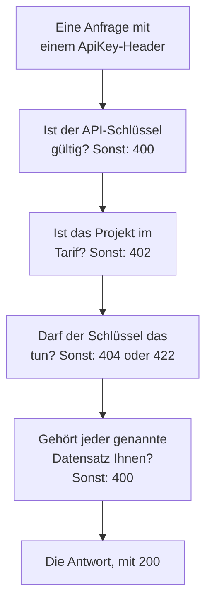

# OneUptime-API-Referenz

Alles, was Sie im OneUptime-Dashboard tun können, können Sie auch über seine REST API tun: wiederkehrende Arbeit automatisieren, OneUptime mit Ihren anderen Werkzeugen verbinden oder eigene Integrationen bauen. Diese Seite zeigt, wie Sie Ihre erste Anfrage stellen, und die Regeln, denen jede Anfrage folgt. Jeder Endpunkt und jedes Feld steht in der [vollständigen API-Referenz](/reference).

:::cards
- [Ihre erste Anfrage stellen](#ihre-erste-anfrage-stellen): Ein API-Schlüssel, ein Header und ein curl-Befehl.
- [Anfragen und Antworten](#anfragen-und-antworten): Die sechs Anfragen, die jede Ressource hat, und was jeder Statuscode bedeutet.
- [Tarife und die API](#tarife-und-die-api): Was ein Tarif verkauft und was darunter weiter funktioniert.
- [Datensätze benennen und schreiben](#datensätze-benennen-und-schreiben): IDs, Verweise, Schalter und die Felder, die OneUptime setzt.
- [Status und Episoden](#status-und-episoden): Der Status, in dem ein Datensatz beginnt und den er durchläuft.
- [Was eine Anfrage erreichen kann](#was-eine-anfrage-erreichen-kann): Lesen, Ändern und Löschen, ein Projekt nach dem anderen.
:::

## Wie eine Anfrage beantwortet wird

Die API ist nach REST aufgebaut: Standard-HTTP-Methoden und -Statuscodes, JSON hinein und JSON heraus. Jede Anfrage trägt einen API-Schlüssel und durchläuft einige Prüfungen. Die erste Prüfung, an der sie scheitert, antwortet mit einem Statuscode und `{ "message": "..." }`, die Meldung sagt also, was sie aufgehalten hat.



## Ihre erste Anfrage stellen

Alle API-Anfragen werden mit einem API-Schlüssel authentifiziert. Ein Schlüssel gehört zu einem Projekt und tut, was seine Berechtigungen erlauben.

:::steps
### Einen API-Schlüssel anlegen

Öffnen Sie **Projekteinstellungen → Erweitert → API-Schlüssel** und klicken Sie auf **API-Schlüssel erstellen**. Geben Sie ihm einen **Name** und wählen Sie unter **Zugriff**, was er tun darf: **Projektadministrator**, **Projektmitglied**, **Betrachter** oder **Berechtigungen später wählen**, um auf der Seite des Schlüssels einzelne Berechtigungen hinzuzufügen. Der Schlüssel läuft in einem Jahr ab, es sei denn, Sie wählen unter **Erweitert** ein anderes Datum.

### Den Schlüssel kopieren

Die Seite des Schlüssels öffnet sich. Kopieren Sie den **API-Schlüssel** aus der Karte **API-Schlüssel-Details** und halten Sie ihn aus Ihrem Code heraus:

```bash
export ONEUPTIME_API_KEY="your-api-key"
```

### Eine Anfrage senden

Listen Sie die ersten zehn Monitore auf. Der Schlüssel liest sein eigenes Projekt, daher nennt die Anfrage kein Projekt:

```bash
curl -X POST 'https://oneuptime.com/api/monitor/get-list?skip=0&limit=10' \
  -H "ApiKey: $ONEUPTIME_API_KEY" \
  -H 'Content-Type: application/json' \
  -d '{ "select": { "name": true } }'
```

Die Antwort ist `{ "data": [...], "count": ... }`: die Monitore und wie viele es insgesamt gibt. Verwenden Sie bei einer selbst gehosteten Installation Ihre eigene OneUptime-Adresse anstelle von `https://oneuptime.com`.
:::

### Beispiele für jede Ressource

Jede Ressource im OneUptime-Dashboard hat in ihrem Seitenmenü einen Abschnitt **Entwickler**, der eingeklappt ist, bis Sie ihn öffnen. Seine Seite **API** enthält sofort ausführbare `curl`-Befehle für diese Ressource, die auf Ihr OneUptime zeigen und mit Daten aus Ihrem eigenen Projekt gefüllt sind: Lesen, Ändern und Löschen auf der eigenen Seite der Ressource, oder Auflisten, Zählen und Anlegen auf einer Listenseite (zum Beispiel **Monitore**). Die Befehle lesen Ihren API-Schlüssel aus der Umgebungsvariable `ONEUPTIME_API_KEY`.

Die Beispiele sind für die Ressource geschrieben. In der Liste **Vorfälle** zum Beispiel zeigt die Listenanfrage ihre Antwort mit Ihrem ersten Vorfall, die Filter finden nicht gelöste Vorfälle, Vorfälle eines Schweregrads, zu einem Monitor oder aus den letzten sieben Tagen, mit Ihren eigenen Status, Schweregraden und Monitoren, und die Anlegeanfrage meldet einen Vorfall mit einem Ihrer Schweregrade, mit einer Zeile dazu, wofür jedes Feld da ist. Die eigene Seite eines Vorfalls liest ihn mit seiner echten Antwort, verschiebt ihn auf einen anderen Ihrer Schweregrade und hat seine häufigen Aufgaben: ihn bestätigen und lösen (mit den eigenen Status Ihres Projekts) und interne oder öffentliche Notizen hinzufügen. Jede API-Seite endet mit den Endpunkten der Ressource.

## Anfragen und Antworten

Jede Ressource hat dieselben Anfragen, unter `https://oneuptime.com/api` und dem Pfad der Ressource, etwa `/monitor` oder `/incident`:

| Anfrage | Methode und Pfad | Was der Body enthält |
| --- | --- | --- |
| Auflisten | `POST /api/<resource>/get-list` | `query`, `select` und `sort` |
| Zählen | `POST /api/<resource>/count` | `query` |
| Einen lesen | `POST /api/<resource>/<id>/get-item` | `select` |
| Anlegen | `POST /api/<resource>` | `{ "data": { ... } }` |
| Einen ändern | `PUT /api/<resource>/<id>` | `{ "data": { ... } }`, die zu ändernden Felder |
| Einen löschen | `DELETE /api/<resource>/<id>` | Nichts |

`POST /api/<resource>/<id>/update-item` und `POST /api/<resource>/<id>/delete-item` ändern und löschen ebenfalls einen Datensatz, für Clients, die nur `POST` senden.

### Filtern, sortieren und blättern

Eine Liste oder eine Zählung nimmt eine `query`. Ein Feld mit einem Wert passt auf diesen Wert; ein Objekt mit einem `_type` vergleicht:

| `_type` | Passt auf |
| --- | --- |
| `Search` | Text, der `value` enthält |
| `NotEqual` | Alles außer `value` |
| `GreaterThan`, `LessThan` | Spätere Daten oder größere Zahlen, bzw. frühere und kleinere |
| `InBetween` | Daten oder Zahlen zwischen `startValue` und `endValue` |
| `Includes` | Einen der Werte in `value` |
| `IsNull`, `NotNull` | Keinen Wert oder einen beliebigen Wert |

Ein Feld eines Datensatzes, den die Ressource nennt, wird unter seiner Beziehung gefiltert: `"user": { "name": { "_type": "Search", "value": "ada" } }` findet die Teammitglieder, deren Benutzer einen Namen hat, der „ada“ enthält. Nach einem Feld zu filtern erfordert die Berechtigung, es zu lesen, über eine Beziehung wie an der Ressource selbst: Ein Filter auf ein Feld, das Sie nicht lesen dürfen, wird mit einem `422` abgelehnt, der das Feld nennt.

Eine Ressource mit Eigentümern - ein Monitor, ein Vorfall, eine Bereitschaftsrichtlinie und jede andere mit Benutzer- und Team-Eigentümern - wird auch danach gefiltert, wem sie gehört, unter `owners`: `"owners": { "_type": "OwnedBy", "userIds": ["..."], "teamIds": ["..."] }` findet die Datensätze, die einer oder mehreren dieser Personen und Teams gehören. `match` ist `AnyOf`, solange Sie nichts anderes setzen: `NoneOf` findet die Datensätze, die keinem von ihnen gehören, Datensätze ohne Eigentümer eingeschlossen, und `AnyOwner` und `NoOwner` finden die Datensätze mit irgendeinem Eigentümer oder ohne einen und nennen niemanden. Die Mitglieder eines Teams sind keine Eigentümer dessen, was dem Team gehört. Ein Filter nennt höchstens 1.000 Personen und Teams zusammen, eine Ressource ohne Eigentümer lehnt ihn mit einem `400` ab, und nach Eigentümern zu filtern, ohne sie lesen zu dürfen, wird mit einem `422` abgelehnt.

`select` nennt die Felder, die zurückkommen sollen, und `_id` kommt immer zurück. `sort` ordnet sie, `ASC` oder `DESC`; ohne Sortierung kommen die neuesten zuerst. Eine Liste gibt 10 Datensätze zurück, solange Sie kein `limit` setzen, bis zu 10.000, und `skip` überspringt zuerst so viele: Erhöhen Sie `skip` immer weiter um `limit`, bis Sie `count` davon haben. Hängen Sie `?output-type=csv` an eine Listenanfrage an, um CSV statt JSON zu erhalten.

Zum Beispiel die Monitore, deren Name „checkout“ enthält und die seit Anfang 2026 angelegt wurden, die neuesten zuerst:

```bash
curl -X POST 'https://oneuptime.com/api/monitor/get-list' \
  -H "ApiKey: $ONEUPTIME_API_KEY" \
  -H 'Content-Type: application/json' \
  -d '{
    "query": {
      "name": { "_type": "Search", "value": "checkout" },
      "createdAt": { "_type": "GreaterThan", "value": "2026-01-01T00:00:00.000Z" }
    },
    "select": { "name": true, "createdAt": true },
    "sort": { "createdAt": "DESC" },
    "limit": 100
  }'
```

Datumswerte und IDs außer `_id` kommen verpackt zurück, als `{ "_type": "DateTime", "value": "..." }` und `{ "_type": "ObjectID", "value": "..." }`: Lesen Sie sie aus `value`.

Jede ID, nach der eine Anfrage filtert oder die sie schreibt - `_id`, ein Feld wie `monitorId` und jeder Datensatz, den eine Relation auflistet, etwa `"labels": [{ "_id": "..." }]` -, ist eine UUID, als Text gesendet oder so verpackt, wie sie zurückkommt. Alles andere, etwa Text, der keine UUID ist, oder ein Objekt anstelle einer ID, wird mit einem `400` abgelehnt, das das Feld nennt und sagt, ob es in `query` oder in `data` stand, und es wird nichts gelesen oder geschrieben:

```text
Invalid ID for "currentIncidentStateId" in the query: "resolved". An ID is a UUID, such as "550e8400-e29b-41d4-a716-446655440000".
```

### Statuscodes

| Code | Bedeutung | Mehr dazu |
| --- | --- | --- |
| `200` | Sie ist durchgegangen. Eine Liste oder eine Zählung antwortet mit den Datensätzen, die Sie lesen dürfen, ohne Datensätze, wenn es keine gibt. | [Einen Datensatz über seine ID lesen](#einen-datensatz-über-seine-id-lesen) |
| `400` | Die Anfrage ist falsch: Der API-Schlüssel ist ungültig, ein Wert ist nicht erlaubt, ein Feld kann nicht geschrieben werden, ein genannter Datensatz ist nicht Ihrer, oder sie ändert mehrere Projekte auf einmal. Die Meldung sagt, was falsch ist. | [Datensätze, die eine Anfrage nennt](#datensätze-die-eine-anfrage-nennt) |
| `402` | Der Tarif des Projekts enthält nicht, was die Anfrage nutzt. Die Meldung nennt den Tarif. | [Funktionen, die Ihr Tarif nicht enthält](#funktionen-die-ihr-tarif-nicht-enthält) |
| `404` | Der Datensatz existiert nicht, liegt in einem anderen Projekt oder ist einer, den Sie nicht lesen dürfen: dieselbe Antwort für jeden Fall. | [Einen Datensatz ändern oder löschen, den Sie nicht lesen dürfen](#einen-datensatz-ändern-oder-löschen-den-sie-nicht-lesen-dürfen) |
| `422` | Sie dürfen das nicht tun: Der API-Schlüssel hat keine Berechtigung für diese Art von Datensatz, Sie dürfen den Datensatz lesen, aber nicht ändern, oder die Labels einer Berechtigung schließen ihn aus. Die Meldung sagt, warum. | [Einen Datensatz ändern oder löschen, den Sie nicht lesen dürfen](#einen-datensatz-ändern-oder-löschen-den-sie-nicht-lesen-dürfen) |
| `500` | Auf dem Server ist etwas fehlgeschlagen. Wenn der Eigentümer eines neuen Datensatzes nicht geschrieben werden kann, wird der Datensatz wieder entfernt, sodass das Anlegen erneut versucht werden kann. | [Datensätze, die eine Anfrage nennt](#datensätze-die-eine-anfrage-nennt) |

## Tarife und die API

### Funktionen, die Ihr Tarif nicht enthält

In OneUptime Cloud werden manche Ressourcen in einem Tarif verkauft: Single-Sign-on-Anbieter und SCIM-Verbindungen in **Scale**; API-Schlüssel, Bereitschaftspläne sowie Benachrichtigungsregeln und Zusammenfassungen für Slack und Microsoft Teams in **Growth**, unter anderem. Eine davon anzulegen, zu ändern oder einzuschalten braucht diesen Tarif. Darunter wird die Anfrage mit `402 Payment Required` abgelehnt, und die Meldung nennt den Tarif.

Manche Einstellungen einer Ressource werden auf dieselbe Weise in einem Tarif verkauft. Zum Beispiel: eine Statusseite, die privat ist, die eine ihrer Listen ausblendet oder die eigenes HTML, CSS oder JavaScript hat, E-Mail-Berichte, SMS-, Slack-, Microsoft-Teams- oder Webhook-Abonnenten oder eine IP-Zulassungsliste; ein Dashboard, das öffentlich geteilt wird, oder seine IP-Zulassungsliste; die IP-Zulassungsliste eines Formulars; die Audit-Protokolle eines Projekts. Die Anleitung jeder dieser Einstellungen und das Dashboard neben der Einstellung nennen den Tarif, den sie braucht. Eine solche Einstellung braucht ihren Tarif, wann immer sie geschrieben wird - wenn die Ressource mit ihr angelegt wird wie wenn sie später geändert wird -, daher wird auch ein Anlegen, das eine davon unterhalb des Tarifs einschaltet, mit `402` abgelehnt. Eine Einstellung, die auf ihrem Standard bleibt oder auf ihn zurückgesetzt wird, funktioniert in jedem Tarif: Ein Anlegen, das diese Einstellungen unberührt lässt, geht durch, und ebenso eine Terraform-Konfiguration, die sie nicht setzt.

Was ein Projekt bereits hat, bleibt verwaltbar, egal in welchem Tarif, zum Beispiel nach dem Ende einer Testphase oder wenn der Tarif sinkt:

- Sie können diese Datensätze löschen;
- Sie können einen davon ausschalten, bei einer Ressource mit einem Feld `isEnabled`, indem Sie `"isEnabled": false` und sonst nichts senden;
- Sie können die auflisten und lesen, die ein Projekt finden muss, nachdem der Tarif gesunken ist - um sie auszuschalten oder um zu sehen, was angehalten wurde: Single-Sign-on-Anbieter, SCIM-Verbindungen, API-Schlüssel und ihre Berechtigungen, Bereitschaftspläne sowie Benachrichtigungsregeln und Zusammenfassungen für Slack und Microsoft Teams.

Die üblichen Berechtigungen entscheiden weiterhin, wer was tun darf, genau wie im Tarif. Das Lesen der anderen Ressourcen, die ein Tarif verkauft, etwa Vorlagen, benutzerdefinierte Felder, Monitorgruppen, Bereitschaftsprotokolle und Formulareinsendungen, braucht weiterhin den Tarif: Sie zu lesen heißt, die Funktion zu nutzen. Die Berechtigungen eines API-Schlüssels werden unterhalb von **Growth** nicht einzeln gelöscht, weil das Löschen einer Sperrberechtigung dem Schlüssel mehr Zugriff gäbe; löschen Sie stattdessen den Schlüssel.

### API-Schlüssel und SCIM unterhalb ihres Tarifs

In OneUptime Cloud funktionieren die API-Schlüssel eines Projekts nur, solange das Projekt in **Growth** oder höher ist, und seine SCIM-Verbindungen - die eigenen des Projekts und die seiner Statusseiten - funktionieren nur vollständig, solange es in **Scale** oder höher ist. Wenn das Projekt unter diesen Tarif fällt:

- Jede Anfrage, die mit einem der API-Schlüssel des Projekts gestellt wird, wird mit `402 Payment Required` abgelehnt, egal was sie verlangt: die REST API und alles, was sie mit einem API-Schlüssel aufruft - Terraform, die `oneuptime`-CLI, MCP-Clients, die mit einem API-Schlüssel verbunden sind, Workflows, die einen in einem Anfrage-Header senden, und Ihre eigenen Skripte. Die Meldung nennt den Tarif: `API keys need the Growth plan. This project's plan does not include them, so its API keys stopped working. The keys are kept: upgrade the project to Growth in Project Settings > Billing and Invoices > Billing and they work again.`
- Seine SCIM-Verbindungen entfernen nur noch Personen. Personen zu deaktivieren und zu löschen und sie aus Gruppen zu entfernen funktioniert weiterhin, sodass jeder, der geht, seinen Zugriff trotzdem verliert; jede SCIM-Anfrage, die Personen oder Gruppen hinzufügen oder ändern würde, wird mit `402` im SCIM-Fehlerformat abgelehnt, sodass Ihr Identitätsanbieter zeigt, warum ([SCIM unterhalb des Tarifs Scale](/docs/identity/scim#unterhalb-des-plans-scale)).

Nichts wird gelöscht oder ausgeschaltet. Die Schlüssel und Verbindungen bleiben erhalten, und sie funktionieren wieder vollständig, so wie sie sind, sobald das Projekt wieder im Tarif ist: keine neuen Schlüssel anzulegen, nichts im Identitätsanbieter neu einzurichten. Eine Tarifänderung wirkt innerhalb einer Minute.

Unterhalb von **Growth** listet **Projekteinstellungen** > **Erweitert** > **API-Schlüssel** die Schlüssel auf, die das Projekt noch hat, und sagt, dass sie angehalten wurden, sodass jeder von ihnen in jedem Tarif gelöscht (widerrufen) werden kann. Schlüssel anzulegen oder zu ändern braucht **Growth**. **Projekteinstellungen** > **Abrechnung und Rechnungen** > **Abrechnung** nennt, wie viele API-Schlüssel ein niedrigerer Tarif anhält und wie viele SCIM-Verbindungen er einschränkt, für jeden Tarif, den Sie wählen können, und was der Tarif des Projekts angehalten hat; die Eigentümer des Projekts erhalten eine E-Mail, wenn eine Tarifänderung sie anhält. Die Eigentümer von Projekten, die bereits unter diesen Tarifen lagen, als dies begann, erhalten eine einzige E-Mail, die sagt, was angehalten wurde und wie man es wieder einschaltet.

Betroffen sind nur die API-Schlüssel und SCIM-Verbindungen eines Projekts. Personen sind nicht betroffen: Die Anmeldung im Dashboard und MCP-Clients, die per Anmeldung verbunden sind, funktionieren wie zuvor. Telemetrie-Ingestion-Schlüssel, Probe-Schlüssel und Agent-Schlüssel sind keine API-Schlüssel und funktionieren weiter. Selbst gehostete Installationen haben keine Tarife, für sie ändert sich also nichts.

## Datensätze benennen und schreiben

### Die ID einer Ressource finden

Anfragen, die eine Ressource lesen, ändern oder löschen, nennen sie über ihre ID, eine UUID. Auf der eigenen Seite der Ressource endet ihre Detailkarte mit einer kleinen Zeile **ID**, die den Anfang der ID zeigt: Klicken Sie auf die ID oder die Kopierschaltfläche daneben, um die ganze ID zu kopieren. Listen, die es anbieten, haben **ID anzeigen** im Menü **⋯** einer Zeile, und die ID ist auch der letzte Teil der Adresse der Seite. Die ID Ihres Projekts ist das Erste auf der Karte **Projektdetails** unter **Projekteinstellungen → Projekt**.

### Datensätze, die eine Anfrage nennt

Viele Ressourcen nennen andere Datensätze: ein Monitor seine Labels und Probes, ein Abonnent einer Statusseite seine Statusseite, ein Netzwerkgerät seinen Standort, das Mitglied eines Vorfalls den Vorfall und die Rolle. Jede Regel unten gilt für die API, Terraform und Workflows gleichermaßen:

| Wenn eine Anfrage | muss sie | Sonst |
| --- | --- | --- |
| einen Datensatz über seine ID nennt | einen Datensatz Ihres Projekts nennen | `400` |
| einen Datensatz anlegt, der über einen anderen gelesen wird, etwa eine Notiz | ihn unter einem anlegen, den Sie lesen dürfen | `400`, oder `422` ohne Berechtigung, diese Art Datensatz zu lesen |
| einen Datensatz unter einen anderen verschiebt | ihn unter einen verschieben, den Sie lesen dürfen | `400` |
| Datensätze auflistet oder einen in einem eigenen Feld nennt | Datensätze nennen, die Ihre Leseberechtigung erreicht | `400` |
| eine Einstellung nennt, die Zugangsdaten enthält | von jemandem kommen, der diese Art Einstellung lesen darf | `400` |
| einen Datensatz unter einer auf Labels beschränkten Berechtigung anlegt oder umbeschriftet | dem Datensatz eines dieser Labels geben | `422` |
| einen Datensatz auf zwei Arten nennt | beide Male denselben Datensatz nennen | `400` |

#### Jede ID muss zu Ihrem Projekt gehören

Jede ID, die Sie für einen Datensatz senden, den eine Ressource nennt, muss ein Datensatz Ihres Projekts sein — die Auswahlfelder des Dashboards bieten nichts anderes an —, und Anfragen von Terraform und Workflows unterliegen demselben. Eine ID eines Datensatzes eines anderen Projekts und eine ID, die nicht existiert, werden gleich abgelehnt, mit einem `400`, das das Feld und die ID nennt:

```text
This network device references records that are not in this project: Network Site "…". Please pick values from this project and try again.
```

Personen werden über ihre Mitgliedschaft geprüft: Wer kein Mitglied des Projekts ist, wird auf dieselbe Weise abgelehnt. Eine globale Probe, die jedes Projekt nutzen kann, zählt als die Ihres Projekts. Eine Änderung an einer Ressource prüft nur die IDs, die die Änderung hinzufügt, sodass eine Ressource, die etwas nennt, das inzwischen verschwunden ist, weiterhin gespeichert werden kann.

#### Datensätze, die über einen anderen gelesen werden

Ein Datensatz, der über einen anderen gelesen wird - die Notizen und die Status-Zeitleiste eines Vorfalls oder einer Warnung, die Ankündigungen, Domains und Gruppen einer Statusseite -, muss ebenfalls einen nennen, den Sie lesen dürfen, nach der Regel, der ein Lesen von ihm folgt: Ein Vorfall außerhalb der Labels oder Eigentümer, die Ihre Berechtigung zum Lesen von Vorfällen erreicht, der ein Label trägt, das eine Sperre beim Lesen von Vorfällen wegnimmt, oder der als privat markiert ist, ohne dass Sie zu seinen Eigentümern gehören, direkt oder über ein Team (Projekteigentümer und -administratoren sehen jeden privaten Vorfall, jede private Warnung und Episode), wird mit demselben `400` abgelehnt, und nichts wird geschrieben. Jede Statusseite, die eine Ankündigung nennt, muss eine sein, die Sie lesen dürfen, und ein Schlüssel, dessen Berechtigung zum Lesen von Statusseiten nur einige von ihnen erreicht, muss mindestens eine nennen. Eine Berechtigung, einen solchen Datensatz anzulegen, braucht eine, den Datensatz zu lesen, unter dem er angelegt wird; ohne sie wird das Anlegen mit einem `422` abgelehnt, das die Berechtigungen nennt, die es zulassen würden:

```text
You do not have permissions to create Incident Internal Note. It is read through its Incident, and you need one of these permissions to read Incidents: …
```

Eine Änderung, die einen solchen Datensatz verschiebt, folgt derselben Regel: Jeder Datensatz, den sie als übergeordneten hinzufügt - eine andere Statusseite für eine Ankündigung, ein anderer Dienst für einen Datensatz, der über seinen Dienst gelesen wird -, muss einer sein, den Sie lesen dürfen, sonst wird die Änderung mit demselben `400` abgelehnt, und nichts wird geschrieben. Die übergeordneten Datensätze, die ein Datensatz bereits hat, werden nicht erneut geprüft, und eine Änderung, die ihn unter keinem lässt, braucht eine Berechtigung zum Lesen dieser Art Datensatz, die jeden von ihnen erreicht, wie ein Anlegen, das keinen nennt.

#### Eigentümer

Die Eigentümer einer Ressource - die Benutzer- und Team-Eigentümer-Datensätze eines Monitors, einer Bereitschaftsrichtlinie, eines Dashboards und jeder anderen Ressource mit Eigentümern - werden auf dieselbe Weise über die Ressource gelesen, der sie gehören: Sie aufzulisten, zu lesen, hinzuzufügen und zu entfernen braucht eine Berechtigung, diese Ressource zu lesen, unter ihren Labels und Eigentümern, und ein Eigentümer-Datensatz einer Ressource, die Sie nicht lesen dürfen, wird beantwortet, als gäbe es ihn nicht. Auch das Hinzufügen und Entfernen hält sich an den Geltungsbereich der Berechtigung, die es erlaubt: Eine mit Geltungsbereich `Owned` erreicht nur die Eigentümer von Ressourcen, die Ihnen oder einem Ihrer Teams gehören, und das Hinzufügen eines Eigentümers zu jeder anderen Ressource wird mit einem `422` abgelehnt, der das sagt.

#### Datensätze, die ein Schreibzugriff auflistet oder nennt

Die Datensätze, die ein Anlegen oder eine Änderung auflistet - die Monitore und Bereitschaftsrichtlinien eines Vorfalls, die Dienste einer Warnung, die Statusseiten eines geplanten Wartungsereignisses, die Runbooks einer Regel -, halten sich an Ihre Berechtigung, diese Art Datensatz zu lesen, wenn Sie eine haben, und in jedem Fall an eine Sperre mit Labels beim Lesen: Einer außerhalb davon wird mit demselben `400` abgelehnt. Eine Änderung prüft nur die Datensätze, die sie einer Liste hinzufügt, sodass die bleiben, die die Liste bereits enthält.

Der eine Datensatz, den ein Anlegen oder eine Änderung in einem eigenen Feld nennt - der Monitor einer Warnung, der Monitor, den eine Statusseiten-Ressource zeigt, der Dienst eines Kostenbudgets, der Vorfall, mit dem ein Runbook-Lauf verknüpft ist -, folgt derselben Regel, unter jedem seiner beiden Namen: Einer außerhalb Ihrer Berechtigung, diese Art Datensatz zu lesen, oder einer mit einem Label, das eine Sperre beim Lesen wegnimmt, wird mit demselben `400` abgelehnt. Eine Änderung prüft ihn nur, wenn sie einen anderen Datensatz nennt als den, den das Feld bereits enthält. Die globalen Probes und KI-Agenten von OneUptime, die jedes Projekt nutzen kann, bleiben für jedes Projekt offen. Die Datensätze, die eine Vorlage für Sie ausfüllt, werden auf dieselbe Weise geprüft, sobald sie ausgefüllt sind, bevor irgendetwas gespeichert wird: Die Monitore, Statusseiten und Bereitschaftsrichtlinien, die eine Vorfallvorlage einem aus ihr gemeldeten Vorfall hinzufügt, müssen solche sein, die Sie lesen dürfen, als hätten Sie sie ausgewählt.

#### Einstellungen, die Zugangsdaten enthalten

Eine Einstellung, die Zugangsdaten enthält - ein SMTP-Server, ein Anruf- und SMS-Anbieter, SNMP-Zugangsdaten, eine Videoanruf-Verbindung, ein API-Schlüssel, ein externer MCP-Server -, wird nur von jemandem genannt, der diese Art Einstellung lesen darf: `smtpConfig` und `callSmsConfig` einer Statusseite, `projectCallSMSConfig` einer Richtlinie für eingehende Anrufe, `snmpCredentialProfile` eines Netzwerkgeräts oder Standorts, die Videoanruf-Verbindung `videoCallConnection` eines Vorfalls oder einer Warnung, `apiKey` einer API-Schlüssel-Berechtigung und `externalMcpServers` einer KI-Regel. Eine davon ohne Berechtigung zu nennen, diese Art Einstellung zu lesen - oder mit einer, die eine Sperre ohne Labels wegnimmt -, wird mit demselben `400` abgelehnt, unter jedem ihrer beiden Namen; eine Änderung, die die Einstellung behält, die ein Datensatz bereits nennt, wird dazu nicht befragt. Die Nummernsuche und die Liste eigener Nummern einer Richtlinie für eingehende Anrufe verlangen dasselbe Lesen der Anruf-/SMS-Konfiguration, die sie nennen.

#### Labels und Eigentümer beim Anlegen

Eine auf Labels beschränkte Berechtigung zum Anlegen legt nur Datensätze an, die eines ihrer Labels tragen - bei einem Datensatz ohne eigene Labels Datensätze unter einem, der eines trägt -, es sei denn, eine andere Berechtigung zum Anlegen dieser Art Datensatz erreicht das ganze Projekt, und eine Sperre mit Labels bei einer Berechtigung zum Anlegen lehnt einen Datensatz ab, der eines ihrer Labels trägt. Ein Anlegen außerhalb davon wird mit einem `422` abgelehnt, das die Labels nennt:

```text
Your access lets you create Status Pages only with one of these labels: Production. Add one of them and try again.
```

Eine Berechtigung zum Anlegen mit dem Geltungsbereich **Owned** legt einen Monitor, eine Statusseite oder einen anderen Datensatz mit eigenen Eigentümern nur für eine Person an, die zu einem seiner Eigentümer wird, und eine Notiz oder einen anderen Datensatz, der seine Eigentümer von dem Datensatz übernimmt, zu dem er gehört, nur unter einem, der Ihnen oder einem Ihrer Teams gehört.

Der Ersteller wird direkt nach dem Speichern des Datensatzes zum Eigentümer gemacht, bevor irgendetwas anderes mit ihm geschieht. Wenn die Eigentümerzeile nicht geschrieben werden kann, wird der Datensatz wieder entfernt und das Anlegen mit einem `500` abgelehnt, sodass kein Datensatz zurückbleibt, den sein Ersteller nicht erreichen könnte.

#### Eine Änderung der Labels

Eine Änderung der Labels, die ein Datensatz trägt - seiner eigenen Labels oder, bei einem Datensatz ohne eigene Labels, der Datensätze, die er nennt -, hält sich auf dieselbe Weise an Ihre Berechtigung, diese Art Datensatz zu ändern: Mit einer auf Labels beschränkten behält der Datensatz mindestens eines davon, es sei denn, eine andere Berechtigung zum Ändern erreicht das ganze Projekt, und eine Sperre mit Labels bei einer Berechtigung zum Ändern lehnt es ab, ihm eines ihrer Labels zu geben. Eine solche Änderung wird mit einem `422` abgelehnt, das die Labels nennt:

```text
Your access lets you change Monitors only with one of these labels: Production. Keep one of them and try again.
```

#### Einen Datensatz auf zwei Arten nennen

Ein Datensatz kann auf zwei Arten genannt werden: über sein ID-Feld (`monitorId`) oder über die Beziehung (`"monitor": { "_id": "…" }`), die die Formulare des Dashboards senden. Senden Sie eines davon. Wenn eine Anfrage beides sendet, müssen beide denselben Datensatz nennen: Eine Anfrage, bei der die beiden nicht übereinstimmen — zwei verschiedene IDs oder eine ID und ein leerer Wert —, wird mit einem `400` abgelehnt, das beide Felder nennt:

```text
Conflicting Monitor references were provided. monitorId and monitor are names for the same field and must hold the same value: send only one of them, or the same id in each.
```

Beide Namen werden auf dieselbe Weise geprüft. Die Regeln für den Datensatz, den Sie nennen, gelten, unter welchem Namen Sie ihn auch senden: Die übergeordnete Gruppe einer Statusseitengruppe muss auf derselben Statusseite liegen, eine Statusseite nimmt höchstens drei Kopfzeilen-Links, und der Name einer Gruppe muss auf ihrer Statusseite eindeutig sein.

### Schalter

Ein Feld, das an oder aus ist - `isEnabled`, `isVisibleOnStatusPage`, `isArchived` und jedes andere `true`- oder `false`-Feld -, nimmt `true` oder `false`. Text und Zahlen, die die Datenbank als einen dieser Werte liest, werden als dieser Wert übernommen, auf dieselbe Weise für die API, Terraform und Workflows: `"true"`, `"yes"`, `"on"`, `"1"` und `1` sind `true`, und `"false"`, `"no"`, `"off"`, `"0"` und `0` sind `false`, in jeder Schreibweise. Alles, was OneUptime mit dem Datensatz tut, behandelt ihn ebenfalls als diesen Wert: Ein geplantes Wartungsereignis, das mit `"isVisibleOnStatusPage": "true"` gesendet wird, zeigt seine Bilder auf der Statusseite, und `"isEnabled": "false"` schaltet eine Ressource unterhalb ihres Tarifs aus wie `false`. Jeder andere Wert, etwa `"maybe"`, `""` oder `2`, wird mit einem `400` abgelehnt, das das Feld nennt:

```text
isVisibleOnStatusPage must be true or false.
```

Ein Update, das die Werte eines Datensatzes so schreibt, wie sie bereits sind, ändert nichts: Es startet die Workflows **On Update** des Datensatzes nicht, sendet keine Live-Aktualisierungen und fügt keinen Audit-Protokolleintrag hinzu. `false` über `false` geschrieben zählt als derselbe Wert, ebenso `"false"` über `false` geschrieben, eine als Text geschriebene Zahl, eine Zeit, die als derselbe Zeitpunkt in einem anderen Format geschrieben wird, und Labels, die als dieselben Labels in beliebiger Reihenfolge geschrieben werden. Wenn ein Update einige Werte ändert und andere so zurückschreibt, wie sie sind, listet sein Audit-Protokolleintrag nur die geänderten Werte auf, und **Fields to watch** eines Workflows hört nur diese.

### Wo ein Projekt gekauft wurde

Der Reseller, der Reseller-Tarif und die Reseller-Lizenz eines Projekts (`resellerId`, `resellerPlanId`, `resellerLicenseId` und die Beziehungen `reseller` und `resellerPlan`) werden allein von OneUptime gesetzt: wenn ein Projekt mit dem Promo-Code eines Resellers angelegt wird und wenn der Reseller den Tarif ändert. Ein Anlegen oder eine Änderung eines Projekts, das einen davon sendet, wird mit einem `400` abgelehnt, das das Feld nennt, egal wer es sendet:

```text
User is not allowed to create on resellerId column of Project. No permission allows it: the column is set by the server, not by a request.
```

### Wer einen Datensatz angelegt hat

OneUptime erfasst, wer einen Datensatz angelegt hat — und wer ihn archiviert, gelöst, bestätigt oder ausgelöst hat —, aus der Anfrage selbst: die angemeldete Person, oder niemand, wenn die Anfrage mit einem API-Schlüssel oder aus einem Workflow kommt. Diese Felder (`createdByUserId` und die anderen Felder, die auf `ByUserId` enden, mit ihren Beziehungen wie `createdByUser`) sind schreibgeschützt, ebenso der Zeitpunkt, zu dem ein Datensatz archiviert oder gelöst wurde (`archivedAt`, `markedAsResolvedAt`, `markedAsArchivedAt`): `isArchived` oder `isResolved` einzuschalten erfasst, wer es getan hat und wann, und es auszuschalten löscht beides. Einen Schalter so zu senden, wie er bereits steht, behält, wer ihn umgelegt hat und wann.

Die API-Referenz kennzeichnet diese Felder als schreibgeschützt. Ein Wert, den eine Anfrage neben anderen Änderungen für eines davon sendet, wird ignoriert, sodass der Rest der Änderung durchgeht; ein Update, das sonst nichts sendet, wird mit einer Meldung abgelehnt, die die Felder nennt. Datensätze, die OneUptime selbst im Namen von jemandem anlegt — eine aus Slack oder Microsoft Teams gepostete Notiz, ein durch eine Einladung entstandenes Konto —, nennen diese Person.

## Status und Episoden

### Der Status, in dem ein neuer Datensatz beginnt

Ein Vorfall, eine Warnung, eine Vorfall-Episode und eine Warnungs-Episode können in jedem Status Ihres Projekts angelegt werden, wie es das Feld **Anfangsstatus** ihrer Anlegeformulare tut: Senden Sie `currentIncidentStateId` (Vorfälle und Vorfall-Episoden) oder `currentAlertStateId` (Warnungen und Warnungs-Episoden) oder die Beziehung. Der Datensatz beginnt in diesem Status, und seine Status-Zeitleiste beginnt damit. Lassen Sie es weg, beginnt er im Anlegestatus Ihres Projekts, dem mit der Markierung `isCreatedState` — oder, bei einem Vorfall, der aus einer Vorlage mit Anfangsstatus gemeldet wird, im Status der Vorlage. Ein Status eines anderen Projekts wird wie jeder andere Datensatz abgelehnt. `current_incident_state_id` und `current_alert_state_id` in Terraform funktionieren genauso. Ein Datensatz, der in Ihrem Bestätigt-Status oder danach angelegt wird, alarmiert niemanden, und einer, der gelöst angelegt wird, wird außerdem nicht gruppiert, nicht automatisch behoben und nicht von der KI untersucht und bekommt keinen Slack- oder Microsoft-Teams-Kanal — siehe [Bereits bestätigt oder gelöst gemeldet](/docs/incidents/declaring-incidents#bereits-bestätigt-oder-behoben-gemeldet).

### Den Status eines Datensatzes ändern

Der Status eines Datensatzes ändert sich durch eine Zeile seiner Status-Zeitleiste - `POST /api/incident-state-timeline`, `/api/alert-state-timeline`, `/api/incident-episode-state-timeline`, `/api/alert-episode-state-timeline` oder `/api/scheduled-maintenance-state-timeline` - oder durch ein Update, das seinen aktuellen Status schreibt (`currentIncidentStateId`, `currentAlertStateId`, `currentScheduledMaintenanceStateId` oder die Beziehung), was dieselbe Zeile erfasst. So oder so gilt für den Wechsel eine Regel, für eine Episode wie für einen Vorfall, eine Warnung oder ein geplantes Wartungsereignis: Ein Status, der in der Reihenfolge Ihres Projekts vor dem aktuellen des Datensatzes liegt, wird abgelehnt, bevor irgendetwas gespeichert wird, ebenso der Status, in dem er sich bereits befindet:

```text
Episode cannot transition to Acknowledged state from Resolved state because Acknowledged is before Resolved in the order of incident states.
```

Ein versehentlich gesetzter Status wird korrigiert, indem Sie seine Zeile aus der Status-Zeitleiste des Datensatzes löschen. Siehe [Die Reihenfolge ist eine echte Einschränkung](/docs/incidents/states-and-severities#die-reihenfolge-ist-eine-echte-einschränkung-keine-anzeigevorliebe).

### Die Episode, in der ein Vorfall oder eine Warnung ist

`incidentEpisodeId` eines Vorfalls und `alertEpisodeId` einer Warnung — und ihre Beziehungen `incidentEpisode` und `alertEpisode` — nennen die letzte Episode, der der Datensatz hinzugefügt wurde und deren Mitglied er noch ist, oder nichts. Sie sind schreibgeschützt: OneUptime setzt sie aus den Mitgliedern der Episode. Um einen Vorfall in eine Episode aufzunehmen, legen Sie ein Incident Episode Member an (`POST /api/incident-episode-member` mit `incidentEpisodeId` und `incidentId`); um ihn herauszunehmen, löschen Sie dieses Mitglied, und der Vorfall nennt dann die letzte Episode, in der er noch ist, oder keine. Warnungen funktionieren genauso über Alert Episode Members (`/api/alert-episode-member`, mit `alertEpisodeId` und `alertId`). Gruppierungsregeln fügen Vorfälle und Warnungen auf dieselbe Weise zu Episoden hinzu. Ein Anlegen oder Update eines Vorfalls oder einer Warnung, das seine Episode sendet, wird abgelehnt, egal wer es sendet — die API, Terraform, die MCP-Tools oder ein Workflow. In Terraform lassen sich `incident_episode_id` und `alert_episode_id` lesen, aber nicht setzen; die Ressourcen `oneuptime_incident_episode_member` und `oneuptime_alert_episode_member` verwalten die Mitgliedschaft.

## Was eine Anfrage erreichen kann

### Einen Datensatz ändern oder löschen, den Sie nicht lesen dürfen

Eine Änderung oder ein Löschen erreicht nur die Datensätze, die der API-Schlüssel - oder die angemeldete Person - lesen darf. Ein Datensatz außerhalb seiner Labels oder Eigentümer, hinter einer Sperre beim Lesen oder über einen anderen Datensatz gelesen, den er nicht lesen darf (die Notiz eines Vorfalls, die Ankündigung einer Statusseite), kann auch nicht geändert oder gelöscht werden. Eine Berechtigung, eine Art Datensatz zu ändern oder zu löschen, wirkt zusammen mit der Berechtigung, ihn zu lesen, und eine, die Notizen eines Vorfalls zu ändern, mit einer, Vorfälle zu lesen.

Eine Anfrage, die einen Datensatz über seine ID ändert oder löscht - `PUT /api/<resource>/<id>` oder `POST /api/<resource>/<id>/update-item`, `DELETE /api/<resource>/<id>` oder `POST /api/<resource>/<id>/delete-item` - und nichts erreicht, antwortet:

- `404`, wenn der Datensatz nicht existiert, in einem anderen Projekt liegt oder einer ist, den Sie nicht lesen dürfen - dieselbe Antwort für jeden Fall:

```text
Incident not found.
```

- `422`, wenn Sie den Datensatz lesen, aber nicht ändern oder löschen dürfen, mit dem Grund:

```text
You do not have permission to update this incident.
```

Ein Löschen, das nichts erreichte, antwortete früher mit `200`. Updates und Löschvorgänge per Abfrage, etwa die Update- und Löschschritte eines Workflows, antworten damit, wie viele Datensätze sie geändert haben, `0`, wenn sie keinen erreicht haben. Terraform liest ein `404` bei `terraform destroy` als eine Ressource, die bereits weg ist.

Telemetrie folgt derselben Regel. Ein Löschen von Logs, Traces, Metriken, Ausnahmen, Profilen oder Sitzungsaufzeichnungen erreicht die Zeilen der Ressourcen - Dienste, Hosts, Cluster und dergleichen -, deren Telemetrie Sie sowohl lesen als auch löschen dürfen, und erfolgt in einem Projekt nach dem anderen: Eine Anfrage über alle Ihre Projekte hinweg wird abgelehnt. Ein Löschen einer Zeile über ihre ID, das nichts erreicht, antwortet wie oben mit `404` oder `422`.

### Änderungen erfolgen in einem Projekt nach dem anderen

Ein Update oder ein Löschen der Datensätze eines Projekts erfolgt in dem Projekt, das die Anfrage nennt: dem Header `tenantid` oder, bei einem API-Schlüssel, dem eigenen Projekt des Schlüssels. Ein Update oder Löschen eines angemeldeten Benutzers, das kein Projekt nennt oder mit dem Header `is-multi-tenant-query` über alle seine Projekte hinweg fragt, wird mit `400` abgelehnt:

```text
Changes to incidents are made in one project at a time. Please pass the project ID in the 'tenantid' header.
```

Eine solche Anfrage schlug früher mit `500` fehl. Lesevorgänge dürfen weiterhin über alle Ihre Projekte hinweg fragen.

### Einen Datensatz über seine ID lesen

Ein Lesen eines Datensatzes über seine ID - `POST /api/<resource>/<id>/get-item` - antwortet mit `404`, wenn der Datensatz nicht existiert, in einem anderen Projekt liegt oder einer ist, den Sie nicht lesen dürfen, dieselbe Antwort für jeden Fall:

```text
Incident not found.
```

Früher antwortete es mit `200` und einem leeren Body. Eine Liste (`get-list`) und eine Zählung antworten weiterhin mit `200` und den Datensätzen, die Sie lesen dürfen, ohne Datensätze, wenn es keine gibt. Der Terraform-Provider liest ein `404` beim Aktualisieren als eine Ressource, die weg ist, und entfernt sie aus dem State, sodass der nächste Plan sie wieder anlegt: Geben Sie dem API-Schlüssel, den er verwendet, die Berechtigungen und die Labels, um jede Ressource zu lesen, die er verwaltet. Die MCP-Tools beantworten ein `404` mit einem Fehler, der auf das passende Listen-Tool verweist, und die CLI endet mit dem Code `3`.

## Die vollständige Endpunkt-Referenz

Jede Ressource, jeder Endpunkt und jedes Feld steht in der [OneUptime-API-Referenz](/reference). Sie ist in mehreren Sprachen verfügbar: Ihre Sprache wird aus Ihrem Browser übernommen, und Sie können sie jederzeit mit der Auswahl oben auf der Seite wechseln.

## Fehlerbehebung

:::details Jede Anfrage antwortet mit 400 Invalid API Key
Der Header `ApiKey` ist leer, ist kein Schlüssel oder nennt einen Schlüssel, der abgelaufen ist oder zurückgesetzt wurde. Kopieren Sie den Schlüssel erneut von seiner Seite unter **Projekteinstellungen → Erweitert → API-Schlüssel**, wo auch sein Datum unter **Läuft ab** steht.
:::

:::details Jede Anfrage antwortet mit 402 Payment Required
In OneUptime Cloud funktionieren API-Schlüssel nur, solange das Projekt im Tarif **Growth** oder höher ist. Die Schlüssel bleiben erhalten und funktionieren wieder so, wie sie sind, sobald das Projekt wieder im Tarif ist: siehe [API-Schlüssel und SCIM unterhalb ihres Tarifs](#api-schlüssel-und-scim-unterhalb-ihres-tarifs).
:::

:::details Jede Anfrage antwortet mit 422 You do not have permissions
Der API-Schlüssel hat keine Berechtigung für diese Art von Datensatz. Ein mit **Berechtigungen später wählen** angelegter Schlüssel kann nichts, bis er eine bekommt: Öffnen Sie ihn unter **Projekteinstellungen → Erweitert → API-Schlüssel** und klicken Sie dann auf **Rolle hinzufügen** oder **Berechtigung hinzufügen**. Die Meldung nennt die Berechtigungen, mit denen die Anfrage durchkäme.
:::

:::details Ein Datensatz, den ich im Dashboard sehe, antwortet mit 404
Der API-Schlüssel liest nur, was seine Berechtigungen und deren Labels erreichen, und ein Schlüssel kann weniger erreichen als Ihr eigenes Konto. Geben Sie dem Schlüssel eine Berechtigung, die den Datensatz erreicht: siehe [Einen Datensatz über seine ID lesen](#einen-datensatz-über-seine-id-lesen).
:::

:::details Ein Update antwortet mit 400 Invalid request body
Ein Update sendet die zu ändernden Felder innerhalb von `data`, als `{ "data": { "name": "New name" } }`. Ein Body ohne dieses wird abgelehnt, statt mit `200` zu antworten und nichts zu ändern:

```text
Invalid request body. The update payload should be an object of the form { "data": { ...fields to update... } }.
```
:::

:::details Ein Schreibzugriff antwortet mit 400 und nennt ein Feld und eine ID
Die ID nennt einen Datensatz eines anderen Projekts, einen, der nicht existiert, oder einen, den Ihre Berechtigungen nicht erreichen. Siehe [Datensätze, die eine Anfrage nennt](#datensätze-die-eine-anfrage-nennt).
:::

## Nächste Schritte

:::cards
- [Benutzer, Teams & Berechtigungen](/docs/permissions/index): Was die Berechtigungen und Labels eines API-Schlüssels erreichen.
- [Terraform-Provider](/docs/terraform/index): OneUptime-Ressourcen als Code verwalten, über dieselbe API.
- [OneUptime-CLI](/docs/cli/index): Die API aus Ihrem Terminal und Ihren Skripten aufrufen.
- [MCP-Server](/docs/ai/mcp-server): KI-Assistenten mit Ihrem Projekt arbeiten lassen.
:::
