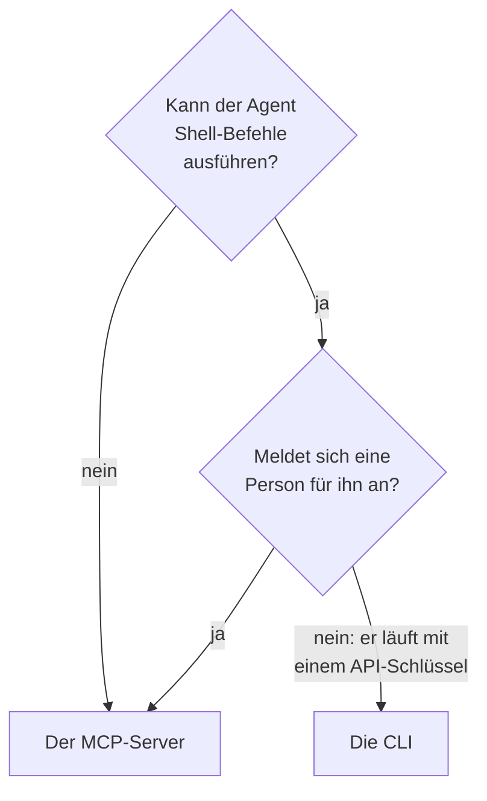

# CLI für KI-Agenten

Ein KI-Agent, der Shell-Befehle ausführen kann, etwa ein Coding-Agent in Ihrem Editor oder ein Job in Ihrer Pipeline, kann über die CLI statt über den [MCP-Server](/docs/ai/mcp-server) mit OneUptime arbeiten. Diese Seite sagt, wann was passt und wie ein Agent die CLI installiert, sich zurechtfindet und ihre Antworten liest.

:::cards
- [Die CLI oder der MCP-Server](#die-cli-oder-der-mcp-server): Was ein Agent verwenden sollte.
- [Für einen Agenten einrichten](#für-einen-agenten-einrichten): Installieren Sie sie und geben Sie ihr einen Schlüssel in der Umgebung.
- [Wie ein Agent sich zurechtfindet](#wie-ein-agent-sich-zurechtfindet): Die Ressourcen, ihre Felder und die Hilfe.
- [Die Antworten lesen](#die-antworten-lesen): JSON von jedem Befehl, Fehler eingeschlossen.
:::

## Die CLI oder der MCP-Server

Beide erreichen die OneUptime-API und tun, was ihre Zugangsdaten erlauben. Sie unterscheiden sich darin, was der Agent braucht, um sie zu erreichen:



| | Die CLI | Der MCP-Server |
| --- | --- | --- |
| Der Agent braucht | Eine Shell und Node.js 22 oder neuer | Einen MCP-Client, etwa Claude oder Cursor |
| Er meldet sich an mit | Einem API-Schlüssel des Projekts, in `ONEUPTIME_API_KEY` | Ihrem OneUptime-Konto oder einem API-Schlüssel |
| Er erreicht | Jede Ressource der API, 450 und mehr | Die Datensätze und die Telemetrie, für die er Werkzeuge hat, und Werkzeuge für die Reaktion auf Vorfälle |
| Er eignet sich für | Skripte, die der Agent für Menschen zum Behalten schreibt, Prüfungen in einer Pipeline und Arbeit mit vielen Datensätzen | Ein Gespräch: einen Vorfall untersuchen, einen Monitor einrichten |

Verwenden Sie die CLI, wenn der Agent ohnehin Befehle ausführt, wie ein Coding-Agent, oder wenn das, was er baut, ohne ihn weiterlaufen soll: ein Skript in einem Repository, ein Schritt einer Pipeline. Verwenden Sie den MCP-Server, wenn eine Person in einem Chat-Client mit dem Agenten spricht, sodass der Agent mit ihren Berechtigungen arbeitet und der Client vor einer Änderung nachfragt.

## Für einen Agenten einrichten

Jede OneUptime-Instanz stellt das Installationsskript der CLI für ihr eigenes Release bereit: Die Befehle unten laden es von `https://oneuptime.com`, ersetzen Sie die Adresse bei einer selbst gehosteten OneUptime-Instanz also durch Ihre URL. Das Skript wird zuerst als `install.sh` gespeichert, sodass Sie es lesen können, bevor Sie es ausführen:

```bash
curl -fsSL https://oneuptime.com/install/cli -o install.sh
ONEUPTIME_URL=https://oneuptime.com bash install.sh
```

Geben Sie dem Agenten einen API-Schlüssel des Projekts mit nur dem Zugriff, den seine Arbeit braucht, in der Umgebung statt auf der Befehlszeile, und lassen Sie ihn den Schlüssel zuerst prüfen:

```bash
export ONEUPTIME_API_KEY="your-api-key"
export ONEUPTIME_URL=https://oneuptime.com
oneuptime whoami --check -o json
```

Legen Sie den Schlüssel unter **Projekteinstellungen → Erweitert → API-Schlüssel** an: siehe [Einen API-Schlüssel erstellen](/docs/api-reference/api-reference#einen-api-schlüssel-erstellen). Ein Schlüssel, der nur lesen darf, lässt den Agenten nachsehen und sonst nichts.

## Wie ein Agent sich zurechtfindet

Die CLI sagt, was sie kann, ohne API-Schlüssel und ohne Anfrage:

| Befehl | Was er antwortet |
| --- | --- |
| `oneuptime resources -o json` | Jede Ressource: ihr Befehl, ihre Namen, ihr API-Pfad, ihre Operationen und ihre Aktionen |
| `oneuptime incident fields -o json` | Die Felder einer Ressource: wozu jedes dient, sein Typ, ob ein Erstellen es braucht, und sein Flag |
| `oneuptime incident create --help` | Die Argumente und Flags eines Befehls |

Ein Feld, das eine ID enthält, sagt, aus welcher Ressource die ID kommt, sodass der Agent diese Ressource zuerst auflistet: `incidentSeverityId` nimmt eine ID aus `oneuptime incident-severity list`. Ein Feld, das eine Person nennt, nimmt auch ihre E-Mail-Adresse, etwa mit `--user-email`.

## Die Antworten lesen

Lassen Sie den Agenten `-o json` oder `--json` an jeden Befehl anhängen. Jeder Befehl antwortet dann mit JSON, auch die, deren Antwort ein Satz ist, und ein Fehler ist ein einzelnes JSON-Objekt in der Standardfehlerausgabe:

```bash
oneuptime incident acknowledge 6f1c2a40-3b1e-4c55-9a0b-3e2f8d7c1a11 -o json
```

```json
{
  "_id": "6f1c2a40-3b1e-4c55-9a0b-3e2f8d7c1a11",
  "action": "acknowledge",
  "changed": true,
  "state": {
    "_id": "0b7d5e2c-8f4a-4d1b-9c3e-5a6f7b8c9d0e",
    "name": "Acknowledged"
  }
}
```

Der Exit-Code sagt, was passiert ist: `0`, wenn es geklappt hat, `1`, wenn es fehlgeschlagen ist, `2`, wenn der API-Schlüssel fehlt oder abgelehnt wird, und `3`, wenn der Datensatz nicht da ist. Das JSON eines Fehlers hat denselben Code in `exitCode` und in `hint`, was als Nächstes zu tun ist. Siehe [Ausgabeformate](/docs/cli/output-formats#json) und [Exit-Codes](/docs/cli/scripting#exit-codes).

## Nächste Schritte

:::cards
- [Ressourcenoperationen](/docs/cli/resource-operations): Jede Operation, mit ihren Flags und Filtern.
- [Befehlsreferenz](/docs/cli/command-reference): Jeder Befehl, jede Option und jeder Standardwert.
- [MCP-Server](/docs/ai/mcp-server): Verbinden Sie stattdessen einen Chat-Client mit OneUptime.
:::
