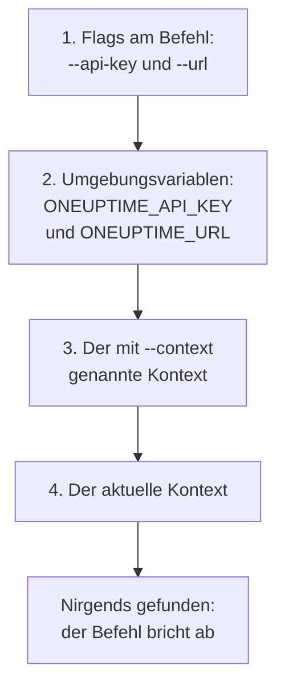

# Authentifizierung

Jede Anfrage, die die CLI sendet, trägt einen API-Schlüssel Ihres Projekts. Speichern Sie Schlüssel einmal mit `oneuptime login`, einen Kontext für jede Umgebung, oder geben Sie sie einem Befehl in Flags oder Umgebungsvariablen mit, wie es Skripte tun. Diese Seite zeigt jeden Weg und welchen ein Befehl nimmt, wenn es mehrere gibt.

:::cards
- [Anmelden](#anmelden): Einen API-Schlüssel und die Adresse Ihrer OneUptime-Instanz speichern.
- [Kontexte](#kontexte): Eine gespeicherte Anmeldung für jedes Projekt oder jede Umgebung, und der Wechsel zwischen ihnen.
- [Welche Anmeldedaten ein Befehl verwendet](#welche-anmeldedaten-ein-befehl-verwendet): Zuerst Flags, dann Umgebungsvariablen, dann Kontexte.
- [Fehlerbehebung](#fehlerbehebung): Keine Anmeldedaten gefunden, ungültige Schlüssel und Ablehnungen.
:::

## Bevor Sie beginnen

Sie brauchen einen API-Schlüssel Ihres Projekts. Legen Sie einen unter **Projekteinstellungen → Erweitert → API-Schlüssel** mit **API-Schlüssel erstellen** an und geben Sie ihm den Zugriff, den Ihre Befehle brauchen: siehe [Einen API-Schlüssel anlegen](/docs/api-reference/api-reference#einen-api-schlüssel-anlegen). Ein Schlüssel tut, was seine Berechtigungen erlauben: Ein Schlüssel, der Datensätze nur lesen darf, kann sie auflisten und lesen, aber nicht ändern.

In OneUptime Cloud funktionieren API-Schlüssel nur, solange das Projekt im Tarif **Growth** oder höher ist. Darunter antwortet jeder Befehl mit `API error (402)` und einer Meldung, die den Tarif nennt, bis das Projekt hochgestuft wird; dann funktioniert derselbe Schlüssel wieder. Siehe [API-Schlüssel und SCIM unterhalb ihres Tarifs](/docs/api-reference/api-reference#api-schlüssel-und-scim-unterhalb-ihres-tarifs).

## Anmelden

`oneuptime login` speichert einen API-Schlüssel und die Adresse Ihrer OneUptime-Instanz als Kontext und macht ihn zum aktuellen Kontext:

```bash
oneuptime login <api-key> <instance-url> [--context-name <name>]
```

| Argument oder Option | Was es ist |
| --- | --- |
| `<api-key>` | Ein API-Schlüssel Ihres Projekts |
| `<instance-url>` | Die Adresse Ihrer OneUptime-Instanz: `https://oneuptime.com` oder die Ihres eigenen Servers, etwa `https://oneuptime.example.com` |
| `--context-name <name>` | Der Name, unter dem der Kontext gespeichert wird. Standard: `default` |

Zum Beispiel ein Kontext namens `production`:

```bash
oneuptime login <api-key> https://oneuptime.com --context-name production
```

Sie antwortet `Logged in successfully. Context "production" is now active.` Ein Schrägstrich am Ende der Adresse wird entfernt, und eine erneute Anmeldung unter demselben Namen ersetzt diesen Kontext.

> [!NOTE]
> `login` speichert den Schlüssel, ohne OneUptime danach zu fragen. Führen Sie einen Befehl aus, etwa `oneuptime incident count`, um zu sehen, dass der Schlüssel funktioniert.

## Kontexte

Ein Kontext ist eine gespeicherte Anmeldung: ein Name, eine Adresse und ein API-Schlüssel. Speichern Sie einen für jedes Projekt oder jede Umgebung und wählen Sie dann einen für alle folgenden Befehle oder für einen einzelnen Befehl.

:::steps
### Einen Kontext für jede Umgebung speichern

```bash
oneuptime login <production-api-key> https://oneuptime.com --context-name production
oneuptime login <staging-api-key> https://oneuptime.example.com --context-name staging
```

Jede Anmeldung macht ihren Kontext zum aktuellen, also ist jetzt `staging` aktuell.

### Die Kontexte auflisten

```bash
oneuptime context list
```

```text
┌───┬────────────┬───────────────────────────────┐
│   │ Name       │ URL                           │
├───┼────────────┼───────────────────────────────┤
│   │ production │ https://oneuptime.com         │
├───┼────────────┼───────────────────────────────┤
│ * │ staging    │ https://oneuptime.example.com │
└───┴────────────┴───────────────────────────────┘
```

Das `*` markiert den aktuellen Kontext. API-Schlüssel werden nie aufgelistet.

### Zu einem anderen Kontext wechseln

```bash
oneuptime context use production
```

Sie antwortet `Switched to context "production".` und die folgenden Befehle verwenden ihn.

### Einen Kontext für einen einzelnen Befehl verwenden

```bash
oneuptime incident list --context staging
```

Der aktuelle Kontext bleibt, wie er war.
:::

| Befehl | Was er tut |
| --- | --- |
| `oneuptime context list` | Listet die gespeicherten Kontexte auf; `*` markiert den aktuellen. Mit `-o json` von jedem Kontext `name`, `apiUrl` und `isCurrent`, nie seinen Schlüssel |
| `oneuptime context use <name>` | Macht einen gespeicherten Kontext zum aktuellen |
| `oneuptime context current` | Zeigt Namen, URL und API-Schlüssel des aktuellen Kontexts, vom Schlüssel alles außer den ersten vier und letzten vier Zeichen verborgen |
| `oneuptime context delete <name>` | Löscht einen gespeicherten Kontext. War es der aktuelle, wird der erste verbleibende Kontext zum aktuellen |

## Welche Anmeldedaten ein Befehl verwendet

Ein Befehl braucht einen API-Schlüssel und eine URL. Beides nimmt er jeweils vom ersten dieser Orte, der einen Wert hat:



Sie können sie also mischen: etwa einen API-Schlüssel aus einer Umgebungsvariable mit der URL des aktuellen Kontexts. Umgebungsvariablen passen zu Skripten und CI-Jobs, die keine gespeicherten Kontexte haben:

:::tabs
@tab Linux
```bash
export ONEUPTIME_API_KEY=<api-key>
export ONEUPTIME_URL=https://oneuptime.com
oneuptime incident list
```
@tab macOS
```bash
export ONEUPTIME_API_KEY=<api-key>
export ONEUPTIME_URL=https://oneuptime.com
oneuptime incident list
```
@tab Windows
```powershell
$env:ONEUPTIME_API_KEY = "<api-key>"
$env:ONEUPTIME_URL = "https://oneuptime.com"
oneuptime incident list
```
:::

Flags gehen allem anderen vor, für einen einzelnen Befehl:

```bash
oneuptime --api-key <api-key> --url https://oneuptime.com incident list
```

> [!WARNING]
> Ein als Flag übergebener Schlüssel landet in Ihrem Shell-Verlauf, und andere Benutzer des Rechners können ihn in der Prozessliste sehen. Verwenden Sie auf einem gemeinsam genutzten Rechner stattdessen einen Kontext oder eine Umgebungsvariable.

## Prüfen, was die CLI verwenden wird

`oneuptime whoami` zeigt die URL und den API-Schlüssel, die der nächste Befehl verwendet, und den Kontext, aus dem sie stammen:

```bash
oneuptime whoami
```

```text
URL:     https://oneuptime.com
API Key: 4f1c****0a13
Context: production
```

Vom Schlüssel werden nur die ersten vier und die letzten vier Zeichen gezeigt. Die Zeile `Context` erscheint nur, wenn URL und Schlüssel die eigenen Werte dieses Kontexts sind, keine, die ein Flag oder eine Umgebungsvariable ersetzt hat. `whoami` liest Ihre Einstellungen, ohne OneUptime aufzurufen: Es zeigt, was ein Befehl senden wird, nicht ob OneUptime es annimmt. Ist nichts gespeichert oder gesetzt, antwortet es:

```text
Not authenticated. Run `oneuptime login` to authenticate.
```

## Die Konfigurationsdatei

`oneuptime login` speichert Kontexte in `~/.oneuptime/config.json`, in Ihrem Home-Verzeichnis (`%USERPROFILE%\.oneuptime\config.json` unter Windows). Die CLI legt die Datei so an, dass nur Ihr Benutzer sie lesen und schreiben kann (Modus `0600`):

```json title="~/.oneuptime/config.json"
{
  "currentContext": "production",
  "contexts": {
    "production": {
      "name": "production",
      "apiUrl": "https://oneuptime.com",
      "apiKey": "<api-key>"
    },
    "staging": {
      "name": "staging",
      "apiUrl": "https://oneuptime.example.com",
      "apiKey": "<api-key>"
    }
  }
}
```

Die Datei enthält die API-Schlüssel, wie sie sind: Halten Sie sie aus geteilten Ordnern, Backups und Repositories heraus. Um sich von einem Kontext abzumelden, löschen Sie ihn mit `oneuptime context delete <name>`; um sich von allen abzumelden, löschen Sie die Datei. Ein Schlüssel, der durchgesickert sein könnte, bleibt gültig, bis Sie ihn in OneUptime löschen, unter **Projekteinstellungen → Erweitert → API-Schlüssel**.

Ausgabeformate und Listengrößen werden hier nicht gespeichert: Geben Sie `-o` und `--limit` jedem Befehl mit.

## Fehlerbehebung

:::details Meldung „No credentials found“
`Authentication error: No credentials found.` bedeutet, dass kein Flag, keine Umgebungsvariable und kein gespeicherter Kontext dem Befehl seinen API-Schlüssel und seine URL gegeben hat. Führen Sie `oneuptime login` aus oder setzen Sie sowohl `ONEUPTIME_API_KEY` als auch `ONEUPTIME_URL`. Der Befehl endet mit dem Code `2`.
:::

:::details Meldung „API error (400): Invalid API Key“
Der Schlüssel ist kein API-Schlüssel von OneUptime, ist abgelaufen oder wurde zurückgesetzt. Kopieren Sie ihn erneut von seiner Seite unter **Projekteinstellungen → Erweitert → API-Schlüssel**, wo auch sein Datum unter **Läuft ab** steht, und melden Sie sich unter demselben Kontextnamen erneut an. Der Befehl endet mit dem Code `2`.
:::

:::details Meldung „API error (402): API keys need the Growth plan“
In OneUptime Cloud liegt das Projekt unter dem Tarif **Growth**, daher funktionieren seine API-Schlüssel nicht mehr. Stufen Sie das Projekt hoch, und derselbe Schlüssel funktioniert wieder: An der CLI ist nichts zu ändern.
:::

:::details Meldung „API error (422): You do not have permissions“
Die Berechtigungen des Schlüssels reichen nicht bis zu dem, was der Befehl verlangt. Geben Sie dem Schlüssel auf seiner Seite unter **Projekteinstellungen → Erweitert → API-Schlüssel** eine Rolle oder eine Berechtigung: Die Meldung nennt die Berechtigungen, die die Anfrage durchlassen würden.
:::

:::details Meldung „Context "staging" does not exist“
Unter diesem Namen ist kein Kontext gespeichert. `oneuptime context list` zeigt die vorhandenen Namen.
:::

:::details whoami zeigt eine andere URL oder einen anderen Schlüssel als der Kontext
Eine Umgebungsvariable oder ein Flag ersetzt den Wert des Kontexts. `env | grep ONEUPTIME` zeigt die gesetzten Variablen, und `unset ONEUPTIME_API_KEY ONEUPTIME_URL` führt zurück zu Ihren Kontexten.
:::

:::details Die Anfrage an die Adresse schlägt fehl
`Error: Request failed to https://...` bedeutet, dass die CLI OneUptime unter dieser Adresse nicht erreichen konnte. Prüfen Sie die URL mit `oneuptime whoami`: Es ist die Adresse, unter der Sie OneUptime öffnen, mit `https://`, etwa `https://oneuptime.com`.
:::

## Nächste Schritte

:::cards
- [Ressourcenoperationen](/docs/cli/resource-operations): Datensätze auflisten, lesen, erstellen, ändern, löschen und zählen.
- [Skripting & CI/CD](/docs/cli/scripting): Einer Pipeline ihren Schlüssel in Umgebungsvariablen geben.
- [OneUptime-API-Referenz](/docs/api-reference/api-reference): Was ein API-Schlüssel tun darf und was jede Antwort bedeutet.
:::
