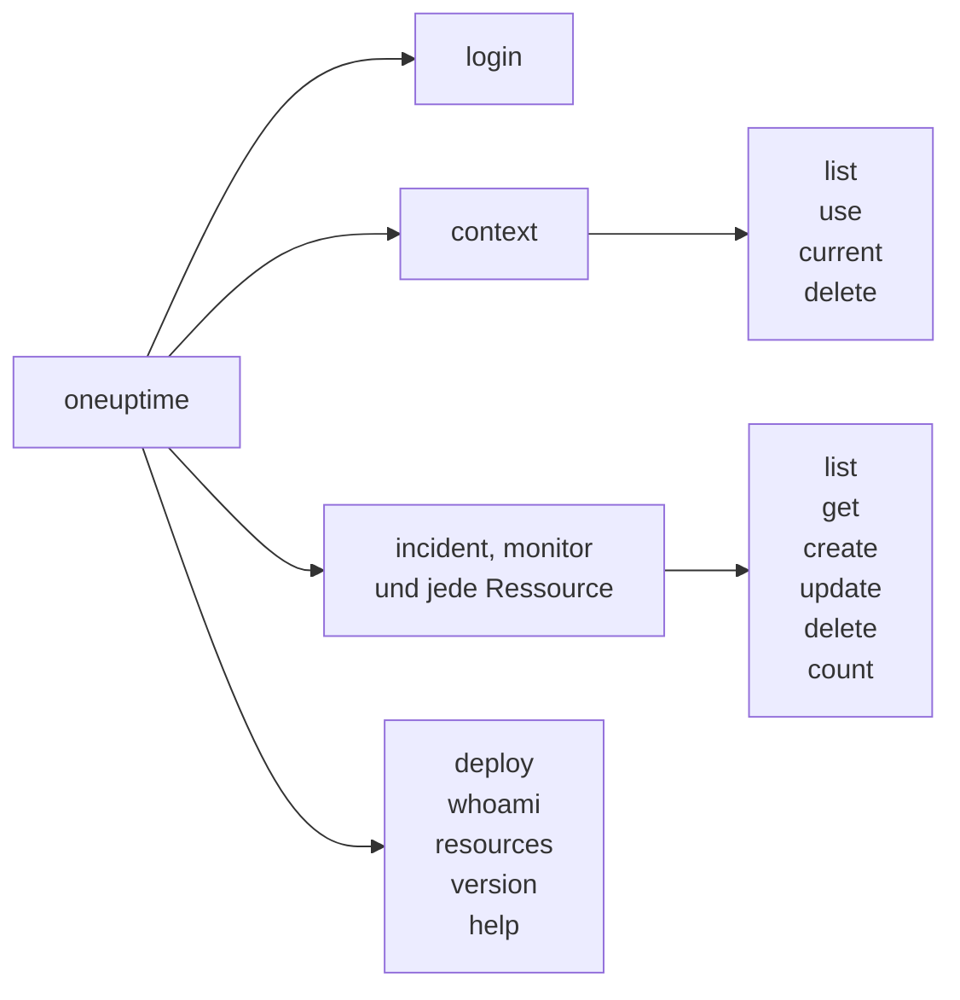

# Befehlsreferenz

Jeder Befehl der CLI `oneuptime`, mit seinen Argumenten, Optionen und Standardwerten. Hängen Sie `--help` an einen Befehl, um dasselbe in Ihrem Terminal zu sehen.

:::cards
- [Globale Optionen](#globale-optionen): Die Optionen, die jeder Befehl nimmt.
- [Anmeldung und Kontexte](#anmeldung-und-kontexte): login und die context-Befehle.
- [Ressourcenbefehle](#ressourcenbefehle): list, get, create, update, delete und count.
- [Weitere Befehle](#weitere-befehle): deploy, whoami, resources, version und help.
:::

## Die Befehle



## Globale Optionen

| Option | Was sie tut | Standard |
| --- | --- | --- |
| `--api-key <key>` | Der API-Schlüssel für diesen Befehl | `ONEUPTIME_API_KEY`, dann der Schlüssel des Kontexts |
| `--url <url>` | Die Adresse Ihrer OneUptime-Instanz für diesen Befehl | `ONEUPTIME_URL`, dann die URL des Kontexts |
| `--context <name>` | Der gespeicherte Kontext für diesen Befehl | Der aktuelle Kontext |
| `-o, --output <format>` | `json`, `table` oder `wide` | `table` im Terminal, `json` in einer Pipe |
| `--no-color` | Gibt ohne Farben aus | Farben, außer `NO_COLOR` ist gesetzt |
| `-V, --version` | Gibt die Version der CLI aus | |
| `-h, --help` | Zeigt die Hilfe eines Befehls | |

Die Optionen stehen vor oder hinter dem Befehl: `oneuptime --context staging incident list` und `oneuptime incident list --context staging` tun dasselbe.

## Anmeldung und Kontexte

### `oneuptime login`

Speichert einen API-Schlüssel und eine Adresse als Kontext und macht ihn zum aktuellen. Siehe [Anmelden](/docs/cli/authentication#anmelden).

```bash
oneuptime login <api-key> <instance-url> [--context-name <name>]
```

| Argument oder Option | Erforderlich | Was es ist | Standard |
| --- | --- | --- | --- |
| `<api-key>` | Ja | Ein API-Schlüssel Ihres Projekts | |
| `<instance-url>` | Ja | Die Adresse Ihrer OneUptime-Instanz, etwa `https://oneuptime.com` | |
| `--context-name <name>` | Nein | Der Name, unter dem der Kontext gespeichert wird | `default` |

### `oneuptime context list`

Listet die gespeicherten Kontexte auf; `*` markiert den aktuellen. API-Schlüssel werden nie aufgelistet.

```bash
oneuptime context list [-o <format>]
```

| Option | Erforderlich | Was es ist |
| --- | --- | --- |
| `-o, --output <format>` | Nein | `json`, `table` oder `wide`. JSON liefert von jedem Kontext `name`, `apiUrl` und `isCurrent` |

### `oneuptime context use`

Macht einen gespeicherten Kontext zum aktuellen.

```bash
oneuptime context use <name>
```

| Argument | Erforderlich | Was es ist |
| --- | --- | --- |
| `<name>` | Ja | Der Name eines gespeicherten Kontexts |

### `oneuptime context current`

Zeigt Namen und URL des aktuellen Kontexts und seinen API-Schlüssel, von dem alles außer den ersten vier und letzten vier Zeichen verborgen ist.

```bash
oneuptime context current
```

### `oneuptime context delete`

Löscht einen gespeicherten Kontext. War es der aktuelle, wird der erste verbleibende Kontext zum aktuellen.

```bash
oneuptime context delete <name>
```

| Argument | Erforderlich | Was es ist |
| --- | --- | --- |
| `<name>` | Ja | Der Name eines gespeicherten Kontexts |

## Ressourcenbefehle

`<resource>` ist der Befehl einer Art von Datensatz aus den Tabellen unter [Ressourcen](#ressourcen), etwa `incident` oder `monitor`. Beispiele finden Sie unter [Ressourcenoperationen](/docs/cli/resource-operations).

### `oneuptime <resource> list`

Listet Datensätze auf, die neuesten zuerst. Beschriftungen werden stattdessen nach Namen aufgelistet, nummerierte Beschriftungen zuerst (`2. Team` vor `10. Owner`).

```bash
oneuptime <resource> list [--query <json>] [--limit <n>] [--skip <n>] [--sort <json>] [-o <format>]
```

| Option | Was sie tut | Standard |
| --- | --- | --- |
| `--query <json>` | Ein Filter, als JSON | Jeder Datensatz, den der Schlüssel lesen darf |
| `--limit <n>` | Die meisten zurückzugebenden Datensätze, bis zu 10.000 | `10` |
| `--skip <n>` | Wie viele Datensätze zuerst übersprungen werden | `0` |
| `--sort <json>` | Die Reihenfolge, als JSON: `{"<field>":"ASC"}` oder `{"<field>":"DESC"}` | Die neuesten zuerst |
| `-o, --output <format>` | `json`, `table` oder `wide` | `table` im Terminal, `json` in einer Pipe |

### `oneuptime <resource> get`

Liest einen Datensatz. Nur Datensätze: Telemetrie hat kein `get`.

```bash
oneuptime <resource> get <id> [-o <format>]
```

| Argument oder Option | Erforderlich | Was es ist |
| --- | --- | --- |
| `<id>` | Ja | Die ID des Datensatzes, eine UUID |
| `-o, --output <format>` | Nein | `json`, `table` oder `wide` |

### `oneuptime <resource> create`

Erstellt einen Datensatz und gibt ihn aus.

```bash
oneuptime <resource> create (--data <json> | --file <path>) [-o <format>]
```

| Option | Erforderlich | Was es ist |
| --- | --- | --- |
| `--data <json>` | Eine der beiden | Der Datensatz, als JSON |
| `--file <path>` | Eine der beiden | Eine JSON-Datei mit dem Datensatz. Zusammen mit `--data` angegeben, wird die Datei verwendet |
| `-o, --output <format>` | Nein | `json`, `table` oder `wide` |

### `oneuptime <resource> update`

Ändert die Felder, die Sie angeben. Nur Datensätze: Telemetrie hat kein `update`.

```bash
oneuptime <resource> update <id> --data <json> [-o <format>]
```

| Argument oder Option | Erforderlich | Was es ist |
| --- | --- | --- |
| `<id>` | Ja | Die ID des Datensatzes |
| `--data <json>` | Ja | Die zu ändernden Felder, als JSON |
| `-o, --output <format>` | Nein | `json`, `table` oder `wide` |

### `oneuptime <resource> delete`

Löscht einen Datensatz sofort, ohne zu fragen. Nur Datensätze: Telemetrie hat kein `delete`.

```bash
oneuptime <resource> delete <id> [--force]
```

| Argument oder Option | Erforderlich | Was es ist |
| --- | --- | --- |
| `<id>` | Ja | Die ID des Datensatzes |
| `--force` | Nein | Wird angenommen und ändert nichts: `delete` fragt nie nach einer Bestätigung |

### `oneuptime <resource> count`

Zählt Datensätze und gibt die Zahl aus.

```bash
oneuptime <resource> count [--query <json>] [-o <format>]
```

| Option | Erforderlich | Was es ist |
| --- | --- | --- |
| `--query <json>` | Nein | Ein Filter, als JSON. Ohne ihn jeder Datensatz, den der Schlüssel lesen darf |
| `-o, --output <format>` | Nein | `json`, `table` oder `wide` |

### Ressourcen

Datensätze nehmen `list`, `get`, `create`, `update`, `delete` und `count`:

| Bereich | Befehle |
| --- | --- |
| Überwachung | `monitor`, `monitor-status`, `monitor-status-event` |
| Vorfälle | `incident`, `incident-state`, `incident-severity`, `incident-state-timeline`, `incident-public-note`, `incident-internal-note`, `incident-alert`, `postmortem-status` |
| Warnungen | `alert`, `alert-state`, `alert-severity`, `alert-state-timeline`, `alert-internal-note` |
| Statusseiten | `status-page`, `status-page-announcement` |
| Geplante Wartung | `scheduled-maintenance-event`, `scheduled-maintenance-state`, `scheduled-maintenance-state-timeline` |
| Teams und Bereitschaft | `team`, `on-call-policy` |
| Sicherheit | `security-case`, `security-case-evidence`, `security-case-note`, `security-case-priority`, `security-case-status`, `security-case-task`, `security-detection`, `security-playbook` |
| Labels | `label` |

Telemetrie nimmt `list`, `create` und `count`:

| Bereich | Befehle |
| --- | --- |
| Beobachtbarkeit | `log`, `metric`, `span`, `exception-instance`, `monitor-log` |
| Sicherheit | `security-event`, `threat-intel-indicator` |
| Änderungen und Kosten | `change-event`, `kubernetes-cost-allocation` |

Die CLI erscheint mit OneUptime, daher listet `oneuptime resources` die Befehle der Version auf, die Sie installiert haben.

### API-Anfragen

Jede Operation ist eine Anfrage an die API, mit dem Schlüssel im Header `APIKey`. `<path>` ist der API-Pfad der Ressource, aus `oneuptime resources`: `/incident` für `incident`, `/on-call-duty-policy` für `on-call-policy`.

| Operation | Anfrage | Body |
| --- | --- | --- |
| `list` | `POST /api/<path>/get-list` | `query`, `select`, `skip`, `limit` und `sort` |
| `get` | `POST /api/<path>/<id>/get-item` | `select` |
| `create` | `POST /api/<path>` | `{"data": ...}` |
| `update` | `PUT /api/<path>/<id>/` | `{"data": ...}` |
| `delete` | `DELETE /api/<path>/<id>/` | Keiner |
| `count` | `POST /api/<path>/count` | `query` |

## Weitere Befehle

### `oneuptime deploy`

Zeichnet einen Deploy oder eine andere Änderung aus einer Pipeline auf: Sie wird in die Diagramme des Dienstes eingezeichnet und von OneUptime AI gelesen, wenn es einen Vorfall untersucht. Der Befehl schreibt mit einem Telemetrie-Ingestion-Schlüssel, nicht mit einem API-Schlüssel. Siehe [Deploys und Änderungen](/docs/telemetry/change-events).

```bash
oneuptime deploy [--service <name>] [--service-version <version>] [--previous-version <version>] [--commit <sha>] [--repository <url>] [--branch <name>] [--pull-request <number>] [--environment <name>] [--title <title>] [--description <text>] [--type <type>] [--time <time>] [--attribute <key=value...>] [--ingestion-key <key>]
```

| Option | Erforderlich | Was es ist | Standard |
| --- | --- | --- | --- |
| `--service <name>` | Nein | Der Dienst, der deployt wurde | Eine Änderung für das ganze Projekt |
| `--service-version <version>` | Nein | Die deployte Version | |
| `--previous-version <version>` | Nein | Die Version, die sie ersetzt hat | |
| `--commit <sha>` | Nein | Der deployte Commit | |
| `--repository <url>` | Nein | Das Repository, in dem der Commit liegt | |
| `--branch <name>` | Nein | Der deployte Branch | |
| `--pull-request <number>` | Nein | Der deployte Pull Request | |
| `--environment <name>` | Nein | Die Umgebung, in die deployt wurde | |
| `--title <title>` | Nein | Der Titel der Änderung; eine andere Art als ein Deploy braucht einen | `Deploy <version>` |
| `--description <text>` | Nein | Details der Änderung | |
| `--type <type>` | Nein | Die Art der Änderung, etwa `config-change` oder `rollback` | `deployment` |
| `--time <time>` | Nein | Wann sie geschah, etwa `2026-10-19T10:00:00Z` | Jetzt |
| `--attribute <key=value...>` | Nein | Weitere Attribute, als `key=value`, eines oder mehrere | |
| `--ingestion-key <key>` | Nein | Ein Telemetrie-Ingestion-Schlüssel des Projekts | `ONEUPTIME_TELEMETRY_INGESTION_KEY` |

### `oneuptime whoami`

Zeigt die URL und den API-Schlüssel, die der nächste Befehl verwendet, mit maskiertem Schlüssel, und den Kontext, aus dem sie stammen. Es ruft OneUptime nicht auf. Siehe [Prüfen, was die CLI verwenden wird](/docs/cli/authentication#prüfen-was-die-cli-verwenden-wird).

```bash
oneuptime whoami
```

### `oneuptime resources`

Listet jede Art von Datensatz auf, für die die CLI einen Befehl hat: ihren Befehl, Singular- und Pluralnamen, Typ und API-Pfad sowie die Gesamtzahl.

```bash
oneuptime resources [--type <type>] [-o <format>]
```

| Option | Erforderlich | Was es ist | Standard |
| --- | --- | --- | --- |
| `--type <type>` | Nein | `database` für Datensätze, `analytics` für Telemetrie | Beide |
| `-o, --output <format>` | Nein | `json`, `table` oder `wide`. JSON liefert von jeder `name`, `singularName`, `pluralName`, `modelType` und `apiPath` | `table` im Terminal, `json` in einer Pipe |

### `oneuptime version`

Gibt die Version der CLI aus, wie `oneuptime --version`.

```bash
oneuptime version
```

### `oneuptime help`

Zeigt die Hilfe der CLI oder eines Befehls.

```bash
oneuptime help [command]
```

## Umgebungsvariablen

| Variable | Was sie tut |
| --- | --- |
| `ONEUPTIME_API_KEY` | Der API-Schlüssel, wenn kein Flag `--api-key` einen angibt |
| `ONEUPTIME_URL` | Die Adresse Ihrer OneUptime-Instanz, wenn kein Flag `--url` eine angibt |
| `ONEUPTIME_TELEMETRY_INGESTION_KEY` | Der Telemetrie-Ingestion-Schlüssel, mit dem `oneuptime deploy` schreibt, wenn kein Flag `--ingestion-key` einen angibt |
| `NO_COLOR` | Auf einen beliebigen Wert gesetzt, schaltet sie Farben aus |

## Dateien

| Datei | Was sie enthält |
| --- | --- |
| `~/.oneuptime/config.json` | Die gespeicherten Kontexte, ihre API-Schlüssel und den aktuellen Kontext |

## Exit-Codes

| Code | Bedeutung |
| --- | --- |
| `0` | Es hat geklappt |
| `1` | Es ist fehlgeschlagen: OneUptime hat die Anfrage abgelehnt, oder der Befehl war falsch |
| `2` | Kein verwendbarer API-Schlüssel: keiner gefunden, ungültig oder unter seinem Tarif |
| `3` | Nicht gefunden: OneUptime hat mit `404` geantwortet |

Beispiele finden Sie unter [Exit-Codes](/docs/cli/scripting#exit-codes).

## Nächste Schritte

:::cards
- [CLI – Übersicht](/docs/cli/index): Die CLI installieren und die ersten Befehle ausführen.
- [Ressourcenoperationen](/docs/cli/resource-operations): Beispiele für jede Operation.
- [Skripting & CI/CD](/docs/cli/scripting): Die CLI in Skripten und Pipelines.
:::
