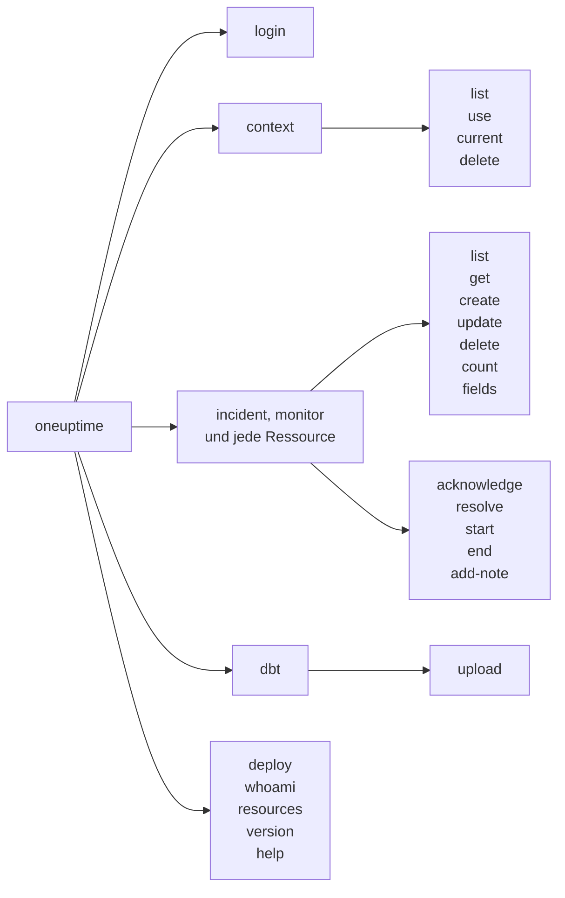

# Befehlsreferenz

Jeder Befehl der CLI `oneuptime`, mit seinen Argumenten, Optionen und Standardwerten. Hängen Sie `--help` an einen Befehl, um dasselbe in Ihrem Terminal zu sehen.

:::cards
- [Globale Optionen](#globale-optionen): Die Optionen, die jeder Befehl nimmt.
- [Anmeldung und Kontexte](#anmeldung-und-kontexte): login und die context-Befehle.
- [Ressourcenbefehle](#ressourcenbefehle): Die Operationen, Felder und Aktionen jeder Ressource.
- [Weitere Befehle](#weitere-befehle): deploy, dbt upload, data-checks apply, whoami, resources, version und help.
:::

## Die Befehle



## Globale Optionen

| Option | Was sie tut | Standard |
| --- | --- | --- |
| `--api-key <key>` | Der API-Schlüssel für diesen Befehl | `ONEUPTIME_API_KEY`, dann der Schlüssel des Kontexts |
| `--url <url>` | Die Adresse Ihrer OneUptime-Instanz für diesen Befehl | `ONEUPTIME_URL`, dann die URL des Kontexts |
| `--context <name>` | Der gespeicherte Kontext für diesen Befehl | Der aktuelle Kontext |
| `-o, --output <format>` | `json`, `table` oder `wide` | `table` im Terminal, `json` in einer Pipe |
| `--json` | Dasselbe wie `-o json` | |
| `--no-color` | Gibt ohne Farben aus | Farben, außer `NO_COLOR` ist gesetzt |
| `-V, --version` | Gibt die Version der CLI aus | |
| `-h, --help` | Zeigt die Hilfe eines Befehls | |

Die Optionen stehen vor oder hinter dem Befehl: `oneuptime --context staging incident list` und `oneuptime incident list --context staging` tun dasselbe.

Jeder Befehl nimmt `-o` und `--json` an, daher lassen die Tabellen unten sie weg. Ein Befehl, dessen Antwort ein Satz ist, etwa `delete`, gibt den Satz aus, es sei denn, `-o json` oder `--json` verlangt JSON: siehe [Ausgabeformate](/docs/cli/output-formats#json).

## Anmeldung und Kontexte

### `oneuptime login`

Speichert einen API-Schlüssel und eine Adresse als Kontext und macht ihn zum aktuellen. Siehe [Anmelden](/docs/cli/authentication#anmelden).

```bash
oneuptime login <api-key> <instance-url> [--context-name <name>]
```

| Argument oder Option | Erforderlich | Was es ist | Standard |
| --- | --- | --- | --- |
| `<api-key>` | Ja | Ein API-Schlüssel Ihres Projekts | |
| `<instance-url>` | Ja | Die Adresse Ihrer OneUptime-Instanz, etwa `https://oneuptime.com` | |
| `--context-name <name>` | Nein | Der Name, unter dem der Kontext gespeichert wird | `default` |

### `oneuptime context list`

Listet die gespeicherten Kontexte auf; `*` markiert den aktuellen. API-Schlüssel werden nie aufgelistet: JSON gibt für jeden Kontext `name`, `apiUrl` und `isCurrent`.

```bash
oneuptime context list
```

### `oneuptime context use`

Macht einen gespeicherten Kontext zum aktuellen.

```bash
oneuptime context use <name>
```

| Argument | Erforderlich | Was es ist |
| --- | --- | --- |
| `<name>` | Ja | Der Name eines gespeicherten Kontexts |

### `oneuptime context current`

Zeigt Namen und URL des aktuellen Kontexts und seinen API-Schlüssel, von dem alles außer den ersten vier und letzten vier Zeichen verborgen ist.

```bash
oneuptime context current
```

### `oneuptime context delete`

Löscht einen gespeicherten Kontext. War es der aktuelle, wird der erste verbleibende Kontext zum aktuellen.

```bash
oneuptime context delete <name>
```

| Argument | Erforderlich | Was es ist |
| --- | --- | --- |
| `<name>` | Ja | Der Name eines gespeicherten Kontexts |

## Ressourcenbefehle

`<resource>` ist der Befehl einer Art von Datensatz aus der Tabelle unter [Ressourcen](#ressourcen), etwa `incident` oder `monitor`. Eine Ressource hat die Operationen, die die API für sie annimmt, die meisten alle sechs, und `oneuptime <resource> --help` listet ihre eigenen auf. Beispiele finden Sie unter [Ressourcenoperationen](/docs/cli/resource-operations).

### `oneuptime <resource> list`

Listet Datensätze auf, die neuesten zuerst. Beschriftungen werden stattdessen nach Namen aufgelistet, nummerierte Beschriftungen zuerst (`2. Team` vor `10. Owner`).

```bash
oneuptime <resource> list [--query <json>] [--limit <n>] [--skip <n>] [--sort <json>] [--fields <names>] [--all]
```

| Option | Was sie tut | Standard |
| --- | --- | --- |
| `--query <json>` | Ein Filter, als JSON | Jeder Datensatz, den der Schlüssel lesen darf |
| `--limit <n>` | Die meisten zurückzugebenden Datensätze, bis zu 10.000 | `10` |
| `--skip <n>` | Wie viele Datensätze zuerst übersprungen werden | `0` |
| `--sort <json>` | Die Reihenfolge, als JSON: `{"<field>":"ASC"}` oder `{"<field>":"DESC"}` | Die neuesten zuerst |
| `--fields <names>` | Die zurückzugebenden Felder, durch Kommas getrennt; ein Feld eines verknüpften Datensatzes nach einem Punkt, wie in `currentIncidentState.name` | Jedes Feld, das der Schlüssel lesen darf |
| `--all` | Jeder passende Datensatz, 100 auf einmal, bis zu 100.000, anstelle von `--limit` und `--skip`. Nur Datensätze: Telemetrie hat kein `--all` | |

### `oneuptime <resource> get`

Liest einen Datensatz.

```bash
oneuptime <resource> get <id> [--fields <names>]
```

| Argument oder Option | Erforderlich | Was es ist |
| --- | --- | --- |
| `<id>` | Ja | Die ID des Datensatzes, eine UUID |
| `--fields <names>` | Nein | Die zurückzugebenden Felder, durch Kommas getrennt. Standard: jedes Feld, das der Schlüssel lesen darf |

### `oneuptime <resource> create`

Erstellt einen Datensatz und gibt ihn aus.

```bash
oneuptime <resource> create [--<field> <value>]... [--data <json>] [--file <path>]
```

| Option | Erforderlich | Was es ist |
| --- | --- | --- |
| `--<field> <value>` | Die Felder, die ein Erstellen angeben muss | Der Wert eines Felds: `--title <text>`, `--incident-severity-id <id>`, `--labels <ids>`. `oneuptime <resource> create --help` listet sie auf. Nur Datensätze |
| `--data <json>` | Nein | Der Datensatz, als JSON |
| `--file <path>` | Nein | Eine JSON-Datei mit dem Datensatz. Zusammen mit `--data` angegeben, wird die Datei verwendet |

Die Flags gelten zusätzlich zu `--data` oder `--file`. Ein Feld, das eine Person über ihre Benutzer-ID nennt, hat auch ein Flag, das sie über ihre E-Mail-Adresse nennt: `--user-email` neben `--user-id`.

### `oneuptime <resource> update`

Ändert die Felder, die Sie angeben.

```bash
oneuptime <resource> update <id> [--<field> <value>]... [--data <json>] [--file <path>]
```

| Argument oder Option | Erforderlich | Was es ist |
| --- | --- | --- |
| `<id>` | Ja | Die ID des Datensatzes |
| `--<field> <value>` | Nein | Ein zu änderndes Feld: `oneuptime <resource> update --help` listet sie auf. Nur Datensätze |
| `--data <json>` | Nein | Die zu ändernden Felder, als JSON |
| `--file <path>` | Nein | Eine JSON-Datei mit den zu ändernden Feldern. Zusammen mit `--data` angegeben, wird die Datei verwendet |

### `oneuptime <resource> delete`

Löscht einen Datensatz sofort, ohne nachzufragen.

```bash
oneuptime <resource> delete <id> [--force]
```

| Argument oder Option | Erforderlich | Was es ist |
| --- | --- | --- |
| `<id>` | Ja | Die ID des Datensatzes |
| `--force` | Nein | Wird angenommen und ändert nichts: `delete` fragt nie nach einer Bestätigung |

### `oneuptime <resource> count`

Zählt Datensätze und gibt die Zahl aus.

```bash
oneuptime <resource> count [--query <json>]
```

| Option | Erforderlich | Was es ist |
| --- | --- | --- |
| `--query <json>` | Nein | Ein Filter, als JSON. Ohne ihn jeder Datensatz, den der Schlüssel lesen darf |

### `oneuptime <resource> fields`

Listet die Felder der Ressource auf: wozu jedes dient, seinen Typ, ob ein Erstellen es angeben muss, und das Flag, das es setzt. Es liest sie aus der CLI selbst, ohne API-Schlüssel und ohne Anfrage.

```bash
oneuptime <resource> fields
```

### `oneuptime <resource> acknowledge`

Versetzt einen Vorfall, eine Warnung oder eine Episode davon in den Bestätigt-Status Ihres Projekts, wie die Schaltfläche im Dashboard. Ein Datensatz, der schon bestätigt ist oder darüber hinaus, bleibt, wie er ist.

```bash
oneuptime <resource> acknowledge <id>
```

| Argument | Erforderlich | Was es ist |
| --- | --- | --- |
| `<id>` | Ja | Die ID des Datensatzes |

### `oneuptime <resource> resolve`

Versetzt einen Vorfall, eine Warnung oder eine Episode davon in den Gelöst-Status Ihres Projekts.

```bash
oneuptime <resource> resolve <id>
```

| Argument | Erforderlich | Was es ist |
| --- | --- | --- |
| `<id>` | Ja | Die ID des Datensatzes |

### `oneuptime <resource> start`

Versetzt ein Wartungsereignis in den Laufend-Status Ihres Projekts.

```bash
oneuptime <resource> start <id>
```

| Argument | Erforderlich | Was es ist |
| --- | --- | --- |
| `<id>` | Ja | Die ID des Ereignisses |

### `oneuptime <resource> end`

Versetzt ein Wartungsereignis in den Beendet-Status Ihres Projekts.

```bash
oneuptime <resource> end <id>
```

| Argument | Erforderlich | Was es ist |
| --- | --- | --- |
| `<id>` | Ja | Die ID des Ereignisses |

### `oneuptime <resource> add-note`

Fügt einem Vorfall, einer Warnung, einer Episode davon oder einem Wartungsereignis eine Notiz hinzu.

```bash
oneuptime <resource> add-note <id> --note <markdown> [--public]
```

| Argument oder Option | Erforderlich | Was es ist |
| --- | --- | --- |
| `<id>` | Ja | Die ID des Datensatzes |
| `--note <markdown>` | Ja | Die Notiz, in Markdown |
| `--public` | Nein | Veröffentlicht sie auf den Statusseiten des Datensatzes, wo seine Abonnenten benachrichtigt werden. Nur Vorfälle, ihre Episoden und geplante Wartungen |

### Ressourcen

Jede Ressource der OneUptime-API ist ein Befehl, mit den Operationen, die die API für sie annimmt, `fields` und den Aktionen der Datensätze, die welche haben:

{{CLI_RESOURCE_COMMANDS}}

Die CLI erscheint mit OneUptime, daher listet `oneuptime resources` die Befehle der Version auf, die Sie installiert haben.

### API-Anfragen

Jede Operation ist eine Anfrage an die API, mit dem Schlüssel im Header `APIKey`. `<path>` ist der API-Pfad der Ressource, aus `oneuptime resources`: `/incident` für `incident`, `/on-call-duty-policy` für `on-call-policy`.

| Operation | Anfrage | Body |
| --- | --- | --- |
| `list` | `POST /api/<path>/get-list` | `query`, `select`, `skip`, `limit` und `sort` |
| `get` | `POST /api/<path>/<id>/get-item` | `select` |
| `create` | `POST /api/<path>` | `{"data": ...}` |
| `update` | `PUT /api/<path>/<id>/` | `{"data": ...}` |
| `delete` | `DELETE /api/<path>/<id>/` | Keiner |
| `count` | `POST /api/<path>/count` | `query` |

Eine Aktion liest die Status Ihres Projekts und den Datensatz und erstellt dann eine Zeile im Statusverlauf des Datensatzes, wie die Schaltfläche im Dashboard: `acknowledge` bei einem Vorfall erstellt eine `incident-state-timeline`. `add-note` erstellt eine `incident-internal-note`, oder mit `--public` eine `incident-public-note`. Ein E-Mail-Flag listet zuerst die Teammitglieder des Projekts mit dieser Adresse auf. Lehnt OneUptime ein Feld ab, das der Schlüssel nicht lesen darf, fragt eine Liste oder ein Lesen ohne es erneut.

## Weitere Befehle

### `oneuptime deploy`

Zeichnet einen Deploy oder eine andere Änderung aus einer Pipeline auf: Sie wird in die Diagramme des Dienstes eingezeichnet und von OneUptime AI gelesen, wenn es einen Vorfall untersucht. Der Befehl schreibt mit einem Telemetrie-Ingestion-Schlüssel, nicht mit einem API-Schlüssel. Siehe [Deploys und Änderungen](/docs/telemetry/change-events).

```bash
oneuptime deploy [--service <name>] [--service-version <version>] [--previous-version <version>] [--commit <sha>] [--repository <url>] [--branch <name>] [--pull-request <number>] [--environment <name>] [--title <title>] [--description <text>] [--type <type>] [--time <time>] [--attribute <key=value...>] [--ingestion-key <key>]
```

| Option | Erforderlich | Was es ist | Standard |
| --- | --- | --- | --- |
| `--service <name>` | Nein | Der Dienst, der deployt wurde | Eine Änderung für das ganze Projekt |
| `--service-version <version>` | Nein | Die deployte Version | |
| `--previous-version <version>` | Nein | Die Version, die sie ersetzt hat | |
| `--commit <sha>` | Nein | Der deployte Commit | |
| `--repository <url>` | Nein | Das Repository, in dem der Commit liegt | |
| `--branch <name>` | Nein | Der deployte Branch | |
| `--pull-request <number>` | Nein | Der deployte Pull Request | |
| `--environment <name>` | Nein | Die Umgebung, in die deployt wurde | |
| `--title <title>` | Nein | Der Titel der Änderung; eine andere Art als ein Deploy braucht einen | `Deploy <version>` |
| `--description <text>` | Nein | Details der Änderung | |
| `--type <type>` | Nein | Die Art der Änderung, etwa `config-change` oder `rollback` | `deployment` |
| `--time <time>` | Nein | Wann sie geschah, etwa `2026-10-19T10:00:00Z` | Jetzt |
| `--attribute <key=value...>` | Nein | Weitere Attribute, als `key=value`, eines oder mehrere | |
| `--ingestion-key <key>` | Nein | Ein Telemetrie-Ingestion-Schlüssel des Projekts | `ONEUPTIME_TELEMETRY_INGESTION_KEY` |

### `oneuptime dbt upload`

Sendet die Artefakte eines dbt-Projekts nach einem Build, aus einer CI oder einem dbt-Cloud-Job, an Data Observability. Seine Modelle erscheinen mit ihrer Datenherkunft an den Tabellen, die sie erstellen, seine Tests erscheinen neben den Prüfungen von OneUptime und können Warnungen auslösen, und jeder Build ist eine Ausführung der Pipeline des Projekts. Der Befehl liest `manifest.json` und `run_results.json` aus dem Zielordner von dbt, sendet nur, was Data Observability davon liest, und schreibt mit einem Telemetrie-Ingestion-Schlüssel, nicht mit einem API-Schlüssel. Die Seite Dokumentation von Data Observability in Ihrem Dashboard zeigt den Befehl in einem CI-Job.

```bash
oneuptime dbt upload [--target-path <dir>] [--manifest <file>] [--run-results <file>] [--project <name>] [--ingestion-key <key>]
```

| Option | Erforderlich | Was es ist | Standard |
| --- | --- | --- | --- |
| `--target-path <dir>` | Nein | Der Ordner, in den dbt seine Artefakte geschrieben hat | `target` |
| `--manifest <file>` | Nein | Das zu sendende Manifest | `manifest.json` im Zielordner |
| `--run-results <file>` | Nein | Die zu sendenden Ausführungsergebnisse | `run_results.json` im Zielordner |
| `--project <name>` | Nein | Der Name des dbt-Projekts, nur nötig, wenn kein Manifest gesendet wird | Das Projekt des Manifests |
| `--ingestion-key <key>` | Nein | Ein Telemetrie-Ingestion-Schlüssel des Projekts | `ONEUPTIME_TELEMETRY_INGESTION_KEY` |

### `oneuptime data-checks apply`

Bringt die Datenprüfungen des Projekts mit einer YAML-Datei in Übereinstimmung, damit sie in einem Repository liegen und wie Code geprüft werden. Ein Fehler irgendwo in der Datei wendet nichts an und beendet mit einem Fehler. Das Format der Datei steht unter [Prüfungen und Abgleiche](/docs/data-observability/checks).

```bash
oneuptime data-checks apply <file> [--dry-run] [--prune]
```

| Option | Erforderlich | Was es ist | Standard |
| --- | --- | --- | --- |
| `--dry-run` | Nein | Sagt, was sich ändern würde, und ändert nichts | Aus |
| `--prune` | Nein | Löscht Prüfungen, die ein früheres Anwenden erstellt hat und die die Datei nicht mehr nennt | Aus |

### `oneuptime whoami`

Zeigt die URL und den API-Schlüssel, die der nächste Befehl verwendet, mit maskiertem Schlüssel, und den Kontext, aus dem sie stammen. Ohne `--check` ruft es OneUptime nicht auf. Siehe [Prüfen, was die CLI verwenden wird](/docs/cli/authentication#prüfen-was-die-cli-verwenden-wird).

```bash
oneuptime whoami [--check]
```

| Option | Erforderlich | Was es ist |
| --- | --- | --- |
| `--check` | Nein | Fragt OneUptime, ob es den Schlüssel annimmt, und zeigt das Projekt des Schlüssels, die Version Ihrer OneUptime-Instanz und die der CLI |

### `oneuptime resources`

Listet jede Art von Datensatz auf, für die die CLI einen Befehl hat: ihren Befehl, Singular- und Pluralnamen, Typ und API-Pfad, und die Gesamtzahl. JSON gibt für jede `name`, `singularName`, `pluralName`, `modelType`, `apiPath`, `operations` und `actions`.

```bash
oneuptime resources [--type <type>]
```

| Option | Erforderlich | Was es ist | Standard |
| --- | --- | --- | --- |
| `--type <type>` | Nein | `database` für Datensätze, `analytics` für Telemetrie | Beide |

### `oneuptime version`

Gibt die Version der CLI aus, wie `oneuptime --version`.

```bash
oneuptime version
```

### `oneuptime help`

Zeigt die Hilfe der CLI oder eines Befehls.

```bash
oneuptime help [command]
```

## Umgebungsvariablen

| Variable | Was sie tut |
| --- | --- |
| `ONEUPTIME_API_KEY` | Der API-Schlüssel, wenn kein Flag `--api-key` einen angibt |
| `ONEUPTIME_URL` | Die Adresse Ihrer OneUptime-Instanz, wenn kein Flag `--url` eine angibt |
| `ONEUPTIME_TELEMETRY_INGESTION_KEY` | Der Telemetrie-Ingestion-Schlüssel, mit dem `oneuptime deploy` schreibt, wenn kein Flag `--ingestion-key` einen angibt |
| `NO_COLOR` | Auf einen beliebigen Wert gesetzt, schaltet sie Farben aus |

## Dateien

| Datei | Was sie enthält |
| --- | --- |
| `~/.oneuptime/config.json` | Die gespeicherten Kontexte, ihre API-Schlüssel und den aktuellen Kontext |

## Exit-Codes

| Code | Bedeutung |
| --- | --- |
| `0` | Es hat geklappt |
| `1` | Es ist fehlgeschlagen: OneUptime hat die Anfrage abgelehnt, oder der Befehl war falsch |
| `2` | Kein verwendbarer API-Schlüssel: keiner gefunden, ungültig oder unter seinem Tarif |
| `3` | Nicht gefunden: OneUptime hat mit `404` geantwortet |

Beispiele finden Sie unter [Exit-Codes](/docs/cli/scripting#exit-codes).

## Nächste Schritte

:::cards
- [CLI – Übersicht](/docs/cli/index): Die CLI installieren und die ersten Befehle ausführen.
- [Ressourcenoperationen](/docs/cli/resource-operations): Beispiele für jede Operation.
- [Skripting & CI/CD](/docs/cli/scripting): Die CLI in Skripten und Pipelines.
:::
