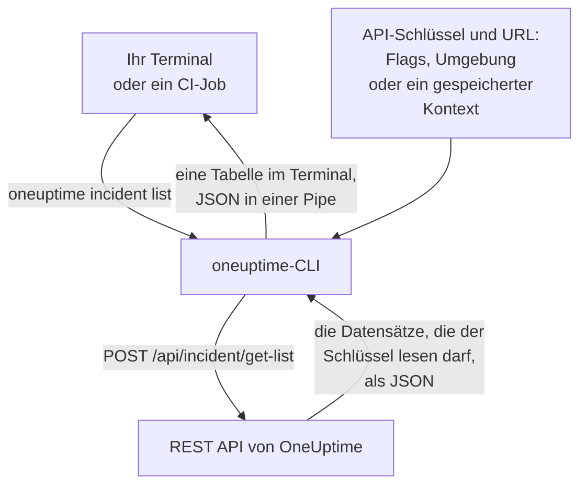

# CLI – Übersicht

Die OneUptime-CLI, `oneuptime`, verwaltet Ihr OneUptime-Projekt aus einem Terminal oder einem Skript. Sie listet, liest, erstellt, ändert, löscht und zählt Monitore, Vorfälle, Warnungen, Statusseiten und die anderen Datensätze, die die OneUptime-API anbietet, mit einem API-Schlüssel Ihres Projekts.

:::cards
- [Wie die CLI arbeitet](#wie-die-cli-arbeitet): Ein Befehl, die API-Anfragen, die er sendet, und seine Antwort.
- [Die CLI installieren](#die-cli-installieren): Das Installationsskript, das Ihre OneUptime-Instanz bereitstellt, oder npm.
- [Die ersten Befehle ausführen](#die-ersten-befehle-ausführen): Speichern Sie Ihren API-Schlüssel, prüfen Sie ihn und listen Sie dann Ihre Vorfälle auf.
- [Die Befehle auf einen Blick](#die-befehle-auf-einen-blick): Jeder Befehl und die Seite, die ihn erklärt.
:::

## Wie die CLI arbeitet

Die meisten Befehle senden eine Anfrage an die REST API von OneUptime und geben die Antwort aus; eine Aktion wie `acknowledge` sendet die wenigen, die auch die Schaltfläche im Dashboard sendet. Den API-Schlüssel und die Adresse Ihrer OneUptime-Instanz nimmt die CLI aus Flags, Umgebungsvariablen oder einem Kontext, den `oneuptime login` gespeichert hat. Der Schlüssel entscheidet, was ein Befehl lesen und ändern darf, genau wie bei der API.



Jede Ressource der OneUptime-API ist ein Befehl, 450 und mehr, von `incident` und `monitor` bis `status-page-subscriber` und `telemetry-ingestion-key`, jeder mit den Operationen, die die API für ihn annimmt. Die CLI erscheint mit OneUptime, daher hat die CLI in der Version Ihrer Instanz einen Befehl für jede Ressource Ihres Servers. `oneuptime resources` listet sie auf.

## Bevor Sie beginnen

- **Node.js und npm**, ein aktuelles LTS-Release, um die CLI zu installieren.
- **Ein API-Schlüssel Ihres Projekts.** Legen Sie einen unter **Projekteinstellungen → Erweitert → API-Schlüssel** mit **API-Schlüssel erstellen** an: siehe [Einen API-Schlüssel erstellen](/docs/api-reference/api-reference#einen-api-schlüssel-erstellen).
- **In OneUptime Cloud der Tarif Growth oder höher.** Die API-Schlüssel eines Projekts funktionieren nur dort: siehe [API-Schlüssel und SCIM unterhalb ihres Tarifs](/docs/api-reference/api-reference#api-schlüssel-und-scim-unterhalb-ihres-tarifs).

## Die CLI installieren

Jede OneUptime-Instanz stellt das Installationsskript der CLI für ihr eigenes Release bereit: Die Befehle unten laden es von `https://oneuptime.com`, ersetzen Sie die Adresse bei einer selbst gehosteten OneUptime-Instanz also durch Ihre URL. Das Skript wird zuerst als `install.sh` gespeichert, sodass Sie es lesen können, bevor Sie es ausführen. Es fragt Ihre OneUptime-Instanz nach ihrer Version und installiert die CLI derselben Version mit npm:

```bash
curl -fsSL https://oneuptime.com/install/cli -o install.sh
ONEUPTIME_URL=https://oneuptime.com bash install.sh
```

Oder installieren Sie das Paket `@oneuptime/cli` selbst aus npm. Es fügt den Befehl `oneuptime` hinzu, und `--version` gibt die installierte Version aus:

```bash
npm install -g @oneuptime/cli
oneuptime --version
```

Die CLI erscheint mit OneUptime und hat dieselbe Versionsnummer. Bei einer selbst gehosteten OneUptime-Instanz installieren Sie die CLI in der Version Ihrer Instanz, damit ihre Befehle zu den Datensätzen Ihres Servers passen:

```bash
npm install -g @oneuptime/cli@<your-oneuptime-version>
```

> [!WARNING]
> CLI-Versionen vor 14.0.64 brechen gleich beim Start ab, mit einem Fehler wie `Cannot find module 'Common/Models/DatabaseModels/Index'`. Installieren Sie 14.0.64 oder neuer mit `npm install -g @oneuptime/cli@latest`. Ist Ihre selbst gehostete OneUptime-Instanz älter als 14.0.64, [aktualisieren Sie zuerst OneUptime](/docs/installation/upgrading#so-führen-sie-ein-upgrade-durch) und installieren Sie dann die CLI in der Version, auf die Sie aktualisiert haben.

## Die ersten Befehle ausführen

:::steps
### Ihren API-Schlüssel speichern

Melden Sie sich mit dem Schlüssel und der Adresse Ihrer OneUptime-Instanz an. Die CLI speichert beides als Kontext namens `default` und verwendet ihn ab jetzt:

```bash
oneuptime login <your-api-key> https://oneuptime.com
```

Sie antwortet `Logged in successfully. Context "default" is now active.` Bei einer selbst gehosteten Instanz verwenden Sie deren Adresse anstelle von `https://oneuptime.com`.

### Den Schlüssel prüfen

```bash
oneuptime whoami --check
```

`login` speichert den Schlüssel, ohne OneUptime danach zu fragen. `--check` fragt nach: Es zeigt das Projekt des Schlüssels, die Version Ihrer OneUptime-Instanz und die der CLI, und was zu installieren ist, wenn beide sich unterscheiden. Lehnt OneUptime den Schlüssel ab, siehe [Fehlerbehebung](/docs/cli/authentication#fehlerbehebung).

### Ihre Vorfälle auflisten

```bash
oneuptime incident list
```

Die zehn neuesten Vorfälle erscheinen als Tabelle.

### Sehen, was Sie sonst noch verwalten können

```bash
oneuptime resources
```

Die Liste zeigt jede Art von Datensatz, mit der Sie arbeiten können, und ihren Befehl, etwa `monitor`, `status-page` oder `on-call-policy`. `oneuptime monitor fields` listet die Felder eines Monitors auf und die Flags, die sie setzen.
:::

## Die Befehle auf einen Blick

| Befehl | Was er tut | Mehr dazu |
| --- | --- | --- |
| `oneuptime login <api-key> <instance-url>` | Speichert einen API-Schlüssel und eine Adresse als Kontext | [Authentifizierung](/docs/cli/authentication#anmelden) |
| `oneuptime context list`, `use`, `current`, `delete` | Listet, wechselt, zeigt und löscht gespeicherte Kontexte | [Authentifizierung](/docs/cli/authentication#kontexte) |
| `oneuptime whoami` | Zeigt die URL und den API-Schlüssel, die der nächste Befehl verwendet, und mit `--check`, ob OneUptime den Schlüssel annimmt | [Authentifizierung](/docs/cli/authentication#prüfen-was-die-cli-verwenden-wird) |
| `oneuptime deploy` | Zeichnet einen Deploy oder eine andere Änderung für die Diagramme und OneUptime AI auf | [Deploys und Änderungen](/docs/telemetry/change-events) |
| `oneuptime data-checks apply` | Bringt die Datenprüfungen des Projekts mit einer Datei in Ihrem Repository in Übereinstimmung | [Befehlsreferenz](/docs/cli/command-reference) |
| `oneuptime dbt upload` | Sendet die Artefakte eines dbt-Projekts nach einem Build an Data Observability | [Befehlsreferenz](/docs/cli/command-reference#oneuptime-dbt-upload) |
| `oneuptime <resource> list`, `get`, `create`, `update`, `delete`, `count` | Arbeitet mit einer Art von Datensatz | [Ressourcenoperationen](/docs/cli/resource-operations) |
| `oneuptime <resource> fields` | Listet die Felder einer Ressource auf und die Flags, die sie setzen | [Ressourcenoperationen](/docs/cli/resource-operations#die-felder-einer-ressource-sehen) |
| `oneuptime <resource> acknowledge`, `resolve`, `start`, `end`, `add-note` | Tut, was die Schaltflächen des Dashboards bei Vorfällen, Warnungen und geplanten Wartungen tun | [Ressourcenoperationen](/docs/cli/resource-operations#bestätigen-beheben-und-notizen-hinzufügen) |
| `oneuptime resources` | Listet die Arten von Datensätzen mit ihren Befehlen auf | [Befehlsreferenz](/docs/cli/command-reference#oneuptime-resources) |
| `oneuptime version` | Gibt die Version der CLI aus | [Befehlsreferenz](/docs/cli/command-reference#oneuptime-version) |
| `oneuptime help [command]` | Zeigt die Hilfe eines Befehls | [Hilfe erhalten](#hilfe-erhalten) |

## Globale Optionen

Diese Optionen funktionieren mit jedem Befehl, davor oder dahinter:

| Option | Was sie tut |
| --- | --- |
| `--api-key <key>` | Der API-Schlüssel für diesen Befehl, anstelle des gespeicherten |
| `--url <url>` | Die Adresse Ihrer OneUptime-Instanz für diesen Befehl |
| `--context <name>` | Ein gespeicherter Kontext für diesen Befehl, anstelle des aktuellen |
| `-o, --output <format>` | `table`, `json` oder `wide`: siehe [Ausgabeformate](/docs/cli/output-formats) |
| `--json` | Dasselbe wie `-o json` |
| `--no-color` | Gibt ohne Farben aus |
| `-V, --version` | Gibt die Version der CLI aus |
| `-h, --help` | Zeigt die Hilfe des Befehls |

## Hilfe erhalten

Jeder Befehl hat seine eigene Hilfe, mit seinen Argumenten, Optionen und Standardwerten:

```bash
oneuptime --help
oneuptime help incident
oneuptime incident list --help
```

## Nächste Schritte

:::cards
- [Authentifizierung](/docs/cli/authentication): Kontexte für jede Umgebung, und welchen Schlüssel ein Befehl verwendet.
- [Ressourcenoperationen](/docs/cli/resource-operations): Datensätze auflisten, lesen, erstellen, ändern, löschen und zählen.
- [Ausgabeformate](/docs/cli/output-formats): Tabellen für Menschen, JSON für Skripte.
- [Skripting & CI/CD](/docs/cli/scripting): Exit-Codes, jq und Pipelines.
- [CLI für KI-Agenten](/docs/cli/ai-agents): Wann ein Agent die CLI ausführt und wann er den MCP-Server verwendet.
- [Befehlsreferenz](/docs/cli/command-reference): Jeder Befehl, jede Option und jeder Standardwert.
:::
