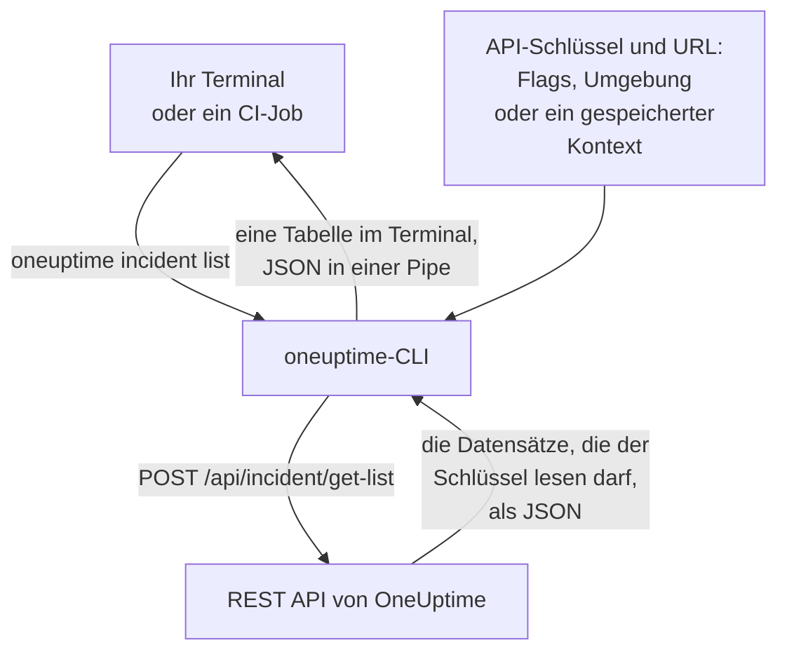

# CLI – Übersicht

Die OneUptime-CLI, `oneuptime`, verwaltet Ihr OneUptime-Projekt aus einem Terminal oder einem Skript. Sie listet, liest, erstellt, ändert, löscht und zählt Monitore, Vorfälle, Warnungen, Statusseiten und die anderen Datensätze, die die OneUptime-API anbietet, mit einem API-Schlüssel Ihres Projekts.

:::cards
- [Wie die CLI arbeitet](#wie-die-cli-arbeitet): Ein Befehl, eine API-Anfrage, eine Antwort.
- [Die CLI installieren](#die-cli-installieren): Ein npm-Befehl, und welche Version Sie wählen.
- [Die ersten Befehle ausführen](#die-ersten-befehle-ausführen): Speichern Sie Ihren API-Schlüssel und listen Sie dann Ihre Vorfälle auf.
- [Die Befehle auf einen Blick](#die-befehle-auf-einen-blick): Jeder Befehl und die Seite, die ihn erklärt.
:::

## Wie die CLI arbeitet

Jeder Befehl sendet eine Anfrage an die REST API von OneUptime und gibt die Antwort aus. Den API-Schlüssel und die Adresse Ihrer OneUptime-Instanz nimmt die CLI aus Flags, Umgebungsvariablen oder einem Kontext, den `oneuptime login` gespeichert hat. Der Schlüssel entscheidet, was ein Befehl lesen und ändern darf, genau wie bei der API.



Die Befehle für Datensätze bringt die CLI mit: Jede Art von Datensatz, die die OneUptime-API für Werkzeuge öffnet, hat einen, dieselben Datensätze, für die der [MCP-Server](/docs/ai/mcp-server) Werkzeuge hat. `oneuptime resources` listet sie auf.

## Bevor Sie beginnen

- **Node.js und npm**, ein aktuelles LTS-Release, um die CLI zu installieren.
- **Ein API-Schlüssel Ihres Projekts.** Legen Sie einen unter **Projekteinstellungen → Erweitert → API-Schlüssel** mit **API-Schlüssel erstellen** an: siehe [Einen API-Schlüssel anlegen](/docs/api-reference/api-reference#einen-api-schlüssel-anlegen).
- **In OneUptime Cloud der Tarif Growth oder höher.** Die API-Schlüssel eines Projekts funktionieren nur dort: siehe [API-Schlüssel und SCIM unterhalb ihres Tarifs](/docs/api-reference/api-reference#api-schlüssel-und-scim-unterhalb-ihres-tarifs).

## Die CLI installieren

Installieren Sie das Paket `@oneuptime/cli` aus npm. Es fügt den Befehl `oneuptime` hinzu, und `--version` gibt die installierte Version aus:

```bash
npm install -g @oneuptime/cli
oneuptime --version
```

Die CLI erscheint mit OneUptime und hat dieselbe Versionsnummer. Bei einer selbst gehosteten OneUptime-Instanz installieren Sie die CLI in der Version Ihrer Instanz, damit ihre Befehle zu den Datensätzen Ihres Servers passen:

```bash
npm install -g @oneuptime/cli@<your-oneuptime-version>
```

> [!WARNING]
> CLI-Versionen vor 14.0.64 brechen gleich beim Start ab, mit einem Fehler wie `Cannot find module 'Common/Models/DatabaseModels/Index'`. Installieren Sie 14.0.64 oder neuer mit `npm install -g @oneuptime/cli@latest`. Ist Ihre selbst gehostete OneUptime-Instanz älter als 14.0.64, [aktualisieren Sie zuerst OneUptime](/docs/installation/upgrading#so-führen-sie-ein-upgrade-durch) und installieren Sie dann die CLI in der Version, auf die Sie aktualisiert haben.

## Die ersten Befehle ausführen

:::steps
### Ihren API-Schlüssel speichern

Melden Sie sich mit dem Schlüssel und der Adresse Ihrer OneUptime-Instanz an. Die CLI speichert beides als Kontext namens `default` und verwendet ihn ab jetzt:

```bash
oneuptime login <your-api-key> https://oneuptime.com
```

Sie antwortet `Logged in successfully. Context "default" is now active.` Bei einer selbst gehosteten Instanz verwenden Sie deren Adresse anstelle von `https://oneuptime.com`.

### Ihre Vorfälle auflisten

```bash
oneuptime incident list
```

Die zehn neuesten Vorfälle erscheinen als Tabelle. `login` speichert den Schlüssel, ohne ihn zu prüfen, daher zeigt erst dieser Befehl, dass der Schlüssel funktioniert: Wird er abgelehnt, siehe [Fehlerbehebung](/docs/cli/authentication#fehlerbehebung).

### Sehen, was Sie sonst noch verwalten können

```bash
oneuptime resources
```

Die Liste zeigt jede Art von Datensatz, mit der Sie arbeiten können, und ihren Befehl, etwa `monitor`, `status-page` oder `on-call-policy`.
:::

## Die Befehle auf einen Blick

| Befehl | Was er tut | Mehr dazu |
| --- | --- | --- |
| `oneuptime login <api-key> <instance-url>` | Speichert einen API-Schlüssel und eine Adresse als Kontext | [Authentifizierung](/docs/cli/authentication#anmelden) |
| `oneuptime context list`, `use`, `current`, `delete` | Listet, wechselt, zeigt und löscht gespeicherte Kontexte | [Authentifizierung](/docs/cli/authentication#kontexte) |
| `oneuptime whoami` | Zeigt die URL und den API-Schlüssel, die der nächste Befehl verwendet | [Authentifizierung](/docs/cli/authentication#prüfen-was-die-cli-verwenden-wird) |
| `oneuptime deploy` | Zeichnet einen Deploy oder eine andere Änderung für die Diagramme und OneUptime AI auf | [Deploys und Änderungen](/docs/telemetry/change-events) |
| `oneuptime <resource> list`, `get`, `create`, `update`, `delete`, `count` | Arbeitet mit einer Art von Datensatz | [Ressourcenoperationen](/docs/cli/resource-operations) |
| `oneuptime resources` | Listet die Arten von Datensätzen mit ihren Befehlen auf | [Befehlsreferenz](/docs/cli/command-reference#oneuptime-resources) |
| `oneuptime version` | Gibt die Version der CLI aus | [Befehlsreferenz](/docs/cli/command-reference#oneuptime-version) |
| `oneuptime help [command]` | Zeigt die Hilfe eines Befehls | [Hilfe erhalten](#hilfe-erhalten) |

## Globale Optionen

Diese Optionen funktionieren mit jedem Befehl, davor oder dahinter:

| Option | Was sie tut |
| --- | --- |
| `--api-key <key>` | Der API-Schlüssel für diesen Befehl, anstelle des gespeicherten |
| `--url <url>` | Die Adresse Ihrer OneUptime-Instanz für diesen Befehl |
| `--context <name>` | Ein gespeicherter Kontext für diesen Befehl, anstelle des aktuellen |
| `-o, --output <format>` | `table`, `json` oder `wide`: siehe [Ausgabeformate](/docs/cli/output-formats) |
| `--no-color` | Gibt ohne Farben aus |
| `-V, --version` | Gibt die Version der CLI aus |
| `-h, --help` | Zeigt die Hilfe des Befehls |

## Hilfe erhalten

Jeder Befehl hat seine eigene Hilfe, mit seinen Argumenten, Optionen und Standardwerten:

```bash
oneuptime --help
oneuptime help incident
oneuptime incident list --help
```

## Nächste Schritte

:::cards
- [Authentifizierung](/docs/cli/authentication): Kontexte für jede Umgebung, und welchen Schlüssel ein Befehl verwendet.
- [Ressourcenoperationen](/docs/cli/resource-operations): Datensätze auflisten, lesen, erstellen, ändern, löschen und zählen.
- [Ausgabeformate](/docs/cli/output-formats): Tabellen für Menschen, JSON für Skripte.
- [Skripting & CI/CD](/docs/cli/scripting): Exit-Codes, jq und Pipelines.
- [Befehlsreferenz](/docs/cli/command-reference): Jeder Befehl, jede Option und jeder Standardwert.
:::
