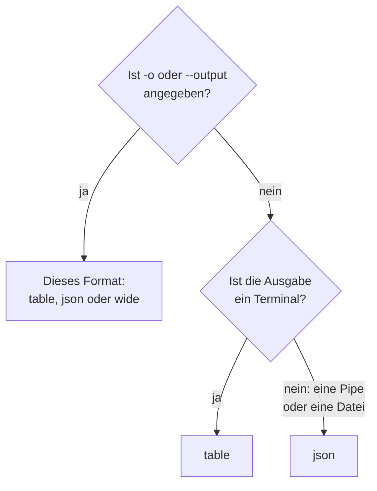

# Ausgabeformate

Die CLI gibt eine Tabelle aus, wenn Sie ihre Antwort in einem Terminal lesen, und JSON, wenn ein Skript oder ein anderes Programm sie liest. Wählen Sie das Format jedes Befehls mit `-o` oder `--output`.

:::cards
- [Wie das Format gewählt wird](#wie-das-format-gewählt-wird): Ein Terminal bekommt eine Tabelle, eine Pipe bekommt JSON.
- [Tabelle](#tabelle): Sechs Spalten, jeder Wert nach 60 Zeichen abgeschnitten.
- [JSON](#json): Jedes Feld, vollständig, für Skripte und jq.
- [Breit](#breit): Eine Tabelle mit jeder Spalte.
:::

## Wie das Format gewählt wird



| Format | Was es ausgibt | Am besten für |
| --- | --- | --- |
| `table` | Eine Tabelle mit bis zu sechs Spalten; ein einzelner Datensatz als eine Zeile je Feld | Das Lesen im Terminal |
| `json` | Die Antwort, wie OneUptime sie gesendet hat, um zwei Leerzeichen eingerückt | Skripte, `jq` und Dateien |
| `wide` | Eine Tabelle mit einer Spalte für jedes Feld | Viele Felder auf einen Blick vergleichen |

`-o` funktioniert bei jedem Befehl, der Datensätze ausgibt: `list`, `get`, `create`, `update` und `count` einer Ressource, `oneuptime resources` und `oneuptime context list`. Es kann überall auf der Befehlszeile stehen. Jeder andere Wert wird abgelehnt, bevor eine Anfrage gesendet wird:

```text
error: option '-o, --output <format>' argument 'yaml' is invalid. Allowed choices are json, table, wide.
```

## Tabelle

Eine Tabelle ist im Terminal der Standard. `oneuptime resources --type analytics` zum Beispiel gibt diese aus:

```text
┌────────────────────────────┬────────────────────────────┬─────────────────────────────┬───────────┬─────────────────────────────┐
│ Command                    │ Singular                   │ Plural                      │ Type      │ API Path                    │
├────────────────────────────┼────────────────────────────┼─────────────────────────────┼───────────┼─────────────────────────────┤
│ log                        │ Log                        │ Logs                        │ analytics │ /logs                       │
├────────────────────────────┼────────────────────────────┼─────────────────────────────┼───────────┼─────────────────────────────┤
│ span                       │ Span                       │ Spans                       │ analytics │ /span                       │
├────────────────────────────┼────────────────────────────┼─────────────────────────────┼───────────┼─────────────────────────────┤
│ metric                     │ Metric                     │ Metrics                     │ analytics │ /metrics                    │
├────────────────────────────┼────────────────────────────┼─────────────────────────────┼───────────┼─────────────────────────────┤
│ exception-instance         │ Exception Instance         │ Exception Instances         │ analytics │ /exceptions                 │
├────────────────────────────┼────────────────────────────┼─────────────────────────────┼───────────┼─────────────────────────────┤
│ monitor-log                │ Monitor Log                │ Monitor Logs                │ analytics │ /monitor-log                │
├────────────────────────────┼────────────────────────────┼─────────────────────────────┼───────────┼─────────────────────────────┤
│ kubernetes-cost-allocation │ Kubernetes Cost Allocation │ Kubernetes Cost Allocations │ analytics │ /kubernetes-cost-allocation │
├────────────────────────────┼────────────────────────────┼─────────────────────────────┼───────────┼─────────────────────────────┤
│ security-event             │ Security Event             │ Security Events             │ analytics │ /security-events            │
├────────────────────────────┼────────────────────────────┼─────────────────────────────┼───────────┼─────────────────────────────┤
│ change-event               │ Change Event               │ Change Events               │ analytics │ /change-events              │
├────────────────────────────┼────────────────────────────┼─────────────────────────────┼───────────┼─────────────────────────────┤
│ threat-intel-indicator     │ Threat Intel Indicator     │ Threat Intel Indicators     │ analytics │ /threat-intel-indicators    │
└────────────────────────────┴────────────────────────────┴─────────────────────────────┴───────────┴─────────────────────────────┘

Total: 9 resources
```

Für eine Liste von Datensätzen zeigt eine Tabelle bis zu sechs Spalten: zuerst `_id`, `name`, `title`, `status`, `createdAt` und `updatedAt`, soweit die Datensätze sie haben, dann die nächsten Felder der Datensätze der Reihe nach. Die Spalten werden aus dem ersten Datensatz genommen. Ein Wert, der länger als 60 Zeichen ist, wird auf seine ersten 57 gekürzt, gefolgt von `...`.

Ein einzelner Datensatz, wie `get` und `create` ihn ausgeben, ist eine Tabelle mit zwei Spalten: der Name des Felds und sein Wert, eine Zeile je Feld.

OneUptime sendet Daten und die IDs anderer Datensätze als Objekte, etwa `{"_type":"DateTime","value":"2026-10-14T09:12:44.000Z"}`, und eine Tabelle zeigt sie als diesen Text. Ihr Wert steht in `value`: siehe [JSON](#json).

## JSON

JSON ist die Antwort, wie OneUptime sie gesendet hat, um zwei Leerzeichen eingerückt: Eine Liste ist ein Array von Datensätzen, und ein einzelner Datensatz ist ein Objekt.

```bash
oneuptime incident list --limit 1 -o json
```

```json
[
  {
    "_id": "6f1c2a40-3b1e-4c55-9a0b-3e2f8d7c1a11",
    "createdAt": {
      "_type": "DateTime",
      "value": "2026-10-14T09:12:44.000Z"
    },
    "title": "Checkout API is down",
    "currentIncidentStateId": {
      "_type": "ObjectID",
      "value": "0b7d5e2c-8f4a-4d1b-9c3e-5a6f7b8c9d0e"
    }
  }
]
```

Ein Datensatz hat jedes Feld, das der Schlüssel lesen darf; dieser hier ist auf vier gekürzt. Die eigene `_id` eines Datensatzes ist Text, und die anderen IDs und die Daten sind Objekte, deren `value` sie enthält:

```bash
oneuptime incident list -o json | jq -r '.[] | "\(.createdAt.value)  \(.title)"'
```

Wenn die Ausgabe kein Terminal ist, wie in `oneuptime incident list | jq '.[].title'`, gibt die CLI JSON auch ohne `-o json` aus. Schreiben Sie `-o json` in Skripten trotzdem, damit sie nicht davon abhängen.

## Breit

`-o wide` ist eine Tabelle mit einer Spalte für jedes Feld der Datensätze. Jeder Wert wird weiterhin nach 60 Zeichen abgeschnitten, und Datensätze haben viele Felder, daher ist eine breite Tabelle sehr breit: Blättern Sie mit `less -S` durch sie.

```bash
oneuptime incident list -o wide | less -S
```

## Farben

Tabellenköpfe sind cyan; Meldungen sind grün, wenn etwas geklappt hat, blau für Informationen und rot für Fehler. Schalten Sie Farben mit `--no-color` aus oder indem Sie `NO_COLOR` auf einen beliebigen Wert setzen:

```bash
oneuptime incident list --no-color
NO_COLOR=1 oneuptime incident list
```

## Was jeder Befehl ausgibt

Datensätze und Anzahlen gehen in die Standardausgabe und Fehler in die Standardfehlerausgabe, sodass eine Pipe nur die Antwort liest.

| Befehl | In einer Tabelle | In JSON |
| --- | --- | --- |
| Ein `list`, das nichts findet | `No results found.` | `[]` |
| Ein `get` oder ein `create` | Eine Zeile je Feld | Der Datensatz |
| Ein `count` | Die Zahl | Die Zahl |
| Ein `update` | Eine leere Zeile | `{}` |
| Ein `delete` | `Monitor <id> deleted successfully.` | Dieselbe Zeile |

## Nächste Schritte

:::cards
- [Skripting & CI/CD](/docs/cli/scripting): Das JSON in Skripten und Pipelines mit jq lesen.
- [Ressourcenoperationen](/docs/cli/resource-operations): Die Operationen, deren Antworten das sind.
- [Befehlsreferenz](/docs/cli/command-reference): Jeder Befehl und jede Option.
:::
