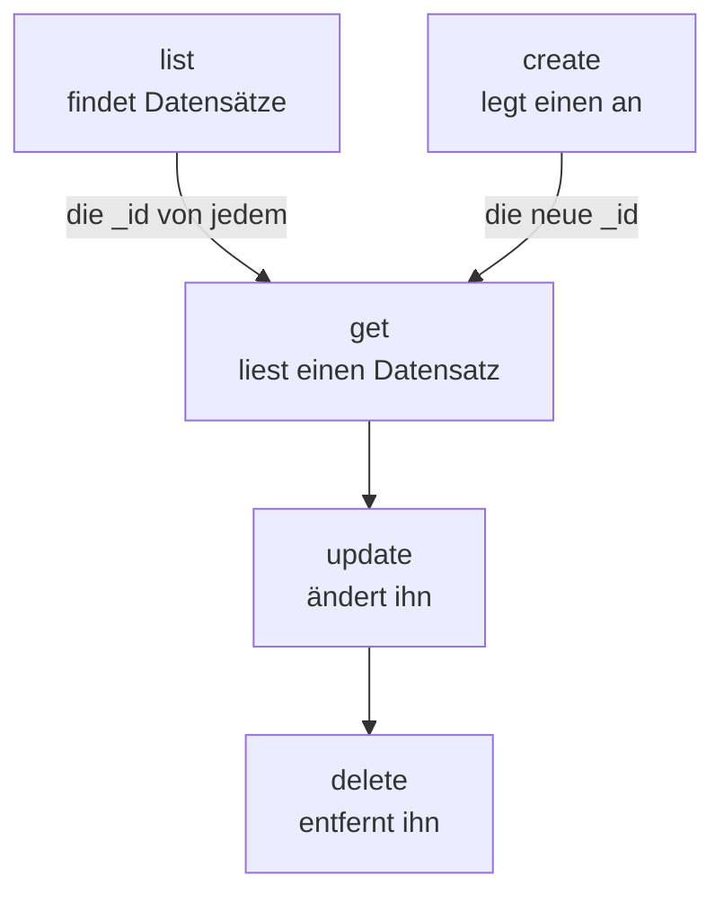

# Ressourcenoperationen

Jede Art von Datensatz ist ein eigener Befehl, etwa `incident`, `monitor` oder `status-page`, und jeder nimmt dieselben Operationen: `list`, `get`, `create`, `update`, `delete` und `count`. Diese Seite zeigt jede Operation, mit Filtern, Seiten und dem JSON, in dem ein Datensatz geschrieben wird.

:::cards
- [Den Befehl für einen Datensatz finden](#den-befehl-für-einen-datensatz-finden): oneuptime resources listet sie alle auf.
- [Datensätze auflisten](#datensätze-auflisten): Filtern, sortieren und blättern.
- [Einen Datensatz erstellen](#einen-datensatz-erstellen): Aus JSON auf der Befehlszeile oder in einer Datei.
- [Einen Datensatz löschen](#einen-datensatz-löschen): Sofort und ohne Rückgängig.
:::

## Wie die Operationen zusammenspielen

Lesen, Ändern und Löschen eines Datensatzes brauchen seine ID. Auflisten, Zählen und Erstellen brauchen keine, und eine Liste oder ein Erstellen liefert Ihnen die IDs, die die anderen nehmen:



Eine ID ist eine UUID, etwa `6f1c2a40-3b1e-4c55-9a0b-3e2f8d7c1a11`. Sie können eine auch auf der Seite des Datensatzes in OneUptime kopieren: siehe [Die ID einer Ressource finden](/docs/api-reference/api-reference#die-id-einer-ressource-finden).

## Den Befehl für einen Datensatz finden

```bash
oneuptime resources
```

Die Liste zeigt jede Art von Datensatz mit ihrem Befehl, ihren Namen, ihrem Typ und ihrem API-Pfad. Es gibt zwei Typen:

| Typ | Was er enthält | Operationen |
| --- | --- | --- |
| `database` | Datensätze, die Sie verwalten: Monitore, Vorfälle, Warnungen, Statusseiten, Teams und mehr | `list`, `get`, `create`, `update`, `delete`, `count` |
| `analytics` | Telemetrie: Logs, Spans, Metriken, Ausnahmen und andere Ereignisse | `list`, `create`, `count` |

Zeigen Sie einen Typ mit `oneuptime resources --type database` oder `--type analytics`. Die [Befehlsreferenz](/docs/cli/command-reference#ressourcen) listet jeden Befehl auf.

## Datensätze auflisten

```bash
oneuptime <resource> list [--query <json>] [--limit <n>] [--skip <n>] [--sort <json>] [-o <format>]
```

| Option | Was sie tut | Standard |
| --- | --- | --- |
| `--query <json>` | Gibt nur die passenden Datensätze zurück: siehe [Eine Liste filtern](#eine-liste-filtern) | Jeder Datensatz, den der Schlüssel lesen darf |
| `--limit <n>` | Die meisten zurückzugebenden Datensätze, bis zu 10.000 | `10` |
| `--skip <n>` | Wie viele passende Datensätze zuerst übersprungen werden | `0` |
| `--sort <json>` | Die Reihenfolge, etwa `{"createdAt":"ASC"}`, oder `"DESC"` für die neuesten zuerst | Die neuesten zuerst |
| `-o, --output <format>` | `table`, `json` oder `wide` | `table` im Terminal, `json` in einer Pipe |

```bash
# The ten newest incidents
oneuptime incident list

# The oldest monitors first, 50 at a time: the second page
oneuptime monitor list --sort '{"createdAt":"ASC"}' --limit 50 --skip 50

# Every field of each incident, as JSON
oneuptime incident list -o json
```

Eine Liste fragt OneUptime nach jedem Feld jedes Datensatzes, das der Schlüssel lesen darf. Eine Tabelle zeigt sechs davon; JSON zeigt sie alle (siehe [Ausgabeformate](/docs/cli/output-formats)). Um durch alle Datensätze zu blättern, erhöhen Sie `--skip` um `--limit`, bis eine Seite leer zurückkommt; `count` sagt, wie viele es gibt.

Beschriftungen werden nach Namen statt mit den neuesten zuerst aufgelistet: Beschriftungen, deren Namen mit einer Zahl beginnen, kommen zuerst, in der Reihenfolge dieser Zahl (`2. Team` vor `10. Owner`), danach die übrigen alphabetisch. Für eine andere Reihenfolge geben Sie `--sort` an.

### Eine Liste filtern

`--query` nimmt denselben Filter wie die API: Ein Feld mit einem Wert passt zu diesem Wert, und ein Objekt mit einem `_type` vergleicht.

| Filter | Passt zu |
| --- | --- |
| `{"title":"Checkout API is down"}` | Datensätzen mit genau diesem Wert |
| `{"title":{"_type":"Search","value":"checkout"}}` | Text, der den Wert enthält |
| `{"createdAt":{"_type":"GreaterThan","value":"2026-10-01T00:00:00.000Z"}}` | Späteren Daten oder größeren Zahlen |
| `{"currentIncidentState":{"isResolvedState":false}}` | Einem Feld eines Datensatzes, den die Ressource nennt: hier Vorfällen, die nicht gelöst sind |

```bash
oneuptime incident list --query '{"title":{"_type":"Search","value":"checkout"}}'
```

[Filtern, sortieren und blättern](/docs/api-reference/api-reference#filtern-sortieren-und-blättern) in der API-Referenz listet jeden `_type` auf.

## Einen Datensatz lesen

```bash
oneuptime <resource> get <id> [-o <format>]
```

```bash
oneuptime incident get 6f1c2a40-3b1e-4c55-9a0b-3e2f8d7c1a11
```

Eine Tabelle zeigt eine Zeile für jedes Feld des Datensatzes, jeden Wert nach 60 Zeichen abgeschnitten; `-o json` zeigt die Werte vollständig. Eine ID, die keinen Datensatz nennt, den Ihr Schlüssel lesen darf, antwortet mit `Not found`, und der Befehl endet mit dem Code `3`.

## Einen Datensatz erstellen

```bash
oneuptime <resource> create --data <json> [-o <format>]
oneuptime <resource> create --file <path> [-o <format>]
```

`--data` nimmt den Datensatz als JSON, und `--file` liest ihn aus einer JSON-Datei. Geben Sie eines von beiden an; sind beide angegeben, wird die Datei verwendet. Die Felder sind die der API, und die [API-Referenz](/reference) listet die jeder Ressource auf. Das Projekt kommt aus dem API-Schlüssel, ein Datensatz nennt es also nie.

```bash
# A manual monitor
oneuptime monitor create --data '{"name":"Checkout API","monitorType":"Manual"}'

# An incident with one of your severities
oneuptime incident create --data '{"title":"Checkout API is down","incidentSeverityId":"<severity-id>"}'

# The same incident, from a file
oneuptime incident create --file incident.json
```

Die CLI gibt den neuen Datensatz mit seiner `_id` aus. Ein Vorfall beginnt im Erstellt-Status Ihres Projekts, es sei denn, `currentIncidentStateId` nennt einen anderen: siehe [Der Status, in dem ein neuer Datensatz beginnt](/docs/api-reference/api-reference#der-status-in-dem-ein-neuer-datensatz-beginnt). So finden Sie die IDs Ihrer Schweregrade:

```bash
oneuptime incident-severity list -o json | jq -r '.[] | "\(._id)  \(.name)"'
```

> [!TIP]
> Unter Windows legen Sie das JSON in eine Datei und verwenden `--file`: PowerShell und die Eingabeaufforderung setzen JSON auf der Befehlszeile anders in Anführungszeichen als Bash.

## Einen Datensatz aktualisieren

```bash
oneuptime <resource> update <id> --data <json> [-o <format>]
```

`--data` ist Pflicht und enthält nur die zu ändernden Felder:

```bash
# Rename a monitor
oneuptime monitor update <monitor-id> --data '{"name":"Checkout API (EU)"}'

# Move an incident to your resolved state
oneuptime incident update <incident-id> --data '{"currentIncidentStateId":"<resolved-state-id>"}'
```

OneUptime beantwortet eine Aktualisierung mit einem leeren Objekt: Die CLI gibt eine leere Zeile aus, oder `{}` mit `-o json`. Führen Sie `get` aus, um den Datensatz in seinem jetzigen Stand zu sehen. Wird ein Vorfall auf diesem Weg in einen anderen Status versetzt, wird die Änderung in seinem Verlauf festgehalten, wie im Dashboard, und ein Status vor seinem aktuellen wird abgelehnt. So finden Sie die ID des Gelöst-Status, des ersten in der Reihenfolge Ihres Projekts:

```bash
oneuptime incident-state list --query '{"isResolvedState":true}' --sort '{"order":"ASC"}' --limit 1 -o json | jq -r '.[0]._id'
```

## Einen Datensatz löschen

```bash
oneuptime <resource> delete <id>
```

```bash
oneuptime monitor delete 6f1c2a40-3b1e-4c55-9a0b-3e2f8d7c1a11
```

Sie antwortet `Monitor 6f1c2a40-3b1e-4c55-9a0b-3e2f8d7c1a11 deleted successfully.`

> [!CAUTION]
> `delete` entfernt den Datensatz sofort. Die CLI fragt nicht nach einer Bestätigung, und es gibt kein Rückgängig. Sie akzeptiert `--force` für Skripte, die damit geschrieben wurden, und `--force` ändert nichts.

## Datensätze zählen

```bash
oneuptime <resource> count [--query <json>]
```

```bash
# Every incident
oneuptime incident count

# Incidents that are not resolved
oneuptime incident count --query '{"currentIncidentState":{"isResolvedState":false}}'
```

Die CLI gibt eine Zahl aus, in einer Tabelle wie in JSON dieselbe, sodass ein Skript sie so lesen kann, wie sie ist.

## Was jeder Typ kann

| Operation | `database` | `analytics` |
| --- | --- | --- |
| `list` | Ja | Ja |
| `get` | Ja | Nein |
| `create` | Ja | Ja |
| `update` | Ja | Nein |
| `delete` | Ja | Nein |
| `count` | Ja | Ja |

## Fehlerbehebung

:::details Meldung „Not found: API error (404)“
Der Datensatz existiert nicht, liegt in einem anderen Projekt oder ist einer, den der Schlüssel nicht lesen darf: OneUptime antwortet für jeden Fall gleich. Prüfen Sie die ID mit `list` und die Berechtigungen des Schlüssels. Der Befehl endet mit dem Code `3`.
:::

:::details Meldung „API error (422): You do not have permissions to select on“
Eine Liste oder ein Lesen fragt nach jedem Feld des Datensatzes, und der Schlüssel darf eines davon nicht lesen: Die Meldung nennt das Feld und die Berechtigungen, die es lesen dürfen. Geben Sie dem Schlüssel eine dieser Berechtigungen.
:::

:::details Meldung „Error: Invalid JSON“
Der Wert von `--query`, `--sort` oder `--data` ist kein JSON. Setzen Sie ihn in Bash und zsh in einfache Anführungszeichen; unter Windows legen Sie einen Datensatz in eine Datei und verwenden `--file`.
:::

:::details API error (400) beim Erstellen oder Aktualisieren
OneUptime hat ein Feld abgelehnt: Die Meldung nennt es. `No fields to update` bedeutet, dass `--data` kein zu änderndes Feld enthielt.
:::

## Nächste Schritte

:::cards
- [Ausgabeformate](/docs/cli/output-formats): Die Antworten als Tabellen oder als JSON lesen.
- [Skripting & CI/CD](/docs/cli/scripting): Diese Operationen in Skripten und Pipelines verwenden.
- [Befehlsreferenz](/docs/cli/command-reference): Jeder Befehl, jede Option und jeder Standardwert.
:::
