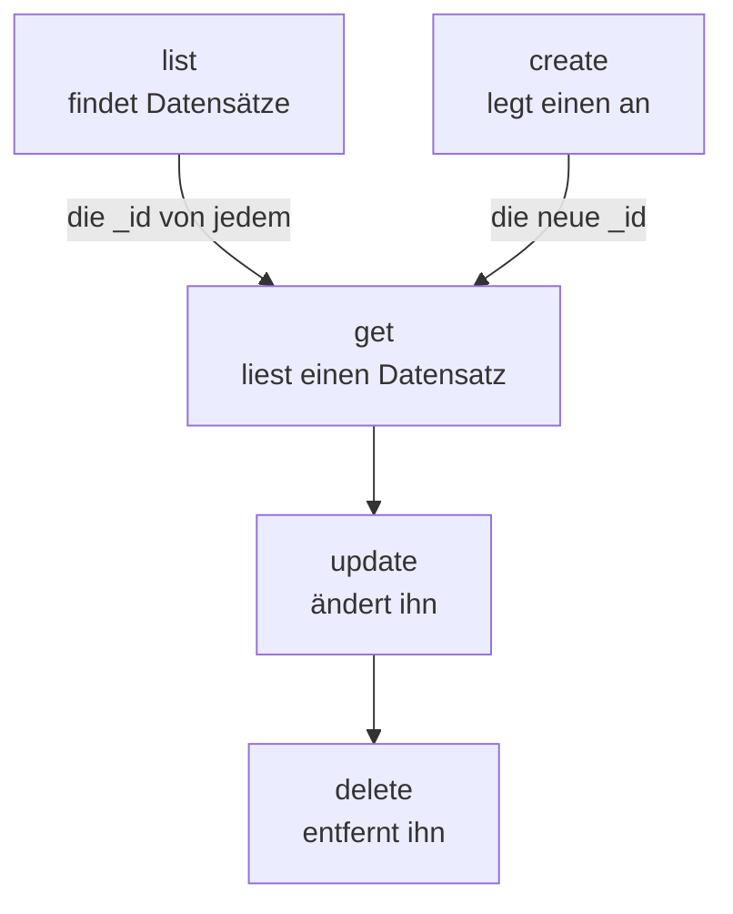

# Ressourcenoperationen

Jede Art von Datensatz ist ein eigener Befehl, etwa `incident`, `monitor` oder `status-page`, mit den Operationen, die die API für sie annimmt: für die meisten `list`, `get`, `create`, `update`, `delete` und `count`. Diese Seite zeigt jede Operation, mit Filtern, Seiten und den Flags, mit denen ein Datensatz geschrieben wird, und die Befehle, die tun, was die Schaltflächen des Dashboards tun.

:::cards
- [Den Befehl für einen Datensatz finden](#den-befehl-für-einen-datensatz-finden): oneuptime resources listet sie alle auf.
- [Datensätze auflisten](#datensätze-auflisten): Filtern, sortieren und blättern.
- [Einen Datensatz erstellen](#einen-datensatz-erstellen): Ein Flag für jedes Feld oder der Datensatz als JSON.
- [Bestätigen, beheben und Notizen hinzufügen](#bestätigen-beheben-und-notizen-hinzufügen): Die Schaltflächen des Dashboards als Befehle.
- [Einen Datensatz löschen](#einen-datensatz-löschen): Sofort und ohne Rückgängig.
:::

## Wie die Operationen zusammenspielen

Lesen, Ändern und Löschen eines Datensatzes brauchen seine ID. Auflisten, Zählen und Erstellen brauchen keine, und eine Liste oder ein Erstellen liefert Ihnen die IDs, die die anderen nehmen:



Eine ID ist eine UUID, etwa `6f1c2a40-3b1e-4c55-9a0b-3e2f8d7c1a11`. Sie können eine auch auf der Seite des Datensatzes in OneUptime kopieren: siehe [Die ID einer Ressource finden](/docs/api-reference/api-reference#die-id-einer-ressource-finden).

## Den Befehl für einen Datensatz finden

```bash
oneuptime resources
```

Die Liste zeigt jede Art von Datensatz mit ihrem Befehl, ihren Namen, ihrem Typ und ihrem API-Pfad. Es gibt zwei Typen:

| Typ | Was er enthält |
| --- | --- |
| `database` | Datensätze, die Sie verwalten: Monitore, Vorfälle, Warnungen, Statusseiten, Teams und mehr |
| `analytics` | Telemetrie: Logs, Spans, Metriken, Ausnahmen und andere Ereignisse |

Zeigen Sie einen Typ mit `oneuptime resources --type database` oder `--type analytics`. Die [Befehlsreferenz](/docs/cli/command-reference#ressourcen) listet jeden Befehl auf.

Eine Ressource nimmt die Operationen an, die die API für sie annimmt. Die meisten nehmen alle sechs; eine, die OneUptime selbst schreibt, etwa ein E-Mail-Protokoll, wird nur gelesen. `oneuptime <resource> --help` listet die Unterbefehle einer Ressource auf.

## Die Felder einer Ressource sehen

`fields` listet die Felder einer Ressource aus der CLI selbst auf, ohne API-Schlüssel und ohne Anfrage:

```bash
oneuptime incident fields
```

Jedes Feld hat seinen Typ, wozu es dient, ob ein Erstellen es angeben muss, und das Flag, das es setzt. Ein Feld, das eine ID enthält, nennt die Ressource, zu der die ID gehört: `incidentSeverityId` nimmt eine aus `oneuptime incident-severity list`. Mit `-o json` liest ein Skript oder ein KI-Agent dasselbe, mit denselben Schlüsseln für jedes Feld: `name`, `title`, `type`, `description`, `required`, `create`, `update`, `read`, `flag`, `emailFlag` und `relatedResource`.

## Datensätze auflisten

```bash
oneuptime <resource> list [--query <json>] [--limit <n>] [--skip <n>] [--sort <json>] [--fields <names>] [--all] [-o <format>]
```

| Option | Was sie tut | Standard |
| --- | --- | --- |
| `--query <json>` | Gibt nur die passenden Datensätze zurück: siehe [Eine Liste filtern](#eine-liste-filtern) | Jeder Datensatz, den der Schlüssel lesen darf |
| `--limit <n>` | Die meisten zurückzugebenden Datensätze, bis zu 10.000 | `10` |
| `--skip <n>` | Wie viele passende Datensätze zuerst übersprungen werden | `0` |
| `--sort <json>` | Die Reihenfolge, etwa `{"createdAt":"ASC"}`, oder `"DESC"` für die neuesten zuerst | Die neuesten zuerst |
| `--fields <names>` | Die zurückzugebenden Felder, durch Kommas getrennt, etwa `title,createdAt` | Jedes Feld, das der Schlüssel lesen darf |
| `--all` | Jeder passende Datensatz, Seite für Seite, anstelle von `--limit` und `--skip`. Nur Datensätze | |
| `-o, --output <format>` | `table`, `json` oder `wide` | `table` im Terminal, `json` in einer Pipe |

```bash
# The ten newest incidents
oneuptime incident list

# The oldest monitors first, 50 at a time: the second page
oneuptime monitor list --sort '{"createdAt":"ASC"}' --limit 50 --skip 50

# Every field of each incident, as JSON
oneuptime incident list -o json

# The title, the state and the creation date of every incident
oneuptime incident list --all --fields title,currentIncidentState.name,createdAt -o json
```

Eine Liste fragt OneUptime nach jedem Feld jedes Datensatzes, das der Schlüssel lesen darf. `--fields` fragt stattdessen nach den genannten Feldern und, nach einem Punkt, nach einem Feld eines verknüpften Datensatzes, wie in `currentIncidentState.name`. Eine Tabelle zeigt sechs Felder; JSON zeigt sie alle (siehe [Ausgabeformate](/docs/cli/output-formats)). `--all` liest jede Seite, 100 Datensätze auf einmal, bis zu 100.000; `count` sagt, wie viele es gibt.

Beschriftungen werden nach Namen statt mit den neuesten zuerst aufgelistet: Beschriftungen, deren Namen mit einer Zahl beginnen, kommen zuerst, in der Reihenfolge dieser Zahl (`2. Team` vor `10. Owner`), danach die übrigen alphabetisch. Für eine andere Reihenfolge geben Sie `--sort` an.

### Eine Liste filtern

`--query` nimmt denselben Filter wie die API: Ein Feld mit einem Wert passt zu diesem Wert, und ein Objekt mit einem `_type` vergleicht.

| Filter | Passt zu |
| --- | --- |
| `{"title":"Checkout API is down"}` | Datensätzen mit genau diesem Wert |
| `{"title":{"_type":"Search","value":"checkout"}}` | Text, der den Wert enthält |
| `{"createdAt":{"_type":"GreaterThan","value":"2026-10-01T00:00:00.000Z"}}` | Späteren Daten oder größeren Zahlen |
| `{"currentIncidentState":{"isResolvedState":false}}` | Einem Feld eines Datensatzes, den die Ressource nennt: hier Vorfällen, die nicht gelöst sind |

```bash
oneuptime incident list --query '{"title":{"_type":"Search","value":"checkout"}}'
```

[Filtern, sortieren und blättern](/docs/api-reference/api-reference#filtern-sortieren-und-blättern) in der API-Referenz listet jeden `_type` auf.

## Einen Datensatz lesen

```bash
oneuptime <resource> get <id> [--fields <names>] [-o <format>]
```

```bash
oneuptime incident get 6f1c2a40-3b1e-4c55-9a0b-3e2f8d7c1a11
```

Eine Tabelle zeigt eine Zeile für jedes Feld des Datensatzes, jeden Wert nach 60 Zeichen abgeschnitten; `-o json` zeigt die Werte vollständig. Eine ID, die keinen Datensatz nennt, den Ihr Schlüssel lesen darf, antwortet mit `Not found`, und der Befehl endet mit dem Code `3`.

## Einen Datensatz erstellen

```bash
oneuptime <resource> create [--<field> <value>]... [--data <json>] [--file <path>] [-o <format>]
```

Jedes Feld, das ein Erstellen annimmt, hat ein Flag: `--title <text>`, `--incident-severity-id <id>`, `--labels <ids>` für durch Kommas getrennte IDs, `--is-visible-on-status-page [true|false]` für ein Ja-oder-Nein-Feld, wahr, wenn allein angegeben, und `--monitor-steps <json>` für ein Feld, das JSON enthält. `oneuptime <resource> create --help` listet sie auf, und [`fields`](#die-felder-einer-ressource-sehen) sagt, wozu jedes dient. Das Projekt kommt aus dem API-Schlüssel, ein Datensatz nennt es also nie.

```bash
# A manual monitor
oneuptime monitor create --name "Checkout API" --monitor-type Manual

# An incident with one of your severities
oneuptime incident create --title "Checkout API is down" --incident-severity-id <severity-id>

# The same incident, from a file
oneuptime incident create --file incident.json
```

`--data` nimmt den Datensatz als JSON, und `--file` liest ihn aus einer JSON-Datei, mit den Feldern der API: Die [API-Referenz](/reference) listet die jeder Ressource auf. Sind beide angegeben, wird die Datei verwendet, und Flags gelten zusätzlich zu beidem.

Ein Feld, das eine Person über ihre Benutzer-ID nennt, hat ein zweites Flag, das sie über ihre E-Mail-Adresse nennt: `--user-email` neben `--user-id`, `--owner-user-emails` neben `--owner-users`. Die CLI findet sie unter den Mitgliedern des Projekts des API-Schlüssels und den dazu eingeladenen Personen. Ein Teammitglied, das über eine Adresse genannt wird, die niemand im Projekt hat, wird dazu eingeladen, wie beim Einladen aus dem Dashboard:

```bash
oneuptime team-member create --team-id <team-id> --user-email alice@example.com
```

Die CLI gibt den neuen Datensatz mit seiner `_id` aus. Ein Vorfall beginnt im Erstellt-Status Ihres Projekts, es sei denn, `currentIncidentStateId` nennt einen anderen: siehe [Der Status, in dem ein neuer Datensatz beginnt](/docs/api-reference/api-reference#der-status-in-dem-ein-neuer-datensatz-beginnt). So finden Sie die IDs Ihrer Schweregrade:

```bash
oneuptime incident-severity list -o json | jq -r '.[] | "\(._id)  \(.name)"'
```

> [!TIP]
> Unter Windows geben Sie die Felder mit ihren Flags an oder legen das JSON in eine Datei und verwenden `--file`: PowerShell und die Eingabeaufforderung setzen JSON auf der Befehlszeile anders in Anführungszeichen als Bash.

## Einen Datensatz aktualisieren

```bash
oneuptime <resource> update <id> [--<field> <value>]... [--data <json>] [--file <path>] [-o <format>]
```

Geben Sie nur die zu ändernden Felder an, mit ihren Flags oder als JSON:

```bash
# Rename a monitor
oneuptime monitor update <monitor-id> --name "Checkout API (EU)"

# Record an incident's root cause
oneuptime incident update <incident-id> --root-cause "A full disk on the primary database"
```

OneUptime beantwortet eine Aktualisierung mit einem leeren Objekt: Die CLI gibt eine leere Zeile aus, oder `{}` mit `-o json`. Führen Sie `get` aus, um den Datensatz in seinem jetzigen Stand zu sehen. Um einen Vorfall in einen anderen Status zu versetzen, geben Sie `--current-incident-state-id` an: Die Änderung wird in seinem Verlauf festgehalten, wie im Dashboard, und ein Status vor seinem aktuellen wird abgelehnt. [`acknowledge` und `resolve`](#bestätigen-beheben-und-notizen-hinzufügen) finden den Status für Sie. So finden Sie die ID des Gelöst-Status, des ersten in der Reihenfolge Ihres Projekts:

```bash
oneuptime incident-state list --query '{"isResolvedState":true}' --sort '{"order":"ASC"}' --limit 1 -o json | jq -r '.[0]._id'
```

## Bestätigen, beheben und Notizen hinzufügen

Vorfälle, Warnungen, ihre Episoden und geplante Wartungsereignisse haben Befehle für das, was die Schaltflächen des Dashboards bei ihnen tun:

| Befehl | Was er tut | Ressourcen |
| --- | --- | --- |
| `acknowledge <id>` | Versetzt den Datensatz in den Bestätigt-Status Ihres Projekts | `incident`, `alert`, `incident-episode`, `alert-episode` |
| `resolve <id>` | Versetzt ihn in den Gelöst-Status Ihres Projekts | Dieselben vier |
| `start <id>` | Versetzt das Ereignis in den Laufend-Status Ihres Projekts | `scheduled-maintenance-event` |
| `end <id>` | Versetzt es in den Beendet-Status Ihres Projekts | `scheduled-maintenance-event` |
| `add-note <id> --note <markdown>` | Fügt eine Notiz hinzu, die nur lesen kann, wer den Datensatz sehen kann, oder mit `--public` eine auf den Statusseiten des Datensatzes | Alle fünf |

```bash
oneuptime incident acknowledge 6f1c2a40-3b1e-4c55-9a0b-3e2f8d7c1a11
oneuptime incident add-note 6f1c2a40-3b1e-4c55-9a0b-3e2f8d7c1a11 --note "Rolled back the 14:05 deploy."
oneuptime incident resolve 6f1c2a40-3b1e-4c55-9a0b-3e2f8d7c1a11
```

`acknowledge` antwortet `Incident 6f1c2a40-3b1e-4c55-9a0b-3e2f8d7c1a11 acknowledged: it is in Acknowledged now.` Ein Datensatz, der schon in diesem Status ist oder darüber hinaus, bleibt, wie er ist: Der Befehl sagt es und endet mit `0`. Mit `-o json` antwortet er mit der `_id` des Datensatzes, der `action`, ob sich etwas geändert hat (`changed`), und dem Status `state`, in dem der Datensatz ist. Warnungen und Warnungsepisoden nehmen nur interne Notizen an.

## Einen Datensatz löschen

```bash
oneuptime <resource> delete <id>
```

```bash
oneuptime monitor delete 6f1c2a40-3b1e-4c55-9a0b-3e2f8d7c1a11
```

Sie antwortet `Monitor 6f1c2a40-3b1e-4c55-9a0b-3e2f8d7c1a11 deleted successfully.` Mit `-o json` antwortet sie mit der `_id` des Datensatzes und `"deleted": true`.

> [!CAUTION]
> `delete` entfernt den Datensatz sofort. Die CLI fragt nicht nach einer Bestätigung, und es gibt kein Rückgängig. Sie akzeptiert `--force` für Skripte, die damit geschrieben wurden, und `--force` ändert nichts.

## Datensätze zählen

```bash
oneuptime <resource> count [--query <json>]
```

```bash
# Every incident
oneuptime incident count

# Incidents that are not resolved
oneuptime incident count --query '{"currentIncidentState":{"isResolvedState":false}}'
```

Die CLI gibt eine Zahl aus, in einer Tabelle wie in JSON dieselbe, sodass ein Skript sie so lesen kann, wie sie ist.

## Fehlerbehebung

:::details Meldung „Not found: API error (404)“
Der Datensatz existiert nicht, liegt in einem anderen Projekt oder ist einer, den der Schlüssel nicht lesen darf: OneUptime antwortet für jeden Fall gleich. Prüfen Sie die ID mit `list` und die Berechtigungen des Schlüssels. Der Befehl endet mit dem Code `3`.
:::

:::details Meldung „Left out fields this API key may not read“
Eine Liste oder ein Lesen fragt nach jedem Feld des Datensatzes, und OneUptime lehnt ein Feld ab, das der Schlüssel nicht lesen darf: Die CLI fragt ohne es erneut und nennt die ausgelassenen Felder in der Standardfehlerausgabe. Geben Sie dem Schlüssel eine Berechtigung, die sie liest, oder nennen Sie die benötigten Felder mit `--fields`: Ein dort genanntes Feld, das der Schlüssel nicht lesen darf, beendet den Befehl mit `API error (422)`.
:::

:::details Meldung „Error: Invalid JSON“
Der Wert von `--query`, `--sort` oder `--data` ist kein JSON. Setzen Sie ihn in Bash und zsh in einfache Anführungszeichen; unter Windows geben Sie die Felder mit ihren Flags an oder legen einen Datensatz in eine Datei und verwenden `--file`.
:::

:::details API error (400) beim Erstellen oder Aktualisieren
OneUptime hat ein Feld abgelehnt: Die Meldung nennt es, und `oneuptime <resource> fields` listet die Felder mit den Flags auf, die sie setzen. Ein Befehl, der gar kein Feld angibt, wird abgelehnt, bevor er gesendet wird, mit den anzugebenden Flags.
:::

:::details Meldung „No one in this project, or invited to it, has the email address“
Ein E-Mail-Flag nennt jemanden, der weder Mitglied im Projekt des API-Schlüssels noch dazu eingeladen ist. Laden Sie die Person mit `oneuptime team-member create --team-id <team-id> --user-email <email>` ein oder nennen Sie sie über ihre Benutzer-ID.
:::

## Nächste Schritte

:::cards
- [Ausgabeformate](/docs/cli/output-formats): Die Antworten als Tabellen oder als JSON lesen.
- [Skripting & CI/CD](/docs/cli/scripting): Diese Operationen in Skripten und Pipelines verwenden.
- [Befehlsreferenz](/docs/cli/command-reference): Jeder Befehl, jede Option und jeder Standardwert.
:::
