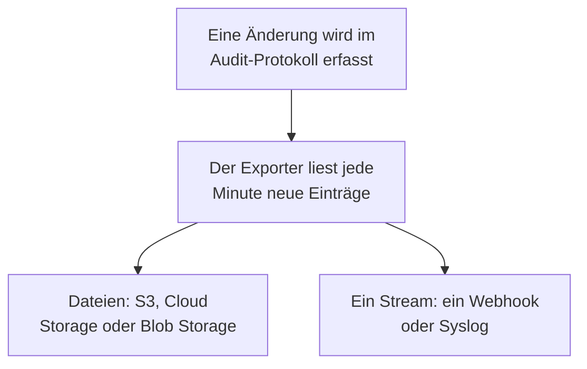

# Audit-Protokoll-Export

Senden Sie das Audit-Protokoll, sobald es erfasst wird, an einen Speicher oder einen Dienst Ihrer Wahl: Amazon S3 oder S3-kompatiblen Speicher, Google Cloud Storage, Azure Blob Storage, einen Webhook oder Syslog. Bewahren Sie die Einträge dort so lange auf, wie Ihre Compliance-Prüfungen es verlangen, und durchsuchen Sie sie in Ihrem SIEM. Die Owner und Admins eines Projekts exportieren dessen Audit-Protokoll aus den Projekteinstellungen, und Master-Admins exportieren das aller Projekte aus dem Admin Dashboard. Es gehört in OneUptime Cloud zum Enterprise-Tarif und beim Selbsthosten zur Enterprise Edition.

:::cards
- [Einen Export einrichten](#einen-export-einrichten): Ein Ziel wählen, testen, speichern.
- [Was gesendet wird](#was-gesendet-wird): Ein JSON-Objekt pro Eintrag, in einem stabilen Schema.
- [Wann Einträge gesendet werden](#wann-einträge-gesendet-werden): Jede Minute, jeder Eintrag einmal, der Reihe nach.
- [Wenn ein Ziel ausfällt](#wenn-ein-ziel-ausfällt): Wiederholungen, der Fehler, und nichts wird übersprungen.
:::

## Wie ein Eintrag Ihr Ziel erreicht



- **Ein Export, ein Ziel.** Ein Projekt kann mehrere Exporte haben, und jeder sendet jeden Eintrag an sein eigenes Ziel.
- **Für ein Projekt oder die ganze Instanz.** Der Export eines Projekts sendet die Einträge dieses Projekts. Ein im Admin Dashboard eingerichteter Export sendet die Einträge aller Projekte, die Audit-Protokolle erfassen.
- **Ab dem Speichern.** Ein Export sendet, was nach seinem Speichern erfasst wird, außer Sie setzen **Exportieren ab** auf ein früheres Datum.

## Bevor Sie beginnen

- **In OneUptime Cloud, der Enterprise-Tarif.** In anderen Tarifen zeigt die Seite, was die Funktion tut und wie Sie sie bekommen.
- **Beim Selbsthosten, die Enterprise Edition**, mit einer Lizenz, die Audit-Protokolle enthält. Siehe [Enterprise Edition](/docs/self-hosted/enterprise).
- **Eingeschaltete Audit-Protokollierung** in jedem Projekt, das Sie exportieren. Siehe [Audit-Protokolle](/docs/configuration/audit-logs).
- **Ein Project Owner oder Project Admin**, um das Audit-Protokoll eines Projekts zu exportieren, oder ein Master-Admin, um das der Instanz zu exportieren.

## Einen Export einrichten

:::steps
### Die Exportseite öffnen

Gehen Sie für ein Projekt zu **Projekteinstellungen → Audit-Protokolle → Export**. Für die ganze Instanz gehen Sie im Admin Dashboard zu **Einstellungen → Audit-Protokoll-Export**.

### Ein Ziel wählen

Klicken Sie auf **Export hinzufügen** und wählen Sie eines der sechs Ziele unten. Das Ziel eines Exports lässt sich später nicht ändern.

### Angeben, wie es erreicht wird

Füllen Sie aus, was das Ziel verlangt. Einstellungen, die die meisten unverändert lassen, warten unter **Weitere Felder**, und **Einrichtungsanleitung** öffnet den Abschnitt des Ziels auf dieser Seite.

### Einen Test senden

Klicken Sie auf **Testdatei schreiben** oder **Testeintrag senden**. Ein Speicher erhält die Datei `oneuptime-audit-log-export-test.ndjson.gz` in seinem Ordner, und ein Webhook oder Syslog erhält einen Eintrag, dessen Aktion `Test` ist. Ein fehlgeschlagener Test sagt, was zu beheben ist.

### Den Export starten

Klicken Sie auf **Weiter**, geben Sie dem Export einen Namen und klicken Sie auf **Export starten**. Die ersten Einträge kommen innerhalb weniger Minuten an.
:::

Die Zeile des Exports zeigt, wie es um ihn steht: **Exportiert**, **Fehlerhaft**, **Pausiert**, **Wartet auf Einträge** oder **Wird gestartet**. **Test senden** sendet einen Test mit den gespeicherten Einstellungen, und **Bearbeiten** ändert sie: Eine Anmeldeinformation, die Sie leer lassen, behält die gespeicherte.

## Ziele

| Ziel | Was ankommt | Anmeldung mit |
| --- | --- | --- |
| [Amazon S3](#amazon-s3) | Komprimierte NDJSON-Dateien | Einem Zugriffsschlüssel |
| [S3-kompatibler Speicher](#s3-kompatibler-speicher) | Komprimierte NDJSON-Dateien | Einem Zugriffsschlüssel |
| [Google Cloud Storage](#google-cloud-storage) | Komprimierte NDJSON-Dateien | Einem Dienstkontoschlüssel |
| [Azure Blob Storage](#azure-blob-storage) | Komprimierte NDJSON-Dateien | Einem SAS-Token oder einem Zugriffsschlüssel |
| [Webhook](#webhook) | HTTPS-Anfragen | Einem optionalen Header und Signaturgeheimnis |
| [Syslog](#syslog) | RFC-5424-Nachrichten | Keiner |

### Amazon S3

| Feld | Was Sie eingeben |
| --- | --- |
| **Bucket** | Der Bucket, in den die Dateien geschrieben werden. |
| **Region** | Die Region des Buckets. Sie steht anfangs auf `us-east-1`. |
| **Zugriffsschlüssel-ID** | Ein Zugriffsschlüssel, der Objekte in den Bucket schreiben darf. |
| **Geheimer Zugriffsschlüssel** | Das Geheimnis des Schlüssels. |
| **Ordner** | Unter **Weitere Felder**. Leer gelassen, landen die Dateien in `oneuptime/audit-logs/`. |

Der Schlüssel braucht nur `s3:PutObject` auf dem Ordner:

```json
{
  "Version": "2012-10-17",
  "Statement": [
    {
      "Effect": "Allow",
      "Action": "s3:PutObject",
      "Resource": "arn:aws:s3:::my-audit-logs/oneuptime/audit-logs/*"
    }
  ]
}
```

### S3-kompatibler Speicher

Dieselben Felder wie bei Amazon S3, nach einem **Endpunkt**: der S3-Adresse des Speichers, etwa `https://minio.example.com:9000` oder `https://<account>.r2.cloudflarestorage.com`. Setzen Sie **Region** auf die Region, die der Speicher erwartet: `us-east-1` für MinIO und den Standard von Wasabi, `auto` für Cloudflare R2.

### Google Cloud Storage

Geben Sie den **Bucket** ein und fügen Sie einen **Dienstkontoschlüssel** (JSON) ein, dessen Dienstkonto auf dem Bucket die Rolle Storage Object Creator hat. **Ordner** wartet unter **Weitere Felder**.

### Azure Blob Storage

Geben Sie das **Speicherkonto** und den **Container** ein und wählen Sie unter **Anmelden mit**, wie sich der Export anmeldet: mit einem **SAS-Token** mit der Berechtigung Create und Write auf dem Container oder mit einem **Zugriffsschlüssel** des Speicherkontos. Ein SAS-Token lässt sich auf diesen Container beschränken und ist darum die sicherere Wahl. **Cloud** und **Ordner** warten unter **Weitere Felder**.

### Webhook

OneUptime sendet jeden Batch per POST an die **URL**, als JSON-Array (`application/json`) oder als einen Eintrag pro Zeile (`application/x-ndjson`), wie es **Format des Inhalts** festlegt, mit diesen Headern:

| Header | Wert |
| --- | --- |
| `X-OneUptime-Event` | `audit-log-export` |
| `X-OneUptime-Batch-Id` | Die ID des ersten Eintrags im Batch: Derselbe Batch trägt beim erneuten Senden dieselbe ID. |
| `X-OneUptime-Entry-Count` | Wie viele Einträge der Inhalt enthält. |
| `X-OneUptime-Signature` | `sha256=` und der HMAC-SHA256 des Inhalts, mit dem **Signaturgeheimnis**, wenn eines gesetzt ist. |

Die **Anmeldedaten**, etwa `Bearer <token>`, werden in dem Header gesendet, den Sie unter **Header-Name** wählen, `Authorization`, solange Sie ihn nicht ändern. **Format des Inhalts**, **Header-Name** und **Signaturgeheimnis** warten unter **Weitere Felder**. Jede 2xx-Antwort gilt als Zustellung. Ein `413` teilt den Batch in zwei Hälften, und jede andere Ablehnung sendet später den ganzen Batch erneut.

### Syslog

Jeder Eintrag ist eine Nachricht nach RFC 5424 an **Host** und **Port**, über TLS auf Port `6514`, sofern **Protokoll** nicht TCP festlegt, mit Facility 13 (log audit) und Severity 6 (informational):

```text
<110>1 2026-10-24T09:15:03.000Z oneuptime.example.com oneuptime - audit-log - {"schemaVersion":1,"id":"..."}
```

Nachrichten werden per Oktettzählung (RFC 5425) getrennt, sofern **Nachrichtentrennung** nicht eine Nachricht pro Zeile festlegt. Ein Empfänger, dessen Zertifikat eine private CA signiert hat, braucht das Zertifikat dieser CA unter **CA-Zertifikat**. Beide warten unter **Weitere Felder**.

## Was gesendet wird

Jeder Eintrag ist ein JSON-Objekt, seine Schlüssel immer in dieser Reihenfolge:

| Schlüssel | Was er enthält |
| --- | --- |
| `schemaVersion` | `1`. Eine Änderung am Schema kommt mit einer neuen Version. |
| `id` | Die ID des Eintrags. Derselbe Eintrag hat auch zweimal gesendet dieselbe ID. |
| `createdAt` | Wann die Änderung erfasst wurde, in UTC. |
| `projectId` | Das Projekt, in dem die Änderung vorgenommen wurde. |
| `action` | `Create`, `Update`, `Delete` oder `Download`. |
| `resourceType`, `resourceId`, `resourceName` | Was geändert wurde. |
| `rootResourceType`, `rootResourceId` | Die Ressource, zu der es gehört, etwa ein SLO für seine Regel. |
| `userId`, `userName`, `userEmail`, `userType` | Wer die Änderung vorgenommen hat. |
| `apiKeyId`, `apiKeyName` | Der API-Schlüssel, mit dem sie vorgenommen wurde, falls vorhanden. |
| `mcpOAuthGrantId`, `mcpClientName` | Der MCP-Client, über den sie vorgenommen wurde, falls vorhanden. |
| `workflowId`, `workflowName` | Der Workflow, der sie vorgenommen hat, falls vorhanden. |
| `changes` | Jedes geänderte Feld: `field`, mit `oldValue` und `newValue`. |

Eine Datei enthält einen Eintrag pro Zeile, mit gzip komprimiert, und wird unter der Stunde ihres ersten Eintrags abgelegt: `oneuptime/audit-logs/2026/10/24/09/20261024T091503Z_<first entry id>.ndjson.gz`.

Schlüssel, Tokens und Passwörter gehen nie hinaus: Sie werden als `[REDACTED]` erfasst, und Felder, die niemand lesen darf, fehlen in jedem Eintrag.

## Wann Einträge gesendet werden

- **Jede Minute.** Einträge, die vor mehr als einer Minute erfasst wurden, werden die ältesten zuerst gelesen und in Batches gesendet: bis zu 5.000 Einträge oder 16 MB pro Datei und 500 Einträge pro Webhook-Anfrage oder Syslog-Verbindung.
- **Dateien werden nicht für jeden Eintrag geschrieben.** Eine Datei wird geschrieben, wenn ein Batch voll ist oder sein erster Eintrag fünf Minuten alt ist.
- **Jeder Eintrag einmal, der Reihe nach.** Nach jeder Zustellung merkt sich der Export den zuletzt gesendeten Eintrag, sodass ein Neustart oder ein anderer Worker dort weitermacht.
- **Eine Wiederholung ist erkennbar.** Ein Batch, der nach einem Absturz erneut gesendet wird, schreibt denselben Dateinamen oder trägt dieselbe `X-OneUptime-Batch-Id`, und jeder Eintrag trägt seine `id`.

## Wenn ein Ziel ausfällt

Ein Batch wird dreimal im Abstand weniger Sekunden versucht, dann wartet der Export, bevor er es erneut versucht: eine Minute, dann zwei, vier und so weiter, bis zu einer Stunde. Seine Zeile sagt **Fehlerhaft**, und **Fehler anzeigen** zeigt, was das Ziel geantwortet hat und wann der nächste Versuch kommt.

Nichts wird übersprungen: Die Einträge warten im Audit-Protokoll, und die nächste Zustellung, die gelingt, holt ab dem ältesten auf. Ein Eintrag, der älter ist als die Aufbewahrung des Audit-Protokolls seines Projekts, wird gelöscht, bevor er gesendet werden kann, beheben Sie einen fehlerhaften Export also innerhalb dieser Zeit.

Um einen Export zu pausieren, wählen Sie im Menü seiner Zeile **Ausschalten**: Er behält seine Stelle, und **Einschalten** sendet, was in der Zwischenzeit erfasst wurde. In OneUptime Cloud hört ein Projekt, das den Enterprise-Tarif verlässt, mit dem Exportieren auf, und seine Exporte warten unter der Upgrade-Karte, wo sie ausgeschaltet oder gelöscht werden können. Beim Selbsthosten hört das Exportieren auf, solange die Lizenz keine Audit-Protokolle enthält, und macht dort weiter, wo es aufgehört hat, sobald eine Lizenz sie enthält.

## Fehlerbehebung

:::details Der Test meldet, dass der Zugriff verweigert wird
Der Schlüssel, das Token oder das Dienstkonto darf dort, wo der Export schreibt, nicht schreiben. Geben Sie ihm die Berechtigung, Objekte im Ordner anzulegen, wie es der Abschnitt jedes Ziels oben zeigt, und senden Sie den Test dann erneut.
:::

:::details Der Test erreicht die Adresse nicht
Der Export eines Projekts in OneUptime Cloud kann keine private Netzwerkadresse erreichen. Beim Selbsthosten kann er das, sofern `DATA_SOURCE_BLOCK_PRIVATE_ADDRESSES` nicht `true` ist, und ein im Admin Dashboard eingerichteter Export kann es immer. Loopback- und Link-Local-Adressen werden nie erreicht.
:::

:::details Nichts kommt an
Prüfen Sie, ob die Audit-Protokollierung im Projekt eingeschaltet ist und ob nach dem Speichern des Exports jemand etwas geändert hat. Ein Speicher erhält erst dann eine Datei, wenn ein Batch voll oder fünf Minuten alt ist.
:::

## Nächste Schritte

:::cards
- [Audit-Protokolle](/docs/configuration/audit-logs): Was erfasst wird und wie lange es bleibt.
- [Benutzer, Teams & Berechtigungen](/docs/permissions/index): Festlegen, wer einen Export einrichten darf.
- [Enterprise Edition](/docs/self-hosted/enterprise): Audit-Protokolle auf einer selbst gehosteten Installation.
:::
