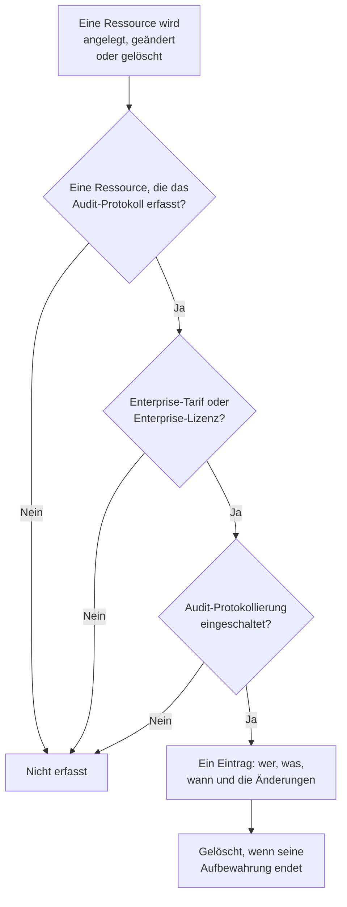

# Audit-Protokolle

Das Audit-Protokoll hält fest, wer was in Ihrem Projekt geändert hat: jedes Anlegen, Ändern und Löschen der Ressourcen, die es erfasst, mit den Werten vorher und nachher, und jedes Mal, wenn sich jemand an- oder abmeldet. Damit finden Sie heraus, wer einen Monitor ausgeschaltet oder einen API-Schlüssel geändert hat, wer sich angemeldet hat und von wo, und führen einen Nachweis für Compliance-Prüfungen. Es gehört in OneUptime Cloud zum Enterprise-Tarif und beim Selbsthosten zur Enterprise Edition.

:::cards
- [Audit-Protokollierung einschalten](#audit-protokollierung-einschalten): Sie ist in jedem Projekt anfangs aus.
- [Das Audit-Protokoll lesen](#das-audit-protokoll-lesen): Wer was geändert hat, und wann.
- [Was erfasst wird](#was-erfasst-wird): Die Ressourcen und Aktionen, die es abdeckt.
- [Anmeldungen und Sitzungen](#anmeldungen-und-sitzungen): Wer sich angemeldet hat, und wie jede Sitzung endete.
- [Wie lange Einträge bleiben](#wie-lange-einträge-bleiben): Von 7 bis 180 Tagen.
:::

## Wie aus einer Änderung ein Eintrag wird

- **Sie ist anfangs aus.** Ein Projekt erfasst nichts, bis jemand die Audit-Protokollierung einschaltet, und nichts von vor diesem Moment.
- **Sie erfasst, was Menschen tun.** Eine Änderung durch eine Person, einen API-Schlüssel, einen MCP-Client oder einen Workflow wird erfasst. Eine Änderung, die OneUptime selbst vornimmt, etwa durch einen Hintergrundjob, bleibt außen vor, außer Sie schalten **Systemereignisse speichern** ein.
- **Einträge lassen sich nicht ändern.** Niemand kann einen Eintrag bearbeiten oder löschen, weder im Dashboard noch über die API. Ein Eintrag verschwindet erst, wenn seine Aufbewahrung endet.

## Bevor Sie beginnen

- **In OneUptime Cloud, der Enterprise-Tarif.** In anderen Tarifen zeigen die Seiten des Audit-Protokolls, was die Funktion tut und wie Sie sie bekommen.
- **Beim Selbsthosten, die Enterprise Edition**, mit einer Lizenz, die Audit-Protokolle enthält. Siehe [Enterprise Edition](/docs/self-hosted/enterprise).
- **Eine Rolle, die das Audit-Protokoll lesen darf.** Project Owner, Project Admin, Settings Admin oder die Berechtigung **Read Audit Log**. Das Einschalten der Audit-Protokollierung und das Ändern ihrer Einstellungen erfordern einen Project Owner, einen Project Admin oder die Berechtigung, das Projekt zu bearbeiten.

## Audit-Protokollierung einschalten

:::steps
### Die Einstellungen des Audit-Protokolls öffnen

Gehen Sie zu **Projekteinstellungen → Audit-Protokolle → Einstellungen**. **Audit-Protokolle** ist im Seitenmenü anfangs eingeklappt: Klicken Sie darauf, um es zu öffnen.

### Die Einstellungen bearbeiten

Klicken Sie auf **Edit Audit Log Settings**.

### Sie einschalten

Schalten Sie **Audit-Protokolle aktivieren** ein, legen Sie **Aufbewahrung (Tage)** fest und entscheiden Sie, ob Sie **Systemereignisse speichern** möchten. Klicken Sie auf **Änderungen speichern**.
:::

| Einstellung | Anfangswert | Was sie bewirkt |
| --- | --- | --- |
| **Audit-Protokolle aktivieren** | Aus | Erfasst ab jetzt Änderungen an den Ressourcen des Projekts. |
| **Aufbewahrung (Tage)** | 7 | Wie viele Tage jeder Eintrag bleibt: von 7 bis 180. |
| **Systemereignisse speichern** | Aus | Erfasst auch die Änderungen, die OneUptime selbst vornimmt und die keine Person und kein Schlüssel angestoßen hat. |

Eine Änderung dieser Einstellungen gilt innerhalb einer Minute.

## Das Audit-Protokoll lesen

**Projekteinstellungen → Audit-Protokolle → Audit-Protokolle** listet jeden Eintrag des Projekts, die neuesten zuerst:

| Spalte | Was sie zeigt |
| --- | --- |
| **Wann** | Wie lange es her ist, mit Datum und Uhrzeit. |
| **Aktion** | `Create`, `Update` oder `Delete`, `Download` für eine Paketmitschnitt-Datei, die jemand heruntergeladen hat, oder `Sign In`, `Sign Out`, `Session Timeout` oder `Session Revoked` für eine Sitzung. |
| **Ressource** | Der Name der Ressource, der sie öffnet, solange es sie gibt, und ihr Typ. |
| **Akteur** | Wer die Änderung vorgenommen hat: eine Person, ein API-Schlüssel, ein Workflow oder `System` für eine Änderung, die OneUptime selbst vorgenommen hat. Kam die Änderung einer Person über einen MCP-Client, nennt der Eintrag ihn. |
| **Änderungen** | Wie viele Felder sich geändert haben, oder bei einem Anlegen oder Löschen erfasst wurden. Bei einer Sitzung, wie sie angemeldet wurde oder warum sie endete. Klicken Sie darauf, um jedes Feld zu sehen. |

Filtern Sie nach **Ressourcentyp**, **Ressourcenname**, **Aktion**, **Benutzer-E-Mail** oder **Zeit**. Eine Änderung listet nur die geänderten Felder, vorher und nachher, und ein Speichern, das nichts ändert, erzeugt keinen Eintrag.

Eine Ressource ohne eigenen Namen wird nach dem benannt, was sie in OneUptime benennt: eine Ausnahme nach ihrem Typ und dem Anfang ihrer Meldung, wobei IDs, Adressen und alles, was wie ein Geheimnis aussieht, maskiert werden, ein Runbook-Lauf nach seinem Runbook, die Telefonnummer einer Richtlinie für eingehende Anrufe nach der Nummer und eine Vorlage oder eine Domain nach ihrem eigenen Namen.

Monitore, Vorfälle, Alarme, Statusseiten, SLOs und viele andere Ressourcen haben auch eine eigene Seite **Audit-Protokolle**, in einem eingeklappten Abschnitt ihres Seitenmenüs wie **Erweitert**. Sie listet nur die Einträge dieser Ressource, mit denen dessen, was zu ihr gehört: Die Seite eines SLO zeigt auch seine Regeln und Owners.

## Was erfasst wird

Alles, was Personen in einem Projekt anlegen, ändern oder löschen, wird erfasst: Monitore, Vorfälle, Alarme, Statusseiten, Workflows und ihre Schritte, Warteschlangen, Dashboards, Bereitschaftsrichtlinien, Teams und wer darin ist, API-Schlüssel und jede Einstellung. **Ressourcentyp** sagt, worum es in einem Eintrag geht, zum Beispiel `Monitor`, `Workflow` oder `Queue`.

| Nicht erfasst | Warum |
| --- | --- |
| Protokolle von Nachrichten | Jedes ist bereits der Nachweis einer E-Mail, SMS, eines Anrufs, einer Push-Benachrichtigung oder Chatnachricht, die OneUptime gesendet oder empfangen hat. |
| Aufzeichnungen von Ausführungen | Jede ist bereits der Nachweis einer Workflow-Ausführung, einer Bereitschaftseskalation, eines Scans, eines Imports oder eines KI-Laufs. |
| Was Agenten und Telemetrie melden | Gefundene Ressourcen, Messwerte und Nutzung ändern sich mit jeder Meldung, nicht weil jemand sie geändert hat. |
| Aktivitätsfeeds | Ein Feed zeigt Änderungen, die das Audit-Protokoll bereits erfasst. |
| Arbeitszustand von OneUptime | Sitzungen der Leser von Statusseiten, wartende Jobs und anderer Zustand, den OneUptime während seiner Arbeit hält. |
| Die eigene Benachrichtigungseinrichtung einer Person | Die Adressen, Nummern und persönlichen Bereitschaftsregeln jeder Person gehören nur ihr. |
| Die eigenen Präferenzen einer Person | Die Produkte, die jede Person in ihrer eigenen oberen Leiste fixiert, gehören nur ihr, und nur sie sieht sie. |

Fügt ein Administrator eine Benachrichtigungsmethode oder eine persönliche Bereitschaftsregel zum Konto einer anderen Person hinzu oder entfernt sie, wird das ebenfalls erfasst, ohne die Adresse oder Nummer selbst.

Felder, die nur OneUptime schreibt, etwa wann ein Host zuletzt gesehen wurde, fehlen in jedem Eintrag, ebenso Felder, die niemand lesen darf. Schreibt OneUptime eines davon, weil jemand darum gebeten hat, etwa wenn eine Ausnahme mit einer anderen zusammengeführt oder eine Webhook-URL zurückgesetzt wird, erfasst der Eintrag es als Änderung dieser Person. Schlüssel, Tokens und Passwörter werden als `[REDACTED]` erfasst: Der Eintrag zeigt, dass sie sich geändert haben, nie ihren Wert. Die Schritte eines Workflows werden als das erfasst, was sich geändert hat, mit den Namen der Einstellungen eines Schritts, aber nie dem, was in sie eingegeben wurde, und das Verschieben eines Schritts auf der Arbeitsfläche wird nicht erfasst.

Was OneUptime tut, weil jemand darum gebeten hat, wird ebenfalls als dessen Änderung erfasst, ob das Projekt Systemereignisse speichert oder nicht:

- Das Starten, Genehmigen, Abschließen, Überspringen und Abbrechen eines Runbook-Laufs. Seine Schritte werden als das erfasst, was mit jedem getan wurde, etwa `Approved "Restart the API" (step 3)`, nie mit dem, was ein Schritt ausgegeben hat.
- Was eine Regel ändert, wenn jemand sie ausführt: die Labels und Eigentümer, die sie hinzufügt, die Datensätze, die eine Datenschutzregel privat macht, die Geräte, die eine Regel zur Standortzuweisung verschiebt, die Geräte und Monitore, die eine Regel für automatischen Import anlegt, und was eine Monitor-Regel einer Statusseite oder eines SLOs an ihrer Seite oder ihrem SLO ändert.
- Das Kaufen, Zuordnen und Freigeben der Telefonnummer einer Richtlinie für eingehende Anrufe.
- Das Auflösen eines Datenalarms, den jemand als erwartet oder als kein Problem markiert.
- Das Zurücksetzen des Links eines Kalender-Feeds.
- Die Teams, denen jemand bei der Anmeldung mit SSO beitritt.

Was eine Regel von sich aus tut, ist eine Änderung von OneUptime selbst und wird erfasst, wenn **Systemereignisse speichern** eingeschaltet ist: die Labels und Eigentümer, die eine Regel beim Anlegen eines Datensatzes hinzufügt, und ein Datensatz, den sie dabei privat macht; die Geräte und Monitore, die eine Regel für automatischen Import aus neuen Scan-Ergebnissen anlegt; und was eine Monitor-Regel einer Statusseite oder eines SLOs ändert, wenn eine Regel, ein Monitor oder ein Label gespeichert wird.

Das Zurücksetzen des KI-Agenten eines Hosts, eines Clusters oder eines Cloud-Kontos wird auf der eigenen Seite **Audit-Protokolle** dieser Ressource als Änderung von `aiAgentResetAt` durch die Person erfasst, die ihn zurückgesetzt hat: wer, und wann. Ebenso das Erstellen eines Schlüssels für den KI-Agenten eines Cloud-Kontos: Die Schlüssel erscheinen als geändert, nie mit einem Schlüssel oder einem Hash. Was ein Agent beim Verbinden und bei seinen Meldungen berichtet, bleibt wie bisher außen vor.

## Anmeldungen und Sitzungen

Jedes Mal, wenn sich ein Mitglied des Projekts bei OneUptime anmeldet, erfasst das Audit-Protokoll das, und noch einmal, wenn diese Sitzung endet. Eine Anmeldung gilt für OneUptime, nicht für ein einzelnes Projekt, daher wird sie in jedem Projekt erfasst, in dem die Person Mitglied ist.

| Aktion | Wann sie erfasst wird |
| --- | --- |
| `Sign In` | Jemand meldet sich an: mit einem Passwort oder einem Anmeldelink, einem Passkey, mit Google, Microsoft, Vercel oder Single Sign-On. |
| `Sign Out` | Die Person meldet sich ab. |
| `Session Timeout` | OneUptime beendet die Sitzung, weil ihre Zeit abgelaufen ist: die Inaktivitätsdauer oder Sitzungsdauer, die ein Server-Admin festgelegt hat, oder 30 Tage ohne Nutzung. |
| `Session Revoked` | OneUptime beendet die Sitzung, weil das Passwort geändert wurde, das Konto gesperrt wurde oder ein Server-Admin die Zwei-Faktor-Authentifizierung zurückgesetzt oder vorgeschrieben hat. |

Die **Ressource** eines Eintrags ist die Sitzung, benannt nach dem Gerät, von dem aus sie angemeldet wurde, etwa `Chrome 130 on macOS`. Sein **Akteur** ist die Person, der die Sitzung gehört, sodass ein Filter nach **Benutzer-E-Mail** jede ihrer Anmeldungen und Sitzungen findet. Seine Details nennen, wie sich die Person angemeldet hat und mit welchem zweiten Faktor, die IP-Adresse und den Standort, und bei einer beendeten Sitzung, wann sie angemeldet wurde, wann sie zuletzt genutzt wurde und wann sie abgelaufen ist. Der eigene SSO-Anbieter eines Projekts wird nur im Audit-Protokoll dieses Projekts genannt.

Anmeldungen und Sitzungen werden erfasst, ob das Projekt Systemereignisse speichert oder nicht. Eine Sitzungsdauer oder 30 Tage ohne Nutzung werden innerhalb weniger Minuten nach ihrem Ablauf erfasst. Eine Inaktivitätsdauer wird erfasst, sobald der offene Tab der Person oder die mobile App OneUptime das nächste Mal erreicht.

## Wie lange Einträge bleiben

Jeder Eintrag bleibt für die **Aufbewahrung (Tage)**, die das Projekt bei seiner Erfassung hatte, und wird dann gelöscht. Eine neue Aufbewahrung gilt für neue Einträge: Die bisher erfassten Einträge behalten ihre Daten. Auch über die API ist eine Aufbewahrung eine ganze Zahl von Tagen von 7 bis 180: Jeder andere Wert wird abgelehnt.

Um Einträge länger als 180 Tage aufzubewahren, senden Sie sie, sobald sie erfasst werden, an Ihren eigenen Speicher oder Ihr SIEM: siehe [Audit-Protokoll-Export](/docs/configuration/audit-log-export). Sie können sie auch über die API mit einem API-Schlüssel lesen, der **Read Audit Log** hat, und dort speichern, wo Sie sie brauchen. Siehe [OneUptime-API-Referenz](/docs/api-reference/api-reference).

## Wenn der Tarif oder die Lizenz keine Audit-Protokolle mehr enthält

- **In OneUptime Cloud** hört ein Projekt, das den Enterprise-Tarif verlässt, mit dem Erfassen auf, und seine Seiten des Audit-Protokolls zeigen die Upgrade-Karte, bis es wieder in dem Tarif ist.
- **Beim Selbsthosten** hört die Audit-Protokollierung mit dem Erfassen auf, wenn die Enterprise-Testphase oder die Kulanzfrist ohne Lizenz endet, oder wenn die Lizenz keine Audit-Protokolle enthält. Das Audit-Protokoll sagt das in Rot. Die bisher erfassten Einträge bleiben erhalten, und das Erfassen geht mit denselben Einstellungen weiter, sobald eine Lizenz aktiviert ist. Siehe [Wenn eine Lizenz abläuft oder fehlt](/docs/self-hosted/enterprise#wenn-eine-lizenz-abläuft-oder-fehlt).

## Fehlerbehebung

:::details Das Audit-Protokoll ist leer
Die Audit-Protokollierung ist anfangs aus und erfasst nichts von vor ihrem Einschalten. Sagt die Liste, dass die Audit-Protokollierung aus ist, folgen Sie ihrem Link zu den Einstellungen und schalten Sie sie ein. Andernfalls ändern Sie einen Monitor oder einen Vorfall und laden die Liste neu.
:::

:::details Eine Änderung fehlt im Audit-Protokoll
Prüfen Sie, ob die Ressource unter [Was erfasst wird](#was-erfasst-wird) steht und ob die Änderung nach dem Einschalten der Audit-Protokollierung vorgenommen wurde. Eine Änderung, die OneUptime selbst vorgenommen hat, wird nur mit **Systemereignisse speichern** erfasst.
:::

## Nächste Schritte

:::cards
- [Audit-Protokoll-Export](/docs/configuration/audit-log-export): Das Audit-Protokoll an Ihren eigenen Speicher oder Ihr SIEM senden.
- [Benutzer, Teams & Berechtigungen](/docs/permissions/index): Festlegen, wer das Audit-Protokoll lesen darf.
- [Projekteinstellungen](/docs/configuration/project-settings): Die übrigen Einstellungen des Projekts.
- [Abrechnung & Nutzung](/docs/configuration/billing): Den Tarif des Projekts ändern.
- [Enterprise Edition](/docs/self-hosted/enterprise): Audit-Protokolle auf einer selbst gehosteten Installation.
:::
