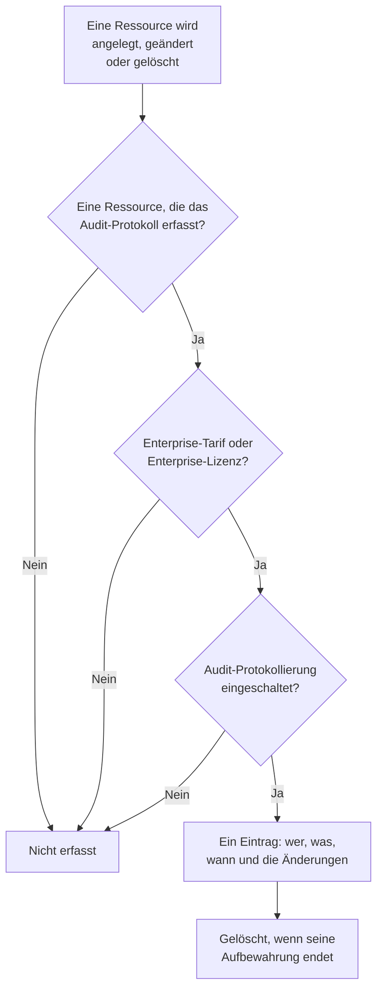

# Audit-Protokolle

Das Audit-Protokoll hält fest, wer was in Ihrem Projekt geändert hat: jedes Anlegen, Ändern und Löschen der Ressourcen, die es erfasst, mit den Werten vorher und nachher. Damit finden Sie heraus, wer einen Monitor ausgeschaltet oder einen API-Schlüssel geändert hat, und führen einen Nachweis für Compliance-Prüfungen. Es gehört in OneUptime Cloud zum Enterprise-Tarif und beim Selbsthosten zur Enterprise Edition.

:::cards
- [Audit-Protokollierung einschalten](#audit-protokollierung-einschalten): Sie ist in jedem Projekt anfangs aus.
- [Das Audit-Protokoll lesen](#das-audit-protokoll-lesen): Wer was geändert hat, und wann.
- [Was erfasst wird](#was-erfasst-wird): Die Ressourcen und Aktionen, die es abdeckt.
- [Wie lange Einträge bleiben](#wie-lange-einträge-bleiben): Von 7 bis 180 Tagen.
:::

## Wie aus einer Änderung ein Eintrag wird

- **Sie ist anfangs aus.** Ein Projekt erfasst nichts, bis jemand die Audit-Protokollierung einschaltet, und nichts von vor diesem Moment.
- **Sie erfasst, was Menschen tun.** Eine Änderung durch eine Person, einen API-Schlüssel, einen MCP-Client oder einen Workflow wird erfasst. Eine Änderung, die OneUptime selbst vornimmt, etwa durch einen Hintergrundjob, bleibt außen vor, außer Sie schalten **Systemereignisse speichern** ein.
- **Einträge lassen sich nicht ändern.** Niemand kann einen Eintrag bearbeiten oder löschen, weder im Dashboard noch über die API. Ein Eintrag verschwindet erst, wenn seine Aufbewahrung endet.

## Bevor Sie beginnen

- **In OneUptime Cloud, der Enterprise-Tarif.** In anderen Tarifen zeigen die Seiten des Audit-Protokolls, was die Funktion tut und wie Sie sie bekommen.
- **Beim Selbsthosten, die Enterprise Edition**, mit einer Lizenz, die Audit-Protokolle enthält. Siehe [Enterprise Edition](/docs/self-hosted/enterprise).
- **Eine Rolle, die das Audit-Protokoll lesen darf.** Project Owner, Project Admin, Settings Admin oder die Berechtigung **Read Audit Log**. Das Einschalten der Audit-Protokollierung und das Ändern ihrer Einstellungen erfordern einen Project Owner, einen Project Admin oder die Berechtigung, das Projekt zu bearbeiten.

## Audit-Protokollierung einschalten

:::steps
### Die Einstellungen des Audit-Protokolls öffnen

Gehen Sie zu **Projekteinstellungen → Audit-Protokolle → Einstellungen**. **Audit-Protokolle** ist im Seitenmenü anfangs eingeklappt: Klicken Sie darauf, um es zu öffnen.

### Die Einstellungen bearbeiten

Klicken Sie auf **Edit Audit Log Settings**.

### Sie einschalten

Schalten Sie **Audit-Protokolle aktivieren** ein, legen Sie **Aufbewahrung (Tage)** fest und entscheiden Sie, ob Sie **Systemereignisse speichern** möchten. Klicken Sie auf **Änderungen speichern**.
:::

| Einstellung | Anfangswert | Was sie bewirkt |
| --- | --- | --- |
| **Audit-Protokolle aktivieren** | Aus | Erfasst ab jetzt Änderungen an den Ressourcen des Projekts. |
| **Aufbewahrung (Tage)** | 7 | Wie viele Tage jeder Eintrag bleibt: von 7 bis 180. |
| **Systemereignisse speichern** | Aus | Erfasst auch die Änderungen, die OneUptime selbst vornimmt und die keine Person und kein Schlüssel angestoßen hat. |

Eine Änderung dieser Einstellungen gilt innerhalb einer Minute.

## Das Audit-Protokoll lesen

**Projekteinstellungen → Audit-Protokolle → Audit-Protokolle** listet jeden Eintrag des Projekts, die neuesten zuerst:

| Spalte | Was sie zeigt |
| --- | --- |
| **Wann** | Wie lange es her ist, mit Datum und Uhrzeit. |
| **Aktion** | `Create`, `Update` oder `Delete`, oder `Download` für eine Paketmitschnitt-Datei, die jemand heruntergeladen hat. |
| **Ressource** | Der Name der Ressource, der sie öffnet, solange es sie gibt, und ihr Typ. |
| **Akteur** | Wer die Änderung vorgenommen hat: eine Person, ein API-Schlüssel, ein Workflow oder `System` für eine Änderung, die OneUptime selbst vorgenommen hat. Kam die Änderung einer Person über einen MCP-Client, nennt der Eintrag ihn. |
| **Änderungen** | Wie viele Felder sich geändert haben, oder bei einem Anlegen oder Löschen erfasst wurden. Klicken Sie darauf, um jedes Feld zu sehen. |

Filtern Sie nach **Ressourcentyp**, **Ressourcenname**, **Aktion**, **Benutzer-E-Mail** oder **Zeit**. Eine Änderung listet nur die geänderten Felder, vorher und nachher, und ein Speichern, das nichts ändert, erzeugt keinen Eintrag.

Monitore, Vorfälle, Alarme, Statusseiten, SLOs und viele andere Ressourcen haben auch eine eigene Seite **Audit-Protokolle**, in einem eingeklappten Abschnitt ihres Seitenmenüs wie **Erweitert**. Sie listet nur die Einträge dieser Ressource, mit denen dessen, was zu ihr gehört: Die Seite eines SLO zeigt auch seine Regeln und Owners.

## Was erfasst wird

| Ressource | **Ressourcentyp** im Protokoll |
| --- | --- |
| Monitore | `Monitor` |
| Vorfälle | `Incident` |
| Alarme | `Alert` |
| Statusseiten | `Status Page` |
| Geplante Wartungsereignisse | `Scheduled Maintenance Event` |
| Bereitschaftsrichtlinien | `On-Call Policy` |
| SLOs | `Service Level Objective` |
| Die Regeln und Owners eines SLO | `SLO Burn Rate Rule`, `SLO Monitor Rule`, `Service Level Objective User Owner`, `Service Level Objective Team Owner` |
| Teams | `Team` |
| Benutzerdefinierte Rollen, und die Teams und API-Schlüssel, die eine erhalten | `Custom Role`, `Team Custom Role`, `API Key Custom Role` |
| Beschriftungen | `Label` |
| Vorfallsstatus und -schweregrade | `Incident State`, `Incident Severity` |
| Warnungsstatus und -schweregrade | `Alert State`, `Alert Severity` |
| Monitor-Status | `Monitor Status` |
| Status geplanter Wartungen | `Scheduled Maintenance State` |
| Vorfallsrollen | `Incident Role` |
| Postmortem-Status | `Postmortem Status` |
| API-Schlüssel | `API Key` |
| MCP-Clients, die Personen verbinden | `MCP Client Authorization` |
| Inventareinträge | `Inventory Item` |
| Collector-Konfigurationen | `Collector Config` |
| vCenter | `vCenter` |
| Paketmitschnitte, und ihre Downloads | `Packet Capture` |
| Sicherheitsfälle mit ihren Prioritäten und Status, Playbooks und ihre Ausführungen, geschützte Entitäten, die Entitätskritikalität sowie das Risiko einer Entität, wenn es jemand zurücksetzt | `Security Case`, `Security Case Priority`, `Security Case Status`, `Security Playbook`, `Security Playbook Run`, `Protected Entity`, `Entity Criticality`, `Entity Risk` |
| Regelausnahmen | `Rule Exception` |
| Beobachtungslisten | `Watchlist` |
| Beobachtungslistenwerte | `Watchlist Value` |
| Bedrohungssuchen | `Hunt` |
| Aufgaben und Belege von Sicherheitsfällen | `Security Case Task`, `Security Case Evidence` |
| Audit-Protokoll-Exporte | `Audit Log Export` |

Fügt ein Administrator eine Benachrichtigungsmethode oder eine persönliche Bereitschaftsregel zum Konto einer anderen Person hinzu oder entfernt sie, wird das ebenfalls erfasst, ohne die Adresse oder Nummer selbst.

Andere Datensätze stehen nicht im Audit-Protokoll, etwa wer in einem Team ist oder eine Berechtigung, die einem Team einzeln hinzugefügt wurde. Felder, die niemand lesen darf, fehlen in jedem Eintrag, und Schlüssel, Tokens und Passwörter werden als `[REDACTED]` erfasst: Der Eintrag zeigt, dass sie sich geändert haben, nie ihren Wert.

## Wie lange Einträge bleiben

Jeder Eintrag bleibt für die **Aufbewahrung (Tage)**, die das Projekt bei seiner Erfassung hatte, und wird dann gelöscht. Eine neue Aufbewahrung gilt für neue Einträge: Die bisher erfassten Einträge behalten ihre Daten.

Um Einträge länger als 180 Tage aufzubewahren, senden Sie sie, sobald sie erfasst werden, an Ihren eigenen Speicher oder Ihr SIEM: siehe [Audit-Protokoll-Export](/docs/configuration/audit-log-export). Sie können sie auch über die API mit einem API-Schlüssel lesen, der **Read Audit Log** hat, und dort speichern, wo Sie sie brauchen. Siehe [OneUptime-API-Referenz](/docs/api-reference/api-reference).

## Wenn der Tarif oder die Lizenz keine Audit-Protokolle mehr enthält

- **In OneUptime Cloud** hört ein Projekt, das den Enterprise-Tarif verlässt, mit dem Erfassen auf, und seine Seiten des Audit-Protokolls zeigen die Upgrade-Karte, bis es wieder in dem Tarif ist.
- **Beim Selbsthosten** hört die Audit-Protokollierung mit dem Erfassen auf, wenn die Enterprise-Testphase oder die Kulanzfrist ohne Lizenz endet, oder wenn die Lizenz keine Audit-Protokolle enthält. Das Audit-Protokoll sagt das in Rot. Die bisher erfassten Einträge bleiben erhalten, und das Erfassen geht mit denselben Einstellungen weiter, sobald eine Lizenz aktiviert ist. Siehe [Wenn eine Lizenz abläuft oder fehlt](/docs/self-hosted/enterprise#wenn-eine-lizenz-abläuft-oder-fehlt).

## Fehlerbehebung

:::details Das Audit-Protokoll ist leer
Die Audit-Protokollierung ist anfangs aus und erfasst nichts von vor ihrem Einschalten. Sagt die Liste, dass die Audit-Protokollierung aus ist, folgen Sie ihrem Link zu den Einstellungen und schalten Sie sie ein. Andernfalls ändern Sie einen Monitor oder einen Vorfall und laden die Liste neu.
:::

:::details Eine Änderung fehlt im Audit-Protokoll
Prüfen Sie, ob die Ressource unter [Was erfasst wird](#was-erfasst-wird) steht und ob die Änderung nach dem Einschalten der Audit-Protokollierung vorgenommen wurde. Eine Änderung, die OneUptime selbst vorgenommen hat, wird nur mit **Systemereignisse speichern** erfasst.
:::

## Nächste Schritte

:::cards
- [Audit-Protokoll-Export](/docs/configuration/audit-log-export): Das Audit-Protokoll an Ihren eigenen Speicher oder Ihr SIEM senden.
- [Benutzer, Teams & Berechtigungen](/docs/permissions/index): Festlegen, wer das Audit-Protokoll lesen darf.
- [Projekteinstellungen](/docs/configuration/project-settings): Die übrigen Einstellungen des Projekts.
- [Abrechnung & Nutzung](/docs/configuration/billing): Den Tarif des Projekts ändern.
- [Enterprise Edition](/docs/self-hosted/enterprise): Audit-Protokolle auf einer selbst gehosteten Installation.
:::
