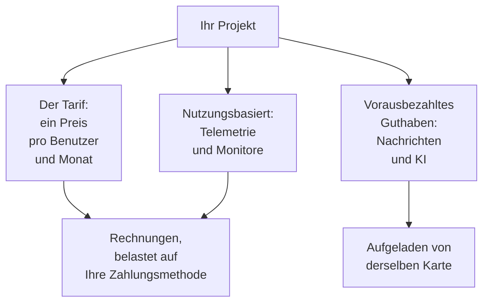

# Abrechnung & Nutzung

In OneUptime Cloud bezahlt ein Projekt seinen Tarif, pro Benutzer, und was es nutzt: Telemetrie, aktive Monitore sowie die Nachrichten und die KI-Arbeit, die es aus vorausbezahltem Guthaben bezahlt. Diese Seite zeigt, wo Sie all das sehen und ändern, und wer es darf. Eine selbst gehostete Installation hat keine Abrechnung und keine dieser Seiten.

:::cards
- [Ihr Tarif und Ihre Plätze](#ihr-tarif-und-ihre-plätze): Was der Tarif kostet und wer als Platz zählt.
- [Zahlungsmethoden](#zahlungsmethoden): Die Karte, mit der Ihre Rechnungen bezahlt werden.
- [Rechnungen](#rechnungen): Bezahlen, herunterladen und prüfen, was Sie genutzt haben.
- [Vorausbezahltes Guthaben](#vorausbezahltes-guthaben): Nachrichten und KI, von Hand oder automatisch aufgeladen.
:::

## Wofür ein Projekt bezahlt

| Was | Wie es berechnet wird |
| --- | --- |
| Der Tarif | Ein Preis pro Benutzer und Monat, monatlich oder jährlich abgerechnet. Jede Person im Projekt ist ein Platz. |
| Telemetrie | $0.10 pro aufgenommenem GB, mit 15 Tagen Aufbewahrung. Längere Aufbewahrung kostet mehr, und Aufbewahrung unter 7 Tagen wird als 7 Tage abgerechnet: siehe [Was Aufbewahrung kostet](/docs/telemetry/data-retention#was-aufbewahrung-kostet). |
| Session Replays | $2 pro GB, mit 15 Tagen Aufbewahrung. |
| Aktive Monitore | $1 pro Monitor und Monat. Jeder Monitor außer einem manuellen ist aktiv, auch wenn er ausgeschaltet ist. |
| SMS, Anrufe, WhatsApp und Telegram | Aus dem Guthaben des Projekts bezahlt, sobald jede Nachricht gesendet wird. |
| OneUptime AI | Aus dem KI-Guthaben des Projekts bezahlt, außer sie läuft auf Ihrem eigenen LLM-Anbieter. |

Die [Preisseite](https://oneuptime.com/pricing) vergleicht die Tarife.

## Bevor Sie beginnen

- **OneUptime Cloud.** Der Abschnitt **Abrechnung und Rechnungen** der **Projekteinstellungen** gibt es nur in OneUptime Cloud, und er ist anfangs eingeklappt: Klicken Sie auf seinen Titel, um ihn zu öffnen.
- **Eine Rolle, die die Abrechnung lesen darf.** Project Owners, Personen mit **Manage Billing** und die drei Abrechnungsrollen lesen jede Abrechnungsseite. Siehe [Wer was darf](#wer-was-darf).

## Ihr Tarif und Ihre Plätze

Gehen Sie zu **Projekteinstellungen → Abrechnung und Rechnungen → Abrechnung**. Die Karte **Aktueller Tarif** zeigt den Tarif des Projekts und seinen Preis pro Benutzer, und **Plätze**: einen für jede Person im Projekt.

Eine Person zählt als Platz ab dem Moment, in dem Sie sie einladen, schon vor der Annahme, bis Sie sie entfernen. Um die Zahl der Plätze zu ändern, laden Sie Personen ein oder entfernen Sie sie: siehe [Personen einladen](/docs/permissions/inviting-people).

## Den Tarif ändern

:::steps
### Zuerst eine Zahlungsmethode hinzufügen

Ein Tarifwechsel braucht eine Zahlungsmethode. Ohne eine öffnet **Tarif ändern** stattdessen **Zahlungsmethode hinzufügen**: siehe [Zahlungsmethoden](#zahlungsmethoden).

### Auf Tarif ändern klicken

Klicken Sie auf der Karte **Aktueller Tarif** auf **Tarif ändern**. **Jahresplan** ist anfangs eingeschaltet: Schalten Sie ihn aus, um die monatlichen Preise zu sehen.

### Den Tarif wählen

Jeder Tarif zeigt seinen Preis pro Benutzer. Der Hinweis unter den Tarifen sagt, was mit Ihrer Testphase geschieht: **Your free trial carries over**, solange das Projekt noch in seiner Testphase ist, und **Changing plan does not start a free trial**, sobald nicht mehr.

### Die Änderung speichern

Klicken Sie auf **Änderungen speichern**. Ein kostenpflichtiger Tarif wird ab dem Moment des Wechsels abgerechnet, und jede Person, die Sie in diesem Tarif einladen, wird bei der Einladung abgerechnet.
:::

API-Schlüssel funktionieren erst ab dem Growth-Tarif, und unterhalb des Scale-Tarifs entfernen SCIM-Verbindungen nur noch Personen. Ein Tarif, der sie stoppt, sagt vor der Wahl, wie viele es betrifft, und die Seite **Abrechnung** zeigt **In diesem Tarif nicht enthalten**, solange sie gestoppt sind. Nichts wird gelöscht: In einem Tarif, der sie enthält, funktionieren sie wieder.

> [!NOTE]
> Haben Sie OneUptime über einen Wiederverkäufer oder einen Cloud-Marketplace gekauft (AWS Marketplace, Microsoft Marketplace, Google Cloud Marketplace oder Vercel Marketplace)? Die Seite **Abrechnung** sagt es. Ein Wiederverkäufer ändert Ihren Tarif für Sie, und ein Marketplace rechnet Tarif und Nutzung des Projekts über Ihre Cloud-Rechnung ab.

## Zahlungsmethoden

Die Karte **Zahlungsmethoden** listet die Karten des Projekts. Rechnungen werden automatisch der Standardkarte belastet.

:::steps
### Auf Zahlungsmethode hinzufügen klicken

Klicken Sie auf der Karte **Zahlungsmethoden** auf **Zahlungsmethode hinzufügen**.

### Die Karte eingeben

Geben Sie die Zahlungsdaten ein und klicken Sie auf **Zahlungsmethode speichern**. Die hinzugefügte Methode wird zum Standard, und mit ihr wird die nutzungsbasierte Abrechnung eingeschaltet. Ihren Tarif ändert sie nicht.
:::

- **Als Standard festlegen** macht eine andere Methode der Liste zu der, die Rechnungen belastet.
- **Autopay neu synchronisieren**, an der Standardmethode, behebt eine Verlängerung, die noch eine ältere Karte belastet.
- Das Projekt behält mindestens eine Zahlungsmethode: Fügen Sie eine weitere hinzu, bevor Sie die letzte löschen.

## Rechnungsadresse und Rechnungs-E-Mail

Die Karte **Geschäftsdaten / Rechnungsadresse** enthält, was Ihre Rechnungen über Sie sagen. Klicken Sie auf **Aktualisieren** und füllen Sie zwei Schritte aus:

| Schritt | Felder |
| --- | --- |
| **Rechnungsadresse** | **Geschäftsdaten / Rechnungsadresse**: der rechtliche Name Ihres Unternehmens, seine Adresse und Steuer- oder USt-IdNr. **Land**: Ihr Rechnungsland. |
| **Rechnungen** | **E-Mail für Finanzen / Buchhaltung**: wohin Rechnungen, Belege und Abrechnungshinweise gehen, mehrere Adressen durch Kommas getrennt. **Rechnungen per E-Mail senden**: jede Rechnung bei Ausstellung dorthin senden. |

## Rechnungen

**Projekteinstellungen → Abrechnung und Rechnungen → Rechnungen** listet die Rechnungen des Projekts, jede mit **Rechnungsnummer**, **Rechnungsdatum**, **Betrag** und **Rechnungsstatus**.

- **Rechnung bezahlen** bezahlt eine Rechnung, die noch offen ist.
- **Herunterladen** öffnet die Rechnung als PDF. Bei einer noch offenen Rechnung steht es im Menü **⋯** der Zeile.

Wenn Ihre Bank eine Zahlung noch verarbeitet, sagt OneUptime das: Manche Banken brauchen bis zu 2 Tage, um eine Kartenzahlung zu bestätigen, und die Rechnung aktualisiert sich von selbst. Bezahlen Sie sie nicht noch einmal.

## Nutzungsverlauf

**Projekteinstellungen → Abrechnung und Rechnungen → Nutzungsverlauf** zeigt die Telemetrie, die das Projekt gesendet hat, eine Zeile pro Produkt, Dienst und Tag:

| Spalte | Was sie zeigt |
| --- | --- |
| **Produkt** | Protokolle, Traces, Metriken und die anderen Arten von Telemetrie. |
| **Tag** | Der Tag, an dem sie gesendet wurde. |
| **Dienst** | Der Dienst, oder der Host, Cluster oder die andere Ressource, die sie gesendet hat. |
| **Aufgenommene Daten (in GB)** | Wie viel ankam. |
| **Datenaufbewahrung (in Tagen)** | Wie lange sie aufbewahrt wird. |
| **Gesamtkosten** | Was sie gekostet hat, in US-Dollar. |

Die Nutzung eines Tages erscheint, sobald der Tag vorbei ist. Filtern Sie nach **Produkt**, **Tag** oder **Dienst**, um zu finden, was gewachsen ist.

## Vorausbezahltes Guthaben

SMS-, Telefon-, WhatsApp- und Telegram-Nachrichten werden aus dem Guthaben des Projekts bezahlt, OneUptime AI aus seinem KI-Guthaben. Sie laden beides im Voraus auf:

| Guthaben | Wo |
| --- | --- |
| SMS, Anrufe, WhatsApp und Telegram | **Projekteinstellungen → Benachrichtigungen → Benachrichtigungseinstellungen** |
| OneUptime AI | **Projekteinstellungen → KI → KI-Guthaben** |

:::steps
### Jetzt aufladen

Klicken Sie auf der Karte **Aktuelles Guthaben** der Seite auf **Guthaben aufladen**. Geben Sie einen Betrag von $20 bis $1,000 ein und klicken Sie auf **Aufladen**. Der Betrag wird der Karte des Projekts belastet.

### Oder automatisch aufladen lassen

Klicken Sie auf der Karte **Automatisches Aufladen** auf **Automatische Aufladung bearbeiten** und schalten Sie **Automatisches Aufladen aktivieren** ein. Anfangs ist es aus. Ist es eingeschaltet, lädt OneUptime $20 auf, sobald das Guthaben auf $10 fällt, oder die Beträge, die Sie wählen.
:::

Wenn ein Guthaben nicht ausreicht, wird die Nachricht nicht gesendet oder OneUptime AI hält an, und die Owners des Projekts erhalten eine E-Mail. Siehe [Wenn eine Alarmierung nicht gesendet wird](/docs/on-call/escalation-rules#wenn-eine-alarmierung-nicht-gesendet-wird) und [Wenn das KI-Guthaben aufgebraucht ist](/docs/ai/ai-sre#wenn-das-ki-guthaben-aufgebraucht-ist).

## Wer was darf

| Um | Es braucht |
| --- | --- |
| Die Abrechnungsseiten lesen: Tarif, Rechnungen, Nutzung, Guthaben und Zahlungsmethoden | Project Owner, **Manage Billing**, **Billing Admin**, **Billing Member** oder **Billing Viewer** |
| Eine Rechnung herunterladen | Project Owner, Project Admin, **Manage Billing**, **Read Invoices**, **Billing Admin** oder **Billing Member** |
| Rechnungsadresse und Rechnungs-E-Mail ändern | Project Owner, **Manage Billing**, **Billing Admin** oder **Billing Member** |
| SMS, Anrufe, WhatsApp oder Telegram ein- oder ausschalten | Project Owner, **Manage Billing** oder **Billing Admin** |
| Eine Zahlungsmethode hinzufügen | Project Owner, **Manage Billing** oder **Create Payment Method** |
| Eine Rechnung bezahlen | Project Owner, **Manage Billing** oder **Edit Invoices** |
| Den Tarif ändern, ein Guthaben aufladen oder das automatische Aufladen ändern | Project Owner oder **Manage Billing** |

Eine Schaltfläche, die Sie nicht nutzen dürfen, erscheint gesperrt und sagt, wer darf. Siehe [Benutzer, Teams & Berechtigungen](/docs/permissions/index#teams) zu den Abrechnungsrollen.

## Einstellungen, die einen Tarif brauchen

In OneUptime Cloud brauchen diese Verwaltungseinstellungen einen Tarif. Eine Seite, deren Tarif Sie nicht haben, zeigt, was die Funktion tut und welchen Tarif sie braucht.

| Einstellung | Der Tarif, den sie braucht |
| --- | --- |
| Beschriftungen | Growth |
| API-Schlüssel | Growth |
| Eigene SMTP-Server und Twilio-Konten | Growth |
| Eigene LLM-Anbieter | Growth |
| MCP-Clients verbinden | Growth |
| Teams anlegen | Scale |
| SSO, OIDC und SCIM | Scale |
| Aufbewahrungs-Überschreibungen | Scale |
| Audit-Protokolle | Enterprise |

## Den Tarif kündigen

Um für ein Projekt nicht mehr zu bezahlen, löschen Sie es: Die Abrechnung endet, wenn es gelöscht ist. Siehe [Das Projekt löschen](/docs/configuration/project-settings#das-projekt-löschen). Ein über einen Wiederverkäufer gekauftes Projekt kündigen Sie beim Wiederverkäufer, ein über einen Cloud-Marketplace gekauftes auf dem Marketplace.

## Fehlerbehebung

:::details "Add a payment method in Project Settings > Billing and Invoices > Billing before using paid monitoring or telemetry"
Ein Projekt im Free-Tarif braucht eine Zahlungsmethode, bevor es aktive Monitore anlegt oder Telemetrie sendet, weil diese nutzungsbasiert abgerechnet werden. Fügen Sie eine unter [Zahlungsmethoden](#zahlungsmethoden) hinzu. Manuelle Monitore bleiben kostenlos.
:::

:::details Ein rotes Banner sagt, dass Rechnungen unbezahlt sind
Ein Projekt mit unbezahlten Rechnungen wird inaktiv und gelöscht, wenn sie unbezahlt bleiben. Öffnen Sie **Rechnungen** und klicken Sie bei jeder noch offenen Rechnung auf **Rechnung bezahlen**.
:::

:::details Tarif ändern öffnet Zahlungsmethode hinzufügen
Das Projekt hat noch keine Zahlungsmethode. Fügen Sie eine hinzu und ändern Sie dann den Tarif.
:::

:::details Der Nutzungsverlauf ist leer
Die Nutzung wird pro Tag gezählt, und ein Tag erscheint, sobald er vorbei ist. Ein Projekt, das keine Telemetrie gesendet hat, hat keine Zeilen.
:::

## Nächste Schritte

:::cards
- [Projekteinstellungen](/docs/configuration/project-settings): Alles andere, was für das ganze Projekt gilt.
- [Personen einladen](/docs/permissions/inviting-people): Die Personen hinzufügen, für die Ihre Plätze da sind.
- [Datenaufbewahrung](/docs/telemetry/data-retention): Telemetrie so lange aufbewahren wie nötig, und nicht länger.
- [Drop-Filter & Scrub-Regeln](/docs/telemetry/drop-filters-and-scrub-rules): Nicht mehr für Telemetrie zahlen, die Sie nicht nutzen.
:::
