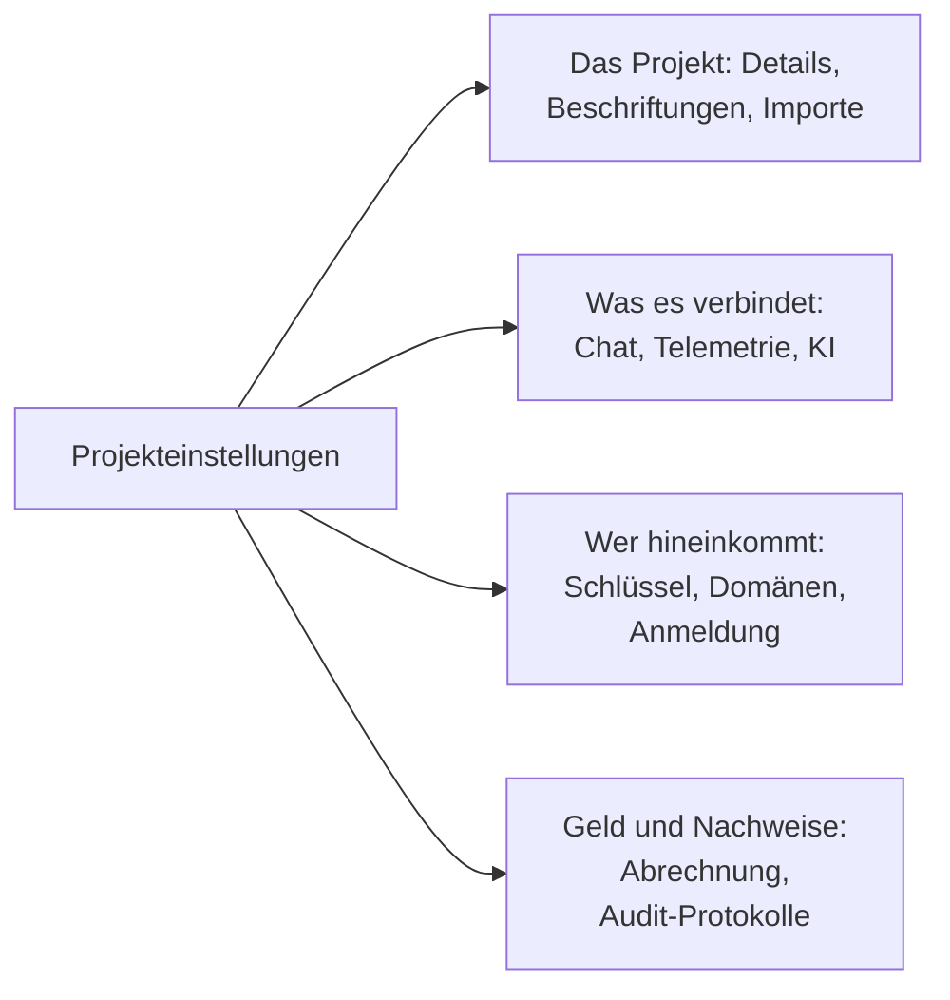

# Projekteinstellungen

Die Projekteinstellungen enthalten, was für das ganze Projekt gilt: seinen Namen, die Werkzeuge, mit denen es verbunden ist, seine Schlüssel, wie sich Personen anmelden, seine Abrechnung und seinen Prüfpfad. Das meiste richten Sie einmal ein und kommen selten zurück. Diese Seite ist eine Karte davon und behandelt die Einstellungen ohne eigene Seite: die Details des Projekts, Beschriftungen, Feature-Flags und das Löschen des Projekts.

:::cards
- [Eine Einstellung finden](#eine-einstellung-finden): Was jeder Abschnitt des Seitenmenüs enthält.
- [Die Details des Projekts](#die-details-des-projekts): Sein Name, seine ID und der Support-Zugriff.
- [Beschriftungen](#beschriftungen): Markierungen für Ressourcen, Berechtigungen und Regeln.
- [Das Projekt löschen](#das-projekt-löschen): Was es erfordert und was mitgeht.
:::

## Projekteinstellungen öffnen

Gehen Sie zu **Produkte → Einstellungen → Projekteinstellungen**. Das Seitenmenü gruppiert die Seiten in Abschnitte, und nur **Grundlegend** ist anfangs geöffnet: Klicken Sie auf den Titel eines Abschnitts, um ihn zu öffnen. Ein Abschnitt öffnet sich von selbst auf jeder Seite darin.

## Bevor Sie beginnen

- **Eine Rolle, die das Projekt ändern darf.** Project Owners und Project Admins ändern die meisten dieser Einstellungen. Abrechnung, Benachrichtigungskanäle und das Löschen des Projekts erfordern mehr, wie jeder Abschnitt sagt.
- **In OneUptime Cloud, der Tarif, der eine Einstellung enthält.** Manche Einstellungen brauchen einen Tarif: siehe [Einstellungen, die einen Tarif brauchen](/docs/configuration/billing#einstellungen-die-einen-tarif-brauchen).

## Eine Einstellung finden

| Abschnitt | Seiten | Wo Sie mehr lesen |
| --- | --- | --- |
| **Grundlegend** | **Projekt**, **Beschriftungen** | [Die Details des Projekts](#die-details-des-projekts), [Beschriftungen](#beschriftungen) |
| **Arbeitsbereich** | **Slack**, **Microsoft Teams**, **Videoanrufe** | [Slack](/docs/workspace-connections/slack), [Microsoft Teams](/docs/workspace-connections/microsoft-teams), [Videoanrufe](/docs/workspace-connections/video-calls) |
| **Telemetrie & APM** | **Ingestion-Schlüssel**, **Datenaufbewahrung** | [Ingestion-Schlüssel](/docs/telemetry/ingestion-keys), [Datenaufbewahrung](/docs/telemetry/data-retention) |
| **Benachrichtigungen** | **Benachrichtigungseinstellungen**, **Benachrichtigungsprotokolle**, **Mobile Apps** | [Benachrichtigungen](#benachrichtigungen) |
| **KI** | **KI-Funktionen**, **LLM-Anbieter**, **Externe MCP-Server**, **KI-Guthaben**, **KI-Protokolle**, **MCP-Server** | [LLM-Anbieter](/docs/ai/llm-provider), [Externe MCP-Server](/docs/ai/external-mcp-servers), [MCP-Server](/docs/ai/mcp-server), [AI SRE](/docs/ai/ai-sre#kostenkontrollen) |
| **Erweitert** | **Domänen**, **API-Schlüssel**, **Feature-Flags**, **Import aus anderem Tool** | [Eigene Domains](/docs/status-pages/branding-and-domains#eigene-domains), [API-Schlüssel](/docs/permissions/index#api-schlüssel), [Feature-Flags](#feature-flags), [Wechsel von Opsgenie](/docs/moving-to-oneuptime/opsgenie) und die anderen Umzugsanleitungen |
| **Sicherheit** | **SSO**, **SCIM** | [SSO](/docs/identity/sso), [SCIM](/docs/identity/scim) |
| **Abrechnung und Rechnungen** | **Abrechnung**, **Nutzungsverlauf**, **Rechnungen** | [Abrechnung & Nutzung](/docs/configuration/billing) |
| **Audit-Protokolle** | **Audit-Protokolle**, **Einstellungen**, **Export** | [Audit-Protokolle](/docs/configuration/audit-logs), [Audit-Protokoll-Export](/docs/configuration/audit-log-export) |
| **Gefahrenzone** | **Gefahrenzone** | [Das Projekt löschen](#das-projekt-löschen) |

**Abrechnung und Rechnungen** und **KI-Guthaben** gibt es nur in OneUptime Cloud: Eine selbst gehostete Installation hat keine Abrechnung.

## Die Details des Projekts

**Projekteinstellungen → Grundlegend → Projekt** enthält zwei Karten.

**Projektdetails** zeigt den Namen des Projekts und seine ID:

- **Projektname**: Klicken Sie auf **Projekt bearbeiten**, um das Projekt umzubenennen. Ein Name hat mindestens 2 Zeichen. Umbenennen erfordert einen Project Owner oder die Berechtigung, das Projekt zu bearbeiten oder die Abrechnung zu verwalten.
- **Projekt-ID**: Kopieren Sie sie für die API, die CLI und Terraform, oder wenn Sie dem Support schreiben.
- **Datenresidenz**: in OneUptime Cloud, wo die Daten Ihres Projekts liegen sollen, wenn OneUptime das erfasst hat. Nur OneUptime setzt sie.

**Kundensupport-Zugriff** entscheidet in OneUptime Cloud, ob das Support-Team von OneUptime das Projekt öffnen darf. Schalten Sie **OneUptime-Support Zugriff auf dieses Projekt gewähren** ein, wenn Sie Hilfe möchten: OneUptime fragt vorher, weil der Support dann alles im Projekt sehen und ändern kann, und Sie klicken auf **Support hereinlassen**. Schalten Sie es aus, sobald er fertig ist: Das wird sofort gespeichert. Project Owners und Project Admins ändern es.

## Beschriftungen

Beschriftungen sind Markierungen, die Sie an Monitore, Vorfälle, Statusseiten und andere Ressourcen hängen. Sie filtern und gruppieren Listen, und sie begrenzen, wie weit die Berechtigungen eines Teams und die Regeln des Projekts reichen.

:::steps
### Beschriftungen öffnen

Gehen Sie zu **Projekteinstellungen → Grundlegend → Beschriftungen**.

### Eine Beschriftung anlegen

Klicken Sie auf **Beschriftung erstellen**. Geben Sie ihr einen **Name** und, wenn Sie möchten, eine **Beschreibung**. **Beschriftungsfarbe** ist schon gewählt, eine Farbe, die noch keine Beschriftung auf der Seite nutzt: Wählen Sie eine andere, wenn Sie möchten. Klicken Sie zum Speichern auf **Beschriftung erstellen**.
:::

In OneUptime Cloud erfordern das Anlegen und Ändern von Beschriftungen den Growth-Tarif. Siehe [Beschriftungen](/docs/permissions/index#labels) dazu, wie Beschriftungen Berechtigungen begrenzen, und [Beschriftungs- und Eigentümerregeln](/docs/configuration/label-and-owner-rules), um Ressourcen beim Anlegen zu beschriften.

In einer Liste werden die Beschriftungen eines Datensatzes untereinander angezeigt; sind es mehr als vier, erscheinen die ersten drei mit einem Link zu den übrigen. Wo immer Beschriftungen aufgelistet werden (in Listen, auf der Seite eines Datensatzes und in jeder Beschriftungsauswahl), stehen sie in natürlicher Reihenfolge: Beschriftungen, deren Namen mit einer Zahl beginnen, kommen zuerst, in der Reihenfolge dieser Zahl (`2. Team` vor `10. Owner`), danach die übrigen alphabetisch, unabhängig von Groß- und Kleinschreibung. Um die Reihenfolge Ihrer Beschriftungen festzulegen, beginnen Sie ihre Namen mit einer Zahl, etwa `1. Category` und `2. Subcategory`.

### Eine Beschriftung archivieren

Um eine Beschriftung außer Dienst zu stellen, archivieren Sie sie über das Menü **⋯** ihrer Zeile, statt sie zu löschen. Alles, was die Beschriftung hat, behält sie, und Sie können weiterhin danach filtern, aber niemand kann sie erneut zu etwas hinzufügen: Jede Beschriftungsauswahl lässt sie weg, und die API, Terraform und MCP lehnen sie ab. Der Dialog listet die Regeln und Berechtigungen auf, die so eingerichtet sind, dass sie die Beschriftung verwenden; sie verwenden sie weiter, bis Sie sie ändern. Archivierte Beschriftungen werden getrennt aufgeführt, im eingeklappten Abschnitt **Archivierte Beschriftungen**, wo **Aus Archiv entfernen** eine wiederherstellt. **Löschen** listet zuerst alles auf, wovon die Beschriftung entfernt würde, und bietet **Stattdessen archivieren** an.

## Benachrichtigungen

**Projekteinstellungen → Benachrichtigungen** enthält, wie das Projekt Benachrichtigungen sendet:

- **Benachrichtigungseinstellungen**: Die Karte **Benachrichtigungskanäle** schaltet SMS, Telefonanrufe, WhatsApp und Telegram für das Projekt ein oder aus. Alle vier sind anfangs aus. Ein Project Owner, ein **Abrechnungs-Administrator** oder jemand mit **Manage Billing** schaltet sie. Die Seite enthält auch die eigenen Mailserver des Projekts unter **Benutzerdefinierte SMTP-Konfigurationen** (siehe [SMTP](/docs/emails/smtp)) und sein eigenes Twilio-Konto (siehe [Twilio-Integration](/docs/self-hosted/twilio-integration)). In OneUptime Cloud enthält sie das Guthaben, aus dem diese Nachrichten bezahlt werden: siehe [Vorausbezahltes Guthaben](/docs/configuration/billing#vorausbezahltes-guthaben).
- **Benachrichtigungsprotokolle**: jede Benachrichtigung, die das Projekt gesendet hat, mit einem Tab pro Kanal: **E-Mail**, **SMS**, **WhatsApp**, **Telegram**, **Webhook**, **Anruf**, **Push** und **Arbeitsbereich**.
- **Mobile Apps**: wo Sie die Apps für iOS und Android bekommen. Siehe [Apps – Übersicht](/docs/mobile-desktop-apps/index).

## Feature-Flags

**Projekteinstellungen → Erweitert → Feature-Flags** schaltet optionale Funktionen für das Projekt ein oder aus. Jede ist ein Schalter, der beim Umlegen speichert. Heute enthält es **Monitor-Gruppen**, in einem neuen Projekt aus: Schalten Sie es ein, um Monitor-Gruppen zum Monitore-Menü hinzuzufügen. Das Ausschalten löscht keine Gruppe. Siehe [Monitor-Gruppen](/docs/monitor/monitor-groups).

## Das Projekt löschen

Das Löschen eines Projekts löscht alles darin, für jedes Mitglied: seine Monitore, Vorfälle, Statusseiten, Bereitschaftseinrichtung und Telemetrie. Nichts bringt es zurück.

:::steps
### Die Gefahrenzone öffnen

Gehen Sie zu **Projekteinstellungen → Gefahrenzone**.

### Auf Projekt löschen klicken

Klicken Sie auf **Projekt löschen**. Ein Dialog bittet um Bestätigung.

### Den Namen des Projekts eingeben

Geben Sie den Namen genau so ein, wie er ist. **Projekt löschen** bleibt gesperrt, bis Sie das tun. In OneUptime Cloud fragt der Dialog auch, warum Sie gehen: Die Antwort ist freiwillig.

### Bestätigen

Klicken Sie auf **Projekt löschen**. OneUptime löscht das Projekt und nimmt Sie heraus.
:::

> [!CAUTION]
> Das Löschen des Projekts lässt sich nicht rückgängig machen. Es erfordert einen Project Owner oder die Berechtigung, das Projekt zu löschen.

In OneUptime Cloud kündigen Sie den Tarif eines Projekts, indem Sie es löschen: Die Abrechnung endet, wenn das Projekt gelöscht ist. Ein Projekt, das über einen Cloud-Marketplace abgerechnet wird, erhält eine letzte Belastung für seine Nutzung, und sein Kauf auf dem Marketplace bleibt aktiv, bis Sie ihn dort kündigen.

## Fehlerbehebung

:::details Ein Abschnitt des Seitenmenüs scheint zu fehlen
Jeder Abschnitt außer **Grundlegend** ist anfangs eingeklappt. Klicken Sie auf den Titel des Abschnitts, um ihn zu öffnen. Auf einer selbst gehosteten Installation gibt es keinen Abschnitt **Abrechnung und Rechnungen** und keine Seite **KI-Guthaben**.
:::

:::details Projekt bearbeiten ist gesperrt
Umbenennen erfordert einen Project Owner oder die Berechtigung, das Projekt zu bearbeiten oder die Abrechnung zu verwalten. Die gesperrte Schaltfläche nennt die Berechtigung, die Sie brauchen.
:::

:::details Projekt löschen bleibt im Dialog gesperrt
Geben Sie den Namen des Projekts genau so ein, wie der Dialog ihn zeigt: Groß- und Kleinschreibung zählt.
:::

## Nächste Schritte

:::cards
- [Personen einladen](/docs/permissions/inviting-people): Ihr Team ins Projekt holen.
- [Abrechnung & Nutzung](/docs/configuration/billing): Ihr Tarif, Zahlungsmethoden, Rechnungen und Nutzung.
- [Audit-Protokolle](/docs/configuration/audit-logs): Sehen, wer was im Projekt geändert hat.
- [SSO](/docs/identity/sso): Personen mit Ihrem Identitätsanbieter anmelden lassen.
:::
