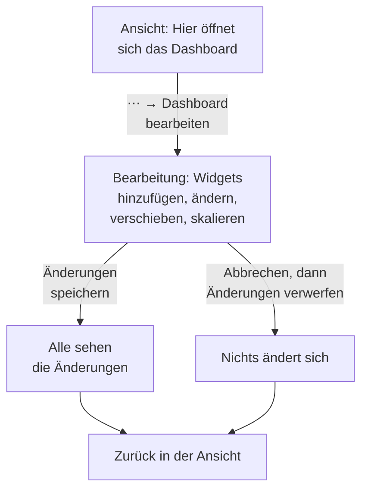

# Ein Dashboard erstellen

Um ein Dashboard zu erstellen, öffnen Sie **Produkte → Dashboards**, klicken auf **Dashboard erstellen** und wählen eine Vorlage, oder **Blank Dashboard**, um bei null zu beginnen. Eine Vorlage füllt den Namen des Dashboards für Sie aus (nummeriert, etwa „Kubernetes Dashboard 2“, wenn das Projekt schon eines hat); ein leeres Dashboard fragt Sie nach einem Namen. Klicken Sie auf **Dashboard erstellen**, und das neue Dashboard öffnet sich. Ein leeres öffnet sich auf seiner leeren Arbeitsfläche, mit einer Schaltfläche **Widget hinzufügen** für sein erstes Widget.

:::cards
- [Ein Dashboard anlegen](#ein-dashboard-anlegen): Mit einer Vorlage oder einer leeren Arbeitsfläche beginnen.
- [Bearbeiten und speichern](#bearbeiten-und-speichern): Für niemanden ändert sich etwas, bevor Sie auf Änderungen speichern klicken.
- [Ein Widget hinzufügen](#ein-widget-hinzufügen): Aus dem Katalog wählen, einrichten, an seinen Platz bringen.
- [In eine Spitze zoomen](#in-eine-spitze-zoomen): Ziehen Sie über ein Diagramm, um das ganze Dashboard in diesem Moment zu lesen.
:::

## Bevor Sie beginnen

Projektinhaber und -administratoren können jedes Dashboard erstellen und bearbeiten. Alle anderen brauchen eine Teamberechtigung: `CreateDashboard`, um Dashboards zu erstellen, und `EditDashboard`, um sie zu ändern. Projektmitglieder und Betrachter können Dashboards ohne beides lesen. Wer ein Dashboard nicht bearbeiten darf, öffnet trotzdem sein Menü **⋯**, in dem **Dashboard bearbeiten** gesperrt ist und sagt, welche Berechtigung fehlt.

## Ein Dashboard anlegen

:::steps
### Die Vorlagenauswahl öffnen

Öffnen Sie **Produkte → Dashboards** und klicken Sie auf **Dashboard erstellen**. Der Dialog **Aus Vorlage erstellen** zeigt **Blank Dashboard** und fünfzehn Vorlagen, gruppiert nach dem, was sie überwachen.

### Eine Vorlage wählen

Klicken Sie auf eine Karte. Eine Vorlage baut ihre Widgets und oft ihre Variablen für Sie auf; **Blank Dashboard** beginnt mit einer leeren Arbeitsfläche.

### Das Dashboard benennen

Der Name einer Vorlage ist ausgefüllt und über die Namen hinaus nummeriert, die das Projekt schon hat. Der Name eines leeren Dashboards ist leer: Geben Sie einen ein. Die Beschreibung ist optional, unter **Weitere Felder** eingeklappt, und Sie können sie später auf der Seite **Übersicht** des Dashboards hinzufügen.

### Es erstellen

Klicken Sie auf **Dashboard erstellen**. Das neue Dashboard öffnet sich: die Widgets einer Vorlage sofort, oder die leere Arbeitsfläche eines leeren Dashboards mit **Widget hinzufügen** darauf.
:::

Die Vorlagen, nach der Gruppe, unter der die Auswahl sie aufführt:

| Gruppe | Vorlagen |
| --- | --- |
| Get Started | Blank Dashboard |
| Monitoring & APM | Monitor Dashboard, Metrics Dashboard, Real User Monitoring Dashboard, SLO Dashboard |
| Incident Response | Incident Dashboard, Alert Dashboard |
| Infrastructure | Kubernetes Dashboard, Kubernetes Cost Dashboard, Hosts Dashboard, Proxmox Dashboard, VMware Dashboard, Ceph Dashboard, Storage Array Dashboard, Docker Swarm Dashboard, Network Dashboard |

Eine Vorlage ist ein Ausgangspunkt, keine Verknüpfung: Sobald das Dashboard erstellt ist, ändern Sie es nach Belieben. Später aktualisiert die Vorlage es nicht mehr.

## Bearbeiten und speichern

Ein Dashboard öffnet sich in der Ansicht, zum Lesen. Um es zu ändern, öffnen Sie das Menü **⋯** in seiner Werkzeugleiste und wählen **Dashboard bearbeiten**. Die Werkzeugleiste zeigt **Bearbeitung** neben dem Namen und tauscht den Zeitbereich und seine anderen Bedienelemente gegen **Widget hinzufügen**, **Variablen**, **Abbrechen** und **Änderungen speichern**.

Ihre Änderungen gehören nur Ihnen, bis Sie sie speichern. Beim Bearbeiten wird nichts gespeichert, daher sehen andere das Dashboard weiterhin so, wie es war.

- **Änderungen speichern** speichert die Widgets, ihre Plätze und Größen, die Variablen und das Aktualisierungsintervall auf einmal und kehrt zur Ansicht zurück. Wird das Speichern abgelehnt, etwa weil Sie inzwischen die Berechtigung verloren haben, bleiben Sie mit Ihren Änderungen in der Bearbeitung, und der Grund steht über dem Raster.
- **Abbrechen** fragt zuerst, weil es Ihre Änderungen verwirft: **Änderungen verwerfen** kehrt zum gespeicherten Dashboard zurück, und **Weiter bearbeiten** bringt Sie zurück zu Ihrer Arbeit.

Während Sie bearbeiten, pausiert die automatische Aktualisierung, und ein gezoomter Zeitbereich kehrt zu dem Bereich zurück, den Sie gewählt hatten.

## Ein Widget hinzufügen

:::steps
### Den Widget-Katalog öffnen

Klicken Sie auf **Widget hinzufügen**: in der Werkzeugleiste während der Bearbeitung oder auf der Arbeitsfläche eines leeren Dashboards. Der Katalog gruppiert seine Widgets nach dem, was sie zeigen. Tippen Sie in sein Suchfeld, um eines nach Name oder Zweck zu finden ("error budget", "pods"), und drücken Sie die Eingabetaste, um den ersten Treffer hinzuzufügen.

### Ein Widget wählen

Klicken Sie darauf. Das Widget landet an der ersten freien Stelle im Raster, an die es passt, und seine Einstellungen öffnen sich.

### Festlegen, was es zeigt

Der Einstellungsdialog zeigt über den Einstellungen eine **Live-Vorschau** des Widgets, und die Vorschau folgt jeder Änderung. Wählen Sie, was das Widget liest (eine Metrikabfrage, einen Filter, einen Text) und wie es aussieht, und klicken Sie dann auf **Fertig**.

### Es platzieren

Ziehen Sie das Widget, um es zu verschieben, und ziehen Sie seine Kanten oder Ecken, um seine Größe zu ändern. Siehe [Widgets im Raster](#widgets-im-raster).
:::

[Dashboard-Widgets](/docs/dashboards/widgets) führt jedes Widget und seine Einstellungen auf.

## Widgets im Raster

Die Arbeitsfläche ist ein Raster mit zwölf Spalten. Widgets rasten darin ein, und die Seite wächst nach unten, wenn Sie Zeilen hinzufügen. Während Sie ein Widget ziehen, zeigt ein gestrichelter Umriss, wo es landen wird, mit seiner Spalte und Zeile; während Sie eines skalieren, zeigt der Umriss seine Größe in Rastereinheiten. Widgets, die im Weg sind, weichen aus, sodass sich nie zwei Widgets überlappen.

Jede Art von Widget hat eine Mindestgröße, damit das, was es zeichnet, lesbar bleibt: Ein Diagramm ist mindestens sechs Spalten breit und drei Zeilen hoch, während eine einzelne Zahl in eine Zelle passt.

Um ein Widget später zu ändern, klicken Sie während der Bearbeitung darauf. Seine Einstellungen öffnen sich erneut, mit zwei weiteren Schaltflächen unten:

- **Widget duplizieren** fügt an der ersten freien Stelle eine Kopie mit denselben Einstellungen hinzu.
- **Widget löschen** entfernt es, sobald Sie bestätigen.

## Zeitbereich und automatische Aktualisierung

In der Ansicht legt die Zeitbereichsauswahl der Werkzeugleiste das Fenster fest, das jedes Diagramm-, Zahlen-, Log- und Trace-Widget liest. Wählen Sie eine Vorgabe von den letzten 5 Minuten bis zu den letzten 3 Monaten, oder einen eigenen Beginn und ein eigenes Ende. Bei jedem Öffnen beginnt das Dashboard mit der letzten Stunde.

Listen von Vorfällen, Warnungen, Monitoren und Ressourcen zeigen ihren aktuellen Zustand, unabhängig vom Zeitbereich.

Neben dem Zeitbereich liest das Menü der automatischen Aktualisierung jedes Widget alle 5 Sekunden, 10 Sekunden, 30 Sekunden, 1 Minute, 5 Minuten oder 15 Minuten neu, mit einem Countdown bis zur nächsten Aktualisierung. Lassen Sie sie aus, während Sie untersuchen, damit die Ansicht stillhält. Um ein Intervall zum eigenen des Dashboards zu machen, wählen Sie es, bearbeiten Sie dann das Dashboard und klicken Sie auf **Änderungen speichern**: Jeder Besuch beginnt dann damit.

Die Zeitbereichsauswahl, die Variablen und die automatische Aktualisierung erscheinen, sobald das Dashboard ein Widget hat.

### In eine Spitze zoomen

Sie müssen nicht zur Zeitbereichsauswahl greifen, um sich eine Spitze anzusehen. Ziehen Sie über den interessanten Abschnitt eines beliebigen Linien- oder Flächendiagramms, und das **ganze Dashboard** springt in dieses Fenster, genau als hätten Sie es in der Zeitbereichsauswahl gewählt — jedes Widget, das den Zeitbereich nutzt, fragt mit ab, sodass Sie einen Moment über das ganze Board hinweg lesen statt eines Diagramms in einem anderen Maßstab als seine Nachbarn. Live-Listen zeigen weiterhin, was gerade passiert, wie immer.

**Doppelklicken Sie auf ein beliebiges Diagramm**, um das rückgängig zu machen: Das Dashboard kehrt zu dem Bereich zurück, den es vor dem Zoomen hatte, wie oft Sie auch hineingebohrt haben. Eine Schaltfläche **Zoom zurücksetzen** erscheint neben der Zeitbereichsauswahl, solange ein Zoom aktiv ist, und ein Doppelklick auf ein nicht gezoomtes Dashboard bewirkt nichts.

Ein gezoomtes Fenster ist fest, daher rollt es nicht weiter, während die automatische Aktualisierung läuft — das ist Absicht, denn ein Fenster, das Ihnen mitten in einer Untersuchung davonläuft, wäre schlimmer. Setzen Sie den Zoom zurück, um wieder mitzurollen.

Zoomen funktioniert nur in der Ansicht; in der Bearbeitung verschiebt und skaliert Ziehen stattdessen Widgets. Balkendiagramme zoomen genauso — ziehen Sie über die Balken —, und ein Doppelklick auf eines setzt das Dashboard wie jedes andere Diagramm zurück. Nur Ziehen zoomt: Ein einfacher Klick auf ein Diagramm ändert nie den Zeitbereich des Dashboards. Dieselben Gesten funktionieren in den Diagrammen überall in OneUptime; siehe [In einen Zeitbereich zoomen](/docs/telemetry/charts-and-time-ranges).

## Vollbild

**⋯ → Vollbild** zeigt die Widgets des Dashboards auf dem ganzen Bildschirm, für eine Wandanzeige oder ein Meeting. Drücken Sie Esc, um es zu verlassen.

## Tipps für Dashboards, die gut altern

- **Ein Thema pro Dashboard.** Einige fokussierte Dashboards schlagen eine Seite mit allem, was Sie überwachen.
- **Stellen Sie das wichtigste Widget nach oben.** Menschen lesen von oben nach unten, also sollte das Erste, was sie sehen, die Frage „Ist das gesund?“ beantworten.
- **Benennen Sie die Abschnitte mit Text-Widgets.** Eine kurze Überschrift alle paar Zeilen („Latenz“, „Fehler“, „Kapazität“) macht die Seite auch quer durch den Raum leicht überschaubar.
- **Variablen statt Kopien.** Wenn Sie dabei sind, dasselbe Dashboard für einen zweiten Dienst zu bauen, fügen Sie stattdessen eine Variable `service` hinzu. Siehe [Dashboard-Variablen & Filter](/docs/dashboards/variables).
- **Vor einer großen Änderung kopieren.** **Dashboard duplizieren** auf der Seite **Einstellungen** des Dashboards erstellt eine sichere Kopie, an der Sie Ihre Ideen ausprobieren.

## Nächste Schritte

:::cards
- [Dashboard-Widgets](/docs/dashboards/widgets): Jedes Widget, seine Einstellungen und welches Sie wählen.
- [Dashboard-Variablen & Filter](/docs/dashboards/variables): Ein Dashboard für jeden Dienst, jeden Host oder jeden Kunden.
- [Teilen & öffentliche Dashboards](/docs/dashboards/sharing): Das Dashboard außerhalb Ihres Teams teilen.
- [Dashboard-Konfiguration & Berechtigungen](/docs/dashboards/configuration): Eigentümer, Beschriftungen, Archivieren und wer was darf.
:::
