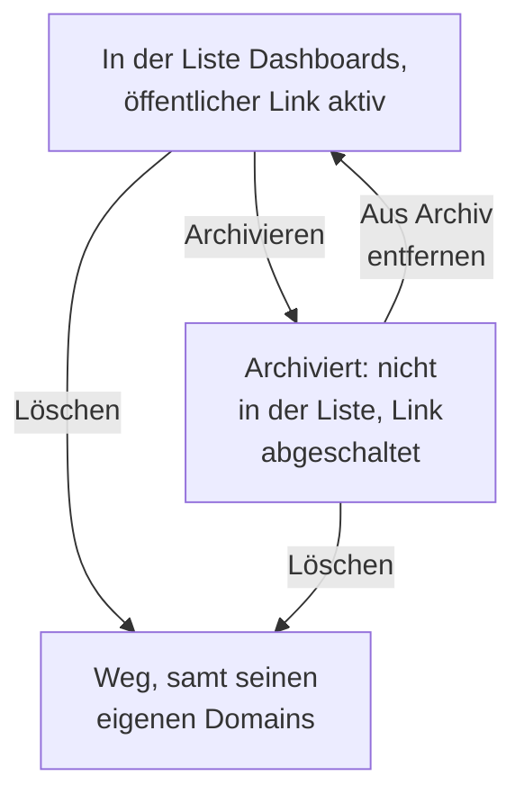

# Dashboard-Konfiguration & Berechtigungen

Sobald Sie ein Dashboard haben, das sich zu behalten lohnt, behandelt diese Seite, wer es lesen und ändern darf, wie Eigentümer und Beschriftungen Ihre Dashboards ordnen und wie Sie eines kopieren, exportieren, archivieren und löschen.

:::cards
- [Wer was darf](#wer-was-darf): Die Berechtigungen hinter jeder Aktion und wer sie hat.
- [Eigentümer](#eigentümer): Die Benutzer und Teams, denen ein Dashboard gehört.
- [Ein Dashboard duplizieren](#ein-dashboard-duplizieren): Eine sichere Kopie, für Sie nummeriert.
- [Ein Dashboard archivieren](#ein-dashboard-archivieren): Ein Dashboard wegräumen, ohne es zu löschen.
:::

## Wer was darf

Dashboards folgen den [Berechtigungen](/docs/permissions/index) Ihres Projekts. Jede Aktion braucht eine davon, erhalten über ein Team:

| Um | Braucht es |
| --- | --- |
| Dashboards zu lesen | `ReadDashboard` oder eine Projektrolle: Project Owner, Project Admin, Project Member, Viewer oder eine Settings-Rolle |
| Dashboards zu erstellen | `CreateDashboard`, Project Owner oder Project Admin |
| Ein Dashboard zu ändern: seine Widgets, Variablen, Freigabe, sein Branding, und es zu archivieren | `EditDashboard`, Project Owner oder Project Admin |
| Ein Dashboard zu löschen | `DeleteDashboard`, Project Owner oder Project Admin |
| Eigentümer hinzuzufügen und zu entfernen | Die Berechtigungen für Dashboard-Eigentümer, Project Owner, Project Admin oder Project Member |
| Eigene Domains hinzuzufügen und zu ändern | Die Berechtigungen für Dashboard-Domains, Project Owner, Project Admin, Project Member, Settings Admin oder Settings Member |
| Eigentümer- und Beschriftungsregeln zu erstellen | Die Berechtigungen für Regeln, Project Owner oder Project Admin |

Ein Project Member liest also jedes Dashboard, braucht aber `CreateDashboard` und `EditDashboard`, um welche zu bauen. Lesen, Bearbeiten und Löschen lassen sich jeweils auf die Dashboards beschränken, die einem Team gehören, oder auf Dashboards mit bestimmten Beschriftungen: siehe [Geltungsbereich: wie weit eine Erlaubnis reicht](/docs/permissions/index#geltungsbereich-wie-weit-eine-erlaubt-berechtigung-reicht).

Vergeben Sie sie auf der Seite **Berechtigungen** eines Teams: Öffnen Sie **Produkte → Teams** und wählen Sie das Team.

Wer ein Dashboard außerhalb des Projekts sehen kann, ist eine eigene Frage, die auf seiner Seite **Freigabe** beantwortet wird: siehe [Zugriff auf öffentliche Dashboards](#zugriff-auf-öffentliche-dashboards).

## Eigentümer

Die **Eigentümer** eines Dashboards sind die Benutzer und Teams, denen es gehört. Fügen Sie sie auf der Seite **Eigentümer** des Dashboards hinzu, oder wählen Sie mehrere Dashboards in der Liste **Dashboards** aus und fügen Sie allen auf einmal Eigentümer hinzu.

Eigentümer schränken den Zugriff ein, wenn Sie es wollen: Eine Teamberechtigung, die auf die Dashboards des Teams begrenzt ist, reicht nur bis zu den Dashboards, die dieses Team oder die handelnde Person als Eigentümer führen. Eigentum allein gewährt nichts.

Die Liste **Dashboards** zeigt die Eigentümer jedes Dashboards, und ihr Filter **Eigentümer** findet die Dashboards, die einer Person oder einem Team gehören.

## Beschriftungen

Beschriftungen sind Schlagwörter, um Dashboards zu ordnen. Fügen Sie sie auf der Seite **Übersicht** des Dashboards hinzu, wo Sie auch seinen Namen und seine Beschreibung bearbeiten, oder mehreren Dashboards auf einmal über die Liste **Dashboards**.

Häufige Muster:

- **Nach Team**: `team:platform`, `team:checkout`, `team:growth`.
- **Nach Umgebung**: `env:prod`, `env:staging`.
- **Nach Zweck**: `purpose:oncall`, `purpose:exec`, `purpose:investigation`.

Der Filter **Beschriftungen** der Liste **Dashboards** ist der schnellste Weg, ein Dashboard in einem Projekt zu finden, das viele davon angesammelt hat. Beschriftungen begrenzen auch Berechtigungen: Eine auf bestimmte Beschriftungen beschränkte Teamberechtigung reicht nur bis zu den Dashboards, die eine davon tragen.

## Eigentümer- und Beschriftungsregeln

Statt Eigentümer und Beschriftungen von Hand hinzuzufügen, lassen Sie Regeln das tun. Unter **Einstellungen** im Seitenmenü von **Dashboards** fügen **Eigentümerregeln** Eigentümer und **Beschriftungsregeln** Beschriftungen zu jedem neuen Dashboard hinzu, auf das sie passen: anhand der Beschriftungen, die es schon trägt, oder anhand eines Musters in seinem Namen oder seiner Beschreibung. [Beschriftungs- und Eigentümerregeln](/docs/configuration/label-and-owner-rules) erklärt, wie Regeln passen und wie Sie eine auf die Dashboards anwenden, die Sie schon haben.

## Zugriff auf öffentliche Dashboards

Wer ein Dashboard außerhalb des Projekts sehen kann, ist eine einzige Wahl auf seiner Seite **Freigabe** (auch **⋯ → Teilen** im Dashboard selbst; siehe [Teilen & öffentliche Dashboards](/docs/dashboards/sharing)):

1. **Nur Personen in diesem Projekt** (Standard) — Das Dashboard hat keinen öffentlichen Link; seine öffentliche Adresse zeigt eine Seite „nicht gefunden“.
2. **Alle mit dem Link** — Wer den öffentlichen Link hat, kann es sehen, ohne sich anzumelden.
3. **Alle mit dem Link und einem Passwort** — Besucher geben ein Passwort ein, bevor das Dashboard erscheint.

Unter **Weitere Einstellungen** auf derselben Seite weist die **IP-Zulassungsliste** (Tarif Scale) Anfragen an den öffentlichen Link von jeder IP-Adresse ab, die nicht darauf steht. Die am stärksten abgeschottete öffentliche Einrichtung ist **Alle mit dem Link und einem Passwort** mit einer IP-Zulassungsliste — nützlich für Partnerportale, bei denen Sie beide Schichten wollen.

## Ein Dashboard duplizieren

Um ein Dashboard zu kopieren, öffnen Sie es, gehen Sie zu seiner Seite **Einstellungen** und klicken Sie auf **Dashboard duplizieren**. Der Name der Kopie wird für Sie ausgefüllt: der Name des Dashboards, über die Namen hinaus nummeriert, die das Projekt schon hat („Checkout API“ wird als „Checkout API 2“ kopiert, und eine Kopie davon als „Checkout API 3“). Ändern Sie ihn, wenn Sie möchten, bestätigen Sie mit **Dashboard duplizieren**, und die Kopie öffnet sich. Sie hat die Widgets, Variablen, Beschreibung und Beschriftungen des Dashboards. Branding und eigene Domains bleiben beim Original, und die öffentliche Freigabe ist immer zunächst aus, damit Sie entscheiden können, ob Sie sie einschalten.

Das ist der richtige Schritt, wenn Sie eine Vorlage (etwa „unser Dashboard für die Rufbereitschaft“) in eine Kopie für einen bestimmten Dienst abzweigen wollen.

## Exportieren und importieren

Ein Dashboard reist als JSON:

- **Dashboard exportieren** auf der Seite **Einstellungen** des Dashboards lädt es als JSON-Datei herunter. Um mehrere zu exportieren, wählen Sie sie in der Liste **Dashboards** aus und wählen **JSON exportieren**.
- **JSON importieren** über der Liste **Dashboards** erstellt Dashboards aus einer solchen Datei, in diesem Projekt oder in einem anderen.

Ein Export enthält die eigenen Einstellungen des Dashboards, darunter seine Widgets und Variablen. Seine Eigentümer und Beschriftungen bleiben außen vor, und bei Widgets, die auf Ressourcen dieses Projekts zeigen, etwa ein SLO oder eine Datenquelle, müssen diese in einem anderen Projekt eventuell neu gewählt werden.

## Ein Dashboard archivieren

Archivieren Sie ein Dashboard, das Sie nicht mehr nutzen, aber behalten wollen. Ein archiviertes Dashboard verschwindet aus der Liste **Dashboards**, und wenn es öffentlich ist, funktioniert sein öffentlicher Link nicht mehr — seine URL und seine eigenen Domains antworten mit "Dashboard not found". Seine Widgets, Variablen, sein Branding, seine Domains und seine öffentlichen Einstellungen bleiben alle erhalten, sodass das Zurückholen aus dem Archiv es genau so wiederherstellt, wie es war, samt öffentlichem Link.

Um ein Dashboard zu archivieren, öffnen Sie es, gehen Sie zu seiner Seite **Einstellungen** und klicken Sie auf **Archivieren**. Um mehrere zu archivieren, wählen Sie sie in der Liste **Dashboards** aus und wählen **Archivieren**. Um eines zurückzuholen, öffnen Sie **Dashboards → Erweitert → Archiviert**, wählen es aus und wählen **Aus Archiv entfernen**, oder öffnen Sie es und klicken Sie auf **Aus Archiv entfernen** im Banner oben auf seinen Seiten.

Archivieren ist die umkehrbare Alternative zum Löschen: Greifen Sie zuerst dazu, wenn Sie unsicher sind.

## Ein Dashboard löschen

Öffnen Sie die Seite **Löschen** des Dashboards. Löschen lässt sich nicht rückgängig machen: Das Dashboard, seine Widgets und Variablen und alle ihm zugeordneten eigenen Domains werden entfernt. Ihre Telemetrie bleibt unberührt.

Ist das Dashboard unter einer eigenen Domain öffentlich, antwortet die Adresse nicht mehr, sobald Sie es löschen. Um die Adresse weiter zu bedienen, fügen Sie die Domain nach dem Löschen einem anderen Dashboard hinzu: Eine Domain gehört jeweils zu einem Dashboard.

## Audit-Protokolle

Die Seite **Audit-Protokolle** des Dashboards führt jede Änderung am Dashboard auf und wer sie vorgenommen hat. Audit-Protokolle gehören zum Enterprise-Tarif und zur [Enterprise Edition](/docs/self-hosted/enterprise).

## Datenaufbewahrung und Backups

Dashboards selbst verfallen nicht. Die Daten, die sie zeigen, folgen den Aufbewahrungseinstellungen Ihres Projekts: Mit dem Zeitbereich auf den letzten 3 Monaten zeigt ein Projekt, das seine Logs 15 Tage lang aufbewahrt, die letzten 15 Tage davon.

Wenn Sie OneUptime selbst hosten, genügt ein regelmäßiges Datenbank-Backup: Die Konfiguration eines Dashboards wird mit dem Rest Ihres Projekts gespeichert. In OneUptime Cloud werden Backups für Sie erledigt. Für eine eigene Kopie exportieren Sie das Dashboard als JSON oder lesen es über die [OneUptime-API](/docs/api-reference/api-reference).

## Nächste Schritte

:::cards
- [Teilen & öffentliche Dashboards](/docs/dashboards/sharing): Öffentliche Links, Passwörter, IP-Zulassungslisten und eigene Domains.
- [Benutzer, Teams & Berechtigungen](/docs/permissions/index): Teams, Rollen, Geltungsbereiche und Sperren.
- [Dashboard-Variablen & Filter](/docs/dashboards/variables): Ein Dashboard für jeden Dienst.
- [Dashboards – Übersicht](/docs/dashboards/index): Das große Ganze.
:::
