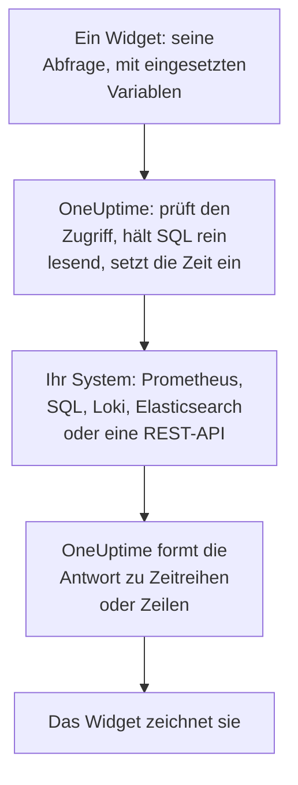

# Externe Datenquellen

Eine externe Datenquelle bindet ein System außerhalb von OneUptime an, etwa Prometheus, eine SQL-Datenbank, ClickHouse, Loki, Elasticsearch oder eine REST-API, damit Ihre Dashboards seine Daten neben Ihren eigenen darstellen können. Sie verbinden das System einmal; danach führt jedes Widget eine reine Leseabfrage in der eigenen Sprache dieses Systems aus.

:::cards
- [Eine Datenquelle verbinden](#eine-datenquelle-verbinden): Den Typ wählen, dann angeben, wo sie liegt und wie man sich anmeldet.
- [Eine Abfrage schreiben](#eine-abfrage-schreiben): PromQL, SQL, LogQL, Query DSL oder eine Anfrage.
- [Grenzen](#grenzen): Die Zeitlimits und Obergrenzen, die beide Seiten schützen.
- [Sicherheit](#sicherheit): Reine Leseabfragen und Zugangsdaten, die nur geschrieben werden.
:::

## Wie eine Abfrage abläuft

Das Widget sendet seine Abfrage an OneUptime, mit bereits eingesetzten Variablen. OneUptime prüft, ob Sie die Datenquelle lesen dürfen, setzt den Zeitbereich ein und fragt Ihr System mit den Zugangsdaten, die es verwahrt. Die Antwort formt es zu Zeitreihen oder Zeilen, die das Widget zeichnet.



## Bevor Sie beginnen

- **Ein Tarif, der sie enthält.** In OneUptime Cloud braucht das Erstellen und Ändern von Datenquellen den Tarif **Growth**. Das Löschen funktioniert in jedem Tarif.
- **Eine Berechtigung, sie hinzuzufügen.** Projektinhaber und -administratoren können Datenquellen hinzufügen; alle anderen brauchen `CreateDataSource`, dazu `EditDataSource` und `DeleteDataSource`, um sie zu ändern und zu entfernen. Alle, die die Datenquellen des Projekts lesen dürfen, Mitglieder und Betrachter eingeschlossen, sehen die Daten ihrer Widgets.
- **Ein reines Lesekonto.** Dashboards lesen immer nur. Verbinden Sie Datenbanken mit einem Konto, das nur lesen darf, und HTTP-Quellen mit einem Token, das nur abfragen darf.
- **Ein Weg hinein.** Der API-Server von OneUptime verbindet sich mit Ihrem System, also muss er es erreichen können: Welche Adressen abgelehnt werden, steht unter [Sicherheit](#sicherheit).

## Unterstützte Systeme

| Typ | Abfragesprache | Funktioniert mit |
| --- | --- | --- |
| Prometheus | PromQL | Prometheus, Thanos, Cortex, Mimir, VictoriaMetrics |
| PostgreSQL | SQL | PostgreSQL, TimescaleDB, CockroachDB |
| MySQL | SQL | MySQL, MariaDB |
| Microsoft SQL Server | T-SQL | SQL Server, Azure SQL |
| ClickHouse | SQL | ClickHouse, über seine HTTP-Schnittstelle |
| Grafana Loki | LogQL | Loki und Loki-kompatible Endpunkte |
| Elasticsearch | Query DSL (JSON) | Elasticsearch, OpenSearch |
| REST API | Request (JSON) | Jede HTTP(S)-API, die mit JSON antwortet |

## Eine Datenquelle verbinden

:::steps
### Datenquellen öffnen

Öffnen Sie **Produkte → Dashboards**, klappen Sie im Seitenmenü **Einstellungen** auf und klicken Sie auf **Datenquellen**.

### Den Typ wählen

Klicken Sie auf **Datenquelle erstellen**. Der Dialog **Datenquellentyp auswählen** gruppiert die Typen nach dem, was sie enthalten: Metriken, Logs, Datenbanken, Suche und APIs. Klicken Sie auf einen.

### Sie benennen

Geben Sie ihr unter **Grundinformationen** einen **Name**, etwa „Production Prometheus“, und auf Wunsch eine **Beschreibung**.

### Angeben, wo sie liegt

Unter **Verbindung** nimmt eine HTTP-Quelle die **URL**, unter der sie antwortet. Eine Datenbank nimmt ihren **Datenbank-Host**, ihren **Datenbank-Port** (leer lassen für 5432, 3306, 1433 oder 8123) und ihren **Datenbankname**.

### Angeben, wie man sich anmeldet

Geben Sie unter **Authentifizierung** einen **Benutzername** und ein **Passwort** ein, oder für eine HTTP-Quelle einen **API-Token**, der als Bearer-Token gesendet wird. **Weitere Felder** enthält **Benutzerdefinierte HTTP-Header**, etwa `{ "X-Scope-OrgID": "tenant-1" }`, und **Weitere Optionen**: `sslEnabled` und `sslRejectUnauthorized` für Datenbanken, `elasticsearchIndex` für Elasticsearch, das ohne ihn jeden Index liest (`*`).

### Sie testen

Klicken Sie auf **Datenquelle erstellen**, dann auf **Testen** in ihrer Zeile. OneUptime verbindet sich mit den angegebenen Daten und sagt, ob es funktioniert hat oder was schiefging.
:::

Um eine Datenquelle später zu ändern, öffnen Sie sie aus der Liste. **Bearbeiten** auf **Datenquellen-Details** ändert alles außer ihren Geheimnissen; **Anmeldedaten aktualisieren** ersetzt das Passwort, den Token oder die Header und lässt die Felder, die Sie leer lassen, unverändert; **Testen** prüft sie erneut.

## In einem Widget verwenden

Bearbeiten Sie ein Dashboard, klicken Sie auf **Widget hinzufügen** und wählen Sie ein Widget der Gruppe External Data Sources: ein **Diagramm**, einen **Wert**, einen **Messwert** oder eine **Tabelle**. In seinen Einstellungen:

- Wählen Sie die **Datenquelle** und schreiben Sie die **Abfrage**. Der Editor nennt die Abfragesprache und zeigt ein Beispiel für den Typ.
- In einem Diagramm legt **Abfrage hinzufügen** weitere Abfragen auf dieselben Achsen, und **Legende (optional)** benennt jede Reihe nach ihren Labels: `{{instance}} — errors` schreibt das Label `instance` der Reihe nach vorn.
- Bei einem Wert oder Messwert macht **Reduce** aus den Punkten eine Zahl: den letzten Wert (Standard), den ersten, den Durchschnitt, die Summe, das Minimum oder das Maximum. **Einheit** fügt ein Suffix hinzu und skaliert die bekannten: `Bytes` wird zu 1.5 MB, `ms` zu 2.4 s.
- In einer Tabelle funktioniert jede reine Leseabfrage, und ihre Zeilen erscheinen so, wie sie zurückkommen.

## Eine Abfrage schreiben

Jeder Typ nimmt seine eigene Sprache, mit denselben Regeln für das, was zurückkommt:

- **Diagramme, Werte und Messwerte brauchen Zeitreihen.** Eine SQL-Abfrage liefert eine Zeitspalte namens `time`, `timestamp`, `date` oder `ts` und eine numerische Spalte `value` (oder ihre erste numerische Spalte); jede andere Spalte wird zum Label einer Reihe. Elasticsearch braucht eine Aggregation `date_histogram`, und Loki eine Metrikabfrage wie `rate()` oder `count_over_time()`.
- **Tabellen zeigen Zeilen** so, wie die Abfrage sie liefert: SQL-Zeilen, Prometheus-Reihen, Loki-Logzeilen, Elasticsearch-Treffer oder die Objekte unter dem `rowsPath` einer REST-API.

:::tabs
@tab Prometheus
```text title="PromQL"
sum by (job) (rate(http_requests_total{job=~"{{job}}"}[5m]))
```
@tab SQL
```sql title="SQL"
SELECT date_trunc('minute', created_at) AS time, COUNT(*) AS value
FROM orders
WHERE created_at BETWEEN $__startTime AND $__endTime
GROUP BY 1
ORDER BY 1
```
@tab Loki
```text title="LogQL"
sum by (app) (rate({app="api"} |= "error" [5m]))
```
@tab Elasticsearch
```json title="Query DSL"
{
  "query": { "range": { "@timestamp": { "gte": "$__startTime", "lte": "$__endTime" } } },
  "aggs": {
    "over_time": {
      "date_histogram": { "field": "@timestamp", "fixed_interval": "1m" }
    }
  }
}
```
@tab REST API
```json title="Request"
{
  "path": "/api/stats?from=$__startTimeMs&to=$__endTimeMs",
  "method": "GET",
  "rowsPath": "data.items",
  "timestampField": "time",
  "valueField": "count",
  "seriesField": "service"
}
```
:::

### Zeitmakros

Prometheus und Loki erhalten den Zeitbereich des Dashboards mit jeder Anfrage, also brauchen ihre Abfragen nichts weiter. Die anderen Typen setzen den Zeitbereich dort ein, wo Sie ein Makro schreiben:

| Makro | Wird zu | In |
| --- | --- | --- |
| `$__startTime`, `$__endTime` | Beginn und Ende des Bereichs, in UTC: `'2026-10-13 09:00:00'` in SQL, sonst ISO 8601 | SQL, Elasticsearch, REST API |
| `$__startTimeMs`, `$__endTimeMs` | Dasselbe, als Millisekunden seit 1970 | SQL, Elasticsearch, REST API |
| `$__rangeSeconds` | Die Länge des Bereichs, in Sekunden | SQL |

SQL-Makros werden in UTC geschrieben, also lassen Sie Ihre Datenbanksitzungen in UTC laufen oder rechnen Sie in der Abfrage um.

### Dashboard-Variablen

Schreiben Sie `{{name}}` an eine beliebige Stelle einer Abfrage, und das Widget setzt dort den Wert der Variablen ein, bevor es die Abfrage sendet. Mehrere Werte einer Variablen mit Mehrfachauswahl werden mit `|` verbunden, genau was ein regulärer Ausdruck als Matcher in PromQL oder LogQL braucht: `job=~"{{job}}"`. Eine Variable ohne Auswahl lässt den Platzhalter stehen, wie er geschrieben ist, sodass der Fehler ihn nennt. [Dashboard-Variablen & Filter](/docs/dashboards/variables) zeigt, wie Sie eine hinzufügen.

## Grenzen

Jede Abfrage ist begrenzt, damit ein Dashboard mit zwanzig Widgets, das sich jede Minute aktualisiert, weder OneUptime noch Ihr System überlasten kann:

| Grenze | Wert |
| --- | --- |
| Verbindungsaufbau | 10 Sekunden |
| Ausführung einer Abfrage | 30 Sekunden |
| Punkte in einer Zeitreihenantwort | 11.000 |
| Zeilen in einer Tabelle | 1.000 |
| Reihen in einer Antwort | 100 |
| Antwort einer HTTP-Quelle | 20 MB |

Bereichsabfragen an Prometheus und Loki fordern etwa 250 Punkte über den Zeitbereich an, nicht dichter als 10 Sekunden und nicht weiter auseinander als einen Tag.

## Sicherheit

- **SQL bleibt rein lesend.** Eine Abfrage muss eine einzige Anweisung sein, die mit `SELECT`, `WITH`, `SHOW`, `EXPLAIN`, `DESCRIBE` oder `DESC` beginnt. Wörter, die schreiben oder eine Sitzung ändern, etwa `INSERT`, `UPDATE`, `DELETE`, `DROP`, `INTO` oder `SET`, werden überall außerhalb von Zeichenketten und zitierten Namen abgelehnt, also setzen Sie eine Spalte, die so heißt, in Anführungszeichen. Schreiben Sie ein Anführungszeichen in einer Zeichenkette als zwei (`''`): Ein Backslash vor einem Anführungszeichen wird abgelehnt. Sitzungen von PostgreSQL, MySQL und ClickHouse sind zusätzlich schreibgeschützt. SQL Server hat keine schreibgeschützte Sitzung, also verbinden Sie es mit einem Login, das nur lesen darf.
- **Zugangsdaten werden nur geschrieben.** **Passwort**, **API-Token** und **Benutzerdefinierte HTTP-Header** werden verschlüsselt gespeichert, und die API gibt sie nie zurück, nicht einmal Ihnen.
- **Adressen werden geprüft.** Loopback, Link-Local (wo Cloud-Metadaten liegen) und andere reservierte Adressen werden überall abgelehnt. Private Adressen werden in OneUptime Cloud abgelehnt und bei einer selbst gehosteten Installation erlaubt, es sei denn, `DATA_SOURCE_BLOCK_PRIVATE_ADDRESSES` ist `true`: siehe [Zugriff auf private Netzwerke](/docs/self-hosted/private-network-access).
- **Öffentliche Dashboards führen sie nie aus.** Die Widgets der Gruppe External Data Sources werden aus einem [öffentlichen Dashboard](/docs/dashboards/sharing) weggelassen, samt ihren Abfragen.

## Fehlerbehebung

:::details Der Test sagt, dass keine Verbindung möglich ist
Prüfen Sie die URL, oder Host und Port, von dort aus, wo OneUptime läuft: Eine Firewall, eine private Adresse in OneUptime Cloud oder eine Datenbank, die nur auf ihrer eigenen Maschine lauscht, sehen von hier aus gleich aus. Für eine Datenbank, die TLS braucht, fügen Sie unter **Weitere Optionen** `{ "sslEnabled": true }` hinzu.
:::

:::details "Only read-only queries are allowed"
Die Abfrage beginnt nicht mit `SELECT`, `WITH`, `SHOW`, `EXPLAIN`, `DESCRIBE` oder `DESC`. Senden Sie eine Anweisung, die nur liest: Eine zweite Anweisung nach einem `;` wird ebenfalls abgelehnt, mit "Only a single SQL statement is allowed per query."
:::

:::details "Query contains a keyword that is not allowed"
Ein Wort, das schreibt, steht außerhalb einer Zeichenkette, oft als Spaltenname, etwa `delete` oder `set`. Setzen Sie es so in Anführungszeichen, wie die Datenbank es tut: `"delete"` in PostgreSQL, `[delete]` in SQL Server und in Backticks in MySQL und ClickHouse.
:::

:::details Das Diagramm bleibt leer, aber die Tabelle zeigt Zeilen
Die Abfrage liefert Zeilen, aber keine Zeitreihen. Nennen Sie in SQL die Zeitspalte `time` und die Zahl `value`, fügen Sie in Elasticsearch eine Aggregation `date_histogram` hinzu, oder machen Sie aus einer Loki-Logabfrage eine Metrikabfrage mit `rate()` oder `count_over_time()`.
:::

:::details Einige Daten fehlen
Die Antwort hat eine [Grenze](#grenzen) erreicht. Verkleinern Sie den Zeitbereich, filtern Sie die Abfrage, oder aggregieren Sie sie zu weniger Reihen.
:::

## Nächste Schritte

:::cards
- [Dashboard-Widgets](/docs/dashboards/widgets): Jedes Widget, die Gruppe External Data Sources eingeschlossen.
- [Dashboard-Variablen & Filter](/docs/dashboards/variables): Variablen für Ihre Abfragen.
- [Zugriff auf private Netzwerke](/docs/self-hosted/private-network-access): Systeme in einem privaten Netzwerk von einer selbst gehosteten Installation aus erreichen.
- [Dashboard-Konfiguration & Berechtigungen](/docs/dashboards/configuration): Wer Datenquellen hinzufügen darf und wer sie liest.
:::
