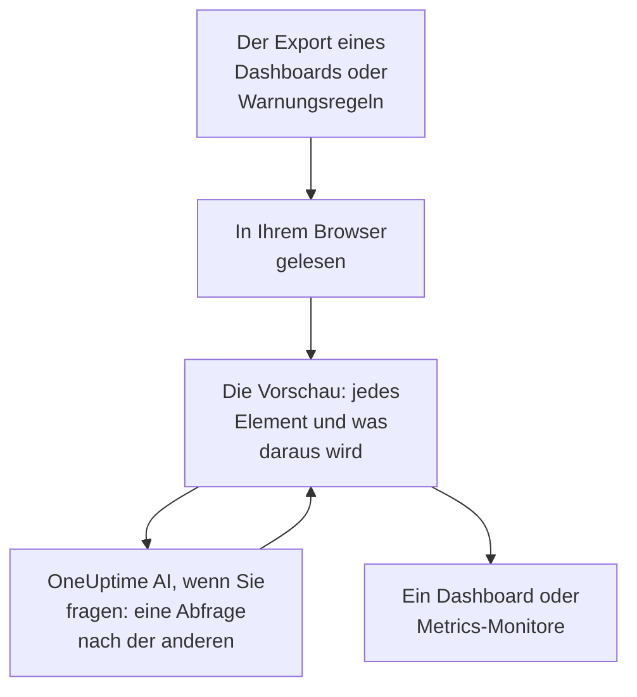

# Import aus Grafana und Datadog

Holen Sie ein Dashboard, das Sie in Grafana oder Datadog gebaut haben, oder die Warnungsregeln, die Sie für Prometheus, Grafana oder Datadog geschrieben haben, in OneUptime. Sie fügen die Datei ein oder laden sie hoch, sehen, was aus jedem Panel und jeder Regel wird, und erst dann erstellen Sie das Dashboard oder die Monitore.

:::cards
- [Ein Dashboard importieren](#ein-dashboard-importieren): Das JSON-Modell eines Grafana-Dashboards oder der Export eines Datadog-Dashboards.
- [Warnungsregeln importieren](#warnungsregeln-importieren): Prometheus-Regeldateien, Grafana-Warnungsregeln und Datadog-Monitore.
- [Wie jedes Element umgewandelt wird](#wie-jedes-element-umgewandelt-wird): Genau, ungefähr oder gar nicht, und warum.
- [Eine Abfrage mit OneUptime AI umwandeln](#eine-abfrage-mit-oneuptime-ai-umwandeln): Für eine Abfrage, die keine Regel umwandelt.
:::

## Wie ein Import abläuft

OneUptime liest die Datei in Ihrem Browser und wandelt jedes Panel, jedes Widget, jede Variable und jede Regel einzeln um. Die Vorschau listet alle mit dem auf, was aus ihnen wird. Nichts wird erstellt, bevor Sie es erstellen, und dann mit Ihren eigenen Berechtigungen, so wie die Dashboard- und Monitor-Formulare es erstellen.

## Bevor Sie beginnen

- Die importierten Widgets und Monitore lesen die eigenen Metriken dieses Projekts mit PromQL. Senden Sie sie mit Prometheus Remote Write, OpenTelemetry oder dem Datadog Agent; sie behalten die Namen, die sie dort haben.
- Ein Dashboard zu importieren erfordert eine Rolle, die Dashboards erstellen darf, und Warnungsregeln zu importieren eine Rolle, die Monitore erstellen darf.
- Eine Datei darf bis zu 10 MB groß sein, und bis zu 500 ihrer Panels oder Regeln werden gelesen.

## Ein Dashboard importieren

:::steps
### Den Dashboard-Import öffnen

Öffnen Sie **Produkte → Dashboards**, dann **Weitere Optionen → Import from Grafana or Datadog**.

### Das Dashboard einfügen

Kopieren Sie in Grafana das JSON-Modell aus den Einstellungen des Dashboards. Exportieren Sie in Datadog das JSON des Dashboards. Fügen Sie es ein oder wählen Sie **Upload a File**, dann wählen Sie **Vorschau**.

### Das Dashboard erstellen

Prüfen Sie, was aus jedem Panel und jeder Variable wird, geben Sie dem Dashboard einen Namen und wählen Sie **Dashboard erstellen**. Das neue Dashboard öffnet sich.
:::

Das PromQL von Grafana bleibt, wie es geschrieben ist: OneUptime setzt `$__interval`, `$__rate_interval` und `$__range` so ein, wie Grafana es tut, und eine Variable auf All passt auf jeden Wert. Eine Datadog-Abfrage wird zu PromQL über die Metriken, die der Datadog Agent gesendet hat: `avg:system.cpu.user{host:web-1}` liest `system_cpu_user{host="web-1"}`.

## Warnungsregeln importieren

:::steps
### Den Warnungs-Import öffnen

Öffnen Sie **Produkte → Monitore**, dann **Weitere Optionen → Import Alerts**.

### Die Regeln einfügen

Fügen Sie eine Prometheus-Regeldatei oder eine PrometheusRule-Ressource, den Export der Warnungsregeln aus Grafana oder als JSON exportierte Datadog-Monitore ein, dann wählen Sie **Vorschau**.

### Die Monitore erstellen

Entfernen Sie das Häkchen bei jeder Regel, die Sie nicht möchten, wählen Sie unter **When a rule fires**, was eine auslösende Regel öffnet, und wählen Sie **Monitore erstellen**.
:::

Jede Regel wird zu einem Metrics-Monitor mit einer PromQL-Abfrage, der Bedingung der Regel und ihrem Zeitfenster. Er öffnet eine Warnung oder einen Vorfall für jede Serie, die den Grenzwert überschreitet, und löst die Warnung oder den Vorfall auf, wenn sich die Serie erholt. Titel und Beschreibung stammen aus der Zusammenfassung oder Nachricht der Regel, mit den Labels der Serie eingesetzt.

## Wie jedes Element umgewandelt wird

| Status | Was er bedeutet |
| --- | --- |
| **Converted exactly** | Es liest dieselben Daten und zeigt sie auf dieselbe Weise. |
| **Converted approximately** | Es wird erstellt, und seine Hinweise sagen, was abweicht. |
| **Not converted** | Dafür wird nichts erstellt, und seine Hinweise sagen, warum. |

Aufzeichnungsregeln, Warnungsregeln über Logs, Datadog-Widgets, die Logs, Traces oder Ereignisse lesen, und die Anomalie-, Ausreißer- und Prognose-Monitore von Datadog werden nicht umgewandelt.

## Eine Abfrage mit OneUptime AI umwandeln

Eine Abfrage, die keine Regel umwandelt, zeigt **Convert with OneUptime AI**; dafür muss KI für das Projekt eingeschaltet sein. Nur diese Abfrage, mit den Namen der Variablen des Dashboards, geht an den [LLM-Anbieter](/docs/ai/llm-provider) Ihres Projekts. Die Antwort wird wie jede Abfrage geprüft und Ihnen gezeigt: Wählen Sie **Use This Query**, um sie zu verwenden. Nichts wird erstellt, bevor Sie das Dashboard oder die Monitore erstellen.

## Nächste Schritte

:::cards
- [Dashboard-Widgets](/docs/dashboards/widgets): Ändern Sie, was ein importiertes Widget zeigt.
- [Dashboard-Variablen & Filter](/docs/dashboards/variables): Die Variablen, die ein Import angelegt hat.
- [Metriken-Überwachung](/docs/monitor/metrics-monitor): Die Monitore, die ein Import angelegt hat.
- [PromQL](/docs/telemetry/promql): Die Sprache, die die importierten Widgets und Monitore lesen.
:::
