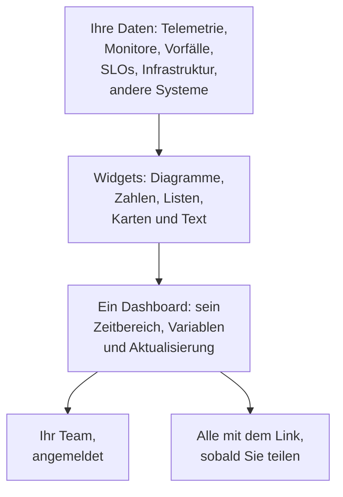

# Dashboards – Übersicht

Ein Dashboard ist eine Seite mit Widgets, die Sie selbst anordnen: Diagramme Ihrer Metriken, Logs und Traces, Listen von Vorfällen, Warnungen und Monitoren, Ihre SLOs und Ihre Infrastruktur, sogar Daten aus Systemen außerhalb von OneUptime. Bauen Sie eines für den Bildschirm der Rufbereitschaft, den Morgencheck eines Teams oder eine Seite für Ihre Kunden, und teilen Sie es mit Ihrem Projekt oder mit allen, die den Link haben.

:::cards
- [Wie ein Dashboard funktioniert](#wie-ein-dashboard-funktioniert): Woher seine Daten kommen und wer es sieht.
- [Ihre Dashboards finden](#ihre-dashboards-finden): Die Liste Dashboards und die eigenen Seiten jedes Dashboards.
- [Ihr erstes Dashboard bauen](#ihr-erstes-dashboard-bauen): Von einer Vorlage zu einer geteilten Seite in fünf Schritten.
- [Ein Beispiel: ein Dashboard für die Rufbereitschaft](#ein-beispiel-ein-dashboard-für-die-rufbereitschaft): Eine Seite, die für jeden Dienst funktioniert.
:::

## Wie ein Dashboard funktioniert

Jedes Widget liest aus einer Quelle, innerhalb des Zeitbereichs des Dashboards und gefiltert durch seine Variablen. Alle, die das Dashboard öffnen, sehen dieselben Widgets: Ihr Team nach der Anmeldung und Besucher über seinen öffentlichen Link, sobald Sie es teilen.

| Begriff | Bedeutung |
| --- | --- |
| Dashboard | Eine Seite: ein Name, ein Raster aus Widgets, ein Zeitbereich, Variablen und eine Einstellung für die automatische Aktualisierung. |
| Widget | Eine Kachel im Raster: ein Diagramm, eine Zahl, eine Liste, eine Karte, eine Uhr oder ein Textblock. |
| Variable | Eine Auswahl in der Werkzeugleiste, die jedes Widget, das sie unterstützt, auf einen Dienst, einen Host oder einen Kunden eingrenzt. |
| Zeitbereich | Das Zeitfenster, das jedes Diagramm und jede Zahl liest. Ein Dashboard öffnet sich mit seinem Standard, der letzten Stunde, es sei denn, jemand legt beim Bearbeiten einen anderen fest, und jeder Betrachter kann einen eigenen wählen. |
| Automatische Aktualisierung | Wie oft die Widgets ihre Daten neu lesen: aus, oder alle 5 Sekunden bis 15 Minuten. |
| Ansehen und bearbeiten | Ein Dashboard öffnet sich zum Lesen. Das Bearbeiten ist ein eigener Schritt, der mit dem Speichern oder Verwerfen Ihrer Änderungen endet. |

## Wofür Dashboards gut sind

- **Eine Seite „Ist alles in Ordnung?“** für die Person in Rufbereitschaft, das Standup eines Teams oder einen Bildschirm an der Wand.
- **Zusammenhänge sehen**: Eine CPU-Spitze neben einem Latenzanstieg und einem offenen Vorfall ist auf einer Seite offensichtlich und leicht zu übersehen, wenn sie auf drei Seiten verteilt ist.
- **Untersuchen**: Stellen Sie die Diagramme, die Sie immer wieder öffnen, nebeneinander, und ziehen Sie über eine Spitze, um jedes Widget in diesem Moment zu lesen.
- **Außerhalb des Teams teilen**: eine Leistungsseite für einen Kunden oder Partner, auf Wunsch mit einem Passwort oder einer IP-Zulassungsliste geschützt.

## Ihre Dashboards finden

Öffnen Sie **Produkte → Dashboards**. Die Liste **Dashboards** zeigt die Dashboards des Projekts mit ihren Beschreibungen, Beschriftungen und Eigentümern. Suchen Sie nach Name oder Beschreibung, grenzen Sie die Liste mit den Filtern **Eigentümer** und **Beschriftungen** ein, oder wählen Sie mehrere Dashboards aus, um ihre Beschriftungen oder Eigentümer zu ändern, sie zu archivieren oder als JSON zu exportieren.

Das Seitenmenü der Liste enthält die Seiten, die sich um all Ihre Dashboards kümmern:

| Seite | Was Sie dort tun |
| --- | --- |
| **Dashboards** | Die Dashboards des Projekts. Erstellen Sie eines, oder holen Sie Dashboards mit **JSON importieren** herein. |
| **Dashboards → Playlists** | [Dashboards nacheinander](/docs/dashboards/playlists) auf einem Bildschirm zeigen, etwa an einer NOC-Wand. |
| **Einstellungen → Eigentümerregeln** | Neuen Dashboards automatisch Eigentümer hinzufügen. |
| **Einstellungen → Beschriftungsregeln** | Neuen Dashboards automatisch Beschriftungen hinzufügen. |
| **Einstellungen → Datenquellen** | Prometheus, SQL-Datenbanken, ClickHouse, Loki, Elasticsearch oder eine REST-API anbinden. |
| **Erweitert → Archiviert** | Dashboards, die Sie archiviert haben. Holen Sie sie von hier aus dem Archiv zurück. |

Öffnen Sie ein Dashboard, und sein eigenes Seitenmenü enthält diese Seiten. Jeder Abschnitt außer **Grundlegend** ist anfangs eingeklappt: Klicken Sie auf seinen Titel, um ihn zu öffnen.

| Seite | Was Sie dort tun |
| --- | --- |
| **Dashboard** | Das Dashboard selbst. Lesen Sie es, oder bearbeiten Sie es über sein Menü **⋯**. |
| **Übersicht** | Sein Name, seine Beschreibung und seine Beschriftungen. |
| **Freigabe** | Wer es sehen kann, sein öffentlicher Link und eine IP-Zulassungsliste unter Weitere Einstellungen. |
| **Eigentümer** | Die Benutzer und Teams, denen es gehört. |
| **Branding** | Seitentitel, Beschreibung, Logo, Design und Favicon des öffentlichen Dashboards. |
| **Benutzerdefinierte Domains** | Das öffentliche Dashboard unter Ihrer eigenen Domain bereitstellen. |
| **Einstellungen** | Das Dashboard duplizieren, exportieren oder archivieren. |
| **Audit-Protokolle** | Jede Änderung am Dashboard und wer sie vorgenommen hat. |
| **Löschen** | Das Dashboard endgültig löschen. |

## Ihr erstes Dashboard bauen

:::steps
1. **Erstellen** — Wählen Sie eine Vorlage oder **Ohne Vorlage beginnen**. Eine Vorlage füllt den Namen aus und öffnet sich mit ihren Widgets; ein Dashboard ohne Vorlage öffnet sich leer, mit **Widget hinzufügen** auf seiner Arbeitsfläche.
2. **Widgets hinzufügen** — Wählen Sie ein Widget aus dem Katalog, legen Sie in seinen Einstellungen fest, was es liest, und ziehen Sie es dann an seinen Platz und in seine Größe.
3. **Variablen hinzufügen, falls Sie sie brauchen** — Eine Variable `service` zum Beispiel lässt ein Dashboard jeden beliebigen Dienst zeigen.
4. **Speichern** — Klicken Sie auf **Änderungen speichern**. Nichts, was Sie beim Bearbeiten ändern, bleibt erhalten, bevor Sie das tun.
5. **(Optional) Öffentlich teilen** — Wählen Sie **⋯ → Teilen** im Dashboard und legen Sie fest, wer es sehen kann: alle mit dem Link oder alle mit dem Link und einem Passwort.
:::

[Ein Dashboard erstellen](/docs/dashboards/authoring) führt durch jeden Schritt.

## Ein Beispiel: ein Dashboard für die Rufbereitschaft

Das Ziel: eine Seite für den Checkout-Dienst mit seiner Latenz, seiner Fehlerquote, seinen offenen Vorfällen und seinen neuesten Logs, die auch für jeden anderen Dienst funktioniert.

1. Klicken Sie auf **Dashboard erstellen**, wählen Sie **Ohne Vorlage beginnen** und nennen Sie das Dashboard „Checkout on-call“.
2. Klicken Sie auf **Widget hinzufügen** und fügen Sie ein **Diagramm** Ihrer Latenzmetrik für Anfragen hinzu, aggregiert als P95.
3. Fügen Sie daneben einen **Wert** Ihrer Fehlerquote hinzu, mit einer Warnschwelle von 1 und einer kritischen Schwelle von 5.
4. Fügen Sie darunter eine **Vorfallsliste** hinzu, gefiltert auf ungelöste Vorfälle, und einen **Protokoll-Stream** der Logs des Dienstes.
5. Öffnen Sie **Variablen**, fügen Sie eine Variable namens `service` mit der Quelle Telemetry Attribute und dem Attributschlüssel `service.name` hinzu und geben Sie ihr den Standardwert `checkout`.
6. Klicken Sie auf **Änderungen speichern**. Wählen Sie `payments` in der Auswahl `service` der Werkzeugleiste: Das Diagramm, der Wert und der Log-Stream wechseln zum Dienst payments, und die Vorfallsliste zeigt weiterhin jeden ungelösten Vorfall.

## Wie Dashboards zum Rest von OneUptime passen

- **Monitore und Telemetrie** sind die Herkunft der Daten. Jede Metrik, jedes Log und jeder Trace, den Sie senden, kann auf ein Widget.
- **Vorfälle und Warnungen** erscheinen in den Widgets **Vorfallsliste** und **Warnungsliste**. Ein Dashboard zeigt sie nur: Bearbeitet werden sie auf ihren eigenen Seiten.
- **Statusseiten** sagen Ihren Kunden, ob Ihr Dienst läuft. Dashboards zeigen im Detail, wie er sich verhält. Beide arbeiten Seite an Seite.
- **Workflows** handeln, wenn etwas geschieht. Dashboards sind der Ort, an dem Sie es lesen.

## Nächste Schritte

:::cards
- [Ein Dashboard erstellen](/docs/dashboards/authoring): Ein Dashboard anlegen, bearbeiten und Ihre Änderungen speichern.
- [Dashboard-Widgets](/docs/dashboards/widgets): Jedes Widget und welches Sie wählen.
- [Dashboard-Variablen & Filter](/docs/dashboards/variables): Ein Dashboard für jeden Dienst, jeden Host oder jeden Kunden.
- [Teilen & öffentliche Dashboards](/docs/dashboards/sharing): Öffentliche Links, Passwörter, IP-Zulassungslisten und eigene Domains.
:::
