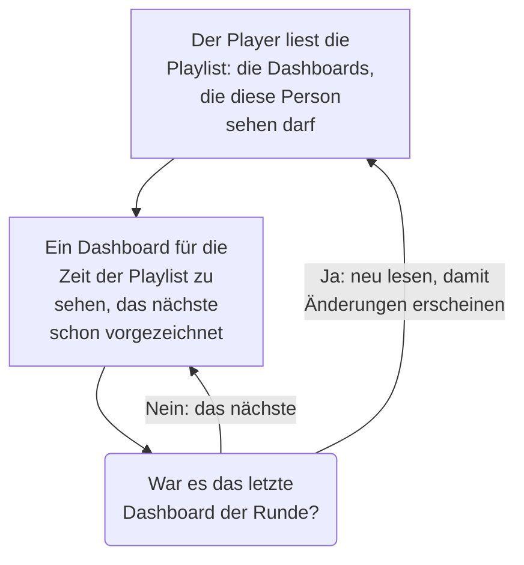

# Dashboard-Playlists

Eine Playlist zeigt eine Reihe von Dashboards nacheinander auf einem Bildschirm, den niemand bedient, etwa an einer NOC-Wand oder auf dem Fernseher eines Teams: jedes Dashboard so lange, wie Sie es festlegen, immer wieder von vorn, bis jemand sie anhält. Legen Sie die Playlist einmal an, öffnen Sie ihren Player auf dem Bildschirm, und lassen Sie ihn laufen.

:::cards
- [So spielt eine Playlist](#so-spielt-eine-playlist): Die Reihenfolge, die Anzeigezeiten und was jedes Dashboard zeigt.
- [Eine Playlist erstellen](#eine-playlist-erstellen): Ein Name, ihre Dashboards in Reihenfolge und wie lange jedes gezeigt wird.
- [Auf einem Bildschirm abspielen](#auf-einem-bildschirm-abspielen): Die Leiste des Players, ihre Schaltflächen und ihre Tasten.
- [Wer was sieht](#wer-was-sieht): Die Berechtigungen und die Dashboards, die eine Person nicht lesen darf.
:::

## So spielt eine Playlist

Der Player zeigt das erste Dashboard der Playlist, dann das nächste, wenn seine Zeit um ist, und beginnt nach dem letzten wieder beim ersten. Jedes Dashboard öffnet sich so, wie seine Bearbeiter es gespeichert haben: mit seinem eigenen Standard-Zeitraum, seiner automatischen Aktualisierung und seinen Variablen, ganz gleich, was in der Adresse des Players steht. Während ein Dashboard zu sehen ist, zeichnet der Player das nächste unsichtbar vor, sodass der Bildschirm zwischen zwei Dashboards nie leer wird.

Eine Playlist nennt ihre Dashboards und kopiert sie nie: Eine Änderung, die jemand an einem Dashboard speichert, ist auf dem Bildschirm, sobald es das nächste Mal an der Reihe ist. Der Player liest die Playlist vor jeder Runde neu, sodass ein hinzugefügtes, verschobenes oder entferntes Dashboard innerhalb einer Runde erscheint, ohne den Bildschirm neu zu laden; schlägt dieses Lesen fehl, spielt der Bildschirm seine bisherige Runde noch einmal.

## Eine Playlist erstellen

:::steps
### Playlists öffnen
Öffnen Sie **Produkte → Dashboards** und dann **Playlists** im Seitenmenü. Die Liste zeigt, wie viele Dashboards jede Playlist hat und wie lange jedes gezeigt wird, mit **Abspielen** in jeder Zeile.

### Einen Namen geben
Klicken Sie auf **Playlist erstellen**, und tragen Sie unter **Name** ein, wo die Playlist läuft, etwa „NOC-Wand“.

### Die Dashboards hinzufügen
Wählen Sie unter **Dashboards** jedes über **Dashboard hinzufügen** aus, in der Reihenfolge, in der der Bildschirm sie zeigt. Die Schaltflächen in der Zeile eines Dashboards verschieben es nach oben oder unten oder entfernen es. Archivierte Dashboards werden nicht angeboten.

### Festlegen, wie lange jedes gezeigt wird
**Jedes Dashboard zeigen für** beginnt bei einer Minute; wählen Sie eine Zeit von 15 Sekunden bis zu einer Stunde. Klicken Sie auf **Playlist erstellen**.
:::

Die Seite der Playlist listet ihre Dashboards in Reihenfolge, wie lange jedes gezeigt wird, und den **Player-Link**. **Playlist bearbeiten** ändert den Namen, die Dashboards, ihre Reihenfolge und die Zeit. **Dashboard-Playlist löschen**, unten auf der Seite, löscht die Playlist und nie ihre Dashboards.

Über die API und Terraform ist eine Playlist ein `name`, ihre `dashboards` als Liste wie `[{"dashboardId": "<id>"}]` in der Reihenfolge, in der sie gezeigt werden, höchstens 100, und `intervalInSeconds`, eine beliebige ganze Zahl von Sekunden von 10 bis 86400 (ein Tag). Ein Wert außerhalb davon wird abgelehnt, mit dem, was daran nicht stimmt.

## Auf einem Bildschirm abspielen

Klicken Sie in der Zeile der Playlist oder auf ihrer Seite auf **Abspielen**. Der Player füllt das Browserfenster, über dem Rest von OneUptime; **Vollbild** füllt den ganzen Bildschirm. Um einen Bildschirm für sich allein zu starten, öffnen Sie dort den **Player-Link** und setzen Sie ein Lesezeichen darauf: Der Link öffnet den Player sofort.

Die Leiste des Players nennt das Dashboard auf dem Bildschirm, die Playlist, wo die Runde steht („2 von 5“) und das Dashboard, das als Nächstes kommt. Eine Linie unter der Leiste füllt sich, während ein Dashboard an der Reihe ist. Die Schaltflächen der Leiste gehen zum vorherigen Dashboard, pausieren oder spielen ab und gehen zum nächsten; an einem Computer tun diese Tasten dasselbe:

| Tasten | Was sie tun |
| --- | --- |
| `Space` | **Pausieren oder abspielen**. Pausiert bleibt das Dashboard auf dem Bildschirm, und die Leiste zeigt **Pausiert**. |
| `Right Arrow` | **Nächstes Dashboard**. |
| `Left Arrow` | **Vorheriges Dashboard**. |
| `F` | **Vollbild**, oder wieder heraus. |
| `Esc` | **Player verlassen**, zurück zur Seite der Playlist. Im Vollbild verlässt das erste `Esc` nur das Vollbild. |
| `?` | **Tastenkürzel anzeigen**. |

Ein Dashboard, zu dem Sie gehen, ob das nächste oder das vorherige, bekommt seine volle Zeit. Auf einer Seite, die von rechts nach links gelesen wird, etwa auf Persisch, tauschen die Pfeile: `Left Arrow` geht zum nächsten Dashboard. Solange er spielt, hält der Player den Bildschirm wach, wo der Browser es erlaubt.

## Wer was sieht

Playlists haben eigene Berechtigungen, die wie die der Dashboards über ein Team vergeben werden:

| Um | Braucht es |
| --- | --- |
| Playlists zu sehen und abzuspielen | `ReadDashboardPlaylist` oder eine Projektrolle: Project Owner, Project Admin, Project Member, Viewer oder eine Settings-Rolle |
| Playlists zu erstellen | `CreateDashboardPlaylist`, Project Owner oder Project Admin |
| Eine Playlist zu ändern: ihren Namen, ihre Dashboards und ihre Zeit | `EditDashboardPlaylist`, Project Owner oder Project Admin |
| Eine Playlist zu löschen | `DeleteDashboardPlaylist`, Project Owner oder Project Admin |

Eine Playlist zeigt niemandem ein Dashboard, das er nicht lesen darf. Der Player spielt nur die Dashboards, die die am Bildschirm angemeldete Person lesen darf und die nicht archiviert sind, und überspringt den Rest: ein gelöschtes Dashboard, ein archiviertes oder eines, das ihre Berechtigungen ihr vorenthalten. Die Seite der Playlist sagt, warum sie jedes davon überspringt. Wer eine Playlist speichert, behält die Dashboards darin, die er selbst nicht sehen kann, sodass nichts verloren geht, was jemand anderes hineingelegt hat.

| Wenn der Player findet | Zeigt er |
| --- | --- |
| Dashboards, die er zeigen darf | Jedes der Reihe nach. |
| Kein Dashboard, das er zeigen darf | **Noch nichts anzuzeigen**, und er sieht jede Minute erneut nach. |
| Die Playlist gelöscht oder für diese Person nicht lesbar | **Playlist nicht gefunden**. |
| Ein Lesen, das fehlschlug | **Diese Playlist konnte nicht geladen werden**, und er versucht es jede Minute erneut, oder bei **Erneut versuchen**. |

> [!NOTE]
> Der Player ist für jemanden, der bei OneUptime angemeldet ist. Um eine Playlist auf einem Bildschirm laufen zu lassen, melden Sie sich auf diesem Bildschirm mit einem Konto an, das die Playlist und ihre Dashboards lesen darf, etwa mit einem Teammitglied mit der Rolle Viewer.

## Nächste Schritte

:::cards
- [Ein Dashboard erstellen](/docs/dashboards/authoring): Bauen Sie die Dashboards, die eine Playlist zeigt.
- [Dashboard-Variablen & Filter](/docs/dashboards/variables): Die gespeicherte Auswahl, mit der jedes Dashboard öffnet.
- [Teilen & öffentliche Dashboards](/docs/dashboards/sharing): Ein Dashboard Menschen zeigen, die sich nicht anmelden.
- [Dashboard-Konfiguration & Berechtigungen](/docs/dashboards/configuration): Eigentümer, Beschriftungen und wer ein Dashboard lesen darf.
:::
