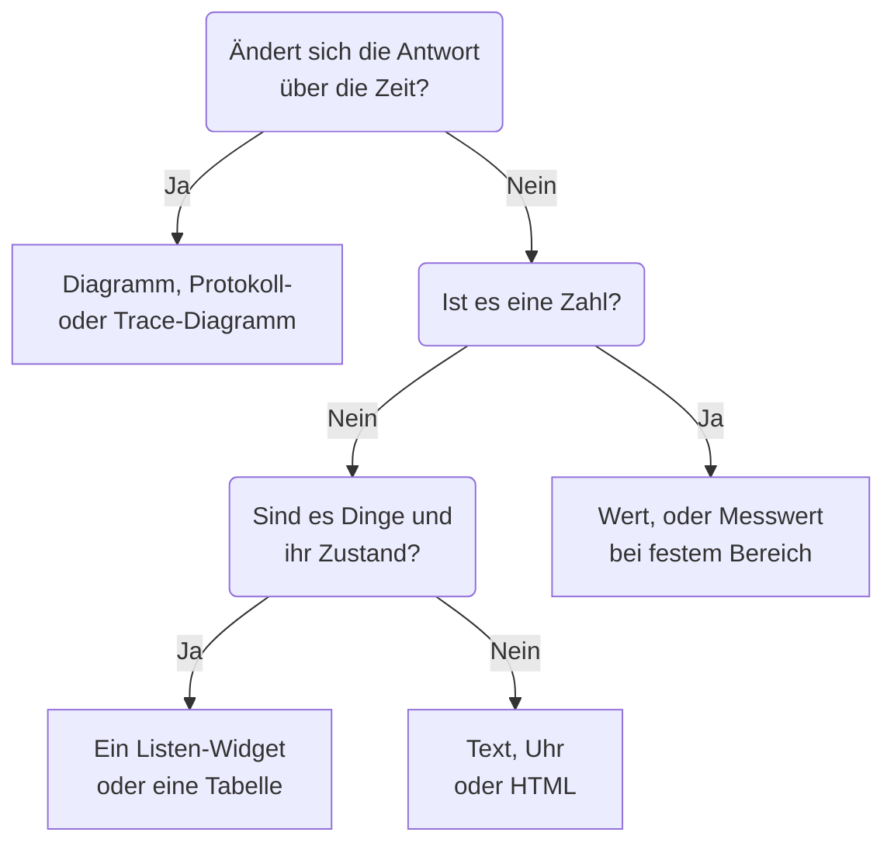

# Dashboard-Widgets

Ein Widget ist eine Kachel auf einem Dashboard. Diese Seite führt jedes Widget des Katalogs **Widget hinzufügen** auf, was es zeigt und welche Einstellungen zählen, in den Gruppen des Katalogs. Wie Sie Widgets im Raster platzieren und speichern, steht in [Ein Dashboard erstellen](/docs/dashboards/authoring).

:::cards
- [Welches Widget soll ich nehmen?](#welches-widget-soll-ich-nehmen): Nach der Frage wählen, die die Kachel beantwortet.
- [Diagramme und Zahlen](#diagramme-und-zahlen): Diagramm, Wert, Messwert und Tabelle aus einer Metrikabfrage.
- [Logs, Traces und Sicherheit](#logs-traces-und-sicherheit): Volumendiagramme, Live-Streams und Listen.
- [Listen und Tabellen sortieren](#listen-und-tabellen-sortieren): Nach einer Spalte sortieren und die Reihenfolge festlegen, die alle sehen.
- [Wenn ein Widget nicht angezeigt werden kann](#wenn-ein-widget-nicht-angezeigt-werden-kann): Was ein defektes Widget zeigt und wie Sie es beheben.
:::

## Welches Widget soll ich nehmen?

Beginnen Sie mit der Frage, die die Kachel beantworten soll:

| Die Frage | Das Widget |
| --- | --- |
| Wie hat sich eine Metrik über die Zeit verändert? | **Diagramm** |
| Wie viele Logs welchen Schweregrads, über die Zeit? | **Protokolldiagramm** |
| Wie schnell sind Anfragen und wie viele schlagen fehl, über die Zeit? | **Trace-Diagramm** |
| Wie lautet eine Zahl gerade jetzt? | **Wert**, oder **Messwert**, wenn sie einen bekannten Bereich hat |
| Welche Hosts, Dienste oder Endpunkte stechen hervor? | **Tabelle** oder **Trace-Tabelle** |
| Was passiert gerade? | **Protokoll-Stream**, **Trace-Liste**, **Vorfallsliste** oder **Warnungsliste** |
| Sind alle unsere Websites erreichbar? | **Überwachungsliste** |
| Halten wir die Zuverlässigkeit, die wir versprochen haben? | **SLO** oder **SLO-Liste** |
| In welchem Zustand sind unsere Cluster und Hosts? | Ein Widget der Gruppe Infrastruktur |
| Wo auf der Welt ist unser Netzwerk, und was ist ausgefallen? | **Netzwerkkarte** |
| Eine Überschrift, eine Notiz, die Uhrzeit in einem anderen Büro? | **Text** oder **Uhr** |
| Daten außerhalb von OneUptime? | Ein Widget der Gruppe External Data Sources |
| Etwas, das kein Widget abdeckt? | **HTML**, sobald Sie sicher sind, dass kein anderes Widget es kann |



Die meisten Dashboards mischen einige: oben ein Diagramm, daneben ein oder zwei Werte, eine Textüberschrift und darunter eine oder zwei Listen.

## Diagramme und Zahlen

Diese vier Widgets lesen eine Metrikabfrage, aufgebaut wie im Metrik-Explorer: Wählen Sie eine Metrik und eine Aggregation, fügen Sie Attributfilter hinzu und gruppieren Sie nach einem Attribut, um eine Reihe pro Wert zu erhalten.

### Diagramm

Eine Zeitreihe aus einer oder mehreren Metrikabfragen über den Zeitbereich des Dashboards. **Chart Type** zeichnet sie als Linien-, Balken-, Flächen-, gestapeltes Flächen- oder Kreisdiagramm. **Additional Queries** legen weitere Metriken auf dieselben Achsen, und **Formeln** kombinieren sie mit `+`, `-`, `*`, `/`, `%`, `^` und Klammern, etwa `(1 - a) * 100`. Die Anzeigeeinstellungen jeder Abfrage fügen eine Legende und eine Einheit, eine Farbe, Warn- und kritische Linien sowie eine Rate pro Sekunde für Zähler hinzu, die nur wachsen.

Nutzen Sie es, wenn die Form der Linie die Geschichte erzählt: Latenz, Fehler, Durchsatz oder Warteschlangentiefe.

### Wert

Eine große Zahl mit einer Sparkline: der Wert der Abfrage über den ganzen Zeitbereich, summiert bei einer Summe oder Anzahl, der höchste bei einem Maximum, der niedrigste bei einem Minimum und sonst der Mittelwert. Ein Pfeil vergleicht die zweite Hälfte des Bereichs mit der ersten, jede Hälfte auf dieselbe Weise berechnet, gefärbt nach **Trend Direction**: ob ein höherer Wert besser oder schlechter ist, oder abgeleitet aus dem Namen der Metrik. Zeigen Sie auf den Pfeil, um die Werte beider Hälften zu sehen, und auf die Sparkline, um Wert und Zeit eines beliebigen Punkts abzulesen. **Warnschwelle** färbt den Hintergrund gelb und **Kritischer Schwellenwert** rot, sobald der Wert sie erreicht.

Nutzen Sie es, wenn eine Zahl die Frage beantwortet: die Fehlerquote, die P95-Latenz oder die heute bedienten Anfragen.

### Messwert

Eine Skala zwischen einem Minimum und einem Maximum, 0 und 100, wenn Sie nichts anderes festlegen, mit einer gelben Zone ab **Warnschwelle** und einer roten Zone ab **Kritischer Schwellenwert**.

Nutzen Sie es, wenn der Wert in einem bekannten Bereich liegt: CPU- oder Festplattenauslastung in Prozent oder die Kapazität einer Warteschlange.

### Tabelle

Metrikwerte als Zeilen. **Nach Attributen gruppieren** ergibt eine Zeile pro Wert, etwa eine pro `host.name`; ohne Gruppierung ist jede Zeile ein Zeitintervall. **Metrics & Columns** legt die Spalten fest: Metriken und Formeln darüber, etwa die Verfügbarkeit in Prozent. Wenn Sie gruppieren, macht **Reduce across time** aus der Reihe jeder Zeile einen Wert: den letzten Wert, den Durchschnitt, die Summe, das Minimum oder das Maximum.

Schalten Sie in einer Spalte **Nach Schwellenwerten einfärben** ein, um ihre Werte einzufärben: Ein Wert, der die **Warnschwelle** erreicht, wird bernsteinfarben, mit einem Dreieck, und einer, der den Wert unter **Kritischer Schwellenwert** erreicht, rot und fett, mit einem Kreis. Eine Prozentspalte beginnt bei 80 und 90. Für eine Spalte, bei der niedrige Werte das Problem sind, etwa freier Speicherplatz, wählen Sie unter **Richtung** die Option **Niedriger ist schlechter**.

Schwellenwerte lesen die Zahl, die die Tabelle zeigt: Eine Auslastungsmetrik, die als Anteil von 1 gesendet wird, etwa `system.cpu.utilization`, wird als Prozentwert angezeigt und verglichen. Unter **Schwellenwertfarben** füllt **Farbiger Hintergrund** die ganze Zelle, statt die Zahl einzufärben.

Nutzen Sie sie für eine Aufschlüsselung statt eines Trends: die lautesten Hosts, die Fehler pro Dienst, die Anfragen pro Endpunkt.

## Text, Uhr und HTML

Diese Widgets brauchen keine Datenquelle.

### Text

Eine Zeile oder ein Textblock für eine Überschrift, eine Notiz oder Links zu Ihren Runbooks. Schalten Sie **Markdown** ein, um Überschriften, Links, Listen, Code und Tabellen zu zeichnen; sonst erscheint der Text wie getippt, auf Wunsch fett, kursiv oder unterstrichen.

### Uhr

Die aktuelle Uhrzeit in einer beliebigen Zeitzone, als Ziffern oder als analoges Zifferblatt, mit einer Beschriftung wie „Sydney Office“. Ohne Zeitzone zeigt sie die eigene jedes Betrachters. Fügen Sie eine pro Büro hinzu, um zu sehen, wer wach ist.

### HTML

Ihr eigenes HTML, CSS und JavaScript, als Widget gezeichnet. Seine Einstellungen sind der HTML-Inhalt, ein optionales Stylesheet, ein optionales Skript und drei Berechtigungsschalter.

Nutzen Sie es, wenn Sie etwas brauchen, das kein eingebautes Widget abdeckt: ein eingebettetes Abzeichen eines Drittanbieters, eine Tabelle aus einer internen API, eine eigene Legende oder eine Reihe gestalteter Links zu Ihren eigenen Werkzeugen.

#### Was es kann und was nicht

Das Widget wird in einem abgeschotteten Frame mit eigenem, isoliertem Ursprung gerendert. In diesem Frame kann Ihr Code mehr oder weniger alles: DOM aufbauen, Timer laufen lassen, von jeder URL abrufen, auf einer Canvas zeichnen.

Was es nicht kann, ist die OneUptime-Seite drumherum erreichen. Es hat keinen Zugriff auf das DOM, die Cookies, den lokalen Speicher oder die API-Sitzung des Dashboards, und es kann den Browser-Tab nicht wegnavigieren. Das gilt, ob das Dashboard privat oder öffentlich geteilt ist.

Zwei Folgen, die Sie kennen sollten, bevor Sie etwas einfügen:

- Ein `fetch` aus dem Widget ist eine ursprungsübergreifende Anfrage von einem opaken Ursprung, daher muss der aufgerufene Server sie per CORS erlauben. Die OneUptime-API von hier aus aufzurufen, wird nicht unterstützt.
- Das Widget beginnt transparent. Setzen Sie in Ihrem CSS einen Hintergrund auf `body`, wenn es die Karte füllen soll. Im dunklen Design beginnt sein Text hell, und sein Element `<html>` hat die Klasse `dark`: Beginnen Sie eine CSS-Regel mit `html.dark`, um nur das dunkle Design zu gestalten.

#### Dashboard-Variablen verwenden

Schreiben Sie `{{variableName}}` an eine beliebige Stelle im HTML, CSS oder JavaScript, und es wird vor dem Rendern durch den aktuellen Wert dieser Variablen ersetzt. Die Wahl eines neuen Werts rendert das Widget neu. Ein Platzhalter, der eine nicht vorhandene Variable nennt, bleibt unverändert.

Skripte erhalten dieselben Werte, dazu den Zeitbereich des Dashboards, unter `window.ONEUPTIME`:

```javascript title="window.ONEUPTIME"
window.ONEUPTIME.variables.environment; // current value, or "" if unset
window.ONEUPTIME.startDate; // ISO 8601 string, start of the dashboard's time range
window.ONEUPTIME.endDate; // ISO 8601 string, end of it
```

Das Widget lädt neu, wann immer das Dashboard aktualisiert, sodass ein Widget, das seine eigenen Daten abruft, mit dem Aktualisierungsintervall Schritt hält.

#### Berechtigungen

**Run JavaScript** (standardmäßig an) führt Ihr Skript aus. Schalten Sie es aus, um nur Markup und Stile zu rendern — das Skript wird dann ganz aus dem Widget weggelassen, nicht bloß blockiert.

**Open links in a new tab** (standardmäßig an) erlaubt Links und `window.open`, einen Browser-Tab zu öffnen. Links öffnen sich immer in einem neuen Tab; das Widget kann nie das Dashboard selbst wegnavigieren.

**Allow forms to submit** (standardmäßig aus) erlaubt einem `<form>` im Widget, abzuschicken.

Wer das Dashboard bearbeiten darf, entscheidet, was dieses Widget ausführt, und alle, die das Dashboard ansehen, führen es aus — auf einem öffentlichen Dashboard auch anonyme Besucher. Behandeln Sie Bearbeitungsrechte an einem Dashboard mit einem HTML-Widget so wie den Zugriff auf jeden anderen Code, den Sie ausliefern.

## Logs, Traces und Sicherheit

| Widget | Was es zeigt | Wichtige Einstellungen |
| --- | --- | --- |
| **Protokolldiagramm** | Das Log-Volumen über die Zeit, eine Reihe pro Schweregrad, als Balken, Linien oder Flächen. | Schweregrade, Text im Body, Attributfilter. |
| **Protokoll-Stream** | Die neuesten Logzeilen, die zu einem Filter passen. | Schweregrad, Text im Body, Attributfilter wie `@service.name:checkout`, Anzahl der Zeilen. |
| **Trace-Diagramm** | Anzahl der Anfragen, Anzahl der Fehler oder Antwortzeit (Durchschnitt, Minimum, Maximum, P50 bis P99) über die Zeit. | Die Metrik, welche Spans gezählt werden, und ein Attribut, nach dem die Reihen aufgeteilt werden. |
| **Trace-Liste** | Die neuesten Traces mit ihrer Dauer und ihrem Status. | Status, Anzahl der Zeilen. |
| **Trace-Tabelle** | Die häufigsten Span-Namen, Status oder Attributwerte nach Anzahl der Anfragen, mit Median, Durchschnitt, Minimum und Maximum der Antwortzeit. | Wonach die Zeilen gruppiert werden und welche Spans zählen. |
| **Sicherheitsereignisse** | Die neuesten Sicherheitsereignisse mit Schweregrad, Ereignisklasse und Host. | Schweregrade, Ereignisklassen, Text in der Nachricht. |
| **Fluss der Sicherheitsereignisse** | Ein Fluss der Sicherheitsereignisse von ihrer Quelle über ihre Ereignisklasse bis zu ihrem Schweregrad. | Schweregrade, Anzahl der Ereignisse. |

Die Trace-Widgets zählen nur Root-Spans, wie der Traces-Explorer, es sei denn, Sie schließen in ihren Einstellungen Kind-Spans ein. Ein häufiges Muster ist ein Latenzdiagramm oben mit einer Liste langsamer Traces darunter.

## Vorfälle, Warnungen und Monitore

| Widget | Was es zeigt | Filter |
| --- | --- | --- |
| **Vorfallsliste** | Vorfälle mit ihrem Status und Schweregrad. | Ungelöst, bestätigt oder gelöst; Schweregrad, Status, Monitore und Beschriftungen. |
| **Warnungsliste** | Warnungen mit ihrem Status und Schweregrad. | Ungelöst, bestätigt oder gelöst; Schweregrad, Status, Monitore und Beschriftungen. |
| **Überwachungsliste** | Monitore mit ihrem aktuellen Status. | Betriebsbereit oder nicht, Status, Monitortyp und Beschriftungen, oder eine **Beschriftungsvariable**, die Betrachter in der Werkzeugleiste wählen. |

Wie die meisten Listen-Widgets können diese drei statt einer Tabelle eine Wabenansicht aus Zellen zeichnen, die nach Status gefärbt sind: Wählen Sie sie unter **Ansichtsmodus**. Sie zeigen den aktuellen Zustand, unabhängig vom Zeitbereich des Dashboards.

## Service Level Objectives

### SLO

Ein Service Level Objective, gezeichnet entweder als einzelne Zahl oder als Linie über die Zeit.

**Einstellungen**: welches SLO, oder das in einer Dashboard-Variablen gewählte SLO; welche seiner drei Zahlen (SLI, Error Budget Remaining oder Burn Rate); die Darstellung als Tile oder Diagramm; und ein optionaler Titel.

- **Tile** gibt die aktuelle Zahl aus, dazu eine zweite Zeile, wo es eine gibt — das Ziel unter dem SLI, die verbleibenden Minuten unter dem Fehlerbudget. Eine Statuspille färbt das Ganze.
- **Diagramm** zeichnet dieselbe Zahl über den Zeitbereich des Dashboards, mit dem Ziel als gestrichelter Linie auf der SLI-Reihe. Der Verlauf wird alle paar Minuten vom Auswertungs-Worker geschrieben, daher ist ein brandneues SLO im Diagramm leer, bis es zum ersten Mal ausgewertet wurde.

Nutzen Sie es, wenn das Dashboard die Frage „Halten wir, was wir versprochen haben?“ beantwortet, statt „Was passiert gerade?“.

Das SLO-Widget funktioniert auf [öffentlichen Dashboards](/docs/dashboards/sharing). Veröffentlicht werden die Kennzahlen des SLO — sein Name, sein Ziel, der aktuelle SLI, das verbleibende Fehlerbudget, die Burn Rate und der Status —, unabhängig davon, welche davon das Widget gerade zeichnet. Seine Definition bleibt privat: die Monitore, die es beobachtet, seine Beschriftungen, seine Beschreibung, seine Abfrage und sein Auswertungsplan werden nie an einen öffentlichen Betrachter gesendet. Ein Tile-Widget veröffentlicht nur diese aktuellen Zahlen; ein Diagramm-Widget veröffentlicht zusätzlich den Verlauf der einen Reihe, die es zeichnet, und sonst nichts.

### SLO-Liste

Jedes SLO mit seinem Status, SLI, Fehlerbudget und seiner Burn Rate, das mit dem wenigsten verbleibenden Budget zuerst. Filtern Sie sie nach Status oder Beschriftungen, oder nach einer **Beschriftungsvariable**, die Betrachter in der Werkzeugleiste wählen. [SLO-Metriken und -Dashboards](/docs/slo/metrics) zeigt beide SLO-Widgets im Einsatz.

## Infrastruktur

Jedes dieser Widgets listet die Ressourcen, die ein Agent oder ein Collector an OneUptime meldet. Grenzen Sie sie in ihren Filtern nach Cluster, Host oder Namespace ein, und zeigen Sie sie als Liste oder als Waben.

| Gruppe | Widgets | Befüllt durch |
| --- | --- | --- |
| **Hosts** | **Hosts**, mit Verbindungsstatus, Betriebssystem, CPU und Speicher | Jeden OpenTelemetry Collector, der `host.name` sendet |
| **Kubernetes** | **Pods**, **Knoten**, **Namespaces**, **Deployments**, **StatefulSets**, **DaemonSets**, **Jobs**, **CronJobs** | Den [Kubernetes-Agent](/docs/monitor/kubernetes-agent) |
| **Docker** | **Hosts**, **Container**, **Images**, **Netzwerke**, **Volumes** | Den Docker-Agent |
| **Docker Swarm** | **Knoten**, **Dienste** | Den Docker-Swarm-Agent |
| **Podman** | **Hosts**, **Container**, **Images**, **Netzwerke**, **Volumes** | Den Podman-Agent |
| **Proxmox** | **Knoten**, **Gäste** | Den Proxmox-Agent |
| **VMware** | **Hosts**, **Virtuelle Maschinen** | Den VMware-Agent oder ein vCenter, das Sie verbinden |
| **Ceph** | **OSDs**, als Wand nach Zustand gefärbt, und **Pools** | Den Ceph-Agent |
| **Speicher-Arrays** | **Volumes**, und **Hardware** als Wand nach Status gefärbt | Den Storage-Array-Agent |

Nutzen Sie sie für eine Seite, die den Zustand Ihrer Infrastruktur mit der Telemetrie der Workloads darauf verbindet.

### Netzwerkkarte

Ihre Netzwerkstandorte auf der Weltkarte, jeder an seinem eigenen Breiten- und Längengrad angeheftet und nach dem darauf zusammengefassten Monitorstatus gefärbt. Nahe beieinander liegende Standorte teilen sich eine Markierung mit der Anzahl darin; eine Markierung, die für genau einen Standort steht, öffnet diesen Standort, wenn Sie darauf klicken.

Die Karte rahmt sich auf die Standorte ein, die sie gezeichnet hat — ein Bestand innerhalb eines Landes füllt den Rahmen mit diesem Land, einer über Kontinente hinweg öffnet sich mit der Welt. Es gibt keine Zoom- oder Verschiebeelemente: Eine Dashboard-Kachel ist ein Bild, und die Seite Netzwerkkarte unter Netzwerk ist der Ort, an dem Sie die Hierarchie durchlaufen.

Über der Karte steht, wie viele Standorte ausgefallen sind, denn einen zwei Pixel großen roten Punkt unter zweihundert grünen liest niemand aus Dashboard-Entfernung. Darunter sagt eine Abdeckungszeile, was die Karte nicht zeigt: Standorte ohne Koordinaten und ob die Zeilenobergrenze erreicht wurde.

**Einstellungen**: Titel, Karten- oder Listenansicht, maximal gezeichnete Standorte, ob Standortnamen angezeigt werden, und Filter nach Standorttyp und Status. Standortnamen verschwinden automatisch, wenn die Karte zu voll wird, um sie zu lesen; der Tooltip nennt trotzdem jede Markierung.

Ein Standort erscheint nur, wenn er Koordinaten hat. Fügen Sie Breiten- und Längengrad am Standort hinzu (oder importieren Sie sie per CSV), um ihn anzuheften.

## Externe Datenquellen

Die Gruppe External Data Sources zeichnet ein **Diagramm**, einen **Wert**, einen **Messwert** oder eine **Tabelle** aus einem System, das nicht OneUptime gehört: Prometheus, PostgreSQL, MySQL, SQL Server, ClickHouse, Loki, Elasticsearch oder eine beliebige REST-API. Sie verbinden das System einmal und schreiben dann die Abfrage jedes Widgets in der eigenen Sprache dieses Systems. [Externe Datenquellen](/docs/dashboards/data-sources) zeigt, wie.

## Listen und Tabellen sortieren

Klicken Sie auf den Kopf einer Spalte, um eine Liste oder Tabelle danach zu sortieren: Ein erster Klick sortiert so, wie es die Tabelle unten angibt, der nächste Klick andersherum, und der Klick danach stellt die eigene Reihenfolge des Widgets wieder her. Bei der Spalte, nach der das Widget schon sortiert ist, kehrt ein Klick die Reihenfolge um. Ein Pfeil markiert die Spalte, nach der die Zeilen sortiert sind.

| Spalte | Erster Klick | Nächster Klick |
| --- | --- | --- |
| Ein Status, ein Zustand oder ein Schweregrad | Schlechteste zuerst | Beste zuerst |
| Eine Zeit | Neueste zuerst | Älteste zuerst |
| Eine Zahl | Höchste zuerst | Niedrigste zuerst |
| Text | A bis Z | Z bis A |

Was am schlechtesten ist, folgt der eigenen Reihenfolge Ihres Projekts: ein Monitorstatus nach seiner Priorität, Schweregrad und Zustand eines Vorfalls oder einer Warnung nach der Reihenfolge, in der Sie sie führen, und eine Ressource, die ausgefallen, nicht bereit oder ausgeschaltet ist, vor einer gesunden. Die Phase eines Pods sortiert Failed, dann Unknown, dann Pending, dann Running und Succeeded. SLI und Fehlerbudget eines SLO sowie die VMID eines Proxmox-Gasts sortieren die niedrigsten zuerst.

Sortiert wird die ganze Liste, nicht nur die Zeilen auf dem Bildschirm: Eine Liste, die 25 Zeilen zeigt, zeigt mit den schlechtesten zuerst die 25 schlechtesten von allen. Gleichrangige Zeilen behalten die eigene Reihenfolge des Widgets. Eine Spalte, nach der sich eine Liste nicht als Ganzes sortieren lässt, etwa die Nachricht eines Sicherheitsereignisses, sortiert nicht.

### Ihre eigene Sortierung

Ihre Sortierung gehört Ihnen allein: Ihr Browser merkt sie sich für dieses Widget auf diesem Dashboard, sodass ein Neuladen oder der Neustart eines Wandbildschirms sie behält, und niemand sonst sieht sie. Der Klick, der die eigene Reihenfolge des Widgets wiederherstellt, vergisst Ihre Sortierung, und das Widget folgt danach seiner eigenen Reihenfolge, auch wenn ein Bearbeiter sie später ändert.

### Die Reihenfolge, die alle sehen

Um festzulegen, in welcher Reihenfolge sich ein Widget für alle öffnet, bearbeiten Sie es und wählen die Reihenfolge unter **Sortieren**, oder Sie klicken in seiner **Live-Vorschau** auf einen Spaltenkopf; klicken Sie danach auf **Änderungen speichern**. Sie sehen die neue Reihenfolge sofort; wer das Widget selbst sortiert hat, behält seine Sortierung.

Die Dashboard-Vorlagen öffnen ihre Listen von Hosts, Knoten, Pods, Swarm-Diensten und Netzwerkgeräten mit den schlechtesten zuerst.

Über die API und Terraform ist die Reihenfolge das `arguments.sort` des Widgets: eine Spalte und eine Richtung, etwa `status:desc`. Ein Listen-Widget lehnt eine Spalte ab, die es nicht hat, und die Fehlermeldung nennt die Sortierungen, die es hat.

## Auf einem öffentlichen Dashboard

Ein [öffentliches Dashboard](/docs/dashboards/sharing) zeichnet die meisten Widgets für seine Besucher, jedes zeigt nur, wofür es eingerichtet wurde. Einige können ohne angemeldete Sitzung nicht angezeigt werden:

- **Protokolldiagramm**, **Trace-Diagramm**, **Trace-Tabelle**, **Sicherheitsereignisse** und **Fluss der Sicherheitsereignisse** sagen an ihrer Stelle, dass sie auf öffentlichen Dashboards nicht verfügbar sind.
- Die Widgets der Gruppe External Data Sources werden aus einem öffentlichen Dashboard ganz weggelassen, weil ihre Einstellungen die Abfrage selbst sind.

## Wenn ein Widget nicht angezeigt werden kann

Ein Widget, das nicht gezeichnet werden kann, zeigt an seiner Stelle **Dieses Widget konnte nicht angezeigt werden**, und der Rest des Dashboards funktioniert weiter. Das passiert, wenn OneUptime kein Widget dieses Typs hat (eines, das entfernt wurde, beim Schreiben des Dashboards über die API falsch geschrieben wurde oder von einer neueren Version hinzugefügt wurde), oder wenn das Widget beim Zeichnen fehlschlägt, etwa weil seine gespeicherten Einstellungen unvollständig sind.

Wenn Sie das Dashboard bearbeiten dürfen, klicken Sie auf **Widget bearbeiten** darauf. Das Dashboard wechselt in die Bearbeitung, mit den Einstellungen dieses Widgets geöffnet: Beheben Sie sie, oder klicken Sie auf **Widget löschen**, dann auf **Änderungen speichern**. Ein Widget, das beim Zeichnen fehlgeschlagen ist, bietet zusätzlich **Erneut versuchen** an und wird bei der nächsten automatischen Aktualisierung oder bei einer Änderung des Zeitbereichs erneut gezeichnet.

Besucher eines öffentlichen Dashboards erfahren nur, dass das Widget nicht angezeigt werden konnte.

## Nächste Schritte

:::cards
- [Dashboard-Variablen & Filter](/docs/dashboards/variables): Lassen Sie Betrachter die Widgets auf einen Dienst, einen Host oder einen Kunden richten.
- [Externe Datenquellen](/docs/dashboards/data-sources): Prometheus, SQL, Loki und mehr neben Ihren eigenen Daten darstellen.
- [Ein Dashboard erstellen](/docs/dashboards/authoring): Widgets hinzufügen, anordnen und speichern.
- [Teilen & öffentliche Dashboards](/docs/dashboards/sharing): Das Dashboard außerhalb Ihres Teams teilen.
:::
