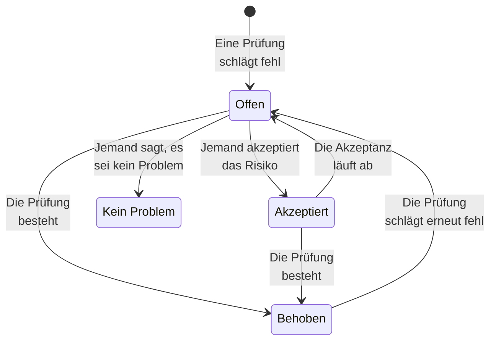

# Prüfungen und Probleme der Datensicherheit

Datensicherheit führt an jedem Datenspeicher 32 Prüfungen aus, in neun Gruppen. Eine Prüfung liest, was über einen Datenspeicher bekannt ist - wie er konfiguriert ist, was darin gefunden wurde, wer ihn erreichen kann, wo er liegt - und besteht, schlägt fehl oder kann es nicht feststellen. Eine fehlschlagende Prüfung eröffnet ein Problem an diesem Datenspeicher, und das Problem schließt sich von selbst, sobald die Prüfung besteht. Diese Seite listet jede Prüfung auf, wie Schweregrad und Risikowert eines Problems ermittelt werden und was mit einem Problem im Lauf seines Lebens geschieht.

:::cards
- [Wie eine Prüfung entscheidet](#wie-eine-prüfung-entscheidet): Bestanden, fehlgeschlagen oder nicht feststellbar, und wie schlimm ein Fehlschlag ist.
- [Jede Prüfung](#jede-prüfung): Alle 32, mit dem, was jede prüft, und wie Sie den Mangel beheben.
- [Risikowert](#risikowert): Wie Probleme innerhalb eines Schweregrads geordnet werden.
- [Was mit einem Problem geschieht](#was-mit-einem-problem-geschieht): Offen, behoben, akzeptiert, kein Problem.
- [Hier beheben](#hier-beheben): Einen öffentlichen Bucket sperren oder die Freigabe eines Snapshots beenden, mit einem Klick.
:::

## Wie eine Prüfung entscheidet

Jede Prüfung liest Fakten über einen Datenspeicher und antwortet auf eine von vier Arten:

| Antwort | Was sie bedeutet | Was mit dem Problem geschieht |
| --- | --- | --- |
| Bestanden | Die Prüfung findet nichts, was nicht stimmt. | Ein offenes oder akzeptiertes Problem wird behoben. |
| Fehlgeschlagen | Die Prüfung findet den Mangel und sagt in einem Satz, was sie gesehen hat: den Beleg des Problems. | Ein Problem öffnet sich, oder das offene wird aktualisiert. |
| Nicht feststellbar | Ein Fakt konnte nicht gelesen werden: eine Berechtigung, die die Rolle nicht hat, ein Aufruf, der fehlgeschlagen ist. | Nichts ändert sich: Ein offenes Problem bleibt offen, denn niemand darf schließen, ein Mangel sei behoben, wenn OneUptime nicht nachsehen konnte. |
| Nicht zutreffend | Die Art des Datenspeichers hat keine solche Einstellung. | Ein offenes Problem wird behoben. |

### Der Schweregrad folgt den Daten

Derselbe Mangel wiegt bei sensibleren Daten schwerer. Jede Prüfung gibt für jede Sensibilitätsstufe einen Schweregrad an, und ein Problem übernimmt den für seinen Datenspeicher: Ein öffentlicher Bucket mit Kartennummern ist Kritisch, ein öffentlicher Bucket mit Website-Bildern nur Niedrig. Ein Strich bedeutet überhaupt kein Problem. Die Sensibilität eines Datenspeichers stammt aus seinen Funden (siehe [Sensible Datentypen](/docs/data-security/data-types#sensibilität)), sodass Inhaltsstichproben die Schweregrade richtig machen.

Einige Prüfungen setzen den Schweregrad stattdessen anhand dessen, was sie gesehen haben. **Darin sind Geheimnisse gespeichert** ist an jedem Datenspeicher Hoch, und Kritisch an einem Datenspeicher, der öffentlich oder mit anderen Konten geteilt ist.

## Jede Prüfung

Der Schweregrad wird für eingeschränkte, vertrauliche, interne und öffentliche Daten angegeben, in dieser Reihenfolge. Die Seite jedes Problems zeigt die vollständige Behebung für seinen eigenen Datenspeicher - die Schritte in der Konsole, den CLI-Befehl und, wo es passt, das Terraform -, mit Name und Region des Datenspeichers ausgefüllt.

### Exponierung

| Prüfung | Läuft auf | Was sie prüft | Schweregrad | So beheben Sie es |
| --- | --- | --- | --- | --- |
| Jeder im Internet kann ihn lesen (`public-read`) | Objektspeicher, Warehouse, Suche | Richtlinie, ACL oder IAM-Bindungen des Datenspeichers erlauben jedem, seine Daten ohne Anmeldung zu lesen. | Kritisch / Kritisch / Hoch / Niedrig | Entfernen Sie jede Berechtigung für anonyme oder alle authentifizierten Prinzipale. Dateien, die öffentlich sein müssen, gehören in einen als **Absichtlich öffentlich** markierten Datenspeicher, der sonst nichts enthält. |
| Jeder im Internet kann ihn ändern (`public-write`) | Objektspeicher, Warehouse, Suche | Richtlinie, ACL oder IAM-Bindungen des Datenspeichers erlauben jedem, seine Daten zu schreiben oder zu löschen. | Kritisch / Kritisch / Kritisch / Hoch | Entfernen Sie jede Schreib- oder Löschberechtigung für anonyme oder alle authentifizierten Prinzipale. |
| Öffentlicher Zugriff ist nicht gesperrt (`public-access-not-blocked`) | AWS S3 Bucket | S3 Block Public Access ist für den Bucket oder sein Konto nicht vollständig eingeschaltet, sodass eine einzige Richtlinienänderung ihn öffentlich machen kann. | Hoch / Mittel / Niedrig / — | Schalten Sie alle vier Einstellungen von Block Public Access für den Bucket ein. |
| Die Datenbank nimmt Verbindungen aus dem Internet an (`internet-reachable`) | Datenbank, Warehouse, Suche, Cache | Die Datenbank hat einen öffentlichen Endpunkt, oder der öffentliche Netzwerkzugriff ist eingeschaltet. | Hoch / Hoch / Mittel / Niedrig | Schalten Sie den öffentlichen Endpunkt aus, und erreichen Sie die Datenbank über ein privates Netzwerk oder einen Bastion-Host. |
| Seine Firewall lässt jede Adresse herein (`open-to-all-addresses`) | Datenbank, Warehouse, Suche, Cache | Eine Firewallregel oder ein autorisiertes Netzwerk erlaubt 0.0.0.0/0 oder den ganzen Adressbereich. | Kritisch / Kritisch / Hoch / Mittel | Ersetzen Sie die Regel, die alles erlaubt, durch die Adressen oder Netzwerke, die Zugriff brauchen. |
| Ein Snapshot davon kann von jedem wiederhergestellt werden (`snapshot-public`) | Datenbank, Snapshot | Ein Datenbank-Snapshot ist öffentlich geteilt, sodass jedes Cloud-Konto eine vollständige Kopie wiederherstellen kann. | Kritisch / Kritisch / Kritisch / Hoch | Machen Sie den Snapshot privat. |
| Ein Snapshot davon ist mit anderen Konten geteilt (`snapshot-shared-externally`) | Datenbank, Snapshot | Ein Datenbank-Snapshot ist mit Konten außerhalb Ihrer verbundenen Konten geteilt. | Hoch / Hoch / Mittel / Niedrig | Beenden Sie die Freigabe des Snapshots für die Konten, die ihn nicht haben sollen. |
| Konten außerhalb Ihrer Organisation können ihn erreichen (`shared-with-external-accounts`) | Jeder Datenspeicher außer Telemetrie | Die Richtlinie des Datenspeichers gewährt Zugriff für Konten, Mandanten oder Projekte, die nicht mit OneUptime verbunden sind. | Hoch / Hoch / Mittel / Niedrig | Prüfen Sie jeden externen Prinzipal, und entfernen Sie die, die keinen Zugriff brauchen. |

### Verschlüsselung

| Prüfung | Läuft auf | Was sie prüft | Schweregrad | So beheben Sie es |
| --- | --- | --- | --- | --- |
| Seine Daten sind im Ruhezustand nicht verschlüsselt (`not-encrypted-at-rest`) | Jeder Datenspeicher außer Telemetrie | Die Speicherverschlüsselung ist ausgeschaltet. | Hoch / Mittel / Niedrig / — | Schalten Sie die Verschlüsselung im Ruhezustand ein. Eine RDS-Instanz lässt sich nicht nachträglich verschlüsseln: Stellen Sie eine verschlüsselte Kopie ihres Snapshots wieder her. |
| Eingeschränkte Daten stehen nicht unter Ihrem eigenen Schlüssel (`no-customer-managed-key`) | Jeder Datenspeicher außer Telemetrie | Der Datenspeicher enthält eingeschränkte Daten, ist aber mit dem Standardschlüssel des Anbieters verschlüsselt, nicht mit einem kundenverwalteten Schlüssel. | Mittel / — / — / — | Verschlüsseln Sie den Datenspeicher mit einem Schlüssel, den Sie in Ihrem Schlüsseldienst verwalten. |
| Unverschlüsselte Verbindungen sind erlaubt (`encryption-in-transit-not-enforced`) | Jeder Datenspeicher außer Telemetrie | Der Datenspeicher akzeptiert Verbindungen, die kein TLS verwenden. | Hoch / Mittel / Niedrig / — | Verlangen Sie TLS für jede Verbindung. Lehnen Sie bei S3 jede Anfrage ab, bei der `aws:SecureTransport` false ist. |
| Er akzeptiert TLS älter als 1.2 (`weak-tls`) | Jeder Datenspeicher außer Telemetrie | Die minimale TLS-Version ist 1.0 oder 1.1. | Mittel / Mittel / Niedrig / — | Setzen Sie die minimale TLS-Version auf 1.2 oder höher. |

### Wiederherstellung

| Prüfung | Läuft auf | Was sie prüft | Schweregrad | So beheben Sie es |
| --- | --- | --- | --- | --- |
| Er hat keine Backups oder bewahrt sie weniger als 7 Tage auf (`no-backups`) | Datenbank, Warehouse | Automatische Backups sind aus oder werden weniger als 7 Tage aufbewahrt. | Hoch / Mittel / Niedrig / — | Schalten Sie automatische Backups ein, und bewahren Sie sie mindestens 7 Tage auf. |
| Point-in-Time-Wiederherstellung ist aus (`no-point-in-time-recovery`) | AWS DynamoDB Table, Azure Cosmos DB Account | Die Tabelle oder Datenbank lässt sich nicht auf einen Moment vor einem Fehler wiederherstellen. | Mittel / Niedrig / — / — | Schalten Sie die Point-in-Time-Wiederherstellung ein. |
| Er kann in einem Schritt gelöscht werden (`deletion-protection-off`) | Datenbank, Warehouse | Der Löschschutz ist aus. | Mittel / Niedrig / — / — | Schalten Sie den Löschschutz ein. |
| Gelöschte oder überschriebene Dateien lassen sich nicht wiederherstellen (`deleted-data-not-recoverable`) | Objektspeicher | Versionierung und vorläufiges Löschen sind beide aus. | Mittel / Niedrig / — / — | Schalten Sie Versionierung oder vorläufiges Löschen ein. |

### Sichtbarkeit

| Prüfung | Läuft auf | Was sie prüft | Schweregrad | So beheben Sie es |
| --- | --- | --- | --- | --- |
| Niemand wüsste, wer ihn gelesen hat (`access-not-logged`) | Jeder Datenspeicher außer Telemetrie | Lesezugriffe auf den Datenspeicher werden nicht protokolliert: keine Zugriffsprotokolle, keine Audit-Logs für Datenzugriffe. | Hoch / Mittel / Niedrig / — | Schalten Sie Zugriffs- oder Audit-Protokollierung für Lesezugriffe ein: S3-Serverzugriffsprotokolle oder CloudTrail-Datenereignisse, Azure-Diagnoseprotokolle für StorageRead, Data-Access-Audit-Logs von Cloud Storage. |

### Zugriff

| Prüfung | Läuft auf | Was sie prüft | Schweregrad | So beheben Sie es |
| --- | --- | --- | --- | --- |
| Jeder mit dem Kontoschlüssel kann alles lesen (`shared-key-access`) | Azure Storage Account | Das Speicherkonto erlaubt den Zugriff per gemeinsam genutztem Schlüssel, der Microsoft Entra ID umgeht und keinen Audit-Trail pro Person hinterlässt. | Mittel / Niedrig / — / — | Stellen Sie Anwendungen auf Microsoft Entra ID um, und schalten Sie dann den Zugriff per Speicherkontoschlüssel aus. |
| Objekte können eigene Zugriffsregeln tragen (`object-acls-enabled`) | AWS S3 Bucket, Google Cloud Storage Bucket | Objekt-ACLs sind eingeschaltet, sodass ein einzelnes Objekt öffentlich gemacht werden kann, während der Bucket privat aussieht. | Niedrig / Niedrig / — / — | Setzen Sie bei S3 Object Ownership auf Bucket owner enforced. Schalten Sie bei Cloud Storage den einheitlichen Zugriff auf Bucket-Ebene ein. |
| Mehr als 25 Identitäten können eingeschränkte Daten lesen (`many-readers`) | Jeder Datenspeicher außer Telemetrie | Mehr Identitäten, als die meisten Teams überprüfen können, haben Lesezugriff auf den Datenspeicher. | Mittel / — / — / — | Öffnen Sie die Seite **Wer ihn erreichen kann** des Datenspeichers, und entfernen Sie den Zugriff, der ungenutzt oder breiter als nötig ist. |

### Datenhygiene

| Prüfung | Läuft auf | Was sie prüft | Schweregrad | So beheben Sie es |
| --- | --- | --- | --- | --- |
| Darin sind Geheimnisse gespeichert (`secrets-stored`) | Jeder Datenspeicher außer Telemetrie | In den Daten des Datenspeichers wurden Passwörter, API-Schlüssel, Tokens oder private Schlüssel gefunden. | Hoch / Hoch / Hoch / Hoch | Rotieren Sie jedes gefundene Geheimnis, als wäre es abgeflossen. Verschieben Sie Geheimnisse in einen Secret Manager, und löschen Sie sie aus dem Datenspeicher. |
| Kartenprüfnummern werden gespeichert (`card-security-codes-stored`) | Jeder Datenspeicher außer Telemetrie | CVV- oder CVC-Codes wurden gefunden. PCI DSS verbietet, sie nach der Autorisierung einer Zahlung aufzubewahren, verschlüsselt oder nicht. | Kritisch / Kritisch / Kritisch / Kritisch | Stoppen Sie den Code, der sie schreibt, löschen Sie die gespeicherten Codes, und prüfen Sie, dass keine in Backups verbleiben. |
| Kartennummern werden lesbar gespeichert (`card-numbers-readable`) | Jeder Datenspeicher außer Telemetrie | Vollständige Kartennummern wurden in lesbarer Form gefunden. PCI DSS verlangt, dass sie überall, wo sie gespeichert sind, unlesbar sind. | Hoch / Hoch / Hoch / Hoch | Tokenisieren Sie Kartennummern bei Ihrem Zahlungsanbieter oder verschlüsseln Sie sie auf Feldebene, und löschen Sie die lesbaren Kopien. |
| Passwörter werden im Klartext gespeichert (`plaintext-passwords`) | Jeder Datenspeicher außer Telemetrie | Ein Passwortfeld enthält Werte, die keine Passwort-Hashes sind (bcrypt, argon2, scrypt oder PBKDF2). | Kritisch / Kritisch / Kritisch / Kritisch | Hashen Sie Passwörter mit bcrypt, scrypt oder argon2, migrieren Sie die gespeicherten, und lassen Sie jedes Konto sein Passwort zurücksetzen. |
| Produktionsdaten wurden in einen Nicht-Produktions-Datenspeicher kopiert (`production-data-in-non-production`) | Jeder Datenspeicher außer Telemetrie | Werte, die in einem Produktions-Datenspeicher gefunden wurden, wurden auch hier gefunden, in einem Entwicklungs-, Test- oder Staging-Datenspeicher. | Hoch / Mittel / — / — | Ersetzen Sie die Kopie durch maskierte oder synthetische Daten, und löschen Sie die echten Daten aus dem Nicht-Produktions-Datenspeicher. |
| Sensible Daten, die seit 90 Tagen niemand genutzt hat (`stale-sensitive-data`) | Jeder Datenspeicher außer Telemetrie | Der Datenspeicher enthält sensible Daten und hatte seit 90 Tagen keine Lese- oder Schreibzugriffe. | Mittel / Niedrig / — / — | Bestätigen Sie, dass die Daten nicht mehr gebraucht werden, und archivieren Sie sie dann mit einem Aufbewahrungsdatum, oder löschen Sie sie. |
| Dieser sensible Datenspeicher hat keinen Eigentümer (`no-owner`) | Jeder Datenspeicher | Der Datenspeicher enthält sensible Daten und hat keinen Eigentümer. | Mittel / Niedrig / — / — | Fügen Sie auf der Seite **Eigentümer** des Datenspeichers einen Eigentümer hinzu, oder eine Eigentümerregel, die auf seine Tags passt. |

### Telemetrie

| Prüfung | Läuft auf | Was sie prüft | Schweregrad | So beheben Sie es |
| --- | --- | --- | --- | --- |
| Sensible Daten gelangen in Ihre Telemetrie (`sensitive-data-in-telemetry`) | Telemetrie | Logs, Traces, Ausnahmen, Wiedergaben oder KI-Unterhaltungen enthalten sensible Daten, die keine Bereinigungsregel maskiert. | Hoch / Mittel / Niedrig / — | Klicken Sie bei jedem Fund auf **Bereinigen**, um die Daten bei der Aufnahme zu maskieren, und beheben Sie dann den Code, der sie schreibt. |
| Geheimnisse gelangen in Ihre Telemetrie (`secrets-in-telemetry`) | Telemetrie | Passwörter, API-Schlüssel oder Tokens erscheinen in Logs, Traces, Ausnahmen oder KI-Unterhaltungen. | Kritisch / Kritisch / Kritisch / Kritisch | Rotieren Sie zuerst das Geheimnis, klicken Sie dann auf **Bereinigen**, und beheben Sie den Code, der es schreibt. |

### Residenz

| Prüfung | Läuft auf | Was sie prüft | Schweregrad | So beheben Sie es |
| --- | --- | --- | --- | --- |
| Daten werden außerhalb der Regionen gespeichert, in denen sie liegen dürfen (`residency-violation`) | Jeder Datenspeicher außer Telemetrie | Die Region des Datenspeichers oder eine Region, in die seine Daten repliziert werden, verstößt gegen eine Residenzregel. | Hoch / Hoch / Mittel / — | Verschieben Sie die Daten in eine erlaubte Region, oder beenden Sie das Kopieren in die andere. Ist die Übertragung rechtmäßig, akzeptieren Sie das Problem und halten Sie den Grund fest. |

### KI

| Prüfung | Läuft auf | Was sie prüft | Schweregrad | So beheben Sie es |
| --- | --- | --- | --- | --- |
| Sensible Daten werden an einen KI-Anbieter gesendet (`sensitive-data-to-ai`) | KI-Unterhaltungen | In OneUptime aufgezeichnete KI-Unterhaltungen tragen sensible Daten zu einem Modellanbieter. | Kritisch / Hoch / Niedrig / — | Schwärzen Sie sensible Werte, bevor Prompts gesendet werden, oder senden Sie diese Aufrufe an ein Modell, das Sie selbst hosten. |
| Eingeschränkte Daten liegen in einem Datenspeicher, der für KI genutzt wird (`sensitive-data-in-ai-store`) | Jeder Datenspeicher außer Telemetrie | Ein Datenspeicher, der als Trainings- oder Retrieval-Daten für KI getaggt ist, enthält eingeschränkte Daten. | Hoch / Mittel / — / — | Entfernen oder maskieren Sie die eingeschränkten Daten, bevor sie zum Trainieren oder Grounding eines Modells verwendet werden. |

## Risikowert

Der Schweregrad sagt, wie schlimm ein Problem ist. Der Risikowert, von 0 bis 100, ordnet die Probleme eines Schweregrads nach dem, was denselben Mangel schlimmer macht:

```text
risk = severity + 10 × exposure + 6 × volume + 5 × activity + 4 × production, at most 100
```

| Faktor | Punkte |
| --- | --- |
| Schweregrad | 75 für Kritisch, 50 für Hoch, 25 für Mittel, 0 für Niedrig |
| Exponierung | 10 für Öffentlich, 8 für Andere Konten, 6 für Aus dem Internet erreichbar, 3 für Unbekannt, 0 für Privat |
| Volumen | Bis zu 6, nach den geschätzten sensiblen Datensätzen des Datenspeichers auf einer logarithmischen Skala: 1 für 10 Datensätze, 3 für 1.000, 5 für eine Million, 6 für zehn Millionen oder mehr |
| Aktivität | 5, wenn Security Operations in der letzten Woche Erkennungen am Datenspeicher gesehen hat |
| Produktion | 4 für einen Datenspeicher in Produktion |

Die Zusätze bringen höchstens 25 Punkte, sodass ein Problem nie niedriger bewertet wird als ein Problem eines niedrigeren Schweregrads. Ein öffentlicher Produktions-Bucket mit einer Million Datensätzen eingeschränkter Daten erzielt bei einem kritischen Problem 75 + 10 + 5 + 4 = 94. Jedes Problem listet die Faktoren auf, die zu seinem Wert beigetragen haben, mit ihren Punkten, und der Datenspeicher zeigt den Wert seines schlimmsten offenen Problems.

Die Umgebung eines Datenspeichers - Produktion, Staging, Development, Test oder Unbekannt - stammt aus seinen Tags (`env`, `environment`, `stage`, `tier` und Ähnlichen) oder, ohne solche, aus den Wörtern in seinem Namen, etwa `prod`, `staging`, `dev` oder `qa`. Legen Sie sie am Datenspeicher fest, wenn keins von beidem sie nennt.

## Was mit einem Problem geschieht



OneUptime eröffnet, aktualisiert und behebt Probleme, während die Prüfungen laufen. Was ein Mensch mit einem Problem tut, ist zu entscheiden, was als Nächstes geschieht:

| Status | Wie es dorthin kommt | Was folgt |
| --- | --- | --- |
| **Offen** | Seine Prüfung schlägt jetzt am Datenspeicher fehl. | Es zählt in der Übersicht, in der Zusammenfassung des Datenspeichers und in der Compliance, bis die Prüfung besteht. |
| **Behoben** | Seine Prüfung hat bei einem späteren Lauf bestanden, gilt nicht mehr oder wurde ausgeschaltet, oder sein Datenspeicher wurde archiviert. Jemand kann auch **Als behoben markieren** wählen: Der Datenspeicher wird dann sofort erneut geprüft. | Es öffnet sich wieder, wenn die Prüfung erneut fehlschlägt, und das Problem zählt, wie oft es wieder geöffnet wurde. |
| **Akzeptiert** | Jemand hat **Risiko akzeptieren** gewählt, mit einem **Grund** und einem Datum unter **Akzeptiert bis**, höchstens ein Jahr entfernt. | Es bleibt bis zu diesem Datum geschlossen und öffnet sich dann wieder, wenn die Prüfung noch fehlschlägt. Akzeptieren Sie es dann erneut, wenn der Grund noch gilt. |
| **Kein Problem** | Jemand hat **Kein Problem** gewählt: Der Fund war falsch. | Es bleibt geschlossen, auch solange die Prüfung fehlschlägt. **Wieder öffnen** öffnet es erneut. |

Security Members, Security Admins, Project Admins und Project Owners können den Status eines Problems ändern und es mit **Zuweisen** einer Person oder einem Team zuweisen. Jede Änderung wird in die **Zeitachse** des Problems geschrieben: wann es sich geöffnet hat, jede Änderung des Schweregrads, jede Statusänderung und wer sie vorgenommen hat, die angeforderten erneuten Prüfungen und was die Integrationen getan haben.

Ein Problem, das sich wieder öffnet, behält seinen Verlauf. Akzeptierte Risiken werden jeden Tag erneut betrachtet, sodass eines pünktlich abläuft, auch wenn nichts gescannt wurde.

## Hier beheben

Ein offenes Problem zu einem öffentlichen Bucket oder einem geteilten Snapshot lässt sich von seiner Seite aus beheben. Über den Schritten für die Konsole bietet **Hier beheben** die Änderung an, die es behebt:

| Das Problem | Sein Datenspeicher | Die Schaltfläche | Was sie ändert |
| --- | --- | --- | --- |
| `public-read`, `public-write` oder `public-access-not-blocked` | Ein S3-Bucket, ein Azure-Speicherkonto oder ein Cloud-Storage-Bucket | **Öffentlichen Zugriff sperren** | Schaltet die vier Einstellungen von Block Public Access des Buckets ein, schaltet den anonymen Blobzugriff des Speicherkontos aus oder erzwingt die Verhinderung des öffentlichen Zugriffs für den Bucket |
| `snapshot-public` oder `snapshot-shared-externally` | Ein RDS-Snapshot, eine RDS-Datenbank oder ein Aurora- oder DocumentDB-Cluster | **Freigabe widerrufen** | Beendet die Freigabe des Snapshots, oder jedes geteilten manuellen Snapshots der Datenbank, für alle und für Konten außerhalb der von Ihnen verbundenen |

Es fragt zuerst und sagt, was sich ändert und was dann nicht mehr funktioniert. Es ändert, wie der Datenspeicher geteilt wird, nie seine Daten, und ändert nichts, was schon geschlossen ist. Ein als **Absichtlich öffentlich** markierter Datenspeicher wird nie gesperrt.

Es handelt über die Cloud-Verbindung des Datenspeichers, also muss an der Verbindung **Datensicherheitsreaktion** eingeschaltet und ihr Einrichtungsbefehl erneut ausgeführt sein (siehe [Datensicherheit einrichten](/docs/data-security/setup#datensicherheit-eine-exponierung-schließen-lassen)). Bis dahin sagt das Panel, was einzuschalten ist. Der Datenspeicher wird direkt danach erneut geprüft, und das Problem wird von selbst behoben, sobald seine Prüfung besteht. Die **Zeitachse** des Problems und die **Zeitachse** des Datenspeichers sagen, was getan wurde und wer es getan hat.

## Einstellungen der Prüfungen

**Datensicherheit → Einstellungen → Prüfungen** listet jede Prüfung nach Gruppe auf, mit dem, wonach sie sucht, und dem Schweregrad, den ein Fehlschlag für jede Sensibilität erhält. Jede Prüfung lässt sich für das Projekt anpassen, und jede Änderung wird sofort gespeichert:

- **Ihr Schalter** schaltet die Prüfung aus, wenn sie nicht zu Ihrer Arbeitsweise passt. Ihre offenen und akzeptierten Probleme werden behoben und sagen, dass die Prüfung nicht mehr läuft.
- **Ihr Schweregrad** ist ab Werk **Nach Sensibilität**, oder ein einziger Schweregrad, den jeder Fehlschlag der Prüfung erhält, egal was ihr Datenspeicher enthält.

Um eine Prüfung nur an einem Datenspeicher stummzuschalten, akzeptieren Sie das Risiko am Problem dieses Datenspeichers, oder markieren Sie das Problem als kein Problem. Bei einem Fund, der falsch ist, statt eines Mangels, der keine Rolle spielt, markieren Sie stattdessen den Fund als nicht sensibel (siehe [Sensible Datentypen](/docs/data-security/data-types#nicht-sensibel-und-nie-sensibel)).

**Jetzt prüfen** an einem Datenspeicher liest seine Konfiguration erneut und führt seine Prüfungen aus. **Jetzt scannen** nimmt Stichproben seines Inhalts, und seine Prüfungen laufen, wenn der Scan endet.

## Nächste Schritte

:::cards
- [Integrationen der Datensicherheit](/docs/data-security/integrations): Sicherheitsfälle, Warnungen und E-Mails an Eigentümer, wenn sich ein Problem öffnet.
- [Datenflüsse, Zugriff und Residenz](/docs/data-security/flows-access-residency): Der Zugriff, die Kopien und die Regionen, die mehrere Prüfungen lesen.
- [Compliance der Datensicherheit](/docs/data-security/compliance): Die Anforderungen der Rahmenwerke, für die jede Prüfung als Beleg dient.
:::
