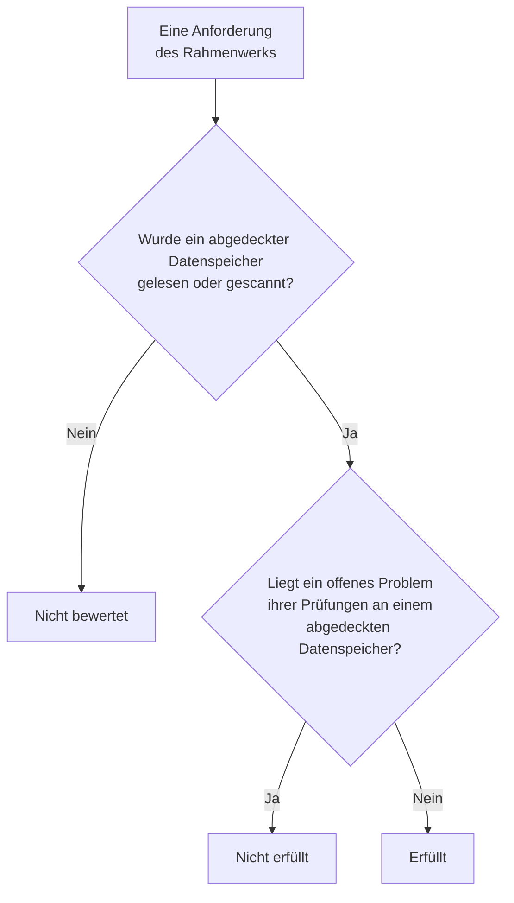

# Compliance der Datensicherheit

Datensicherheit bewertet neun Rahmenwerke anhand dessen, was ihre Scans gefunden haben. Jedes Rahmenwerk deckt die Datenspeicher ab, um die es in seinen Regeln geht - GDPR die Datenspeicher mit personenbezogenen Daten, PCI DSS die Datenspeicher, in denen Kartendaten gefunden wurden, SOC 2 jeden Datenspeicher -, und jede seiner Anforderungen wird durch die Prüfungen, die als Beleg für sie dienen, erfüllt oder nicht erfüllt. **Datensicherheit → Compliance** zeigt die Bewertung jedes Rahmenwerks, wie viele Datenspeicher es abdeckt, und jede Anforderung mit der Zahl der offenen Probleme, an denen sie scheitert. Jede Ressource, die Datenspeicher enthält - ein Kubernetes-Cluster, ein Docker- oder Podman-Host, eine Datenbank, ein Dienst oder eine Cloud-Ressource -, hat eine eigene Seite dieser Art, auf der sich ausschalten lässt, was für sie nicht gilt. Eine Bewertung ist ein Beleg für ein Audit, kein Zertifikat: Sie sagt, was OneUptime von den Datenspeichern sehen kann, die es liest.

:::cards
- [Die Rahmenwerke](#die-rahmenwerke): Die neun, und welche Datenspeicher jedes abdeckt.
- [Wie ein Rahmenwerk bewertet wird](#wie-ein-rahmenwerk-bewertet-wird): Erfüllte, nicht erfüllte und nicht bewertete Anforderungen.
- [Auf der Seite einer Ressource](#auf-der-seite-einer-ressource): Die Compliance eines Clusters, eines Hosts, einer Datenbank, eines Dienstes oder einer Cloud-Ressource und was dort ausgeschaltet ist.
- [Anforderungen und ihre Prüfungen](#anforderungen-und-ihre-prüfungen): Jede Anforderung und die Prüfungen, die als Beleg für sie dienen.
- [Verzeichnis von Verarbeitungstätigkeiten](#verzeichnis-von-verarbeitungstätigkeiten): GDPR Artikel 30, geschrieben aus Ihren Datenspeichern, mit den Entwürfen von OneUptime AI zum Bestätigen.
- [Datenschutz-Folgenabschätzungen](#datenschutz-folgenabschätzungen): Eine Datenschutz-Folgenabschätzung für jeden Datenspeicher, der eine braucht.
- [Audit-Belege](#audit-belege): Was ein Auditor unter jeder Anforderung liest, exportiert mit Ihrem Verzeichnis und dem Problemverlauf.
:::

## Die Rahmenwerke

| Rahmenwerk | Vollständiger Name | Abgedeckte Datenspeicher |
| --- | --- | --- |
| GDPR | Datenschutz-Grundverordnung der EU (DSGVO) | Datenspeicher, die personenbezogene Daten enthalten. |
| CCPA | California Consumer Privacy Act, geändert durch den CPRA | Datenspeicher, die personenbezogene Informationen enthalten. |
| HIPAA | HIPAA Security Rule | Datenspeicher, die Gesundheitsdaten enthalten. |
| PCI DSS | PCI DSS v4.0 | Datenspeicher, in denen Kartennummern gefunden wurden. |
| SOC 2 | SOC 2 Trust Services Criteria | Jeder Datenspeicher. |
| ISO 27001 | ISO/IEC 27001:2022 | Jeder Datenspeicher. |
| NIST CSF | NIST Cybersecurity Framework 2.0 | Jeder Datenspeicher. |
| LGPD | Allgemeines Datenschutzgesetz Brasiliens | Datenspeicher, die personenbezogene Daten von Personen in Brasilien enthalten. |
| DPDP | Digital Personal Data Protection Act Indiens von 2023 | Datenspeicher, die personenbezogene Daten von Personen in Indien enthalten. |

## Welche Datenspeicher ein Rahmenwerk abdeckt

Der Geltungsbereich eines Datenspeichers ergibt sich aus den darin gefundenen Daten und ändert sich daher, wenn die Scans mehr finden:

- **SOC 2, ISO 27001 und NIST CSF** sind Sicherheitsrahmenwerke: Sie decken jeden Datenspeicher ab, egal was er enthält.
- **GDPR, CCPA, HIPAA und PCI DSS** decken die Datenspeicher ab, die einen Datentyp enthalten, den sie schützen. Personenbezogene Daten bringen GDPR und CCPA ins Spiel, Gesundheitsdaten zusätzlich HIPAA, und Kartennummern, Kartenprüfnummern und Ablaufdaten von Karten PCI DSS. Ein Datenspeicher, der nur Geheimnisse oder Geschäftsdokumente enthält, fällt unter keines davon.
- **LGPD und DPDP** sind eigene Gesetze einzelner Länder: Sie decken die Datenspeicher ab, die personenbezogene Daten von Personen in Brasilien oder in Indien enthalten, abgelesen an Datentypen, die zu diesem Land gehören, etwa einer brasilianischen CPF oder einer indischen Aadhaar-Nummer.

[Sensible Datentypen](/docs/data-security/data-types#integrierte-datentypen) listet jeden Datentyp mit seinem Land auf.

## Wie ein Rahmenwerk bewertet wird

- **Eine Anforderung ist erfüllt**, wenn kein offenes Problem der ihr zugeordneten Prüfungen an einem Datenspeicher im Geltungsbereich des Rahmenwerks liegt, und **nicht erfüllt**, wenn eines dort liegt.
- **Sie ist nicht bewertet**, solange bei keinem Datenspeicher im Geltungsbereich die Konfiguration gelesen oder der Inhalt gescannt wurde.
- **Zwei Anforderungen erfüllt Datensicherheit selbst**: GDPR Artikel 30, Verzeichnis von Verarbeitungstätigkeiten, und ISO 27001 A.5.12, Klassifizierung von Informationen. Sie sind erfüllt, sobald jeder Datenspeicher im Geltungsbereich gelesen oder gescannt wurde, und nicht erfüllt, solange einer es nicht wurde.
- **Sie ist ausgeschaltet**, wenn jeder Datenspeicher im Geltungsbereich zu einer Ressource gehört, die die Anforderung ausgeschaltet hat (siehe [Auf der Seite einer Ressource](#auf-der-seite-einer-ressource)).
- **Die Bewertung** ist der Anteil der bewerteten Anforderungen eines Rahmenwerks, die erfüllt sind, als ganzer Prozentwert: Eine ausgeschaltete Anforderung zählt weder dafür noch dagegen. Ein Rahmenwerk, bei dem nichts bewertet wurde, hat keine Bewertung.

Nur offene Probleme zählen. Ein Problem, dessen Risiko akzeptiert wurde oder das kein Problem ist, lässt seine Anforderungen nicht scheitern, sodass ein akzeptiertes Risiko eine Entscheidung ist, die Ihr Audit am Problem sehen kann: wer es akzeptiert hat, warum und bis wann.

## Auf der Seite einer Ressource

Das Menü einer Ressource erhält einen Abschnitt **Sicherheit**, der eingeklappt bleibt, bis Sie ihn öffnen, sobald die Ressource einen Datenspeicher enthält, den Datensicherheit kennt - in einem Projekt, das Datensicherheit nutzt, und für jemanden, der Datenspeicher lesen darf:

| Ressource | Ihre Datenspeicher |
| --- | --- |
| Kubernetes-Cluster | Die Datenbanken, die darauf laufen |
| Docker- oder Podman-Host | Die Datenbanken, die darauf laufen |
| Datenbank | Die Datenbank selbst |
| Dienst | Seine Telemetrie: die Logs, Traces und Ausnahmen, die er sendet |
| Cloud-Ressource | Die Ressource selbst: ein Bucket, eine Datenbank oder ein Warehouse |

- **Datensicherheit** listet diese Datenspeicher auf, die riskantesten zuerst, und die offenen Probleme daran. Jeder Eintrag öffnet sich in der Datensicherheit, wo er bearbeitet wird.
- **Compliance** bewertet die Rahmenwerke nur für diese Datenspeicher. Die Rahmenwerke, die ihre Daten in den Geltungsbereich bringen, stehen oben; die ausgeschalteten und die, für die keiner der Datenspeicher Daten enthält, sind darunter eingeklappt.

Jedes Rahmenwerk hat einen Schalter, **Gilt hier**, und jede seiner Anforderungen ebenso. Schalten Sie einen davon aus, fallen die Datenspeicher der Ressource aus diesem Rahmenwerk oder aus dieser Anforderung heraus, auf der Seite der Ressource wie auf **Datensicherheit → Compliance**, wo steht, wie viele Datenspeicher auf ihren Ressourcen ausgeschaltet wurden. Schalten Sie ihn wieder ein, zählen sie wieder mit. Jeder Schalter wird sofort gespeichert, und jede Änderung wird in den [Audit-Protokollen](/docs/configuration/audit-logs) des Projekts festgehalten.

Schalten Sie einen davon aus, erscheint darunter die Frage **Warum gilt das hier nicht?** Ein Grund ist optional: Schreiben Sie einen kurzen und wählen Sie **Grund speichern**, oder **Jetzt nicht**, um ihn wegzulassen. Von da an steht dort, wer ihn wann ausgeschaltet hat, samt Grund, mit **Grund hinzufügen** oder **Grund bearbeiten**, um ihn später zu schreiben oder zu ändern. Wie der Schalter wird auch der Grund im Audit-Protokoll festgehalten.

**Datensicherheit → Compliance** sagt dasselbe für jede Ressource. Ein ausgewähltes Rahmenwerk listet unter **Für das ganze Rahmenwerk ausgeschaltet** die Ressourcen auf, die es ganz ausgeschaltet haben, und jede Anforderung nennt unter ihrem Status die Ressourcen, die diese Anforderung ausgeschaltet haben: jede mit einem Link auf ihre eigene Compliance-Seite und mit Angaben dazu, wer es wann und warum ausgeschaltet hat. Dort enthält **CSV exportieren** sie in der Spalte `Turned Off On` und **JSON exportieren** in der Liste `turnedOff`.

Ein Datenspeicher folgt den Schaltern genau einer Ressource. Eine Datenbank, die auf einem Kubernetes-Cluster oder auf einem Docker- oder Podman-Host läuft, folgt denen dieses Clusters oder Hosts: Schalten Sie ein Rahmenwerk für den Cluster aus, ist es für jede Datenbank darauf ausgeschaltet. Die eigene Compliance-Seite der Datenbank sagt das und verlinkt dorthin; ihre Schalter sind gesperrt.

Sicherheits-Mitglieder, Sicherheits-Administratoren, Projektadministratoren und Projektinhaber können Rahmenwerke und Anforderungen ein- und ausschalten, so wie sie eine Prüfung anpassen können. Sicherheits-Betrachter sehen, was ausgeschaltet ist, und warum.

## Anforderungen und ihre Prüfungen

### GDPR

| Anforderung | Was sie verlangt | Prüfungen |
| --- | --- | --- |
| Art. 5(1)(c) | Datenminimierung | `production-data-in-non-production`, `stale-sensitive-data`, `new-personal-data-column`, `sensitive-data-in-telemetry`, `sensitive-data-to-ai`, `sensitive-data-in-ai-store` |
| Art. 5(1)(e) | Speicherbegrenzung | `stale-sensitive-data` |
| Art. 25 | Datenschutz durch Technikgestaltung und durch datenschutzfreundliche Voreinstellungen | `production-data-in-non-production`, `stale-sensitive-data`, `new-personal-data-column`, `sensitive-data-in-telemetry`, `sensitive-data-to-ai`, `sensitive-data-in-ai-store` |
| Art. 28 | Auftragsverarbeiter | `sensitive-data-to-ai` |
| Art. 30 | Verzeichnis von Verarbeitungstätigkeiten | Von Datensicherheit selbst erfüllt |
| Art. 32 | Sicherheit der Verarbeitung | `public-read`, `public-write`, `public-access-not-blocked`, `internet-reachable`, `open-to-all-addresses`, `snapshot-public`, `snapshot-shared-externally`, `shared-with-external-accounts`, `not-encrypted-at-rest`, `no-customer-managed-key`, `encryption-in-transit-not-enforced`, `weak-tls`, `no-backups`, `no-point-in-time-recovery`, `deletion-protection-off`, `deleted-data-not-recoverable`, `access-not-logged`, `shared-key-access`, `object-acls-enabled`, `many-readers`, `unused-access`, `secrets-stored`, `plaintext-passwords`, `secrets-in-telemetry` |
| Arts. 44-49 | Übermittlungen in Drittländer | `residency-violation` |

### CCPA

| Anforderung | Was sie verlangt | Prüfungen |
| --- | --- | --- |
| 1798.100(c) | Erhebung beschränkt auf das Notwendige | `production-data-in-non-production`, `stale-sensitive-data`, `new-personal-data-column`, `sensitive-data-in-telemetry`, `sensitive-data-to-ai`, `sensitive-data-in-ai-store` |
| 1798.150 | Angemessene Sicherheitsverfahren | `public-read`, `public-write`, `public-access-not-blocked`, `internet-reachable`, `open-to-all-addresses`, `snapshot-public`, `snapshot-shared-externally`, `shared-with-external-accounts`, `shared-key-access`, `object-acls-enabled`, `many-readers` |

### HIPAA

| Anforderung | Was sie verlangt | Prüfungen |
| --- | --- | --- |
| 164.308(a)(4) | Verwaltung des Informationszugriffs | `unused-access` |
| 164.308(a)(7) | Notfallplan | `no-backups`, `no-point-in-time-recovery`, `deletion-protection-off`, `deleted-data-not-recoverable` |
| 164.312(a)(1) | Zugriffskontrolle | `public-read`, `public-write`, `public-access-not-blocked`, `internet-reachable`, `open-to-all-addresses`, `snapshot-public`, `snapshot-shared-externally`, `shared-with-external-accounts`, `shared-key-access`, `object-acls-enabled`, `many-readers` |
| 164.312(a)(2)(iv) | Verschlüsselung und Entschlüsselung | `not-encrypted-at-rest`, `no-customer-managed-key` |
| 164.312(b) | Audit-Kontrollen | `access-not-logged` |
| 164.312(e)(1) | Übertragungssicherheit | `encryption-in-transit-not-enforced`, `weak-tls` |

### PCI DSS

| Anforderung | Was sie verlangt | Prüfungen |
| --- | --- | --- |
| 3.3.1 | Sensible Authentifizierungsdaten werden nach der Autorisierung nicht aufbewahrt | `card-security-codes-stored` |
| 3.4.1 | Kartennummern werden bei der Anzeige maskiert | `card-numbers-readable`, `sensitive-data-in-telemetry` |
| 3.5.1 | Kartennummern sind überall, wo sie gespeichert sind, unlesbar | `not-encrypted-at-rest`, `no-customer-managed-key`, `card-numbers-readable` |
| 4.2.1 | Starke Kryptografie schützt Kartendaten bei der Übertragung | `encryption-in-transit-not-enforced`, `weak-tls` |
| 7.2 | Zugriff wird nach Bedarf festgelegt und vergeben | `public-read`, `public-write`, `public-access-not-blocked`, `internet-reachable`, `open-to-all-addresses`, `snapshot-public`, `snapshot-shared-externally`, `shared-with-external-accounts`, `shared-key-access`, `object-acls-enabled`, `many-readers` |
| 7.2.4 | Konten und ihre Zugriffe werden überprüft | `unused-access` |
| 8.3.2 | Authentifizierungsfaktoren sind bei der Speicherung unlesbar | `plaintext-passwords` |
| 10.2 | Audit-Logs zeichnen den Zugriff auf Kartendaten auf | `access-not-logged` |

### SOC 2

| Anforderung | Was sie verlangt | Prüfungen |
| --- | --- | --- |
| A1.2 | Backup und Wiederherstellung | `no-backups`, `no-point-in-time-recovery`, `deletion-protection-off`, `deleted-data-not-recoverable` |
| CC6.1 | Logische Zugriffssicherheit | `public-read`, `public-write`, `public-access-not-blocked`, `internet-reachable`, `open-to-all-addresses`, `snapshot-public`, `snapshot-shared-externally`, `shared-with-external-accounts`, `not-encrypted-at-rest`, `no-customer-managed-key`, `shared-key-access`, `object-acls-enabled`, `many-readers`, `secrets-stored`, `plaintext-passwords`, `secrets-in-telemetry` |
| CC6.2 | Zugriff wird entzogen, wenn er nicht mehr benötigt wird | `unused-access` |
| CC6.7 | Übertragung von Informationen | `encryption-in-transit-not-enforced`, `weak-tls` |
| CC7.2 | Überwachung von Systemkomponenten | `access-not-logged` |

### ISO 27001

| Anforderung | Was sie verlangt | Prüfungen |
| --- | --- | --- |
| A.5.9 | Inventar der Informationen und anderen damit verbundenen Werte | `no-owner` |
| A.5.12 | Klassifizierung von Informationen | Von Datensicherheit selbst erfüllt |
| A.5.15 | Zugangssteuerung | `public-read`, `public-write`, `public-access-not-blocked`, `internet-reachable`, `open-to-all-addresses`, `snapshot-public`, `snapshot-shared-externally`, `shared-with-external-accounts`, `shared-key-access`, `object-acls-enabled`, `many-readers` |
| A.5.18 | Zugriffsrechte | `unused-access` |
| A.5.34 | Privatsphäre und Schutz personenbezogener Daten | `production-data-in-non-production`, `stale-sensitive-data`, `new-personal-data-column`, `sensitive-data-in-telemetry`, `sensitive-data-to-ai`, `sensitive-data-in-ai-store` |
| A.8.11 | Datenmaskierung | `production-data-in-non-production`, `stale-sensitive-data`, `new-personal-data-column`, `sensitive-data-in-telemetry`, `sensitive-data-to-ai`, `sensitive-data-in-ai-store` |
| A.8.12 | Verhinderung von Datenlecks | `secrets-stored`, `secrets-in-telemetry` |
| A.8.13 | Sicherung von Informationen | `no-backups`, `no-point-in-time-recovery`, `deletion-protection-off`, `deleted-data-not-recoverable` |
| A.8.15 | Protokollierung | `access-not-logged` |
| A.8.24 | Verwendung von Kryptografie | `not-encrypted-at-rest`, `no-customer-managed-key`, `encryption-in-transit-not-enforced`, `weak-tls`, `plaintext-passwords` |

### NIST CSF

| Anforderung | Was sie verlangt | Prüfungen |
| --- | --- | --- |
| ID.AM-07 | Inventare von Daten und Metadaten werden gepflegt | `no-owner` |
| PR.AA-05 | Zugriffsberechtigungen werden verwaltet | `public-read`, `public-write`, `public-access-not-blocked`, `internet-reachable`, `open-to-all-addresses`, `snapshot-public`, `snapshot-shared-externally`, `shared-with-external-accounts`, `shared-key-access`, `object-acls-enabled`, `many-readers`, `unused-access` |
| PR.DS-01 | Ruhende Daten sind geschützt | `not-encrypted-at-rest`, `no-customer-managed-key`, `secrets-stored`, `secrets-in-telemetry` |
| PR.DS-02 | Daten bei der Übertragung sind geschützt | `encryption-in-transit-not-enforced`, `weak-tls` |
| PR.DS-11 | Backups von Daten werden aufbewahrt und getestet | `no-backups`, `no-point-in-time-recovery`, `deletion-protection-off`, `deleted-data-not-recoverable` |
| DE.CM-09 | Daten und ihre Nutzung werden überwacht | `access-not-logged` |

### LGPD

| Anforderung | Was sie verlangt | Prüfungen |
| --- | --- | --- |
| Art. 6 | Notwendigkeit und Zweckbindung | `production-data-in-non-production`, `stale-sensitive-data`, `new-personal-data-column`, `sensitive-data-in-telemetry`, `sensitive-data-to-ai`, `sensitive-data-in-ai-store` |
| Art. 33 | Internationale Übermittlung von Daten | `residency-violation` |
| Art. 46 | Sicherheitsmaßnahmen | `public-read`, `public-write`, `public-access-not-blocked`, `internet-reachable`, `open-to-all-addresses`, `snapshot-public`, `snapshot-shared-externally`, `shared-with-external-accounts`, `not-encrypted-at-rest`, `no-customer-managed-key`, `shared-key-access`, `object-acls-enabled`, `many-readers` |

### DPDP

| Anforderung | Was sie verlangt | Prüfungen |
| --- | --- | --- |
| Sec. 8(5) | Angemessene Sicherheitsvorkehrungen | `public-read`, `public-write`, `public-access-not-blocked`, `internet-reachable`, `open-to-all-addresses`, `snapshot-public`, `snapshot-shared-externally`, `shared-with-external-accounts`, `not-encrypted-at-rest`, `no-customer-managed-key`, `shared-key-access`, `object-acls-enabled`, `many-readers` |
| Sec. 8(7) | Löschung, sobald der Zweck erfüllt ist | `production-data-in-non-production`, `stale-sensitive-data`, `new-personal-data-column`, `sensitive-data-in-telemetry`, `sensitive-data-to-ai`, `sensitive-data-in-ai-store` |
| Sec. 16 | Übermittlung außerhalb Indiens | `residency-violation` |

## Verzeichnis von Verarbeitungstätigkeiten

GDPR Artikel 30 verlangt, dass Sie ein Verzeichnis Ihrer Verarbeitungstätigkeiten führen. Datensicherheit schreibt den Teil davon, der beschreibt, wo personenbezogene Daten aufbewahrt werden: eine Zeile für jeden Datenspeicher, der personenbezogene Daten enthält. Es ist die Karte **Verarbeitungsverzeichnis** am Ende von **Datensicherheit → Compliance**, mit **CSV exportieren** und **JSON exportieren**.

| Spalte | Woher sie stammt |
| --- | --- |
| Datenspeicher, Art, Anbieter und Region | Erkennung |
| Umgebung | Die Tags oder der Name des Datenspeichers, oder was Sie festlegen |
| Sensibilität, Kategorien und Datentypen | Was die Scans gefunden haben, oder die Sensibilität, die Sie festlegen |
| Eigentümer | Die Eigentümer des Datenspeichers, Personen und die Mitglieder seiner Teams |
| Zweck | Was Sie unter **Zweck** des Datenspeichers eintragen oder bestätigen: warum er personenbezogene Daten enthält. Für die Datenspeicher, die OneUptime für Ihre Sicherheit führt, trägt OneUptime ihn ein |
| Aufbewahrung | Was Sie unter **Aufbewahrung** des Datenspeichers eintragen oder bestätigen: wie lange Daten darin aufbewahrt werden. Für die Datenspeicher, die OneUptime für Ihre Sicherheit führt, trägt OneUptime sie ein, und für die Telemetrie eines Dienstes aus der Telemetrie-Aufbewahrung Ihres Projekts |
| Wer lesen darf | Wer einen Datenspeicher lesen darf, den OneUptime für Ihre Sicherheit führt |
| Rahmenwerke | Die Rahmenwerke, die seine Datentypen in den Geltungsbereich bringen |
| Deklariert von | OneUptime, für die Datenspeicher, die es für Ihre Sicherheit führt |
| Rechtsgrundlage | Was Sie eintragen oder bestätigen: die Rechtsgrundlage des Datenspeichers nach GDPR Artikel 6, eine von Einwilligung, Vertrag, rechtlicher Verpflichtung, lebenswichtigen Interessen, Wahrnehmung einer Aufgabe im öffentlichen Interesse und berechtigten Interessen. Berechtigte Interessen für die Datenspeicher, die OneUptime für Ihre Sicherheit führt |
| Betroffene Personen | Was Sie eintragen oder bestätigen: um wen es in den Daten des Datenspeichers geht, etwa Kunden, Benutzer, Beschäftigte oder Patienten |
| Empfänger | Aus den Datenflüssen des Datenspeichers ermittelt: die externen Hosts und KI-Anbieter, an die seine Daten gesendet werden, und die Datenspeicher, die eine Kopie davon enthalten |
| Übermittlungen | Ermittelt aus der Region des Datenspeichers, den Regionen, in die seine Cloud ihn kopiert, und den Regionen seiner Kopien, abgeglichen mit den Ländern der betroffenen Personen: jede Übermittlung aus diesen Ländern heraus, oder warum sie nicht bekannt ist |
| Datenschutz-Folgenabschätzung | Ob der Datenspeicher eine Datenschutz-Folgenabschätzung braucht und wie es um sie steht: nicht erforderlich, erforderlich, entworfen oder bearbeitet |
| Wartet auf Prüfung | Die Felder, deren Entwurf auf eine Person wartet. Ein Entwurf steht nie im Verzeichnis und nie in seinen Exporten, bevor ihn jemand bestätigt |

Für einen Datenspeicher, den Datensicherheit gefunden hat, kann kein Scan wissen, warum er personenbezogene Daten enthält, wie lange, auf welcher Grundlage oder über wen: Tragen Sie es in seinen **Einstellungen** ein, oder bestätigen Sie die Entwürfe von OneUptime AI. Das Verzeichnis und die Bewertungen liefert auch die API der Datensicherheit, unter `/data-security/record-of-processing`, `/data-security/compliance` und, für eine einzelne Ressource, `/data-security/resource-compliance`, für jeden, der Datenspeicher lesen darf (siehe [Integrationen der Datensicherheit](/docs/data-security/integrations#api-terraform-und-mcp)).

### Entwürfe von OneUptime AI

OneUptime AI entwirft **Zweck**, **Aufbewahrung**, **Rechtsgrundlage** und **Betroffene Personen** eines Datenspeichers aus dem, was Datensicherheit über ihn weiß: den gefundenen Datentypen, seinem Namen, seinen Tags und seiner Beschreibung, den Diensten, die ihn nutzen, und wofür sie laut ihren Teams da sind, wohin seine Daten gehen und wo sie liegen. Sie sieht nie einen Wert Ihrer Daten (siehe [OneUptime AI in der Datensicherheit](/docs/data-security/ai)).

- **Ein Entwurf trägt die Markierung Entwurf** und sagt, warum, mit den Fakten, auf denen er beruht, einen Klick entfernt. Er steht nicht im Verzeichnis, bis Sie **Bestätigen** drücken oder ihn mit **Bearbeiten** in Ihre eigenen Worte fassen.
- **Ihre Worte werden nie durch einen Entwurf ersetzt.** Ein Feld, das Sie geschrieben haben, wird nie neu entworfen. Ein Entwurf, den Sie bestätigt haben, wird nur neu entworfen, wenn sich ein Fakt ändert, auf dem er beruht, und dann wird er vorgeschlagen, nicht übernommen: markiert mit **Änderung vorgeschlagen**, mit dem, was sich geändert hat, **Neuen Entwurf verwenden** und **Aktuellen Wert behalten**.
- **Entwürfe prüfen** auf der Karte **Verarbeitungsverzeichnis** führt nacheinander durch die Datenspeicher, deren Entwürfe auf Sie warten. Die **Einstellungen** eines Datenspeichers haben dieselben Felder, mit **Mit OneUptime AI entwerfen** für die leeren.
- **Von sich aus** entwirft OneUptime AI einmal täglich die leeren Felder der riskantesten Datenspeicher, solange **An neuen Problemen arbeiten** unter **Datensicherheit → KI** eingeschaltet ist, wie Ihre KI-Regeln es erlauben.

Die Aufbewahrung der Telemetrie eines Dienstes, die Empfänger und die Übermittlungen werden von einfachem Code ermittelt, nie entworfen. Die Entwürfe sind ein Ausgangspunkt, keine Rechtsberatung: Lassen Sie sie von der Person prüfen, die für Ihre Compliance verantwortlich ist.

### Datenspeicher, die OneUptime für Ihre Sicherheit führt

Drei Datenspeicher enthalten IP-Adressen mit Absicht, um Ihr Netzwerk zu schützen: **Sicherheitsereignisse**, **Netzwerk-Flows** und **Sicherheits-Adresstresor**. Das Verzeichnis führt jeden auf, den Ihr Projekt hat. OneUptime deklariert sie, statt sie zu finden: Was sie enthalten, steht von vornherein fest, daher liest kein Scan sie, keine Prüfung gilt für sie, und dass sie diese Adressen enthalten, ist nie ein Problem, denn dafür sind sie da. Unter **Datenspeicher** tragen sie den Hinweis **Von OneUptime deklariert**, und die **Übersicht** und die Bewertungen der Rahmenwerke lassen sie aus.

| Datenspeicher | Was er enthält | Aufbewahrung | Wer ihn lesen darf |
| --- | --- | --- | --- |
| Sicherheitsereignisse | Die IP-Adressen, Benutzernamen und E-Mail-Adressen dessen, der gehandelt hat, und dessen, was er berührt hat | Die [Telemetrie-Aufbewahrung](/docs/telemetry/data-retention) Ihres Projekts, jedes Mal gelesen, wenn das Verzeichnis gelesen wird, sodass eine Änderung sofort gilt | Projektinhaber, Projektadministratoren, Sicherheits-Administratoren, Sicherheits-Mitglieder, Sicherheits-Betrachter und jeder mit Read Security Event |
| Netzwerk-Flows | Die IP-Adressen derer, die miteinander kommuniziert haben | 30 Tage nach dem Eingang eines Flows | Jeder, der Netzwerkgeräte lesen darf |
| Sicherheits-Adresstresor | Die IP-Adresse hinter jedem Token, das eine IP-Adressen-Regel, die hasht, in den Protokollen und Traces hinterlassen hat, die [Sicherheitsereignisse](/docs/telemetry/security-events) liest | 30 Tage nach dem letzten Auftreten einer Adresse | Nur die Scans von Sicherheitsereignissen, innerhalb von OneUptime: keine Person, keine Seite, kein Export, keine API und kein KI-Tool |

Der Zweck jedes dieser Datenspeicher ist „Netz- und Informationssicherheit (Erwägungsgrund 49 DSGVO)“. Um Ihren eigenen Zweck oder Ihre eigene Aufbewahrung einzutragen, nutzen Sie **Verzeichnis bearbeiten** in den **Einstellungen** des Datenspeichers: Ein leer gelassenes Feld behält das von OneUptime.

Ein Datenspeicher wird aufgeführt, solange Ihr Projekt seine Daten aufbewahrt: der Tresor, solange eine aktivierte IP-Adressen-Regel Protokolle oder Traces hasht, die Sicherheitsereignisse liest, und noch 31 Tage danach (siehe [Sensible Daten bereinigen](/docs/telemetry/drop-filters-and-scrub-rules#sensible-daten-bereinigen)). Sind seine Daten weg, wird der Datenspeicher archiviert, und er kehrt mit Ihrem Zweck und Ihrer Aufbewahrung zurück, wenn die Daten zurückkehren.

## Datenschutz-Folgenabschätzungen

GDPR Artikel 35 verlangt eine Datenschutz-Folgenabschätzung vor einer Verarbeitung, die voraussichtlich ein hohes Risiko mit sich bringt. Datensicherheit sagt, welche Datenspeicher eine brauchen: jeder Datenspeicher, der Daten besonderer Kategorien enthält, etwa Gesundheitsdaten, Daten über viele Personen (etwa 100.000 Datensätze oder mehr) oder Daten, die die Länder der betroffenen Personen verlassen.

Die **Folgenabschätzung** eines Datenspeichers, in seinem Menü unter **Einstellungen**, sagt, warum der Datenspeicher eine braucht, oder dass er keine braucht. **Folgenabschätzung entwerfen** bittet OneUptime AI um die vier Teile, die Artikel 35(7) verlangt, aus dem Verzeichnis des Datenspeichers, seinen offenen und kürzlich behobenen Problemen, wie exponiert er ist, wie viele ihn erreichen können und seiner Verschlüsselung:

| Teil | Artikel |
| --- | --- |
| Die Verarbeitung und ihre Zwecke | Art. 35(7)(a) |
| Notwendigkeit und Verhältnismäßigkeit | Art. 35(7)(b) |
| Risiken für die betroffenen Personen | Art. 35(7)(c) |
| Maßnahmen zur Bewältigung der Risiken | Art. 35(7)(d) |

Jeder Teil sagt, wer ihn wann geschrieben hat, mit den Fakten, auf denen ein entworfener Teil beruht. **Bearbeiten** macht einen Teil zu Ihrem, und er wird nie neu entworfen; **Erneut entwerfen** entwirft nur die Teile, die niemand bearbeitet hat. Ein Teil, der auf inzwischen geänderten Fakten beruht, sagt das. **PDF exportieren** und **Markdown exportieren** laden die Folgenabschätzung herunter.

## Audit-Belege

**Audit-Belege**, für das Rahmenwerk, das Sie unter **Datensicherheit → Compliance** auswählen, zeigt, was ein Auditor unter jeder seiner Anforderungen liest, über die letzten 30, 90, 180 oder 365 Tage:

- die Datenspeicher in seinem Geltungsbereich und wie seine Prüfungen stehen;
- die Probleme seiner Prüfungen, die im Zeitraum geöffnet und behoben wurden, und wie schnell sie behoben wurden;
- die darunter akzeptierten Risiken, mit ihren Gründen und ihrem Ablauf;
- die Ressourcen, die es ausgeschaltet haben, und warum.

**Belege entwerfen** bittet OneUptime AI um einen Absatz unter jeder Anforderung, gebunden an diese Fakten; **Bearbeiten** macht einen Absatz zu Ihrem, und er wird nie neu entworfen. Eine Anforderung ohne Absatz zeigt ihre Belege, wie sie sind. **PDF exportieren** und **Markdown exportieren** laden die Belege mit zwei Anhängen herunter: dem Verarbeitungsverzeichnis der Datenspeicher im Geltungsbereich und dem Problemverlauf, den sie zitieren.

## Nächste Schritte

:::cards
- [Prüfungen und Probleme der Datensicherheit](/docs/data-security/checks-and-issues): Die Prüfungen hinter jeder Anforderung und wie Sie die Mängel beheben.
- [Datenflüsse, Zugriff und Residenz](/docs/data-security/flows-access-residency): Residenzregeln, für Übermittlungen nach GDPR, LGPD und DPDP.
- [Sensible Datentypen](/docs/data-security/data-types): Die Datentypen, die einen Datenspeicher in den Geltungsbereich eines Rahmenwerks bringen.
:::
