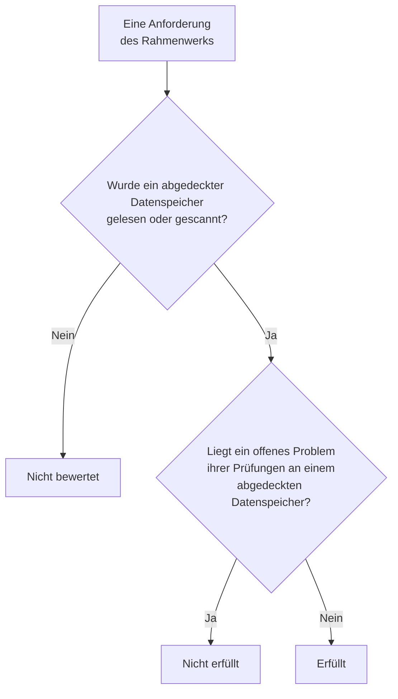

# Compliance der Datensicherheit

Datensicherheit bewertet neun Rahmenwerke anhand dessen, was ihre Scans gefunden haben. Jedes Rahmenwerk deckt die Datenspeicher ab, um die es in seinen Regeln geht - GDPR die Datenspeicher mit personenbezogenen Daten, PCI DSS die Datenspeicher, in denen Kartendaten gefunden wurden, SOC 2 jeden Datenspeicher -, und jede seiner Anforderungen wird durch die Prüfungen, die als Beleg für sie dienen, erfüllt oder nicht erfüllt. **Datensicherheit → Compliance** zeigt die Bewertung jedes Rahmenwerks, wie viele Datenspeicher es abdeckt, und jede Anforderung mit der Zahl der offenen Probleme, an denen sie scheitert. Eine Bewertung ist ein Beleg für ein Audit, kein Zertifikat: Sie sagt, was OneUptime von den Datenspeichern sehen kann, die es liest.

:::cards
- [Die Rahmenwerke](#die-rahmenwerke): Die neun, und welche Datenspeicher jedes abdeckt.
- [Wie ein Rahmenwerk bewertet wird](#wie-ein-rahmenwerk-bewertet-wird): Erfüllte, nicht erfüllte und nicht bewertete Anforderungen.
- [Anforderungen und ihre Prüfungen](#anforderungen-und-ihre-prüfungen): Jede Anforderung und die Prüfungen, die als Beleg für sie dienen.
- [Verzeichnis von Verarbeitungstätigkeiten](#verzeichnis-von-verarbeitungstätigkeiten): GDPR Artikel 30, geschrieben aus Ihren Datenspeichern.
:::

## Die Rahmenwerke

| Rahmenwerk | Vollständiger Name | Abgedeckte Datenspeicher |
| --- | --- | --- |
| GDPR | Datenschutz-Grundverordnung der EU (DSGVO) | Datenspeicher, die personenbezogene Daten enthalten. |
| CCPA | California Consumer Privacy Act, geändert durch den CPRA | Datenspeicher, die personenbezogene Informationen enthalten. |
| HIPAA | HIPAA Security Rule | Datenspeicher, die Gesundheitsdaten enthalten. |
| PCI DSS | PCI DSS v4.0 | Datenspeicher, in denen Kartennummern gefunden wurden. |
| SOC 2 | SOC 2 Trust Services Criteria | Jeder Datenspeicher. |
| ISO 27001 | ISO/IEC 27001:2022 | Jeder Datenspeicher. |
| NIST CSF | NIST Cybersecurity Framework 2.0 | Jeder Datenspeicher. |
| LGPD | Allgemeines Datenschutzgesetz Brasiliens | Datenspeicher, die personenbezogene Daten von Personen in Brasilien enthalten. |
| DPDP | Digital Personal Data Protection Act Indiens von 2023 | Datenspeicher, die personenbezogene Daten von Personen in Indien enthalten. |

## Welche Datenspeicher ein Rahmenwerk abdeckt

Der Geltungsbereich eines Datenspeichers ergibt sich aus den darin gefundenen Daten und ändert sich daher, wenn die Scans mehr finden:

- **SOC 2, ISO 27001 und NIST CSF** sind Sicherheitsrahmenwerke: Sie decken jeden Datenspeicher ab, egal was er enthält.
- **GDPR, CCPA, HIPAA und PCI DSS** decken die Datenspeicher ab, die einen Datentyp enthalten, den sie schützen. Personenbezogene Daten bringen GDPR und CCPA ins Spiel, Gesundheitsdaten zusätzlich HIPAA, und Kartennummern, Kartenprüfnummern und Ablaufdaten von Karten PCI DSS. Ein Datenspeicher, der nur Geheimnisse oder Geschäftsdokumente enthält, fällt unter keines davon.
- **LGPD und DPDP** sind eigene Gesetze einzelner Länder: Sie decken die Datenspeicher ab, die personenbezogene Daten von Personen in Brasilien oder in Indien enthalten, abgelesen an Datentypen, die zu diesem Land gehören, etwa einer brasilianischen CPF oder einer indischen Aadhaar-Nummer.

[Sensible Datentypen](/docs/data-security/data-types#integrierte-datentypen) listet jeden Datentyp mit seinem Land auf.

## Wie ein Rahmenwerk bewertet wird

- **Eine Anforderung ist erfüllt**, wenn kein offenes Problem der ihr zugeordneten Prüfungen an einem Datenspeicher im Geltungsbereich des Rahmenwerks liegt, und **nicht erfüllt**, wenn eines dort liegt.
- **Sie ist nicht bewertet**, solange bei keinem Datenspeicher im Geltungsbereich die Konfiguration gelesen oder der Inhalt gescannt wurde.
- **Zwei Anforderungen erfüllt Datensicherheit selbst**: GDPR Artikel 30, Verzeichnis von Verarbeitungstätigkeiten, und ISO 27001 A.5.12, Klassifizierung von Informationen. Sie sind erfüllt, sobald jeder Datenspeicher im Geltungsbereich gelesen oder gescannt wurde, und nicht erfüllt, solange einer es nicht wurde.
- **Die Bewertung** ist der Anteil der bewerteten Anforderungen eines Rahmenwerks, die erfüllt sind, als ganzer Prozentwert. Ein Rahmenwerk, bei dem nichts bewertet wurde, hat keine Bewertung.

Nur offene Probleme zählen. Ein Problem, dessen Risiko akzeptiert wurde oder das kein Problem ist, lässt seine Anforderungen nicht scheitern, sodass ein akzeptiertes Risiko eine Entscheidung ist, die Ihr Audit am Problem sehen kann: wer es akzeptiert hat, warum und bis wann.

## Anforderungen und ihre Prüfungen

### GDPR

| Anforderung | Was sie verlangt | Prüfungen |
| --- | --- | --- |
| Art. 5(1)(c) | Datenminimierung | `production-data-in-non-production`, `stale-sensitive-data`, `sensitive-data-in-telemetry`, `sensitive-data-to-ai`, `sensitive-data-in-ai-store` |
| Art. 5(1)(e) | Speicherbegrenzung | `stale-sensitive-data` |
| Art. 25 | Datenschutz durch Technikgestaltung und durch datenschutzfreundliche Voreinstellungen | `production-data-in-non-production`, `stale-sensitive-data`, `sensitive-data-in-telemetry`, `sensitive-data-to-ai`, `sensitive-data-in-ai-store` |
| Art. 28 | Auftragsverarbeiter | `sensitive-data-to-ai` |
| Art. 30 | Verzeichnis von Verarbeitungstätigkeiten | Von Datensicherheit selbst erfüllt |
| Art. 32 | Sicherheit der Verarbeitung | `public-read`, `public-write`, `public-access-not-blocked`, `internet-reachable`, `open-to-all-addresses`, `snapshot-public`, `snapshot-shared-externally`, `shared-with-external-accounts`, `not-encrypted-at-rest`, `no-customer-managed-key`, `encryption-in-transit-not-enforced`, `weak-tls`, `no-backups`, `no-point-in-time-recovery`, `deletion-protection-off`, `deleted-data-not-recoverable`, `access-not-logged`, `shared-key-access`, `object-acls-enabled`, `many-readers`, `secrets-stored`, `plaintext-passwords`, `secrets-in-telemetry` |
| Arts. 44-49 | Übermittlungen in Drittländer | `residency-violation` |

### CCPA

| Anforderung | Was sie verlangt | Prüfungen |
| --- | --- | --- |
| 1798.100(c) | Erhebung beschränkt auf das Notwendige | `production-data-in-non-production`, `stale-sensitive-data`, `sensitive-data-in-telemetry`, `sensitive-data-to-ai`, `sensitive-data-in-ai-store` |
| 1798.150 | Angemessene Sicherheitsverfahren | `public-read`, `public-write`, `public-access-not-blocked`, `internet-reachable`, `open-to-all-addresses`, `snapshot-public`, `snapshot-shared-externally`, `shared-with-external-accounts`, `shared-key-access`, `object-acls-enabled`, `many-readers` |

### HIPAA

| Anforderung | Was sie verlangt | Prüfungen |
| --- | --- | --- |
| 164.308(a)(7) | Notfallplan | `no-backups`, `no-point-in-time-recovery`, `deletion-protection-off`, `deleted-data-not-recoverable` |
| 164.312(a)(1) | Zugriffskontrolle | `public-read`, `public-write`, `public-access-not-blocked`, `internet-reachable`, `open-to-all-addresses`, `snapshot-public`, `snapshot-shared-externally`, `shared-with-external-accounts`, `shared-key-access`, `object-acls-enabled`, `many-readers` |
| 164.312(a)(2)(iv) | Verschlüsselung und Entschlüsselung | `not-encrypted-at-rest`, `no-customer-managed-key` |
| 164.312(b) | Audit-Kontrollen | `access-not-logged` |
| 164.312(e)(1) | Übertragungssicherheit | `encryption-in-transit-not-enforced`, `weak-tls` |

### PCI DSS

| Anforderung | Was sie verlangt | Prüfungen |
| --- | --- | --- |
| 3.3.1 | Sensible Authentifizierungsdaten werden nach der Autorisierung nicht aufbewahrt | `card-security-codes-stored` |
| 3.4.1 | Kartennummern werden bei der Anzeige maskiert | `card-numbers-readable`, `sensitive-data-in-telemetry` |
| 3.5.1 | Kartennummern sind überall, wo sie gespeichert sind, unlesbar | `not-encrypted-at-rest`, `no-customer-managed-key`, `card-numbers-readable` |
| 4.2.1 | Starke Kryptografie schützt Kartendaten bei der Übertragung | `encryption-in-transit-not-enforced`, `weak-tls` |
| 7.2 | Zugriff wird nach Bedarf festgelegt und vergeben | `public-read`, `public-write`, `public-access-not-blocked`, `internet-reachable`, `open-to-all-addresses`, `snapshot-public`, `snapshot-shared-externally`, `shared-with-external-accounts`, `shared-key-access`, `object-acls-enabled`, `many-readers` |
| 8.3.2 | Authentifizierungsfaktoren sind bei der Speicherung unlesbar | `plaintext-passwords` |
| 10.2 | Audit-Logs zeichnen den Zugriff auf Kartendaten auf | `access-not-logged` |

### SOC 2

| Anforderung | Was sie verlangt | Prüfungen |
| --- | --- | --- |
| A1.2 | Backup und Wiederherstellung | `no-backups`, `no-point-in-time-recovery`, `deletion-protection-off`, `deleted-data-not-recoverable` |
| CC6.1 | Logische Zugriffssicherheit | `public-read`, `public-write`, `public-access-not-blocked`, `internet-reachable`, `open-to-all-addresses`, `snapshot-public`, `snapshot-shared-externally`, `shared-with-external-accounts`, `not-encrypted-at-rest`, `no-customer-managed-key`, `shared-key-access`, `object-acls-enabled`, `many-readers`, `secrets-stored`, `plaintext-passwords`, `secrets-in-telemetry` |
| CC6.7 | Übertragung von Informationen | `encryption-in-transit-not-enforced`, `weak-tls` |
| CC7.2 | Überwachung von Systemkomponenten | `access-not-logged` |

### ISO 27001

| Anforderung | Was sie verlangt | Prüfungen |
| --- | --- | --- |
| A.5.9 | Inventar der Informationen und anderen damit verbundenen Werte | `no-owner` |
| A.5.12 | Klassifizierung von Informationen | Von Datensicherheit selbst erfüllt |
| A.5.15 | Zugangssteuerung | `public-read`, `public-write`, `public-access-not-blocked`, `internet-reachable`, `open-to-all-addresses`, `snapshot-public`, `snapshot-shared-externally`, `shared-with-external-accounts`, `shared-key-access`, `object-acls-enabled`, `many-readers` |
| A.5.34 | Privatsphäre und Schutz personenbezogener Daten | `production-data-in-non-production`, `stale-sensitive-data`, `sensitive-data-in-telemetry`, `sensitive-data-to-ai`, `sensitive-data-in-ai-store` |
| A.8.11 | Datenmaskierung | `production-data-in-non-production`, `stale-sensitive-data`, `sensitive-data-in-telemetry`, `sensitive-data-to-ai`, `sensitive-data-in-ai-store` |
| A.8.12 | Verhinderung von Datenlecks | `secrets-stored`, `secrets-in-telemetry` |
| A.8.13 | Sicherung von Informationen | `no-backups`, `no-point-in-time-recovery`, `deletion-protection-off`, `deleted-data-not-recoverable` |
| A.8.15 | Protokollierung | `access-not-logged` |
| A.8.24 | Verwendung von Kryptografie | `not-encrypted-at-rest`, `no-customer-managed-key`, `encryption-in-transit-not-enforced`, `weak-tls`, `plaintext-passwords` |

### NIST CSF

| Anforderung | Was sie verlangt | Prüfungen |
| --- | --- | --- |
| ID.AM-07 | Inventare von Daten und Metadaten werden gepflegt | `no-owner` |
| PR.AA-05 | Zugriffsberechtigungen werden verwaltet | `public-read`, `public-write`, `public-access-not-blocked`, `internet-reachable`, `open-to-all-addresses`, `snapshot-public`, `snapshot-shared-externally`, `shared-with-external-accounts`, `shared-key-access`, `object-acls-enabled`, `many-readers` |
| PR.DS-01 | Ruhende Daten sind geschützt | `not-encrypted-at-rest`, `no-customer-managed-key`, `secrets-stored`, `secrets-in-telemetry` |
| PR.DS-02 | Daten bei der Übertragung sind geschützt | `encryption-in-transit-not-enforced`, `weak-tls` |
| PR.DS-11 | Backups von Daten werden aufbewahrt und getestet | `no-backups`, `no-point-in-time-recovery`, `deletion-protection-off`, `deleted-data-not-recoverable` |
| DE.CM-09 | Daten und ihre Nutzung werden überwacht | `access-not-logged` |

### LGPD

| Anforderung | Was sie verlangt | Prüfungen |
| --- | --- | --- |
| Art. 6 | Notwendigkeit und Zweckbindung | `production-data-in-non-production`, `stale-sensitive-data`, `sensitive-data-in-telemetry`, `sensitive-data-to-ai`, `sensitive-data-in-ai-store` |
| Art. 33 | Internationale Übermittlung von Daten | `residency-violation` |
| Art. 46 | Sicherheitsmaßnahmen | `public-read`, `public-write`, `public-access-not-blocked`, `internet-reachable`, `open-to-all-addresses`, `snapshot-public`, `snapshot-shared-externally`, `shared-with-external-accounts`, `not-encrypted-at-rest`, `no-customer-managed-key`, `shared-key-access`, `object-acls-enabled`, `many-readers` |

### DPDP

| Anforderung | Was sie verlangt | Prüfungen |
| --- | --- | --- |
| Sec. 8(5) | Angemessene Sicherheitsvorkehrungen | `public-read`, `public-write`, `public-access-not-blocked`, `internet-reachable`, `open-to-all-addresses`, `snapshot-public`, `snapshot-shared-externally`, `shared-with-external-accounts`, `not-encrypted-at-rest`, `no-customer-managed-key`, `shared-key-access`, `object-acls-enabled`, `many-readers` |
| Sec. 8(7) | Löschung, sobald der Zweck erfüllt ist | `production-data-in-non-production`, `stale-sensitive-data`, `sensitive-data-in-telemetry`, `sensitive-data-to-ai`, `sensitive-data-in-ai-store` |
| Sec. 16 | Übermittlung außerhalb Indiens | `residency-violation` |

## Verzeichnis von Verarbeitungstätigkeiten

GDPR Artikel 30 verlangt, dass Sie ein Verzeichnis Ihrer Verarbeitungstätigkeiten führen. Datensicherheit schreibt den Teil davon, der beschreibt, wo personenbezogene Daten aufbewahrt werden: eine Zeile für jeden Datenspeicher, der personenbezogene Daten enthält.

| Spalte | Woher sie stammt |
| --- | --- |
| Datenspeicher, Art, Anbieter und Region | Erkennung |
| Umgebung | Die Tags oder der Name des Datenspeichers, oder was Sie festlegen |
| Sensibilität, Kategorien und Datentypen | Was die Scans gefunden haben, oder die Sensibilität, die Sie festlegen |
| Eigentümer | Die Eigentümer des Datenspeichers, Personen und die Mitglieder seiner Teams |
| Zweck | Was Sie unter **Zweck** des Datenspeichers eintragen: warum er personenbezogene Daten enthält |
| Aufbewahrung | Was Sie unter **Aufbewahrung** des Datenspeichers eintragen: wie lange Daten darin aufbewahrt werden |
| Rahmenwerke | Die Rahmenwerke, die seine Datentypen in den Geltungsbereich bringen |

Füllen Sie **Zweck** und **Aufbewahrung** in den **Einstellungen** jedes Datenspeichers aus: Das sind die beiden Dinge, die kein Scan wissen kann. Das Verzeichnis und die Bewertungen liefert auch die API der Datensicherheit, unter `/data-security/record-of-processing` und `/data-security/compliance`, für jeden, der Datenspeicher lesen darf (siehe [Integrationen der Datensicherheit](/docs/data-security/integrations#api-terraform-und-mcp)).

## Nächste Schritte

:::cards
- [Prüfungen und Probleme der Datensicherheit](/docs/data-security/checks-and-issues): Die Prüfungen hinter jeder Anforderung und wie Sie die Mängel beheben.
- [Datenflüsse, Zugriff und Residenz](/docs/data-security/flows-access-residency): Residenzregeln, für Übermittlungen nach GDPR, LGPD und DPDP.
- [Sensible Datentypen](/docs/data-security/data-types): Die Datentypen, die einen Datenspeicher in den Geltungsbereich eines Rahmenwerks bringen.
:::
