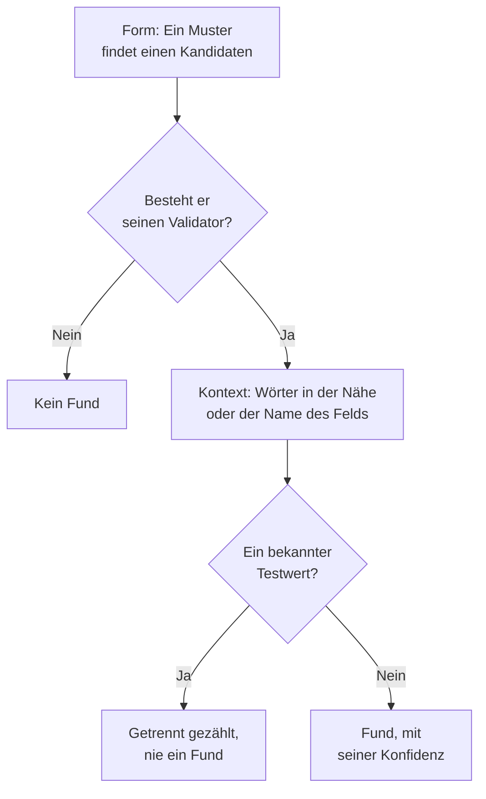

# Sensible Datentypen

Datensicherheit kennt 143 Arten sensibler Daten: Kartennummern, Bankkonten, nationale Ausweisnummern aus 43 Ländern, Gesundheitskennungen, API-Schlüssel und Tokens sowie die besonderen Kategorien personenbezogener Daten. Jede hat eine Kategorie, eine Sensibilität und, wenn sie zu einem Land gehört, dieses Land. Diese Seite sagt, wie ein Wert gefunden wird, und führt jeden Datentyp auf, damit Sie erkennen, warum etwas gefunden wurde, und entscheiden können, was Sie dagegen tun.

:::cards
- [Wie ein Wert gefunden wird](#wie-ein-wert-gefunden-wird): Form, Validator, Kontext, Testwerte, Konfidenz.
- [Felder und Spalten](#felder-und-spalten): Wie eine ganze Spalte oder ein ganzes Attribut beurteilt wird.
- [Namen und Anschriften in Freitext](#namen-und-anschriften-in-freitext): Das kleine Modell im Scanner und seine Messwerte.
- [Jeder Datentyp](#integrierte-datentypen): Alle 143, nach Kategorie.
- [Ihre eigenen Datentypen](#ihre-eigenen-datentypen): Personalnummern, Policennummern und das Feld Testen.
- [Datentypen, die OneUptime AI findet](#datentypen-die-oneuptime-ai-findet): Ihre eigenen Datentypen, gefunden in den Feldern, die kein Detektor zuordnen konnte.
- [Die Einschätzungen von OneUptime AI](#die-einschätzungen-von-oneuptime-ai): Eine Einschätzung zu jedem Fund, der auf Sie wartet, mit den Entscheidungen Ihres Teams als Präzedenzfällen.
:::

## Wie ein Wert gefunden wird



Jeder Scan - einer Logzeile, einer CSV-Zelle, einer Datenbankzeile, der ersten Bytes eines Objekts - durchläuft dieselben Schritte:

1. **Form.** Jeder Datentyp hat Muster, die Kandidaten finden: sechzehn Ziffern, `AKIA` und sechzehn Buchstaben, ein Wort, ein `@` und eine Domain. Ein Muster passt nie innerhalb eines längeren Tokens, sodass eine Kartennummer nicht in einer längeren Ziffernfolge gefunden wird.
2. **Validator.** Ein Kandidat muss die eigenen Regeln seines Typs bestehen: eine Prüfsumme (Luhn für Karten, Mod 97 für IBANs, Verhoeff für Aadhaar-Nummern, die Prüfziffer der meisten nationalen Ausweisnummern), ein echtes Datum, ein bekanntes Präfix, genug Zufälligkeit für ein Geheimnis. Ein Kandidat, der durchfällt, ist überhaupt kein Fund. Platzhalter wie `000000000` und `123456789` fallen bei jedem numerischen Typ durch.
3. **Kontext.** Wörter in der Nähe eines Kandidaten - standardmäßig bis zu 64 Zeichen davor und 32 danach -, die sagen, was er ist, heben seine Konfidenz um eine Stufe, und ebenso ein Feld, dessen Name auf den Typ hinweist. Wörter, die sagen, dass er etwas anderes ist, etwa eine Bestell- oder Sendungsnummer, senken sie um eine Stufe. Eine Nummer ohne Prüfsumme und mit gängiger Form, etwa eine Passnummer oder ein Bankkonto, zählt nur neben Wörtern, die sie benennen.
4. **Bekannte Testwerte.** Veröffentlichte Testkartennummern (etwa `4242 4242 4242 4242` von Stripe), Beispiel-IBANs, Adressen unter `example.com` und anderen reservierten Domains, IP-Adressen für Dokumentation, die Beispiel-IDs, die Behördendokumentation abdruckt, Testmodus-Schlüssel wie `sk_test_` und Platzhalterschlüssel werden getrennt gezählt. Sie ergeben nie einen Fund, sodass ein Datenspeicher voller solcher Werte als Testumgebung gilt, nicht als Datenleck.
5. **Konfidenz.** Was übrig bleibt, ist ein Fund, so sicher, wie seine Belege es erlauben.

| Konfidenz | Was sie bedeutet |
| --- | --- |
| **Hoch** | Der Wert hat seinen Validator bestanden, und Wörter um ihn herum oder das Feld, in dem er steht, sagen, was er ist - oder, bei einem Feld, die meisten seiner Werte sind von diesem Typ. |
| **Mittel** | Der Wert hat seinen Validator bestanden, ohne dass etwas um ihn herum ihn bestätigt, oder der Name des Felds sagt, was es enthält, und einige Werte stimmen damit überein. |
| **Niedrig** | Die Form passt, aber nichts bestätigt sie. |

Nur Funde mit Konfidenz Hoch oder Mittel zählen: Sie machen einen Datenspeicher sensibel und können ein Problem eröffnen. Funde mit Konfidenz Niedrig werden am Datenspeicher aufgeführt, eingeklappt, damit ein Mensch sie beurteilt: **Bestätigen** an einem zutreffenden Fund macht ihn zu Hoch, und er bleibt in späteren Scans Hoch.

Beanspruchen zwei Datentypen dieselben Zeichen, gewinnt der sicherere Fund: die höhere Konfidenz, dann der Detektor, dessen eigene Regeln mehr beweisen, dann der längere Treffer.

Ein Wert wird auch so gelesen, wie Menschen ihn schreiben. Die Prozent-Escapes einer URL werden gelesen, auch für die UTF-8-Bytes eines Zeichens, sodass eine IP-Adresse, eine E-Mail-Adresse wie `jane%40example.com` oder `jos%C3%A9%40example.com`, ein Token oder ein Schlüssel in einem Query-String gefunden wird. Die Ziffern einer Nummer werden in jeder Schrift gelesen, etwa Ziffern voller Breite (`４１１１ １１１１ １１１１ １１１１`) oder arabisch-indische Ziffern, jede Schrift zuerst für sich und dann zusammen: eine Kartennummer, eine Telefonnummer, eine US-Sozialversicherungsnummer, eine IBAN, eine Bankleitzahl (Routing Number), eine nationale Ausweisnummer oder eine Gesundheitskennung wie eine NHS-Nummer. Eine E-Mail-Adresse wird in jeder Schrift gefunden, etwa `张伟@example.com` oder `почта@пример.рф`, und eine IPv6-Adresse direkt nach dem Doppelpunkt eines Schlüssels, etwa `ip:2001:db8::1`. Jeder Fund ist der Wert, wie er geschrieben ist, sodass eine Bereinigungsregel ihn dort verbirgt.

Ein langer Wert wird in Fenstern von 64 KB gelesen, die sich um 4 KB überlappen, sodass ein Wert ganz gefunden wird, wo immer er steht, und von einem Wert werden höchstens 4 MB gelesen.

## Felder und Spalten

Eine Spalte, ein JSON-Feld oder ein Log-Attribut wird als Ganzes beurteilt. Sein Name deutet auf einen Datentyp hin, und seine Stichprobenwerte beweisen einen. Der Anteil seiner Werte, die den Typ enthalten, entscheidet, wie sicher der Fund ist:

| Werte, die den Typ enthalten | Konfidenz |
| --- | --- |
| 60 % oder mehr | Hoch |
| 25 % oder mehr | Hoch, wenn der Name des Felds auf den Typ hinweist, sonst Mittel |
| Weniger | Mittel, wenn der Name des Felds auf den Typ hinweist, sonst Niedrig: ein paar E-Mails in einer Spalte mit etwas anderem |

Ein Feld, dessen Werte im Schnitt länger als 80 Zeichen sind, ist Freitext - Notizen, Nachrichten, Beschreibungen - und soll keinen einzelnen Typ enthalten. Seine Funde behalten die Konfidenz, die jeder Treffer für sich erzielt hat, und sagen, dass sie in Freitext gefunden wurden. Bis zu 1.000 Werte eines Felds werden klassifiziert, und von jedem bis zu 16 KB.

Der Name eines Felds wird in Wörter zerlegt - `customerEmail`, `customer_email` und `customer-email` sind alle „customer email“ - und der Namenshinweis eines Typs passt, wenn seine Wörter in dieser Reihenfolge direkt nebeneinander vorkommen: „date of birth“ passt auf `customer_date_of_birth`, nicht auf `birth_city`. Nur der letzte Teil eines Pfads mit Punkten ist der eigene Name des Felds, zusammen mit dem Teil davor, wenn der letzte ein allgemeines Wort wie `number`, `id` oder `value` ist: `customer.address.city` ist keine Straßenadresse, und `card.number` ist trotzdem eine Kartennummer.

Manche Datentypen lassen sich nicht an ihren Werten erkennen: Kein Muster unterscheidet den Namen einer Person von einer Straße oder eine Religion von irgendeinem anderen Wort. Diese werden allein anhand des Feldnamens gefunden, wenn das Feld Werte hat: Personenname, Benutzername, Geschlecht, Staatsangehörigkeit, Gesundheitsinformationen, Rassische oder ethnische Herkunft, Religiöse Überzeugung, Sexuelle Orientierung, Politische Meinung, Gewerkschaftszugehörigkeit, Biometrische Daten, Genetische Daten und Vorstrafen. Ein Name, ein Benutzername, ein Geschlecht oder eine Staatsangehörigkeit ist dann Hoch, wenn 60 % oder mehr der Werte danach aussehen, und sonst Mittel. In Freitext findet zusätzlich ein kleines Modell Namen und Anschriften von Personen: siehe [Namen und Anschriften in Freitext](#namen-und-anschriften-in-freitext). Der Name einer Person wird auch im Query-String einer URL gefunden, unter einem Parameter, der so heißt, wie ein solches Feld heißen würde, etwa `full_name` in `/contacts?full_name=Jos%C3%A9%20Garc%C3%ADa`: Sein Wert wird so gelesen, wie eine URL ihn schreibt, er ist Hoch, wenn er wie ein Name aussieht, und er wird dort gefunden, wo er geschrieben ist, samt seinen Escape-Sequenzen. Ein Parameter, der nur `name` heißt, bleibt dem Modell überlassen.

Ein Feld, dessen Name sagt, dass es ein Passwort enthält - `password`, `passwordHash`, `pwd`, nicht `password_changed_at` -, sollte einen Hash enthalten: bcrypt, argon2, scrypt, PBKDF2 oder ein anderes Verfahren, das ein Datenspeicher wahrscheinlich nutzt. Leere Werte, Platzhalter wie `********` und verschlüsselte Werte werden beiseitegelegt. Sind vom Rest mehr Werte keine Hashes als Hashes, enthält das Feld die Passwörter selbst, die kein Muster sehen kann, und der Datenspeicher besteht [Passwörter werden im Klartext gespeichert](/docs/data-security/checks-and-issues#datenhygiene) nicht.

### Felder, die kein Detektor zuordnen konnte

Eine Spalte oder ein Feld, deren Name auf keinen Datentyp hinweist und deren Werte zu keinem Detektor passen, ist nicht als sicher bekannt: Es kann Ihre eigene Kundennummer sein oder eine Spalte, die in einer anderen Sprache benannt ist. Ist **KI aktivieren** im Projekt eingeschaltet, behält ein Inhaltsscan solche Felder, höchstens 200 pro Scan, und OneUptime AI wird gefragt, welchen der Datentypen des Projekts jedes davon enthält, höchstens 40 Felder eines Datenspeichers auf einmal. Es erfährt den Namen des Feldes, die Namen der Felder daneben und die Formen seiner Werte - jeder Buchstabe als `a` oder `A` geschrieben und jede Ziffer als `9`, sodass aus `AB-1234` die Form `AA-9999` wird - nie einen Wert. Nach Freitext, Feldern mit weniger als 5 Werten, kleinen ganzen Zahlen und Feldern, die als ID, Zeitpunkt oder Status benannt sind, wird nicht gefragt.

Ein Telemetriescan behält die Attribute, die kein Detektor zugeordnet hat, auf dieselbe Weise, aus den Logs, Spans, Metriken und der übrigen Telemetrie eines Dienstes, höchstens 50 pro Dienst und Scan. Er behält nie die eigenen Attribute von OneUptime, nie die, die die Konventionen von OpenTelemetry an jeden Datensatz schreiben, um zu sagen, woher er kommt, etwa den Dienst, den Host oder den Pod, und nie Freitext wie den Text eines Logs.

Jeder Typ, den OneUptime AI nennt, ist ein Fund mit Konfidenz Niedrig, markiert als **Von OneUptime AI vorgeschlagen**, mit seiner Begründung, die in der Sprache Ihres Projekts geschrieben ist und über die ganze Zeile des Funds angezeigt wird. Wie jeder Fund mit Konfidenz Niedrig zählt er für nichts, bis ein Mensch auf der Seite **Inhalt** des Datenspeichers **Bestätigen** wählt; **Als nicht sensibel markieren** lehnt ihn ab. Nach einer Antwort wird zu einem Feld 30 Tage lang nicht erneut gefragt, und zu einem Feld, das ein Mensch beurteilt hat, nie wieder.

## Namen und Anschriften in Freitext

Kein Muster unterscheidet den Namen einer Person von irgendeinem anderen Wort. Deshalb liest zusätzlich ein kleines Sprachmodell Freitext - eine Support-Notiz, eine Logzeile, eine Ausnahmenachricht, einen Prompt - und findet darin Namen und Anschriften von Personen. Das Modell läuft im Scanner, auf den Workern von OneUptime und auf Ihren Sonden: Der Text verlässt den Scanner nie, nichts wird heruntergeladen, solange es läuft, und es wird kein Prompt geschrieben. Es ist nicht OneUptime AI, und die Schalter von OneUptime AI schalten es weder ein noch aus: Das tut **Namen und Anschriften finden**.

- **Was es liest.** Jedes Feld, dessen Werte im Schnitt länger als 80 Zeichen sind; jedes Feld, dessen Name sagt, dass eine Person Freitext hineingeschrieben hat, egal wie kurz seine Werte sind, etwa `delivery_note`, `comentario`, `Lieferhinweis` oder `opmerking` (siehe [Kurze Werte](#kurze-werte)); und in der Telemetrie jeden Log-Body, jede Ausnahmenachricht, jeden Stacktrace und jede KI-Unterhaltung, egal wie kurz. Es liest bis zu 100 verschiedene Werte eines Felds, insgesamt 32 KB Text, und von einem einzelnen Wert bis zu 16 KB. Eine URL in dem, was es liest, wird als URL gelesen: Ihre Prozent-Escapes werden gelesen und ein `+` zwischen zwei Buchstaben als Leerzeichen, sodass der Name in `/profile?name=Jos%C3%A9%20Garc%C3%ADa` gefunden und so verborgen wird, wie er geschrieben ist.
- **Was es findet.** Die Datentypen **Personenname** (`person-name`) und **Anschrift** (`postal-address`). Als Anschrift gilt eine Ortsangabe, die das Modell neben einer Hausnummer liest, etwa `14 Calle Mayor`, samt der Postleitzahl und der Stadt, die darauf folgen. Eine Stadt oder ein Land allein ist keine Anschrift.
- **Wie sicher es ist.** Ein Name oder eine Anschrift, die das Modell findet, ist für sich allein Mittel. Hoch ist der Fund, wenn der Name des Felds sagt, dass das Feld Namen oder Anschriften enthält, oder wenn Wörter in der Nähe das sagen, etwa „customer“, „Kunde“ oder „dirección“. Niedrig ist er, wenn sich das Modell nicht sicher ist, bei einem Score unter 0,6. Jeder Fund behält die Konfidenz, die er für sich erzielt hat, sodass ein einzelner Name unter tausend Logzeilen trotzdem Mittel ist.
- **Testwerte.** Platzhalter wie `Jane Doe`, `John Smith`, `Max Mustermann` und `123 Main Street` werden getrennt gezählt, wie die Testwerte jedes Typs.
- **Was es behält.** Seine Stichproben werden maskiert wie bei einem Namen, der anhand des Feldnamens gefunden wurde: das erste Zeichen und vier Sternchen, `M****`. Sie fließen nie in Fingerabdrücke ein. Auf der Seite **Inhalt** des Datenspeichers steht bei einem solchen Fund **Vom Modell des Scanners in Freitext gefunden**.
- **Seine Einträge und seine Regeln.** Ein Fund, den es gemacht hat, listet die Einträge auf, in denen er gefunden wurde, jede Zeile auf den Namen oder die Anschrift zugeschnitten und jeder Name und jede Anschrift darin maskiert, und Bereinigen weist an diesen Einträgen eine Regel nach, wie bei jedem Fund: Sie werden mit dem Modell erneut gelesen, jedes Mal mit bis zu 20 Sekunden seiner Zeit. Ein Eintrag, für den es keine Zeit hatte, wird nicht aufgelistet, und die Liste sagt, für wie viele Werte es keine Zeit hatte. Wo das Modell nicht laufen kann, sagt die Liste das, und für den Fund wird keine Regel nachgewiesen.

| Modell | Lizenz | Größe | Revision | Gemessene Sprachen |
| --- | --- | --- | --- | --- |
| [openmasq/ner-multilingual](https://huggingface.co/openmasq/ner-multilingual): mehrsprachiges BERT mit sechs Schichten, int8-ONNX | Apache 2.0 | 98 MB | `8cf7273` | Englisch, Spanisch, Deutsch, Französisch, Italienisch, Portugiesisch, Niederländisch |

### Wie gut es sie findet

Gemessen wurde es mit dem eigenen Code des Scanners, an einem eigens dafür geschriebenen Testset: 392 erfundene Sätze in sieben Sprachen - Logzeilen, Support-Notizen, E-Mails, Prompts -, von denen 168 weder einen Namen noch eine Anschrift enthalten. Ein Fund gilt als richtig, wenn er sich mit einem Namen oder einer Anschrift seines Typs überschneidet. Die Anforderungen standen fest, bevor irgendein Modell gemessen wurde: eine Precision von mindestens 0,90 für jeden Typ über alle Sprachen und von 0,85 in jeder einzelnen Sprache, ein Recall von mindestens 0,70 und höchstens 20 falsche Funde pro 1.000 Werte, die keins von beiden enthalten. Zwei der vier gemessenen Modelle erfüllten sie, und das kleinere wurde gewählt. Ein Test schreibt diese Werte fest: Eine Änderung am Modell oder am Scanner, die einen davon senkt, lässt ihn fehlschlagen.

| Sprache | Namen: Precision | Namen: Recall | Anschriften: Precision | Anschriften: Recall |
| --- | --- | --- | --- | --- |
| Englisch | 0,96 | 0,96 | 1,00 | 1,00 |
| Spanisch | 0,96 | 0,96 | 1,00 | 1,00 |
| Deutsch | 1,00 | 0,93 | 1,00 | 1,00 |
| Französisch | 0,96 | 0,96 | 1,00 | 1,00 |
| Italienisch | 0,96 | 0,96 | 1,00 | 1,00 |
| Portugiesisch | 0,93 | 0,89 | 1,00 | 1,00 |
| Niederländisch | 0,96 | 0,89 | 1,00 | 1,00 |
| Alle sieben | 0,96 | 0,94 | 1,00 | 1,00 |

Bei den 168 Sätzen des Testsets, die keins von beiden enthalten, macht es 18 falsche Funde pro 1.000. Auf einem Ausschnitt eines öffentlichen Benchmarks, [gretelai/synthetic_pii_finance_multilingual](https://huggingface.co/datasets/gretelai/synthetic_pii_finance_multilingual) (Apache 2.0): 15 Finanzdokumente in jeder von sieben Sprachen, deren Labels maschinell erstellt und nicht vollständig sind, daher neben der Tabelle oben zu lesen und nicht für sich allein:

| Sprache | Namen: Precision | Namen: Recall | Anschriften: Precision | Anschriften: Recall |
| --- | --- | --- | --- | --- |
| Englisch | 0,91 | 0,90 | 0,83 | 1,00 |
| Spanisch | 0,89 | 0,37 | 0,58 | 0,70 |
| Deutsch | 0,93 | 0,58 | 0,75 | 0,70 |
| Französisch | 0,84 | 0,50 | 0,42 | 0,83 |
| Italienisch | 0,73 | 0,61 | 0,79 | 0,69 |
| Niederländisch | 0,91 | 0,49 | 1,00 | 0,89 |
| Schwedisch | 1,00 | 0,61 | 1,00 | 0,93 |
| Alle sieben | 0,89 | 0,54 | 0,77 | 0,82 |

Die vier gemessenen Modelle auf dem eigens geschriebenen Testset, nacheinander auf derselben Maschine gemessen, die Zeit jeweils auf einem Kern mit dem nativen Code von onnxruntime. OneUptime führt das gewählte Modell mit der WebAssembly-Variante von onnxruntime aus, die in jedem Image läuft und etwa fünf- bis achtmal langsamer ist:

| Modell | Lizenz | Größe | Namen: Precision / Recall | Anschriften: Precision / Recall | Falsche Funde pro 1.000 | Zeit pro 1.000 Werte mit 75 / 1.181 Zeichen |
| --- | --- | --- | --- | --- | --- | --- |
| openmasq/ner-multilingual (gewählt) | Apache 2.0 | 98 MB | 0,963 / 0,939 | 1,000 / 1,000 | 18 | 5,9 s / 82 s |
| Wismut/nym-pii-multilingual-small | MIT | 121 MB | 0,995 / 0,974 | 0,985 / 1,000 | 12 | 7,4 s / 103 s |
| jkomyno/minilmv2-l6-h384-ner-en-it-q8 | MIT | 34 MB | 0,704 / 0,929 | 0,839 / 1,000 | 369 | 3,7 s / 68 s |
| balticml/mmbert-small-pii-redaction | Apache 2.0 | 38 MB | 0,712 / 0,995 | 0,762 / 0,992 | 589 | 7,8 s / 159 s |

### Kurze Werte

Ein kurzes Feld wird nur gelesen, wenn sein Name sagt, dass eine Person Freitext hineingeschrieben hat. Die Regel wurde gemessen, bevor sie gewählt wurde, an 49 Spalten einer Datenbank in den sieben Sprachen, insgesamt 588 Werte: Produktnamen, Titel, Labels, Berufsbezeichnungen und Ladennamen, in denen der Name einer Marke, einer Figur oder einer Straße kein Fund ist, und kurze Lieferhinweise, Support-Kommentare und Kundenanmerkungen mit 91 Namen und 28 Anschriften. Die erste erwogene Regel, jedes Feld mit vier oder mehr Wörtern zu lesen, las 108 Werte des Katalogs und machte daraus 53 falsche Namen, etwa `Ralph Lauren` im Namen eines Poloshirts und `Tom Sawyer` im Titel eines Buchs:

| Regel | Gelesene Katalogwerte | Namen: Precision | Namen: Recall | Anschriften: Precision | Falsche Funde pro 1.000 |
| --- | --- | --- | --- | --- | --- |
| Felder mit vier oder mehr Wörtern (nicht gewählt) | 108 | 0,62 | 0,99 | 1,00 | 222 |
| Felder, deren Name auf Freitext hinweist (gewählt) | 0 | 0,98 | 0,99 | 1,00 | 14 |

Die gewählte Regel, nach Sprache. Ein Test schreibt diese Werte fest, ebenso die Anforderungen, nach denen das Modell gewählt wurde:

| Sprache | Namen: Precision | Namen: Recall | Anschriften: Precision | Anschriften: Recall |
| --- | --- | --- | --- | --- |
| Englisch | 1,00 | 1,00 | 1,00 | 1,00 |
| Spanisch | 1,00 | 1,00 | 1,00 | 1,00 |
| Deutsch | 1,00 | 1,00 | 1,00 | 1,00 |
| Französisch | 1,00 | 1,00 | 1,00 | 1,00 |
| Italienisch | 1,00 | 1,00 | 1,00 | 1,00 |
| Portugiesisch | 0,86 | 0,92 | 1,00 | 1,00 |
| Niederländisch | 1,00 | 1,00 | 1,00 | 1,00 |
| Alle sieben | 0,98 | 0,99 | 1,00 | 1,00 |

Es zählt der Name des Felds selbst: `orders.delivery_note` wird gelesen, `notes.author` nicht, und ebenso wenig ein Name, der auf eine ID, eine Anzahl, einen Typ, einen Status oder eine Zeit endet, etwa `message_id`. Eine Beschreibung wird nicht wegen ihres Namens gelesen: Die eines Produkts ist Katalogtext.

### Wo es läuft und was es kostet

- **In jedem Image.** Das App-Image, das die Worker ausführt, und das Sonden-Image enthalten das Modell, sein Vokabular und die Runtime, die Air-Gapped- und Iron-Bank-Images eingeschlossen: etwa 114 MB auf der Festplatte. Die Dateien werden beim Bau des Images aus einer festgelegten Revision geladen und gegen ihren SHA-256-Hash geprüft. Während ein Scan läuft, wird nichts heruntergeladen.
- **Arbeitsspeicher.** Das Modell wird geladen, wenn ein Scan es zum ersten Mal braucht, einmal pro Prozess: etwa 550 MB, die nach 10 Minuten ohne Scan wieder freigegeben werden.
- **Zeit.** Auf einem Kern zwischen 30 Sekunden und einer Minute pro 1.000 Werte von der Länge einer Logzeile und etwa 9 Minuten pro 1.000 Werte mit 1.200 Zeichen. Ein Inhaltsscan eines Datenspeichers gibt ihm bis zu 2 Minuten. Der stündliche Telemetrie-Scan gibt ihm insgesamt bis zu 1 Minute, pro Datenspeicher 6 Sekunden, jede Stunde für eine andere Auswahl von Datenspeichern.
- **Reihum.** Das Modell jedes Inhaltsscans beginnt dort, wo das des letzten aufgehört hat: bei der ersten Tabelle oder dem ersten Container mit Freitext, den es nicht gelesen hat, und mit den Objekten eines Buckets, für die es keine Zeit hatte und die vor allen anderen erneut gelesen werden. Was es angefangen und nicht zu Ende gelesen hat, wird nicht noch einmal als Erstes genommen, sodass nichts die Zeit des Modells Scan für Scan belegt und jede Tabelle und jedes Objekt an die Reihe kommt, egal wie viel Freitext der Datenspeicher enthält.
- **Wenn seine Zeit abläuft**, endet der Scan mit dem, was das Modell bis dahin gelesen hat, und die Warnungen des Scans sagen, wie viele der Freitextwerte es gelesen hat, nie, was darin stand. Ein Worker oder eine Sonde ohne Modell scannt wie bisher und sagt, warum:

```text
Names and street addresses were looked for in 120 of 500 free-text values: this store's 6 seconds of model time ran out.
Names and street addresses in free text were not looked for: the model's model_quantized.onnx is not installed on this probe.
```

Die Details eines Scans zeigen diese und jede andere Warnung eines Inhalts- oder Telemetrie-Scans in der Sprache des Lesers.

**Namen und Anschriften finden** ist in jedem Projekt eingeschaltet: Inhaltsscans von Buckets, Datenbanken und BigQuery-Datasets lesen Freitext mit dem Modell, auf Workern wie auf Sonden. Die Einstellung darunter, **Namen und Anschriften in der Telemetrie finden**, ist ausgeschaltet: Jeden Log-Body, jede Ausnahme und jede Unterhaltung eines Projekts mit hohem Datenaufkommen und 200 Diensten einmal zu lesen, dauert auf einem Kern etwa 48 Minuten, und die eine Minute pro Stunde, die der Scan hat, liest etwa 4 % davon. Schalten Sie sie ein, damit jeder stündliche Scan einen Teil davon liest. Beide finden Sie unter **Datensicherheit → Einstellungen → Scan-Einstellungen**, im Abschnitt **Was Datensicherheit liest**. **Testen** läuft in Ihrem Browser, ohne das Modell: Was das Modell finden würde, wird dort nicht angezeigt. Das Modell würde dem Download etwa 113 MB hinzufügen, komprimiert 67 MB, und dem Arbeitsspeicher des Tabs etwa 440 MB, deshalb läuft es nur im Scanner.

## Sensibilität

| Sensibilität | Was sie bedeutet |
| --- | --- |
| **Eingeschränkt** | Schaden folgt, wenn sie abfließen: Geheimnisse, Kartennummern, Gesundheitsakten, amtliche Kennnummern. |
| **Vertraulich** | Personenbezogene Daten und als vertraulich gekennzeichnete Dokumente. |
| **Intern** | Die eigenen Daten des Unternehmens, nicht für Außenstehende bestimmt. |
| **Öffentlich** | Es wurde nichts Sensibles gefunden. |

Ein Datenspeicher ist so sensibel wie der sensibelste Datentyp, der darin mit mindestens mittlerer Konfidenz gefunden wurde. Testwerte und als nicht sensibel markierte Funde zählen nicht, und ein Datenspeicher, in dem nichts gefunden wurde, ist Öffentlich. Um einen Datenspeicher als sensibler oder weniger sensibel zu behandeln, als seine Funde sagen, setzen Sie seine Sensibilität selbst in den **Einstellungen** des Datenspeichers: Die Prüfungen verwenden dann diese.

## Kategorien

| Kategorie | Was sie abdeckt | Personenbezogene Daten |
| --- | --- | --- |
| Geheimnisse und Zugangsdaten | Passwörter, API-Schlüssel, Tokens und private Schlüssel, die andere Systeme öffnen. | Nein |
| Finanzen | Kartennummern, Bankkonten, IBANs und Krypto-Wallets. | Ja |
| Gesundheit | Krankenaktennummern, Gesundheitskennungen, Diagnosen und Rezepte. | Ja |
| Amtliche Kennnummer | Nationale Ausweis-, Steuer-, Pass- und Sozialversicherungsnummern. | Ja |
| Besondere Kategorie | Was Artikel 9 der DSGVO am stärksten schützt: ethnische Herkunft, Religion, sexuelle Orientierung, politische Meinungen, Gewerkschaftszugehörigkeit, biometrische und genetische Daten. | Ja |
| Kontakt und Identität | Wer jemand ist und wie man die Person erreicht: E-Mail, Telefon, Adresse, Geburtsdatum, IP-Adresse. | Ja |
| Geschäftlich vertraulich | Dokumente, die als vertraulich, nur intern oder rechtlich geschützt gekennzeichnet sind. | Nein |

Personenbezogene Daten sind Daten über eine Person, im Sinne von DSGVO, CCPA, LGPD und DPDP. Ein Datenspeicher, der nur Geheimnisse und Geschäftsdokumente enthält, liegt außerhalb des Geltungsbereichs eines Datenschutz-Rahmenwerks, aber nie außerhalb eines Sicherheits-Rahmenwerks (siehe [Compliance der Datensicherheit](/docs/data-security/compliance)).

## Integrierte Datentypen

Ein Datentyp, der zu einem Land gehört, nennt es als ISO-3166-1-Code: Residenzregeln und die an ein Land gebundenen Rahmenwerke lesen ihn (siehe [Residenz](/docs/data-security/flows-access-residency#residenzregeln)). Die ID ist das, womit die API und die Funde den Typ benennen.

### Kontakt und Identität

| Datentyp | ID | Was er ist | Sensibilität | Land |
| --- | --- | --- | --- | --- |
| E-Mail-Adresse | `email-address` | Die E-Mail-Adresse einer Person. | Vertraulich | — |
| Telefonnummer | `phone-number` | Eine Telefonnummer im internationalen oder nationalen Format. | Vertraulich | — |
| Personenname | `person-name` | Vor-, Nach- oder vollständiger Name einer Person, erkannt am Namen des Felds oder vom Modell des Scanners in Freitext. | Vertraulich | — |
| Straßenadresse | `postal-address` | Eine Straßenadresse: eine Hausnummer, ein Straßenname und ein Straßentyp. | Vertraulich | — |
| Postleitzahl | `postal-code` | Eine Postleitzahl. Schon allein grenzt sie ein, wo jemand wohnt. | Intern | — |
| Geburtsdatum | `date-of-birth` | Ein Datum neben Wörtern, die sagen, dass es das Geburtsdatum einer Person ist. | Vertraulich | — |
| IP-Adresse | `ip-address` | Eine öffentliche IPv4- oder IPv6-Adresse, die die DSGVO als personenbezogene Daten behandelt. | Vertraulich | — |
| MAC-Adresse | `mac-address` | Die Hardwareadresse einer Netzwerkkarte, die ein Gerät identifiziert. | Vertraulich | — |
| Werbe-ID | `advertising-id` | Eine mobile Werbe-ID (IDFA, GAID, AAID), die ein Gerät verfolgt. | Vertraulich | — |
| Genauer Standort | `geolocation` | Breiten- und Längengrad, genau genug, um ein Gebäude zu finden. | Vertraulich | — |
| Benutzername | `username` | Der Anmelde- oder Kontoname einer Person, anhand des Feldnamens gefunden. | Vertraulich | — |
| Geschlecht | `gender` | Das soziale oder biologische Geschlecht einer Person, anhand des Feldnamens gefunden. | Vertraulich | — |
| Staatsangehörigkeit | `nationality` | Die Nationalität oder Staatsbürgerschaft einer Person, anhand des Feldnamens gefunden. | Vertraulich | — |
| Fahrzeug-Identifizierungsnummer | `vehicle-identification-number` | Eine 17-stellige VIN mit gültiger Prüfziffer. | Vertraulich | — |

### Amtliche Kennnummer

| Datentyp | ID | Was er ist | Sensibilität | Land |
| --- | --- | --- | --- | --- |
| US-Sozialversicherungsnummer | `us-ssn` | Eine US-amerikanische Social Security Number. | Eingeschränkt | US |
| US-Steuernummer (ITIN) | `us-itin` | Eine US-amerikanische Individual Taxpayer Identification Number. | Eingeschränkt | US |
| US-Arbeitgebernummer (EIN) | `us-ein` | Eine US-amerikanische Employer Identification Number, neben Wörtern, die das sagen. | Vertraulich | US |
| US-Passnummer | `us-passport` | Eine US-Passnummer, neben Wörtern, die das sagen. | Eingeschränkt | US |
| US-Führerscheinnummer | `us-drivers-license` | Eine US-Führerscheinnummer, neben Wörtern, die das sagen. | Eingeschränkt | US |
| Britische National Insurance Number | `uk-nino` | Eine britische National Insurance Number. | Eingeschränkt | GB |
| Britische Passnummer | `uk-passport` | Eine britische Passnummer, neben Wörtern, die das sagen. | Eingeschränkt | GB |
| Britische Führerscheinnummer | `uk-driving-licence` | Eine 16-stellige britische Führerscheinnummer. | Eingeschränkt | GB |
| Kanadische Social Insurance Number | `ca-sin` | Eine kanadische Social Insurance Number mit gültiger Prüfziffer. | Eingeschränkt | CA |
| Mexikanische CURP | `mx-curp` | Eine mexikanische Clave Única de Registro de Población. | Eingeschränkt | MX |
| Mexikanische RFC | `mx-rfc` | Eine mexikanische Steuernummer, Registro Federal de Contribuyentes. | Eingeschränkt | MX |
| Brasilianische CPF | `br-cpf` | Eine brasilianische Nummer des Cadastro de Pessoas Físicas. | Eingeschränkt | BR |
| Brasilianische CNPJ | `br-cnpj` | Eine brasilianische Unternehmensregisternummer (CNPJ). | Vertraulich | BR |
| Argentinische CUIT / CUIL | `ar-cuit` | Ein argentinischer Steuer- oder Arbeits-Identifikationscode. | Eingeschränkt | AR |
| Chilenische RUT | `cl-rut` | Ein chilenischer Rol Único Tributario mit gültiger Prüfziffer. | Eingeschränkt | CL |
| Spanische DNI | `es-dni` | Eine spanische Personalausweisnummer mit ihrem Prüfbuchstaben. | Eingeschränkt | ES |
| Spanische NIE | `es-nie` | Eine spanische Ausländer-Identifikationsnummer mit ihrem Prüfbuchstaben. | Eingeschränkt | ES |
| Portugiesische NIF | `pt-nif` | Eine portugiesische Steuer-Identifikationsnummer. | Eingeschränkt | PT |
| Französische Sozialversicherungsnummer (NIR) | `fr-nir` | Eine französische INSEE-Nummer mit ihrem zweistelligen Schlüssel. | Eingeschränkt | FR |
| Deutsche Steuer-ID | `de-tax-id` | Eine deutsche Steuerliche Identifikationsnummer. | Eingeschränkt | DE |
| Italienischer Codice fiscale | `it-codice-fiscale` | Ein italienischer Codice fiscale mit gültigem Prüfzeichen. | Eingeschränkt | IT |
| Niederländische BSN | `nl-bsn` | Eine niederländische Bürgerservicenummer, die den Elfertest besteht. | Eingeschränkt | NL |
| Belgische Nationalregisternummer | `be-national-number` | Eine belgische Nationalregisternummer. | Eingeschränkt | BE |
| Polnische PESEL | `pl-pesel` | Eine polnische nationale Identifikationsnummer. | Eingeschränkt | PL |
| Schwedische Personennummer | `se-personnummer` | Eine schwedische personnummer mit gültiger Prüfziffer. | Eingeschränkt | SE |
| Norwegische nationale Identitätsnummer | `no-fodselsnummer` | Eine norwegische fødselsnummer mit beiden Prüfziffern. | Eingeschränkt | NO |
| Dänische CPR-Nummer | `dk-cpr` | Eine dänische Personenregisternummer, neben Wörtern, die das sagen. | Eingeschränkt | DK |
| Finnischer persönlicher Identitätscode | `fi-hetu` | Eine finnische henkilötunnus mit ihrem Prüfzeichen. | Eingeschränkt | FI |
| Irische PPS-Nummer | `ie-ppsn` | Eine irische Personal Public Service Number. | Eingeschränkt | IE |
| Schweizer AHV-Nummer | `ch-ahv` | Eine Schweizer Sozialversicherungsnummer (AHV / AVS). | Eingeschränkt | CH |
| Rumänische CNP | `ro-cnp` | Ein rumänischer persönlicher Zahlencode. | Eingeschränkt | RO |
| Bulgarische EGN | `bg-egn` | Eine bulgarische einheitliche Bürgernummer. | Eingeschränkt | BG |
| Kroatische OIB | `hr-oib` | Eine kroatische persönliche Identifikationsnummer. | Eingeschränkt | HR |
| Griechische AMKA | `gr-amka` | Eine griechische Sozialversicherungsnummer. | Eingeschränkt | GR |
| Türkische Identitätsnummer | `tr-tckn` | Eine türkische T.C.-Kimlik-Nummer. | Eingeschränkt | TR |
| Israelische Identitätsnummer | `il-teudat-zehut` | Eine israelische Teudat-Zehut-Nummer. | Eingeschränkt | IL |
| Südafrikanische ID-Nummer | `za-id` | Eine südafrikanische Identitätsnummer mit gültigem Datum und gültiger Prüfziffer. | Eingeschränkt | ZA |
| Emirates ID der VAE | `ae-emirates-id` | Eine Personalausweisnummer der Vereinigten Arabischen Emirate. | Eingeschränkt | AE |
| Saudische nationale ID | `sa-national-id` | Eine saudische nationale ID- oder Iqama-Nummer. | Eingeschränkt | SA |
| Indische Aadhaar-Nummer | `in-aadhaar` | Eine 12-stellige Aadhaar-Nummer, die die Verhoeff-Prüfung besteht. | Eingeschränkt | IN |
| Indische PAN | `in-pan` | Eine indische Permanent Account Number. | Eingeschränkt | IN |
| Chinesische Personalausweisnummer | `cn-resident-id` | Eine 18-stellige Nummer eines chinesischen Personalausweises. | Eingeschränkt | CN |
| Japanische My Number | `jp-my-number` | Eine japanische Individualnummer mit gültiger Prüfziffer. | Eingeschränkt | JP |
| Südkoreanische Einwohnerregistrierungsnummer | `kr-rrn` | Eine koreanische Einwohnerregistrierungsnummer. | Eingeschränkt | KR |
| Singapurische NRIC / FIN | `sg-nric` | Eine Personalausweisnummer oder ausländische Identifikationsnummer aus Singapur. | Eingeschränkt | SG |
| Hongkonger Ausweisnummer | `hk-hkid` | Eine Hongkonger Personalausweisnummer mit ihrer Prüfziffer. | Eingeschränkt | HK |
| Taiwanische nationale ID | `tw-national-id` | Eine taiwanische nationale Identifikationsnummer. | Eingeschränkt | TW |
| Thailändische nationale ID | `th-national-id` | Eine thailändische Bürger-Identifikationsnummer. | Eingeschränkt | TH |
| Malaysische MyKad-Nummer | `my-mykad` | Eine malaysische Personalausweisnummer. | Eingeschränkt | MY |
| Indonesische NIK | `id-nik` | Eine indonesische Bevölkerungs-Identitätsnummer. | Eingeschränkt | ID |
| Australische Tax File Number | `au-tfn` | Eine australische Tax File Number mit gültiger Prüfung. | Eingeschränkt | AU |
| Neuseeländische IRD-Nummer | `nz-ird` | Eine neuseeländische Inland-Revenue-Nummer mit gültiger Prüfziffer. | Eingeschränkt | NZ |
| Russische SNILS | `ru-snils` | Eine russische Versicherungskontonummer mit ihrer Prüfnummer. | Eingeschränkt | RU |
| Russische INN | `ru-inn` | Eine russische Steuer-Identifikationsnummer. | Eingeschränkt | RU |
| Passnummer | `passport-number` | Eine Passnummer aus einem beliebigen Land, neben Wörtern, die das sagen. | Eingeschränkt | — |

### Finanzen

| Datentyp | ID | Was er ist | Sensibilität | Land |
| --- | --- | --- | --- | --- |
| Kartennummer | `credit-card-number` | Eine Zahlungskartennummer, die die Luhn-Prüfung besteht und zu einer Kartenmarke gehört. | Eingeschränkt | — |
| Kartenprüfnummer | `card-verification-code` | Ein CVV oder CVC, den PCI DSS nach der Autorisierung einer Zahlung nicht mehr aufzubewahren erlaubt. | Eingeschränkt | — |
| Ablaufdatum der Karte | `card-expiration-date` | Das Ablaufdatum einer Karte, neben Wörtern, die das sagen. | Vertraulich | — |
| IBAN | `iban` | Eine internationale Bankkontonummer, die die Mod-97-Prüfung besteht. | Eingeschränkt | — |
| Bankkontonummer | `bank-account-number` | Eine Bankkontonummer, neben Wörtern, die das sagen. | Eingeschränkt | — |
| SWIFT- / BIC-Code | `swift-bic` | Der SWIFT- oder BIC-Code einer Bank, neben Wörtern, die das sagen. | Intern | — |
| US-Bankleitzahl (Routing Number) | `us-bank-routing-number` | Eine ABA-Routing-Number mit gültiger Prüfsumme, neben Wörtern, die das sagen. | Intern | US |
| Britischer Sort Code | `uk-sort-code` | Ein britischer Sort Code einer Bank, neben Wörtern, die das sagen. | Intern | GB |
| Indischer IFSC | `in-ifsc` | Ein Indian Financial System Code, der eine Bankfiliale benennt. | Intern | IN |
| Australische BSB | `au-bsb` | Eine australische Bank-State-Branch-Nummer, neben Wörtern, die das sagen. | Intern | AU |
| Bitcoin-Adresse | `bitcoin-address` | Eine Bitcoin-Adresse mit gültiger Prüfsumme. | Vertraulich | — |
| Ethereum-Adresse | `ethereum-address` | Eine Ethereum-Adresse, neben Wörtern, die das sagen. | Vertraulich | — |

### Gesundheit

| Datentyp | ID | Was er ist | Sensibilität | Land |
| --- | --- | --- | --- | --- |
| Britische NHS-Nummer | `uk-nhs-number` | Eine Nummer des britischen National Health Service mit gültiger Prüfziffer. | Eingeschränkt | GB |
| US-Medicare-Versicherten-ID | `us-medicare-mbi` | Ein US-amerikanischer Medicare Beneficiary Identifier. | Eingeschränkt | US |
| Australische Medicare-Nummer | `au-medicare-number` | Eine australische Medicare-Kartennummer mit gültiger Prüfziffer. | Eingeschränkt | AU |
| Deutsche Krankenversichertennummer | `de-health-insurance-number` | Eine deutsche Krankenversichertennummer mit gültiger Prüfziffer. | Eingeschränkt | DE |
| Krankenaktennummer | `medical-record-number` | Die Krankenaktennummer eines Patienten, neben Wörtern, die das sagen. | Eingeschränkt | — |
| Mitgliedsnummer der Krankenversicherung | `health-plan-id` | Eine Mitglieds- oder Policennummer einer Krankenversicherung, neben Wörtern, die das sagen. | Eingeschränkt | — |
| Diagnoseschlüssel (ICD-10) | `diagnosis-code` | Ein ICD-10-Diagnoseschlüssel, neben Wörtern, die das sagen. | Eingeschränkt | — |
| Arzneimittelcode (NDC) | `drug-code` | Ein US-amerikanischer National Drug Code, neben Wörtern, die das sagen. | Vertraulich | — |
| US-DEA-Nummer | `us-dea-number` | Die Drug-Enforcement-Administration-Nummer einer verschreibenden Person, mit gültiger Prüfziffer. | Vertraulich | US |
| US-Leistungserbringer-ID (NPI) | `us-npi` | Ein National Provider Identifier. Er benennt einen Leistungserbringer, nicht einen Patienten. | Intern | US |
| Gesundheitsinformationen | `health-information` | Diagnosen, Erkrankungen, Medikamente und andere Gesundheitsangaben, anhand des Feldnamens gefunden. | Eingeschränkt | — |

### Geheimnisse und Zugangsdaten

| Datentyp | ID | Was er ist | Sensibilität | Land |
| --- | --- | --- | --- | --- |
| AWS-Zugriffsschlüssel-ID | `aws-access-key-id` | Die öffentliche Hälfte eines AWS-Zugriffsschlüssels. Mit seinem Geheimnis signiert sie AWS-Anfragen. | Eingeschränkt | — |
| Geheimer AWS-Zugriffsschlüssel | `aws-secret-access-key` | Die geheime Hälfte eines AWS-Zugriffsschlüssels, neben Wörtern, die das sagen. | Eingeschränkt | — |
| Google-API-Schlüssel | `google-api-key` | Ein API-Schlüssel für Google Cloud oder Maps. | Eingeschränkt | — |
| Google-Dienstkontoschlüssel | `google-service-account-key` | Eine Schlüsseldatei eines Google-Cloud-Dienstkontos mit ihrem privaten Schlüssel. | Eingeschränkt | — |
| Google-OAuth-Clientgeheimnis | `google-oauth-client-secret` | Ein Google-OAuth-Clientgeheimnis. | Eingeschränkt | — |
| Azure-Speicherkontoschlüssel | `azure-storage-account-key` | Ein Azure-Speicherkontoschlüssel oder eine Verbindungszeichenfolge, die einen enthält. | Eingeschränkt | — |
| Azure-SAS-Token | `azure-sas-token` | Eine Azure Shared Access Signature, die Zugriff ohne Anmeldung gewährt. | Eingeschränkt | — |
| Azure-Clientgeheimnis | `azure-client-secret` | Ein Clientgeheimnis einer Anwendung in Microsoft Entra ID. | Eingeschränkt | — |
| GitHub-Token | `github-token` | Ein GitHub-Token: Personal Access, OAuth, App oder fein abgestuft. | Eingeschränkt | — |
| GitLab-Token | `gitlab-token` | Ein GitLab Personal Access Token. | Eingeschränkt | — |
| Slack-Token | `slack-token` | Ein Slack-Token für Bot, Benutzer oder App. | Eingeschränkt | — |
| Slack-Webhook-URL | `slack-webhook-url` | Ein eingehender Slack-Webhook, über den jeder in einem Kanal posten kann. | Eingeschränkt | — |
| Geheimer Stripe-Schlüssel | `stripe-secret-key` | Ein geheimer oder eingeschränkter Live-Schlüssel von Stripe, der Geld bewegen kann. | Eingeschränkt | — |
| Twilio-API-Schlüssel | `twilio-api-key` | Eine Twilio-API-Schlüssel-SID mit Geheimnis. | Eingeschränkt | — |
| SendGrid-API-Schlüssel | `sendgrid-api-key` | Ein SendGrid-API-Schlüssel. | Eingeschränkt | — |
| Mailgun-API-Schlüssel | `mailgun-api-key` | Ein Mailgun-API-Schlüssel. | Eingeschränkt | — |
| Mailchimp-API-Schlüssel | `mailchimp-api-key` | Ein Mailchimp-API-Schlüssel. | Eingeschränkt | — |
| OpenAI-API-Schlüssel | `openai-api-key` | Ein OpenAI-API-Schlüssel, der das Guthaben des Kontos verbraucht. | Eingeschränkt | — |
| Anthropic-API-Schlüssel | `anthropic-api-key` | Ein Anthropic-API-Schlüssel. | Eingeschränkt | — |
| Hugging-Face-Token | `huggingface-token` | Ein Hugging-Face-Token. | Eingeschränkt | — |
| npm-Token | `npm-token` | Ein npm-Zugriffstoken, das Pakete veröffentlichen kann. | Eingeschränkt | — |
| PyPI-Token | `pypi-token` | Ein PyPI-Upload-Token. | Eingeschränkt | — |
| Docker-Hub-Token | `docker-hub-token` | Ein Docker Hub Personal Access Token. | Eingeschränkt | — |
| Shopify-Token | `shopify-token` | Ein Shopify-Zugriffs- oder App-Token. | Eingeschränkt | — |
| Square-Token | `square-token` | Ein Square-Zugriffstoken oder -Geheimnis. | Eingeschränkt | — |
| Braintree-Zugriffstoken | `braintree-access-token` | Ein Braintree-Zugriffstoken für die Produktion. | Eingeschränkt | — |
| DigitalOcean-Token | `digitalocean-token` | Ein DigitalOcean Personal Access Token. | Eingeschränkt | — |
| New-Relic-API-Schlüssel | `new-relic-api-key` | Ein User-API-Schlüssel von New Relic. | Eingeschränkt | — |
| Datadog-API-Schlüssel | `datadog-api-key` | Ein Datadog-API- oder Anwendungsschlüssel, neben Wörtern, die das sagen. | Eingeschränkt | — |
| HashiCorp-Vault-Token | `vault-token` | Ein Service-Token von HashiCorp Vault. | Eingeschränkt | — |
| Terraform-Cloud-Token | `terraform-cloud-token` | Ein API-Token von Terraform Cloud oder Enterprise. | Eingeschränkt | — |
| Atlassian-API-Token | `atlassian-api-token` | Ein Atlassian-API-Token. | Eingeschränkt | — |
| Linear-API-Schlüssel | `linear-api-key` | Ein Linear-API-Schlüssel. | Eingeschränkt | — |
| JSON Web Token | `json-web-token` | Ein signiertes JWT, oft ein Sitzungs- oder Zugriffstoken. | Eingeschränkt | — |
| Privater Schlüssel | `private-key` | Ein privater Schlüsselblock im PEM-, OpenSSH- oder PGP-Format. | Eingeschränkt | — |
| Passwort in einer URL | `password-in-url` | Eine URL, die einen Benutzernamen und ein Passwort enthält, etwa eine Datenbank-Verbindungszeichenfolge. | Eingeschränkt | — |
| Passwort in einer Verbindungszeichenfolge | `connection-string-password` | Ein Wert Password= oder Pwd= in einer Verbindungszeichenfolge. | Eingeschränkt | — |
| Authorization-Header | `authorization-header` | Basic- oder Bearer-Anmeldedaten, kopiert aus einem HTTP-Authorization-Header. | Eingeschränkt | — |
| Passwort oder Geheimnis | `generic-secret` | Ein Wert, der einem Passwort, Geheimnis, API-Schlüssel oder Token zugewiesen ist und zufällig genug aussieht, um echt zu sein. | Eingeschränkt | — |
| Privater Bitcoin-Schlüssel | `bitcoin-private-key` | Ein privater Bitcoin-Schlüssel im Wallet Import Format, mit gültiger Prüfsumme. | Eingeschränkt | — |

### Besondere Kategorie

| Datentyp | ID | Was er ist | Sensibilität | Land |
| --- | --- | --- | --- | --- |
| Rassische oder ethnische Herkunft | `racial-or-ethnic-origin` | Rasse oder ethnische Herkunft, anhand des Feldnamens gefunden. | Eingeschränkt | — |
| Religiöse Überzeugung | `religious-belief` | Religion oder Weltanschauung, anhand des Feldnamens gefunden. | Eingeschränkt | — |
| Sexuelle Orientierung | `sexual-orientation` | Sexuelle Orientierung, anhand des Feldnamens gefunden. | Eingeschränkt | — |
| Politische Meinung | `political-opinion` | Politische Meinungen oder Parteimitgliedschaft, anhand des Feldnamens gefunden. | Eingeschränkt | — |
| Gewerkschaftszugehörigkeit | `trade-union-membership` | Gewerkschaftszugehörigkeit, anhand des Feldnamens gefunden. | Eingeschränkt | — |
| Biometrische Daten | `biometric-data` | Fingerabdrücke, Gesichtsvorlagen, Stimmabdrücke und andere biometrische Merkmale, anhand des Feldnamens gefunden. | Eingeschränkt | — |
| Genetische Daten | `genetic-data` | DNA- und Genomdaten, anhand des Feldnamens gefunden. | Eingeschränkt | — |
| Vorstrafen | `criminal-record` | Strafrechtliche Verurteilungen und Straftaten (Artikel 10 DSGVO), anhand des Feldnamens gefunden. | Eingeschränkt | — |

### Geschäftlich vertraulich

| Datentyp | ID | Was er ist | Sensibilität | Land |
| --- | --- | --- | --- | --- |
| Rechtlich geschütztes Dokument | `privileged-document` | Ein Dokument, das als dem Anwaltsgeheimnis unterliegend oder rechtlich geschützt gekennzeichnet ist. | Eingeschränkt | — |
| Als vertraulich gekennzeichnetes Dokument | `confidential-document` | Ein Dokument, das als vertraulich, streng vertraulich oder Geschäftsgeheimnis gekennzeichnet ist. | Vertraulich | — |
| Als intern gekennzeichnetes Dokument | `internal-document` | Ein Dokument, das als nur für den internen Gebrauch oder nicht zur Weitergabe gekennzeichnet ist. | Intern | — |

## Ihre eigenen Datentypen

Fügen Sie einen Datentyp für das hinzu, was nur Ihr Unternehmen hat: eine Personalnummer, eine Policennummer, einen Projektcode. Öffnen Sie **Datensicherheit → Einstellungen → Datentypen** und fügen Sie ihn unter **Ihre Datentypen** hinzu. Er wird genau wie die integrierten gescannt, in Buckets, Datenbanken und Telemetrie, ab dem nächsten Scan.

:::steps
### Sagen, was er ist

Füllen Sie **Name** aus, etwa mit Personalnummer, und wählen Sie eine **Kategorie** und eine **Empfindlichkeit**: wie sensibel ein Datenspeicher ist, der ihn enthält. Eine **Beschreibung** sagt, was er ist, für alle, die einen Fund davon lesen.

### Sagen, wie er gefunden wird

Geben Sie ein **Muster** ein: einen regulären JavaScript-Ausdruck für einen Wert, etwa `EMP-\d{6}`. Fügen Sie die **Feldnamen** hinzu, die ihn enthalten, etwa `employee id`, und die **Schlüsselwörter**, die in der Nähe eines Werts bestätigen, dass er von diesem Typ ist. Lassen Sie das Muster leer, um den Typ allein anhand von Feldnamen zu finden.

### Ihn testen

Fügen Sie Beispieltext in **Testen** ein, um zu sehen, was Ihr Datentyp darin findet. Es führt den eigenen Code des Scanners auf dem Text aus, in Ihrem Browser: Der Text wird nie an OneUptime gesendet, und nur seine ersten 64 KB werden getestet.
:::

Unter **Weitere Felder** lässt **Groß-/Kleinschreibung ignorieren** das Muster unabhängig von der Groß- und Kleinschreibung seiner Buchstaben passen, **Erfordert ein Schlüsselwort** zählt einen Wert nur, wenn ein Schlüsselwort in seiner Nähe steht oder der Name des Felds sagt, dass er von diesem Typ ist, und **Prüfsumme** verlangt, dass ein Wert eine Prüfung besteht: **Keine**, **Luhn** (die Prüfziffer, die Kartennummern tragen), **Mod97** (die Prüfziffern einer IBAN) oder **Verhoeff** (die Prüfziffer einer Aadhaar-Nummer).

Ein Muster wird beim Speichern geprüft: Es muss kompilieren, darf auf keinen leeren Text passen und muss in einer Zeit laufen, die linear mit dem Text wächst. Es wird von einem Matcher ausgeführt, der nie zurückspringt (kein Backtracking), sodass kein Muster einen Scan aufhalten kann, egal wie es geschrieben ist. Ein Typ nimmt höchstens 50 Schlüsselwörter und 50 Feldnamen.

Ein Wert Ihres Typs ist für sich allein Mittel und mit einem Schlüsselwort in der Nähe Hoch, wenn er eine Prüfsumme besteht, und für sich allein Niedrig und mit einem Schlüsselwort Mittel, wenn er keine hat. In einer Spalte entscheidet der Anteil der passenden Werte, wie bei jedem Typ.

### Beschreiben

Oben im Formular eines neuen Datentyps füllt **Beschreiben** das Formular für Sie aus. Schreiben Sie, wie die Daten aussehen, etwa „Unsere Personalnummern sehen aus wie EMP-123456, manchmal ohne Bindestrich“, fügen Sie auf Wunsch einige Beispiele hinzu, eines pro Zeile, und wählen Sie **Formular ausfüllen**. OneUptime AI erhält Ihren Satz und die Formen Ihrer Beispiele, nie die Beispiele selbst: Sie bleiben in Ihrem Browser, wo **Testen** zeigt, wie viele davon sein Muster findet. Lesen Sie, was es ausgefüllt hat, ändern Sie, was Sie möchten, und speichern Sie: Gespeichert wird erst, wenn Sie speichern, und das Muster wird geprüft wie eines, das Sie selbst geschrieben haben. Für Beschreiben muss **KI aktivieren** im Projekt eingeschaltet sein.

## Datentypen, die OneUptime AI findet

Die Felder, die kein Detektor zuordnen konnte, enthalten oft einen eigenen Datentyp Ihres Unternehmens, an vielen Stellen unter Namen gespeichert, die dasselbe sagen: die Policennummern eines Versicherers in Spalten namens `policy_no`, `policyNumber` und `police_nr`, in allen seinen Datenbanken. Ist **KI aktivieren** im Projekt eingeschaltet, findet OneUptime AI einen solchen Datentyp in den Feldern, die Ihre Scans behalten haben, und fragt Sie erst, wenn Ihre eigenen Scans ihn bestätigt haben.

:::steps
### Es findet eine Gruppe von Feldern

Drei oder mehr Felder in zwei oder mehr Datenspeichern bilden eine Gruppe, wenn die meisten ihrer Werte eine Form haben, mit oder ohne die Trennzeichen zwischen ihren Teilen, und ihre Namen ein Wort teilen, das sagt, was sie enthalten. Eine Form ohne Ziffer, ein Datum, eine Uhrzeit oder eine Dezimalzahl bildet nie eine Gruppe, und ein Wort wie `id`, `no` oder `number` sagt für sich allein nichts.

### Es entwirft einen Datentyp

OneUptime AI entwirft für jede neue Gruppe einen Datentyp, höchstens 3 auf einmal, aus den Namen der Felder und den Formen ihrer Werte, nie aus einem Wert. Der Entwurf muss bestehen, was ein gespeicherter Typ bestehen muss, und die Formen finden, aus denen er entworfen wurde. Ein Entwurf, der das nicht tut, wird noch einmal angefordert, mit dem Grund.

### Ihre nächsten Scans prüfen ihn

Der Entwurf läuft im nächsten Scan jedes Datenspeichers seiner Gruppe, bis zu 48 Stunden oder ein Scanintervall lang, je nachdem, was länger ist. Er erzeugt keinen Fund: Jeder Scan zählt, wie viele Werte er finden würde, in den Feldern der Gruppe und in jedem anderen Feld derselben Datenspeicher. Angeboten wird er, wenn er mindestens 80 % der Werte seiner Felder und höchstens 1 % der übrigen Werte findet. Ein Feld anderswo, in dem er fast jeden Wert findet, enthält dieselben Daten unter einem anderen Namen: Es wird genannt, nicht gegen ihn gezählt.
:::

Jeder Entwurf wird zugleich auch eingeschränkt gezählt: Außerhalb der Felder seiner Gruppe findet ein eingeschränkter Entwurf einen Wert nur neben einem seiner Schlüsselwörter oder unter einem Feldnamen, der ihn nennt. Ein Entwurf, der anderswo zu viel findet, wird eingeschränkt angeboten, wenn das genügt. Ein Entwurf, der auf keine der beiden Arten genügt, wird verworfen, und seine Gruppe wird 30 Tage lang nicht erneut entworfen.

Jeder Datentyp, den es anbietet, wartet unter **Zu prüfende Datentypen**, oben auf **Datensicherheit → Einstellungen → Datentypen** und auf **Datensicherheit → KI**, mit dem, was Ihre Scans gezählt haben, etwa „Passt auf 98 % der Werte in diesen 11 Feldern und auf 0,1 % der Werte anderswo in denselben Datenspeichern.“ **Datentyp hinzufügen** öffnet das Formular eines Datentyps, mit ihm ausgefüllt, zum Ändern und Testen; Speichern fügt den Typ hinzu, den Scans ab ihrem nächsten Lauf finden. **Kein Datentyp** lehnt ihn ab: Er wird für diese Felder nie wieder angeboten. Hinzufügen erfordert eine Rolle, die Datentypen erstellen darf.

## Nicht sensibel und nie sensibel

Ein Scan kann etwas finden, das nicht ist, wonach es aussieht: eine Spalte mit Bestellnummern, die die Luhn-Prüfung bestehen, Ihre eigene Support-Adresse in jeder Logzeile. Sagen Sie es OneUptime, und es hört auf zu zählen:

- **Den Fund als nicht sensibel markieren.** Wählen Sie auf der Seite **Inhalt** des Datenspeichers am Fund **Als nicht sensibel markieren** und geben Sie an, warum. Er zählt nicht mehr für die Sensibilität des Datenspeichers oder seine Prüfungen, und der Datenspeicher wird sofort erneut geprüft. Der Fund bleibt markiert und mit Ihrem Grund am Datenspeicher, sodass die nächste Person sieht, was entschieden wurde.
- **Den Wert zu Nie sensibel hinzufügen**, in den Einstellungen der Datensicherheit, für einen Wert, der nirgends je ein Fund ist, etwa `support@yourcompany.com`. Werte werden verglichen, nachdem der Scanner sie normalisiert hat, ohne Beachtung der Groß- und Kleinschreibung.
- **Einen integrierten Datentyp ausschalten.** Unter **Integrierte Datentypen**, auf **Datensicherheit → Einstellungen → Datentypen**, hat jeder Datentyp einen Schalter, der speichert, sobald er umgelegt wird. Kein Scan des Projekts sucht nach einem Typ, der aus ist.

## Die Einschätzungen von OneUptime AI

Ist **KI aktivieren** im Projekt eingeschaltet und **An neuen Problemen arbeiten** unter **Datensicherheit → KI** eingeschaltet, gibt OneUptime AI seine Einschätzung zu jedem Fund ab, der auf die Entscheidung einer Person wartet, nach jedem Scan seines Datenspeichers. Ein Fund wartet, wenn sich der Scan seiner nicht sicher war - ein Fund mit Konfidenz Niedrig oder einer der Vorschläge von OneUptime AI -, oder wenn ein Fund mit Konfidenz Mittel oder Hoch ein Anzeichen für einen falschen Treffer zeigt:

- die meisten Treffer waren bekannte Testwerte;
- der Name des Felds weist auf einen anderen Datentyp hin und nicht auf diesen;
- ein ID-Feld wie `order_number`, `invoice_no` oder `ref_id` enthält einen Typ, der mit dem Luhn-Algorithmus geprüft wird, den jede zehnte beliebige Ziffernfolge besteht, und sein Name weist nicht auf diesen Typ hin.

Die Einschätzung lautet **Bestätigen**, **Nicht sensibel** oder **Nicht feststellbar**, mit einer Begründung in der Sprache Ihres Projekts. Sie wird über die ganze Zeile des Funds angezeigt, auf der Seite **Inhalt** des Datenspeichers und unter **In Ihrer Telemetrie**, mit den Entscheidungen Ihres Teams, auf denen sie beruht, etwa „Ihr Team hat `order_number` in 4 Datenspeichern als nicht sensibel markiert“. **Entscheidungen anzeigen** listet jede davon auf: ihren Datenspeicher, ihr Feld und den Grund, den Ihr Team angegeben hat.

### Die Entscheidungen Ihres Teams als Präzedenzfälle

OneUptime AI erfährt die früheren Entscheidungen Ihres Teams zu Funden desselben Datentyps, höchstens zehn. Zuerst kommen die in einem Feld mit demselben Namen, in jedem beliebigen Datenspeicher: `order_number`, `orderNumber` und `public.orders.order_number` sind alle „order number“. Dabei kommt dieselbe Stelle zuerst, dann die neueste Entscheidung. Danach kommen Felder, deren Namen oder die für sie angegebenen Gründe dasselbe sagen, etwa `order_ref` mit dem Grund „Shopify order numbers“. Es erfährt, wo sich jeder Fund befand, was entschieden wurde und welcher Grund angegeben wurde, ohne die Werte, die in einem Grund stehen. Es erfährt nie einen Wert, eine maskierte Stichprobe oder einen Datensatz.

Ein Fund in Freitext, etwa in einem Log-Text oder einer Nachricht, hat keinen Feldnamen, über den er sich abgleichen ließe. Seine Präzedenzfälle stammen von derselben Stelle in einem anderen Datenspeicher, etwa dem Log-Text eines anderen Dienstes.

### Was OneUptime AI von sich aus entscheidet

- **Es markiert einen Fund nie als nicht sensibel**, was auch immer eine Regel sagt. Das tut eine Person, mit ihrem eigenen Grund. Lautet die Einschätzung **Nicht sensibel**, beginnt **Als nicht sensibel markieren** mit dem Grund, den OneUptime AI vorformuliert hat und den Sie ändern können.
- **Es bestätigt einen Fund von sich aus nur, wo eine KI-Regel es vorsieht**: eine KI-Regel der Datensicherheit, in der **Beurteilen** auf **Automatisch** steht, für den Datenspeicher und den Datentyp. Dazu braucht es außerdem die eigene Bestätigung eines ähnlichen Funds durch Ihr Team oder ein Feld, das nach dem Typ benannt ist. Die Bestätigung steht in der **Zeitachse** des Datenspeichers und unter **Von der KI erledigt** auf **Datensicherheit → KI**, und **Rückgängig** nimmt sie zurück.

Sonst wartet die Einschätzung in der Zeile des Funds. Hat das Projekt KI-Regeln, erhält ein Fund nur dann eine Einschätzung, wenn eine Regel für seinen Datenspeicher und seinen Datentyp **Beurteilen** eingeschaltet hat; eine Regel, die auf bestimmte Prüfungen oder Schweregrade beschränkt ist, betrifft Probleme und beurteilt keinen Fund. OneUptime AI beurteilt nach einem Scan höchstens 40 Funde eines Datenspeichers, zuerst die, die es noch nie beurteilt hat, und den Rest nach dem nächsten Scan. Nach einem späteren Scan wird zu einem Fund nur dann erneut gefragt, wenn sich geändert hat, worauf seine Einschätzung beruht, etwa durch eine neue Entscheidung zu einem ähnlichen Fund.

## Ähnliche Funde

Nachdem Sie einen Fund bestätigt oder als nicht sensibel markiert haben, listet **Auf ähnliche Funde anwenden** die ähnlichen Funde auf, über die noch niemand entschieden hat: derselbe Datentyp, in einem Feld mit demselben Namen, in diesem Datenspeicher und in jedem anderen, den Sie lesen dürfen. Jeder davon ist ausgewählt. Wählen Sie jeden ab, den Sie einzeln beurteilen möchten, und die übrigen erhalten dieselbe Entscheidung, mit Ihrem Grund, als Ihre eigene Änderung; ein Fund, den Sie nicht ändern dürfen, bleibt, wie er war. **Jetzt nicht** lässt alle, wie sie sind. Ein Fund in Freitext hat nie ähnliche Funde: Was ein Text enthält, sagt nichts über einen anderen.

## Was Ihre Entscheidungen über die Scans sagen

Wenn Ihr Team Funde als nicht sensibel markiert, schlägt OneUptime AI unter **Wartet auf Sie** auf **Datensicherheit → KI** Änderungen an den Scans vor:

- **Einen integrierten Datentyp ausschalten**, wenn jeder seiner Funde als nicht sensibel markiert wurde: mindestens 3 Funde, in mindestens 2 Datenspeichern. Ein Fund, den OneUptime AI nur vorgeschlagen hat, zählt nicht.
- **Eine Stelle aus den Scans eines Datenspeichers ausnehmen**, wenn jeder Fund dort als nicht sensibel markiert wurde, mindestens 2 davon. Das wird für eine Datenbankspalte oder ein Telemetrie-Attribut vorgeschlagen, die ein Scan einzeln auslassen kann.

Jeder Vorschlag wartet immer darauf, dass eine Person ihn genehmigt: Ein Scan, der nicht mehr hinsieht, verpasst die echten Daten, die später kommen. **Nie sensibel** wird nie vorgeschlagen, denn es enthält Werte, und OneUptime AI sieht nie einen.

## Nächste Schritte

:::cards
- [Prüfungen und Probleme der Datensicherheit](/docs/data-security/checks-and-issues): Was die Sensibilität eines Datenspeichers an seinen Problemen ändert.
- [Sensible Daten in der Telemetrie](/docs/data-security/telemetry): Die Datentypen, die in Ihren Logs, Traces und Prompts gefunden werden.
- [Compliance der Datensicherheit](/docs/data-security/compliance): Die Rahmenwerke, die jeder Datentyp in den Geltungsbereich bringt.
:::
