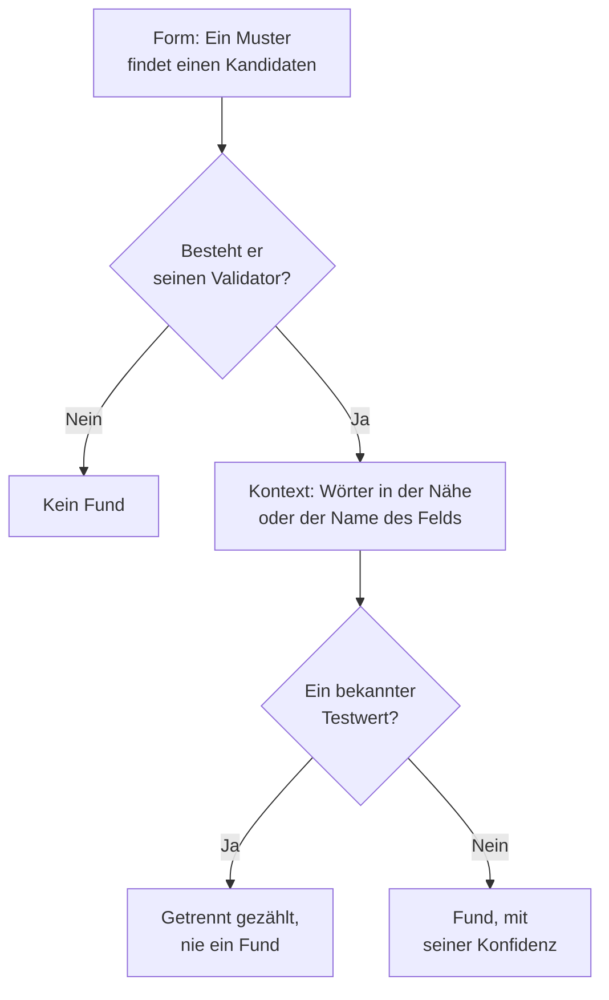

# Sensible Datentypen

Datensicherheit kennt 143 Arten sensibler Daten: Kartennummern, Bankkonten, nationale Ausweisnummern aus 43 Ländern, Gesundheitskennungen, API-Schlüssel und Tokens sowie die besonderen Kategorien personenbezogener Daten. Jede hat eine Kategorie, eine Sensibilität und, wenn sie zu einem Land gehört, dieses Land. Diese Seite sagt, wie ein Wert gefunden wird, und führt jeden Datentyp auf, damit Sie erkennen, warum etwas gefunden wurde, und entscheiden können, was Sie dagegen tun.

:::cards
- [Wie ein Wert gefunden wird](#wie-ein-wert-gefunden-wird): Form, Validator, Kontext, Testwerte, Konfidenz.
- [Felder und Spalten](#felder-und-spalten): Wie eine ganze Spalte oder ein ganzes Attribut beurteilt wird.
- [Jeder Datentyp](#integrierte-datentypen): Alle 143, nach Kategorie.
- [Ihre eigenen Datentypen](#ihre-eigenen-datentypen): Personalnummern, Policennummern und das Feld Testen.
:::

## Wie ein Wert gefunden wird

Jeder Scan - einer Logzeile, einer CSV-Zelle, einer Datenbankzeile, der ersten Bytes eines Objekts - durchläuft dieselben Schritte:

1. **Form.** Jeder Datentyp hat Muster, die Kandidaten finden: sechzehn Ziffern, `AKIA` und sechzehn Buchstaben, ein Wort, ein `@` und eine Domain. Ein Muster passt nie innerhalb eines längeren Tokens, sodass eine Kartennummer nicht in einer längeren Ziffernfolge gefunden wird.
2. **Validator.** Ein Kandidat muss die eigenen Regeln seines Typs bestehen: eine Prüfsumme (Luhn für Karten, Mod 97 für IBANs, Verhoeff für Aadhaar-Nummern, die Prüfziffer der meisten nationalen Ausweisnummern), ein echtes Datum, ein bekanntes Präfix, genug Zufälligkeit für ein Geheimnis. Ein Kandidat, der durchfällt, ist überhaupt kein Fund. Platzhalter wie `000000000` und `123456789` fallen bei jedem numerischen Typ durch.
3. **Kontext.** Wörter in der Nähe eines Kandidaten - standardmäßig bis zu 64 Zeichen davor und 32 danach -, die sagen, was er ist, heben seine Konfidenz um eine Stufe, und ebenso ein Feld, dessen Name auf den Typ hinweist. Wörter, die sagen, dass er etwas anderes ist, etwa eine Bestell- oder Sendungsnummer, senken sie um eine Stufe. Eine Nummer ohne Prüfsumme und mit gängiger Form, etwa eine Passnummer oder ein Bankkonto, zählt nur neben Wörtern, die sie benennen.
4. **Bekannte Testwerte.** Veröffentlichte Testkartennummern (etwa `4242 4242 4242 4242` von Stripe), Beispiel-IBANs, Adressen unter `example.com` und anderen reservierten Domains, IP-Adressen für Dokumentation, die Beispiel-IDs, die Behördendokumentation abdruckt, Testmodus-Schlüssel wie `sk_test_` und Platzhalterschlüssel werden getrennt gezählt. Sie ergeben nie einen Fund, sodass ein Datenspeicher voller solcher Werte als Testumgebung gilt, nicht als Datenleck.
5. **Konfidenz.** Was übrig bleibt, ist ein Fund, so sicher, wie seine Belege es erlauben.

| Konfidenz | Was sie bedeutet |
| --- | --- |
| **Hoch** | Der Wert hat seinen Validator bestanden, und Wörter um ihn herum oder das Feld, in dem er steht, sagen, was er ist - oder, bei einem Feld, die meisten seiner Werte sind von diesem Typ. |
| **Mittel** | Der Wert hat seinen Validator bestanden, ohne dass etwas um ihn herum ihn bestätigt, oder der Name des Felds sagt, was es enthält, und einige Werte stimmen damit überein. |
| **Niedrig** | Die Form passt, aber nichts bestätigt sie. |

Nur Funde mit Konfidenz Hoch oder Mittel zählen: Sie machen einen Datenspeicher sensibel und können ein Problem eröffnen. Funde mit Konfidenz Niedrig werden am Datenspeicher aufgeführt, eingeklappt, damit ein Mensch sie beurteilt.

Beanspruchen zwei Datentypen dieselben Zeichen, gewinnt der sicherere Fund: die höhere Konfidenz, dann der Detektor, dessen eigene Regeln mehr beweisen, dann der längere Treffer.

Ein langer Wert wird in Fenstern von 64 KB gelesen, die sich um 4 KB überlappen, sodass ein Wert ganz gefunden wird, wo immer er steht, und von einem Wert werden höchstens 4 MB gelesen.

## Felder und Spalten

Eine Spalte, ein JSON-Feld oder ein Log-Attribut wird als Ganzes beurteilt. Sein Name deutet auf einen Datentyp hin, und seine Stichprobenwerte beweisen einen. Der Anteil seiner Werte, die den Typ enthalten, entscheidet, wie sicher der Fund ist:

| Werte, die den Typ enthalten | Konfidenz |
| --- | --- |
| 60 % oder mehr | Hoch |
| 25 % oder mehr | Hoch, wenn der Name des Felds auf den Typ hinweist, sonst Mittel |
| Weniger | Mittel, wenn der Name des Felds auf den Typ hinweist, sonst Niedrig: ein paar E-Mails in einer Spalte mit etwas anderem |

Ein Feld, dessen Werte im Schnitt länger als 80 Zeichen sind, ist Freitext - Notizen, Nachrichten, Beschreibungen - und soll keinen einzelnen Typ enthalten. Seine Funde behalten die Konfidenz, die jeder Treffer für sich erzielt hat, und sagen, dass sie in Freitext gefunden wurden. Bis zu 1.000 Werte eines Felds werden klassifiziert, und von jedem bis zu 16 KB.

Der Name eines Felds wird in Wörter zerlegt - `customerEmail`, `customer_email` und `customer-email` sind alle „customer email“ - und der Namenshinweis eines Typs passt, wenn seine Wörter in dieser Reihenfolge direkt nebeneinander vorkommen: „date of birth“ passt auf `customer_date_of_birth`, nicht auf `birth_city`. Nur der letzte Teil eines Pfads mit Punkten ist der eigene Name des Felds, zusammen mit dem Teil davor, wenn der letzte ein allgemeines Wort wie `number`, `id` oder `value` ist: `customer.address.city` ist keine Straßenadresse, und `card.number` ist trotzdem eine Kartennummer.

Manche Datentypen lassen sich nicht an ihren Werten erkennen: Kein Muster unterscheidet den Namen einer Person von einer Straße oder eine Religion von irgendeinem anderen Wort. Diese werden allein anhand des Feldnamens gefunden, wenn das Feld Werte hat: Personenname, Benutzername, Geschlecht, Staatsangehörigkeit, Gesundheitsinformationen, Rassische oder ethnische Herkunft, Religiöse Überzeugung, Sexuelle Orientierung, Politische Meinung, Gewerkschaftszugehörigkeit, Biometrische Daten, Genetische Daten und Vorstrafen. Ein Name, ein Benutzername, ein Geschlecht oder eine Staatsangehörigkeit ist dann Hoch, wenn 60 % oder mehr der Werte danach aussehen, und sonst Mittel.

Ein Feld, dessen Name sagt, dass es ein Passwort enthält - `password`, `passwordHash`, `pwd`, nicht `password_changed_at` -, sollte einen Hash enthalten: bcrypt, argon2, scrypt, PBKDF2 oder ein anderes Verfahren, das ein Datenspeicher wahrscheinlich nutzt. Leere Werte, Platzhalter wie `********` und verschlüsselte Werte werden beiseitegelegt. Sind vom Rest mehr Werte keine Hashes als Hashes, enthält das Feld die Passwörter selbst, die kein Muster sehen kann, und der Datenspeicher besteht [Passwörter werden im Klartext gespeichert](/docs/data-security/checks-and-issues#datenhygiene) nicht.

## Sensibilität

| Sensibilität | Was sie bedeutet |
| --- | --- |
| **Eingeschränkt** | Schaden folgt, wenn sie abfließen: Geheimnisse, Kartennummern, Gesundheitsakten, amtliche Kennnummern. |
| **Vertraulich** | Personenbezogene Daten und als vertraulich gekennzeichnete Dokumente. |
| **Intern** | Die eigenen Daten des Unternehmens, nicht für Außenstehende bestimmt. |
| **Öffentlich** | Es wurde nichts Sensibles gefunden. |

Ein Datenspeicher ist so sensibel wie der sensibelste Datentyp, der darin mit mindestens mittlerer Konfidenz gefunden wurde. Testwerte und als nicht sensibel markierte Funde zählen nicht, und ein Datenspeicher, in dem nichts gefunden wurde, ist Öffentlich. Um einen Datenspeicher als sensibler oder weniger sensibel zu behandeln, als seine Funde sagen, setzen Sie seine Sensibilität selbst in den **Einstellungen** des Datenspeichers: Die Prüfungen verwenden dann diese.

## Kategorien

| Kategorie | Was sie abdeckt | Personenbezogene Daten |
| --- | --- | --- |
| Geheimnisse und Zugangsdaten | Passwörter, API-Schlüssel, Tokens und private Schlüssel, die andere Systeme öffnen. | Nein |
| Finanzen | Kartennummern, Bankkonten, IBANs und Krypto-Wallets. | Ja |
| Gesundheit | Krankenaktennummern, Gesundheitskennungen, Diagnosen und Rezepte. | Ja |
| Amtliche Kennnummer | Nationale Ausweis-, Steuer-, Pass- und Sozialversicherungsnummern. | Ja |
| Besondere Kategorie | Was Artikel 9 der DSGVO am stärksten schützt: ethnische Herkunft, Religion, sexuelle Orientierung, politische Meinungen, Gewerkschaftszugehörigkeit, biometrische und genetische Daten. | Ja |
| Kontakt und Identität | Wer jemand ist und wie man die Person erreicht: E-Mail, Telefon, Adresse, Geburtsdatum, IP-Adresse. | Ja |
| Geschäftlich vertraulich | Dokumente, die als vertraulich, nur intern oder rechtlich geschützt gekennzeichnet sind. | Nein |

Personenbezogene Daten sind Daten über eine Person, im Sinne von DSGVO, CCPA, LGPD und DPDP. Ein Datenspeicher, der nur Geheimnisse und Geschäftsdokumente enthält, liegt außerhalb des Geltungsbereichs eines Datenschutz-Rahmenwerks, aber nie außerhalb eines Sicherheits-Rahmenwerks (siehe [Compliance der Datensicherheit](/docs/data-security/compliance)).

## Integrierte Datentypen

Ein Datentyp, der zu einem Land gehört, nennt es als ISO-3166-1-Code: Residenzregeln und die an ein Land gebundenen Rahmenwerke lesen ihn (siehe [Residenz](/docs/data-security/flows-access-residency#residenzregeln)). Die ID ist das, womit die API und die Funde den Typ benennen.

### Kontakt und Identität

| Datentyp | ID | Was er ist | Sensibilität | Land |
| --- | --- | --- | --- | --- |
| E-Mail-Adresse | `email-address` | Die E-Mail-Adresse einer Person. | Vertraulich | — |
| Telefonnummer | `phone-number` | Eine Telefonnummer im internationalen oder nationalen Format. | Vertraulich | — |
| Personenname | `person-name` | Vor-, Nach- oder vollständiger Name einer Person, anhand des Feldnamens gefunden. | Vertraulich | — |
| Straßenadresse | `postal-address` | Eine Straßenadresse: eine Hausnummer, ein Straßenname und ein Straßentyp. | Vertraulich | — |
| Postleitzahl | `postal-code` | Eine Postleitzahl. Schon allein grenzt sie ein, wo jemand wohnt. | Intern | — |
| Geburtsdatum | `date-of-birth` | Ein Datum neben Wörtern, die sagen, dass es das Geburtsdatum einer Person ist. | Vertraulich | — |
| IP-Adresse | `ip-address` | Eine öffentliche IPv4- oder IPv6-Adresse, die die DSGVO als personenbezogene Daten behandelt. | Vertraulich | — |
| MAC-Adresse | `mac-address` | Die Hardwareadresse einer Netzwerkkarte, die ein Gerät identifiziert. | Vertraulich | — |
| Werbe-ID | `advertising-id` | Eine mobile Werbe-ID (IDFA, GAID, AAID), die ein Gerät verfolgt. | Vertraulich | — |
| Genauer Standort | `geolocation` | Breiten- und Längengrad, genau genug, um ein Gebäude zu finden. | Vertraulich | — |
| Benutzername | `username` | Der Anmelde- oder Kontoname einer Person, anhand des Feldnamens gefunden. | Vertraulich | — |
| Geschlecht | `gender` | Das soziale oder biologische Geschlecht einer Person, anhand des Feldnamens gefunden. | Vertraulich | — |
| Staatsangehörigkeit | `nationality` | Die Nationalität oder Staatsbürgerschaft einer Person, anhand des Feldnamens gefunden. | Vertraulich | — |
| Fahrzeug-Identifizierungsnummer | `vehicle-identification-number` | Eine 17-stellige VIN mit gültiger Prüfziffer. | Vertraulich | — |

### Amtliche Kennnummer

| Datentyp | ID | Was er ist | Sensibilität | Land |
| --- | --- | --- | --- | --- |
| US-Sozialversicherungsnummer | `us-ssn` | Eine US-amerikanische Social Security Number. | Eingeschränkt | US |
| US-Steuernummer (ITIN) | `us-itin` | Eine US-amerikanische Individual Taxpayer Identification Number. | Eingeschränkt | US |
| US-Arbeitgebernummer (EIN) | `us-ein` | Eine US-amerikanische Employer Identification Number, neben Wörtern, die das sagen. | Vertraulich | US |
| US-Passnummer | `us-passport` | Eine US-Passnummer, neben Wörtern, die das sagen. | Eingeschränkt | US |
| US-Führerscheinnummer | `us-drivers-license` | Eine US-Führerscheinnummer, neben Wörtern, die das sagen. | Eingeschränkt | US |
| Britische National Insurance Number | `uk-nino` | Eine britische National Insurance Number. | Eingeschränkt | GB |
| Britische Passnummer | `uk-passport` | Eine britische Passnummer, neben Wörtern, die das sagen. | Eingeschränkt | GB |
| Britische Führerscheinnummer | `uk-driving-licence` | Eine 16-stellige britische Führerscheinnummer. | Eingeschränkt | GB |
| Kanadische Social Insurance Number | `ca-sin` | Eine kanadische Social Insurance Number mit gültiger Prüfziffer. | Eingeschränkt | CA |
| Mexikanische CURP | `mx-curp` | Eine mexikanische Clave Única de Registro de Población. | Eingeschränkt | MX |
| Mexikanische RFC | `mx-rfc` | Eine mexikanische Steuernummer, Registro Federal de Contribuyentes. | Eingeschränkt | MX |
| Brasilianische CPF | `br-cpf` | Eine brasilianische Nummer des Cadastro de Pessoas Físicas. | Eingeschränkt | BR |
| Brasilianische CNPJ | `br-cnpj` | Eine brasilianische Unternehmensregisternummer (CNPJ). | Vertraulich | BR |
| Argentinische CUIT / CUIL | `ar-cuit` | Ein argentinischer Steuer- oder Arbeits-Identifikationscode. | Eingeschränkt | AR |
| Chilenische RUT | `cl-rut` | Ein chilenischer Rol Único Tributario mit gültiger Prüfziffer. | Eingeschränkt | CL |
| Spanische DNI | `es-dni` | Eine spanische Personalausweisnummer mit ihrem Prüfbuchstaben. | Eingeschränkt | ES |
| Spanische NIE | `es-nie` | Eine spanische Ausländer-Identifikationsnummer mit ihrem Prüfbuchstaben. | Eingeschränkt | ES |
| Portugiesische NIF | `pt-nif` | Eine portugiesische Steuer-Identifikationsnummer. | Eingeschränkt | PT |
| Französische Sozialversicherungsnummer (NIR) | `fr-nir` | Eine französische INSEE-Nummer mit ihrem zweistelligen Schlüssel. | Eingeschränkt | FR |
| Deutsche Steuer-ID | `de-tax-id` | Eine deutsche Steuerliche Identifikationsnummer. | Eingeschränkt | DE |
| Italienischer Codice fiscale | `it-codice-fiscale` | Ein italienischer Codice fiscale mit gültigem Prüfzeichen. | Eingeschränkt | IT |
| Niederländische BSN | `nl-bsn` | Eine niederländische Bürgerservicenummer, die den Elfertest besteht. | Eingeschränkt | NL |
| Belgische Nationalregisternummer | `be-national-number` | Eine belgische Nationalregisternummer. | Eingeschränkt | BE |
| Polnische PESEL | `pl-pesel` | Eine polnische nationale Identifikationsnummer. | Eingeschränkt | PL |
| Schwedische Personennummer | `se-personnummer` | Eine schwedische personnummer mit gültiger Prüfziffer. | Eingeschränkt | SE |
| Norwegische nationale Identitätsnummer | `no-fodselsnummer` | Eine norwegische fødselsnummer mit beiden Prüfziffern. | Eingeschränkt | NO |
| Dänische CPR-Nummer | `dk-cpr` | Eine dänische Personenregisternummer, neben Wörtern, die das sagen. | Eingeschränkt | DK |
| Finnischer persönlicher Identitätscode | `fi-hetu` | Eine finnische henkilötunnus mit ihrem Prüfzeichen. | Eingeschränkt | FI |
| Irische PPS-Nummer | `ie-ppsn` | Eine irische Personal Public Service Number. | Eingeschränkt | IE |
| Schweizer AHV-Nummer | `ch-ahv` | Eine Schweizer Sozialversicherungsnummer (AHV / AVS). | Eingeschränkt | CH |
| Rumänische CNP | `ro-cnp` | Ein rumänischer persönlicher Zahlencode. | Eingeschränkt | RO |
| Bulgarische EGN | `bg-egn` | Eine bulgarische einheitliche Bürgernummer. | Eingeschränkt | BG |
| Kroatische OIB | `hr-oib` | Eine kroatische persönliche Identifikationsnummer. | Eingeschränkt | HR |
| Griechische AMKA | `gr-amka` | Eine griechische Sozialversicherungsnummer. | Eingeschränkt | GR |
| Türkische Identitätsnummer | `tr-tckn` | Eine türkische T.C.-Kimlik-Nummer. | Eingeschränkt | TR |
| Israelische Identitätsnummer | `il-teudat-zehut` | Eine israelische Teudat-Zehut-Nummer. | Eingeschränkt | IL |
| Südafrikanische ID-Nummer | `za-id` | Eine südafrikanische Identitätsnummer mit gültigem Datum und gültiger Prüfziffer. | Eingeschränkt | ZA |
| Emirates ID der VAE | `ae-emirates-id` | Eine Personalausweisnummer der Vereinigten Arabischen Emirate. | Eingeschränkt | AE |
| Saudische nationale ID | `sa-national-id` | Eine saudische nationale ID- oder Iqama-Nummer. | Eingeschränkt | SA |
| Indische Aadhaar-Nummer | `in-aadhaar` | Eine 12-stellige Aadhaar-Nummer, die die Verhoeff-Prüfung besteht. | Eingeschränkt | IN |
| Indische PAN | `in-pan` | Eine indische Permanent Account Number. | Eingeschränkt | IN |
| Chinesische Personalausweisnummer | `cn-resident-id` | Eine 18-stellige Nummer eines chinesischen Personalausweises. | Eingeschränkt | CN |
| Japanische My Number | `jp-my-number` | Eine japanische Individualnummer mit gültiger Prüfziffer. | Eingeschränkt | JP |
| Südkoreanische Einwohnerregistrierungsnummer | `kr-rrn` | Eine koreanische Einwohnerregistrierungsnummer. | Eingeschränkt | KR |
| Singapurische NRIC / FIN | `sg-nric` | Eine Personalausweisnummer oder ausländische Identifikationsnummer aus Singapur. | Eingeschränkt | SG |
| Hongkonger Ausweisnummer | `hk-hkid` | Eine Hongkonger Personalausweisnummer mit ihrer Prüfziffer. | Eingeschränkt | HK |
| Taiwanische nationale ID | `tw-national-id` | Eine taiwanische nationale Identifikationsnummer. | Eingeschränkt | TW |
| Thailändische nationale ID | `th-national-id` | Eine thailändische Bürger-Identifikationsnummer. | Eingeschränkt | TH |
| Malaysische MyKad-Nummer | `my-mykad` | Eine malaysische Personalausweisnummer. | Eingeschränkt | MY |
| Indonesische NIK | `id-nik` | Eine indonesische Bevölkerungs-Identitätsnummer. | Eingeschränkt | ID |
| Australische Tax File Number | `au-tfn` | Eine australische Tax File Number mit gültiger Prüfung. | Eingeschränkt | AU |
| Neuseeländische IRD-Nummer | `nz-ird` | Eine neuseeländische Inland-Revenue-Nummer mit gültiger Prüfziffer. | Eingeschränkt | NZ |
| Russische SNILS | `ru-snils` | Eine russische Versicherungskontonummer mit ihrer Prüfnummer. | Eingeschränkt | RU |
| Russische INN | `ru-inn` | Eine russische Steuer-Identifikationsnummer. | Eingeschränkt | RU |
| Passnummer | `passport-number` | Eine Passnummer aus einem beliebigen Land, neben Wörtern, die das sagen. | Eingeschränkt | — |

### Finanzen

| Datentyp | ID | Was er ist | Sensibilität | Land |
| --- | --- | --- | --- | --- |
| Kartennummer | `credit-card-number` | Eine Zahlungskartennummer, die die Luhn-Prüfung besteht und zu einer Kartenmarke gehört. | Eingeschränkt | — |
| Kartenprüfnummer | `card-verification-code` | Ein CVV oder CVC, den PCI DSS nach der Autorisierung einer Zahlung nicht mehr aufzubewahren erlaubt. | Eingeschränkt | — |
| Ablaufdatum der Karte | `card-expiration-date` | Das Ablaufdatum einer Karte, neben Wörtern, die das sagen. | Vertraulich | — |
| IBAN | `iban` | Eine internationale Bankkontonummer, die die Mod-97-Prüfung besteht. | Eingeschränkt | — |
| Bankkontonummer | `bank-account-number` | Eine Bankkontonummer, neben Wörtern, die das sagen. | Eingeschränkt | — |
| SWIFT- / BIC-Code | `swift-bic` | Der SWIFT- oder BIC-Code einer Bank, neben Wörtern, die das sagen. | Intern | — |
| US-Bankleitzahl (Routing Number) | `us-bank-routing-number` | Eine ABA-Routing-Number mit gültiger Prüfsumme, neben Wörtern, die das sagen. | Intern | US |
| Britischer Sort Code | `uk-sort-code` | Ein britischer Sort Code einer Bank, neben Wörtern, die das sagen. | Intern | GB |
| Indischer IFSC | `in-ifsc` | Ein Indian Financial System Code, der eine Bankfiliale benennt. | Intern | IN |
| Australische BSB | `au-bsb` | Eine australische Bank-State-Branch-Nummer, neben Wörtern, die das sagen. | Intern | AU |
| Bitcoin-Adresse | `bitcoin-address` | Eine Bitcoin-Adresse mit gültiger Prüfsumme. | Vertraulich | — |
| Ethereum-Adresse | `ethereum-address` | Eine Ethereum-Adresse, neben Wörtern, die das sagen. | Vertraulich | — |

### Gesundheit

| Datentyp | ID | Was er ist | Sensibilität | Land |
| --- | --- | --- | --- | --- |
| Britische NHS-Nummer | `uk-nhs-number` | Eine Nummer des britischen National Health Service mit gültiger Prüfziffer. | Eingeschränkt | GB |
| US-Medicare-Versicherten-ID | `us-medicare-mbi` | Ein US-amerikanischer Medicare Beneficiary Identifier. | Eingeschränkt | US |
| Australische Medicare-Nummer | `au-medicare-number` | Eine australische Medicare-Kartennummer mit gültiger Prüfziffer. | Eingeschränkt | AU |
| Deutsche Krankenversichertennummer | `de-health-insurance-number` | Eine deutsche Krankenversichertennummer mit gültiger Prüfziffer. | Eingeschränkt | DE |
| Krankenaktennummer | `medical-record-number` | Die Krankenaktennummer eines Patienten, neben Wörtern, die das sagen. | Eingeschränkt | — |
| Mitgliedsnummer der Krankenversicherung | `health-plan-id` | Eine Mitglieds- oder Policennummer einer Krankenversicherung, neben Wörtern, die das sagen. | Eingeschränkt | — |
| Diagnoseschlüssel (ICD-10) | `diagnosis-code` | Ein ICD-10-Diagnoseschlüssel, neben Wörtern, die das sagen. | Eingeschränkt | — |
| Arzneimittelcode (NDC) | `drug-code` | Ein US-amerikanischer National Drug Code, neben Wörtern, die das sagen. | Vertraulich | — |
| US-DEA-Nummer | `us-dea-number` | Die Drug-Enforcement-Administration-Nummer einer verschreibenden Person, mit gültiger Prüfziffer. | Vertraulich | US |
| US-Leistungserbringer-ID (NPI) | `us-npi` | Ein National Provider Identifier. Er benennt einen Leistungserbringer, nicht einen Patienten. | Intern | US |
| Gesundheitsinformationen | `health-information` | Diagnosen, Erkrankungen, Medikamente und andere Gesundheitsangaben, anhand des Feldnamens gefunden. | Eingeschränkt | — |

### Geheimnisse und Zugangsdaten

| Datentyp | ID | Was er ist | Sensibilität | Land |
| --- | --- | --- | --- | --- |
| AWS-Zugriffsschlüssel-ID | `aws-access-key-id` | Die öffentliche Hälfte eines AWS-Zugriffsschlüssels. Mit seinem Geheimnis signiert sie AWS-Anfragen. | Eingeschränkt | — |
| Geheimer AWS-Zugriffsschlüssel | `aws-secret-access-key` | Die geheime Hälfte eines AWS-Zugriffsschlüssels, neben Wörtern, die das sagen. | Eingeschränkt | — |
| Google-API-Schlüssel | `google-api-key` | Ein API-Schlüssel für Google Cloud oder Maps. | Eingeschränkt | — |
| Google-Dienstkontoschlüssel | `google-service-account-key` | Eine Schlüsseldatei eines Google-Cloud-Dienstkontos mit ihrem privaten Schlüssel. | Eingeschränkt | — |
| Google-OAuth-Clientgeheimnis | `google-oauth-client-secret` | Ein Google-OAuth-Clientgeheimnis. | Eingeschränkt | — |
| Azure-Speicherkontoschlüssel | `azure-storage-account-key` | Ein Azure-Speicherkontoschlüssel oder eine Verbindungszeichenfolge, die einen enthält. | Eingeschränkt | — |
| Azure-SAS-Token | `azure-sas-token` | Eine Azure Shared Access Signature, die Zugriff ohne Anmeldung gewährt. | Eingeschränkt | — |
| Azure-Clientgeheimnis | `azure-client-secret` | Ein Clientgeheimnis einer Anwendung in Microsoft Entra ID. | Eingeschränkt | — |
| GitHub-Token | `github-token` | Ein GitHub-Token: Personal Access, OAuth, App oder fein abgestuft. | Eingeschränkt | — |
| GitLab-Token | `gitlab-token` | Ein GitLab Personal Access Token. | Eingeschränkt | — |
| Slack-Token | `slack-token` | Ein Slack-Token für Bot, Benutzer oder App. | Eingeschränkt | — |
| Slack-Webhook-URL | `slack-webhook-url` | Ein eingehender Slack-Webhook, über den jeder in einem Kanal posten kann. | Eingeschränkt | — |
| Geheimer Stripe-Schlüssel | `stripe-secret-key` | Ein geheimer oder eingeschränkter Live-Schlüssel von Stripe, der Geld bewegen kann. | Eingeschränkt | — |
| Twilio-API-Schlüssel | `twilio-api-key` | Eine Twilio-API-Schlüssel-SID mit Geheimnis. | Eingeschränkt | — |
| SendGrid-API-Schlüssel | `sendgrid-api-key` | Ein SendGrid-API-Schlüssel. | Eingeschränkt | — |
| Mailgun-API-Schlüssel | `mailgun-api-key` | Ein Mailgun-API-Schlüssel. | Eingeschränkt | — |
| Mailchimp-API-Schlüssel | `mailchimp-api-key` | Ein Mailchimp-API-Schlüssel. | Eingeschränkt | — |
| OpenAI-API-Schlüssel | `openai-api-key` | Ein OpenAI-API-Schlüssel, der das Guthaben des Kontos verbraucht. | Eingeschränkt | — |
| Anthropic-API-Schlüssel | `anthropic-api-key` | Ein Anthropic-API-Schlüssel. | Eingeschränkt | — |
| Hugging-Face-Token | `huggingface-token` | Ein Hugging-Face-Token. | Eingeschränkt | — |
| npm-Token | `npm-token` | Ein npm-Zugriffstoken, das Pakete veröffentlichen kann. | Eingeschränkt | — |
| PyPI-Token | `pypi-token` | Ein PyPI-Upload-Token. | Eingeschränkt | — |
| Docker-Hub-Token | `docker-hub-token` | Ein Docker Hub Personal Access Token. | Eingeschränkt | — |
| Shopify-Token | `shopify-token` | Ein Shopify-Zugriffs- oder App-Token. | Eingeschränkt | — |
| Square-Token | `square-token` | Ein Square-Zugriffstoken oder -Geheimnis. | Eingeschränkt | — |
| Braintree-Zugriffstoken | `braintree-access-token` | Ein Braintree-Zugriffstoken für die Produktion. | Eingeschränkt | — |
| DigitalOcean-Token | `digitalocean-token` | Ein DigitalOcean Personal Access Token. | Eingeschränkt | — |
| New-Relic-API-Schlüssel | `new-relic-api-key` | Ein User-API-Schlüssel von New Relic. | Eingeschränkt | — |
| Datadog-API-Schlüssel | `datadog-api-key` | Ein Datadog-API- oder Anwendungsschlüssel, neben Wörtern, die das sagen. | Eingeschränkt | — |
| HashiCorp-Vault-Token | `vault-token` | Ein Service-Token von HashiCorp Vault. | Eingeschränkt | — |
| Terraform-Cloud-Token | `terraform-cloud-token` | Ein API-Token von Terraform Cloud oder Enterprise. | Eingeschränkt | — |
| Atlassian-API-Token | `atlassian-api-token` | Ein Atlassian-API-Token. | Eingeschränkt | — |
| Linear-API-Schlüssel | `linear-api-key` | Ein Linear-API-Schlüssel. | Eingeschränkt | — |
| JSON Web Token | `json-web-token` | Ein signiertes JWT, oft ein Sitzungs- oder Zugriffstoken. | Eingeschränkt | — |
| Privater Schlüssel | `private-key` | Ein privater Schlüsselblock im PEM-, OpenSSH- oder PGP-Format. | Eingeschränkt | — |
| Passwort in einer URL | `password-in-url` | Eine URL, die einen Benutzernamen und ein Passwort enthält, etwa eine Datenbank-Verbindungszeichenfolge. | Eingeschränkt | — |
| Passwort in einer Verbindungszeichenfolge | `connection-string-password` | Ein Wert Password= oder Pwd= in einer Verbindungszeichenfolge. | Eingeschränkt | — |
| Authorization-Header | `authorization-header` | Basic- oder Bearer-Anmeldedaten, kopiert aus einem HTTP-Authorization-Header. | Eingeschränkt | — |
| Passwort oder Geheimnis | `generic-secret` | Ein Wert, der einem Passwort, Geheimnis, API-Schlüssel oder Token zugewiesen ist und zufällig genug aussieht, um echt zu sein. | Eingeschränkt | — |
| Privater Bitcoin-Schlüssel | `bitcoin-private-key` | Ein privater Bitcoin-Schlüssel im Wallet Import Format, mit gültiger Prüfsumme. | Eingeschränkt | — |

### Besondere Kategorie

| Datentyp | ID | Was er ist | Sensibilität | Land |
| --- | --- | --- | --- | --- |
| Rassische oder ethnische Herkunft | `racial-or-ethnic-origin` | Rasse oder ethnische Herkunft, anhand des Feldnamens gefunden. | Eingeschränkt | — |
| Religiöse Überzeugung | `religious-belief` | Religion oder Weltanschauung, anhand des Feldnamens gefunden. | Eingeschränkt | — |
| Sexuelle Orientierung | `sexual-orientation` | Sexuelle Orientierung, anhand des Feldnamens gefunden. | Eingeschränkt | — |
| Politische Meinung | `political-opinion` | Politische Meinungen oder Parteimitgliedschaft, anhand des Feldnamens gefunden. | Eingeschränkt | — |
| Gewerkschaftszugehörigkeit | `trade-union-membership` | Gewerkschaftszugehörigkeit, anhand des Feldnamens gefunden. | Eingeschränkt | — |
| Biometrische Daten | `biometric-data` | Fingerabdrücke, Gesichtsvorlagen, Stimmabdrücke und andere biometrische Merkmale, anhand des Feldnamens gefunden. | Eingeschränkt | — |
| Genetische Daten | `genetic-data` | DNA- und Genomdaten, anhand des Feldnamens gefunden. | Eingeschränkt | — |
| Vorstrafen | `criminal-record` | Strafrechtliche Verurteilungen und Straftaten (Artikel 10 DSGVO), anhand des Feldnamens gefunden. | Eingeschränkt | — |

### Geschäftlich vertraulich

| Datentyp | ID | Was er ist | Sensibilität | Land |
| --- | --- | --- | --- | --- |
| Rechtlich geschütztes Dokument | `privileged-document` | Ein Dokument, das als dem Anwaltsgeheimnis unterliegend oder rechtlich geschützt gekennzeichnet ist. | Eingeschränkt | — |
| Als vertraulich gekennzeichnetes Dokument | `confidential-document` | Ein Dokument, das als vertraulich, streng vertraulich oder Geschäftsgeheimnis gekennzeichnet ist. | Vertraulich | — |
| Als intern gekennzeichnetes Dokument | `internal-document` | Ein Dokument, das als nur für den internen Gebrauch oder nicht zur Weitergabe gekennzeichnet ist. | Intern | — |

## Ihre eigenen Datentypen

Fügen Sie einen Datentyp für das hinzu, was nur Ihr Unternehmen hat: eine Personalnummer, eine Policennummer, einen Projektcode. Öffnen Sie **Datensicherheit → Einstellungen → Datentypen** und fügen Sie ihn unter **Ihre Datentypen** hinzu. Er wird genau wie die integrierten gescannt, in Buckets, Datenbanken und Telemetrie, ab dem nächsten Scan.

:::steps
### Sagen, was er ist

Füllen Sie **Name** aus, etwa mit Personalnummer, und wählen Sie eine **Kategorie** und eine **Empfindlichkeit**: wie sensibel ein Datenspeicher ist, der ihn enthält. Eine **Beschreibung** sagt, was er ist, für alle, die einen Fund davon lesen.

### Sagen, wie er gefunden wird

Geben Sie ein **Muster** ein: einen regulären JavaScript-Ausdruck für einen Wert, etwa `EMP-\d{6}`. Fügen Sie die **Feldnamen** hinzu, die ihn enthalten, etwa `employee id`, und die **Schlüsselwörter**, die in der Nähe eines Werts bestätigen, dass er von diesem Typ ist. Lassen Sie das Muster leer, um den Typ allein anhand von Feldnamen zu finden.

### Ihn testen

Fügen Sie Beispieltext in **Testen** ein, um zu sehen, was Ihr Datentyp darin findet. Es führt den eigenen Code des Scanners auf dem Text aus, in Ihrem Browser: Der Text wird nie an OneUptime gesendet, und nur seine ersten 64 KB werden getestet.
:::

Unter **Weitere Felder** lässt **Groß-/Kleinschreibung ignorieren** das Muster unabhängig von der Groß- und Kleinschreibung seiner Buchstaben passen, **Erfordert ein Schlüsselwort** zählt einen Wert nur, wenn ein Schlüsselwort in seiner Nähe steht oder der Name des Felds sagt, dass er von diesem Typ ist, und **Prüfsumme** verlangt, dass ein Wert eine Prüfung besteht: **Keine**, **Luhn** (die Prüfziffer, die Kartennummern tragen), **Mod97** (die Prüfziffern einer IBAN) oder **Verhoeff** (die Prüfziffer einer Aadhaar-Nummer).

Ein Muster wird beim Speichern geprüft: Es muss kompilieren, darf auf keinen leeren Text passen und muss in einer Zeit laufen, die linear mit dem Text wächst. Es wird von einem Matcher ausgeführt, der nie zurückspringt (kein Backtracking), sodass kein Muster einen Scan aufhalten kann, egal wie es geschrieben ist. Ein Typ nimmt höchstens 50 Schlüsselwörter und 50 Feldnamen.

Ein Wert Ihres Typs ist für sich allein Mittel und mit einem Schlüsselwort in der Nähe Hoch, wenn er eine Prüfsumme besteht, und für sich allein Niedrig und mit einem Schlüsselwort Mittel, wenn er keine hat. In einer Spalte entscheidet der Anteil der passenden Werte, wie bei jedem Typ.

## Nicht sensibel und nie sensibel

Ein Scan kann etwas finden, das nicht ist, wonach es aussieht: eine Spalte mit Bestellnummern, die die Luhn-Prüfung bestehen, Ihre eigene Support-Adresse in jeder Logzeile. Sagen Sie es OneUptime, und es hört auf zu zählen:

- **Den Fund als nicht sensibel markieren.** Wählen Sie auf der Seite **Inhalt** des Datenspeichers am Fund **Als nicht sensibel markieren** und geben Sie an, warum. Er zählt nicht mehr für die Sensibilität des Datenspeichers oder seine Prüfungen, und der Datenspeicher wird sofort erneut geprüft. Der Fund bleibt markiert und mit Ihrem Grund am Datenspeicher, sodass die nächste Person sieht, was entschieden wurde.
- **Den Wert zu Nie sensibel hinzufügen**, in den Einstellungen der Datensicherheit, für einen Wert, der nirgends je ein Fund ist, etwa `support@yourcompany.com`. Werte werden verglichen, nachdem der Scanner sie normalisiert hat, ohne Beachtung der Groß- und Kleinschreibung.
- **Einen integrierten Datentyp ausschalten.** Unter **Integrierte Datentypen**, auf **Datensicherheit → Einstellungen → Datentypen**, hat jeder Datentyp einen Schalter, der speichert, sobald er umgelegt wird. Kein Scan des Projekts sucht nach einem Typ, der aus ist.

## Nächste Schritte

:::cards
- [Prüfungen und Probleme der Datensicherheit](/docs/data-security/checks-and-issues): Was die Sensibilität eines Datenspeichers an seinen Problemen ändert.
- [Sensible Daten in der Telemetrie](/docs/data-security/telemetry): Die Datentypen, die in Ihren Logs, Traces und Prompts gefunden werden.
- [Compliance der Datensicherheit](/docs/data-security/compliance): Die Rahmenwerke, die jeder Datentyp in den Geltungsbereich bringt.
:::
