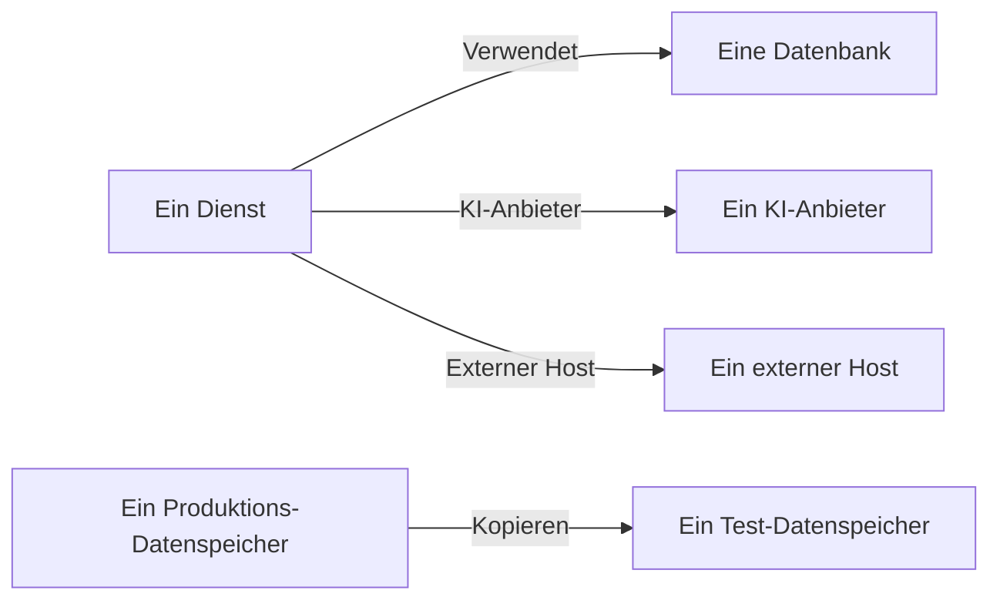

# Datenflüsse, Zugriff und Residenz

Zu wissen, was ein Datenspeicher enthält, ist nur die halbe Antwort. Datensicherheit ermittelt außerdem, wohin diese Daten gelangen - welche Dienste den Datenspeicher nutzen, welche KI-Anbieter und externen Hosts die Daten erreichen und wohin sie kopiert wurden -, wer jeden Datenspeicher erreichen kann und ob er in den Regionen liegt, in denen er liegen darf. All das stammt aus Belegen, die OneUptime bereits hat: Ihren Traces, den eigenen Zugriffseinstellungen Ihrer Cloud und Fingerabdrücken dessen, was die Scans gefunden haben.

:::cards
- [Datenflüsse](#datenflüsse): Dienste, KI-Anbieter, externe Hosts und Kopien.
- [Wer einen Datenspeicher erreichen kann](#wer-einen-datenspeicher-erreichen-kann): Jede Berechtigung, die Ihre Cloud meldet, und wie exponiert der Datenspeicher ist.
- [Residenzregeln](#residenzregeln): Die Regionen, in denen jede Art von Daten liegen darf.
:::

## Datenflüsse

| Datenfluss | Was er bedeutet | Woher er stammt |
| --- | --- | --- |
| **Verwendet** | Ein Dienst spricht mit einem Datenspeicher. | Die Dienstkarte, die OneUptime alle zehn Minuten aus den Client-Spans Ihrer Dienste ermittelt. Jede Datenbank darauf wird über Name, Adresse oder Endpunkt mit ihrem Datenspeicher verknüpft, sodass eine Datenbank, die keine andere Quelle aufführt, zu einem eigenen Datenspeicher wird. |
| **KI-Anbieter** | Ein Dienst sendet Daten an einen KI-Anbieter. | Die KI-Aufrufe in den Traces des Dienstes aus den letzten 7 Tagen, die den Anbieter nennen, den sie erreichen. |
| **Externer Host** | Ein Dienst ruft einen Host außerhalb Ihrer Systeme auf. | Die entfernten Dienste der Dienstkarte, nach der Adresse, unter der sie aufgerufen werden. |
| **Kopieren** | Ein Datenspeicher enthält Werte eines anderen. | Fingerabdrücke der Werte, die jeder Scan gefunden hat: Zwei Datenspeicher teilen Daten, wenn sich ihre Fingerabdrücke eines Datentyps zur Hälfte oder mehr überschneiden. |

Ein Datenfluss trägt die Datentypen, die seine Quelle enthält, und deren Sensibilität. Ein Datenfluss ist bestätigt, wenn ein Scan bewiesen hat, dass die Daten da sind, nicht nur, dass es einen Weg zu ihnen gibt: Eine Kopie ist es immer, und ein Datenfluss zu einem KI-Anbieter ist es, wenn die KI-Unterhaltungen des Dienstes vertrauliche oder eingeschränkte Daten enthalten. Ein Datenfluss, der 30 Tage lang nicht wieder gesehen wird, wird entfernt.

Zwei Prüfungen lesen die Datenflüsse. [Produktionsdaten wurden in einen Nicht-Produktions-Datenspeicher kopiert](/docs/data-security/checks-and-issues#datenhygiene) schlägt am Ziel einer Kopie fehl. Eine Kopie verläuft vom Produktions-Datenspeicher aus, wenn nur einer der beiden in Produktion ist, und sonst von dem Datenspeicher, den OneUptime zuerst gefunden hat. [Sensible Daten werden an einen KI-Anbieter gesendet](/docs/data-security/checks-and-issues#ki) schlägt an den KI-Unterhaltungen eines Dienstes fehl, wenn sie sensible Daten enthalten, und nennt die Anbieter, die sie erreicht haben.

### Wie Fingerabdrücke privat bleiben

Eine Kopie wird gefunden, ohne die Werte eines der beiden Datenspeicher zu kennen. Für jeden Datentyp, den ein Scan mit hoher Konfidenz findet, skizziert er die gelesenen Werte als MinHash: 128 Slots, jeder das Minimum einer Hashfunktion über die Werte, von dem nur die unteren 16 Bit behalten werden. Zwei Skizzen stimmen in etwa so vielen Slots überein, wie sich ihre beiden Wertemengen überschneiden, sodass der Vergleich von Skizzen schätzt, wie viel von einem Datenspeicher im anderen steckt.

- **Die Werte werden mit einem eigenen Schlüssel des Projekts gehasht** (HMAC-SHA256), sodass niemand ohne den Schlüssel einen bekannten Wert gegen eine Skizze testen kann und sich die Skizzen zweier Projekte nie vergleichen lassen.
- **Nur 16 Bit jedes Minimums verlassen den Scan.** Kein Wert und kein Hash eines Werts lässt sich aus einer Skizze zurücklesen.
- **Eine Skizze gilt einem Datentyp, nicht einem Feld.** Ein Datenspeicher hat eine für jeden Datentyp, der darin mit hoher Konfidenz gefunden wurde, und nichts weiter.

## Wer einen Datenspeicher erreichen kann

Das Lesen der Konfiguration macht aus den eigenen Zugriffseinstellungen jeder Cloud - Bucket-Richtlinien und ACLs, Azure-Rollenzuweisungen, IAM-Bindungen von Google Cloud, Snapshot-Freigaben - eine einzige Liste, wer den Datenspeicher erreichen kann, auf seiner Seite **Wer ihn erreichen kann**:

| Spalte | Was sie sagt |
| --- | --- |
| **Prinzipal** | Wer oder was Zugriff hat, so wie die Cloud es nennt: `*`, eine Konto-ID, ein ARN, eine E-Mail-Adresse, ein Dienstkonto. |
| **Prinzipaltyp** | Öffentlich, Konto, Rolle, Benutzer, Gruppe, Dienstprinzipal, Dienstkonto oder Dienst. |
| **Zugriffsebene** | Lesen, Schreiben oder Administrator. |
| **Gewährt über** | Was ihn gewährt: eine Bucket-Richtlinie, eine ACL, eine Rollenzuweisung, eine IAM-Bindung oder eine Snapshot-Freigabe. |
| **Extern** | Der Prinzipal liegt außerhalb der Konten, Abonnements und Projekte, die mit OneUptime verbunden sind. |
| **Öffentlich** | Der Prinzipal ist jeder im Internet. |

Die Liste wird bei jedem Lesen der Konfiguration neu gelesen, und eine Berechtigung, die die Cloud nicht mehr meldet, wird entfernt. [Mehr als 25 Identitäten können eingeschränkte Daten lesen](/docs/data-security/checks-and-issues#zugriff) zählt die Leser darauf. Die Dienste, die einen Datenspeicher nutzen, sind seine Datenflüsse vom Typ **Verwendet**.

Aus dem, was es liest, erhält jeder Datenspeicher eine Exponierung:

| Exponierung | Was sie bedeutet |
| --- | --- |
| **Öffentlich** | Jeder im Internet kann ihn lesen. |
| **Andere Konten** | Konten außerhalb Ihrer verbundenen Konten können ihn erreichen. |
| **Aus dem Internet erreichbar** | Sein Netzwerkendpunkt nimmt Verbindungen aus dem Internet an. |
| **Privat** | Nur Ihre eigenen Konten und Netzwerke erreichen ihn. |
| **Unbekannt** | OneUptime konnte nicht genug von seiner Konfiguration lesen, um es zu sagen. |

Öffentlich schlägt geteilt, und geteilt schlägt erreichbar: Ein öffentlicher Bucket, der auch mit einem anderen Konto geteilt ist, ist Öffentlich. Die Exponierung erhöht den [Risikowert](/docs/data-security/checks-and-issues#risikowert) eines Problems.

## Residenzregeln

Eine Residenzregel legt fest, wo eine Art von Daten liegen darf. Fügen Sie eine unter **Datensicherheit → Einstellungen → Residenzregeln** hinzu:

| Feld | Was es tut |
| --- | --- |
| **Name** | Was die Regel ist, etwa: Personenbezogene Daten aus der EU bleiben in der EU. |
| **Erlaubte Regionen** | Die Regionen, in denen diese Daten gespeichert und in die sie kopiert werden dürfen, so geschrieben, wie Ihre Cloud sie nennt. Eine Regel ohne Regionen prüft nichts. |
| **Datenkategorien** | Die Kategorien von Daten, die sie abdeckt. Leer deckt jede Art personenbezogener Daten ab. |
| **Daten über Personen in** | Nur Daten über Personen in diesen Ländern, als ISO-3166-1-Codes wie `DE` oder `IN`. Leer deckt Daten über Personen überall ab. |
| **Beschreibung** | Wofür die Regel da ist, etwa: Die Daten unserer EU-Kunden werden nur in der EU gespeichert. |
| **Aktiviert** | Ob Datenspeicher gegen die Regel geprüft werden. |

Ein Datenspeicher verstößt gegen eine Regel, wenn er Daten enthält, die die Regel abdeckt, und seine eigene Region oder eine Region, in die seine Daten kopiert werden, auf keine der erlaubten Regionen passt. Kopien sind die Regionen, in die die Daten eines Datenspeichers repliziert werden: S3-Replikation, die georedundante Kopie eines Speicherkontos, die Replikate einer Datenbank. Am Datenspeicher schlägt dann [Daten werden außerhalb der Regionen gespeichert, in denen sie liegen dürfen](/docs/data-security/checks-and-issues#residenz) fehl, mit der Region und der Regel, gegen die er verstoßen hat.

### Regionen und Platzhalter

Ein `*` in einer erlaubten Region steht für beliebige Zeichen, Groß- und Kleinschreibung spielen keine Rolle, und das Muster muss auf die ganze Region passen:

| Erlaubte Region | Passt auf | Passt nicht auf |
| --- | --- | --- |
| `eu-*` (AWS) | `eu-west-1`, `eu-central-1` | `us-east-1`, `us-eu-1` |
| `europe-*` (Google Cloud) | `europe-west1`, `europe-north1` | `us-central1` |
| `westeurope` (Azure) | `westeurope` | `northeurope` |

Führen Sie ein Muster für jede Cloud auf, die Sie nutzen: `eu-*`, `europe-*`, `westeurope` und `northeurope` halten Daten zusammen in allen drei Clouds in Europa.

### Wessen Daten ein Datenspeicher enthält

OneUptime liest aus den Daten selbst ab, wessen Daten ein Datenspeicher enthält. Ein Datentyp, der zu einem Land gehört, sagt, dass seine Personen in diesem Land sind: Eine deutsche Steuer-ID sagt `DE`, eine indische Aadhaar-Nummer `IN`, eine britische NHS-Nummer `GB`. Der Datenspeicher führt diese Länder als Länder seiner betroffenen Personen auf, und eine Regel, die auf Personen in bestimmten Ländern beschränkt ist, deckt nur die Datenspeicher ab, die deren Daten enthalten. [Sensible Datentypen](/docs/data-security/data-types#integrierte-datentypen) nennt das Land jedes Datentyps, der eines hat.

## Nächste Schritte

:::cards
- [Prüfungen und Probleme der Datensicherheit](/docs/data-security/checks-and-issues): Jede Prüfung, die diese Datenflüsse, Berechtigungen und Regeln speisen.
- [Compliance der Datensicherheit](/docs/data-security/compliance): Wie Residenz und Zugriff für GDPR, LGPD und DPDP zählen.
- [Topologie](/docs/telemetry/topology): Die Dienstkarte, aus der die Datenflüsse stammen.
:::
