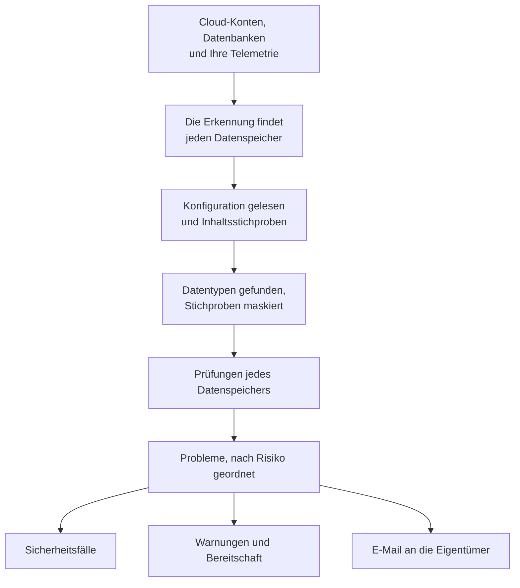

# Datensicherheit

Datensicherheit findet die sensiblen Daten, die Ihr Unternehmen aufbewahrt - in Cloud-Buckets, Datenbanken und Warehouses und in der Telemetrie, die Sie an OneUptime senden - und sagt Ihnen, was daran nicht stimmt, wie sie aufbewahrt werden. Sie findet die Datenspeicher selbst, liest, wie jeder eingerichtet ist, nimmt Stichproben von dem, was er enthält, und eröffnet für jeden Mangel ein Problem, nach Risiko geordnet.

Sie beantwortet vier Fragen:

:::cards
- [Wo sind unsere sensiblen Daten?](/docs/data-security/data-types): 143 Datentypen, von Kartennummern und nationalen Ausweisnummern bis zu API-Schlüsseln, gefunden in Buckets, Tabellen und Telemetrie.
- [Sind sie exponiert?](/docs/data-security/checks-and-issues): 32 Prüfungen jedes Datenspeichers: öffentlicher Zugriff, Verschlüsselung, Backups, Protokollierung, Geheimnisse und Kopien.
- [Wer kann sie erreichen, und wohin gelangen sie?](/docs/data-security/flows-access-residency): Wer jeden Datenspeicher lesen kann, welche Dienste ihn nutzen und welche KI-Anbieter und Hosts seine Daten erreichen.
- [Entsprechen sie unseren Regeln?](/docs/data-security/compliance): Residenzregeln und neun Compliance-Rahmenwerke, bewertet anhand dessen, was die Scans gefunden haben.
:::

## So funktioniert es

1. Die **Erkennung** findet die Datenspeicher, die OneUptime bereits kennt: Ihr Cloud-Inventar, die Datenbanken, die das Produkt Database überwacht, die Datenbanken, mit denen Ihre Dienste laut Dienstkarte sprechen, und die Telemetrie jedes Dienstes. Einen Datenspeicher fügen Sie nur dann von Hand hinzu, wenn keine Quelle ihn aufführt.
2. **Das Lesen der Konfiguration** fragt jede Cloud, wie jeder Datenspeicher eingerichtet ist: wer ihn erreichen kann und wie er verschlüsselt, gesichert und protokolliert wird. Es liest Einstellungen, nie Daten.
3. **Inhaltsstichproben** lesen ein wenig von dem, was ein Datenspeicher enthält, wo Sie es erlauben: einige Objekte jeder Art in einem Bucket, einige Zeilen jeder Tabelle, die neuesten Datensätze der Telemetrie jedes Dienstes.
4. Die **Klassifizierung** findet sensible Werte in den Stichproben und behält Zählungen und maskierte Stichproben, nie einen Wert.
5. **Prüfungen** entscheiden, was an jedem Datenspeicher nicht stimmt und wie schlimm das für die Daten ist, die er enthält. Jede fehlschlagende Prüfung eröffnet ein Problem, das sich von selbst schließt, sobald die Prüfung besteht.

## Was sie anders macht

- **Ihre Telemetrie ist ein Datenspeicher.** Die Logs, Traces, Ausnahmen, Sitzungswiedergaben und KI-Unterhaltungen jedes Dienstes werden wie ein Bucket geprüft, jede Stunde. Eine E-Mail-Adresse in einer Logzeile ist ein Fund, und **Bereinigen** maskiert sie von da an bei der Aufnahme. Siehe [Sensible Daten in der Telemetrie](/docs/data-security/telemetry).
- **Datenflüsse stammen aus echtem Verkehr.** Die Dienstkarte sagt, welcher Dienst welche Datenbank nutzt, KI-Aufrufe nennen den Anbieter, den sie erreichen, und Kopien von Produktionsdaten werden durch den Vergleich von Fingerabdrücken gefunden. Siehe [Datenflüsse, Zugriff und Residenz](/docs/data-security/flows-access-residency).
- **Belege werden immer maskiert.** Ein Fund behält Zählungen und höchstens drei maskierte Stichproben, etwa `j***@e******.com`, maskiert im Scanner, bevor irgendetwas ihn verlässt. Schalten Sie Stichproben aus, und er behält nur Zählungen.
- **Der Scanner ist Open Source.** Muster, Prüfsumme, Kontextwörter und Testwerte jedes Datentyps stehen im Quellcode von OneUptime, sodass Sie genau nachlesen können, was einen Fund ausmacht. Derselbe Code läuft auf den Workern von OneUptime, auf einer Sonde und im Feld **Testen**.
- **Sie arbeitet mit dem Rest von OneUptime zusammen.** Ein kritisches Problem eröffnet einen Sicherheitsfall zum Datenspeicher, sodass [Security Operations](/docs/telemetry/security-cases) ihn wie jede andere Bedrohung bearbeitet. Sie kann eine Warnung auslösen, die alarmiert, wer gerade Bereitschaft hat, und sie schickt den Eigentümern des Datenspeichers eine E-Mail. Siehe [Integrationen der Datensicherheit](/docs/data-security/integrations).
- **OneUptime AI hilft beim Beheben.** **Mit KI erklären** sagt dem Eigentümer eines Datenspeichers, was nicht stimmt und wie er es in seiner Cloud behebt, und **Mit KI beheben** öffnet einen Pull Request in Ihrem Infrastrukturcode.

## Bevor Sie beginnen

- **Eine Rolle, die sie einrichten darf.** Project Owners, Project Admins und Security Admins ändern die Einstellungen der Datensicherheit. Security Members bearbeiten Probleme und scannen Datenspeicher, und Security Viewers lesen, was sie gefunden hat. Andere Rollen sehen nichts davon, sofern ihr Team nicht die entsprechenden Berechtigungen erhält: Welche Buckets Kartennummern enthalten, ist genau das, was ein Angreifer wissen will. Siehe [Rollen](/docs/permissions/reference#rollen).
- **Ein Cloud-Konto zum Lesen oder eine Datenbank.** Datensicherheit liest ein Cloud-Konto über eine [Cloud-Verbindung](/docs/telemetry/cloud-accounts) und eine Datenbank, die Sie betreiben, über eine schreibgeschützte Verbindungszeichenfolge. Telemetrie braucht nichts: Sie wird jede Stunde gescannt.

## Schnellstart

:::steps
### Ein Cloud-Konto verbinden

Öffnen Sie **Cloud → Verbinden** und wählen Sie Ihre Cloud. Ist das Konto bereits verbunden, wählen Sie stattdessen **Bearbeiten** an seiner Verbindung. [Ein Cloud-Konto verbinden](/docs/telemetry/cloud-accounts) führt durch jede Cloud.

### Die Stufe der Datensicherheit wählen

Setzen Sie unter **Weitere Felder** die Option **Datensicherheit** auf **Nur Konfiguration**, um zu prüfen, wie jeder Datenspeicher eingerichtet ist, oder auf **Konfiguration und Inhaltsstichproben**, um auch die sensiblen Daten darin zu finden. Der Befehl, den das Formular zeigt, ändert sich mit Ihrer Wahl: Führen Sie ihn in der Shell Ihrer Cloud aus, wie das Formular es sagt. [Datensicherheit einrichten](/docs/data-security/setup) listet genau auf, was jede Stufe gewährt, und [Ein Cloud-Konto verbinden](/docs/telemetry/cloud-accounts#datensicherheit) zeigt den Befehl jeder Stufe.

### Die Probleme durchsehen

Öffnen Sie **Datensicherheit**. Datenspeicher erscheinen unter **Datenspeicher**, sobald die Erkennung sie findet, alle 15 Minuten, und die Konfiguration einer Verbindung wird innerhalb einer Stunde gelesen. Probleme öffnen sich unter **Probleme**, sobald ein Lesen oder ein Scan abgeschlossen ist, jedes mit seinem Risikowert, und die **Übersicht** zeigt die fünf riskantesten. Jedes Problem sagt, was nicht stimmt, warum es wichtig ist und wie es sich beheben lässt, mit den Befehlen für Ihre Cloud.
:::

## Was als Datenspeicher zählt

| Wo | Datenspeicher | Inhaltsstichproben |
| --- | --- | --- |
| AWS | AWS S3 Bucket, AWS RDS Instance, AWS Aurora Cluster, AWS RDS Snapshot, AWS DynamoDB Table, AWS Redshift Cluster, AWS DocumentDB Cluster, AWS OpenSearch Domain, AWS ElastiCache Cluster, AWS EFS File System | AWS S3 Bucket |
| Azure | Azure Storage Account, Azure SQL Database, Azure Cosmos DB Account, Azure PostgreSQL Server, Azure MySQL Server | Azure Storage Account |
| Google Cloud | Google Cloud Storage Bucket, Google Cloud SQL Instance, Google BigQuery Dataset, Google Firestore Database, Google Spanner Instance, Google Bigtable Instance | Google Cloud Storage Bucket, Google BigQuery Dataset |
| Datenbanken, die Sie betreiben | PostgreSQL, MySQL, MongoDB, SQL Server, Oracle, Redis, Elasticsearch | PostgreSQL, MySQL |
| OneUptime | Protokolle, Traces, Ausnahmen, Sitzungswiedergaben, KI-Unterhaltungen | Protokolle, Traces, Ausnahmen, Sitzungswiedergaben, KI-Unterhaltungen |

Jeder Datenspeicher erhält die Prüfungen, die für seine Art gelten. Ein Datenspeicher, von dessen Inhalt sich keine Stichproben nehmen lassen, wird trotzdem geprüft: Ein öffentlicher Bucket oder eine unverschlüsselte Datenbank ist ein Problem, egal was darin liegt.

Ein Datenspeicher wird mit seinem Verlauf archiviert, sobald seine Quelle ihn nicht mehr aufführt, und seine offenen Probleme werden behoben: **Archivierte Datenspeicher**, am Ende des Menüs der Datensicherheit, bewahrt ihn auf. Er kehrt von selbst zurück, wenn seine Quelle ihn wieder aufführt, und ein Problem, dessen Prüfung noch fehlschlägt, öffnet sich erneut.

Die **Zeitachse** eines Datenspeichers sagt, was mit ihm geschah und wer es getan hat: wann er gefunden oder hinzugefügt wurde, jede Änderung seiner Einstellungen und Eigentümer, wann er archiviert wurde oder zurückkam, und jede Exponierung, die über ein Problem oder ein Playbook geschlossen wurde.

## Wie oft sie läuft

| Was | Wann |
| --- | --- |
| Neue Datenspeicher finden | Alle 15 Minuten |
| Die Konfiguration einer Cloud-Verbindung lesen | Einmal am Tag, und innerhalb einer Stunde, nachdem CloudTrail eine Änderung an Zugriff, Verschlüsselung, Backups oder Freigabe eines AWS-Datenspeichers aufgezeichnet hat |
| Stichproben vom Inhalt eines Datenspeichers nehmen | Alle 24 Stunden, oder so oft, wie **Scan-Intervall (Stunden)** angibt |
| Stichproben von der Telemetrie jedes Dienstes nehmen | Jede Stunde, aus der jeweils letzten Stunde |
| Jeden Datenspeicher erneut prüfen | Nach jedem Lesen und jedem Scan, nachdem Sie etwas ändern, wovon eine Prüfung abhängt, und einmal am Tag |

**Jetzt scannen** an einem Datenspeicher nimmt sofort Stichproben seines Inhalts, und **Jetzt prüfen** liest seine Konfiguration erneut.

## Nächste Schritte

:::cards
- [Datensicherheit einrichten](/docs/data-security/setup): Die drei Stufen, die Berechtigungen, die jede gewährt, und das Scannen Ihrer eigenen Datenbanken.
- [Sensible Datentypen](/docs/data-security/data-types): Wie ein Wert gefunden wird, und jeder Datentyp, den Datensicherheit kennt.
- [Prüfungen und Probleme der Datensicherheit](/docs/data-security/checks-and-issues): Jede Prüfung, der Risikowert und was mit einem Problem geschieht.
- [Integrationen der Datensicherheit](/docs/data-security/integrations): Sicherheitsfälle, Warnungen, Eigentümer, Workflows und OneUptime AI.
:::
