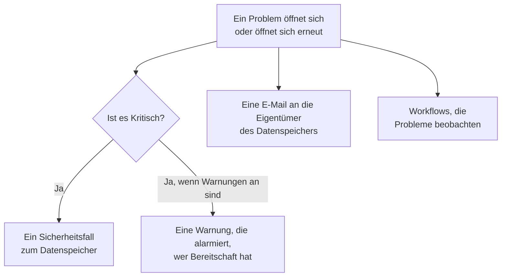

# Integrationen der Datensicherheit

Datensicherheit betreibt keinen eigenen Pager und keine eigene Sicherheitswarteschlange. Sie übergibt, was sie findet, an die Teile von OneUptime, die das bereits tun: Ein kritisches Problem wird zu einem Sicherheitsfall, es kann alarmieren, wer gerade Bereitschaft hat, und jedes neue Problem wird per E-Mail an die Eigentümer des Datenspeichers geschickt. Workflows, OneUptime AI, die API, Terraform und der MCP-Server erreichen alles, was sie aufbewahrt.

:::cards
- [Security Operations](#security-operations): Ein Sicherheitsfall für jeden Datenspeicher mit einem kritischen Problem.
- [Warnungen und Bereitschaft](#warnungen-und-bereitschaft): Alarmieren, wer gerade Bereitschaft hat, wenn sich ein kritisches Problem öffnet.
- [Eigentümer](#eigentümer): Wem jeder Datenspeicher gehört, von Hand oder per Regel festgelegt, und die E-Mail, die die Eigentümer erhalten.
- [OneUptime AI](#oneuptime-ai): Ein Problem erklären, einen Pull Request öffnen, der es behebt, oder „KI fragen“ nach Ihren Daten fragen.
- [Eine Exponierung schließen](#eine-exponierung-schließen): Öffentlichen Zugriff sperren oder eine Freigabe beenden, aus einem Problem oder einem Playbook.
:::

## So funktioniert es

Jede davon läuft, wenn eine Auswertung ein Problem eröffnet oder erneut öffnet. Jede arbeitet nach bestem Bemühen: Das Problem ist bereits offen und steht auf seiner Zeitachse, also wird eine fehlgeschlagene Integration protokolliert und übersprungen, nie erneut versucht, sodass kein zweiter Fall und keine zweite Alarmierung entsteht. Was jede getan hat, wird in die **Zeitachse** des Problems geschrieben.

| Einstellung | Standard | Was sie tut |
| --- | --- | --- |
| **Sicherheitsfälle eröffnen** | An | Ein kritisches Problem eröffnet einen Sicherheitsfall, gruppiert nach Datenspeicher. |
| **Warnungen auslösen** | Aus | Ein kritisches Problem löst eine Warnung aus, die alarmiert, wer gerade Bereitschaft hat. |
| **Warnungsschweregrad** | Leer | Der Schweregrad dieser Warnungen. Leer ist der höchste des Projekts. |
| **Eigentümer benachrichtigen** | An | Jedes neue Problem wird per E-Mail an die Eigentümer seines Datenspeichers geschickt. |

## Security Operations

Jeder Datenspeicher ist in Security Operations eine eigene Entität vom Typ **Datenspeicher**. Ist **Sicherheitsfälle eröffnen** eingeschaltet, wird ein kritisches Problem als Erkennung zum Datenspeicher an Security Operations gesendet:

- ihre Quelle ist **Datensicherheit**, und ihre Regel ist nach der Prüfung benannt, etwa `Data Security: public-read`;
- sie ist Kritisch, sodass der Fall, den sie eröffnet, die kritische Priorität des Projekts erhält;
- sie wird nach Datenspeicher gruppiert: Ein zweites kritisches Problem am selben Datenspeicher kommt zum offenen Fall dazu, statt einen weiteren zu eröffnen.

Von da an wird der Fall wie jeder andere bearbeitet: zugewiesen, kommentiert, geschlossen und von den Playbooks des Projekts beantwortet. Die Erkennungen des Datenspeichers zählen zu seinem Risiko unter [Entitätsrisiko](/docs/telemetry/security-entity-risk), wie bei jeder Entität. Siehe [Sicherheitsfälle und Playbooks](/docs/telemetry/security-cases).

## Warnungen und Bereitschaft

Ist **Warnungen auslösen** eingeschaltet, löst ein kritisches Problem eine Warnung aus, benannt mit „Datensicherheit:“ sowie dem Titel und dem Datenspeicher des Problems. Die Warnung alarmiert über ihre eigenen Regeln, wer gerade Bereitschaft hat, wie jede andere Warnung (siehe [Warnungen](/docs/alerts/index) und [Bereitschaft](/docs/on-call/index)). Ein Problem hat höchstens eine offene Warnung gleichzeitig, egal wie oft es ausgewertet wird. **Warnungsschweregrad** legt den Schweregrad der Warnung fest; bleibt er leer, ist es der höchste des Projekts.

Warnungen sind standardmäßig aus, weil die meisten Teams einen Fund der Datensicherheit zuerst in einem Sicherheitsfall sehen wollen. Schalten Sie sie ein, wenn ein öffentlicher Bucket mit Kartennummern jemanden wecken soll.

## Eigentümer

Die Eigentümer eines Datenspeichers sind Personen und Teams, auf der Seite **Eigentümer** des Datenspeichers. Für sie ist ein Problem gedacht: Sie erhalten die E-Mail, und **Dieser sensible Datenspeicher hat keinen Eigentümer** schlägt an einem sensiblen Datenspeicher fehl, der keinen hat.

Ist **Eigentümer benachrichtigen** eingeschaltet, schickt jede Auswertung, die an einem Datenspeicher Probleme eröffnet, seinen Eigentümern eine E-Mail - den Personen, denen er gehört, und den Mitgliedern der Teams, denen er gehört, bis zu 50 -, betitelt mit der Zahl der neuen Probleme des Datenspeichers, etwa „Datensicherheit: 2 neue Probleme an orders-db“. Sie listet Schweregrad und Titel jedes neuen Problems und die Sensibilität des Datenspeichers auf und verlinkt den Datenspeicher. Sie enthält nie eine Stichprobe.

### Eigentümerregeln und Beschriftungsregeln

Regeln legen Eigentümer und Beschriftungen für Sie fest, sobald Datenspeicher gefunden werden:

| Regel | Wo | Was sie tut |
| --- | --- | --- |
| **Eigentümerregeln** | **Datensicherheit → Regeln → Eigentümerregeln** | Fügt jedem passenden Datenspeicher Eigentümer hinzu, Benutzer und Teams |
| **Beschriftungsregeln** | **Datensicherheit → Regeln → Beschriftungsregeln** | Fügt jedem passenden Datenspeicher Beschriftungen hinzu |

Eine Regel passt auf einen Datenspeicher über seine Beschriftungen, über ein Muster seines Namens oder seiner Beschreibung oder über **Cloud-Tag-Muster**: ein Muster, das mit jedem Cloud-Tag des Datenspeichers abgeglichen wird, geschrieben als `key=value`. `^team=payments$` passt auf jeden Datenspeicher mit dem Tag `team=payments` und `^env=` auf jeden Datenspeicher mit einem Tag `env`. Ein neuer Datenspeicher erhält die Regeln des Projekts in dem Moment, in dem er gefunden wird, und **Eigentümer benachrichtigen** einer Eigentümerregel sagt, ob die Eigentümer, die sie hinzufügt, benachrichtigt werden. [Beschriftungs- und Eigentümerregeln](/docs/configuration/label-and-owner-rules) erklärt, wie jede Regel passt und wann Regeln laufen.

## Workflows

**Datenspeicher** und **Datensicherheitsproblem** sind Workflow-Auslöser, jeweils mit **Beim Erstellen**, **Beim Aktualisieren**, **Beim Erstellen oder Aktualisieren** und **Beim Löschen**. Wählen Sie sie im Panel **Auslöser hinzufügen** unter **OneUptime-Ressourcen**.

- **Datensicherheitsproblem → Beim Erstellen** läuft, wenn sich ein Problem zum ersten Mal öffnet. Lesen Sie seinen Schweregrad in einem Block **Wenn / Sonst**, und posten Sie kritische Probleme in einen Kanal oder eröffnen Sie ein Ticket in Ihrem Tracker.
- **Datensicherheitsproblem → Beim Aktualisieren**, mit **Zu beobachtende Felder** auf seinen Status gesetzt, läuft, wenn ein Problem behoben, akzeptiert oder erneut geöffnet wird.
- **Datenspeicher → Beim Erstellen** läuft, wenn die Erkennung einen Datenspeicher findet, zum Beispiel, um ein Team über jeden neuen Bucket zu informieren.

Siehe [Workflow-Auslöser](/docs/workflows/triggers) für die Felder, die jeder Auslöser weitergibt.

## OneUptime AI

Zwei Aktionen an einem Problem bitten OneUptime AI um Hilfe. Beide senden OneUptime AI Titel und Schweregrad des Problems, Name, Art, Region und Cloud-ID des Datenspeichers, seine Sensibilität und Datentypen, den Beleg, warum die Prüfung wichtig ist, und die Behebung für die Cloud des Datenspeichers - nie die Stichproben eines Funds. Beide laufen unter den Schaltern und Grenzen des Projekts für OneUptime AI.

- **Mit KI erklären** schreibt für den Eigentümer des Datenspeichers, was nicht stimmt, was passieren könnte und die genauen Schritte, um es in seiner Cloud zu beheben. Die Erklärung wird in der **Zeitachse** des Problems aufbewahrt. Jeder, der Datensicherheit lesen darf, kann sie anfordern.
- **Mit KI beheben** bittet OneUptime AI, das Problem in Ihrem Infrastrukturcode zu beheben - Terraform, CloudFormation, Bicep oder Ähnlichem - mit der kleinsten Änderung, die die Prüfung bestehen lässt, und einen Pull Request zu öffnen. Dafür muss das Repository mit dem Infrastrukturcode des Datenspeichers unter **Code** verbunden sein: Wählen Sie es unter **Repository**, wenn das Projekt mehrere hat. Der Pull Request erscheint unter **Code** (siehe [Code](/docs/ai/ai-agent)). Security Members und höher können es anfordern.

### KI fragen

**KI fragen** liest auch Datensicherheit. Fragen Sie auf jeder Seite der Datensicherheit, welche Datenspeicher Kartennummern enthalten, was zuerst zu beheben ist oder welche Datenspeicher eine Rolle erreichen könnte, wenn sie kompromittiert würde; auf der Seite eines Datenspeichers oder eines Problems liest es zuerst diesen Datensatz. Es antwortet mit drei Lesewerkzeugen, die mit Ihren eigenen Berechtigungen laufen:

| Werkzeug | Was es liest |
| --- | --- |
| `query_data_stores` | Die Datenspeicher, die riskantesten zuerst, nach Sensibilität, Datentyp, Exponierung, Anbieter oder Name - oder ein Datenspeicher mit dem, was wo gefunden wurde, wer ihn erreichen kann, und seinen offenen Problemen |
| `query_data_security_issues` | Die Probleme, die riskantesten zuerst, nach Status, Schweregrad, Datenspeicher oder Prüfung - oder ein Problem mit seinem Beleg und der Behebung für seine Cloud |
| `query_data_store_access` | Wer einen Datenspeicher erreichen kann, oder jeder Datenspeicher, den ein Prinzipal erreichen kann |

Sie lesen Datentypen, Orte und Zählungen, nie die Stichproben eines Funds, ob maskiert oder nicht. „KI fragen“ ändert nichts in der Datensicherheit.

## Eine Exponierung schließen

Zwei Änderungen schließen die Exponierung eines Cloud-Datenspeichers, jede über die Cloud-Verbindung des Datenspeichers, an der **Datensicherheitsreaktion** eingeschaltet ist (siehe [Datensicherheit einrichten](/docs/data-security/setup#datensicherheit-eine-exponierung-schließen-lassen)):

- **Öffentlichen Zugriff sperren**, an einem S3-Bucket, einem Azure-Speicherkonto oder einem Cloud-Storage-Bucket.
- **Freigabe widerrufen**, an einem RDS-Snapshot oder an den geteilten manuellen Snapshots einer RDS-Datenbank, eines Aurora-Clusters oder eines DocumentDB-Clusters.

Eine Person führt eine davon aus einem offenen Problem aus, das sie behebt, mit **Hier beheben** (siehe [Prüfungen und Probleme der Datensicherheit](/docs/data-security/checks-and-issues#hier-beheben)). Ein Playbook von Security Operations führt sie als Schritte der Kategorie **Eindämmen** aus, **Öffentlichen Zugriff auf Datenspeicher sperren** und **Freigabe von Datenspeichern widerrufen**: an jedem Datenspeicher, um den es im Fall geht, höchstens 10, jeder ein Schritt, bei dem **Genehmigung erforderlich** zu Beginn eingeschaltet ist. Ein als **Absichtlich öffentlich** markierter Datenspeicher wird nie gesperrt. So oder so sagt die Zeitachse des Datenspeichers, was getan wurde, und der Datenspeicher wird sofort erneut geprüft, sodass das Problem behoben wird, sobald die Änderung gegriffen hat.

## API, Terraform und MCP

Alles, was Datensicherheit aufbewahrt, ist ein Datensatz der OneUptime-API, gelesen mit denselben Berechtigungen wie im Dashboard (siehe die [API-Referenz](/docs/api-reference/api-reference)):

| Datensätze | API-Pfad |
| --- | --- |
| Datenspeicher, ihre Zeitachsen, ihre Funde und wer sie erreichen kann | `/data-store`, `/data-store-feed`, `/data-store-finding`, `/data-store-access` |
| Probleme, ihre Zeitachsen und Datenflüsse | `/data-security-issue`, `/data-security-issue-feed`, `/data-security-flow` |
| Scans | `/data-security-scan` |
| Benutzerdefinierte Datentypen, Prüfungseinstellungen und Residenzregeln | `/data-security-custom-data-type`, `/data-security-check-setting`, `/data-security-residency-rule` |
| Die Einstellungen des Projekts | `/data-security-setting` |
| Eigentümer, Eigentümerregeln und Beschriftungsregeln | `/data-store-owner-user`, `/data-store-owner-team`, `/data-store-owner-rule`, `/data-store-label-rule` |

Einige Antworten werden auf Anfrage berechnet, statt gespeichert zu werden. Jede ist ein `POST`:

| Pfad | Was er tut |
| --- | --- |
| `/data-security/overview` | Die Zahlen der Übersicht: Datenspeicher nach Sensibilität und Kategorie, offene Probleme nach Schweregrad, die riskantesten Probleme und die Probleme der letzten 30 Tage |
| `/data-security/compliance` | Bewertung und Anforderungen jedes Rahmenwerks |
| `/data-security/record-of-processing` | Das GDPR-Verzeichnis von Verarbeitungstätigkeiten, eine Zeile für jeden Datenspeicher, der personenbezogene Daten enthält |
| `/data-store/<id>/scan-now` | **Jetzt scannen**: nimmt sofort Stichproben vom Inhalt des Datenspeichers |
| `/data-store/<id>/check-now` | **Jetzt prüfen**: liest die Konfiguration des Datenspeichers erneut und führt seine Prüfungen aus |
| `/data-store-finding/<id>/scrub` | **Bereinigen** an einem Telemetrie-Fund |
| `/data-security-issue/<id>/explain` | **Mit KI erklären** an einem Problem |
| `/data-security-issue/<id>/fix-with-ai` | **Mit KI beheben** an einem Problem |
| `/data-store/<id>/response-actions` | Welche Reaktionsaktionen am Datenspeicher jetzt möglich sind, und warum nicht |
| `/data-store/<id>/respond` | **Öffentlichen Zugriff sperren** oder **Freigabe widerrufen** am Datenspeicher, mit dem Problem, aus dem es ausgeführt wurde |

Der [Terraform-Provider](/docs/terraform/index) hat eine Ressource für jede Art von Datensatz, die Sie erstellen - Datenspeicher, die Sie selbst hinzufügen, benutzerdefinierte Datentypen, Prüfungseinstellungen, Residenzregeln, Eigentümer- und Beschriftungsregeln -, benannt nach dem Datensatz, etwa `oneuptime_residency_rule`.

Der [MCP-Server](/docs/ai/mcp-server) hat Tools zum Anlegen, Abrufen, Auflisten, Aktualisieren, Löschen und Zählen für diese Datensätze: Data Store, Data Store Finding, Data Store Access Entry, Data Flow, Data Security Issue, Data Security Scan, Custom Data Type, Check Setting, Residency Rule und Data Security Setting. Ein KI-Assistent kann dann mit Ihren Berechtigungen fragen, welche Datenspeicher Kartennummern enthalten oder was an einem Bucket offen ist.

## Nächste Schritte

:::cards
- [Sicherheitsfälle und Playbooks (SOAR)](/docs/telemetry/security-cases): Die Fälle bearbeiten, die Datensicherheit eröffnet.
- [Beschriftungs- und Eigentümerregeln](/docs/configuration/label-and-owner-rules): Wie Regeln passen und wann sie laufen.
- [Workflow-Auslöser](/docs/workflows/triggers): Einen Workflow ausführen, wenn sich ein Problem öffnet oder ein Datenspeicher gefunden wird.
- [Prüfungen und Probleme der Datensicherheit](/docs/data-security/checks-and-issues): Was jedes Problem bedeutet und wie Sie es beheben.
:::
