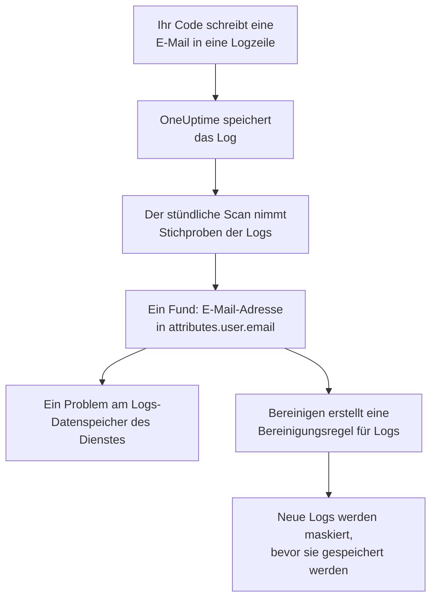

# Sensible Daten in der Telemetrie

Telemetrie enthält alles, was Ihr Code schreibt: eine E-Mail-Adresse in einer Logzeile, eine Kartennummer in einem Span-Attribut, ein Token in einem Stacktrace, die Frage eines Kunden in einem Prompt. Datensicherheit behandelt die Logs, Traces, Ausnahmen und KI-Unterhaltungen jedes Dienstes und die Sitzungen jeder RUM-Anwendung als eigene Datenspeicher. Sie nimmt jede Stunde Stichproben davon, findet darin sensible Daten wie in einem Bucket, und **Bereinigen** macht aus einem Fund eine Bereinigungsregel, die diese Daten von da an bei der Aufnahme maskiert.

Es gibt nichts einzurichten: Die Telemetrie jedes Dienstes wird jede Stunde gescannt, sofern **Telemetrie scannen** in den Einstellungen des Projekts nicht ausgeschaltet ist.

:::cards
- [Was gelesen wird](#was-gelesen-wird): Die Attribute, Bodys, Nachrichten und Prompts jedes Signals.
- [Wie ein Scan Stichproben nimmt](#wie-ein-scan-stichproben-nimmt): Die neuesten Datensätze jedes Dienstes, jede Stunde.
- [Bereinigen](#bereinigen): Einen Fund bei der Aufnahme maskieren, mit einem Klick.
- [Was als bereinigt zählt](#was-als-bereinigt-zählt): Wann eine Bereinigungsregel einen Fund bereits abdeckt.
:::

## So funktioniert es

Ein Fund, den eine Bereinigungsregel abdeckt, wird als bereinigt markiert: Was von diesen Daten übrig ist, sind alte Daten, die auf das Ende ihrer Aufbewahrung warten, kein Leck, das noch fließt. Die beiden Telemetrieprüfungen zählen nur, was keine Regel abdeckt, sodass ihr Problem behoben wird, sobald jeder Fund bereinigt ist (siehe [Telemetrieprüfungen](/docs/data-security/checks-and-issues#telemetrie)).

## Was gelesen wird

| Datenspeicher | Was gelesen wird | Worauf ein Fund verweist |
| --- | --- | --- |
| Protokolle | Jedes Attribut und der Body | `attributes.<key>`, `body` |
| Traces | Jedes Span-Attribut und die Attribute jedes Span-Ereignisses | `attributes.<key>`, `events.<event>.<key>` |
| Ausnahmen | Die Nachricht, der Stacktrace und die Attribute | `message`, `stackTrace`, `attributes.<key>` |
| KI-Unterhaltungen | Die Prompts und Antworten jedes KI-Aufrufs, unter den Schlüsseln, in die die GenAI-Konventionen sie legen, und jedes andere Attribut | Der Schlüssel, in dem sie stehen, etwa `gen_ai.input.messages` oder `gen_ai.prompt[].content` |
| Sitzungswiedergaben | Die Attribute der Spans und Logs einer RUM-Anwendung, die Attribute ihrer Sitzungen, die Merkmale, die `identify()` ihren Benutzern gegeben hat, und die Benutzerreferenz, die ihr mitgeteilt wurde | `spans.attributes.<key>`, `logs.attributes.<key>`, `sessions.attributes.<key>`, `sessions.identifiedUserTraits.<key>`, `sessions.identifiedUserLabel` |

Nummerierte Schlüssel werden zu einem Ort zusammengefasst: `gen_ai.prompt.3.content` ist `gen_ai.prompt[].content`, sodass die zwanzig Nachrichten eines Chats ein Fund sind, nicht zwanzig. Attribute, die OneUptime selbst hinzufügt und die mit `oneuptime.` beginnen, werden nicht gelesen.

### Warum die Aufzeichnung einer Wiedergabe nie gelesen wird

Die Aufzeichnung einer Sitzungswiedergabe enthält den Text der Seiten, die Menschen gesehen haben. Sie anzusehen erfordert eine eigene Berechtigung, und ein daraus gelesener Fund würde jedem, der Datensicherheit lesen darf, maskierten Seitentext zeigen. Deshalb wird eine Wiedergabe nur anhand ihrer Attribute gelesen: der Spans, Logs und Sitzungsdetails neben der Aufzeichnung. Der Rekorder maskiert bereits im Browser, was er aufzeichnet, und Bereinigungsregeln für Logs laufen auch über Aufzeichnungen (siehe [Sitzungswiedergabe](/docs/telemetry/session-replay)).

### KI-Unterhaltungen

Der Prompt eines KI-Aufrufs trägt den ganzen Chat vor der neuesten Nachricht der Person, deshalb werden bis zu 16.384 Zeichen jedes Werts eines KI-Aufrufs gelesen. Enthalten KI-Unterhaltungen sensible Daten, folgen zwei weitere Dinge: Der KI-Anbieter, an den die Aufrufe gingen, ist ein Datenfluss dieser Daten, und [Sensible Daten werden an einen KI-Anbieter gesendet](/docs/data-security/checks-and-issues#ki) schlägt am Datenspeicher fehl.

Die Unterhaltungen eines [KI-Tools des Unternehmens](/docs/telemetry/ai-company-tools) bleiben außen vor. Nur Project Owners und Project Admins dürfen sie lesen, und ein Fund landet dort, wo ihn jeder liest, der Datensicherheit lesen darf. Deshalb werden die Spans dieser Dienste nie gelesen, und ihre KI-Unterhaltungen werden als nicht gelesen gemeldet.

## Wie ein Scan Stichproben nimmt

Jede Stunde werden die neuesten Datensätze jedes Signals aus der letzten Stunde gelesen und Feld für Feld klassifiziert, wie die jedes anderen Datenspeichers (siehe [Felder und Spalten](/docs/data-security/data-types#felder-und-spalten)):

| Grenze | Wert |
| --- | --- |
| Datensätze jedes Dienstes und Signals | **Stichprobengröße der Telemetrie**, standardmäßig 500, nie mehr als 1.000 |
| Gelesene Dienste oder RUM-Anwendungen pro Signal | Die 200 aktivsten |
| Datensätze in einem Lesevorgang | 5.000, aufgeteilt auf die Dienste; 500 bei KI-Aufrufen |
| Zeichen eines Log-Bodys, einer Ausnahmenachricht oder eines Stacktraces | 8.192 |
| Zeichen eines Attributwerts | 4.096 |
| Zeichen eines Werts eines KI-Aufrufs | 16.384 |
| Attribute eines Datensatzes | 128; 64 bei einem KI-Aufruf |
| Ereignisse eines Spans und Attribute eines Ereignisses | 16 und 32 |
| Orte eines Datenspeichers | 500 |

Jeder Wert wird schon in der Datenbank gekürzt, sodass kein langer Wert sie verlässt, und jeder Lesevorgang endet nach 30 Sekunden. Ein fehlgeschlagener Lesevorgang wird zum Warnhinweis an den Datenspeichern, für die er gedacht war; der Scan macht mit dem nächsten weiter.

Um etwas auszulassen, fügen Sie es unter **Scan-Ausschlüsse** des Datenspeichers hinzu: einen vollständig benannten Ort (`attributes.http.url`), alles unterhalb eines Orts (`attributes.http`) oder einen bloß benannten Attributschlüssel (`http.url`).

## Bereinigen

**Bereinigen** an einem Fund erstellt die Bereinigungsregel, die diesen Datentyp an diesem Ort von da an verbirgt, oder verweist auf die aktivierte Regel, die das bereits tut:

:::steps
### Den Fund öffnen

Öffnen Sie den Telemetrie-Datenspeicher - zum Beispiel die **Protokolle** eines Dienstes - und den Fund.

### Auf Bereinigen klicken

Klicken Sie auf **Bereinigen**. OneUptime erstellt eine Bereinigungsregel für Logs bei Logs und den Logs einer RUM-Anwendung und eine Bereinigungsregel für Traces bei Spans, Ausnahmen und KI-Aufrufen, für den Teil des Datensatzes, in dem der Fund steht.

### Auch den Code beheben

Die Regel maskiert neue Daten, bevor sie gespeichert werden. Bereits gespeicherte Daten bleiben, bis ihre Aufbewahrung endet, also beheben Sie den Code, der sie schreibt: Der Fund nennt den Dienst und das Attribut.
:::

Die Regel wird nach dem benannt, was sie verbirgt, etwa „Data Security: Email address in attributes.user.email“, und erscheint bei Ihren anderen Bereinigungsregeln (siehe [Drop-Filter und Bereinigungsregeln](/docs/telemetry/drop-filters-and-scrub-rules#sensible-daten-bereinigen)). Es ist eine der folgenden:

| Fund | Regel, die Bereinigen erstellt |
| --- | --- |
| E-Mail-Adresse, Kartennummer, US-Sozialversicherungsnummer, Telefonnummer oder IP-Adresse | Das integrierte Muster dieses Typs. Kartennummern, Sozialversicherungsnummern und Telefonnummern werden maskiert, der Rest geschwärzt. |
| Ein Wert unter einem Schlüssel, der sensibel aussieht, etwa `password` oder `token` | Eine Regel **Sensible Attributschlüssel**, die den ganzen Wert jedes solchen Attributs schwärzt |
| Jeder andere Datentyp, den ein Muster finden kann | Eine Regel **Benutzerdefinierter Regex** aus den eigenen Mustern des Datentyps, die jeden Wert seiner Form schwärzt |

Manche Funde lassen sich durch keine Regel bereinigen, und **Bereinigen** sagt, warum:

- Ein Datentyp, der allein anhand von Feldnamen gefunden wird, etwa der Name einer Person: Kein Muster kann ihn finden. Benennen Sie das Attribut in einen Schlüssel um, den eine Regel für sensible Schlüssel verbirgt, oder senden Sie es nicht mehr.
- Ein Datentyp, der sich von anderen Werten nur durch die Wörter um ihn herum unterscheidet, etwa eine Bankleitzahl: Eine Regel würde weit mehr verbergen als diesen Datentyp.
- Eine Dokumentkennzeichnung: Das Wort zu verbergen, würde das Dokument nicht verbergen.
- Einer Ihrer eigenen Datentypen: Fügen Sie selbst eine benutzerdefinierte Bereinigungsregel mit seinem Muster hinzu.
- Die eigenen Details einer Sitzung (`sessions.*`): Die Aufnahme von Sitzungswiedergaben führt keine Bereinigungsregeln aus.

**Bereinigen** erstellt die Regel in Ihrem Namen, mit Ihren eigenen Berechtigungen: Project Owners und Project Admins können darauf klicken, ebenso ein Team, das Bereinigungsregeln für Logs erstellen darf, und für Spans, Ausnahmen und KI-Aufrufe Bereinigungsregeln für Traces.

## Was als bereinigt zählt

Ein Fund wird nur dann als bereinigt markiert, wenn die Aufnahme eine aktivierte Regel über ihn laufen ließe und die Regel seinen Datentyp finden würde:

- **Die richtigen Datensätze.** Regeln für Logs decken Logs und die Logs einer RUM-Anwendung ab. Regeln für Traces decken Spans, Ausnahmen und KI-Aufrufe ab: Eine Ausnahme ist eine Kopie des Ausnahmeereignisses ihres Spans, also bereinigen die Regeln, die Ereignisse bereinigen, auch sie.
- **Der richtige Teil.** Die Regel nennt unter **Zu bereinigende Felder** den Teil des Datensatzes, in dem der Fund steht, oder lässt sie auf ihrem Standardwert.
- **Ein Muster, das den Typ findet.** Ein integrierter **Mustertyp** findet seinen eigenen Datentyp: **E-Mail-Adresse** findet E-Mail-Adressen, **Kreditkartennummer** Kartennummern, **SSN (Sozialversicherungsnummer)** US-Sozialversicherungsnummern, **Telefonnummer** Telefonnummern und **IP-Adresse** IP-Adressen. **Sensible Attributschlüssel** deckt jeden Wert unter einem Schlüssel ab, der sensibel aussieht, egal welcher Wert es ist.
- **Ihre eigenen benutzerdefinierten Muster zählen nie.** Ein **Benutzerdefinierter Regex** deckt einen Fund nur ab, wenn er genau das Muster ist, das **Bereinigen** für dessen Typ erstellt. Ein Fund behält nur maskierte Stichproben, an denen sich kein Muster ausprobieren lässt, also könnte OneUptime nicht beweisen, dass Ihr Muster die Daten verbirgt, und ein fälschlich als bereinigt bezeichneter Fund ist ein Leck, das niemand ansieht.

Eine Regel, die ausgeschaltet ist oder nichts bereinigt, zählt nie. Die Abdeckung wird nach jedem Scan neu ermittelt, sodass eine Regel, die Sie von Hand hinzufügen oder entfernen, innerhalb einer Stunde ändert, was als bereinigt markiert ist.

## Nächste Schritte

:::cards
- [Drop-Filter und Bereinigungsregeln](/docs/telemetry/drop-filters-and-scrub-rules): Jede Option der Bereinigungsregeln und die Regeln, die Sie selbst schreiben.
- [Prüfungen und Probleme der Datensicherheit](/docs/data-security/checks-and-issues): Die beiden Telemetrieprüfungen und die KI-Prüfungen.
- [Datenflüsse, Zugriff und Residenz](/docs/data-security/flows-access-residency): Die KI-Anbieter und Hosts, an die Ihre Dienste Daten senden.
:::
