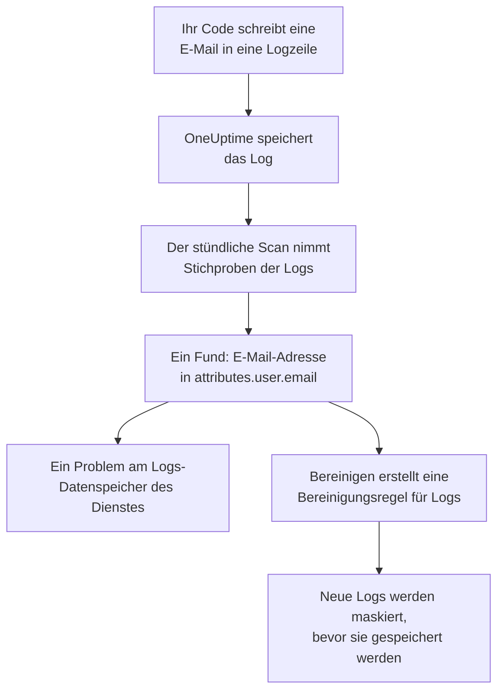

# Sensible Daten in der Telemetrie

Telemetrie enthält alles, was Ihr Code schreibt: eine E-Mail-Adresse in einer Logzeile, eine Kartennummer in einem Span-Attribut, ein Token in einem Stacktrace, die Frage eines Kunden in einem Prompt, die IP-Adresse eines Benutzers im Label einer Metrik. Datensicherheit behandelt die Logs, Traces, Metriken, Ausnahmen und KI-Unterhaltungen jedes Dienstes und die Sitzungen jeder RUM-Anwendung als eigene Datenspeicher. Sie nimmt jede Stunde Stichproben davon, findet darin sensible Daten wie in einem Bucket, und **Bereinigen** macht aus einem Fund eine Regel, die diese Daten von da an bei der Aufnahme verbirgt, in dem Dienst, in dem sie gefunden wurden.

Es gibt nichts einzurichten: Die Telemetrie jedes Dienstes wird jede Stunde gescannt, sofern **Telemetrie scannen** in den Einstellungen des Projekts nicht ausgeschaltet ist. Um die Logs, Traces oder ein anderes Signal eines Dienstes auszulassen, schalten Sie **Inhalt scannen** in den **Einstellungen** dieses Datenspeichers aus: Ab dem nächsten Scan wird nichts davon gelesen.

:::cards
- [Was gelesen wird](#was-gelesen-wird): Die Attribute, Bodys, Nachrichten und Prompts jedes Signals.
- [Wie ein Scan Stichproben nimmt](#wie-ein-scan-stichproben-nimmt): Die neuesten Datensätze jedes Dienstes, jede Stunde.
- [Bereinigen](#bereinigen): Einen Fund bei der Aufnahme verbergen, in dem Dienst, in dem er gefunden wurde.
- [Von sich aus eingedämmt](#von-sich-aus-eingedämmt): Ein Geheimnis, das verborgen wird, ohne dass jemand auf etwas klickt, wo das nachweislich sicher ist.
- [Diese Metrik verwerfen](#diese-metrik-verwerfen): Die Metriken nicht mehr speichern, deren Namen sensible Daten enthalten.
- [Was als bereinigt zählt](#was-als-bereinigt-zählt): Wann eine Bereinigungsregel einen Fund bereits abdeckt.
:::

## So funktioniert es

Ein Fund, den eine Bereinigungsregel abdeckt, wird als bereinigt markiert: Was OneUptime von diesen Daten speichert, sind alte Daten, die auf das Ende ihrer Aufbewahrung warten. Der Code schreibt sie aber weiterhin, deshalb zählen die beiden Telemetrieprüfungen den Fund als eingedämmt, nicht als behoben: Ihr Problem wird als **Bei der Aufnahme eingedämmt** abgeschlossen, sobald jeder Fund bereinigt ist, und als **Im Code korrigiert** erst, wenn die neue Version einer Code-Korrektur die Daten nicht mehr schreibt (siehe [Was mit einem Problem geschieht](/docs/data-security/checks-and-issues#was-mit-einem-problem-geschieht)).

## Was gelesen wird

| Datenspeicher | Was gelesen wird | Worauf ein Fund verweist |
| --- | --- | --- |
| Protokolle | Jedes Attribut und der Body | `attributes.<key>`, `body` |
| Traces | Jedes Span-Attribut und die Attribute jedes Span-Ereignisses | `attributes.<key>`, `events.<event>.<key>` |
| Ausnahmen | Die Nachricht, der Stacktrace und die Attribute | `message`, `stackTrace`, `attributes.<key>` |
| KI-Unterhaltungen | Die Prompts und Antworten jedes KI-Aufrufs, unter den Schlüsseln, in die die GenAI-Konventionen sie legen, und jedes andere Attribut | Der Schlüssel, in dem sie stehen, etwa `gen_ai.input.messages` oder `gen_ai.prompt[].content` |
| Sitzungswiedergaben | Die Attribute der Spans und Logs einer RUM-Anwendung, die Attribute ihrer Sitzungen, die Merkmale, die `identify()` ihren Benutzern gegeben hat, und die Benutzerreferenz, die ihr mitgeteilt wurde | `spans.attributes.<key>`, `logs.attributes.<key>`, `sessions.attributes.<key>`, `sessions.identifiedUserTraits.<key>`, `sessions.identifiedUserLabel` |
| Metriken | Jedes Attribut eines Datenpunkts, darunter die seiner Ressource, und die Namen der Metriken | `attributes.<key>`, `attributes.resource.<key>`, `name` |

Nummerierte Schlüssel werden zu einem Ort zusammengefasst: `gen_ai.prompt.3.content` ist `gen_ai.prompt[].content`, sodass die zwanzig Nachrichten eines Chats ein Fund sind, nicht zwanzig. Attribute, die OneUptime selbst hinzufügt und die mit `oneuptime.` beginnen, werden nicht gelesen.

### Metriken

Die Attribute einer Metrik sind die Labels ihrer Reihen. Sie sind an jedem Datenpunkt einer Reihe gleich, sodass eine Metrik, die tausend Punkte pro Minute schreibt, vielleicht nur drei Werte enthält, und ein Label, das die E-Mail-Adresse eines Benutzers preisgibt, eine Reihe hinzufügt, keinen Punkt. Deshalb werden von einer Metrik Stichproben nach ihren Reihen genommen, nicht nach ihren Punkten:

- **Ein Punkt jeder Serie.** Jede Metrik wird in der neuesten Minute gelesen, die sie in der letzten Stunde geschrieben hat: ein Datenpunkt von jeder von bis zu 100 Serien dieser Minute, egal wie oft die Metrik gesendet wird, sodass eine aktive Serie nie eine ruhige verdrängt. Ein Wert wird einmal klassifiziert, wie viele Serien ihn auch wiederholen, daher zählt ein Fund die unterschiedlichen Werte an seiner Stelle.
- **Neue Metriken zuerst, dann die übrigen im Wechsel.** Welche Metriken ein Dienst geschrieben hat und wann jede davon am letzten Tag zum ersten Mal geschrieben hat, ergibt sich aus der minütlichen Zusammenfassung, die die Metriktabelle führt, nie aus ihren Punkten. Jeder Scan liest die aktivsten Metriken eines Dienstes, die am ehesten viele Serien haben. Danach kommen die Metriken, die er in den letzten 2 Stunden zu schreiben begonnen hat, denn ein neues Leck kommt meist aus neuem Code, und dann die nächsten seiner übrigen Metriken, in fester Reihenfolge, ab der Stelle, an der der letzte Scan aufgehört hat. Neue Metriken nehmen höchstens die Hälfte dieser Plätze ein, sodass die übrigen ihre immer behalten.
- **Jede Metrik in einer festen Zeit.** Ein Scan gibt jedem Dienst 10 seiner Lesevorgänge, weniger, wenn das Projekt mehr als 10 Dienste hat. Die Lesevorgänge, die ein Dienst nicht braucht, weil er weniger Metriken hat, gehen einzeln an die Dienste, deren Metriken noch auf ihre Reihe warten, sodass keiner verfällt und kein Dienst weniger als seinen Anteil erhält. Die 5 aktivsten Metriken eines Dienstes belegen 5 seiner Lesevorgänge, der Rest liest seine übrigen Metriken im Wechsel: Bei einem Dienst mit M Metriken, der r Lesevorgänge im Wechsel erhält, wird jede mindestens einmal alle M ÷ r Stunden gelesen, aufgerundet. Das sind 60 Stunden bei einem Dienst mit 300 Metriken, der nur seine eigenen 5 erhält, und 11 Stunden, wenn sich zwei weitere Dienste mit 300 Metriken sein Projekt teilen, da dann jeder 28 oder 29 erhält. Solange er jede Stunde neue Metriken beginnt, ist es höchstens doppelt so lang.
- **Der eigene Bereich jeder Metrik.** Die Metriken werden gemeinsam gelesen, jede über ihren eigenen Bereich des Primärschlüssels der Tabelle. Eine Metrik, deren neueste Minute mehr als 16.384 Punkte enthält, etwa eine mit der E-Mail-Adresse jedes Benutzers als Label, wird für sich gelesen, und der Lesevorgang endet bei ihren ersten Punkten, sodass sie nicht mehr kostet als jede andere Metrik.

Ein Fund nennt das Attribut, etwa `attributes.user.email`, oder `name` für Daten im Namen einer Metrik. Seine Einträge sind die Datenpunkte, in denen er gefunden wurde: Jeder zeigt seine Metrik und den Wert des Attributs, maskiert, und öffnet in **Metriken** diese Metrik, gruppiert nach diesem Attribut. Enthält der Name einer Metrik sensible Daten, wird auch der Name maskiert, und der Eintrag öffnet stattdessen die Metriken des Dienstes.

### Warum die Aufzeichnung einer Wiedergabe nie gelesen wird

Die Aufzeichnung einer Sitzungswiedergabe enthält den Text der Seiten, die Menschen gesehen haben. Sie anzusehen erfordert eine eigene Berechtigung, und ein daraus gelesener Fund würde jedem, der Datensicherheit lesen darf, maskierten Seitentext zeigen. Deshalb wird eine Wiedergabe nur anhand ihrer Attribute gelesen: der Spans, Logs und Sitzungsdetails neben der Aufzeichnung. Der Rekorder maskiert bereits im Browser, was er aufzeichnet, und Bereinigungsregeln für Logs laufen auch über Aufzeichnungen (siehe [Sitzungswiedergabe](/docs/telemetry/session-replay)).

### KI-Unterhaltungen

Der Prompt eines KI-Aufrufs trägt den ganzen Chat vor der neuesten Nachricht der Person, deshalb werden bis zu 16.384 Zeichen jedes Werts eines KI-Aufrufs gelesen. Enthalten KI-Unterhaltungen sensible Daten, folgen zwei weitere Dinge: Der KI-Anbieter, an den die Aufrufe gingen, ist ein Datenfluss dieser Daten, und [Sensible Daten werden an einen KI-Anbieter gesendet](/docs/data-security/checks-and-issues#ki) schlägt am Datenspeicher fehl.

Die Unterhaltungen eines [KI-Tools des Unternehmens](/docs/telemetry/ai-company-tools) bleiben außen vor. Nur Projektinhaber und Projektadministratoren dürfen sie lesen, und ein Fund landet dort, wo ihn jeder liest, der Datensicherheit lesen darf. Deshalb werden die Spans dieser Dienste nie gelesen, und ihre KI-Unterhaltungen werden als nicht gelesen gemeldet.

## Wie ein Scan Stichproben nimmt

Jede Stunde werden die neuesten Datensätze jedes Signals aus der letzten Stunde gelesen und Feld für Feld klassifiziert, wie die jedes anderen Datenspeichers (siehe [Felder und Spalten](/docs/data-security/data-types#felder-und-spalten)):

| Grenze | Wert |
| --- | --- |
| Datensätze jedes Dienstes und Signals | **Stichprobengröße der Telemetrie**, standardmäßig 500, nie mehr als 1.000 |
| Gelesene Dienste oder RUM-Anwendungen pro Signal | Die 200 aktivsten |
| Datensätze in einem Lesevorgang | 5.000, aufgeteilt auf die Dienste; 500 bei KI-Aufrufen |
| Zeichen eines Log-Bodys, einer Ausnahmenachricht oder eines Stacktraces | 8.192 |
| Zeichen eines Attributwerts | 4.096 |
| Zeichen eines Werts eines KI-Aufrufs | 16.384 |
| Attribute eines Datensatzes | 128; 64 bei einem KI-Aufruf |
| Ereignisse eines Spans und Attribute eines Ereignisses | 16 und 32 |
| Orte eines Datenspeichers | 500 |
| In einem Scan gelesene Metriken | 100, aufgeteilt auf die Dienste, mindestens eine von jedem; 10 eines Dienstes, zur Hälfte seine aktivsten und zur Hälfte im Wechsel seine neuen und übrigen, und die Lesevorgänge, die ein Dienst nicht braucht, gehen im Wechsel an die anderen |
| Eine neue Metrik | Eine, deren erster Punkt der letzten 24 Stunden in den letzten 2 Stunden kam |
| Serien einer Metrik | Ein Datenpunkt von jeder, aus ihrer neuesten Minute, höchstens 100 |

Jeder Wert wird schon in der Datenbank gekürzt, sodass kein langer Wert sie verlässt, und jeder Lesevorgang endet nach 30 Sekunden. Ein fehlgeschlagener Lesevorgang wird zum Warnhinweis an den Datenspeichern, für die er gedacht war; der Scan macht mit dem nächsten weiter.

Um etwas auszulassen, fügen Sie es unter **Scan-Ausschlüsse** des Datenspeichers hinzu: einen vollständig benannten Ort (`attributes.http.url`), alles unterhalb eines Orts (`attributes.http`) oder einen bloß benannten Attributschlüssel (`http.url`).

## Bereinigen

**Bereinigen** an einem Fund erstellt die Regel, die diesen Datentyp an diesem Ort von da an verbirgt, oder verweist auf die aktivierte Regel, die das bereits tut:

:::steps
### Den Fund öffnen

Öffnen Sie das Problem - **Wo es gefunden wurde** listet jeden Fund dahinter auf - oder **Datensicherheit > In Ihrer Telemetrie**, wo **Einträge anzeigen** die Einträge, in denen ein Fund gefunden wurde, neben der Liste öffnet.

### Auf Bereinigen klicken

Klicken Sie auf **Bereinigen**. Ein Dialog sagt, was die Regel tun würde, bevor etwas erstellt wird: wessen Datensätze sie ändert, was sie mit dem Gefundenen macht und was die Werte liest, die sie verbergen würde. Klicken Sie darin auf **Bereinigen**, um die Regel zu erstellen. OneUptime erstellt eine Bereinigungsregel für Logs bei Logs und den Logs einer RUM-Anwendung, eine Bereinigungsregel für Traces bei Spans, Ausnahmen und KI-Aufrufen, für den Teil des Datensatzes, in dem der Fund steht, und eine Metrik-Pipeline-Regel beim Attribut einer Metrik.

### Auch den Code beheben

Die Regel verbirgt neue Daten, bevor sie gespeichert werden. Bereits gespeicherte Daten bleiben, bis ihre Aufbewahrung endet, also beheben Sie den Code, der sie schreibt: Der Fund nennt den Dienst und das Attribut.
:::

Die Regel wird nach dem benannt, was sie verbirgt, etwa „Data Security: Email address in log attributes of checkout“, oder „Data Security: Password or secret in db.password of checkout“ bei einer Regel, die ihr Attribut nennt, und erscheint bei Ihren anderen Bereinigungsregeln (siehe [Drop-Filter und Bereinigungsregeln](/docs/telemetry/drop-filters-and-scrub-rules#sensible-daten-bereinigen)). Es ist die engste Regel, die die Daten des Funds verbirgt, die erste der folgenden, die passt:

| Fund | Regel, die Bereinigen erstellt |
| --- | --- |
| E-Mail-Adresse, Kartennummer, US-Sozialversicherungsnummer, Telefonnummer oder IP-Adresse | Das integrierte Muster dieses Typs, maskiert. Eine IP-Adresse wird geschwärzt, oder gehasht, wo [Sicherheitsereignisse](/docs/telemetry/security-events) diese Datensätze liest, damit Sicherheitsereignisse die zu sperrende Adresse weiterhin nennen kann. |
| Jeder andere Datentyp, den ein Muster allein findet, etwa ein GitHub-Token | Eine Regel **Benutzerdefinierter Regex** aus den eigenen Mustern des Datentyps. Ein Geheimnis wird geschwärzt. |
| Einer Ihrer eigenen Datentypen, mit einem Muster | Dieses Muster, nur in dem Attribut, in dem er gefunden wurde |
| Ein Datentyp, der sich durch die Wörter um ihn herum unterscheidet, etwa eine Bankleitzahl | Seine Form, nur in dem Attribut, in dem er gefunden wurde |
| Ein Datentyp, der anhand des Feldnamens gefunden wird, etwa der Name einer Person unter `customer_name`, oder ein Wert unter einem Schlüssel, der ein Geheimnis benennt | Eine Regel **Benannte Attribute**, die den ganzen Wert dieses Attributs verbirgt |
| Ein Wert unter einem Schlüssel, der sensibel aussieht, wo nichts Engeres ihn verbirgt | Eine Regel **Sensible Attributschlüssel**, die den ganzen Wert jedes solchen Attributs schwärzt |
| Jeder Datentyp im Attribut einer Metrik | Eine Metrik-Pipeline-Regel **Attribut schwärzen** für den Dienst, die die Werte des Attributs in der Form des Datentyps durch `[REDACTED]` ersetzt, oder jeden Wert des Attributs, wenn kein Muster den Datentyp findet |

### Nachgewiesen an den Einträgen des Funds

Bevor der Dialog sagt, was die Regel tun würde, führt OneUptime jede Regel, die es erstellen könnte, auf den Einträgen aus, in denen der Fund gesehen wurde, und auf den neuesten Datensätzen seines Dienstes mit einem Wert an dieser Stelle, mit genau dem Code, den die Aufnahme ausführt, und fragt den Scanner, was übrig bleibt. Die erste Regel, die die Daten in jedem Wert verbirgt, der sie enthielt, und höchstens 5 von 100 der anderen Werte dort ändert, ist die richtige. Der Dialog sagt, auf wie vielen Datensätzen sie ausgeführt wurde, wie viele Werte die Daten enthielten und wie viele andere sie geändert hat. Ein Muster, das mehr ändern würde, wird nie angeboten: Angeboten wird stattdessen die Regel, die das Attribut nennt, mit dem, was sie sonst noch ändert.

Der Nachweis wird bei der Regel gespeichert, und die Liste der Bereinigungsregeln zeigt **Nachgewiesen** in ihrer Zeile, bis die Regel geändert wird. Ist kein Eintrag mehr übrig, auf dem eine Regel ausgeführt werden kann, etwa bei einer Ausnahme oder einer Sitzungswiedergabe, oder bei Datensätzen jenseits ihrer Aufbewahrung, wird die Regel so erstellt, wie sie geplant ist, und der Dialog sagt das.

Eine Regel für Logs oder Traces gilt für den Dienst, in dem der Fund gefunden wurde: Sie bereinigt die Logs oder Spans dieses Dienstes, und die anderer Dienste bleiben, wie sie sind, sodass sich nichts ändert, was deren Daten liest. Die Spalte **Geltungsbereich** der Liste der Bereinigungsregeln sagt, für welchen Dienst eine Regel gilt. Ein Fund in den Sitzungsaufzeichnungen einer RUM-Anwendung erstellt eine Regel für alle Dienste und Apps des Projekts, da Regeln für Logs auch Aufzeichnungen bereinigen, und der Dialog sagt das. Gibt es den Dienst nicht mehr, sagt **Bereinigen** das und erstellt keine Regel.

Der Dialog nennt, jeweils als Link, die Monitore, Dashboards mit ihren Widgets, gespeicherten Ansichten, Aufzeichnungsregeln und SLOs, die die Werte lesen, die die Regel verbergen würde, und was mit ihnen geschieht: Ein Filter auf einen verborgenen Wert trifft nicht mehr zu, und eine Gruppierung danach zeigt die echten Werte nicht mehr. Er sagt auch, was [Sicherheitsereignisse](/docs/telemetry/security-events) verlieren würden, wenn sie diese Datensätze lesen: Sind IP-Adressen verborgen, können ihre Ereignisse die zu sperrende Adresse nicht nennen. Was Sie nicht sehen können, wird gezählt, nie genannt. Der Dialog hält die Regel nie auf: Er sagt es, und Sie entscheiden. Die Formulare der Bereinigungsregeln zeigen dasselbe, bevor eine Regel gespeichert oder aktiviert wird.

Manche Funde lassen sich durch keine Regel bereinigen, und **Bereinigen** sagt, warum. Das Attribut einer Metrik lässt sich immer bereinigen, da seine Regel jeden Wert des Attributs verbergen kann:

- Ein Datentyp, der allein anhand von Feldnamen in einem Log-Body gefunden wird, etwa der Name einer Person: Keine Regel kann ihn vom Rest der Nachricht unterscheiden. Senden Sie ihn als Attribut, das eine Regel **Benannte Attribute** verbirgt, oder senden Sie ihn nicht mehr.
- Jede ausprobierte Regel hat weit mehr verborgen als die Daten: Jede wurde auf den Einträgen ausgeführt, in denen die Daten gesehen wurden, und hat zu viel anderes geändert. Senden Sie die Daten im Code, der sie schreibt, nicht mehr.
- Eine Dokumentkennzeichnung: Das Wort zu verbergen, würde das Dokument nicht verbergen.
- Die eigenen Details einer Sitzung (`sessions.*`): Die Aufnahme von Sitzungswiedergaben führt keine Bereinigungsregeln aus.
- Der Name einer Metrik (`name`): Ihn legt der Code fest, der die Metrik erstellt, und eine Pipeline-Regel kann eine Metrik nur als Ganzes umbenennen. Benennen Sie die Metrik um, und senden Sie, was in ihrem Namen variiert, stattdessen als Attribut. Bis dahin kann **Diese Metrik verwerfen** das Speichern dieser Metriken beenden.

**Bereinigen** erstellt die Regel in Ihrem Namen, mit Ihren eigenen Berechtigungen: Projektinhaber und Projektadministratoren können darauf klicken, ebenso ein Team, das Bereinigungsregeln für Logs erstellen darf, für Spans, Ausnahmen und KI-Aufrufe Bereinigungsregeln für Traces und für Metriken Metrik-Pipeline-Regeln.

## Von sich aus eingedämmt

Während OneUptime AI an Problemen der Datensicherheit arbeitet (siehe [OneUptime AI in der Datensicherheit](/docs/data-security/ai)), wird ein Telemetrieproblem eingedämmt, ohne dass jemand auf etwas klickt, wo das nachweislich sicher ist. Für jede Stelle, die das Problem zählt, plant OneUptime AI die Regel, die **Bereinigen** erstellen würde, auf dieselbe Weise nachgewiesen, und erstellt sie nur dann von sich aus, wenn all dies zutrifft:

- **Die Daten sind ein Geheimnis**, etwa ein Passwort, ein Token oder ein Schlüssel.
- **Die Regel ist nachgewiesen** an den Einträgen, in denen die Daten gesehen wurden: Sie hat die Daten in jedem Wert verborgen, der sie enthielt.
- **Sie ändert dort nichts anderes**: keinen der anderen Werte an ihrer Stelle.
- **Nichts liest, was sie verbirgt**: kein Monitor, kein Dashboard, keine gespeicherte Ansicht, keine Aufzeichnungsregel und kein SLO, und nichts, was Sicherheitsereignisse braucht.
- **Sie gilt für den Dienst**, in dem die Daten gesehen wurden.

Alles andere wird stattdessen vorgeschlagen, unter **Datensicherheit → KI** und auf der Seite des Problems, mit dem, wie die Regel nachgewiesen wurde und was liest, was sie verbergen würde: personenbezogene Daten, eine Regel, deren Werte von etwas gelesen werden, eine, die andere Werte ändert, eine, für die kein Eintrag zum Ausführen übrig war, eine für alle Dienste, die Pipeline-Regel einer Metrik und jede Stelle, deren frühere Regel eine Person rückgängig gemacht oder verworfen hat. Eine KI-Regel der Datensicherheit, die für ein Problem **Eindämmen** auf **Automatisch** setzt, lässt auch nachgewiesene personenbezogene Daten von sich aus verbergen. Keine Regel lässt eine Änderung von sich aus laufen, die nicht nachweislich sicher ist.

Wo keine der Regeln von **Bereinigen** die Daten verbergen kann, etwa bei einem Ihrer eigenen Datentypen ohne Muster, schreibt OneUptime AI eine: ein Muster für die Daten oder das Attribut, das ganz verborgen wird. OneUptime AI erfährt den Datentyp, wo er steht, die Namen der Attribute daneben und die Formen der Werte, etwa `AA-9999` für `AB-1234`, nie einen Wert, und was sie schreibt, wird wie jede andere Regel an den Einträgen nachgewiesen, bevor es vorgeschlagen oder erstellt wird.

Eine Änderung, die OneUptime AI von sich aus vorgenommen hat:

- **Steht in der Zeitachse des Problems**, mit den Regeln, die sie erstellt hat, wie jede nachgewiesen wurde, und **Rückgängig**, das sie löscht. **Datensicherheit → KI** hat dasselbe **Rückgängig**. Eine Stelle, deren Regel Sie rückgängig machen, wird nie wieder von sich aus eingedämmt: OneUptime AI schlägt sie stattdessen vor.
- **Geht per E-Mail** an die Eigentümer des Datenspeichers und an die Eigentümer des Dienstes.
- **Sagt, dass ein Geheimnis rotiert werden muss.** Ein Geheimnis zu verbergen, stoppt nur neue Kopien: Das Geheimnis funktioniert weiterhin, und die vor der Regel gespeicherten Datensätze behalten es, bis ihre Aufbewahrung endet. Die Zeitachse und die E-Mail sagen, wo es gesehen wurde.

Neue Funde in einem Dienst, dessen Problem bereits offen ist, werden auf dieselbe Weise eingedämmt, sobald der stündliche Scan sie findet.

## Diese Metrik verwerfen

Keine Regel nimmt die Daten aus dem Namen einer Metrik heraus, daher kommen sie weiter an, bis der Code behoben ist, der die Metrik benennt. **Diese Metrik verwerfen** an einem Fund im Namen einer Metrik beendet das Speichern der Metriken, deren Namen sie enthalten, auf Kosten ihrer Daten, und geschieht daher nur, wenn Sie es verlangen:

- **Die Metriken eines Dienstes.** Es erstellt eine Metrik-Pipeline-Regel **Verwerfen** für den Dienst des Funds: Jeder neue Datenpunkt einer Metrik, deren Name diesen Datentyp enthält, wird verworfen, bevor er gespeichert wird. Ihr Filter ist das Muster, das **Bereinigen** für den Typ verwendet, daher lässt sich ein Typ, den kein Muster findet, etwa der Name einer Person, nicht verwerfen, und der Dialog sagt, warum.
- **Gesagt, bevor es geschieht.** Der Dialog sagt, dass diese Datenpunkte endgültig verloren gehen, wie viele der am letzten Tag geschriebenen Metriken des Dienstes einen solchen Namen haben, was sie liest und daher keine neuen Daten mehr erhält, dass bereits Gespeichertes bleibt, bis seine Aufbewahrungsfrist endet, und wie man es rückgängig macht. Nichts wird verworfen, bevor Sie ankreuzen, dass Sie das verstehen.
- **Was sie liest, und was damit geschieht.** Der Dialog nennt, jeweils als Link, jeden Monitor, jedes Dashboard mit seinen Widgets, die diese Metriken lesen, jedes metrikbasierte SLO des Dienstes und jede Aufzeichnungsregel für Metriken, die sie liest. Monitore können nicht mehr auf deren Werte warnen, Widgets zeigen keine neuen Daten, SLOs zählen keine neuen Ereignisse daraus, und die Ausgabemetriken der Aufzeichnungsregeln enthalten sie nicht mehr. Unter jeder Aufzeichnungsregel nennt er auch, was ihre Ausgabemetrik liest, und was wiederum deren Ausgabemetriken liest, bis zu drei Ausgabemetriken die Kette hinunter. Der Link eines Widgets öffnet sein Dashboard bei diesem Widget. Was Sie nicht sehen können, wird gezählt, aber nie benannt.
- **In Ihrem Namen, nachvollziehbar.** Die Regel wird mit Ihrer eigenen Berechtigung erstellt, Metrik-Pipeline-Regeln anzulegen: Projektinhaber und Projektadministratoren können sie erstellen, ebenso ein Team, das Metrik-Pipeline-Regeln erstellen darf. Die Audit-Protokolle halten fest, wer sie erstellt hat.
- **Rückgängig durch Löschen der Regel.** Die Regel wird nach dem benannt, was sie verwirft, etwa „Data Security: drop metrics named with Email address“, und erscheint bei Ihren anderen Metrik-Pipeline-Regeln unter **Metriken → Einstellungen → Pipeline-Regeln**. Löschen Sie sie oder schalten Sie sie aus, und diese Metriken werden ab dann wieder gespeichert. Was in der Zwischenzeit verworfen wurde, kommt nicht zurück.

Der Fund wird dann als **Verworfen** markiert und zählt als bereinigt: Von diesen Daten wird nichts mehr gespeichert.

## Was als bereinigt zählt

Ein Fund wird nur dann als bereinigt markiert, wenn die Aufnahme eine aktivierte Regel über ihn laufen ließe und die Regel seinen Datentyp finden würde:

- **Die richtigen Datensätze.** Regeln für Logs decken Logs und die Logs einer RUM-Anwendung ab. Regeln für Traces decken Spans, Ausnahmen und KI-Aufrufe ab: Eine Ausnahme ist eine Kopie des Ausnahmeereignisses ihres Spans, also bereinigen die Regeln, die Ereignisse bereinigen, auch sie.
- **Der richtige Teil.** Die Regel nennt unter **Zu bereinigende Felder** den Teil des Datensatzes, in dem der Fund steht, oder lässt sie auf ihrem Standardwert.
- **Der richtige Dienst.** Eine Regel für Logs oder Traces für einen Dienst deckt nur die Funde dieses Dienstes ab. Eine Regel ohne Dienst deckt die aller Dienste ab.
- **Ein Muster, das den Typ findet.** Ein integrierter **Mustertyp** findet seinen eigenen Datentyp: **E-Mail-Adresse** findet E-Mail-Adressen, **Kreditkartennummer** Kartennummern, **SSN (Sozialversicherungsnummer)** US-Sozialversicherungsnummern, **Telefonnummer** Telefonnummern und **IP-Adresse** IP-Adressen. **Sensible Attributschlüssel** deckt jeden Wert unter einem Schlüssel ab, der sensibel aussieht, egal welcher Wert es ist.
- **Eine Regel, die an den Einträgen des Funds nachgewiesen ist.** Eine Regel, die OneUptime erstellt und an den Einträgen nachgewiesen hat, in denen ein Fund gesehen wurde, deckt diesen Fund ab, egal welches Muster sie hat, solange sie die Regel ist, die nachgewiesen wurde: Ändern Sie ihr Muster, ihre Attribute, ihre Aktion, ihre Felder oder ihren Dienst, und sie deckt ihn nicht mehr ab.
- **Eine Regel für benannte Attribute** deckt einen Fund in einem Attribut ab, das sie nennt, oder in einem darunter verschachtelten.
- **Ihre eigenen benutzerdefinierten Muster zählen sonst nie.** Ein **Benutzerdefinierter Regex**, den Sie geschrieben haben, deckt einen Fund nur ab, wenn er genau das Muster ist, das **Bereinigen** für dessen Typ erstellt. Ein Fund behält nur maskierte Stichproben, an denen sich kein Muster ausprobieren lässt, also könnte OneUptime nicht beweisen, dass Ihr Muster die Daten verbirgt, und ein fälschlich als bereinigt bezeichneter Fund ist ein Leck, das niemand ansieht.
- **Das Attribut einer Metrik.** Eine Metrik-Pipeline-Regel **Attribut schwärzen** oder **Attribut entfernen** für den Schlüssel dieses Attributs, für den Dienst des Funds oder das ganze Projekt, deckt ihn ab, wenn sie keinen Filter hat oder genau den Filter, den **Bereinigen** erstellt. Ein Filter, den Sie selbst geschrieben haben, zählt nie, aus demselben Grund.
- **Der Name einer Metrik.** Eine Metrik-Pipeline-Regel **Verwerfen** für den Dienst des Funds oder das ganze Projekt deckt ihn ab, wenn sie genau den Filter hat, den **Diese Metrik verwerfen** erstellt, oder gar keinen Filter, womit sie keine Metrik des Dienstes speichert. Eine solche Regel ohne Filter deckt jeden Fund in diesen Metriken ab.

Eine Regel, die ausgeschaltet ist oder nichts bereinigt, zählt nie. Die Abdeckung wird nach jedem Scan neu ermittelt, sodass eine Regel, die Sie von Hand hinzufügen oder entfernen, innerhalb einer Stunde ändert, was als bereinigt markiert ist.

## Nächste Schritte

:::cards
- [Drop-Filter und Bereinigungsregeln](/docs/telemetry/drop-filters-and-scrub-rules): Jede Option der Bereinigungsregeln und die Regeln, die Sie selbst schreiben.
- [Prüfungen und Probleme der Datensicherheit](/docs/data-security/checks-and-issues): Die beiden Telemetrieprüfungen und die KI-Prüfungen.
- [Datenflüsse, Zugriff und Residenz](/docs/data-security/flows-access-residency): Die KI-Anbieter und Hosts, an die Ihre Dienste Daten senden.
:::
