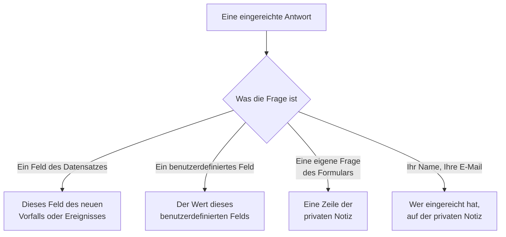

# Ein Formular erstellen

Auf der Seite **Erstellen** eines Formulars legen Sie fest, was es fragt und wie seine Seite aussieht. Die Fragen stehen links, in der Reihenfolge, in der die öffentliche Seite sie zeigt; **Frage hinzufügen** rechts listet alles, was Sie hinzufügen können. Über den Fragen liegt, eingeklappt, das [Branding](#branding) des Formulars: sein Logo und Favicon. Benannte Antwortsätze, mit denen Leute das Formular beginnen können — und von denen jeder eine Frage für seinen eigenen Fall erforderlich, optional oder ausgeblendet machen kann —, liegen auf seiner Seite **Vorlagen**: siehe [Vorlagen](#vorlagen).

:::cards
- [Der Editor](#der-editor): Fragen hinzufügen, bearbeiten, verschieben und speichern.
- [Was Sie hinzufügen können](#was-sie-hinzufügen-können): Eigene Fragen, die Felder des Datensatzes, benutzerdefinierte Felder und die einreichende Person.
- [Ausgeblendete Fragen](#ausgeblendete-fragen): Von einer Vorlage beantwortet, nie von der einreichenden Person.
- [Vorlagen](#vorlagen): Ein Formular und ein Link für jeden Fall, den Ihr Team oft meldet.
:::

## Wohin jede Antwort geht

Jede Antwort bleibt außerdem bei der Einreichung erhalten, auf der Seite **Einreichungen** des Formulars. Ein Feld, das das Formular nicht fragt oder das leer bleibt, wird aus den [Einstellungen Beim Absenden](/docs/forms/on-submit) des Formulars gefüllt.

## Der Editor

:::steps
### Eine Frage hinzufügen

Wählen Sie unter **Frage hinzufügen**, was Sie hinzufügen. Die neue Frage wird nach der ausgewählten eingefügt, oder am Ende, und ausgewählt.

### Sie an Ort und Stelle bearbeiten

Wählen Sie eine Karte aus, um sie zu bearbeiten: ihre Frage, den Hilfetext, den Antworttyp und die Optionen, ob sie erforderlich oder ausgeblendet ist, und die Schaltflächen zum Duplizieren oder Löschen. **Fertig** schließt sie.

### Sie an ihren Platz bringen

Ziehen Sie eine Karte an ihrem Griff, um sie zu verschieben, oder nutzen Sie **Nach oben** und **Nach unten** an der ausgewählten Karte — auf dem Telefon oder per Tastatur.

### Das Formular speichern

**Änderungen speichern** speichert alle Änderungen auf einmal. Bis Sie speichern, zeigt der Editor **Nicht gespeicherte Änderungen** und bietet **Änderungen verwerfen** an, und der Browser fragt nach, bevor Sie die Seite verlassen.
:::

- **Der Kopf des Formulars** zeigt seinen Namen und seine Beschreibung so, wie die öffentliche Seite es tun wird. **Name und Beschreibung bearbeiten** ändert sie.
- **Die Fragen** sind Karten. Jede zeigt die Frage so, wie Leute sie sehen werden, mit einem Abzeichen, das sagt, womit sie verknüpft ist — **Vorfall · Schweregrad**, **Benutzerdefiniertes Feld · Region**, **Einreicher · E-Mail**, oder ihr Antworttyp bei einer eigenen Frage des Formulars. Ein rotes Sternchen markiert eine erforderliche Frage, ein Abzeichen **Ausgeblendet** eine [ausgeblendete](#ausgeblendete-fragen).
- **Grenzen.** Ein Formular kann bis zu 50 Fragen haben. Wer ein Formular lesen, aber nicht bearbeiten darf, sieht den Editor schreibgeschützt.

## Branding

**Branding**, eingeklappt über den Fragen, ist das Aussehen der Formularseite: Ihr Logo oben auf der Seite, über dem Namen des Formulars, und Ihr Favicon im Browser-Tab, solange das Formular offen ist. Bis Sie eigene hochladen, zeigt das Formular das Logo und Favicon von OneUptime.

Eingeklappt listet der Abschnitt **Logo** und **Favicon** — als gesetzt gezeichnet, sobald das Formular eigene hat — und sagt, welche von OneUptime noch gelten. Klappen Sie ihn auf, um beide so zu sehen, wie die Seite sie zeigt: das Logo, wie es oben auf der Seite sitzt, und das Favicon in einem Browser-Tab neben dem Namen des Formulars, der der Titel des Tabs ist.

**Branding bearbeiten** ändert sie in einem Dialog:

| Feld | Was es ist |
| --- | --- |
| **Logo** | Oben auf der Formularseite gezeigt, über ihrem Namen, anstelle des Logos von OneUptime. Ein PNG-, JPEG-, GIF-, WebP- oder SVG-Bild von höchstens 512 KB. Entfernen Sie es, um zum Logo von OneUptime zurückzukehren. |
| **Alternativtext des Logos** | Was das Logo sagt, von Screenreadern vorgelesen: meist der Name Ihrer Organisation. Gefragt, sobald es ein Logo gibt. Bleibt es leer, überspringen Screenreader das Logo — der Name des Formulars folgt ihm ohnehin. Das Entfernen des Logos leert es ebenfalls. |
| **Favicon** | Das Symbol im Browser-Tab, solange das Formular offen ist, anstelle des Favicons von OneUptime. Ein PNG-, JPEG-, GIF-, WebP-, SVG- oder ICO-Bild von höchstens 128 KB; ein quadratisches PNG, SVG oder ICO funktioniert am besten. Entfernen Sie es, um zum Favicon von OneUptime zurückzukehren. |

Das Logo behält die Höhe des Logos von OneUptime, das es ersetzt, und ein breites wird an die Breite der Seite angepasst. Jedes Bild wird beim Speichern geprüft — aus dem Dashboard, der API, Terraform oder einem Workflow: Es muss im eigenen Projekt des Formulars hochgeladen worden sein, einer der obigen Typen sein und darf nicht größer als seine Grenze sein. Ein Logo, das keines dieser Bilder ist, wird mit "The logo must be a PNG, JPEG, GIF, WebP or SVG image." abgelehnt, eines, das zu groß ist, mit "The logo must be 512 KB or smaller.", und eines, dessen Upload fehlt — oder das in einem anderen Projekt hochgeladen wurde —, mit "The logo's file could not be found. Upload the logo again." Ein Favicon wird genauso abgelehnt, mit "The favicon must be a PNG, JPEG, GIF, WebP, SVG or ICO image.", "The favicon must be 128 KB or smaller." und "The favicon's file could not be found. Upload the favicon again."

**Vorschau** zeigt das Logo so, wie die Seite es tut. Wer ein Formular lesen, aber nicht bearbeiten darf, sieht sein Branding ohne **Branding bearbeiten**. Logo und Favicon erreichen die Formularseite nur im Formular selbst — siehe [Teilen & Sicherheit](/docs/forms/sharing-and-security#was-ein-formular-schützt).

## Was Sie hinzufügen können

**Frage hinzufügen** listet vier Gruppen: **Fragen** des Formulars selbst, **Vorfallfelder** oder **Felder der geplanten Wartung** dessen, was das Formular erstellt, **Benutzerdefinierte Felder** und **Einreicher**.

### Eigene Fragen des Formulars

| Antworttyp | Was die einreichende Person angibt |
| --- | --- |
| **Kurze Antwort** | Eine Zeile Text. |
| **Absatz** | Mehrere Zeilen Text. |
| **Formatierter Text** | Text mit Formatierung und Links. |
| **Zahl** | Eine Zahl. |
| **Auswahlliste** | Eine Auswahl aus einer Liste. |
| **Mehrfachauswahl** | Beliebig viele Auswahlen aus einer Liste. |
| **Kontrollkästchen** | Ein Kästchen zum Ankreuzen, etwa eine Bestätigung. |
| **Datum** | Ein Tag. |
| **Datum und Uhrzeit** | Ein Tag und eine Uhrzeit. |

Eine Auswahlliste oder Mehrfachauswahl listet die **Optionen**, die Sie ihr geben, jede mit einer optionalen Farbe (die Schaltfläche neben einer Option öffnet eine Reihe benannter Farben, mit **Benutzerdefinierte Farbe** für einen genauen Code), zwischen einer und 100 davon. Eine Frage zwischen **Auswahlliste** und **Mehrfachauswahl** umzuschalten behält ihre Optionen; eine Frage, die zu einer davon wird, beginnt mit zwei, die Sie umbenennen können, und eine, die keine mehr ist, verwirft sie. **Duplizieren** kopiert eine eigene Frage des Formulars direkt darunter.

Die Antworten auf diese Fragen bleiben bei der Einreichung und stehen auf der privaten Notiz dessen, was das Formular erstellt — sie füllen kein Feld davon. Um ein Feld zu füllen, fügen Sie das Feld selbst hinzu, aus den nächsten beiden Gruppen.

### Felder dessen, was das Formular erstellt

Die Felder eines Vorfalls oder eines geplanten Wartungsereignisses, die eine einreichende Person beantworten kann. Die Antwort wird zum Wert des Felds.

| Vorfallfeld | Beantwortet mit |
| --- | --- |
| **Titel** | Einer Zeile, bis zu 500 Zeichen. |
| **Beschreibung** | Formatiertem Text, bis zu 20.000 Zeichen. |
| **Schweregrad** | Einem Ihrer Vorfall-Schweregrade. |
| **Monitore** | Beliebigen der Monitore, die Sie anbieten — die betroffenen Monitore des Vorfalls. |
| **Beschriftungen** | Beliebigen der Beschriftungen, die Sie anbieten. |
| **Beginn der Auswirkung** | Einem Datum mit Uhrzeit: wann das Problem begann, so wie die einreichende Person es in Erinnerung hat. |

| Feld der geplanten Wartung | Beantwortet mit |
| --- | --- |
| **Titel** | Einer Zeile, bis zu 100 Zeichen. |
| **Beschreibung** | Formatiertem Text, bis zu 20.000 Zeichen. |
| **Beginnt am** | Einem Datum mit Uhrzeit. Immer gefragt und immer erforderlich. |
| **Endet am** | Einem Datum mit Uhrzeit nach **Beginnt am**. Immer gefragt und erforderlich. |
| **Monitore** | Beliebigen der Monitore, die Sie anbieten. |
| **Statusseiten** | Beliebigen der Statusseiten, die Sie anbieten. |
| **Beschriftungen** | Beliebigen der Beschriftungen, die Sie anbieten. |

Jedes Feld kann einmal gefragt werden; die Liste markiert die, die schon im Formular sind, mit **Hinzugefügt**. Ein Feld, das das Formular nicht fragt — oder das leer bleibt —, wird aus den [Einstellungen Beim Absenden](/docs/forms/on-submit) des Formulars gefüllt.

**Angebotene Auswahl.** Eine öffentliche Seite darf Fremden nicht Ihr ganzes Projekt auflisten, daher bietet ein Feld, das durch Auswahl von Datensätzen beantwortet wird, nur die an, die Sie auswählen. **Monitore**, **Beschriftungen** und **Statusseiten** listen genau die angebotenen Auswahlen und werden erst gefragt, wenn Sie mindestens eine anbieten. **Schweregrad** bietet jeden Vorfall-Schweregrad an, solange Sie es nicht eingrenzen, denn Schweregrade sind nicht geheim. Antworten außerhalb der angebotenen Auswahl werden abgelehnt.

### Benutzerdefinierte Felder

Ihre benutzerdefinierten Vorfallfelder — oder, bei einem Wartungsformular, die der geplanten Wartung —, jedes eine Frage, deren Antwort zum Wert des Felds wird. Die Frage übernimmt Typ und Optionen vom benutzerdefinierten Feld und beginnt mit seinem Namen als Frage und seiner Beschreibung als Hilfetext, die Sie ändern können.

Ein Formular fragt nur die benutzerdefinierten Felder, die Sie ihm hinzufügen, was auch immer **Beim Erstellen anzeigen** sagt: Jedes Feld, das ein Formular fragt, zeigt seinen Namen, seine Beschreibung und seine Optionen allen mit dem Link. Wird ein benutzerdefiniertes Feld gelöscht, bleibt seine Frage im Formular, wird aber nicht mehr gefragt, und ihre Karte sagt das — löschen Sie die Frage. Ein mit demselben Namen neu angelegtes Feld ist ein neues Feld: Fügen Sie es erneut hinzu.

Ein benutzerdefiniertes Feld, das seinen Wert aus einem benutzerdefinierten Monitorfeld übernimmt, sagt das auf seiner Karte: Hat der Vorfall oder das Ereignis Monitore, die sich auf einen Wert dafür einigen, ersetzt dieser Wert die Antwort der einreichenden Person.

### Einreichende Person

**Ihr Name** und **Ihre E-Mail-Adresse** fragen, wer einreicht. Sie bleiben bei der Einreichung und werden auf der privaten Notiz genannt, damit Ihr Team nachfassen kann, und erscheinen nie am Vorfall oder Ereignis selbst. OneUptime schreibt der einreichenden Person nie eine E-Mail. Lassen Sie sie weg oder machen Sie sie optional, um anonyme Einreichungen anzunehmen.

Die E-Mail muss eine gewöhnliche Adresse sein, etwa `ada@example.com` — kein Name mit der Adresse in spitzen Klammern und keine Liste von Adressen. Name und E-Mail haben jeweils bis zu 100 Zeichen.

## Die Fragen eines neuen Formulars

Ein neues Formular beginnt mit den Fragen, die es fast immer stellen sollte, sodass es ab dem Moment seiner Erstellung funktioniert: dem **Titel**, erforderlich; der **Beschreibung**; bei einem Wartungsformular **Beginnt am** und **Endet am**; und **Ihr Name** und **Ihre E-Mail-Adresse**, erforderlich. Ihr Wortlaut ist in der Sprache Ihres Dashboards. Ändern, verbergen oder entfernen Sie sie nach Belieben — außer Beginn und Ende eines Wartungsereignisses, ohne die kein Ereignis geplant werden kann. Wenn Ihre eigenen Fragen alles sagen, blenden Sie die **Beschreibung** aus, statt ein Feld stehen zu lassen, in das niemand tippen soll: siehe [Ausgeblendete Fragen](#ausgeblendete-fragen).

## Erforderliche Fragen

**Erforderlich** bedeutet, dass das Formular ohne Antwort nicht eingereicht werden kann. Eine Antwort, die nur aus Leerzeichen, Tabs oder Zeilenumbrüchen besteht, zählt als keine Antwort, und eine erforderliche **Kontrollkästchen** muss angekreuzt sein. Der Server prüft jede erforderliche Frage beim Einreichen erneut, sodass auch eine Anfrage ohne die Seite an sie gebunden ist.

Eine nicht erforderliche Frage darf leer bleiben: Ihr Feld wird dann aus den Einstellungen Beim Absenden gefüllt, als hätte das Formular sie nicht gefragt.

## Ausgeblendete Fragen

Schalten Sie an einer Karte **Ausgeblendet** ein, und die Frage erscheint nicht mehr im Formular. Niemand wird sie gefragt, also ist sie nie erforderlich, und eine Einreichung kann sie nicht beantworten — die Anfrage wird nicht einmal danach gelesen. Nur die [Vorlage](#vorlagen), mit der eine Einreichung beginnt, beantwortet sie, und sie bleibt unbeantwortet, wenn die einreichende Person ohne Vorlage beginnt oder mit einer, die sie leer lässt. Eine Vorlage kann eine ausgeblendete Frage für ihren eigenen Fall auch doch fragen: siehe [Wie eine Vorlage jede Frage stellt](#wie-eine-vorlage-jede-frage-stellt).

Blenden Sie eine Frage aus, wenn ihre Antwort Sache Ihres Teams ist, nicht der einreichenden Person:

- **Die Beschreibung des Vorfalls**, wenn die hinzugefügten Fragen alles sagen. Ausgeblendet lädt sie niemanden mehr ein, dort zu tippen; geben Sie jeder Vorlage den Standardtext, den Sie für ihren Fall senden, oder lassen Sie Vorfälle ohne einen beginnen.
- **Ein benutzerdefiniertes Feld, das Ihre Workflows oder Regeln lesen**, etwa eine Benachrichtigungsart, von jeder Vorlage gesetzt.
- **Eine eigene Frage des Formulars**, deren Antwort nur Ihr Team auf der privaten Notiz braucht.

Eine ausgeblendete Frage behält ihren Platz, ihre Beschriftung und ihre Einstellungen, sodass Sie sie jederzeit wieder zeigen können. Ein Feld, ohne das das Ziel des Formulars nicht erstellt werden kann — **Beginnt am** und **Endet am** eines Wartungsereignisses —, kann nicht ausgeblendet werden. Die Antwort auf eine ausgeblendete Frage wird genau wie eine getippte Antwort geprüft und gespeichert und bleibt bei der Einreichung.

## Vorlagen

Die Seite **Vorlagen** eines Formulars enthält benannte Antwortsätze, mit denen Leute das Formular beginnen können — einen für jeden Fall, den Ihr Team oft meldet, etwa **Anwendungsausfall**, **Geplante Wartung** oder **Dienst wiederhergestellt** —, sodass ein Formular und ein Link sie alle bedient.

:::steps
### Eine Vorlage hinzufügen

Klicken Sie auf **Vorlage hinzufügen**. Der Editor hat zwei Teile. **Fragen** listet jede Frage des Formulars mit der Art, wie diese Vorlage sie stellt — siehe [Wie eine Vorlage jede Frage stellt](#wie-eine-vorlage-jede-frage-stellt). **Antworten** listet sie erneut, ausgeblendete eingeschlossen und keine davon erforderlich: Füllen Sie aus, was die Vorlage beantworten soll, und überlassen Sie den Rest der einreichenden Person. Eine Antwort auf eine Frage, die die Vorlage nicht stellt, sagt das darunter — sie wird so verwendet, wie sie ist.

### Den Standard wählen

**Standard** macht sie zu der Vorlage, mit der das Formular sich öffnet. Nur eine Vorlage kann der Standard sein, und ein Formular, dessen einzige Vorlage sein Standard ist, ist einfach ein vorausgefülltes Formular.

### Ihren Link teilen

**Link kopieren** kopiert den eigenen Link der Vorlage, der das Formular mit ihr ausgefüllt öffnet. Siehe [Teilen & Sicherheit](/docs/forms/sharing-and-security#ein-link-für-jede-vorlage).
:::

Jede Vorlage listet, was sie ausfüllt und welche Fragen sie auf ihre eigene Art stellt, etwa **Datum der geplanten Wartung · Ausgeblendet**, und hat **Bearbeiten**, **Duplizieren** — eine Kopie direkt dahinter, benannt wie **Anwendungsausfall 2** —, **Nach oben** und **Nach unten** für die Reihenfolge, in der das Formular sie listet, und **Löschen**.

Auf der öffentlichen Seite listet ein Formular mit Vorlagen diese über seinen Fragen, unter **Mit einer Vorlage beginnen**. Eine zu wählen füllt das Formular aus und stellt die Fragen so, wie diese Vorlage sie stellt; die einreichende Person kann vor dem Einreichen noch jede Antwort ändern, und eine andere zu wählen beginnt das Formular von dieser neu. Die Seite öffnet sich mit der Vorlage, die ihr Link nennt, sonst mit dem Standard, sonst mit keiner. **Vorschau** listet die Vorlagen und öffnet sich ebenfalls mit dem Standard.

> [!IMPORTANT]
> Alle, die den Link öffnen, sehen den Namen jeder Vorlage und ihre Antworten auf die Fragen, die sie stellt — so füllt sich die Seite selbst aus. Die Antworten einer Vorlage auf Fragen, die sie nicht stellt, verlassen nie den Server; halten Sie Internes also in einer ausgeblendeten Frage.

Jede Antwort jeder Vorlage wird beim Speichern der Vorlagen gegen ihre Frage geprüft — eine Option, die die Frage anbietet, ein Datensatz, den das Formular anbietet, ein Text, der passt —, ebenso jede Frage, die eine Vorlage auf ihre eigene Art stellt, und das Speichern wird mit einer Meldung abgelehnt, die die Vorlage und das Problem nennt, ob es aus dem Dashboard, der API oder Terraform kommt. Der Name einer Vorlage hat bis zu 100 Zeichen und ist im Formular eindeutig, und ein Formular hat bis zu 50 Vorlagen. Ändern Sie später die Fragen, wird die Antwort einer Vorlage auf eine entfernte oder nicht mehr passende Frage einfach nicht verwendet, und das nächste Speichern dieser Vorlage verwirft sie. Das Speichern der anderen Vorlagen wird deswegen nie abgelehnt: Was eine Vorlage schon enthielt, wird nicht erneut geprüft.

### Wie eine Vorlage jede Frage stellt

Verschiedene Fälle brauchen verschiedene Fragen: Ein Ausfall braucht die betroffene Anwendung und kein Wartungsfenster, eine geplante Wartung braucht das Fenster. Statt für jeden Fall ein Formular zu bauen, lassen Sie jede Vorlage die Fragen des Formulars auf ihre eigene Art stellen. In den **Fragen** einer Vorlage hat jede Frage eine dieser Einstellungen:

| Einstellung | Wenn jemand mit der Vorlage beginnt |
| --- | --- |
| **Formularstandard** | Die Frage wird so gestellt, wie das Formular sie stellt — erforderlich, optional oder ausgeblendet, wie ihre Karte im Editor sagt. Die Auswahl sagt, was davon, etwa **Formularstandard (Ausgeblendet)**, und folgt der Karte, wenn Sie sie ändern. |
| **Erforderlich** | Die Frage wird gestellt, und das Formular kann ohne Antwort nicht eingereicht werden. |
| **Optional** | Die Frage wird gestellt und darf leer bleiben. |
| **Ausgeblendet** | Die Frage wird nicht gestellt. Die eigene Antwort der Vorlage darauf, falls sie eine hat, ist die Antwort, wie bei einer Frage, die das Formular ausblendet. |

Ein Vorfallsformular kann so beide Fälle bedienen:

| Frage | Anwendungsausfall | Geplante Wartung |
| --- | --- | --- |
| Name der Anwendung | Erforderlich | Erforderlich |
| Betroffene Einrichtungen | Erforderlich | Optional |
| Datum der geplanten Wartung | Ausgeblendet | Erforderlich |

Jede Frage beginnt auf **Formularstandard**, und ebenso jede Frage, die Sie dem Formular später hinzufügen, in jeder Vorlage. **Beginnt am** und **Endet am** eines Wartungsereignisses werden immer gefragt und sind immer erforderlich: Keine Vorlage kann das ändern. Eine Vorlage kann jede andere Frage ausblenden und sie selbst beantworten: Ihr Link ist dann ein Formular aus einer Schaltfläche, **Senden** — praktisch für einen Fall wie **Dienst wiederhergestellt**.

Die Seite folgt der Vorlage, die die einreichende Person wählt: Eine andere zu wählen zeichnet das Formular mit den Fragen dieser Vorlage neu, und **Vorschau** tut dasselbe. Der Server bindet jede Einreichung an die Fragen, die die genannte Vorlage stellt, was auch immer sie gesendet hat: Eine Frage, die die Vorlage verlangt, muss beantwortet werden, und eine, die sie ausblendet, wird nicht aus der Anfrage gelesen — die eigene Antwort der Vorlage wird verwendet. Eine Einreichung, die keine Vorlage nennt oder eine inzwischen gelöschte, wird an die eigenen Einstellungen des Formulars gebunden. Eine Frage, die das Formular ausblendet, wird der öffentlichen Seite nur gezeigt, wenn eine Vorlage sie stellt.

## Wenn der Editor eine Frage markiert

Eine Karte, an der etwas nicht stimmt, sagt in Bernstein, was:

| Die Karte sagt | Was nicht stimmt |
| --- | --- |
| **Dieses benutzerdefinierte Feld wurde gelöscht, daher wird die Frage nicht gestellt. Löschen Sie die Frage.** | Die öffentliche Seite lässt die Frage weg. |
| **Wählen Sie mindestens eine Option aus, sonst wird die Frage nicht gestellt.** | Ein Feld, das durch Auswahl von Datensätzen beantwortet wird, bietet keine an: Wählen Sie die Monitore, Beschriftungen oder Statusseiten, die es anbietet. |
| **Fügen Sie mindestens eine Option hinzu.** | Eine Auswahlliste oder Mehrfachauswahl hat nichts zur Auswahl. |
| **Schreiben Sie die Frage.** | Die Frage hat keinen Text. |

Das Formular kann nicht gespeichert werden, solange eine Frage eines der letzten drei hat: **Änderungen speichern** sagt, welche Frage und was nicht stimmt, und die Vorschau lässt eine solche Frage weg. Das Speichern prüft die Fragen auch als Ganzes und wird mit einer Meldung abgelehnt, die das Problem nennt, wenn zum Beispiel zwei Fragen dasselbe Feld abfragen oder ein Wartungsformular nicht fragt, wann die Wartung beginnt und endet — ob die Fragen aus dem Editor, der API, Terraform oder einem Workflow kommen.

## Vorschau

**Vorschau** öffnet das Formular genau so, wie Leute es unter seinem Link sehen — dasselbe Logo, dieselben Fragen, Eingaben, Optionen und Prüfungen, seine Liste von Vorlagen und nur die Fragen, die die gewählte Vorlage stellt —, und lässt Sie es ausfüllen. Nichts, was Sie dort eingeben, wird eingereicht: **Senden** prüft nur Ihre Antworten, und **Erneut ausfüllen** beginnt von vorn. Die Vorschau zeigt die Fragen so, wie sie im Editor sind, gespeichert oder nicht, und sagt, wenn sie eine markierte Frage weglässt.

## Was die einreichende Person sieht

Die öffentliche Seite zeigt das Logo des Formulars — das Logo von OneUptime, bis Sie Ihres hochladen —, dann Namen und Beschreibung des Formulars, seine Vorlagen, falls es welche hat, die Fragen, die es stellt — so, wie die gewählte Vorlage sie stellt, oder die nicht ausgeblendeten, wenn keine Vorlage gewählt ist — und **Senden**, und der Browser-Tab zeigt den Namen des Formulars und sein Favicon. Sie ist in der Sprache der einreichenden Person, wenn OneUptime diese hat — der Sprache, die sie zuletzt in OneUptime in diesem Browser gewählt hat, oder sonst der, die ihr Browser anfragt —, und sonst auf Englisch. Ihre Fragen, Optionen und Hilfetexte werden so gezeigt, wie Sie sie geschrieben haben.

Nach dem Einreichen sagt die Seite "Vielen Dank – Ihre Antwort wurde übermittelt." und nennt die Nummer dessen, was erstellt wurde — "Ihre Referenznummer lautet INC-42." —, gefolgt von der Dankesnachricht des Formulars, falls Sie auf der Seite **Teilen** eine geschrieben haben. **Weitere Antwort senden** öffnet ein leeres Formular. Die einreichende Person bekommt keine E-Mail und keinen Weg zurück zum Vorfall oder Ereignis.

## Größengrenzen

| Antwort | Grenze |
| --- | --- |
| Der **Titel** eines Vorfalls | 500 Zeichen, Leerzeichen an beiden Enden nicht mitgezählt. |
| Der **Titel** eines Wartungsereignisses | 100 Zeichen. |
| **Beschreibung** | 20.000 Zeichen. |
| Jede andere Textantwort | 10.000 Zeichen. |
| Eine Antwort einer Mehrfachauswahl | 100 Auswahlen. |
| **Ihr Name**, **Ihre E-Mail-Adresse** | Jeweils 100 Zeichen. |

Eine Einreichung, die eine Grenze überschreitet, eine erforderliche Antwort auslässt oder eine Antwort gibt, die nicht zu ihrer Frage passt, wird mit einer Meldung abgelehnt, die sagt, welche, und es wird nichts erstellt. Antworten auf Fragen, die das Formular nicht stellt, werden ignoriert.

## Nächste Schritte

:::cards
- [Was eine Einreichung erstellt](/docs/forms/on-submit): Wie die Antworten und die Einstellungen Beim Absenden zu einem Vorfall oder einem Wartungsereignis werden.
- [Teilen & Sicherheit](/docs/forms/sharing-and-security): Den Link teilen, ein Link für jede Vorlage und was sie schützt.
- [Vorfalleinstellungen & Automatisierung](/docs/incidents/settings): Benutzerdefinierte Vorfallfelder und Vorlagen.
:::
