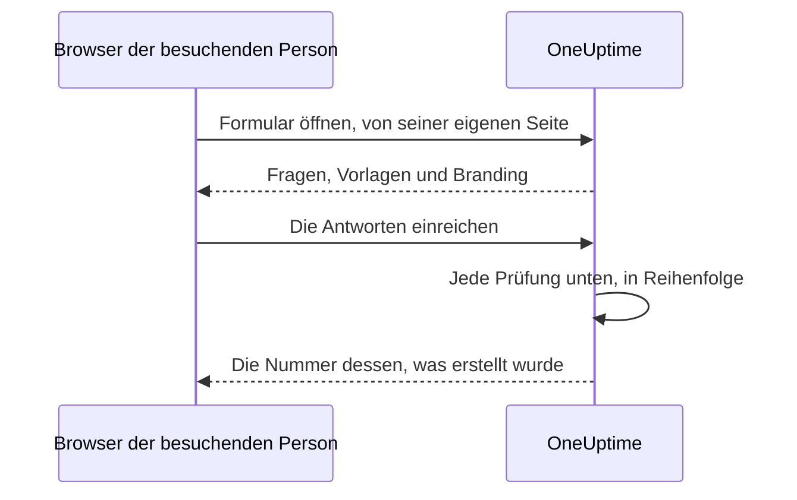

# Teilen & Sicherheit

Ein Formular steht allen offen, die seinen Link haben, und jede Einreichung kann Ihr Bereitschaftsteam alarmieren oder ein Wartungsfenster in Ihren Kalender setzen. Diese Seite behandelt die Seite **Teilen** des Formulars — den Link, das Ausschalten des Formulars, die Nachricht nach dem Einreichen und die IP-Zulassungsliste — und jede weitere Prüfung, die eine Anfrage unterwegs besteht.

:::cards
- [Den Link teilen](#den-link-teilen): Kopieren, öffnen und zurücksetzen, wenn er sich zu weit verbreitet.
- [Ein Link für jede Vorlage](#ein-link-für-jede-vorlage): Ein Lesezeichen pro Fall, ein Formular dahinter.
- [Was ein Formular schützt](#was-ein-formular-schützt): Jede Prüfung, die eine Anfrage besteht, in Reihenfolge.
- [Fehlerbehebung](#fehlerbehebung): Was jede Meldung auf der Formularseite bedeutet und was zu tun ist.
:::

## Die Seite Teilen

| Karte | Was sie enthält |
| --- | --- |
| **Status** | **Nimmt Einreichungen an** — ob der Link des Formulars funktioniert. |
| **Link zum Teilen** | Den Link, mit **Link kopieren**, **Formular öffnen** und **Link zurücksetzen**. |
| **Nach dem Absenden** | Die **Dankesnachricht**, die Leute nach dem Einreichen sehen, unter der Nummer dessen, was das Formular erstellt hat. |
| **Zugriff** | Die **IP-Zulassungsliste**. |

## Den Link teilen

Die Karte **Link zum Teilen** zeigt den Link des Formulars, etwa `https://oneuptime.com/accounts/form/<share-key>`:

- **Link kopieren** kopiert ihn.
- **Formular öffnen** öffnet das Formular in einem neuen Tab, so wie Leute es sehen.
- **Link zurücksetzen** gibt dem Formular nach Ihrer Bestätigung einen neuen Link. Der alte Link funktioniert sofort nicht mehr und zeigt die Nicht-verfügbar-Meldung, daher brauchen alle, mit denen Sie ihn geteilt haben, den neuen. Nutzen Sie es, wenn sich ein Link weiter verbreitet hat, als er sollte.

Alle mit dem Link können das Formular öffnen und einreichen, ohne OneUptime-Konto und ohne Anmeldung. Angemeldet zu sein ändert nichts: OneUptime weiß, wer eingereicht hat, nur aus dem Namen und der E-Mail, die ins Formular getippt wurden. Behandeln Sie den Link also wie eine Telefonnummer Ihres Bereitschaftsteams. Teilen Sie ihn dort, wo die Leute, die ihn nutzen sollen, ihn finden — eine Intranetseite, ein Support-Runbook, eine angeheftete Chatnachricht — und nicht auf einer öffentlichen Website, außer Sie möchten Einreichungen von allen.

Der Link trägt einen eigenen zufälligen Schlüssel, nicht die ID des Formulars. Auf einer selbst gehosteten Installation wird er von Ihrem eigenen OneUptime-Host ausgeliefert und funktioniert nur unter der Adresse, die `HTTP_PROTOCOL` und `HOST` festlegen: Unter einem anderen Namen des Servers oder unter seiner IP-Adresse geöffnet, werden die Anfragen des Formulars abgelehnt, als kämen sie von einer anderen Website.

Links auf die alten Vorfallsformulare, `/accounts/incident-form/<share-key>`, öffnen dasselbe Formular unter seiner neuen Adresse.

### Ein Link für jede Vorlage

Jede der [Vorlagen](/docs/forms/building#vorlagen) des Formulars hat einen eigenen Link: den Link des Formulars mit `?template=` und der ID der Vorlage, etwa `https://oneuptime.com/accounts/form/<share-key>?template=<template-id>`. **Link kopieren** auf der Seite **Vorlagen** des Formulars kopiert ihn. Er öffnet das Formular mit dieser Vorlage ausgefüllt, sodass ein Team einen Link pro Fall als Lesezeichen speichern kann, während Sie ein einziges Formular pflegen. Wählt die einreichende Person eine andere Vorlage, folgt die Adresse in ihrem Browser, sodass der Link, den sie kopiert, das Formular so ist, wie sie es sieht.

Der Link einer Vorlage ist der Link des Formulars: Er funktioniert, solange das Formular **Nimmt Einreichungen an** ist, und **Link zurücksetzen** zieht ihn mit den übrigen zurück. Ein Link, der eine gelöschte Vorlage nennt, öffnet das Formular, als nenne er keine — mit der Standardvorlage, falls es eine gibt.

### Ein Formular ausschalten

Um keine Einreichungen mehr anzunehmen, ohne das Formular zu löschen, schalten Sie **Nimmt Einreichungen an** aus. Der Link zeigt dann "Dieses Formular ist nicht verfügbar. Möglicherweise wurde es deaktiviert, oder der Link ist nicht mehr aktuell.", und die Karte **Link zum Teilen** erinnert Sie daran, dass das Formular ausgeschaltet ist. Schalten Sie es wieder ein, und derselbe Link funktioniert wieder.

### Die Dankesnachricht

Nach einer Einreichung sagt die Seite "Vielen Dank – Ihre Antwort wurde übermittelt." und nennt die Nummer dessen, was erstellt wurde, dann Ihre **Dankesnachricht**, in Markdown. Sagen Sie damit, was als Nächstes passiert und wohin man sich wendet, wenn etwas dringend ist. Ohne sie zeigt die Seite nur die Standardnachricht.

Ein Bild in der Beschreibung oder der Dankesnachricht des Formulars wird allen gezeigt, die den Link öffnen, solange das Formular **Nimmt Einreichungen an** ist. Schalten Sie das Formular aus oder nehmen Sie das Bild heraus, und das Bild ist wieder privat, außer etwas anderes, das alle sehen, enthält es noch.

## Was ein Formular schützt

Jede Anfrage besteht diese Prüfungen, in dieser Reihenfolge:

1. Die Anfrage muss von der eigenen Seite des Formulars kommen, nicht von einer anderen Website — siehe [Anfragen von anderen Websites](#anfragen-von-anderen-websites).
2. Sie muss innerhalb der Ratenbegrenzungen liegen.
3. Das Formular muss existieren, **Nimmt Einreichungen an** sein und zu einem Projekt mit einem Tarif gehören, der Formulare enthält.
4. Sie muss von einer Adresse auf der **IP-Zulassungsliste** kommen, wenn das Formular eine hat.
5. Eine Einreichung muss das Captcha bestehen, wenn die Instanz Captcha eingeschaltet hat.
6. Jede Antwort muss innerhalb der Größengrenzen liegen und zu ihrer Frage passen — siehe [Ein Formular erstellen](/docs/forms/building#größengrenzen).
7. Was die Antworten und die Einstellungen ergeben, muss erstellbar sein: Ein Vorfall braucht einen Schweregrad, ein Ereignis ein Ende nach seinem Beginn.
8. Eine Einreichung muss in das stündliche Kontingent des Formulars passen — siehe [Ratenbegrenzungen](#ratenbegrenzungen).

Logo und Favicon eines Formulars sind Teil des Formulars: Sie werden in der Antwort mitgesendet, die es öffnet, base64, erst wenn es die ersten vier Prüfungen bestanden hat, und nie von einer eigenen Adresse. Niemand kann sie ohne das Formular abrufen, und keine Datei kann über ein Formular anhand ihrer ID abgerufen werden; die Dateien selbst bleiben privat. Ein Formular zeigt nur Bilder, die in seinem eigenen Projekt hochgeladen wurden: Eine Datei eines anderen Projekts wird beim Speichern des Formulars abgelehnt und nie an seine Seite gesendet.

### IP-Zulassungsliste

So beschränken Sie ein Formular auf Ihre eigenen Netze:

:::steps
1. Öffnen Sie die Seite **Teilen** des Formulars.
2. Klicken Sie auf der Karte **Zugriff** auf **IP-Zulassungsliste bearbeiten**.
3. Geben Sie ein Netz pro Zeile ein und speichern Sie. Die Karte listet sie dann unter **IP-Zulassungsliste**.
:::

Jede Zeile ist eines davon:

| Eintrag | Beispiel | Hinweis |
| --- | --- | --- |
| Eine IPv4-Adresse | `203.0.113.7` | |
| Eine IPv6-Adresse | `2001:db8::7` | Passt, wie auch immer sie geschrieben ist, in Großbuchstaben oder mit ausgeschriebenen Nullen. |
| Ein IPv4-Bereich in CIDR-Notation | `10.0.0.0/8` | IPv6-Bereiche werden nicht unterstützt — listen Sie jede IPv6-Adresse in einer eigenen Zeile. |

Eine IPv4-Adresse muss als solche geschrieben werden: In IPv6-Schreibweise, etwa `::ffff:203.0.113.7`, wird sie abgelehnt. Die Liste wird bei jedem Speichern geprüft — aus dem Dashboard, der API, Terraform oder einem Workflow —, und eine Zeile, die nie passen könnte, wird mit einer Meldung abgelehnt, die sie nennt. Lassen Sie die Liste leer, um jedes Netz zu erlauben. Sobald sie einen Eintrag hat, wird eine Anfrage abgelehnt, deren Adresse sich nicht feststellen lässt.

In OneUptime Cloud braucht das Festlegen der IP-Zulassungsliste den Tarif **Scale** — beim Anlegen eines Formulars mit einer über die API wie beim Bearbeiten —, wie die IP-Zulassungsliste eines [öffentlichen Dashboards](/docs/dashboards/sharing). Leeren funktioniert in jedem Tarif.

### Anfragen von anderen Websites

Ein Browser sagt einem Server, welche Seite eine Anfrage gesendet hat. Lässt die Seite einer anderen Website den Browser einer besuchenden Person ein Formular öffnen oder einreichen, wird die Anfrage mit "This form can only be used from its own page." abgelehnt — bevor eine Ratenbegrenzung sie zählt, und unabhängig vom Link, sodass die Antwort nichts darüber verrät, welche Formulare existieren.

Eine Anfrage wird abgelehnt, wenn ihr Header `Sec-Fetch-Site` vorhanden ist und etwas anderes als `same-origin` oder `none` sagt, oder wenn ihr Header `Origin` vorhanden ist und nicht Ihre OneUptime-Adresse ist — `HTTP_PROTOCOL` und `HOST`, mit dem Port, wenn `HOST` einen hat. Eine Einreichung muss außerdem als JSON gesendet werden (`application/json`); eine, die als Formularfelder einer Webseite oder als reiner Text gesendet wird, wird mit "The request must be a JSON object holding the form's answers in "data"." abgelehnt. Das Lesen eines Formulars braucht außerdem den Header, den die Formularseite jeder ihrer Anfragen hinzufügt, `X-OneUptime-Form: 1`: Eine Seite kann einen Browser ohne Skript keinen Header hinzufügen lassen, und das Skript einer anderen Website, das einen hinzufügt, verrät sich durch sein `Origin`.

### Ratenbegrenzungen

Das Öffnen und das Einreichen eines Formulars sind pro Netzwerkadresse begrenzt, und das Einreichen zusätzlich pro Formular:

- **Ein Formular öffnen** — pro Formular von einer Adresse und pro Adresse über alle Formulare, mit Platz für ein ganzes Büro, das den Link gleichzeitig öffnet. Ist eines davon überschritten, zeigt die Seite "Zu viele Anfragen. Bitte versuchen Sie es später erneut." Ist die Ratenbegrenzung nicht erreichbar, öffnen sich Formulare trotzdem.
- **Einreichen, pro Adresse** — pro Formular von einer Adresse und pro Adresse über alle Formulare. Ist eines davon überschritten, sieht die einreichende Person "Zu viele Meldungen aus Ihrem Netzwerk. Bitte warten Sie einige Minuten und versuchen Sie es dann erneut." Alle hinter einer Adresse — einem Büronetz, einem VPN-Gateway — teilen sich diese Grenzen, und jede Einreichung zählt, auch eine, die danach wegen einer falschen Antwort abgelehnt wird.
- **Einreichen, pro Formular** — wie viele Datensätze ein Formular in einer Stunde erstellen darf, von allen Adressen zusammen, sodass selbst Einreichungen von vielen Adressen zugleich Sie nur begrenzt oft pro Stunde alarmieren können. Nur eine Einreichung, die jede andere Prüfung bestanden hat, zählt, unmittelbar bevor ihr Datensatz erstellt wird. Ist sie überschritten, sehen alle "Dieses Formular erhält gerade zu viele Einsendungen. Bitte versuchen Sie es später erneut.", bis das Zeitfenster vorbei ist. **Link zurücksetzen** beginnt den neuen Link mit einem frischen Kontingent.

Jede Grenze antwortet mit `429` und einem Header `Retry-After` in Sekunden, und die Seite sagt der einreichenden Person, wann sie es erneut versuchen kann. Die Zeitfenster sind fest, nicht gleitend. Ist die Ratenbegrenzung nicht erreichbar, werden Einreichungen abgelehnt, statt ungezählt durchgelassen zu werden: Die API antwortet mit `503`, und die einreichende Person sieht "Einsendungen können derzeit nicht angenommen werden. Bitte versuchen Sie es in einigen Minuten erneut."

Auf einer selbst gehosteten Installation ändern diese Umgebungsvariablen der OneUptime-App die Grenzen:

| Variable | Standard | Was sie festlegt |
| --- | --- | --- |
| `FORM_RATE_LIMIT_WINDOW_SECONDS` | `60` | Das Zeitfenster für das Öffnen von Formularen, in Sekunden. |
| `FORM_RATE_LIMIT_PER_FORM_AND_IP_PER_WINDOW` | `120` | Wie oft eine Adresse ein Formular pro Zeitfenster öffnen darf. |
| `FORM_RATE_LIMIT_PER_IP_PER_WINDOW` | `600` | Wie oft eine Adresse Formulare pro Zeitfenster öffnen darf, über alle Formulare. |
| `FORM_SUBMIT_RATE_LIMIT_WINDOW_SECONDS` | `900` | Das Zeitfenster für die Einreichungsgrenzen pro Adresse, in Sekunden. |
| `FORM_SUBMIT_RATE_LIMIT_PER_FORM_AND_IP_PER_WINDOW` | `10` | Einreichungen an ein Formular von einer Adresse pro Zeitfenster. |
| `FORM_SUBMIT_RATE_LIMIT_PER_IP_PER_WINDOW` | `30` | Einreichungen von einer Adresse pro Zeitfenster, über alle Formulare. |
| `FORM_SUBMIT_RATE_LIMIT_PER_FORM_WINDOW_SECONDS` | `3600` | Das Zeitfenster für die Grenze pro Formular, in Sekunden. |
| `FORM_SUBMIT_RATE_LIMIT_PER_FORM_PER_WINDOW` | `60` | Datensätze, die ein Formular pro Zeitfenster erstellen darf, von allen Adressen zusammen. |

Jede Variable liest auch ihren alten Namen, mit `INCIDENT_FORM_` statt `FORM_` davor — etwa `INCIDENT_FORM_SUBMIT_RATE_LIMIT_PER_FORM_PER_WINDOW` —, sodass eine Installation, die Vorfallsformulare angepasst hat, ihre Grenzen behält; der neue Name gewinnt, wenn beide gesetzt sind. Weder `config.env` noch die Werte des Helm-Charts reichen sie weiter: Fügen Sie sie selbst der Umgebung des Containers `app` hinzu — im Helm-Chart mit `app.extraEnv` oder dem chartweiten `extraEnv`, oder bei Docker Compose in einer `docker-compose.override.yml`. `TRUSTED_PROXY_HOPS` entscheidet, welche Adresse die Grenzen pro Adresse zählen.

### Captcha

Hat Ihre OneUptime-Instanz hCaptcha eingeschaltet, zeigt das Formular ein Captcha, und eine Einreichung, die es nicht bestanden hat, wird abgelehnt. Es gibt keine Einstellung pro Formular. Eine selbst gehostete Installation schaltet Captcha mit `CAPTCHA_ENABLED`, `CAPTCHA_SITE_KEY` und `CAPTCHA_SECRET_KEY` ein — dieselben Einstellungen, die die Registrierung schützen. Ohne Captcha tragen die Ratenbegrenzungen und die IP-Zulassungsliste die Last.

## Fehlerbehebung

:::details Der Link sagt, das Formular sei nicht verfügbar
"Dieses Formular ist nicht verfügbar. Möglicherweise wurde es deaktiviert, oder der Link ist nicht mehr aktuell." Die Seite gibt dieselbe Antwort, was auch immer der Grund ist, sodass sie einer fremden Person nie verrät, ob ein Formular existiert:

- **Nimmt Einreichungen an** ist auf der Seite **Teilen** aus.
- Der Link wurde mit **Link zurücksetzen** ersetzt. Teilen Sie den neuen.
- Das Formular wurde gelöscht.
- In OneUptime Cloud liegt das Projekt unter dem Tarif **Growth**, oder sein Abonnement ist unbezahlt.
- Der Link wurde beim Kopieren abgeschnitten.
:::

:::details Das Formular lässt sich nur aus einem erlaubten Netz öffnen
"Dieses Formular kann nur aus einem zugelassenen Netzwerk geöffnet werden." Die Adresse der einreichenden Person steht nicht auf der **IP-Zulassungsliste** des Formulars: Fügen Sie ihr Netz hinzu oder leeren Sie die Liste. Prüfen Sie auf einer selbst gehosteten Installation hinter einem Proxy oder Load Balancer `TRUSTED_PROXY_HOPS` — ist der Wert zu niedrig, sieht OneUptime die Adresse Ihres Proxys statt der der einreichenden Person. Die Seite sagt dasselbe, wenn das Formular unter einer anderen Adresse als der Ihres OneUptime geöffnet wurde: Öffnen Sie den Link genau so, wie die Karte **Link zum Teilen** ihn zeigt.
:::

:::details Zu viele Einreichungen
"Zu viele Meldungen aus Ihrem Netzwerk. Bitte warten Sie einige Minuten und versuchen Sie es dann erneut." Alle hinter einer Adresse teilen sich die Grenzen pro Adresse, was bei einem großen Ausfall zählt, wenn viele gleichzeitig melden. Die Seite sagt, wann es wieder geht. "Dieses Formular erhält gerade zu viele Einsendungen. Bitte versuchen Sie es später erneut." ist stattdessen das Kontingent pro Formular: Es hat nichts mit dem Netz der einreichenden Person zu tun, und Meldungen werden wieder angenommen, wenn das Zeitfenster vorbei ist. Sind die Einreichungen nicht echt, weil sich der Link weiter verbreitet hat als gedacht, stoppt **Link zurücksetzen** den alten Link sofort.
:::

:::details Einreichungen können gerade nicht angenommen werden
"Einsendungen können derzeit nicht angenommen werden. Bitte versuchen Sie es in einigen Minuten erneut." Die Ratenbegrenzung war nicht erreichbar, daher werden Einreichungen abgelehnt, statt ungezählt durchgelassen zu werden. Das Öffnen des Formulars funktioniert weiter. Prüfen Sie auf einer selbst gehosteten Installation, dass Valkey, der Cache, in dem die Ratenbegrenzung zählt, läuft und von der OneUptime-App erreichbar ist.
:::

:::details Dieses Formular kann keinen Vorfall erstellen, weil es keinen Schweregrad hat
Das Formular fragt nach keinem Schweregrad, seine Einstellungen nennen keinen — oder der genannte wurde gelöscht — und auch seine Vorfallsvorlage setzt keinen. Wählen Sie auf der Seite **Beim Absenden** des Formulars einen Schweregrad. Siehe [Kein Schweregrad, kein Vorfall](/docs/forms/on-submit#wie-aus-einer-einreichung-ein-vorfall-wird).
:::

:::details Eine Einreichung wird abgelehnt
Die Meldung sagt, was nicht stimmt: Eine erforderliche Antwort fehlt oder besteht nur aus Leerzeichen, eine Antwort ist zu lang oder passt nicht zu ihrer Frage, die E-Mail-Adresse ist keine gewöhnliche Adresse, oder ein Wartungsfenster endet, bevor es beginnt. "Die Captcha-Überprüfung ist fehlgeschlagen. Bitte versuchen Sie es erneut." bedeutet, dass das Captcha nicht bestanden wurde oder abgelaufen ist: Lösen Sie es erneut. Prüfen Sie auf einer selbst gehosteten Installation, auf der jede Einreichung am Captcha scheitert, dass `CAPTCHA_SITE_KEY` und `CAPTCHA_SECRET_KEY` beide gesetzt sind.
:::

:::details Eine Frage fehlt im Formular
Der Editor markiert Fragen, die er im öffentlichen Formular weglässt — etwa ein gelöschtes benutzerdefiniertes Feld —, und **Vorschau** sagt, wenn sie eine weglässt. Siehe [Wenn der Editor eine Frage markiert](/docs/forms/building#wenn-der-editor-eine-frage-markiert). Eine Frage mit dem Abzeichen **Ausgeblendet** fehlt absichtlich: Nur Vorlagen beantworten sie. Siehe [Ausgeblendete Fragen](/docs/forms/building#ausgeblendete-fragen). Eine Frage kann auch für eine Vorlage im Formular stehen und für eine andere nicht: Jede Vorlage kann eine Frage ausblenden oder eine stellen, die das Formular ausblendet. Öffnen Sie **Bearbeiten** der Vorlage und prüfen Sie ihre **Fragen**. Siehe [Wie eine Vorlage jede Frage stellt](/docs/forms/building#wie-eine-vorlage-jede-frage-stellt).
:::

:::details Eine Vorlage füllt eine Frage nicht aus
Die Antwort einer Vorlage wird nur verwendet, solange sie noch zu ihrer Frage passt: eine Option, die die Frage noch anbietet, ein Datensatz, den das Formular noch anbietet, ein Text, der nicht zu lang ist. Bearbeiten Sie die Vorlage, beantworten Sie die Frage erneut und speichern Sie sie. Siehe [Vorlagen](/docs/forms/building#vorlagen).
:::

:::details Der Vorfall oder das Ereignis ist nicht auf der Statusseite
Das ist so gewollt: Vorfälle aus einem Formular werden verborgen gemeldet, und Wartungsereignisse bleiben verborgen, außer die Einstellungen **Veröffentlichung** des Formulars sagen etwas anderes. Siehe [Was eine Einreichung erstellt](/docs/forms/on-submit).
:::

:::details Niemand wurde alarmiert
Der Vorfall eines Formulars führt die Bereitschaftsrichtlinien aus, die seine Einstellungen und seine Vorlage nennen, und was Ihre Bereitschaftsregeln hinzufügen, wie jeder andere Vorfall. Ohne all das wird niemand alarmiert. Fügen Sie auf der Seite **Beim Absenden** des Formulars eine Bereitschaftsrichtlinie hinzu, oder schreiben Sie eine Bereitschaftsregel, die auf seine Vorfälle zutrifft — zum Beispiel über eine Beschriftung, die das Formular immer hinzufügt.
:::

## Nächste Schritte

:::cards
- [Formulare – Übersicht](/docs/forms/index): Wofür Formulare da sind, Berechtigungen und die API.
- [Ein Formular erstellen](/docs/forms/building): Die Fragen, ausgeblendete Fragen und Vorlagen.
- [Was eine Einreichung erstellt](/docs/forms/on-submit): Der Vorfall oder das Ereignis, das jede Einreichung erstellt.
:::
