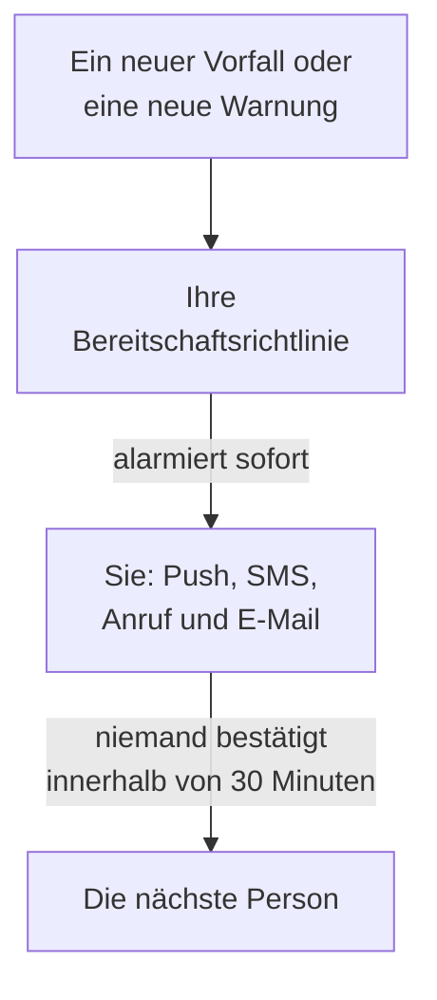

# Per Anruf, SMS oder Push alarmiert werden

Am Ende dieser Anleitung werden Sie bei jedem neuen Vorfall und jeder neuen Warnung in Ihrem Projekt auf Ihrem Telefon alarmiert, per Push-Benachrichtigung, SMS oder Anruf. Bestätigt niemand innerhalb von 30 Minuten, wird die nächste Person alarmiert, und eine Test-Alarmierung, die Sie bestätigt haben, zeigt, dass alles funktioniert. Die Anleitung folgt der geführten Einrichtung **Die richtige Person alarmieren, wenn etwas ausfällt** und dauert etwa 10 Minuten.

## Was Sie brauchen

- Ein Projekt, dessen Eigentümer Sie sind: SMS und Anrufe schaltet nur der Eigentümer ein, eine Bereitschaftsrichtlinie legt der Eigentümer oder ein Admin an.
- Ihr Mobiltelefon.
- Die Teammitglieder, die alarmiert werden sollen, als Mitglieder des Projekts: [Personen einladen](/docs/permissions/inviting-people) zeigt, wie das geht.

:::tabs
@tab OneUptime Cloud
Push-Benachrichtigungen sind in jedem Tarif kostenlos. SMS und Anrufe werden aus dem Guthaben des Projekts bezahlt, das bei 0.00 USD beginnt, und das Hinzufügen einer Telefonnummer sendet eine SMS, daher muss das Guthaben zuerst über 1.00 USD liegen. Das Aufladen von Guthaben belastet die Karte des Projekts. Der Free-Tarif umfasst eine Person und eine Eskalationsregel: Nur Sie werden alarmiert, und die Alarmierung wiederholt sich, statt jemand anderen zu erreichen.
@tab Selbst gehostet
Ihr Server muss E-Mails, SMS und Anrufe senden können. Sein Master-Admin richtet sie unter `/admin/setup` ein, jeweils mit einem Test, wie die [Anleitung zum Selbsthosten](/docs/installation/self-hosting-guide) zeigt. Push-Benachrichtigungen erreichen die App über das Push-Relay von OneUptime, ohne dass etwas einzurichten ist.
:::

## Schritte

:::steps
### Die geführte Einrichtung öffnen

Klicken Sie auf der **Startseite** Ihres Projekts in der Checkliste **Willkommen bei OneUptime 👋** auf **Bereitschaftsrichtlinie einrichten**. Die Startseite eines neuen Projekts fragt vorher **Was möchten Sie zuerst tun?**: Haken Sie **Die richtige Person alarmieren, wenn etwas ausfällt** an und klicken Sie auf **Weiter**. Fehlt der Schritt oder ist er schon erledigt, drücken Sie `Ctrl+K` (`Cmd+K` auf einem Mac), geben Sie `get paged` ein und wählen Sie **Die richtige Person alarmieren, wenn etwas ausfällt**.

### Die App auf Ihrem Telefon installieren

Installieren Sie OneUptime On-Call aus dem App Store oder von Google Play und melden Sie sich an: Die App registriert Ihr Telefon für Push-Benachrichtigungen. Zurück in der Einrichtung klicken Sie auf **Erneut prüfen**: **Mobile App oder Browser** unter **Wie sollen wir dich erreichen?** zeigt jetzt Ihr Telefon an.

### SMS und Anrufe einschalten

In neuen Projekten sind SMS und Telefonanrufe ausgeschaltet. Sind Sie Eigentümer des Projekts, klicken Sie auf **SMS und Anrufe einschalten**; allen anderen zeigt der Schritt, wer das kann. Beträgt das Guthaben auf OneUptime Cloud 1.00 USD oder weniger, klicken Sie auf **Guthaben aufladen**, geben Sie unter **Betrag (USD)** 20 bis 1.000 USD ein und klicken Sie auf **Aufladen**.

### Ihre Telefonnummer hinzufügen

Geben Sie Ihre Mobilnummer mit Ländervorwahl in **Deine Telefonnummer** ein, etwa `+15551234567`, und klicken Sie auf **Code per SMS senden**. Geben Sie den Code aus der SMS ein und klicken Sie auf **Verifizieren**: Dieselbe Nummer wird bei Alarmierungen auch angerufen. Klicken Sie auf **Weiter**. Um nur über die App und per E-Mail alarmiert zu werden, lassen Sie die Nummer weg und klicken Sie sofort auf **Weiter**.

### Festlegen, wer sonst alarmiert wird

Unter **Wer hat sonst Bereitschaft?** stehen Sie bereits in **Zuerst alarmiert**. Klicken Sie auf **Teammitglieder hinzufügen**, um außer Ihnen weitere Personen zu alarmieren, und dann auf **Speichern und weiter**. Hat das Projekt noch keine Bereitschaftsrichtlinie, wird dabei die Richtlinie `Default on-call policy` angelegt, die alle diese Personen bei jedem neuen Vorfall und jeder neuen Warnung alarmiert. Hat es schon eine, wählen Sie sie stattdessen unter **Bereitschaftsrichtlinie** und nehmen Personen unter **Zur ersten Eskalationsregel hinzufügen** auf. Ist jemand noch nicht erreichbar, bleibt der Schritt bei **Erreicht sie eine Alarmierung?** offen: Klicken Sie für diese Person auf **Einrichtungserinnerung senden** und dann auf **Weiter**.

### Festlegen, was passiert, wenn niemand antwortet

Behalten Sie unter **Was, wenn niemand antwortet?** die Option **Jemand anderen alarmieren** bei, wählen Sie unter **Als Nächstes alarmiert**, wer es sein soll, und lassen Sie **Wartezeit in Minuten** auf `30` oder ändern Sie den Wert. Klicken Sie auf **Speichern und weiter**. Im Free-Tarif bietet der Schritt stattdessen **Dieselben Personen erneut alarmieren** an, mit **Anzahl Wiederholungen** auf `2`.

### Eine Test-Alarmierung senden

Klicken Sie unter **Test-Alarmierung senden** auf **Diese Richtlinie testen**. Wählen Sie einen **Schweregrad** und klicken Sie auf **Test-Alarmierung senden**. Die erste Eskalationsregel der Richtlinie wird so alarmiert, wie ein echter Vorfall sie alarmieren würde, und in jeder Nachricht steht TEST. Es wird kein Vorfall erstellt, und weder eine Statusseite noch ein Abonnent wird benachrichtigt.

### Die Test-Alarmierung bestätigen

Öffnen Sie den Link in der SMS oder der E-Mail und bestätigen Sie die Alarmierung dort, oder drücken Sie während des Anrufs die 1. Die App zeigt, dass die Alarmierung angekommen ist, kann einen Test aber nicht bestätigen. Klicken Sie dann im Dialog auf **Fertig** und auf **Weiter**.
:::

## Prüfen, ob es funktioniert hat

- Der Testschritt zeigt, wer die Alarmierung bestätigt hat, wie und wie schnell.
- Die Einrichtung endet mit **Die Alarmierung ist eingerichtet**, aus den gespeicherten Daten gelesen: **Wer alarmiert wird**, **Wenn niemand antwortet** und **Getestet**. Ein Problem mit der Richtlinie selbst, etwa jemand, den sie nicht erreichen kann, steht unter **Erfordert Aufmerksamkeit**.
- Auf der **Startseite** markiert die Checkliste **Bereitschaftsrichtlinie einrichten** als erledigt. War es der letzte Schritt, ist die Checkliste verschwunden.

Alarmiert die Richtlinie noch jemand anderen, können Sie auch die Eskalation beobachten: Klicken Sie in der Zusammenfassung auf **Bereitschaftsrichtlinie öffnen** und dann auf **Diese Richtlinie testen**. Schalten Sie **Jede Eskalationsstufe durchlaufen** ein, senden Sie den Test und bestätigen Sie die erste Alarmierung nicht: Die nächste Person wird bis zu 2 Minuten später alarmiert.

## Was schiefgehen kann

:::details Es gibt keine Schaltfläche „Code per SMS senden“
Der SMS-Versand ist ausgeschaltet oder nicht möglich, und der Schritt sagt, warum. Nur ein Projekteigentümer oder jemand, der die Abrechnung verwaltet, sieht **SMS und Anrufe einschalten**. Bei OneUptime Cloud blendet ein Guthaben von 1.00 USD oder weniger das Feld aus. Auf einem selbst gehosteten Server, der keine SMS senden kann, sieht sein Master-Admin **SMS und Anrufe einrichten**, was das Admin Dashboard öffnet, um Twilio hinzuzufügen, wie [Twilio-Integration](/docs/self-hosted/twilio-integration) zeigt.
:::

:::details „Guthaben aufladen“ meldet, dass keine Zahlungsmethode gefunden wurde
Das Aufladen von Guthaben belastet die Karte des Projekts. Fügen Sie unter **Projekteinstellungen → Abrechnung und Rechnungen → Abrechnung** mit **Zahlungsmethode hinzufügen** eine Karte hinzu und laden Sie dann erneut Guthaben auf. Bis dahin werden Sie weiterhin über die App und per E-Mail alarmiert.
:::

:::details Selbst gehostet: Die Nummer wird abgelehnt, weil kein Twilio-Konto eingerichtet ist
Nur der Master-Admin wird vorab gewarnt, dass der Server keine SMS senden kann. Bitten Sie ihn, SMS und Anrufe unter `/admin/setup` einzurichten. Klicken Sie bis dahin auf **Weiter**: Sie werden weiterhin über die App und per E-Mail alarmiert.
:::

:::details Der Code oder die Test-Alarmierung kommt nie an
Prüfen Sie zuerst die Ländervorwahl der Nummer. Schließen Sie nach einer Test-Alarmierung den Dialog mit **Fertig** und klicken Sie auf **Ich habe nichts erhalten**: Dort steht, was zu prüfen ist, und **Meine Benachrichtigungsmethoden öffnen** listet jeden Weg auf, auf dem Sie erreichbar sind. Senden Sie auf einem selbst gehosteten Server eine Test-SMS von `/admin/setup` aus und führen Sie `npm run doctor` auf dem Server aus.
:::

## Nächste Schritte

:::cards
- [Bereitschaftspläne](/docs/on-call/schedules): Sich abwechseln, damit jede Alarmierung an die Person geht, die gerade Bereitschaft hat. Bei OneUptime Cloud ab dem Growth-Tarif.
- [Eskalationsregeln](/docs/on-call/escalation-rules): Der Richtlinie Stufen, Teams und Pläne hinzufügen.
- [Wie ich erreichbar bin](/docs/notifications/on-call-rules): Wählen, welche Methode Sie zuerst erreicht, und wann.
- [Eine Statusseite veröffentlichen](/docs/guides/status-page): Ihren Kunden auf Ihrer eigenen Domain zeigen, was gerade passiert.
:::
