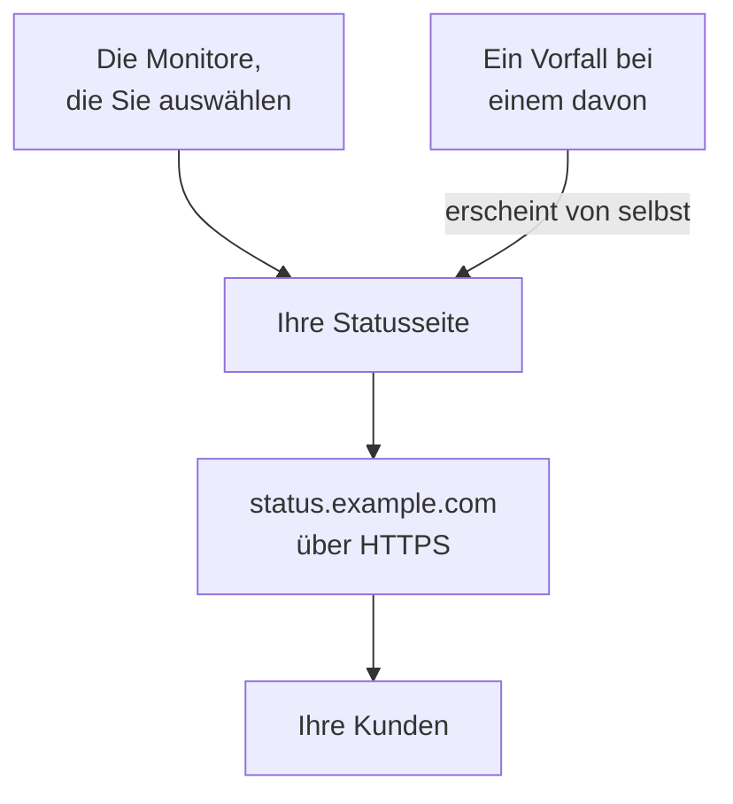

# Eine Statusseite veröffentlichen

Am Ende dieser Anleitung öffnen Ihre Kunden eine Statusseite unter Ihrer eigenen Adresse, etwa `status.example.com`, über HTTPS. Die Seite zeigt die Monitore, die Sie auswählen, mit ihrem Status und ihrer Verfügbarkeit, und ein Vorfall bei einem davon erscheint dort von selbst. Die Anleitung folgt der geführten Einrichtung **Statusseite veröffentlichen** und fügt dann Ihre Domain unter **Benutzerdefinierte Domains** der Statusseite hinzu: etwa 15 Minuten, plus die Zeit, die Ihr DNS-Anbieter braucht.

## Was Sie brauchen

- Mindestens einen Monitor: Eine Statusseite zeigt Monitore. Gibt es noch keinen, bietet die geführte Einrichtung zuerst **Monitor einrichten** an.
- Die Rolle eines Projekteigentümers oder Admins: Für die Seite brauchen Sie die Berechtigung, Statusseiten zu erstellen, und für Ihre Domain die Berechtigung, Domains des Projekts hinzuzufügen und zu verifizieren.
- Eine Domain, die Sie verwalten, und Zugriff auf ihre DNS-Einträge bei Ihrem DNS-Anbieter.

:::tabs
@tab OneUptime Cloud
Eine eigene Domain und ihr kostenloses SSL-Zertifikat sind in jedem Tarif enthalten. Der Free-Tarif umfasst eine Statusseite pro Projekt: Haben Sie bereits eine, öffnen Sie deren **Benutzerdefinierte Domains** und beginnen Sie mit dem Schritt, der Ihre Domain hinzufügt. Eine neue Statusseite ist öffentlich; um sie privat zu machen, brauchen Sie den Growth-Tarif.
@tab Selbst gehostet
Ihr Server braucht einen eigenen Hostnamen mit einem A-Eintrag, der auf ihn zeigt, etwa `oneuptime.example.com`, und der auf den Ports 80 und 443 antwortet. Setzen Sie ihn als `STATUS_PAGE_CNAME_RECORD` in `config.env` (`statusPage.cnameRecord` im Helm-Chart), anstelle des Beispielwerts dort. Kostenlose Zertifikate brauchen außerdem `LETS_ENCRYPT_ACCOUNT_KEY` (`letsEncrypt.accountKey`): einen privaten Schlüssel, mit openssl erzeugt und in base64 kodiert. Starten Sie OneUptime neu, nachdem Sie diese Werte geändert haben. **Benutzerdefinierte Domain hinzufügen** prüft zuerst den Server und listet auf, was noch fehlt.
:::

## Schritte

:::steps
### Die geführte Einrichtung öffnen

Klicken Sie auf der **Startseite** Ihres Projekts in der Checkliste **Willkommen bei OneUptime 👋** auf **Statusseite veröffentlichen**. Die Startseite eines neuen Projekts fragt vorher **Was möchten Sie zuerst tun?**: Haken Sie **Meine Kunden über eine Statusseite informieren** an und klicken Sie auf **Weiter**. Fehlt der Schritt oder ist er schon erledigt, drücken Sie `Ctrl+K` (`Cmd+K` auf einem Mac), geben Sie `status page` ein und wählen Sie **Statusseite veröffentlichen**.

### Die Seite benennen und auswählen, was sie zeigt

Behalten Sie unter **Benennen Sie sie und wählen Sie aus, was sie zeigt** im Feld **Name der Statusseite** den Vorschlag bei oder geben Sie einen eigenen Namen ein. Haken Sie unter **Was sie zeigt** die Monitore an, die Ihre Kunden sehen sollen, oder klicken Sie auf **Alle auswählen**. Klicken Sie auf **Statusseite erstellen**. Ab diesem Moment ist die Seite unter ihrem Link öffentlich und zeigt nur die Monitore, die Sie angehakt haben.

### Ansehen, was Ihre Kunden sehen

Öffnen Sie unter **Das sehen Ihre Kunden** die Adresse unter **Öffentlicher Link**: Ihre Monitore werden mit ihrem Status aufgeführt. Zurück in der Einrichtung klicken Sie auf **Sieht gut aus**.

### Benutzerdefinierte Domains öffnen

Die Einrichtung endet mit einer Zusammenfassung. Klicken Sie unter **Individuell anpassen (optional)** auf **Ihre eigene Domain**. Die Seite **Benutzerdefinierte Domains** der Statusseite öffnet sich.

### Ihre Domain hinzufügen

Klicken Sie auf **Benutzerdefinierte Domain hinzufügen**. Geben Sie in **Domäne** die Adresse ein, die Ihre Kunden öffnen werden, etwa `status.example.com`, und klicken Sie auf **Weiter**. **DNS-Einrichtung** öffnet sich mit den Einträgen, die Sie hinzufügen müssen.

### Die DNS-Einträge hinzufügen

Fügen Sie bei Ihrem DNS-Anbieter jeden Eintrag hinzu, den **DNS-Einrichtung** auflistet, mit **Typ**, **Name** und **Wert**: einen CNAME-Eintrag, der die Adresse auf OneUptime zeigen lässt, und, wenn das Projekt diese Domain zum ersten Mal verwendet, einen TXT-Eintrag, der zeigt, dass die Domain dem Projekt gehört. Hängt Ihr Anbieter die Domain selbst an jeden Namen an, geben Sie nur den Teil davor ein, etwa `status`, und `@` für die Domain selbst.

### Die Einträge prüfen

Lassen Sie **DNS-Einrichtung** geöffnet und klicken Sie auf **Jetzt prüfen**. Unter jedem Eintrag steht, was nachgeschlagen wurde und was zurückkam. Der TXT-Eintrag kommt zuerst: Bis er gefunden ist, wird die Domain nicht hinzugefügt, klicken Sie also erneut auf **Jetzt prüfen**, bis es so weit ist. Sobald der CNAME-Eintrag gefunden ist, sagt der Dialog **Ihr CNAME-Eintrag ist verifiziert.**, und ein kostenloses SSL-Zertifikat wird ausgestellt, meist innerhalb von 15 Minuten.
:::

## Prüfen, ob es funktioniert hat

- Öffnen Sie Ihre Adresse, etwa `https://status.example.com`: Ihre Statusseite öffnet sich ohne Zertifikatswarnung.
- Unter **Benutzerdefinierte Domains** zeigt der **Status** der Domain **Zertifikat ausgestellt, wird automatisch erneuert.** Auch wenn sich die Seite schon öffnet, kann dort noch eine Weile **Kostenloses Zertifikat wird ausgestellt, meist innerhalb von 15 Minuten.** stehen.
- Auf der **Startseite** markiert die Checkliste **Statusseite veröffentlichen** als erledigt: Der Schritt ist erledigt, sobald eine Statusseite einen Monitor zeigt. War es der letzte Schritt, ist die Checkliste verschwunden.

Mehr ist nicht nötig: OneUptime erneuert das Zertifikat von selbst. Sobald die Domain aufgeführt ist, prüft OneUptime ihren CNAME-Eintrag alle 15 Minuten und verifiziert sie, wenn der Eintrag aktiv ist, auch wenn Sie **DNS-Einrichtung** schließen.

## Was schiefgehen kann

:::details Die Domain steht nach dem Schließen der DNS-Einrichtung nicht in der Liste
**DNS-Einrichtung** wurde geschlossen, bevor der TXT-Eintrag gefunden war, daher wurde die Domain nie hinzugefügt. Klicken Sie auf **Benutzerdefinierte Domain hinzufügen**, geben Sie dieselbe Adresse ein, klicken Sie auf **Weiter** und dann auf **Jetzt prüfen**, bis der Dialog beide Einträge findet.
:::

:::details Die Domain bleibt auf „Warten auf DNS“
Öffnen Sie **DNS-Einrichtung** in der Zeile der Domain und klicken Sie auf **Jetzt prüfen**: Dort steht, was gefunden wurde. Prüfen Sie, dass der Name des Eintrags die ganze Adresse ist, etwa `status.example.com`, und dass sein Wert der ist, den **DNS-Einrichtung** zeigt. Antwortet der Name mit einer Adresse, hat er einen A-Eintrag, oder Ihr DNS-Anbieter leitet ihn über einen Proxy: Ersetzen Sie den A-Eintrag, oder stellen Sie den Namen auf DNS only. Verwenden Sie für eine Stammdomain, etwa `example.com`, den ALIAS-, ANAME- oder geflachten CNAME-Eintrag Ihres Anbieters.
:::

:::details Der Status sagt, dass kein kostenloses Zertifikat ausgestellt werden konnte
Ein CAA-Eintrag Ihrer Domain, der `letsencrypt.org` auslässt, blockiert das Zertifikat. Auf einem selbst gehosteten Server muss Let's Encrypt den Server auf Port 80 erreichen. Beheben Sie die Ursache: OneUptime versucht es von selbst weiter, und **Jetzt prüfen** in **DNS-Einrichtung** bestellt erneut, höchstens einmal alle 15 Minuten pro Domain.
:::

:::details Selbst gehostet: Der Server ist nicht bereit für benutzerdefinierte Domains
**Benutzerdefinierte Domain hinzufügen** zeigt **Dieser Server ist noch nicht bereit für benutzerdefinierte Domains**, mit einer Zeile für jeden noch fehlenden Punkt und dem, was zu ändern ist: die Einstellungen unter [Was Sie brauchen](#was-sie-brauchen). Ohne `LETS_ENCRYPT_ACCOUNT_KEY` zeigt eine verifizierte Domain **Verifiziert. Verwendet das HTTPS Ihres eigenen Proxys.**: Stellen Sie ihr HTTPS über Ihren eigenen Proxy bereit. [Statusseiten – Branding & Domains](/docs/status-pages/branding-and-domains#bevor-sie-anfangen) hat die Details.
:::

## Nächste Schritte

:::cards
- [Statusseiten – Branding & Domains](/docs/status-pages/branding-and-domains): Ihr Logo, Ihre Farben, Header-Links und Fußzeile.
- [Abonnenten & Ankündigungen](/docs/status-pages/subscribers): Kunden abonnieren lassen und Ankündigungen veröffentlichen.
- [Geplante Wartung](/docs/scheduled-maintenance/index): Kunden über geplante Arbeiten informieren, bevor sie beginnen.
- [Per Anruf, SMS oder Push alarmiert werden](/docs/guides/paging): Alarmiert werden, wenn einer dieser Monitore ausfällt.
:::
