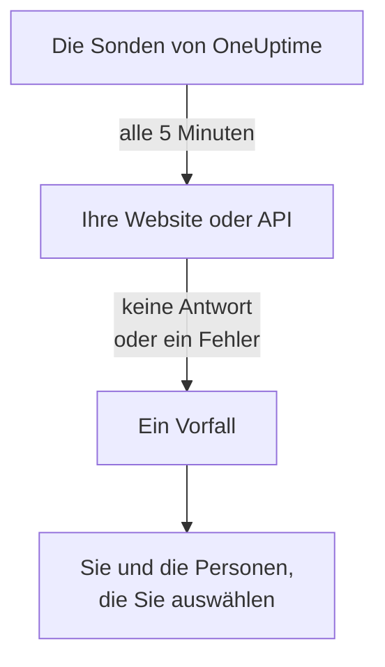

# Erfahren, wenn Ihre Website oder API ausfällt

Am Ende dieser Anleitung prüft OneUptime Ihre Website oder API alle 5 Minuten. Antwortet sie nicht mehr oder mit einem Fehler, eröffnet OneUptime einen Vorfall und benachrichtigt Sie, und eine Test-Alarmierung, die Sie bestätigt haben, zeigt, dass die Nachricht Sie erreicht. Die Anleitung folgt der geführten Einrichtung **Wissen, wenn meine Website oder API ausfällt** und dauert etwa 5 Minuten.

## Was Sie brauchen

- Ein OneUptime-Projekt, in dem Sie Monitore erstellen dürfen: Das dürfen Eigentümer, Admins und Mitglieder. Um ein Konto und ein Projekt anzulegen, folgen Sie dem ersten Teil der Seite [Schnellstart](/docs/introduction/quickstart#ein-projekt-erstellen).
- Die zu prüfende Adresse, etwa `https://example.com`. Wählen Sie für eine API einen Endpunkt, der auf ein einfaches `GET` ohne Schlüssel antwortet, etwa einen Health-Check: Eine Antwort wie `401` zählt als ausgefallen.

:::tabs
@tab OneUptime Cloud
Sonden in mehreren Regionen prüfen die Adresse, daher muss sie aus dem Internet erreichbar sein. Der Free-Tarif umfasst 10 aktive Monitore.
@tab Selbst gehostet
Die Adresse wird von der eigenen Sonde Ihres Servers geprüft, daher muss sie von dort aus erreichbar sein. Damit Sie per E-Mail benachrichtigt werden, muss der Server E-Mails senden können: Sein Master-Admin richtet das unter `/admin/setup` ein, wie die [Anleitung zum Selbsthosten](/docs/installation/self-hosting-guide) zeigt. Der Master-Admin wird nicht zum Eigentümer dessen, was er erstellt, und trägt sich deshalb auf der Seite **Eigentümer** des Monitors selbst ein, um per E-Mail benachrichtigt zu werden.
:::

## Schritte

:::steps
### Die geführte Einrichtung öffnen

Die **Startseite** eines neuen Projekts fragt zunächst **Was möchten Sie zuerst tun?**: Haken Sie **Wissen, wenn meine Website oder API ausfällt** an und klicken Sie auf **Weiter**. Klicken Sie dann in der Checkliste **Willkommen bei OneUptime 👋** auf **Ersten Monitor erstellen**. Zeigt die Checkliste diesen Schritt nicht, drücken Sie `Ctrl+K` (`Cmd+K` auf einem Mac), geben Sie `website down` ein und wählen Sie **Wissen, wenn meine Website oder API ausfällt**.

### Die Adresse eingeben

Geben Sie unter **Was sollen wir prüfen?** die Adresse in **Adresse der Website oder API** ein. Haken Sie für einen API-Endpunkt **Dies ist ein API-Endpunkt** an. Klicken Sie auf **Prüfung starten**: Die Sonden prüfen die Adresse sofort, und ein Satz sagt, was sie gefunden haben. Klicken Sie auf **Weiter**.

### Festlegen, wer informiert wird

Was Sie unter **Wer soll informiert werden?** sehen, hängt vom Projekt ab:

- Gibt es noch keine Bereitschaftsrichtlinie und keine Bereitschaftsregel, stehen Sie bereits in **Wer alarmiert wird**. Klicken Sie auf **Teammitglieder hinzufügen**, um Personen hinzuzufügen, die schon im Projekt sind, und dann auf **Speichern und weiter**. Dabei wird die Richtlinie `Default on-call policy` angelegt, die alle diese Personen bei jedem neuen Vorfall und jeder neuen Warnung im Projekt alarmiert.
- Gibt es schon eine Bereitschaftsrichtlinie oder -regel, entscheiden die eigenen Regeln des Projekts, wer alarmiert wird: Klicken Sie auf **Weiter**.
- Sind Sie Mitglied, dürfen Sie keine Alarmierung einrichten, und der Schritt sagt Ihnen, dass Sie als Eigentümer des Monitors per E-Mail benachrichtigt werden: Klicken Sie auf **Weiter**.

### Sich selbst einen Test senden

Klicken Sie unter **Test senden** auf **Mir eine Test-Alarmierung senden**. Wählen Sie einen **Schweregrad** und klicken Sie auf **Test-Alarmierung senden**. Der Test erreicht Sie so, wie eine echte Alarmierung Sie erreichen würde, und in jeder Nachricht steht TEST. Es wird kein Vorfall erstellt.

### Die Test-Alarmierung bestätigen

Öffnen Sie den Link in der E-Mail und bestätigen Sie die Alarmierung dort. Eine verifizierte Telefonnummer funktioniert auch, sobald SMS und Anrufe für das Projekt eingeschaltet sind: Öffnen Sie den Link in der SMS, oder drücken Sie während des Anrufs die 1. Klicken Sie dann im Dialog auf **Fertig** und auf **Weiter**.
:::

## Prüfen, ob es funktioniert hat

- Die Einrichtung endet mit ihrer Zusammenfassung, aus den gespeicherten Daten gelesen: **Geprüft**, **Bei einem Ausfall**, **Wer informiert wird** und **Getestet**.
- Klicken Sie auf **Monitor öffnen** und dann auf der Karte **Wenn das ausfällt** des Monitors auf **Kette anzeigen**: Sie sehen die Kette vom Monitor bis zu den Personen, die er erreicht, und wenn nichts sie unterbrechen würde, steht dort **Nichts unterbricht die Kette.**
- Auf der **Startseite** markiert die Checkliste **Ersten Monitor erstellen** als erledigt, sobald die erste Prüfung eingeht. War es der letzte Schritt, ist die Checkliste verschwunden.

Um später eine weitere Adresse einzurichten, öffnen Sie die Einrichtung erneut und klicken Sie auf **Andere Adresse prüfen**.

## Was schiefgehen kann

:::details Die erste Prüfung kommt nie zurück
Sagt ein Satz, dass kein Standort die Adresse prüft, hat der Monitor keine Sonde; sagt er immer wieder, dass noch geprüft wird, ist seine Sonde nicht verbunden. Öffnen Sie **Monitore → Einstellungen → Sonden**, um den Status jeder Sonde zu sehen. Auf einem selbst gehosteten Server prüft der Master-Admin die Sonde des Servers unter `/admin/setup`. Öffnen Sie dann den Monitor, fügen Sie ihm eine verbundene Sonde hinzu und öffnen Sie die Einrichtung erneut.
:::

:::details Die Website funktioniert, aber der Monitor meldet einen Ausfall
Der Monitor wertet keine Antwort oder eine Antwort außerhalb von 200 bis 399 als ausgefallen. Eine Firewall, die die Sonden blockiert, sieht für ihn wie keine Antwort aus: Lassen Sie bei OneUptime Cloud die Adressen unter [IP-Adressen](/docs/configuration/ip-addresses) zu; lassen Sie auf einem selbst gehosteten Server den Rechner zu, auf dem die Sonde läuft. Wie Sie die Regel ändern, steht unter [Website-Überwachung](/docs/monitor/website-monitor) oder [API-Überwachung](/docs/monitor/api-monitor).
:::

:::details Die Test-Alarmierung lässt sich nicht bestätigen
Es ist nichts angekommen, worüber Sie die Alarmierung bestätigen könnten. Auf einem selbst gehosteten Server heißt das meist, dass er noch keine E-Mails senden kann: Der Schritt sagt das, und sein Master-Admin sieht **E-Mail einrichten**. Richten Sie den E-Mail-Versand ein und klicken Sie dann auf **Weiteren Test senden**, oder klicken Sie auf **Test überspringen** und kommen Sie später zurück. Schließen Sie nach einem Test den Dialog mit **Fertig** und klicken Sie auf **Ich habe nichts erhalten**: Dort steht, was zu prüfen ist.
:::

## Nächste Schritte

:::cards
- [Per Anruf, SMS oder Push alarmiert werden](/docs/guides/paging): Auf Ihrem Telefon alarmiert werden und die nächste Person alarmieren, wenn niemand antwortet.
- [Eine Statusseite veröffentlichen](/docs/guides/status-page): Ihren Kunden den Monitor zeigen, auf Ihrer eigenen Domain.
- [Kriterien & Status](/docs/monitor/criteria-and-statuses): Genau festlegen, wann ein Monitor als ausgefallen gilt.
:::
