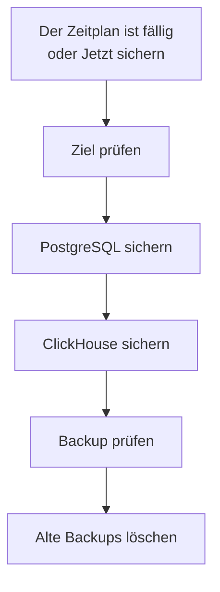

# Backups

Sichern Sie ein selbst gehostetes OneUptime nach Zeitplan in Speicher, der Ihnen gehört, und stellen Sie es aus dem Admin Dashboard wieder her. Ein Backup enthält PostgreSQL mit Ihren Projekten, Monitoren, Vorfällen, Statusseiten und Benutzern, und ClickHouse mit Ihren Logs, Traces und Metriken. Backups werden so viele Tage aufbewahrt, wie Sie wählen, ältere werden für Sie gelöscht, und jedes Backup lässt sich an Ort und Stelle wiederherstellen. Backups gehören zur Enterprise Edition.

:::cards
- [Backups einrichten](#backups-einrichten): Ein Ziel wählen, es testen, einen Zeitplan festlegen.
- [Ziele](#ziele): Was jedes empfohlene Ziel verlangt.
- [Ein Backup wiederherstellen](#ein-backup-wiederherstellen): Was ersetzt wird und wie die aktuellen Daten sicher bleiben.
- [Auf einen neuen Server umziehen](#auf-einen-neuen-server-umziehen): Die Backups einer Installation auf einer anderen wiederherstellen.
:::

## So funktioniert ein Backup



- **Konsistent.** PostgreSQL wird in einer Transaktion gesichert, also zeigt der Dump die Datenbank, wie sie in einem Moment war, während OneUptime weiterläuft. ClickHouse sichert jede Tabelle so, wie sie war, als es ihre Parts las.
- **Direkt ans Ziel.** Die Ausgabe von `pg_dump` wird beim Schreiben in den Speicher gestreamt, und ClickHouse schreibt sein eigenes Backup in den Speicher. Auf die Festplatte des Servers wird nichts geschrieben, wie groß die Daten auch sind.
- **Geprüft.** Bevor ein Backup zählt, liest `pg_restore` den Dump vom Ziel zurück, und der Eintrag, den ClickHouse über sein Backup schreibt, wird dort gefunden. Die SHA-256 des Dumps wird mit dem Backup gespeichert, und eine Wiederherstellung prüft sie, bevor sie etwas ersetzt. Ein Backup, das fehlschlägt oder abgebrochen wird, löscht, was es geschrieben hat, sodass das Ziel nur vollständige Backups enthält.
- **Verschlüsselt.** Backups gelangen über HTTPS in den Speicher, sofern Sie keinen `http://`-Endpunkt eingeben. Amazon S3, Google Cloud Storage, Azure Blob Storage und Cloudflare R2 verschlüsseln alles, was sie speichern; bei anderem Speicher schalten Sie die Verschlüsselung ruhender Daten für den Bucket ein. Die Zugangsdaten des Ziels werden verschlüsselt gespeichert und nie wieder angezeigt.
- **Eins nach dem anderen.** In der ganzen Installation läuft immer nur ein Backup oder eine Wiederherstellung. Die anderen warten, bis sie an der Reihe sind.

Jedes Backup ist ein eigener Ordner im Ordner des Ziels (`oneuptime/backups/`, sofern Sie keinen anderen wählen), benannt nach seiner Startzeit in UTC:

```text
oneuptime/backups/20261024T020000Z-3f2a9c1b/manifest.json
oneuptime/backups/20261024T020000Z-3f2a9c1b/postgres.dump
oneuptime/backups/20261024T020000Z-3f2a9c1b/clickhouse/
```

`manifest.json` wird zuletzt geschrieben: Es sagt, was das Backup enthält und welche Version von OneUptime es erstellt hat.

## Bevor Sie beginnen

- **Die Enterprise Edition** mit einer Lizenz, die Backups umfasst. Während der Testphase und der Kulanzzeit laufen Backups. Ohne Lizenz wird kein neues Backup erstellt, Wiederherstellen und Löschen funktionieren aber weiterhin. Siehe [Enterprise Edition](/docs/self-hosted/enterprise).
- **Ein Master-Admin.** Backups werden im Admin Dashboard eingerichtet.
- **Ein Bucket oder Container nur für Backups** und Zugangsdaten, die darin lesen, schreiben, auflisten und löschen dürfen.
- **Ein Ziel, das auch ClickHouse erreicht.** ClickHouse schreibt sein Backup selbst in den Speicher, also muss sein Netzwerk den Speicher erreichen, so wie das von OneUptime.
- **Zum Wiederherstellen von PostgreSQL ein Datenbankbenutzer, der Datenbanken erstellen darf.** Eine Wiederherstellung schreibt in eine neue Datenbank neben der aktiven. Das mit OneUptime gelieferte PostgreSQL verbindet sich als Superuser, der das darf.

## Backups einrichten

:::steps
### Die Seite Backups öffnen

Gehen Sie im Admin Dashboard zu **Einstellungen → Backups** und klicken Sie auf **Backups einrichten**.

### Wählen, wohin Backups gehen

Wählen Sie eines der empfohlenen Ziele. Was jedes verlangt, steht unter [Ziele](#ziele).

### Die Verbindung ausfüllen

Füllen Sie aus, was das Ziel verlangt. Ein Ordner, eine Region und die Einstellungen, die die meisten unverändert lassen, warten unter **Weitere Felder**, und **Einrichtungsanleitung** öffnet den Abschnitt des Ziels auf dieser Seite.

### Das Ziel testen

Klicken Sie auf **Ziel testen**. OneUptime schreibt, liest, listet und löscht eine kleine Testdatei, prüft, ob `pg_dump` Ihr PostgreSQL sichern kann, und bittet ClickHouse, ein Test-Backup der Definitionen seiner Tabellen zu schreiben. Nichts wird gespeichert, und eine fehlgeschlagene Prüfung sagt, was zu ändern ist.

### Festlegen, wann Backups laufen

Wählen Sie **Wie oft** und die Uhrzeit unter **Um (UTC)**, bei wöchentlichen Backups auch den **Wochentag**. **Backups aufbewahren (Tage)** steht auf 30, sofern Sie es nicht ändern. Schalten Sie **Auch ClickHouse sichern** aus, um nur PostgreSQL zu sichern.

### Mit dem Sichern beginnen

Klicken Sie auf **Backups starten**. Das erste Backup läuft zum nächsten geplanten Zeitpunkt, und **Jetzt sichern** startet sofort eines.
:::

Die Seite zeigt dann, wie es um die Backups steht: wann das letzte lief, wie groß es war und wie lange es dauerte, und wann das nächste läuft. Ein laufendes Backup zeigt seinen aktuellen Schritt, und **Schritte anzeigen** zeigt jeden Schritt, während er läuft.

## Ziele

| Ziel | Speicher | Meldet sich an mit |
| --- | --- | --- |
| [Amazon S3](#amazon-s3) | Amazon S3 | Einem Zugriffsschlüssel |
| [Cloudflare R2](#cloudflare-r2) | S3-kompatibler Speicher | Einem R2-API-Token |
| [Backblaze B2](#backblaze-b2) | S3-kompatibler Speicher | Einem Anwendungsschlüssel |
| [Wasabi](#wasabi) | S3-kompatibler Speicher | Einem Zugriffsschlüssel |
| [MinIO](#minio) | S3-kompatibler Speicher | Einem Zugriffsschlüssel |
| [Google Cloud Storage](#google-cloud-storage) | Google Cloud Storage | Einem HMAC-Schlüssel |
| [Azure Blob Storage](#azure-blob-storage) | Azure Blob Storage | Einem SAS-Token oder einem Zugriffsschlüssel |
| [Anderer S3-kompatibler Speicher](#anderer-s3-kompatibler-speicher) | S3-kompatibler Speicher | Einem Zugriffsschlüssel |

Ein Schlüssel für Amazon S3 oder einen anderen S3-kompatiblen Speicher braucht `s3:PutObject`, `s3:GetObject`, `s3:ListBucket`, `s3:DeleteObject` und `s3:AbortMultipartUpload` für den Ordner, sonst nichts:

```json
{
  "Version": "2012-10-17",
  "Statement": [
    {
      "Effect": "Allow",
      "Action": "s3:ListBucket",
      "Resource": "arn:aws:s3:::my-backups"
    },
    {
      "Effect": "Allow",
      "Action": [
        "s3:PutObject",
        "s3:GetObject",
        "s3:DeleteObject",
        "s3:AbortMultipartUpload"
      ],
      "Resource": "arn:aws:s3:::my-backups/oneuptime/backups/*"
    }
  ]
}
```

### Amazon S3

| Feld | Was Sie eingeben |
| --- | --- |
| **Bucket** | Der Bucket, in den Backups geschrieben werden. Nutzen Sie ihn nur für Backups. |
| **Region** | Die Region des Buckets. Sie steht zu Beginn auf `us-east-1`. |
| **Zugriffsschlüssel-ID** | Ein Zugriffsschlüssel mit den Berechtigungen oben. |
| **Geheimer Zugriffsschlüssel** | Das Secret des Schlüssels. |
| **Ordner** | Unter **Weitere Felder**. Bleibt er leer, gehen Backups nach `oneuptime/backups/`. |

Amazon S3 verschlüsselt jede Datei, die es speichert, und OneUptime verlangt das (SSE-S3) für jede Datei, die es schreibt.

### Cloudflare R2

Geben Sie als **Endpunkt** die S3-API-Adresse Ihres Kontos ein, `https://<account-id>.r2.cloudflarestorage.com`, aus den Einstellungen des Buckets in R2. Geben Sie dann den **Bucket** ein sowie **Zugriffsschlüssel-ID** und **Geheimer Zugriffsschlüssel** eines R2-API-Tokens, das darin Objekte lesen und schreiben darf. Das Zurücklesen von Backups aus R2 kostet nichts.

### Backblaze B2

Geben Sie als **Endpunkt** den S3-Endpunkt des Buckets ein, der auf seiner Buckets-Seite in Backblaze steht, etwa `https://s3.us-west-004.backblazeb2.com`. Geben Sie dann den **Bucket** ein und die Schlüssel-ID und den Schlüssel eines Anwendungsschlüssels als **Zugriffsschlüssel-ID** und **Geheimer Zugriffsschlüssel**. Die Region wird aus dem Endpunkt gelesen.

### Wasabi

Geben Sie als **Endpunkt** die Service-URL der Region des Buckets ein, etwa `https://s3.us-east-1.wasabisys.com`, dann den **Bucket** und einen Zugriffsschlüssel. Die Region wird aus dem Endpunkt gelesen.

### MinIO

Geben Sie als **Endpunkt** die S3-API-Adresse Ihres MinIO-Servers ein, etwa `https://minio.example.com:9000`, dann den **Bucket** und einen Zugriffsschlüssel, dessen Richtlinie darin lesen, schreiben, auflisten und löschen darf. OneUptime und ClickHouse müssen die Adresse beide erreichen.

### Google Cloud Storage

Geben Sie den **Bucket** ein sowie **HMAC-Zugriffsschlüssel** und **HMAC-Secret** eines Dienstkontos mit der Rolle Storage Object Admin auf dem Bucket. Erstellen Sie den Schlüssel in den Einstellungen von Cloud Storage, auf dem Tab Interoperabilität. OneUptime und ClickHouse erreichen den Bucket über die S3-kompatible API von Cloud Storage.

### Azure Blob Storage

Geben Sie das **Speicherkonto** und den **Container** ein und wählen Sie unter **Anmelden mit**, wie die Anmeldung erfolgt: ein **SAS-Token** mit den Berechtigungen Lesen, Hinzufügen, Erstellen, Schreiben, Löschen und Auflisten für den Container, oder ein **Zugriffsschlüssel** des Speicherkontos. Ein SAS-Token lässt sich auf den Container beschränken und ist daher die sicherere Wahl. **Cloud** und **Ordner** warten unter **Weitere Felder**.

### Anderer S3-kompatibler Speicher

Für Ceph, DigitalOcean Spaces, Hetzner Object Storage und jeden Speicher mit einer S3-API geben Sie seine S3-Adresse als **Endpunkt** ein, dann den **Bucket** und einen Zugriffsschlüssel. **Region** unter **Weitere Felder** ist nur nötig, wenn der Speicher eine verlangt. Bleibt sie leer, wird sie aus dem Endpunkt gelesen, sonst ist sie `us-east-1`.

## Zeitplan und Aufbewahrung

| Einstellung | Was sie bewirkt |
| --- | --- |
| **Wie oft** | **Jede Stunde**, **Alle 6 Stunden**, **Alle 12 Stunden**, **Jeden Tag** oder **Jede Woche**. Jeden Tag passt für die meisten Installationen. |
| **Um (UTC)** | Die Stunde, zu der Backups starten, in UTC, mit Ihrer eigenen Uhrzeit daneben. Alle 6 oder 12 Stunden zählen ab ihr: bei `02:00` laufen Backups alle 6 Stunden um 02:00, 08:00, 14:00 und 20:00. Stündliche Backups laufen zur vollen Stunde. |
| **Wochentag** | Der Tag, an dem wöchentliche Backups laufen. |
| **Backups aufbewahren (Tage)** | Von 1 bis 3650 Tagen. 30, sofern Sie es nicht ändern. |
| **Auch ClickHouse sichern** | Eingeschaltet, sofern Sie es nicht ausschalten. PostgreSQL wird immer gesichert. |

Nach jedem Backup werden die Backups gelöscht, die vor mehr als **Backups aufbewahren (Tage)** gestartet sind, am Ziel und aus der Liste, außer dem neuesten erfolgreichen Backup, das behalten wird, egal wie alt es ist. Ausgeschaltete Backups oder eine abgelaufene Lizenz lassen Sie also nie ohne ein Backup zum Wiederherstellen.

**Geplante Backups ausschalten** im Menü der Statuskarte stoppt den Zeitplan. **Jetzt sichern** funktioniert weiterhin, und kein Backup wird gelöscht. **Einschalten** startet den Zeitplan wieder.

## Ein Backup wiederherstellen

:::warning Was eine Wiederherstellung ersetzt
Eine Wiederherstellung ersetzt die aktuellen Daten durch die des Backups. Alles, was seit dem Backup geändert wurde, geht verloren, es sei denn, Sie sichern zuerst die aktuellen Daten.
:::

:::steps
### Das Backup wählen

Klicken Sie in der Tabelle **Backups** beim Backup, zu dem Sie zurückkehren wollen, auf **Wiederherstellen**. OneUptime prüft das Backup zuerst: ob seine Dateien am Ziel und unverändert sind, welche Version von OneUptime es erstellt hat und ob dieser Server es wiederherstellen kann.

### Wählen, was wiederhergestellt wird

Haken Sie **PostgreSQL: Projekte, Monitore, Vorfälle, Benutzer**, **ClickHouse: Logs, Traces, Metriken** oder beides an. Der Dialog zeigt, wie viele Projekte, Benutzer und Monitore das Backup enthält und wie viele es jetzt gibt.

### Die aktuellen Daten sichern

**Zuerst die aktuellen Daten sichern** ist angehakt: Die Wiederherstellung beginnt mit einem Backup der Daten, die sie ersetzt, sodass Sie zu ihnen zurückkehren können. Nehmen Sie den Haken nur heraus, wenn Sie eine andere Kopie haben, denn ohne ihn lässt sich die Wiederherstellung nicht rückgängig machen.

### Bestätigen

Geben Sie `restore` ein und klicken Sie auf **Wiederherstellen**.
:::

Eine Wiederherstellung läuft Schritt für Schritt, und die Seite zeigt jeden einzelnen:

| Schritt | Was passiert |
| --- | --- |
| **Backup prüfen** | Die Dateien des Backups sind da, und diese Installation kann es wiederherstellen. |
| **Aktuelle Daten sichern** | Ein Backup der aktuellen Daten, sofern Sie den Haken nicht herausgenommen haben. |
| **PostgreSQL wiederherstellen** | Das Backup wird in eine neue Datenbank neben der aktiven wiederhergestellt und geprüft. |
| **ClickHouse wiederherstellen** | Die aktive Telemetrie wird beiseitegelegt, und die des Backups wird an ihrer Stelle wiederhergestellt. |
| **Zu den wiederhergestellten Daten wechseln** | Die wiederhergestellte Datenbank übernimmt in einem Moment den Namen der aktiven. |
| **Wiederhergestellte Daten aktualisieren** | Die Datenbankmigrationen dieser Version laufen auf den wiederhergestellten Daten. |
| **Aufräumen** | Was beiseitegelegt wurde, wird entfernt. |

OneUptime läuft bis zur Umschaltung mit den aktuellen Daten weiter, und vorher ändert sich nichts, was es nutzt. Eine Wiederherstellung, die vor der Umschaltung fehlschlägt oder abgebrochen wird, lässt alles, wie es war, und eine, die während der Umschaltung fehlschlägt, legt zurück, was sie beiseitegelegt hat. Telemetrie, die eintrifft, während ClickHouse wiederhergestellt wird, wird nicht gespeichert. Nachdem PostgreSQL wiederhergestellt ist, werden Sie möglicherweise abgemeldet: Melden Sie sich mit einem Konto an, das im Backup enthalten ist.

:::details Die Wiederherstellung meldet, dass das Backup mit einem anderen ENCRYPTION_SECRET erstellt wurde
Die Zugangsdaten, die OneUptime speichert, etwa der Schlüssel eines Ziels, sind mit `ENCRYPTION_SECRET` verschlüsselt. Setzen Sie vor der Wiederherstellung das `ENCRYPTION_SECRET`, mit dem das Backup erstellt wurde, sonst lassen sich diese Zugangsdaten danach nicht lesen.
:::

## Auf einen neuen Server umziehen

:::steps
### OneUptime auf dem neuen Server installieren

Installieren Sie die Enterprise Edition, in der Version, die die Backups erstellt hat, oder einer neueren.

### Dasselbe Ziel einrichten

Richten Sie unter **Einstellungen → Backups** das Ziel ein, in dem Ihre Backups liegen. Die Seite findet die dort bereits vorhandenen Backups und listet sie auf, bereit zur Wiederherstellung. **Backups suchen** im Menü der Statuskarte sucht erneut.

### Das neueste Backup wiederherstellen

Stellen Sie es wie oben wieder her. Ein Backup, das eine ältere Version von OneUptime erstellt hat, wird auf diese Version gebracht. Ein Backup, das eine neuere Version erstellt hat, lässt sich wiederherstellen, sobald Sie aktualisieren.
:::

## Wenn ein Backup fehlschlägt

Die Statuskarte zeigt **Das letzte Backup ist fehlgeschlagen** mit dem Fehler, und **Schritte anzeigen** zeigt den Schritt, bei dem es stehen blieb, und warum. Jeder Master-Admin erhält außerdem eine E-Mail, höchstens alle 12 Stunden, solange Backups weiter fehlschlagen. Eine fehlgeschlagene Wiederherstellung wird immer per E-Mail gemeldet.

## Fehlerbehebung

:::details ClickHouse erreicht das Ziel nicht
ClickHouse verbindet sich selbst mit dem Speicher. Lassen Sie sein Netzwerk die Adresse des Ziels erreichen, so wie das von OneUptime, und testen Sie das Ziel dann erneut.
:::

:::details pg_dump fehlt oder ist zu alt
Das Enterprise-Image enthält `pg_dump` und `pg_restore` 16, 17 und 18, die PostgreSQL 18 und jede ältere Version sichern. Installieren Sie auf einem anderen Image die PostgreSQL-Client-Tools oder setzen Sie `BACKUP_POSTGRES_BIN_DIR` auf das Verzeichnis, das sie enthält. `pg_dump` muss mindestens so neu sein wie Ihr PostgreSQL-Server.
:::

:::details Das Wiederherstellen von PostgreSQL erfordert eine Änderung
Eine Wiederherstellung erstellt eine Datenbank, was der Datenbankbenutzer von OneUptime dürfen muss. Führen Sie dies in PostgreSQL als Superuser aus, mit Ihrem `DATABASE_USERNAME` anstelle von `oneuptime`, und stellen Sie dann erneut wieder her:

```sql
ALTER USER oneuptime CREATEDB;
```
:::

:::details Ein Backup liegt an einem früheren Ziel
Nachdem Sie das Ziel geändert haben, bleiben die am alten Ziel erstellten Backups in der Liste, markiert mit **An einem früheren Ziel**. Richten Sie dieses Ziel wieder ein, um eines wiederherzustellen, oder löschen Sie es aus der Liste: Seine Dateien bleiben, wo sie sind.
:::

## Nächste Schritte

:::cards
- [Enterprise Edition](/docs/self-hosted/enterprise): Lizenzen und was die Enterprise Edition hinzufügt.
- [Aktualisierung](/docs/installation/upgrading): Vor jedem Upgrade ein Backup erstellen.
- [Docker Compose](/docs/installation/docker-compose): OneUptime auf einem Server betreiben.
:::
