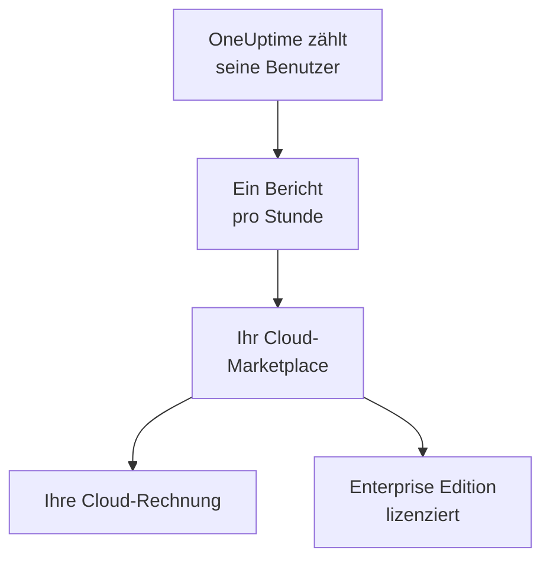

# Cloud-Marktplätze

Betreiben Sie OneUptime Enterprise, gekauft auf AWS Marketplace, Microsoft Marketplace oder Google Cloud Marketplace, in Ihrem eigenen Kubernetes-Cluster. Der Marketplace rechnet jeden Benutzer Ihrer Installation stundenweise über Ihre Cloud-Rechnung ab, und Ihr Abonnement lizenziert die Enterprise Edition: Einen Lizenzschlüssel müssen Sie nicht aktivieren.

:::cards
- [OneUptime installieren](#oneuptime-installieren): Auf Amazon EKS, Azure Kubernetes Service oder Google Kubernetes Engine.
- [So funktioniert die Abrechnung](#so-funktioniert-die-abrechnung): USD 0.10 pro Benutzer und Stunde, jede Stunde gemeldet.
- [Aktualisierung](#aktualisierung): Wie ein neues Release in Ihren Cluster gelangt.
- [Fehlerbehebung](#fehlerbehebung): Wenn das Editions-Label vor einem Problem mit dem Marketplace warnt.
:::

## So funktioniert es

OneUptime zählt seine Benutzer alle 15 Minuten und meldet jede Stunde genau einmal an den Marketplace, auf dem Sie es gekauft haben, und zwar mit der höchsten Benutzerzahl, die es in dieser Stunde gezählt hat. Der Marketplace setzt die Stunde auf Ihre Cloud-Rechnung. Jeder Bericht, den er annimmt, teilt OneUptime außerdem mit, dass Ihr Abonnement aktiv ist, und das hält die Enterprise Edition lizenziert.



| | AWS | Microsoft | Google Cloud |
| --- | --- | --- | --- |
| Marketplace-Eintrag | Noch nicht öffentlich: [Kontaktieren Sie uns](https://oneuptime.com/enterprise/demo) | [OneUptime Enterprise](https://marketplace.microsoft.com/en-us/product/oneupitme.oneuptime-enterprise) | Noch nicht öffentlich: [Kontaktieren Sie uns](https://oneuptime.com/enterprise/demo) |
| Läuft auf | Amazon EKS | Azure Kubernetes Service (AKS) | Google Kubernetes Engine (GKE) |
| Sie installieren es | Mit Helm, aus der Registry des Marketplace-Eintrags | Im Azure-Portal | In der Google Cloud Console |
| Womit OneUptime meldet | Die IAM-Rolle seines Kubernetes-Dienstkontos | Die verwaltete Identität, die Azure der Installation zuweist | Das Reporting-Secret, das Google Cloud Marketplace für die Bereitstellung anlegt |
| Neue Releases | Sie aktualisieren mit Helm | Neben-Releases werden für Sie installiert | Sie aktualisieren von Hand |

## Bevor Sie beginnen

- **Ein Kubernetes-Cluster** in der Cloud, deren Marketplace Sie nutzen, mit mindestens 3 Knoten mit je 4 vCPUs und 16 GiB Arbeitsspeicher, einer Standard-StorageClass und Unterstützung für Dienste vom Typ `LoadBalancer`. OneUptime betreibt sein eigenes PostgreSQL, ClickHouse und Valkey im Cluster; wie Sie sie dimensionieren, beschreibt [Dimensionierung & Kapazitätsplanung](/docs/installation/sizing).
- **Ein Domainname** für OneUptime, etwa `oneuptime.example.com`, den Sie auf den Load Balancer des Clusters zeigen lassen können.
- **Ausgehendes HTTPS** vom Cluster zum Marketplace, damit OneUptime seine Benutzer melden kann: `metering.marketplace.<region>.amazonaws.com` und `sts.<region>.amazonaws.com` auf AWS, `marketplaceapi.microsoft.com` auf Azure, `servicecontrol.googleapis.com` und `oauth2.googleapis.com` auf Google Cloud.

## OneUptime installieren

### AWS Marketplace

Auf AWS meldet OneUptime seine Benutzer mit einer IAM-Rolle, die EKS seinem Kubernetes-Dienstkonto zuweist (IAM-Rollen für Dienstkonten). AWS Marketplace nimmt Nutzungsdaten von EKS nur an, wenn sie auf diese Weise signiert sind.

:::steps
1. Abonnieren Sie OneUptime Enterprise auf AWS Marketplace, klicken Sie dann auf **Continue to Configuration**, wählen Sie die Version und klicken Sie auf **Continue to Launch**.
2. Richten Sie für den Cluster einen IAM-OIDC-Anbieter ein, falls er noch keinen hat, und legen Sie mit den Befehlen unten das Dienstkonto `oneuptime` mit einer IAM-Rolle an, die die Richtlinie `AWSMarketplaceMeteringFullAccess` hat. Führen Sie die Befehle anstelle des `eksctl`-Befehls in Schritt 1 der **General launch instructions** der Launch-Seite aus: Dieser Befehl hängt eine Rolle an, die Sie zuerst selbst anlegen müssten.
3. Melden Sie Helm bei der Registry des Marketplace-Eintrags an und installieren Sie das Chart mit den Befehlen in Schritt 2 der **General launch instructions**. Setzen Sie im `helm install`-Befehl den Wert `serviceAccount.name` auf `oneuptime`, `host` auf Ihren Domainnamen und `httpProtocol` auf `https`, wenn ein Zertifikat vor OneUptime liegt.
4. [OneUptime öffnen](#oneuptime-öffnen).
:::

```bash
eksctl utils associate-iam-oidc-provider --cluster <cluster> --approve
eksctl create iamserviceaccount --name oneuptime --namespace oneuptime --cluster <cluster> \
  --attach-policy-arn arn:aws:iam::aws:policy/AWSMarketplaceMeteringFullAccess \
  --approve --override-existing-serviceaccounts
```

Bewahren Sie die Werte aus Schritt 3 in einer Datei auf und übergeben Sie sie bei jedem `helm upgrade`:

```yaml title="values.yaml"
host: oneuptime.example.com
httpProtocol: https
serviceAccount:
  name: oneuptime
```

### Microsoft Marketplace

Auf Azure ist OneUptime eine Kubernetes-Anwendung: AKS installiert sie als Clustererweiterung und weist ihr die verwaltete Identität zu, mit der OneUptime seine Benutzer meldet.

:::steps
1. Öffnen Sie OneUptime Enterprise auf Microsoft Marketplace im Azure-Portal, oder öffnen Sie Ihren AKS-Cluster und wählen Sie **Extensions + applications** > **Add**. Wählen Sie dann den Tarif und klicken Sie auf **Create**.
2. Wählen Sie das Abonnement und die Ressourcengruppe, und legen Sie fest, ob Sie in einem bestehenden AKS-Cluster installieren oder einen neuen anlegen.
3. Geben Sie im Schritt **OneUptime** einen Namen für die Installation, Ihren Domainnamen und dessen Protokoll ein.
4. Klicken Sie auf **Review + create** und dann auf **Create**. Die Installation dauert einige Minuten; sie ist abgeschlossen, wenn **Extensions + applications** ihren Bereitstellungsstatus als **Succeeded** anzeigt.
5. [OneUptime öffnen](#oneuptime-öffnen).
:::

Benutzerdefinierte Verbrauchseinheiten funktionieren auf AKS-Clustern, nicht auf Kubernetes mit Azure Arc-Unterstützung, daher lässt sich OneUptime Enterprise von Microsoft Marketplace nur auf AKS installieren.

### Google Cloud Marketplace

Auf Google Cloud führt Marketplace einen Deployer aus, der OneUptime in den von Ihnen gewählten Namespace installiert, zusammen mit einem Reporting-Secret, mit dem OneUptime seine Benutzer meldet.

:::steps
1. Öffnen Sie OneUptime Enterprise auf Google Cloud Marketplace in der Google Cloud Console und klicken Sie auf **Configure**.
2. Wählen Sie den GKE-Cluster und den Namespace, und geben Sie einen Namen für die Installation, Ihren Domainnamen und dessen Protokoll ein.
3. Klicken Sie auf **Deploy**. Die Bereitstellung dauert einige Minuten; sie ist abgeschlossen, wenn die Anwendung unter **Kubernetes Engine** > **Applications** als bereit angezeigt wird.
4. [OneUptime öffnen](#oneuptime-öffnen).
:::

## OneUptime öffnen

Beim Start migriert OneUptime zuerst seine Datenbank, was bei einer neuen Installation einige Minuten dauert. Lassen Sie dann Ihren Domainnamen auf seinen Load Balancer zeigen:

```bash
kubectl get service --namespace <namespace>
```

Der Dienst, dessen Name auf `-nginx` endet, hat eine `EXTERNAL-IP`: Legen Sie für Ihren Domainnamen einen DNS-Eintrag an, der auf diese Adresse zeigt. Öffnen Sie den Domainnamen und registrieren Sie sich. Das erste Konto einer neuen Installation wird ihr Master-Admin, der das Admin-Dashboard unter `/admin` öffnen kann.

Innerhalb einer Stunde zeigt das Editions-Label die Enterprise Edition, lizenziert über Ihren Marketplace. Master-Admins sehen das Editions-Label in der Kopfzeile des Admin-Dashboards und in der Fußzeile des Dashboards.

## So funktioniert die Abrechnung

| Was | Wie es funktioniert |
| --- | --- |
| Preis | USD 0.10 pro Benutzer und Stunde, etwa USD 73 pro Benutzer und Monat. |
| Wer gezählt wird | Jede Person mit einem OneUptime-Konto auf der Installation. Statusseiten-Abonnenten und Personen, die sich bei einer privaten Statusseite anmelden, zählen nicht. |
| Wann | OneUptime zählt seine Benutzer alle 15 Minuten und meldet jede Stunde einmal, mit der höchsten Benutzerzahl, die es in dieser Stunde gezählt hat. Eine Stunde, in der OneUptime nicht lief, wird nicht abgerechnet. |
| Wo | Auf Ihrer Rechnung von AWS, Azure oder Google Cloud, über den Marketplace. |
| Nicht enthalten | Der Cluster selbst: Ihre Cloud rechnet seine Knoten, Festplatten und Load Balancer wie gewohnt ab. |

Jede Installation wird einzeln abgerechnet, also auch eine Staging-Installation. Für Jahrespreise, Mengenrabatte oder einen Preis für Installationen außerhalb der Produktion bitten Sie [sales@oneuptime.com](mailto:sales@oneuptime.com) um ein privates Angebot, das Sie auf dem Marketplace annehmen.

Kann ein Bericht wegen eines Netzwerkproblems oder eines Marketplace-Ausfalls nicht gesendet werden, sendet OneUptime ihn beim nächsten Durchlauf erneut. Jeder Bericht trägt einen Schlüssel für seine Stunde, sodass keine Stunde zweimal abgerechnet wird.

## So funktioniert die Lizenzierung

Ihr Marketplace-Abonnement ist Ihre Lizenz. Jeder Bericht, den der Marketplace annimmt, lizenziert jede Enterprise-Funktion für alle Benutzer, und zwar für die nächsten 72 Stunden. Ein Lizenzschlüssel von OneUptime funktioniert auf derselben Installation ebenfalls: Die Installation richtet sich dann nach der besseren der beiden Lizenzen.

| Was geschieht | Was das Editions-Label zeigt |
| --- | --- |
| Der Marketplace nimmt die stündlichen Berichte an | Die Enterprise Edition, lizenziert über Ihren Marketplace. |
| Seit 72 Stunden wurde kein Bericht angenommen | **Enterprise Edition (Marketplace Reports Failing)**: Jede Enterprise-Funktion funktioniert während einer 30-tägigen Kulanzfrist weiter. |
| Der Marketplace meldet, dass für die Installation kein Abonnement besteht, oder die Kulanzfrist endet | **Enterprise Edition (Marketplace Subscription Ended)**: Die Enterprise-Funktionen enden, genau wie beim [Auslaufen einer Lizenz](/docs/self-hosted/enterprise#wenn-eine-lizenz-abläuft-oder-fehlt). |

Der Marketplace lehnt ein gekündigtes oder ausgesetztes Abonnement ab, ebenso eine Installation, die nicht die von Ihnen gekaufte ist. Monitoring, Alarme, Incidents, Bereitschaftsdienst und Statusseiten funktionieren in jedem Fall weiter, und nichts wird gelöscht. Abonnieren Sie erneut, und der nächste angenommene Bericht lizenziert die Enterprise Edition wieder, ohne Neustart.

## Aktualisierung

| Marketplace | Wie ein neues Release in Ihren Cluster gelangt |
| --- | --- |
| AWS Marketplace | Jedes Release ist eine neue Version des Marketplace-Eintrags. Führen Sie `helm upgrade` mit dem Chart aus der Registry des Eintrags, der neuen Version und Ihrer Wertedatei aus. |
| Microsoft Marketplace | AKS installiert neue Neben- und Patch-Releases für Sie. Eine neue Hauptversion wird erst installiert, wenn Sie sie annehmen. Automatische Upgrades können Sie auf der Seite der Installation unter **Extensions + applications** abschalten. |
| Google Cloud Marketplace | Google Cloud Marketplace belässt eine Bereitstellung auf der Version, die er installiert hat, und aktualisiert sie nie. Wenden Sie sich an den [Support](https://oneuptime.com/support), bevor Sie eine Bereitstellung auf eine neue Version umstellen. |

OneUptime migriert seine Datenbank, wenn das neue Release startet. Lesen Sie die [Upgrade-Hinweise](/docs/installation/upgrading), bevor Sie auf eine neue Hauptversion wechseln.

Aktualisieren Sie über den Marketplace. Eine Marketplace-Installation vergleicht sich nicht mit den OneUptime-Releases auf GitHub: Die Versionen, die Ihr Marketplace anbietet, sind die, auf die Sie aktualisieren.

## Einstellungen und Skalierung

Ihre Rechnung ändert sich nicht mit der Skalierung: OneUptime wird pro Benutzer abgerechnet. Mehr Replikate oder größere Knoten ändern nur, was Ihre Cloud für den Cluster berechnet.

| Marketplace | Wo Ihre Einstellungen liegen |
| --- | --- |
| AWS Marketplace | In Ihrer Wertedatei. Jede Einstellung des [Helm-Charts](https://artifacthub.io/packages/helm/oneuptime/oneuptime) funktioniert, außer den mitgelieferten Operatoren. |
| Microsoft Marketplace | In den Konfigurationseinstellungen der Installation, auf ihrer Seite unter **Extensions + applications** oder mit `az k8s-extension update --configuration-settings`. Jede Einstellung ist ein Chart-Wert, etwa `autoscaling.enabled=true`. |
| Google Cloud Marketplace | In den Feldern des Bereitstellungsformulars. Alles andere ändern Sie mit `kubectl`, an den eigenen Ressourcen der Bereitstellung. |

- **Skalieren Sie OneUptime** mit den Replikat- und Autoscaling-Einstellungen des Charts (`deployment.replicaCount`, `autoscaling.enabled` und den eigenen Überschreibungen jedes Dienstes), und die Knoten mit dem Autoscaler Ihres Clusters.
- **Lassen Sie die Marketplace-Einstellungen so, wie der Eintrag sie setzt**: `enterpriseMarketplace` und, auf AWS, `serviceAccount`. Ohne sie kann OneUptime keine Berichte senden, und die Enterprise Edition ist nicht lizenziert.
- **Die Operatoren KEDA, CloudNativePG und Altinity ClickHouse sind nicht enthalten**, weil ein Marketplace nur die Images seines Eintrags ausliefert. Für hochverfügbare Datenspeicher richten Sie OneUptime mit `externalPostgres`, `externalRedis` und `externalClickhouse` auf verwaltete Dienste.

Die Abrechnung hängt nicht davon ab, wie viele Replikate laufen: Berichte sendet immer nur ein Durchlauf auf einmal, und jede Stunde hat genau einen Bericht.

## Fehlerbehebung

:::details Das Editions-Label zeigt Enterprise Edition (Marketplace Reports Failing)
OneUptime kann keine Berichte an den Marketplace senden. Jede Zeile, die es dazu protokolliert, beginnt mit `OneUptime Enterprise marketplace billing`; eine Zeile mit „cannot be reported“ nennt, was fehlt. Die üblichen Ursachen:

- **AWS:** Das Dienstkonto `oneuptime` hat keine IAM-Rolle, oder der Rolle fehlt die Richtlinie `AWSMarketplaceMeteringFullAccess` (`AWSMarketplaceMeteringRegisterUsage` genügt nicht). Hängen Sie die Richtlinie an die Rolle an, oder legen Sie die Rolle mit dem `eksctl`-Befehl unter [AWS Marketplace](#aws-marketplace) an und starten Sie danach die Pods von OneUptime mit `kubectl rollout restart deployment --namespace oneuptime` neu.
- **Azure:** Die Installation ist nicht die Anwendung von Microsoft Marketplace, etwa weil sie mit Helm installiert wurde, daher hat sie weder eine Identität noch einen Tarif, mit denen sie Nutzung melden könnte. Installieren Sie sie über das Azure-Portal.
- **Google Cloud:** Das Reporting-Secret der Bereitstellung wurde gelöscht oder ersetzt.
- **Jeder Marketplace:** Eine Firewall oder ein Proxy blockiert das ausgehende HTTPS aus [Bevor Sie beginnen](#bevor-sie-beginnen).

Die Nutzung bleibt erhalten, während Sie das Problem beheben, und wird abgerechnet, sobald OneUptime wieder Berichte senden kann. Nutzung, die älter als 30 Tage ist, wird nicht abgerechnet.
:::

:::details Das Editions-Label zeigt Enterprise Edition (Marketplace Subscription Ended)
Der Marketplace hat die Installation abgelehnt: Das Abonnement wurde gekündigt oder ausgesetzt, oder die Installation ist nicht die auf dem Marketplace gekaufte. Prüfen Sie das Abonnement auf dem Marketplace und abonnieren Sie erneut; der nächste angenommene Bericht lizenziert die Enterprise Edition wieder. Dasselbe Label erscheint, wenn die Berichte während der gesamten Kulanzfrist fehlgeschlagen sind.
:::

:::details Die Pods bleiben nach der Installation im Status Pending
Die Datenbanken von OneUptime brauchen persistente Volumes. Geben Sie dem Cluster eine Standard-StorageClass: Auf Amazon EKS installieren Sie dazu das Add-on für den Amazon EBS CSI-Treiber.
:::

## Nächste Schritte

:::cards
- [Enterprise Edition](/docs/self-hosted/enterprise): Was die Enterprise Edition hinzufügt und was endet, wenn eine Lizenz ausläuft.
- [Aktualisierung](/docs/installation/upgrading): Die Upgrade-Hinweise zu jedem Release.
- [Dimensionierung & Kapazitätsplanung](/docs/installation/sizing): Die Datenspeicher für Ihre Telemetrie dimensionieren.
- [Architektur](/docs/self-hosted/architecture): Was in Ihrem Cluster läuft.
- [Kubernetes-Agent](/docs/telemetry/kubernetes-agent#als-add-on-für-amazon-eks-installieren): Kostenlos auch auf AWS Marketplace, als Add-on für Amazon EKS, für Cluster, die an OneUptime senden.
:::
