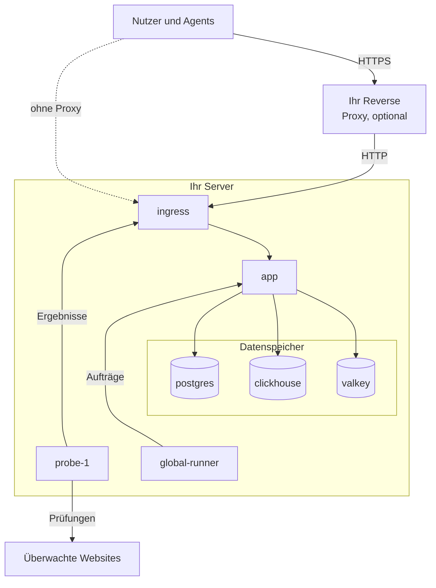

# Docker Compose

Betreiben Sie mit Docker Compose eine vollständige, kostenlose OneUptime-Instanz auf einem einzigen Linux-Server. Diese Seite führt Sie von einem frischen Server zu einer laufenden Instanz und behandelt danach HTTPS, die Absicherung für den Produktivbetrieb, Backups, Updates und das Entfernen. Um stattdessen am Code von OneUptime selbst zu arbeiten, siehe [Lokale Entwicklung](/docs/installation/local-development).

:::cards
- [OneUptime installieren](#oneuptime-installieren): Von einem frischen Server zu Ihrem ersten Konto in fünf Schritten.
- [HTTPS einrichten](#https-einrichten): OneUptime ein Zertifikat holen lassen oder einen eigenen Proxy davorschalten.
- [Checkliste für den Produktivbetrieb](#checkliste-für-den-produktivbetrieb): Was vor echtem Verkehr geklärt sein sollte.
- [OneUptime aktualisieren](#oneuptime-aktualisieren): Auf das neueste Release wechseln.
:::

## So funktioniert es

Docker Compose betreibt jeden Teil von OneUptime als Container auf Ihrem Server. Der gesamte Verkehr kommt über den Container `ingress` herein, der ihn an die `app` weiterleitet. Die App speichert ihre Daten in PostgreSQL, ClickHouse und Valkey. Eine mitgelieferte Probe führt die Prüfungen Ihrer Monitore aus und meldet die Ergebnisse über den Ingress zurück.



| Dienst | Image | Was er tut |
| --- | --- | --- |
| `ingress` | `oneuptime/nginx` | Nimmt den gesamten Verkehr auf den Ports 80 und 443 an und leitet ihn an die App weiter. Liefert HTTPS aus, wenn OneUptime das Zertifikat verwaltet. |
| `app` | `oneuptime/app` | Das Dashboard, die API, Statusseiten, die Telemetrieaufnahme und die Hintergrund-Worker. |
| `probe-1` | `oneuptime/probe` | Eine globale Probe, die die Prüfungen Ihrer Monitore ausführt. Sie nutzt das Netzwerk des Hosts. |
| `global-runner` | `oneuptime/runner` | Der mitgelieferte globale Runner, der die JavaScript-Schritte von Runbooks und die Codekorrekturen von OneUptime AI für jedes Projekt ausführt. |
| `postgres` | `postgres:15` | Konfiguration und Zustand: Monitore, Vorfälle, Benutzer. Gespeichert im Volume `postgres`. |
| `clickhouse` | `clickhouse/clickhouse-server:26.7` | Telemetrie: Logs, Metriken, Traces und Exceptions. Gespeichert im Volume `clickhouse`. |
| `valkey` | `valkey/valkey:9.1-alpine` | Cache und Warteschlangen. Er speichert nichts auf der Festplatte. |

> [!NOTE]
> Der Dienst `valkey` betreibt [Valkey](https://valkey.io), den BSD-lizenzierten Fork von Redis 7.2, konfiguriert über die Einstellungen `VALKEY_*` in `config.env`. Jeder Server mit Redis-Protokoll funktioniert — richten Sie `VALKEY_HOST` auf ein verwaltetes Redis, wenn Sie das bevorzugen. Bis 13.0.0 hießen diese Einstellungen `REDIS_*`; die alten Namen werden weiterhin gelesen, der Container antwortet weiterhin auf den Hostnamen `redis`, und `npm run update` schreibt sie nicht um, sodass eine ältere `config.env` keine Änderungen braucht.

Für den Produktivbetrieb im großen Maßstab oder wenn Sie Hochverfügbarkeit brauchen, verwenden Sie stattdessen das [Helm-Chart](https://artifacthub.io/packages/helm/oneuptime/oneuptime) auf Kubernetes: Docker Compose betreibt jeden Dienst einmal auf einem einzigen Server.

## Anforderungen

Wählen Sie die Servergröße danach, was Sie darauf betreiben werden. Telemetrie (Logs, Metriken, Traces) bestimmt Arbeitsspeicher und Festplatte; siehe [Dimensionierung & Kapazitätsplanung](/docs/installation/sizing), sobald Sie Ihre Datenmengen kennen.

| | Empfohlen | Minimum für das Homelab |
| --- | --- | --- |
| **Arbeitsspeicher** | 16 GB | 8 GB |
| **CPU** | 8 Kerne | 4 Kerne |
| **Festplatte** | 400 GB | 20 GB |
| **System** | Ubuntu 22.04 oder ein anderes Linux auf Basis von Debian, Ubuntu oder RHEL | Dasselbe |
| **Architektur** | x86-64 (`amd64`) oder ARM (`arm64`) | Dasselbe |

Das Minimum für das Homelab eignet sich für die private und experimentelle Nutzung — manche betreiben OneUptime auf einem Raspberry Pi.

Außerdem brauchen Sie:

- **Docker** mit dem Plugin **Docker Compose v2** (der Befehl `docker compose`).
- **Git**, um OneUptime abzurufen.
- **Node.js und npm**, die die Skripte `npm start` und `npm run update` ausführen, die Docker Compose umschließen.
- **Ports 80 und 443** frei auf dem Server. Die Tabelle unten listet jeden Port, den OneUptime auf dem Host belegt.

| Host-Port | Genutzt von | Einstellung | Wofür er dient |
| --- | --- | --- | --- |
| 80 | `ingress` | `ONEUPTIME_HTTP_PORT` | Das Dashboard, die API, die Telemetrieaufnahme und die Validierung durch Let's Encrypt. |
| 443 | `ingress` | `STATUS_PAGE_HTTPS_PORT` | HTTPS für Ihre Instanz, wenn OneUptime das Zertifikat verwaltet, und für Statusseiten und Dashboards auf eigenen Domains. |
| 5400 | `postgres` | `DATABASE_PUBLISHED_PORT` | Lässt `npm run backup` und `restore.sh` PostgreSQL vom Server selbst aus erreichen. Er ist nur auf `127.0.0.1` veröffentlicht. |
| 3874 | `probe-1` | `GLOBAL_PROBE_1_PORT` | Der eigene Server der Probe. Nichts außerhalb des Servers braucht ihn. |

Es gibt auch eine [Video-Anleitung](https://youtu.be/j1SWmMW2oL4) zur Installation.

## OneUptime installieren

Auf einem neuen Ubuntu-, Debian- oder RHEL-basierten Server kann ein einziger Befehl die folgenden Schritte für Sie ausführen. Er installiert Docker, Git und Node.js, wo sie fehlen, klont den Release-Branch in einen Ordner `oneuptime`, fragt nach der Adresse, die die Leute verwenden werden, und führt `npm start` aus:

```bash
curl -fsSL https://oneuptime.com/install.sh | bash
```

:::steps
### Den Release-Branch klonen

Der Branch `release` enthält die Dateien des neuesten Releases.

```bash
git clone --depth 1 --single-branch --branch release https://github.com/OneUptime/oneuptime.git
cd oneuptime
```

### config.env anlegen

Alle Einstellungen von OneUptime stehen in `config.env`. Beginnen Sie mit dem Beispiel:

```bash
cp config.example.env config.env
```

### Den Hostnamen festlegen

Öffnen Sie `config.env` und setzen Sie `HOST` auf den Domainnamen oder die IP-Adresse, über die OneUptime erreicht werden soll, ohne `http://`. Behalten Sie `localhost` nur, um OneUptime auf Ihrem eigenen Rechner auszuprobieren.

```ini title="config.env"
HOST=oneuptime.example.com
```

### OneUptime starten

:::tabs
@tab npm
```bash
npm start
```
@tab Docker CLI
```bash
sh Scripts/Install/WithConfig.sh docker compose up --remove-orphans -d
```
Ersetzen Sie die Platzhalter-Geheimnisse vor dem ersten Start selbst, wie [Zufällige Geheimnisse erzeugen](#zufällige-geheimnisse-erzeugen) zeigt: Nur `npm start` erledigt das für Sie.
:::

`npm start` prüft zuerst den Server: Docker, Arbeitsspeicher, Speicherplatz, die Ports, die OneUptime verwendet, und `HOST`. Bei allem, was OneUptime am Funktionieren hindern würde, hält es an und sagt, was zu ändern ist. Dann gibt es jedem Platzhalter-Geheimnis in `config.env` einen eigenen Zufallswert, startet OneUptime und wartet, bis jeder Teil antwortet. Der erste Start dauert einige Minuten, während Docker die Images herunterlädt und OneUptime seine Datenbanken anlegt. Es endet mit **OneUptime is up!** und der Adresse, die Sie öffnen.

### Das erste Konto anlegen

Öffnen Sie `http://` gefolgt von Ihrem `HOST` (zum Beispiel `http://localhost`) und registrieren Sie sich. Das erste Konto einer neuen Instanz wird ihr Master-Admin, der das Admin Dashboard unter `/admin` öffnen kann.

Jeder, der die Seite erreicht, kann sich nach Ihnen registrieren. Um das zu verhindern, öffnen Sie das Admin Dashboard, gehen zu **Einstellungen > Authentifizierung** und schalten **Registrierung erlauben** aus. Personen, die Sie in ein Projekt einladen, können ihr Konto weiterhin anlegen.
:::

### Zufällige Geheimnisse erzeugen

`config.example.env` liefert jedes Geheimnis als Platzhalter aus, der auf GitHub öffentlich ist. `npm start` gibt jedem einen eigenen Zufallswert, bevor es irgendetwas startet, und nennt die Einstellungen, die es ausgefüllt hat:

| Einstellung | Was sie schützt |
| --- | --- |
| `ONEUPTIME_SECRET` | Aufrufe zwischen den eigenen Diensten von OneUptime. |
| `ENCRYPTION_SECRET` | Die Geheimnisse, die OneUptime speichert, etwa Integrations-Tokens und SMTP-Passwörter, und die Anmelde-Tokens, die es ausstellt. |
| `DATABASE_PASSWORD`, `CLICKHOUSE_PASSWORD`, `VALKEY_PASSWORD` | Die drei Datenspeicher. |
| `REGISTER_PROBE_KEY` | Das Registrieren von Probes bei Ihrer Instanz. |
| `GLOBAL_PROBE_1_KEY`, `GLOBAL_PROBE_2_KEY` | Die globalen Probes, die Docker Compose betreiben kann (`probe-1` läuft standardmäßig). |
| `GLOBAL_RUNNER_KEY` | Den mitgelieferten globalen Runner, der die JavaScript-Schritte und KI-Code-Korrekturen aller Projekte ausführt. |

> [!IMPORTANT]
> Behalten Sie die Geheimnisse bei, sobald OneUptime gestartet ist. PostgreSQL übernimmt sein Passwort nur beim Anlegen seiner Datenbank, und eine spätere Änderung von `ENCRYPTION_SECRET` macht jeden mit dem alten Wert verschlüsselten Wert unlesbar. Deshalb setzt `npm start` `DATABASE_PASSWORD` und `ENCRYPTION_SECRET` nur bei einer neuen Installation, bevor PostgreSQL seine Datenbank anlegt.

Mit der Docker CLI ersetzen Sie die Platzhalter vor dem ersten Start selbst:

```bash
while grep -q "please-change-this-to-random-value" config.env; do
  sed -i "0,/please-change-this-to-random-value/{s/please-change-this-to-random-value/$(openssl rand -hex 32)/}" config.env
done
grep -c "please-change-this" config.env
```

Der letzte Befehl gibt `0` aus: Es ist kein Platzhalter mehr übrig. Die Schleife verwendet GNU `sed`, das jeder Linux-Server hat.

## HTTPS einrichten

OneUptime liefert reines HTTP aus, bis Sie einen von zwei Wegen zu HTTPS wählen:

| | OneUptime ein Zertifikat holen lassen | Einen eigenen Reverse Proxy verwenden |
| --- | --- | --- |
| **TLS endet bei** | Dem `ingress` von OneUptime, mit einem kostenlosen Let's-Encrypt-Zertifikat, das er selbst erneuert | Ihrem Proxy: Caddy, Nginx oder einem Load Balancer |
| **Sie brauchen** | Einen öffentlichen Domainnamen, der auf den Server zeigt, und die Ports 80 und 443 aus dem Internet erreichbar | Einen Proxy und ein Zertifikat für Ihre Domain |
| **Einstellungen** | `PROVISION_SSL=true`, `HTTP_PROTOCOL=https` | `PROVISION_SSL=false`, `HTTP_PROTOCOL=https`, `TRUSTED_PROXY_HOPS=2` |
| **Statusseiten auf eigenen Domains** | Funktionieren ohne weitere Einrichtung | Ihr Proxy muss auch diese Domains ausliefern |

Wenn Sie Statusseiten oder Dashboards auf eigene Domains legen, ist es einfacher, OneUptime TLS übernehmen zu lassen: Der Ingress bestellt die Zertifikate dieser Domains selbst und liefert sie aus.

Mit `HTTP_PROTOCOL=https` erzeugt OneUptime HTTPS-Links, hält Anmelde-Cookies auf HTTPS und weist Browser an, Ihren `HOST` nur noch über HTTPS aufzurufen. Ein Browser hält sich ein Jahr lang daran, auf jedem Port dieses Namens. Soll `HOST` also irgendwann wieder über reines HTTP antworten, setzen Sie `HSTS_MAX_AGE_SECONDS=0` in `config.env` eine Weile vorher: Browser vergessen die Regel bei ihrem nächsten Besuch.

### OneUptime ein Zertifikat holen lassen

:::steps
#### Ihre Domain auf den Server zeigen lassen

Legen Sie für Ihre Domain einen DNS-Eintrag `A` (oder `AAAA` für IPv6) an, mit der öffentlichen IP-Adresse des Servers als Wert. Mit einem `AAAA`-Eintrag schalten Sie außerdem IPv6 für OneUptime ein: siehe [Besucheradressen](#besucheradressen).

#### Die Zertifikatsbereitstellung einschalten

Setzen Sie diese Werte in `config.env`:

```ini title="config.env"
HOST=oneuptime.example.com
PROVISION_SSL=true
HTTP_PROTOCOL=https
```

`HOST` muss ein Domainname sein: OneUptime kann kein Zertifikat für eine IP-Adresse oder für `localhost` bekommen.

#### Mit den neuen Einstellungen neu starten

```bash
npm start
```

#### Ihre Instanz über HTTPS öffnen

Öffnen Sie `https://oneuptime.example.com`. OneUptime bestellt das Zertifikat beim Start und prüft es danach stündlich; es erneuert es, wenn weniger als 30 Tage übrig sind. Bis das erste Zertifikat eintrifft, meist innerhalb weniger Minuten, liefert der Ingress ein vorläufiges selbstsigniertes aus, und Ihr Browser warnt Sie.
:::

### Einen eigenen Reverse Proxy verwenden

Diese Schritte betreiben den Proxy auf demselben Server wie OneUptime. Läuft Ihr Proxy auf einem anderen Rechner, überspringen Sie den ersten Schritt, richten den Proxy auf Port 80 dieses Servers und lassen mit der Firewall Ihres Cloud-Anbieters nur den Proxy die Ports 80 und 443 erreichen: Ein Besucher, der OneUptime am Proxy vorbei erreicht, kann die Adresse wählen, nach der OneUptime ihn zählt.

:::steps
#### Den Ingress von den Ports 80 und 443 wegverlegen

Der Proxy braucht die Ports 80 und 443, also verlegen Sie den Ingress auf andere Ports, veröffentlicht nur auf der Loopback-Adresse `127.0.0.1` dieses Servers, damit Besucher OneUptime nur über Ihren Proxy erreichen:

```ini title="config.env"
ONEUPTIME_HTTP_PORT=127.0.0.1:8080
STATUS_PAGE_HTTPS_PORT=127.0.0.1:8443
```

Die Probe nutzt das Netzwerk des Hosts und erreicht OneUptime über `http://localhost`. `npm start` verlegt sie auf den neuen Port des Ingress, `http://localhost:8080`, und sagt das.

#### OneUptime mitteilen, dass es hinter einem Proxy steht

```ini title="config.env"
HOST=oneuptime.example.com
HTTP_PROTOCOL=https
PROVISION_SSL=false
TRUSTED_PROXY_HOPS=2
```

`HTTP_PROTOCOL=https` lässt die Links, die OneUptime erzeugt, HTTPS verwenden. `TRUSTED_PROXY_HOPS=2` zählt Ihren Proxy und den Ingress von OneUptime, sodass OneUptime für IP-Allowlists und Ratenbegrenzungen die echte Adresse des Besuchers liest. Zählen Sie für jeden weiteren Proxy, der etwas an `X-Forwarded-For` anhängt, etwa ein CDN oder einen Load Balancer, einen hinzu.

#### OneUptime auf den neuen Ports neu starten

```bash
npm start
```

`npm start` prüft OneUptime auf seinem neuen Port, `localhost:8080`, und endet mit **OneUptime is up!**

#### Den Proxy konfigurieren

:::tabs
@tab Caddy
```text title="Caddyfile"
oneuptime.example.com {
	reverse_proxy localhost:8080
}
```
Caddy holt und erneuert das Zertifikat selbst, leitet HTTP auf HTTPS um und reicht WebSocket-Verbindungen durch. Laden Sie Caddy nach einer Änderung der Datei neu, zum Beispiel mit `sudo systemctl reload caddy`.
@tab Nginx
```nginx title="/etc/nginx/conf.d/oneuptime.conf"
map $http_upgrade $oneuptime_connection_upgrade {
    default upgrade;
    ""      close;
}

server {
    listen 80;
    server_name oneuptime.example.com;
    return 301 https://$host$request_uri;
}

server {
    listen 443 ssl;
    server_name oneuptime.example.com;

    ssl_certificate     /etc/letsencrypt/live/oneuptime.example.com/fullchain.pem;
    ssl_certificate_key /etc/letsencrypt/live/oneuptime.example.com/privkey.pem;

    # The limits OneUptime's own ingress uses.
    client_max_body_size 50M;
    proxy_read_timeout 300s;
    proxy_send_timeout 300s;

    proxy_http_version 1.1;
    proxy_set_header Host $host;
    proxy_set_header X-Forwarded-For $proxy_add_x_forwarded_for;
    proxy_set_header X-Forwarded-Proto $scheme;
    proxy_set_header Upgrade $http_upgrade;
    proxy_set_header Connection $oneuptime_connection_upgrade;

    location / {
        proxy_pass http://127.0.0.1:8080;
    }

    # MCP clients keep a stream open.
    location /mcp {
        proxy_pass http://127.0.0.1:8080;
        proxy_buffering off;
        proxy_read_timeout 86400s;
        proxy_send_timeout 86400s;
    }
}
```
Die Zertifikatspfade sind die, unter denen Certbot ein Let's-Encrypt-Zertifikat ablegt; verwenden Sie die Pfade Ihres eigenen Zertifikats, wenn es von woanders stammt. Prüfen Sie die Datei und laden Sie Nginx neu mit `sudo nginx -t && sudo systemctl reload nginx`.
:::

Beide senden `X-Forwarded-Proto`, das OneUptime mitteilt, dass ein Besucher über HTTPS kam. Jeder andere Proxy muss es ebenfalls senden, sonst werden die Anmelde-Cookies von Statusseiten und Dashboards auf Ihren eigenen Domains nicht auf HTTPS gehalten.

#### Ihre Instanz über den Proxy öffnen

Öffnen Sie `https://oneuptime.example.com`. Sie sollten die Anmeldeseite von OneUptime sehen, ausgeliefert mit dem Zertifikat Ihres Proxys.
:::

> [!NOTE]
> Senden Sie Telemetrie hinter Ihrem eigenen Proxy über OTLP/HTTP (`/otlp`). OTLP über gRPC erreicht OneUptime nur, wenn sein eigener Ingress TLS terminiert (`PROVISION_SSL=true`).

## Besucheradressen

OneUptime zählt jeden Besucher nach der Adresse, von der aus er sich verbindet: Die Anmeldelimits, die übrigen Limits pro Adresse und die IP-Allowlists von Statusseiten und Dashboards lesen sie alle. Zwei Setups brauchen eine Einstellung, damit diese Adresse die eigene des Besuchers ist:

| Setup | Einstellung |
| --- | --- |
| Personen erreichen OneUptime über IPv6, zum Beispiel über einen `AAAA`-Eintrag | IPv6 im Netzwerk von OneUptime, in `docker-compose.override.yml` |
| Ihr eigener Reverse Proxy steht vor OneUptime | `TRUSTED_PROXY_HOPS=2`, mit dem Ingress veröffentlicht auf `127.0.0.1` (siehe [Einen eigenen Reverse Proxy verwenden](#einen-eigenen-reverse-proxy-verwenden)) |

Ohne IPv6 im Netzwerk von OneUptime reicht Docker jeden Besucher, der über IPv6 kommt, von einer eigenen Adresse aus an OneUptime weiter, und OneUptime zählt sie alle als einen Besucher: Die fehlgeschlagenen Anmeldungen einer Person können die anderen aussperren. Um IPv6 einzuschalten, brauchen Sie Docker Engine 27 oder neuer (`docker version` zeigt Ihre).

:::steps
### IPv6 einschalten

Legen Sie `docker-compose.override.yml` neben `docker-compose.yml` an, oder ergänzen Sie Ihre vorhandene Datei; `npm start` und `npm run update` lesen sie:

```yaml title="docker-compose.override.yml"
networks:
  oneuptime:
    enable_ipv6: true
```

### OneUptime neu starten

```bash
npm stop
npm start
```

OneUptime hält an und startet wieder, mit IPv6 in seinem Netzwerk. Ihre Daten bleiben erhalten. Docker kann kein Netzwerk entfernen, mit dem ein eigener Container noch verbunden ist, etwa ein Reverse Proxy: Trennen Sie ihn vorher vom Netzwerk von OneUptime und verbinden Sie ihn danach wieder. Bricht `npm start` mit `has active endpoints` ab, trennen Sie ihn und führen dann `npm stop` und `npm start` erneut aus.

### Das Netzwerk prüfen

```bash
docker network ls --quiet --filter name=_oneuptime | xargs docker network inspect | grep EnableIPv6
```

Es gibt `"EnableIPv6": true,` aus.
:::

Wenn sich mehrere Personen von einer privaten Netzwerkadresse aus anmelden, sagt das die Seite **OneUptime-Zustand** im Admin Dashboard, mit der Einstellung, die das ändert.

## Checkliste für den Produktivbetrieb

Docker Compose betreibt jeden Dienst einmal auf einem einzigen Server, was zu kleinen Teams und Homelabs passt. Bevor Sie sich darauf verlassen, gehen Sie diese Liste durch.

| Bereich | Was zu tun ist |
| --- | --- |
| **Geheimnisse** | Kein Wert in `config.env` ist noch ein Platzhalter `please-change-this-to-random-value`. Siehe [Zufällige Geheimnisse erzeugen](#zufällige-geheimnisse-erzeugen), und [Das Datenbankpasswort ändern](#das-datenbankpasswort-ändern) für eine Installation, die mit dem Platzhalter in `DATABASE_PASSWORD` gestartet ist. |
| **HTTPS** | OneUptime ist über HTTPS erreichbar, und `HTTP_PROTOCOL=https` ist gesetzt. Siehe [HTTPS einrichten](#https-einrichten). |
| **Registrierungen** | Sobald Ihr Team Konten hat, schalten Sie im Admin Dashboard unter **Einstellungen > Authentifizierung** die Option **Registrierung erlauben** aus. |
| **Firewall** | Nur die Ports 80 und 443 (und SSH) sind zum Internet hin offen. OneUptime veröffentlicht den PostgreSQL-Port 5400 nur auf `127.0.0.1`. Schließen Sie jeden anderen Port, den Sie veröffentlichen, mit der Firewall Ihres Cloud-Anbieters: `ufw`-Regeln gelten nicht für Ports, die Docker veröffentlicht. |
| **Besucheradressen** | Die Seite **OneUptime-Zustand** im Admin Dashboard meldet nicht, dass sich mehrere Personen von einer Adresse aus anmelden. Siehe [Besucheradressen](#besucheradressen). |
| **Backups** | PostgreSQL wird täglich gesichert, und die Kopien verlassen den Server. Siehe [Sichern und wiederherstellen](#sichern-und-wiederherstellen). |
| **E-Mail** | Im Admin Dashboard ist unter **Einstellungen > Benachrichtigungen > E-Mails** ein Mailserver eingerichtet, damit OneUptime Einladungen und Benachrichtigungen senden kann. Siehe [SMTP](/docs/emails/smtp). |
| **Festplatte** | Der freie Speicherplatz wird überwacht. ClickHouse wächst mit der Telemetrie, die Sie aufbewahren (siehe [Dimensionierung & Kapazitätsplanung](/docs/installation/sizing)); das Log jedes Containers ist auf 1000 MB begrenzt. |
| **Updates** | OneUptime wird mindestens einmal pro Woche aktualisiert. Releases erscheinen häufig. Siehe [OneUptime aktualisieren](#oneuptime-aktualisieren). |
| **Hochverfügbarkeit** | Wenn Sie sie brauchen, wechseln Sie zum [Helm-Chart](https://artifacthub.io/packages/helm/oneuptime/oneuptime) auf Kubernetes. |

### Das Datenbankpasswort ändern

PostgreSQL behält das Passwort, mit dem es angelegt wurde: Ändern Sie nur `DATABASE_PASSWORD` in `config.env`, sperren Sie OneUptime aus seiner Datenbank aus. Um einer Installation, die mit dem Platzhalter gestartet ist, ein eigenes Passwort zu geben, ändern Sie es in PostgreSQL und in `config.env` zugleich und starten OneUptime dann neu:

```bash
NEW_PASSWORD=$(openssl rand -hex 32) &&
  echo "ALTER USER CURRENT_USER PASSWORD '$NEW_PASSWORD';" | sh Scripts/Install/WithConfig.sh sh -c 'docker compose exec -T postgres psql -v ON_ERROR_STOP=1 -U "$DATABASE_USERNAME" -d "$DATABASE_NAME"' &&
  sed -i "s/^DATABASE_PASSWORD=.*/DATABASE_PASSWORD=$NEW_PASSWORD/" config.env
npm start
```

Wenn Sie `DATABASE_BACKUP_PASSWORD` und `DATABASE_RESTORE_PASSWORD` gesetzt haben, geben Sie ihnen ebenfalls den neuen Wert.

## Sichern und wiederherstellen

PostgreSQL enthält alles, was Sie konfigurieren: Monitore, Vorfälle, Statusseiten, Benutzer. `npm run backup` schreibt einen Dump davon in eine Datei im Ordner `Backups`. Die Enterprise Edition kann PostgreSQL und ClickHouse außerdem nach Zeitplan in Ihren eigenen Speicher sichern, eingerichtet im Admin Dashboard: siehe [Backups](/docs/installation/backups).

:::steps
### Dem Backup-Skript das Datenbankpasswort geben

Setzen Sie in `config.env` den Wert `DATABASE_BACKUP_PASSWORD` auf den Wert von `DATABASE_PASSWORD`. Das Skript liest `config.env` als reinen Text, daher wird das mitgelieferte `${DATABASE_PASSWORD}` nie ausgefüllt.

### Das Backup ausführen

```bash
npm run backup
```

Es fragt nach Ihrem sudo-Passwort und schreibt `Backups/db-<day of the month>.backup`, sodass tägliche Backups die eines Monats zuvor ersetzen. Führen Sie es mindestens einmal am Tag aus.

### Die Backups vom Server kopieren

Ein Backup auf derselben Festplatte wie die Datenbank übersteht den Verlust dieser Festplatte nicht.
:::

Nur der Server selbst erreicht PostgreSQL: Es antwortet auf Port 5400 von `127.0.0.1`. Um es von einem anderen Rechner aus zu sichern, öffnen Sie von diesem Rechner einen SSH-Tunnel und verbinden sich dann mit dessen eigenem Port 5400:

```bash
ssh -N -L 5400:127.0.0.1:5400 you@oneuptime.example.com
```

:::details PostgreSQL auf einer Adresse im privaten Netzwerk veröffentlichen
Wenn ein Werkzeug in Ihrem privaten Netzwerk PostgreSQL ohne Tunnel erreichen muss, veröffentlichen Sie es zusätzlich auf der Adresse des Servers in diesem Netzwerk, auf einem eigenen Port. Legen Sie `docker-compose.override.yml` neben `docker-compose.yml` an; `npm start` und `npm run update` lesen sie:

```yaml title="docker-compose.override.yml"
services:
  postgres:
    ports:
      - "10.0.0.5:5401:5432"
```

Setzen Sie die eigene private Adresse des Servers an die Stelle von `10.0.0.5`, nie eine öffentliche, und geben Sie PostgreSQL zuerst ein eigenes Passwort (siehe [Das Datenbankpasswort ändern](#das-datenbankpasswort-ändern)). Führen Sie dann `npm start` aus, und PostgreSQL antwortet auch auf Port 5401 dieser Adresse.
:::

ClickHouse bewahrt Ihre Telemetrie im Docker-Volume `oneuptime_clickhouse` auf, und kein Skript sichert es. Wenn Sie diese Telemetrie behalten müssen, sichern Sie das Volume mit einem ClickHouse-Werkzeug wie [clickhouse-backup](https://github.com/Altinity/clickhouse-backup), oder kopieren Sie es, während OneUptime gestoppt ist.

Um PostgreSQL wiederherzustellen, setzen Sie die Werte `DATABASE_RESTORE_*` in `config.env`: `DATABASE_RESTORE_PASSWORD` auf den Wert von `DATABASE_PASSWORD`, wie bei Backups, und `DATABASE_RESTORE_FILENAME` auf das wiederherzustellende Backup, etwa `db-31.backup`. Führen Sie dann `bash restore.sh` aus. Die Datenbank, in die es wiederherstellt, muss bereits existieren; in einer laufenden Installation tut sie das.

> [!CAUTION]
> `restore.sh` löscht jedes Objekt aus dem Backup in der Zieldatenbank, bevor es neu angelegt wird. Es fragt vor dem Start nach; prüfen Sie den Datenbanknamen, den es anzeigt.

## OneUptime aktualisieren

Sichern Sie zuerst, dann führen Sie aus:

```bash
git checkout release
git pull
npm run update
```

`npm run update` übernimmt neue Einstellungen aus `config.example.env` in Ihre `config.env` (Ihre eigenen Werte bleiben), lädt die neuen Images und startet OneUptime neu. Wie `npm start` endet es mit **OneUptime is up!**

Der Wechsel auf eine neue Hauptversion (von 13 auf 14, zum Beispiel) kann mehr erfordern: Lesen Sie [OneUptime upgraden](/docs/installation/upgrading), bevor Sie beginnen.

`APP_TAG=release` in `config.env` lädt immer das neueste Release der Community Edition. Um auf einer Version zu bleiben, setzen Sie `APP_TAG` auf ihre Nummer, etwa `14.0.22`. Für die Enterprise Edition lauten die Tags `enterprise-release` und `enterprise-14.0.22`.

## OneUptime deinstallieren

Stoppen Sie OneUptime und entfernen Sie seine Container und sein Netzwerk:

```bash
npm run down
```

Ihre Daten bleiben in den Volumes `oneuptime_postgres` und `oneuptime_clickhouse`, und der Ordner `oneuptime` behält `config.env` und Ihre Backups. Um auch die Daten zu löschen:

```bash
sh Scripts/Install/WithConfig.sh docker compose down --volumes --remove-orphans
```

Löschen Sie anschließend den Ordner `oneuptime`.

> [!CAUTION]
> `--volumes` löscht jeden Monitor, jeden Vorfall, jeden Benutzer und die gesamte Telemetrie endgültig. Sichern Sie zuerst, falls Sie etwas davon noch brauchen könnten.

## Fehlerbehebung

:::details npm start hält an, bevor es OneUptime startet
`npm start` prüft zuerst den Server und hält bei allem an, was OneUptime am Funktionieren hindern würde: Docker oder sein Compose-Plugin fehlt, Docker läuft nicht oder ist für Ihren Benutzer nicht erreichbar, ein anderes Programm belegt einen Port, oder `HOST` ist eine Adresse, die kein Browser öffnen kann. Jede mit ✗ markierte Zeile sagt, was zu ändern ist. Ändern Sie es und führen Sie dann `npm start` erneut aus. Liegt eine Prüfung bei Ihrem Server falsch, starten Sie ohne die Prüfungen:

```bash
ONEUPTIME_SKIP_PREFLIGHT=true npm start
```
:::

:::details Docker meldet "permission denied", wenn Sie npm start ausführen
Ihr Benutzer erreicht den Docker-Daemon nicht. Fügen Sie ihn der Gruppe `docker` hinzu, melden Sie sich dann ab und wieder an:

```bash
sudo usermod -aG docker $USER
```
:::

:::details Der Ingress kann nicht starten, weil Port 80 oder 443 belegt ist
Ein anderes Programm auf dem Server, oft ein Webserver, belegt den Port. `npm start` prüft die Ports, bevor es irgendetwas startet, und nennt den Container, der einen belegt, wenn Docker ihn ausführt. Stoppen Sie dieses Programm, oder verlegen Sie den Ingress auf andere Ports und schalten Sie das Programm vor OneUptime, wie unter [Einen eigenen Reverse Proxy verwenden](#einen-eigenen-reverse-proxy-verwenden) beschrieben.
:::

:::details npm start endet mit "Maximum retries reached"
Die Prüfung am Ende von `npm start` hat aufgegeben, bevor OneUptime antwortete. Der erste Start kann länger dauern, als die Prüfung wartet, während Images heruntergeladen und die Datenbanken angelegt werden. Sehen Sie nach, was läuft, und lesen Sie die Logs:

```bash
npm run ps
npm run logs
```

Sobald jeder Container läuft, führen Sie die Prüfung mit `npm run status-check` erneut aus. Sie prüft den Ingress auf dem Port, den `ONEUPTIME_HTTP_PORT` festlegt.
:::

:::details Der Browser zeigt "OneUptime ist für diese Adresse nicht eingerichtet"
Sie haben OneUptime unter einer anderen Adresse als seinem `HOST` geöffnet, etwa unter der IP-Adresse des Servers, während `HOST` noch `localhost` ist. Die Seite zeigt die `HOST`-Zeile für die geöffnete Adresse, mit einer Schaltfläche, die sie kopiert: Fügen Sie diese Zeile in `config.env` ein und führen Sie dann `npm start` aus. Haben Sie die Adresse in `HOST` geöffnet und sagt die Seite, dass Ihr Proxy sie nicht weitergegeben hat, stellen Sie den Proxy so ein, dass er den Hostnamen weitergibt, den der Browser angefragt hat: Caddy tut das standardmäßig, Nginx mit `proxy_set_header Host $host;` und Apache mit `ProxyPreserveHost On`.
:::

:::details Manche Seiten laden, aber Live-Updates oder Uploads schlagen fehl
Öffnen Sie OneUptime unter der Adresse in `HOST`. Der Ingress leitet Anfragen nach Hostnamen weiter: Nur `HOST` und `localhost` erreichen die gesamte Anwendung, und jeder andere Name, etwa die IP-Adresse des Servers, wird als Domain einer Statusseite behandelt. Setzen Sie `HOST` auf den Namen, den die Leute verwenden, und führen Sie dann `npm start` aus.
:::

:::details Registrierung oder Anmeldung schlägt mit "Page not found" fehl
Die Registrierungsseite lädt, aber die Registrierung schlägt mit `Page not found - /identity/signup` fehl und die Anmeldung mit `Page not found - /identity/login`. Die Anfrage hat OneUptime unter einem anderen Hostnamen als `HOST` erreicht, deshalb hat der Ingress sie wie die eigene Domain einer Statusseite weitergeleitet, unter der Registrierung und Anmeldung von OneUptime selbst nicht bereitstehen. Prüfen Sie beides:

- `HOST` ist die Adresse, die die Leute öffnen, mit ihrem Port, falls sie einen verwenden, etwa `oneuptime.example.com:8080`. Führen Sie nach der Änderung `npm start` aus.
- Ein Proxy vor OneUptime gibt den Hostnamen weiter, den der Browser angefragt hat. Caddy tut das standardmäßig, Nginx mit `proxy_set_header Host $host;` wie unter [Einen eigenen Reverse Proxy verwenden](#einen-eigenen-reverse-proxy-verwenden) und Apache mit `ProxyPreserveHost On`.
:::

:::details Der Browser warnt vor dem Zertifikat, nachdem Sie PROVISION_SSL gesetzt haben
Bis Let's Encrypt das Zertifikat ausstellt, liefert der Ingress ein vorläufiges selbstsigniertes aus. Bleibt die Warnung länger als ein paar Minuten bestehen, prüfen Sie Folgendes:

- `HOST` ist ein Domainname, keine IP-Adresse und nicht `localhost`.
- Der DNS-Eintrag der Domain zeigt auf diesen Server.
- Port 80 ist aus dem Internet erreichbar, damit Let's Encrypt die Domain validieren kann.

Schlägt eine Bestellung fehl, protokolliert die App einen Fehler, der mit `CoreSSL:EnsurePrimaryHostCertificate` beginnt, gefolgt vom Grund:

```bash
sh Scripts/Install/WithConfig.sh docker compose logs app | grep -A 5 CoreSSL
```
:::

:::details Die mitgelieferte Probe zeigt Getrennt, nachdem Sie den Port des Ingress verlegt haben
Das Admin Dashboard listet die Probe unter **Einstellungen > Überwachung > Globale Probes**. Sie erreicht OneUptime unter `GLOBAL_PROBE_1_ONEUPTIME_URL`, standardmäßig `http://localhost` (Port 80). `npm start` setzt diese URL auf den Port des Ingress, solange sie auf `localhost` zeigt. Haben Sie sie auf eine andere Adresse gesetzt oder OneUptime mit der Docker CLI gestartet, setzen Sie sie auf den neuen Port des Ingress, zum Beispiel `http://localhost:8080`, und starten Sie OneUptime neu.
:::

## Nächste Schritte

:::cards
- [OneUptime upgraden](/docs/installation/upgrading): Was jede Hauptversion von Ihnen braucht.
- [Dimensionierung & Kapazitätsplanung](/docs/installation/sizing): Arbeitsspeicher und Festplatte für Ihre Telemetrie planen.
- [Self-Hosted-Architektur](/docs/self-hosted/architecture): Wie die Komponenten zusammenspielen.
- [Enterprise Edition](/docs/self-hosted/enterprise): Was das Enterprise-Image hinzufügt, und seine Lizenz.
:::
