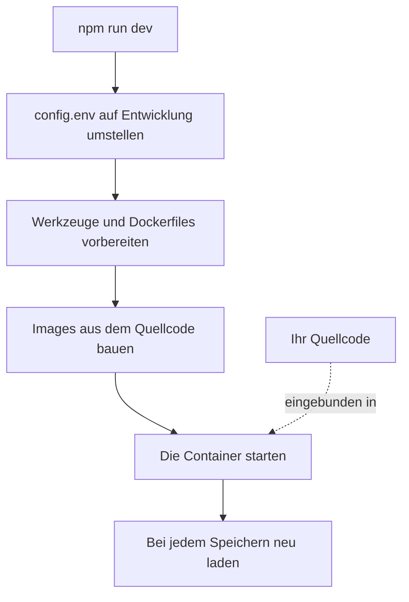

# Lokale Entwicklung

Führen Sie OneUptime aus dem Quellcode auf Ihrem eigenen Rechner aus, um daran zu arbeiten. Der Entwicklungs-Stack baut jeden Dienst aus Ihrem Checkout, bindet Ihren Quellcode in die Container ein und lädt sie neu, sobald Sie eine Datei speichern.

Um stattdessen eine veröffentlichte Version auszuführen, verwenden Sie [Docker Compose](/docs/installation/docker-compose).

## So funktioniert der Entwicklungs-Stack

`npm run dev` bereitet Ihren Checkout vor und startet dann den in `Scripts/Dev/docker-compose.dev.yml` definierten Stack:



| Phase | Was passiert |
| --- | --- |
| Auf Entwicklung umstellen | Setzt `ENVIRONMENT=development` in `config.env`. |
| Vorbereiten | Fragt nach Ihrem sudo-Passwort, installiert fehlende Werkzeuge (Git, curl, Node.js, Docker, gomplate, ts-node), führt `git pull` auf Ihrem aktuellen Branch aus, übernimmt neue Einstellungen aus `config.example.env` in `config.env` und rendert jede `Dockerfile.tpl` zu einem `Dockerfile`. |
| Bauen | Baut für jeden Dienst ein Image aus dem Quellcode. Der erste Build dauert eine Weile. |
| Ausführen | Startet die Container mit Ihrem eingebundenen Quellcode. |
| Neu laden | Die App startet ihre API neu, wenn sich eine Serverdatei ändert, und baut die Dashboards neu, während Sie sie bearbeiten. |

Wenn der Ordner `ee/` des Repositorys vorhanden ist, lädt die App daraus die Enterprise Edition. Setzen Sie `ONEUPTIME_EDITION=community` in `config.env`, um stattdessen die Community Edition auszuführen.

## Bevor Sie beginnen

| Sie brauchen | Hinweise |
| --- | --- |
| **Docker** | Docker Desktop unter macOS und Windows oder Docker Engine mit dem Docker-Compose-v2-Plugin unter Linux. |
| **Node.js 26 oder neuer und npm** | Die Version, die die `package.json` des Repositorys verlangt und die auch die CI verwendet. |
| **Git** | Zum Klonen des Repositorys. |
| **sudo-Zugriff** | `npm run dev` fragt nach Ihrem Passwort, bevor es etwas installiert. |
| **Freie Ports 80 und 443** | Der Stack stellt OneUptime unter `http://localhost` (Port 80) bereit und HTTPS auf Port 443. |

## Den Entwicklungs-Stack starten

:::steps
### Das Repository klonen

```bash
git clone https://github.com/OneUptime/oneuptime.git
cd oneuptime
```

### config.env anlegen

```bash
cp config.example.env config.env
```

Die Beispielwerte funktionieren für die Entwicklung unverändert. Sie können sie ändern, müssen es aber nicht.

### Den Stack starten

```bash
npm run dev
```

Es fragt nach Ihrem sudo-Passwort, baut dann die Images und startet die Container im Hintergrund. Den Start der App verfolgen Sie mit `docker logs -f oneuptime-app-1`.

### OneUptime öffnen

Öffnen Sie `http://localhost` und registrieren Sie sich. Das erste Konto wird zum Master-Admin, der das Admin Dashboard unter `http://localhost/admin` öffnen kann.
:::

## Am Code arbeiten

Bearbeiten Sie die Dateien unter `packages/` und speichern Sie: Die Container übernehmen die Änderung.

Prüfen Sie Ihre Änderung auf Ihrem Rechner außerhalb der Container, bevor Sie einen Pull Request öffnen. Installieren Sie dafür einmalig die Abhängigkeiten: Führen Sie `npm install` im Stammverzeichnis des Repositorys aus, für ESLint und die Migrationswerkzeuge, und dann `npm run install-modules`, das die `node_modules` jedes Pakets löscht und neu installiert und eine Weile dauert.

:::steps
### Kompilieren, was Sie geändert haben

Führen Sie den Compiler in jedem geänderten Paket aus, zum Beispiel in der App:

```bash
cd packages/App
npm run compile
```

### Nur Ihre Dateien linten

Übergeben Sie vom Stammverzeichnis des Repositorys aus die geänderten Dateien:

```bash
npx eslint --fix packages/App/path/to/File.ts
```

Vermeiden Sie `npm run lint` und `npm run fix-lint`: Sie linten das gesamte Repository.

### Die Tests ausführen, die Ihre Änderung abdecken

Führen Sie im Paket die relevanten Testdateien aus statt der ganzen Suite:

```bash
cd packages/App
npx jest Tests/path/to/YourChange.test.ts
```
:::

### Datenbankmigrationen

| Datenbank | So fügen Sie eine Migration hinzu |
| --- | --- |
| PostgreSQL | Ändern Sie das Modell und führen Sie dann `npm run generate-postgres-migration` aus, statt die Migration von Hand zu schreiben. Registrieren Sie die neue Datei in `packages/Common/Server/Infrastructure/Postgres/SchemaMigrations/Index.ts`: Sie läuft erst, wenn sie dort aufgeführt ist. `npm run check-postgres-schema-drift` gibt jede noch fehlende Anweisung aus. |
| ClickHouse | Schreiben Sie die Migration von Hand in `packages/App/FeatureSet/Workers/DataMigrations`, nach dem Vorbild der vorhandenen. |

## Referenz

### Befehle

Führen Sie diese im Stammverzeichnis des Repositorys aus.

| Aufgabe | Befehl |
| --- | --- |
| Den Stack starten oder Änderungen an `config.env` anwenden | `npm run dev` |
| Die Images neu bauen, nach einer Änderung der Abhängigkeiten | `npm run build`, dann `npm run dev` |
| Die Images von Grund auf neu bauen | `npm run force-build-dev`, dann `npm run dev` |
| Die laufenden Container auflisten | `docker ps` |
| Die Logs eines Dienstes verfolgen | `docker logs -f oneuptime-app-1` |
| Den Stack stoppen und seine Container entfernen | `npm run down` |

`npm run down` behält Ihre Daten: Die PostgreSQL- und ClickHouse-Volumes bleiben erhalten.

### Ports

Der Entwicklungs-Stack veröffentlicht die Datenspeicher, sodass Sie sich mit Ihren eigenen Werkzeugen verbinden können. Die Passwörter stehen in `config.env`.

| Dienst | Adresse | Anmeldung mit |
| --- | --- | --- |
| OneUptime | `http://localhost` | Dem Konto, das Sie angelegt haben |
| PostgreSQL | `localhost:5400` | Benutzer `postgres`, Datenbank `oneuptimedb`, Passwort `DATABASE_PASSWORD` |
| ClickHouse | `localhost:8189` (HTTP), `localhost:9034` (nativ) | Benutzer `default`, Datenbank `oneuptime`, Passwort `CLICKHOUSE_PASSWORD` |
| Valkey | `localhost:6310` | Passwort `VALKEY_PASSWORD` |

## Fehlerbehebung

:::details npm run dev bleibt bei git pull stehen
`npm run dev` führt vor dem Bauen `git pull` auf Ihrem aktuellen Branch aus. Git verweigert das auf einem Branch ohne Upstream oder wenn der Pull Ihre nicht committeten Änderungen überschreiben würde. Setzen Sie den Upstream des Branches (zum Beispiel, indem Sie ihn mit `git push -u origin <branch>` pushen) oder committen Sie Ihre Arbeit und führen Sie dann `npm run dev` erneut aus.
:::

:::details npm run dev bricht beim Installieren eines Werkzeugs ab
Installieren Sie das Werkzeug selbst, zum Beispiel gomplate oder ts-node, und führen Sie `npm run dev` erneut aus: Es überspringt jedes Werkzeug, das bereits installiert ist.
:::

:::details Ein Dienst schlägt fehl, nachdem Sie seine Abhängigkeiten geändert haben
Die Images enthalten noch die alten Abhängigkeiten. Bauen Sie sie mit `npm run build` neu und starten Sie den Stack dann mit `npm run dev` erneut. Reicht das nicht, bauen Sie mit `npm run force-build-dev` von Grund auf neu.
:::

:::details Port 80 oder 443 ist bereits belegt
Ein anderes Programm auf Ihrem Rechner, oft ein lokaler Webserver, belegt den Port. Beenden Sie es und führen Sie dann `npm run dev` erneut aus.
:::

## Nächste Schritte

:::cards
- [Architektur selbst gehosteter Installationen](/docs/self-hosted/architecture): Wie die Dienste zusammenspielen, die Sie gerade gestartet haben.
- [Docker Compose](/docs/installation/docker-compose): Eine veröffentlichte Version auf einem Server ausführen.
- [API-Referenz](/docs/api-reference/api-reference): Die API Ihrer lokalen Instanz aufrufen.
:::
