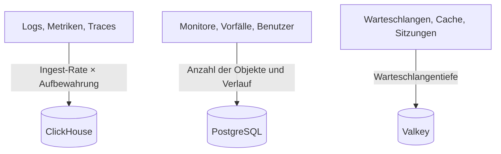

# Dimensionierung & Kapazitätsplanung

Planen Sie CPU, Arbeitsspeicher und Festplatte für ein selbst gehostetes OneUptime auf Kubernetes mit dem [Helm-Chart](https://artifacthub.io/packages/helm/oneuptime/oneuptime). Dimensionieren Sie die drei Datenspeicher – **ClickHouse**, **PostgreSQL** und **Valkey** – und die Anwendung getrennt, beginnen Sie mit einer der Stufen unten und passen Sie an, sobald Sie echte Zahlen haben.

> [!IMPORTANT]
> Die Standardwerte des Charts sind keine Produktionsdimensionierung. Die Dienste, die es standardmäßig ausführt, setzen **keine CPU- oder Speicher-Requests oder -Limits**, und PostgreSQL und ClickHouse erhalten kleine Volumes von **25 Gi**, damit sich das Chart auf jedem Cluster installieren lässt. Für alles, was über einen Test hinausgeht, legen Sie Ressourcen und Speicher selbst fest, mit den Zahlen auf dieser Seite.

Sie nutzen stattdessen die Docker-Compose-Installation auf einem einzelnen Server? Deren Dimensionierung ist einfacher: Siehe die [Anforderungen](/docs/installation/docker-compose#requirements) (empfohlen sind 16 GB Arbeitsspeicher, 8 Kerne und 400 GB Festplatte).

:::cards
- [Was jeden Datenspeicher wachsen lässt](#what-drives-each-datastore): Drei Speicher, die mit drei verschiedenen Dingen wachsen.
- [Startstufen](#starting-tiers): Kleine, mittlere und große Ausgangspunkte.
- [Hochverfügbarkeit](#high-availability): Replikate und Failover für jeden Datenspeicher.
- [Aufbewahrung](#retention-and-how-it-affects-storage): Die Einstellung, die Ihren Speicherbedarf vervielfacht.
:::

## Ihre Installation dimensionieren

:::steps
1. Ermitteln Sie, wie viel Telemetrie Sie senden: die GB an Logs, Metriken und Traces pro Tag. Messen Sie sie nach Möglichkeit an einer kleinen Installation.
2. Legen Sie fest, wie viele Tage Sie sie aufbewahren. Die Aufbewahrung vervielfacht den Festplattenbedarf von ClickHouse (siehe [Aufbewahrung](#retention-and-how-it-affects-storage)).
3. Berechnen Sie den Festplattenbedarf von ClickHouse mit der [Speicherformel](#storage-formula), dann den von PostgreSQL und Valkey aus deren eigenen Abschnitten.
4. Wählen Sie die [Startstufe](#starting-tiers), die Ihren Zahlen am nächsten kommt, und legen Sie deren CPU, Arbeitsspeicher und Speicher in Ihren Helm-Values fest.
5. Schalten Sie [Hochverfügbarkeit](#high-availability) für die Datenspeicher ein, die sie brauchen, beobachten Sie dann die tatsächliche Nutzung und passen Sie an.
:::

## Was jeden Datenspeicher wachsen lässt

OneUptime braucht in der Produktion drei Datenspeicher. Jeder wächst mit etwas anderem, also dimensionieren Sie sie unabhängig voneinander.



| Datenspeicher | Was er speichert | Was seine Größe bestimmt |
| --- | --- | --- |
| **ClickHouse** | Die gesamte Telemetrie – Logs, Metriken, Traces, Exceptions, Profile | Telemetrie: **Ingest-Rate × Aufbewahrung**. Das sind rund 95 % Ihres Speichers und der größte Kostenfaktor. |
| **PostgreSQL** | Konfiguration und Zustand – Monitore, Vorfälle, Alerts, Benutzer, Teams, Projekte, Workflows, Statusseiten, Dashboards | **Anzahl der Objekte und Verlauf**, nicht das Telemetrievolumen. Wächst langsam. |
| **Valkey** | Cache, Arbeitswarteschlangen und Sitzungen | **Warteschlangentiefe und aktive Sitzungen**. Speichergebunden und bescheiden. Keine maßgebliche Datenquelle. |

OneUptime braucht für den Betrieb nie einen Objektspeicher (S3, MinIO), und es verschiebt keine ältere Telemetrie in einen Objektspeicher. Einen Objektspeicher brauchen Sie nur, wenn Sie sich für Backups in einen Objektspeicher entscheiden: das Barman-Cloud-Plugin für CloudNativePG oder [clickhouse-backup](https://github.com/Altinity/clickhouse-backup) für ClickHouse. Das eigene CloudNativePG-Backup des Charts (`postgresOperator.cnpg.backup`) erstellt Volume-Snapshots und braucht keinen Objektspeicher. CloudNativePG löscht alte Snapshots nie: Bereinigen Sie sie selbst, sonst wachsen sie immer weiter.

## ClickHouse – der wichtigste Faktor

Fast Ihr gesamter Speicher und ein großer Teil Ihres Arbeitsspeichers gehen an ClickHouse, weil jede Logzeile, jeder Metrikpunkt, jeder Trace-Span und jede Exception dort liegt.

### Speicherformel

```text
ClickHouse disk ≈ (daily raw telemetry GB ÷ compression) × retention days × replicas × 1.3 (headroom)
```

Die Komprimierung hängt vom Signal ab:

| Signal | Typische Komprimierung | Was sie verändert |
| --- | --- | --- |
| Logs | Etwa 5:1 | Logs lassen sich gut komprimieren. |
| Metriken | Etwa 2:1 | Eine hohe **Kardinalität** der Labels bläht Festplatte und Arbeitsspeicher schneller auf als das reine Volumen. Halten Sie die Kardinalität der Labels niedrig. |
| Traces | Dazwischen | Die Span-Attribute, die Sie senden. |

### Rechenbeispiel

Eine Flotte von **10 Clustern** mit je etwa 10 Knoten und 100 Pods, die auf INFO-Ebene loggen, erzeugt grob **50–150 GB Roh-Logs pro Cluster in 30 Tagen** (etwa 1,7–5 GB pro Tag und Cluster). Über die ganze Flotte, mit Metriken und Traces und nach der Komprimierung, planen Sie grob **5–15 GB komprimierte Telemetrie pro Tag** ein.

| Aufbewahrung | Ein Replikat | 2 Replikate + 30 % Reserve |
| --- | --- | --- |
| 30 Tage | ~150–450 GB | **~0,4–1,2 TB** |
| 90 Tage | ~0,45–1,35 TB | **~1,2–3,5 TB** |

Der Speicher wächst **linear mit der Aufbewahrung**: Ein Fenster von 90 Tagen kostet etwa dreimal so viel wie eines von 30 Tagen.

### Arbeitsspeicher und Festplattentyp

- **Verwenden Sie NVMe oder SSD.** Telemetrie ist schreiblastig, mit Schüben von Aggregationslesezugriffen; ClickHouse auf drehenden Festplatten hat Mühe.
- **Geben Sie ClickHouse großzügig Arbeitsspeicher.** Aggregationsabfragen brauchen viel Arbeitsspeicher. Als Faustregel dimensionieren Sie den Arbeitsspeicher auf 25–50 % Ihrer _heißen_ (kürzlich abgefragten) komprimierten Daten, mit einer praktischen Untergrenze von 16 GB für jede echte Produktionsflotte.
- **Behalten Sie die Kardinalität der Metriken im Griff.** Sie ist der größte einzelne Hebel für Arbeitsspeicher und Festplatte von ClickHouse. Setzen Sie dort, wo Sie Metriken erfassen, Label-Konventionen mit niedriger Kardinalität durch und beobachten Sie die Zahl der aktiven Serien.

## PostgreSQL – Konfiguration und Zustand

PostgreSQL speichert Ihre Konfiguration und Ihren Betriebszustand, keine Telemetrie, deshalb wächst es langsam und bleibt neben ClickHouse klein. Selbst große Installationen liegen typischerweise im Bereich von einigen Dutzend GB. Das Standard-Volume von **25 Gi** genügt für kleine Installationen; planen Sie 50–100 GB für größere ein, mit Reserve für den Verlauf von Vorfällen und Alerts.

Bei vielen Replikaten von App, Worker und Probe können die Datenbankverbindungen vor dem Speicher knapp werden. Jeder Pod öffnet standardmäßig bis zu 50 Verbindungen, und das mitgelieferte PostgreSQL erlaubt 500. Genau dafür enthält das Chart den optionalen Connection-Pooler **PgBouncer** (`pgbouncer.enabled`): Schalten Sie ihn bei Installationen mit vielen Replikaten ein.

## Valkey – Cache, Warteschlangen und Sitzungen

Die Cache-Schicht führt [Valkey](https://valkey.io) aus, den BSD-lizenzierten Fork von Redis 7.2, als Cache, Arbeitswarteschlange und Sitzungsspeicher. Jeder Server mit Redis-Protokoll kann es ersetzen, und die Dimensionierung unten gilt in beiden Fällen. Es ist **speichergebunden**, und die Persistenz ist **standardmäßig aus**: Es ist keine maßgebliche Datenquelle und lässt sich neu aufbauen. Dimensionieren Sie es nach Warteschlangentiefe und gleichzeitigen Sitzungen; 2–8 GB Arbeitsspeicher reichen für die meisten Installationen. Seine Verdrängungsrichtlinie ist `noeviction`, also beobachten Sie seinen Arbeitsspeicher, wenn sich Warteschlangen unter anhaltender Last stauen.

## Rechenleistung der Anwendung

Neben den Datenspeichern dimensionieren Sie die zustandslosen Workloads. Jeder läuft **ohne Ressourcen-Requests oder -Limits**, bis Sie sie festlegen, und mit einem Replikat, außer dem Telemetry Writer, der zwei hat.

| Workload | Values-Schlüssel | Wächst mit |
| --- | --- | --- |
| App: Dashboard, API und Ingest | `app` | Benutzern, API-Aufrufen und eingehender Telemetrie |
| Worker, wenn von der App getrennt | `worker` | Telemetrie und Verarbeitung von Hintergrundjobs |
| Probes | `probes` | Der Zahl der aktiven Monitore |
| Ingress-Gateway | `nginx` | Dem Anfragevolumen |
| Telemetry Writer, wenn eingeschaltet | `telemetryWriter` | Nicht mit der Last: Er bündelt jeden Telemetrie-Insert in ClickHouse und wird daher nach dem dimensioniert, was ClickHouse verkraftet |

Das Chart bringt **KEDA** mit, sodass App, Worker, Probes und der Runner nach ihrem Warteschlangenrückstand skalieren können. Schalten Sie `keda.enabled` zusammen mit dem eigenen `keda.enabled` jedes Dienstes ein (zum Beispiel `app.keda.enabled`). Auf einem Cluster ohne KEDA braucht die erste Installation einen zusätzlichen Durchlauf: Siehe die [KEDA-Anleitung](https://github.com/OneUptime/oneuptime/blob/master/HelmChart/Docs/Keda.md) des Charts. Dienste, die KEDA nicht verwaltet, können stattdessen einen CPU- oder Speicher-Autoscaler nutzen (`autoscaling`).

## Startstufen

Wählen Sie die Stufe, die Ihrer Umgebung am nächsten kommt, als Ausgangspunkt, beobachten Sie dann die tatsächliche Nutzung (`kubectl top pods`, das Festplattenwachstum von ClickHouse und PostgreSQL) und passen Sie an.

- **Klein / PoC** – 1–3 Cluster, ≤30 Knoten, ≤5 GB/Tag Roh-Telemetrie, 30 Tage Aufbewahrung.
- **Mittel / Produktionsflotte** – ~10 Cluster, ~100 Knoten, 10–30 GB/Tag Roh-Telemetrie, 30–90 Tage Aufbewahrung.
- **Groß / Mehrere Flotten** – 50+ Cluster, 500+ Knoten, 100+ GB/Tag Roh-Telemetrie, 90 Tage Aufbewahrung.

| | Klein / PoC | Mittel / Produktionsflotte | Groß / Mehrere Flotten |
| --- | --- | --- | --- |
| **ClickHouse** | 4 vCPU / 16 GB / 200 GB NVMe | 8 vCPU / 32 GB / 1–3 TB NVMe | 16+ vCPU / 64–128 GB / 5–15 TB NVMe, **geshardet** |
| **PostgreSQL** | 2 vCPU / 4 GB / 50 GB SSD | 4 vCPU / 8 GB / 100 GB SSD | 8 vCPU / 16–32 GB / 250 GB SSD (+ PgBouncer) |
| **Valkey** | 1 vCPU / 2 GB | 2 vCPU / 4 GB | 4 vCPU / 8–16 GB |
| **Angenommene Aufbewahrung** | 30 Tage | 30–90 Tage | 90 Tage |

Diese Stufen dimensionieren das OneUptime-Backend. Den Agent, den Sie auf jedem überwachten Cluster installieren, behandelt die Seite [Kubernetes-Agent](/docs/telemetry/kubernetes-agent), die auch zeigt, wie Sie die gesendete Datenmenge verringern.

## Hochverfügbarkeit

Die eingebauten Datenspeicher des Charts laufen standardmäßig als **Einzelinstanzen**. Für Hochverfügbarkeit in der Produktion:

| Datenspeicher | Für Hochverfügbarkeit |
| --- | --- |
| **PostgreSQL** | Schalten Sie den mitgelieferten [CloudNativePG](https://cloudnative-pg.io)-Operator (`postgresOperator.cnpg.enabled`) mit **3 Instanzen** (`postgresOperator.cnpg.instances`) ein: ein Primärserver und zwei Hot Standbys, mit automatischem Failover. |
| **ClickHouse** | Schalten Sie den mitgelieferten [Altinity](https://github.com/Altinity/clickhouse-operator)-Operator (`clickhouseOperator.altinity.enabled`) mit **2 oder mehr Replikaten pro Shard** (`clickhouseOperator.altinity.cluster.replicasCount`) ein. Sein mitgelieferter ClickHouse Keeper läuft mit **3 Knoten** für das Quorum. Fügen Sie Shards hinzu (`shardsCount`), sobald Festplatte oder Arbeitsspeicher eines Knotens die Grenze sind. |
| **Valkey** | Das Chart repliziert es nicht. Richten Sie OneUptime auf ein externes verwaltetes Redis oder Valkey mit automatischem Failover (`externalValkey`). OneUptime verbindet sich mit einem einzelnen Host und Port, verwenden Sie also den primären Endpunkt des Dienstes, keinen im Cluster-Modus. |

> [!WARNING]
> Wenn Sie einen der Operatoren für eine bestehende Installation einschalten, startet eine neue, leere Datenbank: Keiner von beiden kopiert die Daten der Einzelinstanz-Datenbank, die er ersetzt. Migrieren Sie Ihre Daten, wie es die Anleitungen des Charts beschreiben – für [PostgreSQL](https://github.com/OneUptime/oneuptime/blob/master/HelmChart/Docs/MigratePostgresStandaloneToOperator.md) und für [ClickHouse](https://github.com/OneUptime/oneuptime/blob/master/HelmChart/Docs/MigrateClickhouseStandaloneToOperator.md).

## Aufbewahrung und ihr Einfluss auf den Speicher

Die Aufbewahrung von Telemetrie ist eine **ClickHouse-TTL in Tagen**. Jede Edition hat den Standardwert des Projekts unter **Projekteinstellungen > Telemetrie & APM > Datenaufbewahrung** (**Standardaufbewahrung (Tage)**); ist nichts gesetzt, sind es 15 Tage. Die [Enterprise Edition](/docs/self-hosted/enterprise) ergänzt Überschreibungen: nach Signal (Logs, Traces, Metriken, Profile), nach Log-Schweregrad und Trace-Status sowie pro Dienst oder Ressource.

Logs und Metriken werden tageweise gelöscht, um die erste Mitternacht (Serverzeit von ClickHouse) nach dem Ende ihrer Aufbewahrung; so muss ClickHouse nicht jeden Tag davon alle paar Stunden neu schreiben, während er abläuft. Kurz vor Mitternacht liegt noch bis zu ein Tag mehr als das Aufbewahrungsfenster auf der Festplatte: Dimensionieren Sie Logs und Metriken für **Aufbewahrungstage + 1**.

Weil die Aufbewahrung den Speicher von ClickHouse vervielfacht, legen Sie sie fest, bevor Sie die Festplatte dimensionieren. OneUptime archiviert alte Telemetrie **nicht** und verschiebt sie auch nicht in einen Objektspeicher. Für eine mehrjährige Aufbewahrung aus Compliance-Gründen verlängern Sie das Aufbewahrungsfenster und dimensionieren den Speicher von ClickHouse passend, oder Sie exportieren in ein externes Archiv Ihrer Wahl.

## Messen, bevor Sie sich festlegen

Das Telemetrievolumen schwankt enorm je nach Ausführlichkeit der Anwendungslogs, Anzahl der Namespaces, Scrape-Intervall und danach, ob irgendwo DEBUG-Logging eingeschaltet ist. Betrachten Sie die Stufen oben als Ausgangspunkte: **Erfassen Sie mindestens vier Wochen lang Daten aus Ihrer Umgebung**, messen Sie die tatsächlichen GB pro Tag für jedes Signal und dimensionieren Sie dann Aufbewahrung und Speicher anhand echter Daten.

## Nächste Schritte

:::cards
- [Docker Compose](/docs/installation/docker-compose): Anforderungen für eine Installation auf einem einzelnen Server.
- [Architektur selbst gehosteter Installationen](/docs/self-hosted/architecture): Wie die Komponenten zusammenspielen.
- [Kubernetes-Agent](/docs/telemetry/kubernetes-agent): Der Collector, der die Telemetrie eines Clusters sendet.
- [Enterprise Edition](/docs/self-hosted/enterprise): Überschreibungen der Aufbewahrung und die anderen Enterprise-Funktionen.
:::
