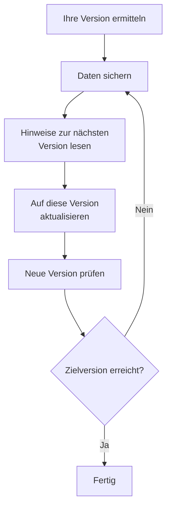

# Aktualisierung

Aktualisieren Sie ein selbst gehostetes OneUptime – mit Docker Compose oder mit Kubernetes und Helm – auf ein neueres Release. Folgen Sie dem Ablauf unten und lesen Sie die Hinweise zu jeder Hauptversion zwischen der, die Sie betreiben, und der, auf die Sie wechseln.

:::cards
- [So führen Sie ein Upgrade durch](#so-führen-sie-ein-upgrade-durch): Der Ablauf, für Docker Compose und Kubernetes.
- [Hinweise zu jeder Version](#hinweise-für-ihre-version-finden): Was jede Hauptversion von Ihnen verlangt, auf einen Blick.
- [Images der Community und Enterprise Edition](#images-der-community-und-enterprise-edition): Welches Image Sie ab 14 betreiben.
- [Upgrade von OneUptime 13 → 14](#upgrade-von-oneuptime-13-14): Die neueste Hauptversion.
:::

## So führen Sie ein Upgrade durch

Drei Regeln machen ein Upgrade sicher:

- **Aktualisieren Sie immer nur um eine Hauptversion** (zum Beispiel 6 → 7 → 8). Überspringen Sie keine Hauptversion.
- **Neben- und Patch-Releases dürfen Sie beliebig überspringen** (zum Beispiel 8.1 → 8.4), sofern Sie deren Release-Notes beachten.
- **Sichern Sie vor jedem Upgrade**, und prüfen Sie, dass sich die Sicherung wiederherstellen lässt.



:::steps
### Ermitteln Sie Ihre aktuelle Version

Öffnen Sie als Master-Admin das Editions-Label in der Kopfzeile des Admin-Dashboards: **This installation** zeigt die Version, die Sie betreiben. Die Instanz meldet sie außerdem unter `/version`:

```bash
curl http://localhost/version
```

Ersetzen Sie `http://localhost` durch die Adresse Ihrer Instanz. Die Antwort ist JSON, etwa `{"version":"14.0.22","commit":"..."}`.

### Sichern Sie Ihre Daten

Sichern Sie PostgreSQL und, wenn Sie dessen Telemetrie brauchen, ClickHouse. Für Docker Compose siehe [Sichern und wiederherstellen](/docs/installation/docker-compose#sichern-und-wiederherstellen). Auf Kubernetes verwenden Sie Ihre Volume-Snapshots oder die CloudNativePG-Backups des Charts.

### Lesen Sie die Hinweise zur nächsten Hauptversion

Sie finden sie in [der Tabelle unten](#hinweise-für-ihre-version-finden). Erledigen Sie, was sie verlangen, bevor Sie aktualisieren: Manche Schritte, etwa das Umbenennen von Helm-Werten, müssen vorher geschehen.

### Führen Sie das Upgrade aus

:::tabs
@tab Docker Compose
```bash
git checkout release
git pull
npm run update
```
`npm run update` ergänzt Ihre `config.env` um neue Einstellungen, ohne Ihre zu ändern, zieht die neuen Images und startet OneUptime neu.
@tab Kubernetes
```bash
helm repo update
helm upgrade my-oneuptime oneuptime/oneuptime -f values.yaml
```
Verwenden Sie Ihren eigenen Release-Namen und Ihre eigene Wertedatei. Das Chart führt die Datenbankmigrationen in einem eigenen Job aus, bevor die neuen Pods Datenverkehr bedienen.
:::

### Prüfen Sie die neue Version

Unter Docker Compose endet `npm run update` mit **OneUptime is up!** Unter Kubernetes warten Sie, bis jeder Pod `Running` und bereit ist:

```bash
kubectl get pods -n <namespace>
```

Prüfen Sie dann Ihre Version erneut, wie im ersten Schritt. Haben Sie Ihre Zielversion noch nicht erreicht, kehren Sie zu [Sichern Sie Ihre Daten](#sichern-sie-ihre-daten) zurück und nehmen Sie die nächste Hauptversion.
:::

### Hinweise für Ihre Version finden

| Upgrade | Was Sie tun müssen |
| --- | --- |
| [13 → 14](#upgrade-von-oneuptime-13-14) | Eine Edition wählen. Docker-Compose-Installationen, die `IS_ENTERPRISE_EDITION=true` setzen, wechseln zu `APP_TAG=enterprise-release`. In der Enterprise Edition eine Lizenz aktivieren. IPv6-Monitore für Ping, Port und SSL erneut speichern. |
| [12 → 13](#upgrade-von-oneuptime-12-13) | Meist nichts: Aus Redis wird Valkey, und die alten Einstellungsnamen funktionieren weiter. Betreiben Sie Docker Compose von Hand? Ergänzen Sie `--remove-orphans`. Nutzen Sie einen eigenen Cache? Lesen Sie [Wenn Sie Ihren eigenen Cache betreiben](#wenn-sie-ihren-eigenen-cache-betreiben). |
| [11 → 12](#upgrade-von-oneuptime-11-12) | Runbook Agents als Runner neu bereitstellen. Unter Docker Compose `ONEUPTIME_RUNNER_KEY` setzen. Unter Helm `aiAgent:` in `runner:` umbenennen. Runner-Berechtigungen, die API-Schlüssel direkt hatten, erneut vergeben. |
| [10 → 11](#upgrade-von-oneuptime-10-11) | SCIM und die Team-Compliance-Einstellungen erfordern die Enterprise Edition. Um Ihre Telemetrie-Historie zu behalten, benennen Sie die alten ClickHouse-Tabellen vor dem Upgrade um. |
| [9 → 10](#upgrade-von-oneuptime-9-10) | Nichts. |
| [8 → 9](#upgrade-von-oneuptime-8-9) | Unter Helm Überschreibungen von `oneuptimeIngress` aus Ihren Werten entfernen. |
| [7 → 8](#upgrade-von-oneuptime-7-8) | Unter Helm auf die neue Wertestruktur für Postgres, Redis und ClickHouse umstellen. Vorher sichern. |

## Images der Community und Enterprise Edition

OneUptime liefert die Anwendung jetzt als zwei Images aus. Die **Community Edition** ist Open Source unter der Apache License 2.0 und enthält Single Sign-On per SAML und OIDC, globales SSO und „Require SSO for login“. Die **Enterprise Edition** fügt die Enterprise-Module aus dem Verzeichnis `ee/` des Repositorys hinzu: SCIM, Team-Compliance, Audit-Logs und die Enterprise-Health-Dashboards im Admin-Dashboard. Vor dieser Änderung führten beide Editionen denselben Code aus, und `IS_ENTERPRISE_EDITION` entschied, welche Funktionen eingeschaltet waren. Jetzt entscheidet das Image, und das Community-Image enthält das Verzeichnis `ee/` nicht.

Die Seite [Enterprise Edition](/docs/self-hosted/enterprise) enthält den vollständigen Funktionsvergleich, die Lizenzdetails und was bei einem Wechsel der Edition geschieht.

### Was vor dem Upgrade zu tun ist

- **Community Edition ohne SCIM:** nichts. Aktualisieren Sie wie gewohnt.
- **Helm mit `image.type: enterprise-edition`:** nichts. Das Chart zieht bereits die `enterprise-`-Images, die jetzt die Enterprise-Module enthalten.
- **Docker Compose mit `IS_ENTERPRISE_EDITION=true`:** Wechseln Sie beim Upgrade auf das Enterprise-Image, indem Sie in `config.env` `APP_TAG=enterprise-release` (oder `enterprise-<version>`) setzen. `APP_TAG=release` ist das Community-Image, und `IS_ENTERPRISE_EDITION=true` schaltet nichts mehr ein. `npm run update` nimmt diese Änderung für Sie vor, solange `IS_ENTERPRISE_EDITION=true` gesetzt ist (`release` wird `enterprise-release`, ein festgepinntes `13.0.7` wird `enterprise-13.0.7`), und gibt aus, was es geändert hat. Die Anwendung **verweigert jetzt den Start**, wenn `IS_ENTERPRISE_EDITION=true` auf dem Community-Image gesetzt ist, statt SCIM-Provisionierung und Audit-Protokollierung stillschweigend einzustellen. Der Fehler sagt, was zu setzen ist: `APP_TAG=enterprise-<version>`, um die Enterprise Edition zu behalten, oder `IS_ENTERPRISE_EDITION=false`, um die Community Edition zu betreiben.
- **Community-Image mit bereits eingerichtetem SCIM:** Die SCIM-Provisionierung endet mit diesem Upgrade, einschließlich der Deprovisionierung. Wechseln Sie auf das Enterprise-Image, um sie zu behalten. Andernfalls lesen Sie vor dem Upgrade [Von Enterprise zu Community wechseln](/docs/self-hosted/enterprise#switching-from-enterprise-to-community). Dort steht, was aufhört und wen Sie zuerst entfernen sollten. Um die Community Edition zu betreiben, setzen Sie außerdem `IS_ENTERPRISE_EDITION=false`. Single Sign-On ist nicht betroffen: Das Community-Image stellt es ebenfalls bereit.

Ihre Konfiguration wird nie gelöscht, und für einen Wechsel der Edition ist in keiner Richtung eine Migration nötig.

### Lizenzierung nach dem Upgrade

Die Enterprise Edition prüft jetzt ihre Lizenz:

- **Eine Installation mit Lizenzschlüssel** funktioniert weiter. Sie prüft die Lizenz bei OneUptime beim Start und einmal täglich. Läuft die Lizenz ab, funktioniert alles während einer Kulanzfrist von 30 Tagen weiter; danach geschieht dasselbe wie bei einer Installation ohne Lizenz.
- **Eine Installation ohne Lizenz**, etwa eine, die die Enterprise Edition allein mit `IS_ENTERPRISE_EDITION=true` betrieben hat, erhält ab dem ersten Start dieses Releases eine Testphase von 14 Tagen. **Wenn Sie SCIM oder die Audit-Protokollierung nutzen, aktivieren Sie vor dem Ende der Testphase eine Lizenz.** Nach der Testphase endet die SCIM-Provisionierung, und die Audit-Protokollierung zeichnet nichts mehr auf. Außerdem wird die Enterprise-Konfiguration schreibgeschützt, und die Enterprise-Health-Dashboards werden gesperrt. Single Sign-On ist nicht betroffen. Alles läuft ohne Neustart wieder, sobald Sie eine Lizenz aktivieren. Die Testphase dient der Evaluierung: Der Produktivbetrieb der Enterprise Edition erfordert ein OneUptime-Enterprise-Abonnement. Siehe [Wenn eine Lizenz abläuft oder fehlt](/docs/self-hosted/enterprise#when-a-license-expires-or-is-missing).
- **Installationen ohne Internetzugang** können statt mit einem Schlüssel mit einem signierten Lizenz-Token aktivieren. Siehe [Offline-Aktivierung](/docs/self-hosted/enterprise#offline-activation-air-gapped-installs).

### Kunden von OneUptime Cloud

Für Sie ändert sich nichts. OneUptime Cloud betreibt die Enterprise Edition, und Ihr Plan entscheidet weiterhin, welche Funktionen Sie erhalten: SSO, OIDC, SCIM und Team-Compliance ab dem Plan Scale, Audit-Logs im Plan Enterprise. Projekte im Plan Scale sehen jetzt die Einstellungen für SSO, OIDC, SCIM und Team-Compliance, die früher einen Upgrade-Hinweis zeigten.

### Änderungen an API und Endpunkten

- `GET /api/global-config/license` liefert den Lizenzschlüssel, das Lizenz-Token, die Liste der Instanzen, die Instanz-ID und die Versionsdetails nur noch an Master-Admins. Alle anderen erhalten die Edition und den Lizenzstatus.
- Selbst gehostete Installationen stellen die Lizenzserver-Endpunkte unter `/api/enterprise-license/` nicht mehr bereit. Nur oneuptime.com verwendet sie.
- Die SCIM-Endpunkte behalten in der Enterprise Edition ihre genauen Pfade, die Konfiguration des Identity Providers ändert sich also nicht. In der Community Edition antworten sie mit `404`. In der Enterprise Edition weisen sie Anfragen ab, solange die Lizenz abgelaufen ist (nach der Testphase oder der Kulanzfrist), und antworten wieder, sobald eine Lizenz aktiviert ist.
- Die SSO- und OIDC-Endpunkte (die SAML-Anmelde- und ACS-URLs, die OIDC-Redirect-URIs und die globalen SSO-Endpunkte) behalten ihre genauen Pfade und werden von beiden Editionen in jedem Lizenzzustand bereitgestellt.

## Upgrade von OneUptime 13 → 14

OneUptime 14 teilt die Anwendung in zwei Editionen, und das Image, das Sie ziehen, entscheidet, welche davon läuft. Die **Community Edition** (Apache-2.0, die Tags `release` und `<version>`) enthält SAML SSO, OpenID Connect, globales SSO und „Require SSO for login“. Das Verzeichnis `ee/` des Repositorys ist darin nicht enthalten, daher sind SCIM-Provisionierung, Team-Compliance-Einstellungen, Audit-Logs, die **Health**-Dashboards des Admin-Dashboards und die **Query Console** des Admin-Dashboards in diesem Image überhaupt nicht vorhanden. Die **Enterprise Edition** (die Tags `enterprise-release` und `enterprise-<version>`) enthält sie und prüft im Betrieb eine Enterprise-Lizenz – das hat OneUptime 13 nie getan. Single Sign-On hängt nicht von dieser Lizenz ab.

[Images der Community und Enterprise Edition](#images-der-community-und-enterprise-edition) oben ist die Referenz zu dieser Änderung: was jede Edition enthält, was auf welchem Installationsweg zu setzen ist und was die Lizenz bewirkt. Dieser Abschnitt beschreibt das Upgrade selbst. Aktualisieren Sie von 13 aus – wenn Sie noch auf 12 sind, führen Sie zuerst 12 → 13 durch.

In keiner Edition wird etwas gelöscht. Single Sign-On funktioniert in beiden Editionen gleich: Ihre SSO- und OIDC-Konfiguration und Ihre Einstellungen für „Require SSO for login“ werden unverändert übernommen. Ihre SCIM-Konfiguration und die bisher aufgezeichneten Audit-Logs bleiben in der Datenbank. Die Community Edition stellt sie lediglich nicht bereit, und ein Wechsel der Edition erfordert in keiner Richtung eine Migration.

### Was Sie tun müssen

1. **Entscheiden Sie, welche Edition diese Installation betreibt.** Wenn Sie SCIM-Provisionierung, Team-Compliance-Einstellungen oder Audit-Logs nutzen oder die **Health**-Dashboards des Admin-Dashboards möchten, ist das die Enterprise Edition. Andernfalls ist hier nichts zu entscheiden: Die Community Edition ist das, was Sie schon haben, und sie enthält SAML SSO und OpenID Connect.
2. **Setzen Sie unter Helm die Edition in Ihrer Wertedatei:** `image.type: enterprise-edition` (Standard ist `community-edition`). Lassen Sie `image.tag` unverändert – das Chart setzt das Präfix `enterprise-` selbst, `image.tag: release` zieht also `oneuptime/app:enterprise-release`. Dieser Wert ist nicht neu. Wenn Sie bereits `enterprise-edition` betreiben, ist nichts zu ändern: Das Tag, das Sie ohnehin ziehen, enthält jetzt `ee/`.
3. **Setzen Sie unter Docker Compose `APP_TAG=enterprise-release`** (oder `enterprise-<version>`, um ein Release festzupinnen) in `config.env`. `APP_TAG=release` ist das Community-Image. Das ist der eine Punkt, der eine 13er-Installation stoppt: Unter 13 war eine Compose-Enterprise-Installation `APP_TAG=release` plus `IS_ENTERPRISE_EDITION=true`, und diese Kombination **verweigert jetzt den Start**, statt als Community Edition hochzukommen und dabei SCIM-Provisionierung und Audit-Protokollierung stillschweigend einzustellen. `npm run update` schreibt `APP_TAG` für Sie um, solange `IS_ENTERPRISE_EDITION=true` gesetzt ist (`release` wird `enterprise-release`, ein festgepinntes `13.0.8` wird `enterprise-13.0.8`), und gibt aus, was es geändert hat. Wenn Sie die Images stattdessen von Hand ziehen, setzen Sie `APP_TAG` vorher selbst.
4. **Aktivieren Sie in der Enterprise Edition eine Lizenz.** Eine Installation ohne Lizenz erhält eine Testphase von 14 Tagen, gerechnet ab ihrem ersten Start der Enterprise Edition – bei einem Upgrade ist das der Tag des Upgrades, nicht der Tag, an dem Sie OneUptime zuerst installiert haben. Ein Master-Admin aktiviert sie über das Editions-Label in der Kopfzeile des Admin-Dashboards; Installationen ohne Internetzugang aktivieren stattdessen mit einem signierten Token. Siehe [Lizenzierung](/docs/self-hosted/enterprise#licensing).
5. **Wenn diese Installation die Community Edition betreiben wird, während Ihr Identity Provider Benutzer über SCIM deprovisioniert, prüfen Sie vor dem Upgrade, wer Zugriff hat.** Die SCIM-Deprovisionierung endet, sodass Personen, die Sie bei Ihrem Identity Provider entfernen, ihre OneUptime-Konten behalten, und sofern „Require SSO for login“ nicht für sie gilt, kann jede Person, die das Postfach eines solchen Kontos noch erreicht, mit „Passwort vergessen“ ein Passwort setzen und sich anmelden. Entfernen Sie diese Benutzer zuerst: [Von Enterprise zu Community wechseln](/docs/self-hosted/enterprise#switching-from-enterprise-to-community).
6. **Wenn Sie IPv6-Adressen mit Ping-, Port- oder SSL-Monitoren überwachen, speichern Sie diese Monitore nach dem Upgrade erneut.** Vor 14 gespeicherte Ziele können abgeschnitten abgelegt worden sein – siehe [IPv6-Monitore für Ping, Port und SSL](#ipv6-monitore-für-ping-port-und-ssl).

### Editionen: was sich geändert hat und was nicht

| | Bis 13 | Ab 14 |
| --- | --- | --- |
| Enterprise-Code | in jedem Image; `IS_ENTERPRISE_EDITION=true` schaltete ihn ein | in `ee/`, und nur in den `enterprise-`-Images |
| Auswahl unter Helm | `image.type` | `image.type` – unverändert, aber die Images unterscheiden sich jetzt |
| Auswahl unter Compose | `IS_ENTERPRISE_EDITION=true` | `APP_TAG=enterprise-release` |
| Enterprise-Lizenz | im Betrieb nie geprüft | beim Start und einmal täglich geprüft |
| SSO- und OIDC-Endpunkte | dieselben Pfade in beiden Editionen | dieselben Pfade in beiden Editionen, unabhängig vom Lizenzzustand |
| SCIM-Endpunkte | dieselben Pfade in beiden Editionen | dieselben Pfade in der Enterprise Edition; `404` in der Community Edition |
| Ihre Enterprise-Konfiguration | gespeichert, durchgesetzt | in beiden Editionen gespeichert, in der Enterprise Edition durchgesetzt |

Es läuft eine Migration: eine nullable Spalte `enterpriseEditionFirstSeenAt` in der einzeiligen Tabelle `GlobalConfig`, die sofort durchläuft. Es gibt keine ClickHouse-Migration, nichts wird verworfen, und für einen Wechsel der Edition ist in keiner Richtung eine Migration nötig.

### Der Lizenz-Zeitplan in der Enterprise Edition

- **Eine Installation ohne Lizenz** läuft 14 Tage in einer Testphase, gerechnet ab dem ersten Start der Enterprise Edition. Währenddessen funktioniert jede Enterprise-Funktion, und das Editions-Label warnt, bevor die Testphase endet. Die Testphase dient der Evaluierung: Der Produktivbetrieb der Enterprise Edition erfordert ein Abonnement unter der OneUptime Enterprise License.
- **Eine ablaufende Lizenz** erhält ab ihrem Ablaufdatum eine Kulanzfrist von 30 Tagen, in der jede Enterprise-Funktion funktioniert und das Editions-Label warnt.
- **Nach der Testphase oder nach dieser Kulanzfrist** gilt bis zur Aktivierung einer Lizenz: Die SCIM-Anfragen Ihres Identity Providers werden abgewiesen, und die Audit-Protokollierung zeichnet nichts mehr auf. Die Enterprise-Konfiguration wird schreibgeschützt – Sie können sie weiterhin einsehen und löschen und ein SCIM-Bearer-Token zurücksetzen, also genau das, was ein Sicherheitsvorfall erfordert –, und die Health-Dashboards und die Query Console des Admin-Dashboards sind gesperrt.
- **Es wird nichts gelöscht, und das Kern-Monitoring ist nie betroffen.** Monitore, Warnungen, Vorfälle, Bereitschaftsdienst, Statusseiten und Telemetrie liegen außerhalb der Lizenz, ebenso die Anmeldung: Die Anmeldung per SSO und OIDC, „Require SSO for login“ und die Anmeldung per Passwort für jeden Benutzer, Master-Admins eingeschlossen, funktionieren in jedem Lizenzzustand gleich. Das Aktivieren einer Lizenz stellt SCIM-Provisionierung und Audit-Protokollierung mit der Konfiguration wieder her, die Sie bereits haben, ohne Neustart.
- **Ein bereits vorhandener Lizenzschlüssel wird akzeptiert**, als „unverified“ eingestufte Lizenz: Ablaufdatum und Sitzplatzgrenze stammen aus dem, was der Lizenzserver dieser Installation bereits mitgeteilt hat, und nach diesem Ablauf gilt dieselbe Kulanzfrist von 30 Tagen. Ab jetzt ausgestellte Lizenzen sind signiert und werden von der Anwendung selbst geprüft. Für dieses Upgrade brauchen Sie keinen neuen Schlüssel.
- **Ein Schlüssel, zu dem diese Installation nie ein Ablaufdatum aufgezeichnet hat**, funktioniert während der Testphase weiter, statt aufzuhören. Der Lizenzserver schreibt den Schlüssel und das Ablaufdatum getrennt, sodass eine Installation einen Schlüssel besitzen kann, zu dem ihr nie ein Ablaufdatum mitgeteilt wurde. Eine solche Installation wird genau wie eine ohne Lizenz behandelt: Während der Testphase von 14 Tagen, gerechnet ab dem ersten Start der Enterprise Edition, funktioniert jede Enterprise-Funktion, und nach der Testphase hört dasselbe auf wie oben. Die Sitzplatzgrenze wird in diesem Zustand nicht durchgesetzt, weil der Lizenzeintrag dieser Installation bereits unvollständig ist. Aktiviert ein Master-Admin die Lizenz über das Editions-Label neu oder holt der tägliche Lizenzabgleich das Ablaufdatum von oneuptime.com, ist sie ohne Neustart wiederhergestellt.

Die vollständige Zustandstabelle steht unter [Wenn eine Lizenz abläuft oder fehlt](/docs/self-hosted/enterprise#when-a-license-expires-or-is-missing).

### Docker Compose: das Image-Tag wählen

```bash
git checkout release # Please make sure you're on release branch.
git pull
npm run update
```

- **`npm run update` verschiebt `APP_TAG`, solange `IS_ENTERPRISE_EDITION=true` gesetzt ist**, auf das Enterprise-Image desselben Releases und gibt aus, was es geändert hat. Ihre Kommentare und Anführungszeichen bleiben erhalten, ein `APP_TAG`, das bereits ein `enterprise-`-Tag ist, bleibt unangetastet, und ein zweiter Lauf ändert nichts.
- **Wer die Images von Hand zieht, überspringt das**, und die Anwendung beendet sich dann beim Start mit einem Fehler, der genau nennt, was zu setzen ist: `APP_TAG=enterprise-<version>`, um die Enterprise Edition zu behalten, oder `IS_ENTERPRISE_EDITION=false`, um die Community Edition zu betreiben.
- **Um bewusst zur Community Edition zu wechseln**, setzen Sie `APP_TAG=release` und `IS_ENTERPRISE_EDITION=false`. Lesen Sie vorher Punkt 5 oben, wenn Ihr Identity Provider Benutzer über SCIM deprovisioniert.
- Sonst muss sich für dieses Release nichts in `config.env` ändern.

### Helm: den Image-Typ wählen

```bash
helm repo update
helm upgrade my-oneuptime oneuptime/oneuptime -f values.yaml
```

- **Eine Installation, die bereits mit `image.type: enterprise-edition` läuft, braucht keine Wertänderung.** Das Chart setzt das Tag-Präfix schon lange; neu ist, dass die `enterprise-`-Images `ee/` enthalten. Ab diesem Release gilt für sie die Lizenz, nach dem Zeitplan oben.
- **`image.tag: release` ist der Standard**, ein Chart auf dem gleitenden Tag wechselt also beim nächsten Upgrade ganz ohne Wertänderung auf 14. Hat diese Installation unter `community-edition` SCIM eingerichtet, setzen Sie im selben Upgrade `image.type: enterprise-edition`.
- **`IS_ENTERPRISE_EDITION` wird vom Chart weiterhin gesetzt**, abgeleitet aus `image.type`, damit beide nie voneinander abweichen. Es steuert nichts. Es über `extraEnv` auf einem Community-Image auf `true` zu erzwingen, bewirkt nur, dass die Anwendung den Start verweigert. Setzen Sie `ONEUPTIME_EDITION` niemals über das Chart.
- **Chart-Probes beachten `probes.<key>.allowPrivateNetworkMonitors` wieder** ([#3879](https://github.com/OneUptime/oneuptime/issues/3879)). Ohne diesen Wert ändert sich nichts – er steht weiterhin auf `false` –, und er gilt für Monitore aller Projekte der Instanz, weil Chart-Probes globale Probes sind. Loopback, Link-Local und `169.254.169.254` bleiben unabhängig davon blockiert.

### Weitere Änderungen in 14

Diese Änderungen betreffen, wie sich OneUptime nach dem Upgrade verhält, und die meisten erfordern nichts von Ihnen. Lesen Sie sie, wenn Sie benutzerdefinierte Rollen oder API-Schlüssel aus einzelnen Berechtigungen, eigene Vorfalls-, Warnungs- oder Wartungsstatus, Terraform oder die API, SSO oder die Apps für Slack und Microsoft Teams verwenden.

:::details Die weiteren Änderungen in 14 lesen
- **Die OTLP-Aufnahme bestätigt ein Batch erst, wenn die Warteschlange es angenommen hat.** 13 antwortete zuerst mit `200` und stellte danach ein, sodass ein Batch, das die Warteschlange ablehnte, unbemerkt verloren ging. 14 antwortet stattdessen mit `503` und `Telemetry queue unavailable. Please retry.`, und der gRPC-Endpunkt gibt `UNAVAILABLE` zurück; beides ist wiederholbar, und Exporter wiederholen. Das gilt für Logs, Metriken, Traces und Profile. Zu tun ist nichts, aber Wiederholungen auf Seiten der Exporter und Rückstau in der Warteschlange werden jetzt dort sichtbar, wo früher Daten verschwanden – gut zu wissen, wenn Sie die Aufnahmekapazität dimensionieren.
- **Die Health-Dashboards und die Query Console des Admin-Dashboards erfordern die Enterprise Edition**, ebenso die Health-Warnungen für PostgreSQL und Valkey. Unter 13 gab es sie allein mit `IS_ENTERPRISE_EDITION=true`, für eine Community-Installation, die sie genutzt hat, ist das also ein sichtbarer Verlust. Die Kapazitätsüberwachung und Bereinigung von ClickHouse, der Migrationsstatus, globale Probes und das Support-Bundle sind in beiden Editionen enthalten.
- **HTTPS-Monitore, die eine IP-Adresse über den Proxy einer Probe erreichen, funktionieren wieder.** Die Probe übergab die IP früher als TLS-Servernamen; das ist kein gültiger Servername, und Node lehnt ihn strikt ab, sodass ein Monitor auf `https://<private IP>` von einer globalen Probe mit `PROBE_ALLOW_PRIVATE_NETWORK_MONITORS` am Handshake scheiterte. Die Probe lässt den Servernamen bei einem IP-Ziel jetzt weg und prüft das Zertifikat gegen die IP selbst. Bei Hostnamen-Zielen ändert sich nichts.
- **Die `oneuptime`-CLI meldet ihre echte Version** bei `--version` statt eines Platzhalters.
- **Eine neue Warnung oder Episode beginnt in dem Status, den ihr Anlegen nennt.** Die API, Terraform (`current_alert_state_id`, `current_incident_state_id`) und Workflows können den Status nennen, in dem eine Warnung, eine Warnungsepisode oder eine Vorfallsepisode beginnt, so wie es das Feld **Anfangsstatus** im Dashboard tut. Bisher wurde dieser Status durch den Erstellungsstatus des Projekts ersetzt; eine Terraform-Konfiguration, die ihn setzte, bekam einen anderen Wert zurück, als sie geplant hatte. Ein Anlegen, das keinen Status nennt, beginnt weiterhin im Erstellungsstatus, und ein Status eines anderen Projekts wird abgelehnt. Siehe [Der Status, in dem ein neuer Datensatz beginnt](/docs/api-reference/api-reference).
- **Ein Datensatz, der bereits bestätigt oder behoben angelegt wird, alarmiert niemanden.** Ein Vorfall, eine Warnung oder eine Episode, die in einem späteren Status angelegt wird – über **Anfangsstatus**, den Anfangsstatus einer Vorlage, die API, Terraform oder einen Workflow –, führt ihre Bereitschaftsrichtlinien nicht mehr aus; ihr Feed sagt das stattdessen. Ein behoben angelegter Datensatz wird außerdem nicht mehr in eine Episode gruppiert, nicht mehr behoben, nicht mehr von OneUptime AI untersucht und bekommt keinen Slack- oder Microsoft-Teams-Kanal mehr, und ein behoben angelegter Vorfall lässt den Status und die Überwachung seiner Monitore in Ruhe und startet kein SLA. Ein bestätigt angelegter Datensatz startet sein SLA bereits als beantwortet. Datensätze, die im Erstellungsstatus angelegt werden, wie jeder von einem Monitor eröffnete, bleiben unverändert. Siehe [Bereits bestätigt oder behoben gemeldet](/docs/incidents/declaring-incidents#bereits-bestätigt-oder-behoben-gemeldet).
- **Ein Status nach Ihrem behobenen Status zählt überall als behoben.** Ein Vorfall, eine Warnung oder eine Episode in einem Status, den Sie nach dem behobenen Status platziert haben – etwa ein Status **Closed** unter **Behoben** –, zählte bisher an manchen Stellen als behoben und an anderen als offen. Jede dieser Stellen fragt jetzt eine einzige Regel: Der behobene Status des Projekts und jeder Status danach ist behoben. Datensätze in einem solchen Status verlassen die Listen **Aktive Vorfälle** und **Aktive Warnungen** und deren Zähler in der Seitenleiste, die Vorfalls- und Warnungslisten auf Dashboards, die aktiven Episoden und die Listen offener Datensätze der mobilen App; Zusammenfassungen in Slack und Microsoft Teams zählen sie als behoben, und Zeitachsen von Statusseiten zeigen eine solche Zeile als behoben. Ein Monitor oder eine SLO-Burn-Rate-Regel, deren Vorfall oder Warnung in einem solchen Status steht, eröffnet beim nächsten Auslösen einen neuen, wo sie den alten früher für noch offen hielt. Einen Vorfall direkt in einen solchen Status zu setzen, behebt ihn so, wie es **Behoben** tut, und ihn von **Behoben** aus weiterzusetzen, öffnet keine Episode mehr erneut und startet kein neues SLA für den Vorfall. Projekte, deren eigene Status alle über dem behobenen Status liegen, merken keine Änderung. Siehe [Die Liste „Aktive Vorfälle“](/docs/incidents/states-and-severities#die-liste-aktive-vorfälle).
- **Ein Status nach Ihrem bestätigten Status zählt überall als bestätigt.** Ein Vorfall, eine Warnung oder eine Episode in einem Status, den Sie zwischen Ihren bestätigten und Ihren behobenen Status platziert haben – etwa ein Status **Investigating** unter **Bestätigt** –, beendete die Alarmierung durch den Bereitschaftsdienst bereits, aber die mobile App und Microsoft Teams boten dafür noch **Acknowledge** an, und das Bestätigen einer Warnung oder einer Episode darin (aus Teams, Slack oder einer Bereitschaftsseite) setzte sie zurück auf **Bestätigt**. Jede dieser Stellen fragt jetzt eine einzige Regel: Der bestätigte Status des Projekts, jeder Status danach und ein behobener Status zählen als bestätigt. **Acknowledge** wird für einen solchen Datensatz nirgends mehr angeboten, und ihn zu bestätigen wird abgelehnt ("... is already acknowledged."), statt ihn zurückzusetzen; eine Einsatzkraft, die ihre Alarmierung dafür bestätigt, schließt einfach die Alarmierung ab. Einen Datensatz direkt in einen solchen Status zu setzen, markiert das SLA des Vorfalls jetzt als beantwortet – wo es früher bis zur Behebung des Vorfalls unbeantwortet blieb, was das Reaktionsziel verletzen konnte – und zählt als seine Bestätigung bei der Zeit bis zur Bestätigung in der Übersicht, der Metrik **Time to Acknowledge**, den Messungen und der MTTA in Zusammenfassungen in Slack und Microsoft Teams. Ein Datensatz, der ohne Bestätigung behoben wurde, zählt jetzt als zum Zeitpunkt seiner Behebung bestätigt, wie es die Übersicht bereits zeigte. Listenfilter **Bestätigt** zeigen auch die Datensätze in solchen Status, und das Attribut `isAcknowledgedState` der Metrik **Time in State** ist für sie `true`. Projekte, deren eigene Status alle über dem bestätigten Status liegen, merken keine Änderung. Siehe [Was das Bestätigen bewirkt](/docs/incidents/states-and-severities#was-bestätigen-bewirkt).
- **Episoden bewegen sich nach derselben Regel durch ihre Status wie Vorfälle und Warnungen.** Eine Vorfalls- oder Warnungsepisode ließ sich in ihrer Statusliste nach oben zurücksetzen – etwa eine behobene Episode zurück auf **Bestätigt** –, über die Statuszeitachse im Dashboard, Slack, Microsoft Teams, die API oder Terraform, und die Änderung ging an ihre Vorfälle oder Warnungen weiter. Jetzt wird ein Wechsel in einen Status, der in der Reihenfolge vor dem aktuellen Status der Episode liegt, mit dem Fehler abgelehnt, den auch ein Vorfall bekommt ("Episode cannot transition to Acknowledged state from Resolved state because Acknowledged is before Resolved in the order of incident states."), und nichts ändert sich. Die Einstellung **Kürzlich behobene Episoden wieder öffnen** einer Gruppierungsregel öffnet eine Episode weiterhin erneut, als eigene Änderung von OneUptime. Um einen versehentlich gesetzten Status zu korrigieren, löschen Sie seine Zeile aus der Statuszeitachse der Episode, wie bei einem Vorfall; die Episode kehrt in den Status ihrer neuesten verbleibenden Zeile zurück, und das Löschen der Zeile, die sie behoben hat, entfernt ihren Behebungszeitpunkt. Eine Episode setzt jeden ihrer Vorfälle oder jede ihrer Warnungen nur dorthin, wohin sich deren eigener Status bewegen würde: Einer, der bereits in diesem Status oder darüber hinaus ist, bleibt, wo er ist.
- **Ein Schreibvorgang auf den aktuellen Status eines Datensatzes folgt derselben Regel.** Den aktuellen Status eines Vorfalls, einer Warnung, einer Episode oder eines geplanten Wartungsereignisses über die API oder Terraform zu aktualisieren (`currentIncidentStateId`, `currentAlertStateId`, `currentScheduledMaintenanceStateId`), wird abgelehnt, bevor etwas gespeichert wird, wenn es den Datensatz in seiner Liste nach oben zurücksetzt, mit demselben Fehler. Bisher landete der Schreibvorgang auf dem Datensatz, und die Statuszeitachse lehnte ihn danach ab, sodass der Datensatz in einem Status stand, den seine Zeitachse nie enthielt. Den Status einer Vorfallsepisode zu schreiben, trägt ihn jetzt in die Statuszeitachse der Episode ein und setzt ihre Vorfälle, wie es das Schreiben des Status einer Warnungsepisode bereits tat. Ein Terraform-Plan, der einen früheren Status setzt, scheitert beim Apply; setzen Sie Status in ihrer Reihenfolge, oder ändern Sie den Status mit einer Zeile der Statuszeitachse.
- **Change State in Slack und Microsoft Teams bietet nur die Status an, in die ein Datensatz als Nächstes wechseln darf.** Ein Datensatz im letzten Status, den er erreichen kann, bekommt die Antwort "There is no later state to move this incident to." statt eines Formulars, in dem jede Auswahl abgelehnt würde. Das Menü **Status ändern in** in der Kopfzeile des Dashboards fragt dieselbe Regel.
- **Der Fehler für ein geplantes Wartungsereignis, das in seiner Liste nach oben zurückgesetzt wird, lautet jetzt wie die anderen:** "Scheduled Maintenance cannot transition to Scheduled state from Ongoing state because Scheduled is before Ongoing in the order of scheduled maintenance states." (vorher hieß es `ScheduledMaintenance` und `scheduledMaintenance states`). Ein Skript, das auf den alten Text geprüft hat, braucht den neuen. Siehe [Die Reihenfolge ist eine echte Bedingung](/docs/incidents/states-and-severities#die-reihenfolge-ist-eine-echte-einschränkung-keine-anzeigevorliebe).
- **Das Beheben eines Vorfalls gibt nur die Monitore frei, die er hält.** OneUptime zeichnet jetzt auf, ob ein Vorfall den Status seiner Monitore hält. Ein Vorfall, der bereits einmal behoben und dann wieder geöffnet wurde, setzt seine Monitore beim erneuten Beheben nicht mehr auf betriebsbereit zurück, sodass ein Status, den sie zwischendurch bekommen haben – von ihren Probes, aus einer Wartung oder von Hand gesetzt –, bestehen bleibt; ändert man seine Monitore oder den Status, in den er sie setzt, während er offen ist, hält er sie wieder. Vorfälle aus der Zeit vor dem Upgrade geben ihre Monitore beim nächsten Beheben frei, wie sie es immer getan haben. Siehe [Was das Beheben bewirkt](/docs/incidents/states-and-severities#was-beheben-bewirkt).
- **Die Episode eines Vorfalls oder einer Warnung wird nur über die Mitglieder der Episode gesetzt.** `incidentEpisodeId` und `alertEpisodeId` (und die Relationen `incidentEpisode` und `alertEpisode`) sind schreibgeschützt. Die API, Terraform (`incident_episode_id`, `alert_episode_id`), die MCP-Werkzeuge und Workflows konnten sie schreiben, ohne den Datensatz zur Episode hinzuzufügen: Die Übersicht der Episode listete dann einen Vorfall oder eine Warnung auf, die ihre Seite **Mitglieder** nicht enthielt, und ein mit gesetzter Episode angelegter Datensatz wurde nie gruppiert. Ein Anlegen oder Aktualisieren, das eines davon sendet, wird jetzt abgelehnt, mit einer Meldung, die auf die Mitglieder der Episode verweist: Fügen Sie den Datensatz mit `POST /api/incident-episode-member` (oder `/api/alert-episode-member`) hinzu und löschen Sie dieses Mitglied, um ihn herauszunehmen; der Verweis auf die Episode folgt. Das Lesen bleibt unverändert. Eine Terraform-Konfiguration, die `incident_episode_id` oder `alert_episode_id` setzt, muss das entfernen, sobald Sie den Provider aktualisieren, der sie jetzt nur noch liest; die Ressourcen `oneuptime_incident_episode_member` und `oneuptime_alert_episode_member` verwalten die Mitgliedschaft. Siehe [Die Episode, in der ein Vorfall oder eine Warnung ist](/docs/api-reference/api-reference).
- **Neue Eskalationsregeln für eingehende Anrufe klingeln 20 Sekunden, nicht 30.** Viele Telefone leiten einen unbeantworteten Anruf innerhalb von 30 Sekunden auf die Mailbox um, und eine Mailbox, die annimmt, beendet den Anruf dort, statt ihn an die nächste Regel weiterzugeben. Das Feld **Klingeldauer (in Sekunden)** im Dashboard, die API (`escalateAfterSeconds`) und der Terraform-Provider (`escalate_after_seconds`) beginnen eine neue Regel jetzt mit 20. Bestehende Regeln behalten ihre Klingeldauer: Das Upgrade ändert nur den Standardwert der Spalte. Eine Terraform-Konfiguration, die `escalate_after_seconds` weglässt, plant für die verwalteten Regeln `30 -> 20`, sobald Sie den Provider aktualisieren; setzen Sie `escalate_after_seconds = 30`, um bei 30 zu bleiben. Siehe [Richtlinie für eingehende Anrufe](/docs/on-call/incoming-call-policy).
- **Zusammenfassungen in Slack und Microsoft Teams behalten ihre Uhrzeit, wenn die Uhren umgestellt werden.** Eine Zusammenfassung hat jetzt eine Zeitzone, und ihr Zeitplan wird nach dieser Uhr gelesen. Bisher wurde er in UTC gelesen, sodass eine Zusammenfassung für 09:00 Uhr in Berlin dort nach der Zeitumstellung um 08:00 Uhr verschickt wurde. Das Upgrade gibt jeder bestehenden Zusammenfassung die Zeitzone aus dem Profil ihres Erstellers, also die Uhr, die das Dashboard ihm zeigte, oder UTC, wenn sie keinen Ersteller mit einer Zeitzone hat (ein API-Schlüssel hat sie angelegt), also das, worin sie bisher gelesen wurde. Kein nächster Versand verschiebt sich während des Upgrades; ab ihrem nächsten Versand kehrt eine Zusammenfassung, die um eine Stunde abgewichen war, zur Uhrzeit ihrer ersten Zusammenfassung zurück, und eine monatliche Zusammenfassung am 29. bis 31. rutscht nicht mehr auf den 28. Die API und Terraform (`timezone`) nehmen den Namen einer IANA-Zeitzone entgegen; eine ohne Zeitzone angelegte Zusammenfassung übernimmt die Profil-Zeitzone ihres Erstellers oder UTC, wenn ein API-Schlüssel sie anlegt, und ein Name, der keine Zeitzone ist, wird abgelehnt. Siehe [Zusammenfassungen](/docs/workspace-connections/slack#zusammenfassungen).
- **Der Feed-Eintrag „aktualisiert“ eines Vorfalls oder einer Warnung zeichnet nur auf, was sich geändert hat.** Das Speichern der Karte **Vorfalldetails** nach einer Änderung nur des Titels, oder ein API-Client, ein Workflow oder ein Skript, der einen Vorfall oder eine Warnung unverändert zurückschreibt, fügte bisher einen Eintrag hinzu, der Titel, Beschreibung, Grundursache, Behebungsnotizen und Labels wiederholte – auch in die Slack- und Microsoft-Teams-Kanäle des Vorfalls oder der Warnung gepostet –, und jeder Schreibvorgang, der die Labels oder den Schalter **Erinnerungen senden** mitschickte, startete das Erinnerungsintervall neu, auch wenn sich nichts geändert hatte, sodass ein oft bearbeiteter Vorfall seine Erinnerungen immer weiter hinausschob. Jetzt wird jede Zeile für einen geänderten Wert geschrieben und nichts für ein Speichern, das nichts geändert hat; die Erinnerungsregel wird nur dann neu abgeglichen und das Intervall nur dann neu gestartet, wenn sich der Schweregrad oder die Labels ändern oder **Erinnerungen senden** umgeschaltet wird. Text, der gleich lautet, zählt als gleich (abgesehen von Zeilenenden und Leerzeichen am Rand), und Labels als dieselbe Menge in beliebiger Reihenfolge. Warnungen zeichnen jetzt auch eine Grundursache auf, die auf ihrer eigenen Seite geändert wurde und die sie früher verloren, wenn sich nicht auch der Titel änderte, sowie eine Beschreibung, Grundursache oder Behebungsnotizen, die geleert wurden. Das Entfernen aller Labels wird als "All labels removed." aufgezeichnet. Siehe [Was der Feed aufzeichnet](/docs/incidents/notes-owners-and-feed#was-der-feed-festhält).
- **Auch der Feed-Eintrag „aktualisiert“ eines geplanten Wartungsereignisses oder eines Monitors zeichnet nur auf, was sich geändert hat.** Das Speichern der Karte **Wartungsdetails** oder **Betroffene Ressourcen** eines Ereignisses oder der Details eines Monitors ohne Änderung, oder ein API-Client, ein Workflow, Terraform oder ein Skript, der ein Ereignis oder einen Monitor unverändert zurückschreibt, fügte bisher einen Eintrag hinzu, der Titel (den Namen eines Monitors), Zeitfenster, Beschreibung, Erinnerungen, Statusseiten, betroffene Ressourcen und Labels wiederholte – auch in seine Slack- und Microsoft-Teams-Kanäle gepostet –, und jeder Schreibvorgang, der die Labels eines Ereignisses oder seinen Schalter **Erinnerungen senden** mitschickte, startete sein Erinnerungsintervall neu. Jetzt wird jede Zeile für einen geänderten Wert geschrieben und nichts für ein Speichern, das nichts geändert hat; die Erinnerungsregel eines Ereignisses wird nur neu abgeglichen, wenn sich seine Labels ändern oder **Erinnerungen senden** umgeschaltet wird. Ein Zeitpunkt zählt als gleich, wenn er denselben Moment bezeichnet, wie auch immer er geschrieben ist, und Erinnerungen, Statusseiten, betroffene Ressourcen und Labels als dieselbe Menge in beliebiger Reihenfolge. Das Leeren der Beschreibung, der Erinnerungen, der Statusseiten oder der Labels eines Ereignisses oder der Beschreibung oder der Labels eines Monitors wird jetzt aufgezeichnet, und Name, Beschreibung und Labelnamen eines Monitors erscheinen so, wie sie eingegeben wurden, statt als Markdown gelesen zu werden. Ein Ereignis, das von **Geplant** direkt in einen eigenen Status zwischen **Laufend** und **Beendet** gesetzt wird, startet jetzt so, wie es **Laufend** tut: Seine Monitore wechseln auf seinen Wert **Monitor-Status ändern in**, wo sie bisher blieben, wie sie waren. Siehe [Geplante Wartungsereignisse](/docs/status-pages/subscribers).
- **Ein Wartungsereignis in einem eigenen Status vor Laufend startet zu seiner Zeit und wird als bevorstehend aufgeführt.** Ein geplantes Wartungsereignis, das von **Geplant** in einen eigenen Status über **Laufend** weitergesetzt wurde – etwa einen Schritt "Confirmed" –, wurde zu seinem **Beginnt am** nie gestartet: Seine Monitore wurden nicht in Wartung versetzt, und seine Eigentümer und Abonnenten wurden nicht benachrichtigt, bis jemand es von Hand weitersetzte. Außerdem fiel es aus den bevorstehenden Ereignissen seiner Statusseiten und deren RSS- und Atom-Feeds, aus der geplanten Wartung der Microsoft-Teams-App heraus, und die Erinnerungen seiner Abonnenten vor dem Ereignis entfielen. Jetzt startet es zu seiner Zeit so, wie ein in **Geplant** belassenes Ereignis, und bis dahin wird es als bevorstehendes aufgeführt und erinnert. Ein Ereignis in einem solchen Status, dessen Beginn bereits vorüber ist, wird innerhalb einer Minute nach dem Upgrade gestartet – und eine Minute später beendet, wenn auch sein **Endet am** vorüber ist –, wobei seine Eigentümer und Abonnenten wie bei jedem Start und Ende benachrichtigt werden; setzen Sie also vor dem Upgrade jedes solche liegengebliebene Ereignis weiter oder löschen Sie es. Ein eigener Status vor **Geplant** – ein Entwurf oder ein Genehmigungsschritt – bleibt wie bisher einer Person überlassen. Vier kleinere Änderungen kommen hinzu. Jeder Statuswechsel eines Ereignisses ermittelt den Status der Netzwerkstandorte, die es abdeckt, sofort, auch wenn es zurückfällt, weil der Eintrag des Status, in dem es steht, aus seiner **Zustands-Zeitachse** gelöscht wurde, wo ein solcher Rückfall bisher auf den fünfminütigen Durchlauf wartete. Ein Ereignis ist in **Abgeschlossen** und in jedem eigenen Status danach abgeschlossen – "Archived": Die Erinnerungen seiner Eigentümer werden nach einer Änderung der Erinnerungsregel nicht mehr neu geplant, Microsoft Teams behandelt es als geschlossen, wenn es nach Reaktionen sucht, aus denen Notizen werden, und sein Feed und die Zeitachse der Statusseite markieren es als erledigt. Die Karte **Messungen** des Ereignisses behandelt ein Ereignis in einem eigenen Status nach **Beendet** als vorbei, wie es seine Kopfzeile tut, und „der Eintritt in den beendeten Status“ und „der Eintritt in den abgeschlossenen Status“ sind die Wechsel in einen Status, in dem das Ereignis vorbei beziehungsweise abgeschlossen ist, sodass ein direkt aus **Laufend** abgeschlossenes Ereignis dort sein Ende aufzeichnet. Und ein Status mit mehr als einer der vier eingebauten Markierungen liest sich in der Kopfzeile des Ereignisses jetzt genauso wie auf dem Server. Projekte ohne eigene Status merken nur die Änderungen an Netzwerkstandorten und Messungen. Siehe [Geplante Wartungsereignisse](/docs/status-pages/subscribers).
- **Ein Wartungsereignis in einem eigenen Status nach Laufend zählt überall als laufend.** Ein geplantes Wartungsereignis, das von **Laufend** in einen eigenen Status über **Beendet** weitergesetzt wurde – etwa einen Schritt "Verifying" –, hielt seine Monitore in Wartung, aber sonst hielt es nichts für laufend: Die Übersicht seiner Statusseiten ließ es ganz weg, die Netzwerkstandorte und Telemetriereihen, die es abdeckt, waren nicht mehr stummgeschaltet, SLO-Burn-Rate-Warnungen zu seinen Monitoren lösten aus, die Listen **Laufend** unter **Geplante Wartung** und **Startseite**, ihre Menü-Abzeichen und die Kachel **Laufende Wartung** ließen es weg, die Microsoft-Teams-App führte es nicht auf, und nichts beendete es zu seinem **Endet am**: Es blieb in diesem Status, mit seinen Monitoren in Wartung, bis jemand es weitersetzte. Jede dieser Stellen fragt jetzt eine einzige Regel: Ein Ereignis läuft im laufenden Status und in jedem eigenen Status zwischen **Laufend** und **Beendet**. Ein solches Ereignis wird zu seinem **Endet am** beendet wie ein laufendes und benachrichtigt seine Abonnenten, wenn **Wenn das Ereignis endet** eingeschaltet ist; ein Ereignis, das über sein Ende hinaus in "Verifying" stand, wird also innerhalb einer Minute nach dem Upgrade beendet. Ein eigener Status nach **Beendet** – "Reviewing" – ist vorbei: Ein Ereignis aus **Laufend** oder "Verifying" in ihn zu setzen, beendet es jetzt so, wie es **Beendet** tut, wo seine Monitore bisher für immer in Wartung blieben, und die Kopfzeile des Ereignisses bietet dafür nicht mehr **Als Beendet markieren** an. Ein Status vor **Laufend** wartet weiterhin auf den Beginn. Ein Ereignis von Hand in einen eigenen Status zu setzen, der es startet oder beendet, startet **Statusseiten-Abonnenten benachrichtigen** so, wie es **Als Laufend markieren** oder **Als Beendet markieren** tun würde. Die Seite der geplanten Ereignisse einer Statusseite und ihre RSS- und Atom-Feeds führen außerdem ein laufendes Ereignis auf, das vor dem Verlaufszeitraum der Seite begonnen hat. Projekte, deren eigene Status alle vor **Laufend** liegen, merken keine Änderung. Drei kleinere Korrekturen kommen hinzu: Das Verschieben von **Beginnt am** eines Ereignisses verschiebt seine erste Erinnerung mit, wenn seine Erinnerungsregel auf den Beginn wartet; das Entfernen seiner letzten betroffenen Ressource außer den Monitoren wird in seinem Feed als "No other affected resources." aufgezeichnet; und ein **Beginnt am** oder **Endet am**, das ohne Zeitzone geschrieben wurde, wird als UTC verglichen, so wie es gespeichert ist, sodass ein Server, der nicht in UTC läuft, keine Verschiebung mehr aufzeichnet, die keine war. Siehe [Geplante Wartungsereignisse](/docs/status-pages/subscribers).
- **Ein Geheimnis unverändert zurückzuspeichern, ändert nichts.** Ein Monitor-Geheimnis, eine Workflow-Variable, ein Runbook-Geheimnis oder eine Runbook-Anmeldeinformation, der API-Schlüssel eines LLM-Anbieters, ein OIDC-Client-Secret und die anderen Werte, die OneUptime verschlüsselt speichert, werden bei jedem Speichern neu verschlüsselt, sodass ein Speichern, das einen davon unverändert zurückschickte, wie eine Änderung aussah: Es führte die Workflows **On Update** des Datensatzes aus, schob den Datensatz an offene Dashboards und fügte einen Audit-Log-Eintrag hinzu. Ein unverändert zurückgeschriebener Wert zählt jetzt als unverändert; ein neuer Wert bewirkt weiterhin alle drei Dinge und wird weiterhin verschlüsselt gespeichert.
- **In OneUptime Cloud funktionieren API-Schlüssel unterhalb ihres Plans nicht mehr, und SCIM entfernt nur noch Personen.** Die API-Schlüssel eines Projekts brauchen **Growth**, und seine SCIM-Verbindungen – die des Projekts und die seiner Statusseiten – brauchen **Scale**. Bisher funktionierten sie weiter, nachdem eine Testphase endete oder das Projekt in einen niedrigeren Plan wechselte. Jetzt wird jede Anfrage mit einem der API-Schlüssel des Projekts – die REST-API, Terraform, die CLI, mit einem API-Schlüssel verbundene MCP-Clients – mit `402` und einer Meldung abgelehnt, die den Plan nennt, und jede SCIM-Anfrage, die Personen oder Gruppen hinzufügen oder ändern würde, wird mit `402` im SCIM-Fehlerformat abgelehnt. SCIM deaktiviert, löscht und entfernt Personen weiterhin in jedem Plan, sodass jeder, der geht, seinen Zugriff weiterhin verliert. Nichts wird gelöscht: Sie funktionieren wieder vollständig, so wie sie sind, sobald das Projekt wieder im Plan ist, innerhalb einer Minute. Die Eigentümer des Projekts erhalten eine E-Mail, wenn eine Planänderung sie stoppt, und die Eigentümer von Projekten, die bereits unterhalb dieser Pläne waren, erhalten nach diesem Upgrade eine einzige E-Mail, die sagt, was gestoppt wurde und wie man es wieder einschaltet. **Projekteinstellungen** > **Abrechnung** nennt, wie viele ein niedrigerer Plan stoppt oder einschränkt. Personen, die sich anmelden, durch Anmeldung verbundene MCP-Clients, Telemetrie-Ingestion-Schlüssel, Probe-Schlüssel und Agent-Schlüssel sind nicht betroffen, und selbst gehostete Installationen (ohne Pläne) merken keine Änderung. Siehe [API-Schlüssel und SCIM unterhalb ihres Plans](/docs/api-reference/api-reference).
- **Ein als Text geschriebener Schalter ist der Schalter, der gespeichert wird, und ein Speichern, das nichts ändert, startet nichts.** Die API, Terraform und Workflows dürfen ein Ein/Aus-Feld als Text oder Zahl senden: `"true"`, `"yes"`, `"on"`, `"1"` oder `1` für ein, `"false"`, `"no"`, `"off"`, `"0"` oder `0` für aus. Die Datenbank speicherte diese immer als ein oder aus, aber OneUptime selbst las den Text: Ein geplantes Wartungsereignis, das mit `"isVisibleOnStatusPage": "true"` gesendet wurde, erschien auf seiner Statusseite, während seine Bilder privat blieben und dort deshalb nicht luden, und ein Monitor, der mit `"isArchived": "false"` gesendet wurde, blieb unarchiviert, bekam aber einen Vermerk, wer ihn wann archiviert hatte. Jetzt ist jeder solche Wert das Ein oder Aus, das die Datenbank speichert, überall, wo OneUptime ihn liest. Ein Wert, den die Datenbank nicht speichern kann, etwa `"maybe"`, `""` oder `2`, wird mit `400` und einer Meldung abgelehnt, die das Feld nennt (`isEnabled must be true or false.`), statt mit einem Serverfehler; das gilt auch für `""` bei den Warnungs- und Vorfallsoptionen einer SLO-Burn-Rate-Regel, das früher als ihr Standardwert gelesen wurde. Einen Datensatz mit den Werten zurückzuschreiben, die er bereits hat – ein ausgeschalteter Schalter, als aus gesendet, eine Anzahl von 0 als 0, dieselben Labels in anderer Reihenfolge –, startet seine Workflows **On Update** nicht mehr, sendet keine Live-Aktualisierung und fügt keinen Audit-Log-Eintrag hinzu, und ein Eintrag für eine echte Änderung listet nur die geänderten Felder auf. **Listen on** eines Workflows hört jetzt nur die Felder, die eine Aktualisierung ändert, und hört jede Änderung daran: Einer, der auf einen Schalter hört, läuft auch, wenn der Schalter ausgeschaltet wird, was er früher verpasste. Siehe [Schalter](/docs/api-reference/api-reference).
- **Runner sind aus den Projekteinstellungen in die Runbooks umgezogen.** Runner finden Sie jetzt unter **Runbooks → Runbook-Agents** (`…/runbooks/runners`) und Runner-Anmeldedaten unter **Runbooks → Runbook-Agents → Anmeldedaten** (`…/runbooks/runner-credentials`), neben den Runbooks, deren Schritte sie ausführen. Die alten URLs `…/settings/runners` und `…/settings/runner-credentials` leiten weiter, Lesezeichen funktionieren also weiter. Sonst ändert sich nichts: Runner behalten ihre IDs, Schlüssel, Fähigkeiten und Berechtigungen und führen weiterhin KI-Codekorrekturen und KI-Behebungsbefehle aus. Ein Runner-Image, das älter als dieses Release ist, schreibt in seinen Logmeldungen noch "Project Settings > Runners"; lesen Sie das als Runbooks → Runbook-Agents.
- **Live-Aktualisierungen enden mit der Anmeldung, die sie geöffnet hat, und fragen, was jede Anfrage fragt.** Die Live-Aktualisierungen einer offenen Seite – die Zähler in der Kopfzeile, Live-Logs, der KI-Chat – hören jetzt auf, wenn ihre Anmeldung endet: beim Abmelden, beim Ändern des Passworts, bei einer Sperre oder wenn das 15-minütige Zugriffstoken abläuft. Eine Minute bevor das Token abläuft, erneuert die Seite ihre Anmeldung und verbindet sich selbst neu, sodass ihre Live-Aktualisierungen weiterlaufen; eine Anmeldung, die sich nicht erneuern lässt, führt die Person wie bisher zur Anmeldeseite. Ein Projekt, das SSO verlangt, oder eine Instanz, die es verlangt, gibt Live-Aktualisierungen nur an Seiten, die mit SSO angemeldet sind, und schickt eine Seite ohne SSO-Anmeldung zur Anmeldung mit SSO, wie es ihre Anfragen bereits taten – auch Seiten, die schon offen sind, wenn die Anforderung eingeschaltet wird. Eine Änderung an den Berechtigungen einer Person, eine Sperre oder der Verlust der Master-Admin-Rolle erreicht ihre offenen Seiten sofort, auf jedem App-Server statt nur auf dem, der die Änderung vorgenommen hat: Jeder App-Server hält eine zusätzliche Verbindung zu Valkey, die den Kanal `oneuptime:realtime:access-changes` abonniert. Ist dieser Kanal nicht erreichbar, holt ein Server innerhalb von 30 Sekunden bei Berechtigungen auf, innerhalb einer Minute bei einer Sperre und innerhalb der 15 Minuten des Zugriffstokens bei einer Sitzung oder einer neu verlangten SSO-Anmeldung. Siehe [Benutzer, Teams und Berechtigungen](/docs/permissions/index).
- **Den SSO-Anbieter eines Projekts auszuschalten oder zu löschen, beendet die Anmeldungen, die er erteilt hat.** Wo SSO verlangt wird, müssen sich Personen, die sich mit einem ausgeschalteten oder gelöschten SAML- oder OIDC-Anbieter angemeldet haben, bei ihrer nächsten Anfrage erneut mit SSO anmelden, ihre offenen Seiten erhalten keine Live-Aktualisierungen mehr, und MCP-Clients, die sie mit dieser Anmeldung verbunden haben, müssen neu verbunden werden. Den Anbieter wieder einzuschalten, bringt diese Anmeldungen nicht zurück, und ein Anbieter, der beim Upgrade bereits ausgeschaltet ist, gilt als beim Upgrade ausgeschaltet. Ein neues Zertifikat oder Client-Secret lässt alle angemeldet. Solange ein Projekt SSO verlangt, lassen sich sein letzter Anbieter und der Anbieter, den es verlangt, nicht ausschalten oder löschen, bis "Require SSO for Login" ausgeschaltet ist; wenn der ganze Server SSO verlangt, lässt sich der letzte Anbieter eines Projekts nicht ausschalten oder löschen, bis ein anderer eingeschaltet ist. Siehe [SSO](/docs/identity/sso#einen-anbieter-ausschalten-oder-löschen).
- **Globale SSO-Anbieter und SSO-Anbieter von Statusseiten beenden ihre Anmeldungen genauso, und "Require SSO for Login" einzuschalten braucht einen Anbieter.** Einen globalen SAML- oder OIDC-Anbieter auszuschalten oder zu löschen, beendet die Anmeldungen, die er erteilt hat, wie es der Anbieter eines Projekts tut, und ihn wieder einzuschalten, bringt sie nicht zurück; ein globaler Anbieter, der beim Upgrade bereits ausgeschaltet ist, gilt als beim Upgrade ausgeschaltet. Eine Änderung an einem globalen Anbieter oder an seinen angehängten Projekten, die ein Projekt, das SSO verlangt – selbst oder weil der ganze Server es verlangt –, ohne Anbieter zum Anmelden ließe, wird abgelehnt und nennt die Projekte. "Require SSO for Login" für ein Projekt oder für den ganzen Server einzuschalten, wird abgelehnt, solange dort kein Anbieter Personen anmelden würde; die Meldung sagt, was zuerst einzurichten ist. Den SSO- oder OIDC-Anbieter einer Statusseite auszuschalten oder zu löschen, meldet die privaten Benutzer ab, die er angemeldet hat, und eine Statusseite, die SSO verlangt, behält keine Sitzungen mehr, die sich mit einem Passwort angemeldet haben. Private Benutzer, die bisher nur per SSO angemeldet wurden, melden sich nach dem Upgrade noch einmal an. Siehe [Globales SSO](/docs/identity/global-sso#einen-anbieter-ausschalten-oder-löschen) und [Statusseiten](/docs/status-pages/index).
- **Auch das Anlegen eines Projekts folgt den SSO-Regeln, und Änderungen, die Personen das Anmelden erlauben, erreichen jeden App-Server sofort.** Solange der ganze Server SSO für die Anmeldung verlangt, braucht das Anlegen eines Projekts einen globalen SSO-Anbieter, der eingeschaltet ist und Personen in jedes Projekt anmeldet, da ein neues Projekt noch keinen eigenen Anbieter hat; ohne einen solchen wird das Anlegen eines Projekts abgelehnt, und die Meldung bittet einen Server-Admin, einen einzuschalten. Master-Admins können weiterhin Projekte anlegen. Ein Projekt, das mit bereits eingeschaltetem "Require SSO for Login" angelegt wird, braucht dasselbe. Einen Anbieter oder die Anbindung eines globalen Anbieters einzuschalten, die Beschränkung eines globalen Anbieters auf seine angehängten Projekte aufzuheben und "Require SSO for Login" für ein Projekt oder für den ganzen Server auszuschalten, erreicht jetzt jeden App-Server sofort, wie es Änderungen, die Anmeldungen beenden, bereits taten, statt erst wenn die zwischengespeicherte Antwort eines anderen Servers eine Minute später abläuft. Nur wenn zwei Änderungen an derselben Einstellung im selben Moment gespeichert werden, kann ein App-Server noch bis zu einer Minute brauchen, um nachzuziehen. Siehe [SSO](/docs/identity/sso#sso-für-ihr-projekt-verlangen) und [Globales SSO](/docs/identity/global-sso#sso-durchsetzen).
- **"Require SSO for Login" erneut eingeschaltet zu speichern, wird geprüft wie das Einschalten.** Ein Speichern, das "Require SSO for Login" als eingeschaltet sendet – für ein Projekt oder für den ganzen Server – oder den Anbieter nennt, den ein Projekt verlangt, wird jetzt auch dann geprüft, wenn die Einstellung diesen Wert bereits hat, wie es die API, Terraform und andere Werkzeuge tun, die bei jedem Speichern alle Einstellungen senden. Solange dort kein Anbieter Personen anmelden würde oder der Anbieter, den ein Projekt verlangt, ausgeschaltet ist, wird ein solches Speichern mit der Meldung abgelehnt, die das Einschalten gibt, egal was es sonst ändert: Schalten Sie zuerst einen Anbieter ein oder die Einstellung aus. Das Ausschalten und das Leeren des verlangten Anbieters werden nie abgelehnt. Siehe [SSO](/docs/identity/sso#sso-für-ihr-projekt-verlangen).
- **Ein Datensatz, den Sie nicht lesen dürfen, lässt sich nicht mehr ändern oder löschen, und eine Änderung über die ID, die nichts erreicht, sagt das.** Eine Änderung oder ein Löschen – aus dem Dashboard, über die API, Terraform, die MCP-Werkzeuge oder einen Workflow – erreicht jetzt nur die Datensätze, die der Aufrufer lesen darf, und einen über einen anderen gelesenen Datensatz nur über einen Datensatz, den der Aufrufer lesen darf. Die Rollen, die OneUptime mitliefert, funktionieren wie bisher: Jede, die eine Art von Datensatz ändern oder löschen darf, darf ihn lesen, Warnungsrollen sehen weiterhin, mit welchen Vorfällen ihre Warnungen verknüpft sind, die Telemetrie-Rollen lesen weiterhin Regeln von Metrik-Pipelines und Source Maps, und jeder liest weiterhin das Protokoll der Benachrichtigungen, die an ihn gesendet wurden. Was sich ändert, betrifft benutzerdefinierte Rollen und API-Schlüssel aus einzelnen Berechtigungen:
  - Eine Berechtigung, eine Art von Datensatz zu ändern oder zu löschen, braucht eine, ihn zu lesen: `EditProjectIncident` ohne eine Berechtigung, Vorfälle zu lesen, ändert keinen Vorfall. Eine Rolle, deren Lesen auf bestimmte Labels oder Eigentümer beschränkt ist, ändert und löscht nur diese Datensätze, wie weit ihre Berechtigungen zum Bearbeiten oder Löschen auch reichen, und eine Sperre auf das Lesen nimmt auch das Ändern und Löschen weg.
  - Ein über einen anderen gelesener Datensatz – die Notizen eines Vorfalls oder einer Warnung, die Ankündigungen und Domains einer Statusseite, die Eskalationsregeln einer Bereitschaftsrichtlinie und Ähnliches – braucht eine Berechtigung, diesen anderen Datensatz zu lesen: `ReadIncidentInternalNote` ohne eine Berechtigung, Vorfälle zu lesen, erreicht jetzt keine Notiz mehr, wo sie die Notizen jedes Vorfalls erreichte. Eine Sperre mit Labels auf das Lesen von Vorfällen lässt die Notizen der Vorfälle weg, die diese tragen.
  - Das Ändern oder Löschen eines Datensatzes über seine ID (`PUT` oder `DELETE /api/<resource>/<id>` und die Routen `update-item` und `delete-item`) antwortet mit `404`, wenn der Datensatz nicht existiert oder der Aufrufer ihn nicht lesen darf, und mit `422`, wenn der Aufrufer ihn lesen, aber nicht ändern darf. Ein Löschen antwortete früher mit `200`, ohne etwas zu löschen, und ein Aktualisieren in beiden Fällen mit `422`. Terraform liest ein `404` beim Destroy als bereits entfernt.

  Geben Sie einer benutzerdefinierten Rolle oder einem API-Schlüssel neben jeder Berechtigung zum Bearbeiten oder Löschen die Leseberechtigung, und neben der Berechtigung für eine Notiz oder eine Ankündigung die Leseberechtigung des übergeordneten Datensatzes. Ein API-Schlüssel mit Project Admin liest jetzt auch die SSO- und OIDC-Anbieter des Projekts, die er bereits ändern konnte. Siehe [Einen Datensatz ändern oder löschen, den Sie nicht lesen dürfen](/docs/api-reference/api-reference) und [Benutzer, Teams und Berechtigungen](/docs/permissions/index).
- **Ein Datensatz, der über einen anderen gelesen wird, wird nur unter einem Datensatz angelegt, den sein Ersteller lesen darf.** Die Notizen, die Statuszeitachse und der Feed eines Vorfalls, einer Warnung, einer Episode oder eines geplanten Wartungsereignisses, die Ankündigungen, Domains, Gruppen und Eigentümer einer Statusseite, die Eskalationsregeln einer Bereitschaftsrichtlinie und die anderen Datensätze, die über einen anderen gelesen werden, werden – aus dem Dashboard, über die API, Terraform oder die MCP-Werkzeuge – nur unter einem angelegt, den der Aufrufer lesen darf, nach der Regel, der auch das Lesen folgt: die Labels oder Eigentümer, die die Leseberechtigung des Aufrufers erreicht, abzüglich dessen, was eine Sperre mit Labels auf das Lesen wegnimmt. Einer, den der Aufrufer nicht lesen darf, wird abgelehnt, als gäbe es ihn nicht, mit dem `400`, das das Feld und die ID nennt, und nichts wird geschrieben. Ein privater Vorfall, eine private Warnung oder Episode nimmt sie nur von ihren Eigentümern an, direkt oder über ein Team, und von Projekteigentümern und -administratoren. Eine Ankündigung wird nur auf Statusseiten angelegt, die der Aufrufer lesen darf, auf jeder von ihnen, und ein Aufrufer, dessen Berechtigung zum Lesen von Statusseiten nur einige davon erreicht, nennt mindestens eine. Die Rollen, die OneUptime mitliefert, funktionieren wie bisher, ebenso eine benutzerdefinierte Rolle oder ein API-Schlüssel, der die Datensätze, unter denen er anlegt, im ganzen Projekt liest. Was sich ändert, betrifft die aus einzelnen Berechtigungen: `CreateIncidentInternalNote` ohne eine Berechtigung, Vorfälle zu lesen, legt jetzt keine Notiz mehr an, wo es einem beliebigen Vorfall eine hinzufügen konnte, und mit `ReadProjectIncident`, beschränkt auf bestimmte Labels oder auf den Geltungsbereich **Eigene**, fügt es nur diesen Vorfällen Notizen hinzu. Der Statusverlauf eines Monitors folgt derselben Regel: Ein Vorfall, den jemand meldet oder bearbeitet, ändert den Status der Monitore, die diese Person lesen darf, und lässt die anderen, wie sie sind. Geben Sie einer benutzerdefinierten Rolle oder einem API-Schlüssel neben jeder solchen Berechtigung zum Anlegen die Leseberechtigung des Datensatzes, unter dem angelegt wird. Siehe [Datensätze, die eine Anfrage nennt](/docs/api-reference/api-reference) und [Benutzer, Teams und Berechtigungen](/docs/permissions/index).
- **Ein Datensatz, der unter einen anderen verschoben wird oder weitere Datensätze in einer Liste bekommt, bekommt nur Datensätze, die sein Bearbeiter lesen darf, und eine auf Labels oder auf „Eigene“ beschränkte Berechtigung zum Anlegen gilt auch für den Datensatz, den sie anlegt.** Eine Änderung, die einen über einen anderen gelesenen Datensatz verschiebt – eine Ankündigung auf weitere Statusseiten, eine Regel zu einem anderen Dienst –, folgt der Regel, der ein Anlegen folgt: Jeder Datensatz, den sie als übergeordneten hinzufügt, muss einer sein, den der Aufrufer lesen darf, sonst wird die Änderung mit dem `400` abgelehnt, das das Feld und die ID nennt, und nichts wird geschrieben. Die Datensätze, die ein Anlegen oder eine Änderung auflistet – die Monitore eines Vorfalls, die Dienste einer Warnung, die Statusseiten eines geplanten Wartungsereignisses –, halten sich an die Berechtigung des Aufrufers, diese Art von Datensatz zu lesen, wenn er eine hat, und in jedem Fall an eine Sperre mit Labels auf das Lesen. Was eine Änderung an seinem Platz lässt, als übergeordneten Datensatz oder in einer Liste, wird nicht erneut geprüft. Eine auf Labels beschränkte Berechtigung zum Anlegen legt nur Datensätze an, die eines ihrer Labels tragen – bei einem Datensatz ohne eigene Labels Datensätze unter einem, der eines trägt –, es sei denn, eine andere Berechtigung zum Anlegen dieser Art von Datensatz erreicht das ganze Projekt, und eine Sperre mit Labels auf eine Berechtigung zum Anlegen lehnt einen Datensatz ab, der eines ihrer Labels trägt; beides wird mit einer `422` abgelehnt, die die Labels nennt. Eine auf **Eigene** beschränkte Berechtigung zum Anlegen legt einen Monitor, eine Statusseite oder einen anderen Datensatz mit eigenen Eigentümern nur für eine Person an, die sein Eigentümer wird, und eine Notiz nur zu einem Vorfall, den diese Person oder eines ihrer Teams besitzt. Rollen und API-Schlüssel, deren Berechtigungen das ganze Projekt erreichen, funktionieren wie bisher; geben Sie einem, der auf Labels beschränkt ist, auf jedem Datensatz, den er anlegt, eines dieser Labels. Die Eigentümer, die beim Anlegen eines Monitors, eines Vorfalls, einer Warnung, eines geplanten Wartungsereignisses, einer Statusseite oder einer Vorlage gewählt werden, und die erste Eskalationsregel, die beim Anlegen einer Bereitschaftsrichtlinie gewählt wird, werden für ihren Ersteller hinzugefügt, auch wenn seine eigene Leseberechtigung den neuen Datensatz nicht erreicht. Eine Auswahl, die seine Berechtigung zum Hinzufügen nicht erreicht – etwa beschränkt auf Labels, die der neue Datensatz nicht trägt –, lehnt das Anlegen ab, und nichts wird gespeichert. Siehe [Datensätze, die eine Anfrage nennt](/docs/api-reference/api-reference) und [Benutzer, Teams und Berechtigungen](/docs/permissions/index).
- **Der eine Datensatz, den ein Schreibvorgang nennt, und eine Änderung der Labels eines Datensatzes halten sich ebenfalls an die Berechtigungen des Aufrufers.** Der eine Datensatz, den ein Anlegen oder eine Änderung in einem eigenen Feld nennt – der Monitor einer Warnung, der Monitor, den eine Ressource einer Statusseite zeigt, der Dienst eines Kostenbudgets, der Vorfall, mit dem eine Runbook-Ausführung verknüpft ist –, folgt der Regel, der die Datensätze folgen, die ein Schreibvorgang auflistet, unter jedem seiner beiden Namen: Einer außerhalb der Berechtigung des Aufrufers, diese Art von Datensatz zu lesen, oder mit einem Label, das eine Sperre auf das Lesen wegnimmt, wird mit dem `400` abgelehnt, das das Feld und die ID nennt, und nichts wird geschrieben. Eine Änderung prüft ihn nur, wenn sie einen anderen Datensatz nennt. Die globalen Probes und KI-Agenten von OneUptime bleiben für jedes Projekt offen. Die Datensätze, die ein Dienst für seinen Aufrufer einträgt – die Monitore, Statusseiten und Bereitschaftsrichtlinien, die eine Vorfallsvorlage einem daraus gemeldeten Vorfall hinzufügt –, werden genauso geprüft, bevor etwas gespeichert wird und bevor der Vorfall seine Nummer bekommt. Eine Änderung der Labels, die ein Datensatz trägt, hält ihn innerhalb der Berechtigung des Aufrufers, ihn zu ändern: Ist sie auf Labels beschränkt, behält der Datensatz eines davon, und eine Sperre mit Labels auf das Ändern verhindert, ihm eines ihrer Labels zu geben; beides wird mit einer `422` abgelehnt, die die Labels nennt. Ein Ersteller, dessen Berechtigung zum Anlegen nur erreicht, was ihm gehört, wird direkt nach dem Speichern zum Eigentümer gemacht, bevor mit dem Datensatz irgendetwas anderes geschieht, und wenn das scheitert, wird der Datensatz wieder entfernt und das Anlegen mit einer `500` abgelehnt. Die Eigentümer von Monitoren, Vorfällen, Warnungen, geplanten Wartungsereignissen und deren Vorlagen werden jetzt über den Datensatz gelesen, den sie besitzen, wie die einer Statusseite und eines Dienstes. Rollen und API-Schlüssel, deren Berechtigungen das ganze Projekt erreichen, funktionieren wie bisher; geben Sie einer benutzerdefinierten Rolle oder einem API-Schlüssel, die auf Labels beschränkt sind, die Leseberechtigung für die Datensätze, die sie nennen. Siehe [Datensätze, die eine Anfrage nennt](/docs/api-reference/api-reference) und [Benutzer, Teams und Berechtigungen](/docs/permissions/index).
- **Was ein Abonnement, das Jetzt ausführen einer Regel, eine Liste von LLM-Anbietern und die Genehmigung eines KI-Plans erreichen, bleibt innerhalb dessen, was ihnen erlaubt ist.**
  - Ein Abonnement einer Statusseite nennt nur Ressourcen seiner eigenen Statusseite. Eine Anmeldung oder eine Änderung auf der Statusseite nennt nur die Ressourcen, die die Seite zeigt, also keine, deren Monitor archiviert ist, und ein Anlegen oder eine Änderung durch das Team, einen API-Schlüssel oder einen Workflow nennt nur Ressourcen der Seite des Abonnenten; jede andere Ressource wird mit dem `400` abgelehnt, das das Feld und die ID nennt, wie eine, die es nicht gibt. Eine Änderung fragt nur nach den Ressourcen, die sie hinzufügt, ein Abonnement behält also, was es bereits nennt. Ein vorher gespeichertes Abonnement, das eine Ressource einer anderen Seite nennt, bleibt, wie es ist: Es wird über Ereignisse nur über die Ressourcen seiner eigenen Seite benachrichtigt, wie schon immer.
  - **Jetzt ausführen** bei den Regeln für Standortzuweisung, Gerätelabels und automatischen Import eines Netzwerks braucht Berechtigungen, die das ganze Projekt erreichen, wie es **Jetzt ausführen** bei jeder anderen Regel tut: das Bearbeiten der Regel und `EditNetworkDevice` – oder, bei einer Regel für den automatischen Import, `CreateNetworkDevice` sowie `CreateProjectMonitor`, wenn die Regel eine Monitorvorlage hat. Eine auf Labels oder auf eigene Ressourcen beschränkte Berechtigung wird mit einer `422` abgelehnt, ebenso eine Sperre eines Teams mit Labels auf die Ressourcen, die ein Lauf ändert, bei **Jetzt ausführen** jeder Regel: Der Lauf würde auch die Ressourcen ändern, die diese Labels tragen. Geben Sie einer Rolle oder einem API-Schlüssel, der Regeln ausführt, diese Berechtigungen mit dem Geltungsbereich aller Ressourcen im Projekt.
  - LLM-Anbieter werden nur von den Mitgliedern des Projekts gelesen, die seine Einstellungen lesen dürfen (`ProjectOwner`, `ProjectAdmin`, `ProjectMember`, `Viewer`, `SettingsAdmin`, `SettingsMember`, `SettingsViewer` und `ReadProjectLlm`); eine nicht angemeldete Anfrage erhält eine `401`. Die Liste der globalen LLM-Anbieter unter **Projekteinstellungen → KI → LLM-Anbieter** zeigt jedem angemeldeten Benutzer ihren Namen, ihre Beschreibung und ihren Preis.
  - Einen KI-Befehlsplan mit einem SSH-Befehl zu genehmigen, braucht die Berechtigung, Runbook-Anmeldedaten zu lesen (`ReadRunbookCredential` oder `ProjectOwner` oder `ProjectAdmin`), wie es das Nennen einer Anmeldeinformation in einem Runbook-Schritt tut; ohne sie wird die Genehmigung mit einer `422` abgelehnt, und nichts läuft. Eine Regel zur automatischen Behebung zu speichern, die OneUptime AI ihre Befehle ohne Nachfrage ausführen lässt – OneUptime AI stellt Befehle zusammen, **Ohne Nachfrage beheben** und eine Befehls-Allowlist –, braucht dieselbe Berechtigung, wenn das Speichern das einschaltet (einschließlich des Einschaltens einer solchen Regel) oder Muster der Allowlist oder Runner hinzufügt. Regeln, die bereits so laufen, laufen weiter, und sie einzuschränken oder das auszuschalten, braucht nichts weiter. **Führt KI-Behebungsbefehle aus** für einen Runner einzuschalten, der SSH-Anmeldedaten hält, braucht dieselbe Berechtigung; ein Runner, der sie bereits ausführt, tut das weiter. `ProjectMember` und die Runbook-Rollen genehmigen solche Pläne, sobald ihrem Team `ReadRunbookCredential` hinzugefügt wird.
  Siehe [Abonnenten Ressourcen und Ereignistypen wählen lassen](/docs/status-pages/subscribers), [Regeln auf vorhandene Ressourcen anwenden](/docs/configuration/run-rules-now#bevor-sie-beginnen) und [Benutzer, Teams und Berechtigungen](/docs/permissions/index).
- **Wer eine Ressource besitzt, und eine Einstellung mit Zugangsdaten werden nur von jemandem genannt, der sie lesen darf.** Die Eigentümer jeder Ressource – Bereitschaftsrichtlinien und -pläne, Monitorgruppen, Dashboards, Richtlinien für eingehende Anrufe, Workflows, Runbooks, Probes, Hosts und Cluster, SLOs und der Rest – werden jetzt über die Ressource aufgelistet, gelesen, hinzugefügt und entfernt, die sie besitzen, wie die eines Monitors, einer Statusseite und eines Dienstes: Eine auf Labels beschränkte Rolle oder ein solcher API-Schlüssel erreicht die Eigentümer der Ressourcen, die ihre Labels tragen, eine Sperre mit Labels auf das Lesen der Ressource lässt deren Eigentümer weg, und eine Berechtigung nur auf Eigentümer erreicht keine. Die Eigentümer von Richtlinien für eingehende Anrufe übernehmen jetzt die Rollen der Richtlinie selbst (`SettingsAdmin`, `SettingsMember`, `SettingsViewer`) statt der Bereitschaftsrollen. Ein Anlegen oder eine Änderung, die einen SMTP-Server, einen Anruf- und SMS-Anbieter, eine Runbook-Anmeldeinformation, SNMP-Anmeldedaten, eine Videoanruf-Verbindung oder einen API-Schlüssel nennt – den SMTP-Server oder den Anruf- und SMS-Anbieter einer Statusseite, den Anbieter einer Richtlinie für eingehende Anrufe, die Anmeldeinformation, die ein Kubernetes-Cluster OneUptime AI gibt, die SNMP-Anmeldedaten eines Netzwerkgeräts oder Standorts, die Verbindung eines Videoanrufs, den Schlüssel einer API-Schlüssel-Berechtigung, die Anmeldeinformation der SSH- und Kubernetes-Schritte eines Runbooks –, braucht eine Berechtigung, diese Art von Einstellung zu lesen, und wird sonst mit dem `400` abgelehnt, das das Feld und die ID nennt; eine Änderung, die die Einstellung behält, die ein Datensatz bereits nennt, wird nicht geprüft. Eine Rolle, die Statusseiten bearbeitet, aber die SMTP-Server oder die Anruf- und SMS-Anbieter des Projekts nicht lesen darf, etwa `StatusPageAdmin`, wählt für eine Statusseite keinen mehr aus; wer Runbooks schreibt, braucht `ReadRunbookCredential`, um in einem Schritt eine Anmeldeinformation zu nennen. Die Suche nach Nummern zum Kauf und das Auflisten der Nummern, die ein Anruf- und SMS-Anbieter besitzt, brauchen dieselbe Leseberechtigung für den genannten Anbieter. Wo ein Projekt gekauft wurde – sein Reseller, sein Reseller-Plan und seine Lizenz –, setzt allein OneUptime: Ein Anlegen eines Projekts, das `resellerId`, `resellerPlanId`, `resellerLicenseId` oder deren Relationen sendet, wird mit einem `400` abgelehnt, das das Feld nennt, wie es eine Änderung daran bereits wurde. Siehe [Datensätze, die eine Anfrage nennt](/docs/api-reference/api-reference) und [Benutzer, Teams und Berechtigungen](/docs/permissions/index).
- **Jede Zuweisung und jeder Geltungsbereich grenzt ein, was sie erreichen, und das Lesen eines Datensatzes, den Sie nicht lesen dürfen, über seine ID antwortet mit `404`.** Dieselbe Regel gilt jetzt auch an den Stellen, die sie noch nicht erreichte:
  - Das Lesen eines Datensatzes über seine ID (`POST /api/<resource>/<id>/get-item`) antwortet mit `404`, wenn der Datensatz nicht existiert, zu einem anderen Projekt gehört oder einer ist, den der Aufrufer nicht lesen darf – dieselbe Antwort für jeden Fall, wie sie eine Änderung oder ein Löschen über die ID bereits gibt. Früher antwortete es mit `200` und leerem Inhalt. Das Dashboard zeigt einen solchen Datensatz wie bisher als nicht gefunden. Die MCP-Werkzeuge antworten mit einem Nicht-gefunden-Fehler, der auf das Listenwerkzeug verweist, und die CLI beendet sich mit dem Code `3`. Der Terraform-Provider entfernt eine Ressource, die er nicht mehr lesen kann, beim Aktualisieren aus seinem Zustand, und der nächste Plan legt sie erneut an: Geben Sie dem API-Schlüssel, den Terraform verwendet, die Berechtigungen und die Labels, um jede Ressource zu lesen, die es verwaltet (siehe [Fehlerbehebung](/docs/terraform/troubleshooting#a-resource-leaves-the-state-and-the-next-apply-creates-it-again)).
  - Eine auf Labels beschränkte Berechtigung **All Operational Resources** (`ReadAllOperationalResources`, `EditAllOperationalResources`, `DeleteAllOperationalResources`) erreichte jeden Monitor, jeden Vorfall, jede Statusseite und jede andere betriebliche Ressource des Projekts, unabhängig von ihren Labels. Jetzt erreicht sie die, die eines ihrer Labels tragen, wie es die eigene, auf dieselben Labels beschränkte Berechtigung jeder Ressource tut, und eine Sperre mit Labels darauf nimmt die Ressourcen mit diesen Labels aus dem heraus, was sie gewährt. Ein Team oder ein API-Schlüssel, der jede Ressource braucht, hält die Berechtigung mit dem Geltungsbereich **Alle**.
  - Wenn eine Rolle Vorfälle nur im Geltungsbereich **Eigene** lesen darf, sind die über einen Vorfall gelesenen Datensätze – seine Notizen, Statuszeitachse, sein Feed und Ähnliches – die der Vorfälle, die ihre Personen oder deren Teams besitzen, zum Lesen, Ändern und Löschen gleichermaßen, unabhängig vom Geltungsbereich der Berechtigung für die Datensätze selbst. Dasselbe gilt für Warnungen, Episoden, geplante Wartungen, Monitore, Bereitschaftsrichtlinien, Statusseiten und jeden anderen Datensatz, über den andere gelesen werden: Die Notizen einer Episode oder die Ankündigungen einer Statusseite erreichten früher die jeder Episode oder Statusseite.
  - Das Löschen von Telemetrie – Logs, Traces, Metriken, Ausnahmen, Profile und Sitzungsaufzeichnungen – bleibt bei den Ressourcen, deren Telemetrie der Aufrufer sowohl lesen als auch löschen darf, abzüglich derer, die eine Sperre mit Labels wegnimmt, und geschieht jeweils in einem Projekt: Eine Anfrage über alle Projekte des Aufrufers wird abgelehnt. Das Löschen einer Zeile über ihre ID, das nichts erreicht, antwortet mit `404`, oder mit `422`, wenn der Aufrufer die Zeile lesen, aber nicht löschen darf.
  - Die SAML- und OIDC-Anmeldeanbieter einer Statusseite werden von `ProjectOwner`, `ProjectAdmin`, `ProjectMember`, `Viewer` und den Berechtigungen **Read Status Page SSO** und **Read Status Page OIDC** gelesen, nicht mehr von jedem Mitglied, das die Statusseite lesen darf. Die eigene Anmeldeseite der Statusseite ist nicht betroffen.

  Siehe [Einen Datensatz über seine ID lesen](/docs/api-reference/api-reference) und [Benutzer, Teams und Berechtigungen](/docs/permissions/index).
- **Runbook Member führt Runbooks aus und baut keine.** `RunbookMember` konnte Runbooks, Runner und deren Eigentümer anlegen und löschen, aber nicht bearbeiten. Jetzt öffnet die Rolle Runbooks und ihre Ausführungen und führt sie aus – startet eine Ausführung, schließt ihre Schritte ab oder überspringt sie, bricht sie ab – und legt nichts davon an, ändert und löscht nichts davon: Geben Sie `RunbookAdmin` den Personen, die Runbooks bauen. Eine Rolle führt außerdem nur die Runbooks aus, die ihre Labels und ihr Geltungsbereich „Eigene“ erreichen, gelesen mit der eigenen Zuweisung dieser Rolle: Bisher konnte ein auf bestimmte Labels beschränktes `RunbookMember` jedes Runbook im Projekt ausführen, von der Seite des Runbooks, über seine API oder durch das Genehmigen eines Behebungsvorschlags. **Jetzt ausführen** ist für alle gesperrt, die keine Runbooks ausführen dürfen, mit dem Grund im Tooltip. `WorkflowMember` fügt die Eigentümer eines Workflows nicht mehr hinzu und entfernt sie nicht mehr. Siehe [Berechtigungen](/docs/runbooks/configuration#berechtigungen).
- **Die Abrechnungsrollen tun, was ihr Name sagt.** `BillingViewer` liest die Abrechnungsseiten und -datensätze des Projekts – Plan und Abonnement, Rechnungen, Nutzung, Guthaben, KI-Guthaben, Zahlungsmethoden und die Rechnungskontaktdaten – und ändert nichts. `BillingMember` lädt zusätzlich Rechnungen herunter und ändert die Rechnungskontaktdaten, und `BillingAdmin` tut, was `BillingMember` tut, und schaltet SMS, Telefonanrufe, WhatsApp und Telegram ein oder aus. Bisher konnte ein Team oder ein API-Schlüssel nur mit `BillingViewer` oder `BillingMember` nichts davon lesen, und die Abrechnungsseite schlug für alle außer den Eigentümern fehl. **Manage Billing** liest und bezahlt jetzt auch Rechnungen. Den Plan, die Zahlungsmethoden oder das Guthaben zu ändern und Rechnungen zu bezahlen, braucht weiterhin `ProjectOwner` oder **Manage Billing**: Diese Schaltflächen sind für alle anderen gesperrt und sagen, wer es darf.
- **Die E-Mails an die Eigentümer folgen den Sperren von Teams.** Die E-Mails, die die Eigentümer eines Projekts erhalten – Planänderungen, die Plan-Abschaltung, KI-Limits und -Guthaben, niedrige Guthaben –, gehen an die Mitglieder, die `ProjectOwner` halten, und nicht mehr an jemanden, den ein Team davon ausschließt. Eine ausstehende Einladung ist keine Mitgliedschaft.
- **Die Beschreibung jeder Rolle sagt, was die Rolle tut.** Die Beschreibungen in der Rollenauswahl wurden mit den Berechtigungen jeder Rolle abgeglichen. Die, die mehr versprachen, als die Rolle tut – API-Schlüssel, Teams, Labels, SSO und Domains von `SettingsAdmin`, Pipelines und Ingestion-Schlüssel von `TelemetryAdmin`, Probes und Geheimnisse von `MonitorAdmin`, SSO von `StatusPageAdmin` –, sagen jetzt, was sie tut, und die, die zu wenig sagten, wie „can view most resources“ von `ProjectMember`, sagen, was sie ändert. Keine andere Rolle hat etwas verloren, was sie konnte: nur `RunbookMember` und `WorkflowMember` oben. **Create Team** wird `ProjectMember`, `SettingsAdmin` und `SettingsMember` nicht mehr angeboten: Der Name eines Teams braucht `ProjectAdmin` oder **Create Team**, sie konnten also nie eines anlegen.
- **Eine Verbindung mit Slack, Microsoft Teams oder GitHub, die nicht abgeschlossen wird, sagt warum, auf der Seite, auf der sie begonnen hat.** Eine Verbindung, die beim Abschließen scheiterte – ein Token-Austausch, den Slack ablehnte, ein Lese- oder Schreibvorgang, der fehlschlug –, konnte den Browser ganz ohne Antwort warten lassen; eine abgelehnte Slack- oder GitHub-Verbindung endete auf einer nackten Fehlerseite, und die für Microsoft Teams und GitHub konnten zeigen, was Microsoft oder GitHub geantwortet hatte. Jetzt kehrt der Browser immer zu der Seite zurück, auf der die Verbindung begonnen hat – Slack oder Microsoft Teams in den Projekteinstellungen oder in Ihren eigenen Benutzereinstellungen, GitHub unter Code-Repositorys –, die in Ihrer Sprache sagt, dass nicht verbunden wurde und warum, mit ihrer Schaltfläche zum Verbinden direkt daneben. Was der Anbieter geantwortet hat, steht nur im Server-Log. Ein Link, der sich nicht mehr verwenden lässt, führt zu `/dashboard/connect-return`, das die Seite des Anbieters in dem Projekt öffnet, das Sie geöffnet haben. Nichts zu konfigurieren: Die Redirect-URLs der Slack-App, der Microsoft-App-Registrierung und der GitHub App bleiben gleich. Siehe [Slack](/docs/self-hosted/slack-integration#fehlerbehebung), [Microsoft Teams](/docs/self-hosted/microsoft-teams-integration#das-verbinden-wurde-nicht-abgeschlossen) und [GitHub](/docs/self-hosted/github-integration#fehlerbehebung).
- **Ein Server-Admin ist innerhalb eines Projekts an keinen Plan gebunden.** Wo die Abrechnung eingeschaltet ist, war eine Anfrage, die ein Server-Admin in einem Projekt über die eigenen Routen der API stellte – eine Testbenachrichtigung, das Starten einer GitHub-Verbindung –, an den Plan des Projekts gebunden, das Anlegen von Datensätzen dagegen nie. Jetzt gilt überall eine Regel: Ein Server-Admin, der in einem Projekt handelt, ist an keinen Plan gebunden, und alle anderen an den des Projekts. Installationen mit ausgeschalteter Abrechnung, der Standard bei selbst gehosteten Installationen, merken keine Änderung.
- **Einen Status zu ändern, braucht die Berechtigung der Statuszeitachse und nichts weiter.** Ein Vorfall, eine Warnung, eine Episode oder ein geplantes Wartungsereignis wechselt seinen Status, und ein Monitor seinen Status, über eine neue Zeile in seiner Statuszeitachse, und der Datensatz übernimmt dann den neuen Status. Dieser zweite Schreibvorgang wurde bisher mit Ihren eigenen Berechtigungen ausgeführt, sodass bei einer benutzerdefinierten Rolle mit **Create Incident State Timeline**, aber ohne **Edit Incident** – oder bei einem Team mit einer Sperre auf **Edit Incident** – die Änderung in der Zeitachse aufgezeichnet und auf dem Vorfall abgelehnt wurde, der seinen alten Status behielt. OneUptime schreibt den Status des Datensatzes jetzt selbst, sobald die Zeile der Zeitachse erlaubt ist, sodass diese Rollen Status ändern. Wenn Sie eine Sperre auf das Bearbeiten genutzt haben, um ein Team vom Ändern von Status abzuhalten, sperren Sie stattdessen die Berechtigung zum Anlegen der Statuszeitachse. Eine mit einer Änderung gepostete Notiz braucht weiterhin die Berechtigung der Notiz selbst. Ein Statuswechsel, der nach seinem Beginn fehlgeschlagen ist, hält außerdem die nächste Änderung am selben Datensatz nicht mehr auf: Die nächste geht sofort durch, wo sie früher etwa zehn Sekunden wartete und dann ohne die Sperre durchging, die verhindert, dass sich zwei Änderungen überkreuzen. Siehe [Einen Status ändern](/docs/permissions/index#einen-status-ändern).
- **Warnungen beim Melden eines Vorfalls zu bestätigen, braucht dasselbe wie das Bestätigen an jeder anderen Stelle.** Einen Vorfall aus Warnungen zu melden, mit angehaktem Feld zum Bestätigen – `acknowledgeAlertsToLink` in der API –, brauchte bisher **Edit Alert** und **Create Alert State Timeline** für jede bestätigte Warnung, mehr als das Bestätigen derselben Warnungen einzeln auf ihren eigenen Seiten. Jetzt braucht es nur **Create Alert State Timeline**, eingegrenzt durch Ihre Labels, Eigentümer und die Vertraulichkeit jeder Warnung, wie auf der Seite der Warnung, sodass eine benutzerdefinierte Rolle mit dieser Berechtigung, aber ohne **Edit Alert** – oder ein Team mit einer Sperre auf **Edit Alert** – die Warnungen beim Melden bestätigt. Eine Sperre auf **Create Alert State Timeline** hält ein Team weiterhin davon ab, und die eingebauten Rollen merken keine Änderung. Das Feld im Dashboard verlangt dasselbe, und Terraform meldet keine Vorfälle aus Warnungen, dort ändert sich also nichts. Siehe [Die Warnungen beim Melden bestätigen](/docs/incidents/linked-alerts#die-warnungen-beim-melden-bestätigen).
- **Die Telefonnummern einer Richtlinie für eingehende Anrufe folgen den Rollen der Richtlinie.** Das Nachschlagen von Nummern – `POST /api/notification/phone-number/search` und `/list-owned` – braucht die Berechtigung, Richtlinien für eingehende Anrufe zu lesen und Anruf- und SMS-Konfigurationen zu lesen, sodass **Viewer** und die **Settings**-Rollen jetzt Nummern nachschlagen können, und eine benutzerdefinierte Rolle allein mit **Read Incoming Call Policy**, die bisher hereingelassen wurde und dann hörte, die Konfiguration sei nicht gefunden worden, wird mit "Looking up phone numbers needs permission to read incoming call policies and call and SMS settings." abgelehnt. Eine Nummer zu kaufen, anzuhängen und freizugeben – `/purchase`, `/assign-existing` und `/release` – braucht die Berechtigung, Richtlinien für eingehende Anrufe zu bearbeiten, die **Settings Admin** und **Settings Member** hier jetzt haben, wie sie sie auf der Richtlinie selbst haben. Eine Sperre eines Teams ohne Labels auf eine der beiden Berechtigungen nimmt sie weg, wo sie früher ignoriert wurde. Die Schaltflächen **Telefonnummer hinzufügen** und **Freigeben** im Dashboard bleiben sichtbar, aber gesperrt, für alle, die die API ablehnen würde. Der Kauf einer Nummer belastet weiterhin Ihr eigenes Twilio-Konto und braucht keine Abrechnungsberechtigung. Terraform verwaltet keine Telefonnummern, dort ändert sich also nichts. Siehe [Wer Telefonnummern hinzufügen und freigeben kann](/docs/on-call/incoming-call-policy#wer-telefonnummern-hinzufügen-und-freigeben-darf).
- **Formulare in Slack und Microsoft Teams handeln als das OneUptime-Mitglied, das sie verwendet.** `/incident` und `/maintenance` in Slack, die Karten `create incident` und `create maintenance` in Microsoft Teams und die Auswahlen **Execute On-Call Policy** listeten bisher jeden Schweregrad, jeden Monitor, jeden Monitorstatus, jede Bereitschaftsrichtlinie und jedes Label des Projekts, und `/incident` in Slack stand jedem im Workspace offen, ob verbunden oder nicht. Jetzt wird jemand, dessen Chat-Konto nicht mit OneUptime verbunden ist, gebeten, es zu verbinden, jemandem, der keinen Vorfall melden, kein Ereignis anlegen oder keine Richtlinie ausführen darf, wird das gesagt, bevor sich ein Formular öffnet, jede Liste enthält nur, was dieses Mitglied lesen darf, und das Absenden geschieht mit den eigenen Berechtigungen des Mitglieds: Ein Datensatz, den es nicht lesen darf, oder einer eines anderen Projekts wird abgelehnt wie einer, den das Projekt nicht hat, und nichts wird angelegt. Die Monitor- und Bereitschaftsrichtlinien-Ansichten in Teams lesen ebenfalls als das Mitglied, und das Eskalieren einer Richtlinie von einer Karte aus braucht die Berechtigung, eine auszuführen. Keine Projekteinstellung bringt das Melden aus Slack ohne verbundenes Konto zurück. Die REST-API und Terraform ändern sich nicht. Siehe [Slack](/docs/workspace-connections/slack#vorfälle-und-wartungen-aus-slack-erstellen) und [Microsoft Teams](/docs/workspace-connections/microsoft-teams#vorfälle-und-wartungen-aus-microsoft-teams-erstellen).
- **Schaltflächen in Slack und Microsoft Teams handeln als das OneUptime-Mitglied, das sie drückt.** **Acknowledge**, **Resolve**, **Change State**, **Mark as Ongoing**, **Mark as Complete**, **Add Note** und **Execute On-Call Policy** bei Vorfällen, Warnungen, Episoden und geplanten Wartungsereignissen sowie Notizen, die aus einer Nachricht mit einer Reaktion gespeichert werden, nehmen jetzt dieselbe Änderung vor wie das Dashboard für dieselbe Aktion, mit den eigenen Berechtigungen des Mitglieds, und schreiben sie ihm zu. Ein Mitglied, das diese Änderung in OneUptime nicht vornehmen darf, ein Datensatz außerhalb seiner Labels oder eines anderen Projekts und eine Änderung, die der Plan des Projekts nicht enthält, werden abgelehnt, und nichts ändert sich. **Acknowledge** und **Resolve** in Microsoft Teams brauchten bisher die Berechtigung, den Vorfall oder die Warnung zu bearbeiten; wie das Statusfeld im Dashboard brauchen sie jetzt die Berechtigung, den Status zu ändern (**Create Incident State Timeline**, **Create Alert State Timeline**), prüfen Sie also benutzerdefinierte Rollen, die eine der beiden halten und die andere nicht. **Change State** listet nur die Status, die das Mitglied lesen darf. **Escalate** in Teams führt seine Richtlinie für den Vorfall, die Warnung oder die Episode aus, um die es auf seiner Karte geht, und eine Karte, die keine davon betrifft, bekommt stattdessen eine Antwort. Eine archivierte Bereitschaftsrichtlinie auszuführen, über **Bereitschaftsdienst-Richtlinie ausführen** eines Datensatzes oder auch über die API, alarmiert niemanden, und ihr Ausführungsprotokoll sagt warum, wie es das Melden eines Vorfalls mit einer solchen bereits tat. Siehe [Slack](/docs/workspace-connections/slack#aus-slack-auf-vorfälle-warnungen-und-ereignisse-reagieren) und [Microsoft Teams](/docs/workspace-connections/microsoft-teams#aus-microsoft-teams-auf-vorfälle-warnungen-und-ereignisse-reagieren).
- **Die Aktionen von Ask AI geschehen als die Person, die gefragt hat.** Einen Vorfall oder eine Warnung zu bestätigen oder zu beheben, eine Bereitschaftsrichtlinie zu alarmieren, ein Runbook auszuführen, den Schweregrad eines Vorfalls zu ändern, eine KI-Untersuchung zu starten und Code in ein Repository zu schreiben, nehmen aus Ask AI jetzt dieselbe Änderung vor wie das Dashboard für dieselbe Aktion, mit den eigenen Berechtigungen, Labels und Eigentümern der fragenden Person, und schreiben sie ihr zu. Bestätigen und Beheben brauchten bisher die Berechtigung, den Vorfall oder die Warnung zu bearbeiten; wie das Statusfeld im Dashboard brauchen sie jetzt die Berechtigung, den Status zu ändern (**Create Incident State Timeline**, **Create Alert State Timeline**). Alarmieren brauchte bisher die Berechtigung, Vorfälle zu bearbeiten, und braucht jetzt die Berechtigung, Bereitschaftsrichtlinien auszuführen (**Create On-Call Duty Policy Execution Log**), und ein Runbook auszuführen brauchte bisher die Berechtigung, Runbooks zu bearbeiten, und braucht jetzt die Berechtigung, Runbook-Ausführungen zu starten (**Create Runbook Execution**); prüfen Sie also benutzerdefinierte Rollen, die die alte Berechtigung halten und die neue nicht. Eine abgelehnte Aktion ändert nichts, und Ask AI sagt warum. Die Antworten der KI in Slack und Microsoft Teams und autonome KI-Untersuchungen führen keine dieser Aktionen aus. Siehe [Ask AI](/docs/ai/ask-ai#actions-are-made-as-you).
- **Eine SSH-Anmeldeinformation erreicht einen Runner, der die Befehle von OneUptime AI ausführt, nur über jemanden, der Runbook-Anmeldedaten lesen darf.** Eine SSH-Runbook-Anmeldeinformation mit einem Runner anzulegen, bei dem **Führt KI-Behebungsbefehle aus** eingeschaltet ist, oder einen solchen Runner zu einer hinzuzufügen, braucht jetzt die Berechtigung, Runbook-Anmeldedaten zu lesen (`ReadRunbookCredential` oder `ProjectOwner` oder `ProjectAdmin`), wie es das Einschalten dieses Schalters für einen Runner, der SSH-Anmeldedaten hält, bereits tut; ohne sie wird das Speichern mit einer `422` abgelehnt, die den Runner nennt. Anmeldedaten behalten die Runner, die ihnen vor dem Upgrade zugewiesen waren, und das Entfernen von Runnern, das Speichern einer Anmeldeinformation mit den Runnern, die sie hat, sowie Kubernetes-Anmeldedaten brauchen nichts weiter. Das Anlegen einer solchen Anmeldeinformation und das Einschalten des Schalters durch jemanden ohne diese Berechtigung werden in einem Projekt nacheinander gespeichert: Ein solches Speichern, das zu lange auf ein anderes wartet oder Valkey nicht erreicht, wird mit einem `400` abgelehnt, das bittet, es gleich noch einmal zu versuchen. Einen Runner zu speichern, ohne seinen Schalter zu ändern – etwa beim Bearbeiten seiner Beschreibung –, wartet nie und braucht kein Valkey, wer auch immer ihn speichert. Die Schritte eines Workflows handeln als Project Admin, bekommen aber nie die Leseberechtigung für Runbook-Anmeldedaten oder für eine andere Einstellung mit Zugangsdaten geliehen: Ein Schritt, der die Befehle von OneUptime AI eine Runbook-Anmeldeinformation verwenden ließe oder der einen SMTP-Server, einen Anruf- und SMS-Anbieter, SNMP-Anmeldedaten, eine Videoanruf-Verbindung, einen API-Schlüssel oder eine Runbook-Anmeldeinformation nennt, wird abgelehnt, und sein Ausführungsprotokoll sagt, dass eine Person, die sie lesen darf, die Änderung vornehmen muss. Upgrade von 14.0.26 bis 14.0.31: Diese Releases fragten stattdessen nach der Person, die die Schritte eines Workflows zuletzt gespeichert hatte, aufgezeichnet in einer schreibgeschützten Spalte `lastSavedByUserId` der Workflows. Diese Spalte wird beim Start entfernt, die API und Terraform geben sie nicht mehr zurück, und ein Schritt wird abgelehnt, egal wer den Workflow gespeichert hat. Siehe [Runner, die die Befehle von OneUptime AI ausführen](/docs/runbooks/credentials#runner-die-die-befehle-von-oneuptime-ai-ausführen) und [Was Workflow-Schritte dürfen](/docs/workflows/configuration#was-workflow-schritte-dürfen).
- **Die zusätzlichen Parameter eines LLM-Anbieters werden wie sein API-Schlüssel gelesen, und seine Basis-URL ändert nur, wer sie lesen darf.** Die Werte unter **Zusätzliche Parameter** eines Anbieters werden mit jeder Anfrage an den Anbieter gesendet und können ein Token oder einen Header enthalten, daher lesen sie jetzt nur Projekteigentümer und -administratoren (`ProjectOwner`, `ProjectAdmin`), wie es beim **API-Schlüssel** bereits war. Andere Mitglieder und API-Schlüssel mit ihren Rollen erhalten eine `422`, wenn sie nach `additionalParams` fragen; sie können stattdessen das neue schreibgeschützte Feld `hasAdditionalParams` lesen, das sagt, ob Parameter gespeichert sind, und bei jedem Lesen daraus ermittelt wird. Mitglieder, die einen Anbieter bearbeiten dürfen, können seinen API-Schlüssel und seine Parameter weiterhin ersetzen. Der API-Schlüssel und die Parameter werden an die **Basis-URL** des Anbieters gesendet, daher braucht das Ändern von `baseUrl` jetzt ebenfalls `ProjectOwner` oder `ProjectAdmin`; alle anderen erhalten eine `422`, die nennt, wer sie ändern darf. Der Terraform-Provider und der MCP-Server lassen weg, was ein API-Schlüssel nicht lesen darf, daher braucht ein Terraform-API-Schlüssel, der `additional_params` oder `base_url` verwaltet, `ProjectOwner` oder `ProjectAdmin`. Jeder, der einen Anbieter liest, liest seine **Basis-URL**, halten Sie also Schlüssel und Tokens aus ihr heraus. Siehe [Wer einen Anbieter sehen kann](/docs/ai/llm-provider#einrichten-eines-llm-anbieters).
- **Probes und KI-Agenten werden nur von Mitgliedern ihres Projekts gelesen.** Die Probes oder KI-Agenten eines Projekts zu lesen, braucht eine Rolle, die sie lesen darf, etwa **Viewer**, **Settings Viewer**, **Read Probe** oder **Read AI Agent** (und bei Probes die Monitor-Rollen), und eine Anfrage ohne angemeldeten Benutzer oder API-Schlüssel wird mit einer `401` beantwortet. Wer Monitore, die Probes eines Monitors, Netzwerkgeräte, deren Erkennungsscans oder Netzwerkstandorte lesen, anlegen oder bearbeiten darf, liest, was eine Probe-Auswahl von den Probes des Projekts zeigt – Name, Beschreibung, Symbol, Status und ob neue Monitore mit ihr beginnen –, aber nicht den Schlüssel, die Version, die Labels oder den Paketmitschnitt-Bericht einer Probe. Der Schlüssel einer Probe bleibt bei Projekteigentümern und -administratoren. Die Listen globaler Probes und globaler KI-Agenten antworten nur angemeldeten Benutzern.
- **Eine Aktualisierung oder ein Löschen nennt sein Projekt.** Die Aktualisierung oder das Löschen von Datensätzen eines Projekts durch einen angemeldeten Benutzer, die kein Projekt nennt (kein Header `tenantid`) oder über alle seine Projekte fragt (der Header `is-multi-tenant-query`), wird mit einem `400` abgelehnt, das sagt, die Projekt-ID mitzugeben. Eine solche Anfrage scheiterte früher mit einer `500`. API-Schlüssel handeln in ihrem eigenen Projekt, und das Dashboard und die mobile App senden bei einer Änderung immer das Projekt mit, beide sind also nicht betroffen. Siehe [Änderungen geschehen jeweils in einem Projekt](/docs/api-reference/api-reference).
- **Eine Datenbankanweisung, auf die die Anwendung nicht mehr wartet, wird abgebrochen.** Läuft eine Anweisung länger als `DATABASE_QUERY_TIMEOUT_MS` (standardmäßig 35 Sekunden), bricht die Anwendung sie jetzt in der Datenbank ab und schließt die Verbindung, auf der sie lief, statt sie nur aufzugeben. Hinter PgBouncer lief eine solche Anweisung früher weiter, und ein Anlegen, zu dem sie gehörte, konnte von der nächsten Anfrage auf dieser Verbindung festgeschrieben werden, nachdem der ersten gesagt worden war, dass es gescheitert sei. Eine Anfrage, deren Anweisung so lange läuft, wartet jetzt bis zu 5 Sekunden länger, bis die Datenbank den Abbruch bestätigt, und scheitert dann wie bisher. Der PgBouncer des Charts weist jetzt eine Anweisung ab, die 30 Sekunden in seiner Warteschlange auf eine freie Serververbindung gewartet hat (`pgbouncer.queryWaitTimeoutSeconds`; der eigene Standard von PgBouncer ist 120 Sekunden), sodass sie nie startet, nachdem die Anwendung sie aufgegeben hat. Wenn Sie Ihren eigenen PgBouncer oder einen verwalteten gepoolten Endpunkt betreiben, setzen Sie dessen `query_wait_timeout` unter `DATABASE_QUERY_TIMEOUT_MS` und lassen Sie `statement_timeout` für die Datenbankrolle der Anwendung gesetzt: Es beendet weiterhin eine Anweisung, deren Abbruch die Datenbank nicht erreicht. Eine Änderung an den SSO-Anmeldeeinstellungen oder an den Runnern und Anmeldedaten, die OneUptime AI verwenden darf, deren Schreibvorgang abgebrochen wurde, gibt ihre Sperre jetzt sofort zurück, statt andere solche Änderungen bis zu einer Minute aufzuhalten.
- Welche Endpunkte verschoben oder eingeschränkt wurden, einschließlich `GET /api/global-config/license` und der Lizenzserver-Endpunkte, die selbst gehostete Installationen nicht mehr bereitstellen, steht oben unter [Änderungen an API und Endpunkten](#änderungen-an-api-und-endpunkten).
:::

### Workflow-Schritte handeln als Project Admin

Die Schritte Find, Create, Update und Delete eines Workflows und seine Trigger On Create, On Update und On Delete handelten bisher als OneUptime selbst: Für sie galt keine Prüfung von Berechtigungen, Spalten oder Plan. Jetzt handeln sie als **Project Admin** des Projekts des Workflows, im Plan des Projekts. Siehe [Was Workflow-Schritte dürfen](/docs/workflows/configuration#was-workflow-schritte-dürfen).

Was sich für einen bestehenden Workflow ändert:

- Ein Schritt, der einem Team oder einem API-Schlüssel eine Berechtigung gab, die ein Project Admin nicht hat – **Project Owner**, Abrechnung oder das Löschen des Projekts oder irgendeine Berechtigung außerhalb derer eines Project Admin –, wird abgelehnt, ebenso ein Schritt, der jemanden zu einem Team mit mehr Berechtigungen als ein Project Admin hinzufügt, etwa zum Team der Eigentümer.
- Ein Schritt, der einen Feed-Eintrag bearbeitete oder löschte, ein Benachrichtigungsprotokoll schrieb, einen Wert setzte, den OneUptime für sich selbst verwaltet (ein verifizierter CNAME, die Schutzschalter eines Teams, die primäre Vorfallsrolle, Felder zu Benachrichtigungen und Erinnerungen, wer gerade Bereitschaft hat, die Ergebnisse eines SLO, das Token zum Zurücksetzen des Passworts eines privaten Benutzers …) oder einen Datensatz unter einen anderen übergeordneten Datensatz verschob, wird abgelehnt. Die Liste steht auf jener Seite.
- Ein Schritt **Create One Incident**, der aus einer Vorlage meldete, indem er `createdIncidentTemplateId` sendete, wird abgelehnt. Wählen Sie die Vorlage stattdessen in der Einstellung **Incident Template** des Schritts und nehmen Sie `createdIncidentTemplateId` aus seinem **JSON Object** heraus. Der Schritt meldet den Vorfall dann aus der Vorlage so, wie es das Dashboard tut – alles, was der Schritt setzt, hat Vorrang, ein Status eingeschlossen –, fügt die Eigentümer der Vorlage hinzu und zeichnet die Vorlage auf. Das Ausführungsprotokoll eines Schritts, der die Spalte noch sendet, verweist auf die Einstellung. Siehe [Einen Vorfall aus einer Vorlage melden](/docs/workflows/components#einen-vorfall-aus-einer-vorlage-melden).
- Ein Schritt, der abfragt, wer eine Probe oder einen KI-Agenten angelegt hat, wird abgelehnt.
- Ein Schritt, der einen SMTP-Server, einen Anruf- und SMS-Anbieter, SNMP-Anmeldedaten, eine Videoanruf-Verbindung, einen API-Schlüssel oder eine Runbook-Anmeldeinformation nennt, wird abgelehnt – etwa einer, der den SMTP-Server einer Statusseite setzt oder einem API-Schlüssel eine Berechtigung gibt. Ein Schritt bekommt nie die Leseberechtigung für Einstellungen mit Zugangsdaten geliehen: Eine Person, die sie lesen darf, muss diese Änderung vornehmen. Ein Schritt, der behält, was ein Datensatz bereits nennt, oder es leert, wird nicht abgelehnt.
- In OneUptime Cloud wird ein Schritt, der anlegt oder ändert, was der Plan des Projekts nicht enthält, mit dem Plan abgelehnt, den er braucht, wie im Dashboard.
- Ein Schritt Update schreibt das Projekt nicht mehr: Ein Datensatz bleibt wie bisher in seinem Projekt.

Ein abgelehnter Schritt nimmt seinen Ausgang **Error**, ohne die abgelehnte Änderung vorzunehmen, und sein Ausführungsprotokoll nennt den Schritt und den Grund (ein Schritt Create Many hält bei dem abgelehnten Datensatz an und behält die, die er davor angelegt hat). Sehen Sie nach dem Upgrade die **Ausführungen** Ihrer Workflows nach abgelehnten Schritten durch.

Was sich nicht ändert: Die API, Terraform und der MCP-Server hielten ihre Aufrufer bereits an diese Prüfungen und tun es weiterhin, für sie ändert sich also nichts. Workflow-Schritte, die mit anderen Systemen sprechen (API, E-Mail, Chat, Custom Code, KI), sind nicht betroffen. Wer einen Workflow bearbeiten oder ausführen darf, bleibt unverändert.

Das Audit-Log zeichnet jetzt die Änderungen auf, die die Schritte eines Workflows vornehmen, und nennt den Workflow mit dem Namen, den er zu diesem Zeitpunkt hatte. Bisher waren das Systemereignisse, die nur aufgezeichnet wurden, wenn **Systemereignisse speichern** eingeschaltet war. Die beiden neuen Spalten des Audit-Logs, `workflowId` und `workflowName`, werden beim Start hinzugefügt; vor dem Upgrade geschriebene Einträge lesen sich wie bisher.

Aktionen in Slack und Microsoft Teams sind ebenfalls an den Plan des Projekts gebunden: Eine Bereitschaftsrichtlinie aus dem Chat zu alarmieren, wird in einem Plan ohne Bereitschaftsdienst mit dem Plan abgelehnt, den es braucht, wie im Dashboard.

### IPv6-Monitore für Ping, Port und SSL

Ein Ping- oder Port-Ziel, das mit umgebenden Leerzeichen eingefügt wurde – genau das liefert das Kopieren einer Adresse aus einem Looking Glass oder einer Router-Konfiguration –, wurde bisher abgeschnitten gespeichert: Aus `2001:518:2800:9::2 ` wurde der Host `2001` mit dem Port `518`. Beide Hälften sind zulässig, deshalb schlug nichts fehl und es wurde kein Fehler angezeigt; der Monitor überwachte einfach einen Host, den niemand eingegeben hatte. IPv4-Adressen waren nie betroffen, weil es dort keinen Doppelpunkt zum Trennen gibt. 14 korrigiert das Parsen und behebt zugleich, dass IPv6-Ping-Monitore auf macOS- und FreeBSD-Probes sofort und dauerhaft fehlschlugen (und als echte Ausfälle gemeldet wurden) und dass IPv6-SSL-Monitore mit `ENOTFOUND` scheiterten.

Für bereits gespeicherte Ziele gibt es keine Migration. **Öffnen Sie daher nach dem Upgrade jeden IPv6-Monitor für Ping, Port und SSL erneut und speichern Sie ihn**, und prüfen Sie das Ziel, das er anzeigt. Rechnen Sie damit, dass Monitore, die auf macOS- oder FreeBSD-Probes dauerhaft fehlschlugen, ab jetzt die Wahrheit melden, was Vorfälle beheben oder neue auslösen kann.

### Chart des Kubernetes-Agenten: der Kubernetes-KI-Agent

Das Chart `kubernetes-agent` betreibt jetzt standardmäßig den **Kubernetes-KI-Agent**: einen kleinen, schreibgeschützten Pod (`component=ai-agent`, Image `oneuptime/kubernetes-ai-agent`), mit dem OneUptime AI `kubectl` ausführen kann, während es einen Vorfall oder eine Warnung in diesem Cluster untersucht. Er ersetzt den Runner im Cluster, den `aiAccess.enabled=true` installiert hat. Er hat nichts mit dem in OneUptime 12 eingestellten AI Agent zu tun ([Wenn Sie den eigenständigen AI Agent betrieben haben](#wenn-sie-den-eigenständigen-ai-agent-betrieben-haben)).

- **Aktualisieren Sie den OneUptime-Server vor dem Chart.** Der KI-Agent braucht eine API, die ältere Server nicht haben. Gegen einen solchen protokolliert er "This OneUptime server does not have the Kubernetes AI agent API" und versucht es alle 5 Minuten erneut – und das Chart-Upgrade hat den alten Runner im Cluster bereits entfernt. Bis Sie den Server aktualisieren können, installieren Sie die Chart-Version, die zu ihm passt (`--version <your OneUptime version>`).
- **Spiegeln Sie das Image oder schalten Sie es ab, wenn Ihre Upgrades warten.** Das Chart-Upgrade fügt einen Pod hinzu, der `docker.io/oneuptime/kubernetes-ai-agent` zieht. Wenn Ihre Knoten über einen Mirror oder eine Image-Allowlist ziehen und Sie mit `--wait` oder `--atomic`, mit Terraform oder mit Flux aktualisieren, spiegeln Sie das Image und setzen Sie `aiAgent.image.repository` (und `aiAgent.imagePullSecrets` für eine private Registry), oder übergeben Sie `--set aiAgent.enabled=false`. Sonst wird der Pod nie bereit, das Upgrade läuft in ein Timeout, und `--atomic` setzt das ganze Release zurück.
- **Die Einstellungen unter `aiAccess` werden übernommen.** Schreibzugriff, die Liste der Namespaces, der Schalter für Knotenoperationen und `aiAccess.extraEnv` gelten weiter, bis Sie den passenden Wert `aiAgent.*` setzen, der immer Vorrang hat. `aiAccess.enabled=false` schaltet den KI-Agenten nicht aus – das tut `--set aiAgent.enabled=false` –, und `aiAccess.image` und `aiAccess.resources` werden nicht übernommen.
- **Die KI-Einstellungen der Cluster bleiben erhalten**, mit zwei Änderungen durch das Server-Upgrade: Ein Cluster, dessen Runner jemand gelöst oder gelöscht hatte (den Runner im Cluster oder einen anderen), beginnt mit ausgeschaltetem kubectl-Zugriff, und **Automatisch** oder **Genehmigung umgehen** bei einem Cluster, dessen Projekt **Enable AI Command Execution** nie eingeschaltet hat, wird zu **Genehmigung anfordern**.
- **Um das Chart zurückzustufen, verwenden Sie `helm rollback`**, nicht `helm upgrade --version <older version>`: Das Schema eines älteren Charts lehnt die im Release gespeicherten Werte unter `aiAgent` ab. Innerhalb einer Woche nach dem Upgrade bringt das Rollback den Runner im Cluster zurück, und er verbindet sich von selbst neu, sobald der KI-Agent gestoppt ist. Danach hat OneUptime den alten Runner möglicherweise entfernt, und der zurückgesetzte wird erst verwendet, wenn Sie ihn mit der API oder Terraform wieder an den Cluster binden (das Feld **KI-Zugriffs-Runner** des Clusters; das dürfen ein Project Owner, ein Project Admin oder **Edit Auto Remediation Rule**), oder wenn Sie das Chart erneut aktualisieren.

```bash
helm repo update
helm upgrade kubernetes-agent oneuptime/kubernetes-agent \
  --namespace oneuptime-agent --reset-then-reuse-values \
  --set aiAgent.enabled=true
```

Verwenden Sie Ihren eigenen Release-Namen und Namespace, falls sie abweichen. Der Abschnitt [Den Agenten aktualisieren](/docs/telemetry/kubernetes-agent) auf der Seite des Kubernetes-Agenten hat die Details, und [AI SRE – Clusterzugriff](/docs/ai/ai-sre#cluster-access-let-oneuptime-ai-run-kubectl) erklärt, was der Agent darf und wie Sie ihn beheben lassen, was er findet.

### Was die KI darf, wird am KI-Agenten festgelegt

Untersuchung und Behebung in einem Kubernetes-Cluster oder einer Infrastrukturressource sind jetzt eigene Einstellungen des KI-Agenten – `aiAgent.investigation` und `aiAgent.fixes` des Charts, oder `ONEUPTIME_AI_INVESTIGATION` und `ONEUPTIME_AI_FIXES` dort, wo ein KI-Agent für eine Ressource läuft. Der Agent meldet sie, OneUptime wendet sie an, und die Seite des KI-Agenten zeigt sie schreibgeschützt an: **Ändern** zeigt für jede Option den Befehl, statt etwas zu speichern.

- **Einstellungen, die Sie gewählt haben, bleiben.** Ein Cluster oder eine Ressource, deren KI-Einstellungen jemand auf der Seite des KI-Agenten gewählt hat, behält sie, bis die Konfiguration seines Agenten sie nennt. Ein Agent oder Chart, das älter als dieses Release ist, meldet nichts, und die Seite setzt sie wie bisher.
- **Eine Konfiguration, die sie nennt, hat Vorrang.** OneUptime lehnt dann eine Änderung an jeder anderen Stelle ab – auf der Seite des KI-Agenten, über die API, über Terraform –, bis die Konfiguration sie nicht mehr nennt. Die Befehls-Allowlist bleibt auf der Seite.
- **Noch nichts gewählt: die Standardwerte des Agenten.** Untersuchung eingeschaltet, und Behebung **Genehmigung anfordern**, wenn der Agent Schreibzugriff hat, sonst **Aus**.
- Ein Cluster, dessen KI-Befehle über einen Runner laufen, den Sie gebunden haben, behält seine Einstellungen auf der Seite.

[AI SRE – Clusterzugriff](/docs/ai/ai-sre#cluster-access-let-oneuptime-ai-run-kubectl) und [KI-Agenten für Infrastruktur](/docs/ai/infrastructure-ai-agents#what-ai-may-do-set-by-the-agent) enthalten die Befehle.

### KI aktivieren ist der einzige KI-Schalter

**Projekteinstellungen → KI-Funktionen** hatte drei Schalter. **Enable Auto-Remediation** und **Enable AI Command Execution (for Runners)** sind weg: Automatische Behebung und KI-Befehle auf Runnern laufen, sobald **KI aktivieren** eingeschaltet ist. **KI aktivieren** auszuschalten, stoppt sie zusammen mit jeder anderen KI-Funktion, einschließlich der Regeln zur automatischen Behebung, die ein Runbook ohne KI starten. Ein Projekt, in dem **KI aktivieren** bereits ausgeschaltet ist, führt diese Regeln nach dem Upgrade also nicht mehr aus; schalten Sie **KI aktivieren** ein, um sie zu behalten.

Die beiden Schalter hielten bisher manche Behebungen zurück. Damit nichts beginnt, Ihre Systeme ohne einen Menschen zu ändern, wenn sie wegfallen, stellt das Server-Upgrade diese Behebungen auf vorheriges Nachfragen um:

- In einem Projekt, das **Enable Auto-Remediation** ausgeschaltet hatte, werden Regeln mit **Vollautomatisch** zu **Vorschlagen**, und Cluster und Ressourcen mit **Automatisch** oder **Genehmigung umgehen** werden zu **Genehmigung anfordern**.
- In einem Projekt, das **Enable AI Command Execution** nie eingeschaltet hat, werden Regeln mit **Vollautomatisch**, die die KI Befehle zusammenstellen lassen, zu **Vorschlagen**. Ein Kubernetes-Cluster, den die KI über einen Runner erreicht, den Sie an ihn gebunden haben (mit einer Kubernetes-Anmeldeinformation), wechselt von **Automatisch** oder **Genehmigung umgehen** zu **Genehmigung anfordern**. Cluster, die über den Kubernetes-KI-Agenten erreicht werden, behalten ihren Modus, ebenso Ressourcen: Sie brauchten diesen Schalter nie.

Nichts wird ausgeschaltet. Regeln, Cluster und Ressourcen, die einer der Schalter ruhig hielt, beginnen Behebungen vorzuschlagen, und jede Behebung wartet weiterhin auf einen Menschen. Um die automatische Behebung aus einem Projekt herauszuhalten, schalten Sie **KI aktivieren** aus, oder schalten Sie **Neue Vorfälle automatisch beheben** und **Neue Warnungen automatisch beheben** aus (Vorfälle oder Warnungen → KI → Einstellungen; siehe [Das Beheben neuer Vorfälle und Warnungen hat einen eigenen Schalter](#das-beheben-neuer-vorfälle-und-warnungen-hat-einen-eigenen-schalter)). API-Clients und Terraform-Konfigurationen, die `enableAutoRemediation` oder `enableAiCommandExecution` setzen (`enable_auto_remediation` oder `enable_ai_command_execution` in Terraform), sollten aufhören, sie zu setzen.

### Neue Projekte beginnen mit allen KI-Funktionen eingeschaltet

Ein nach dem Upgrade angelegtes Projekt beginnt mit jeder eingeschalteten KI-Funktion, nicht nur mit der automatischen Untersuchung von Vorfällen und Warnungen: Postmortem-Entwürfe (Vorfälle → KI → Einstellungen) und AI Insights mit seinen Korrektur-Pull-Requests und der automatischen Archivierung erwarteter Zugriffsverweigerungs-Ausnahmen (KI → Einblicke → Einstellungen). Die Pull-Requests, die OneUptime AI für Vorfälle und Warnungen öffnet, gehören zum Beheben, das ausgeschaltet beginnt; siehe [Die Pull-Request-Schalter gehören zum Beheben](#die-pull-request-schalter-gehören-zum-beheben).

Bereits bestehende Projekte behalten ihre Einstellungen; das Upgrade schaltet nichts ein. Eingeschaltet heißt auch nicht, dass etwas läuft: Jede Funktion braucht weiterhin einen LLM-Anbieter (und in OneUptime Cloud KI-Guthaben), und die, die Pull-Requests öffnen, brauchen ein verbundenes Repository und einen Runner mit der Fähigkeit zur Codekorrektur. Schalten Sie jede davon auf ihrer Einstellungsseite aus, oder alle zusammen mit **KI aktivieren**.

Ein über die API angelegtes Projekt, das eines dieser Felder auf `false` setzt, behält es ausgeschaltet. Der Standardwert des Terraform-Providers für diese Attribute ist weiterhin `false`, ein mit Terraform angelegtes Projekt beginnt also mit ihnen ausgeschaltet, es sei denn, seine Konfiguration setzt sie auf `true`.

### Die KI hat standardmäßig keine Limits

Jedes Limit für die Arbeit, die die KI von sich aus erledigt, muss jetzt ausdrücklich gesetzt werden, und ein Limit, das niemand gesetzt hat, gilt nicht. Wo ein bestehendes Projekt eine dieser Einstellungen leer gelassen hatte, bekam es bisher einen Standardwert und bekommt jetzt kein Limit:

| Einstellung | Vorher | Jetzt |
| --- | --- | --- |
| **Mindestschweregrad für Untersuchungen** (Warnungen) | Die zwei höchsten Schweregradstufen des Projekts | Jeder Schweregrad |
| **Abkühlzeit für erneute Untersuchung (Minuten)** (Vorfälle und Warnungen) | 30 Minuten | Keine Abkühlzeit: Jeder Vorfall und jede Warnung wird untersucht |
| **Max. gleichzeitige Vorfallsuntersuchungen**, **Max. gleichzeitige Warnungsuntersuchungen** | 3, und ein von Ihnen gesetzter Wert wurde auf 1–25 begrenzt | Kein Limit: Jede Untersuchung beginnt sofort |
| **Tägliches Limit für KI-Korrekturaufgaben bei Vorfällen**, **Tägliches Limit für KI-Korrekturaufgaben bei Warnungen** | 25 pro UTC-Tag | Kein Limit |
| KI-Arbeit außerhalb von Vorfällen und Warnungen: Einordnung von Insights und Korrekturaufgaben für Ausnahmen, Insights und Performance | 3 Läufe gleichzeitig, 25 Korrekturaufgaben pro UTC-Tag | Kein Limit |
| **Max. offene Korrektur-Pull-Requests** (die Seite **Einstellungen** eines Repositorys) | 5 | Keine Obergrenze |

Werte, die ein Projekt bereits gesetzt hat, bleiben genau erhalten, und nichts wird migriert. Sie funktionieren wie bisher, außer dass eine Obergrenze für Gleichzeitigkeit nicht mehr auf 25 begrenzt ist: Sie kann jede Zahl ab 1 sein. Untersuchungen warten nur in einer Spur mit Obergrenze auf einen freien Platz, und eine wartende läuft weiterhin nach 30 Minuten ab. 0 pausiert weiterhin dort, wo es das tat: Ein tägliches Limit von 0 für Korrekturaufgaben pausiert die Korrekturaufgaben dieser Spur, und ein Wert von 0 für **Max. offene Korrektur-Pull-Requests** blockiert KI-Korrektur-Pull-Requests in diesem Repository. Eine Abkühlzeit ist weiterhin auf höchstens 1440 Minuten (einen Tag) begrenzt.

Um die alten Limits zu behalten, setzen Sie sie selbst: **Mindestschweregrad für Untersuchungen**, die Abkühlzeit, die Obergrenzen für Gleichzeitigkeit und die täglichen Limits für Korrekturaufgaben unter **Vorfälle → KI → Einstellungen** und **Warnungen → KI → Einstellungen**, und **Max. offene Korrektur-Pull-Requests** auf der Seite **Einstellungen** jedes Repositorys. KI-Arbeit außerhalb von Vorfällen und Warnungen hat keine Einstellung und läuft daher ohne diese Limits. Für **Tägliches KI-Token-Limit für Vorfälle** und **Tägliches KI-Token-Limit für Warnungen** (0 pausiert diese Spur weiterhin) und für das Zeitlimit einer Untersuchung ändert sich nichts: Sie waren standardmäßig bereits nicht gesetzt, was kein Limit bedeutet.

Auch die KI-Seiten in den Seitenleisten von Vorfällen und Warnungen haben sich geändert. Der Bereich **KI** jeder Seitenleiste, direkt nach **Episoden** und eingeklappt, bis Sie ihn öffnen, enthält alles, was OneUptime AI für diese Art von Signal tut: **Einblicke** und **Protokolle**, die neu sind, dann **Einstellungen**, die Seite, die **Untersuchung** hieß, und **Auto-Behebungsregeln**, die Seite, die **Behebung** hieß. Ihre Adressen sind von `…/settings/ai` und `…/settings/auto-remediation-rules` zu `…/ai/settings` und `…/ai/auto-remediation-rules` umgezogen. Die alten Adressen öffnen die neuen Seiten, Lesezeichen funktionieren also weiter.

### Die AI Logs bekommen einen Index für die täglichen KI-Limits

Die täglichen KI-Limits eines Projekts (**Projekteinstellungen → KI-Funktionen → Weitere Einstellungen**) und die täglichen Token-Limits für Vorfälle und Warnungen addieren vor jedem KI-Aufruf die AI Logs des Tages. Bisher las das jedes AI Log, das das Projekt je geschrieben hatte, und eine selbst gehostete Installation behält sie alle. Das Upgrade fügt einen Index auf den AI Logs (`LlmLog`) hinzu, über das Projekt und den Zeitpunkt jedes Aufrufs, sodass jede Prüfung nur die des Tages liest. Auch die Seite der AI Logs listet die Logs eines Projekts schneller.

Nichts zu tun: Der Index wird während des Upgrades online gebaut (`CREATE INDEX CONCURRENTLY`), und KI-Aufrufe funktionieren weiter, während er gebaut wird. Bei einer großen Tabelle der AI Logs dauert das einige Minuten. Der Aufbau wartet höchstens zwei Minuten hinter einer einzelnen lang laufenden Transaktion, etwa einem Backup, und läuft höchstens fünfzehn. Kann er nicht abgeschlossen werden, wird das Upgrade trotzdem fertig, die Limits funktionieren ohne den Index weiter, und das Log sagt das und wie Sie ihn bauen. Führen Sie dies jederzeit in der OneUptime-Datenbank aus, außerhalb einer Transaktion:

```sql
CREATE INDEX CONCURRENTLY IF NOT EXISTS "IDX_LLM_LOG_PROJECT_CREATED_AT"
  ON "LlmLog" ("projectId", "createdAt");
```

Meldet das Log, dass eine unfertige Kopie (INVALID) zurückgeblieben ist, entfernen Sie sie zuerst mit `DROP INDEX CONCURRENTLY IF EXISTS "IDX_LLM_LOG_PROJECT_CREATED_AT";`. Das passiert, wenn während des Upgrades ein Backup läuft: Das Backup hält die Tabelle, bis es fertig ist. Ein Index, den Sie auf diese Weise vor dem Upgrade bauen, bleibt, wie er ist.

Unter Helm mit `migrate.hook: true` wartet `helm upgrade` auf die Migrationen, standardmäßig 5 Minuten lang. Ist Ihre Tabelle der AI Logs sehr groß, führen Sie dieses Upgrade mit `--timeout 20m` aus.

### Das Beheben neuer Vorfälle und Warnungen hat einen eigenen Schalter

**Vorfälle → KI → Einstellungen** und **Warnungen → KI → Einstellungen** haben je einen neuen Schalter, **Neue Vorfälle automatisch beheben** und **Neue Warnungen automatisch beheben**. Solange er ausgeschaltet ist, wird nichts Neues dieser Art behoben: keine Behebung in einem Kubernetes-Cluster oder auf einem Host und keine Regel zur automatischen Behebung. Er beginnt ausgeschaltet, auch für neue Projekte, weil er OneUptime AI Ihre Infrastruktur ändern lässt. **KI aktivieren** schaltet weiterhin die gesamte KI auf einmal aus.

Das Upgrade lässt jedes Projekt weiterhin beheben, was es bisher behoben hat:

- Der Schalter ist für Vorfälle (oder Warnungen) in einem Projekt eingeschaltet, das eine aktivierte Regel zur automatischen Behebung für sie hatte oder Behebungen für einen seiner Kubernetes-Cluster oder Hosts eingeschaltet hatte. Überall sonst ist er ausgeschaltet.
- Mit eingerichteten Regeln werden jetzt nur die Vorfälle behoben, auf die eine davon passt. Bisher behob OneUptime AI jeden Vorfall auf den Clustern und Hosts, mit denen es verknüpft war, unabhängig davon, was die Regeln sagten; ein Projekt mit aktivierten Regeln und eingeschalteten Behebungen für einen Cluster oder Host bekommt daher eine weitere Regel, **Fix every incident with OneUptime AI** (oder **Fix every alert with OneUptime AI**), die auf jeden passt und OneUptime AI ihn beheben lässt. Löschen Sie sie, um nur das zu beheben, worauf Ihre anderen Regeln passen.
- Eine Regel zur automatischen Behebung stellt jetzt drei Fragen: welche Vorfälle (ihre Bedingungen), **Beheben mit** (**OneUptime AI** oder **Runbooks**) und **Genehmigung** (**Vor dem Beheben fragen** oder **Ohne Nachfrage beheben**). Eine bestehende Regel ohne KI-Einstellung ist eine Regel mit **Runbooks** und führt ihre Runbooks wie bisher aus; eine, die die KI Befehle zusammenstellen oder ein Runbook wählen ließ, tut das weiterhin. Ihre übrigen Einstellungen (die Befehls-Allowlist, die Runner für Befehle, das Prüffenster und das automatische Beheben) bleiben erhalten und werden über die API oder Terraform gesetzt: Das Dashboard zeigt sie nicht mehr.
- Die Regeln sind von einer eigenen Seite in **Weitere Einstellungen** auf der KI-Einstellungsseite umgezogen, neben die neuen **Untersuchungsregeln**, die eingrenzen, welche Vorfälle (oder Warnungen) untersucht werden; ohne sie wird jeder untersucht. `…/ai/auto-remediation-rules` und `…/settings/auto-remediation-rules` öffnen die KI-Einstellungsseite.

API-Clients und Terraform-Konfigurationen können das Beheben mit `enableAutomaticIncidentRemediation` und `enableAutomaticAlertRemediation` des Projekts einschalten (`enable_automatic_incident_remediation` und `enable_automatic_alert_remediation` in Terraform) und in `remediationAction` einer Regel angeben, womit sie behebt (`OneUptimeAI` oder `Runbooks`). Eine ohne diese Angabe angelegte Regel mit Runbooks und ohne KI-Einstellung ist eine Regel mit **Runbooks**, wie sie früher gelaufen wäre.

### Die Pull-Request-Schalter gehören zum Beheben

**Korrektur-Pull-Anfrage öffnen, wenn eine Untersuchung eine Codeänderung findet** und **Pull-Anfrage öffnen, die fehlende Telemetrie ergänzt** (Vorfälle oder Warnungen → KI → Einstellungen) stehen jetzt unter **Neue Vorfälle automatisch beheben** (oder **Neue Warnungen automatisch beheben**). Sie werden nur angezeigt, solange das Beheben eingeschaltet ist; das Beheben einzuschalten, schaltet beide ein, und es auszuschalten, schaltet beide aus. Solange das Beheben eingeschaltet ist, lässt sich jeder der beiden einzeln ausschalten.

Was sich nach dem Upgrade ändert:

- Ein Pull-Request öffnet sich nur dann von selbst, wenn sowohl das Beheben als auch sein eigener Schalter eingeschaltet sind. Ein Projekt, das einen Pull-Request-Schalter eingeschaltet und das Beheben ausgeschaltet hatte, öffnet diese Pull-Requests nicht mehr von selbst. Schalten Sie das Beheben ein, um sie zurückzubekommen. Um OneUptime AI davon abzuhalten, Ihre Cluster oder Hosts zu ändern, lassen Sie **Korrekturen** auf deren Seiten **KI-Agent** ausgeschaltet (der Standard) und fügen Sie keine Regel zur automatischen Behebung hinzu.
- Das Upgrade ändert keine gespeicherte Einstellung. Ein Pull-Request-Schalter, der unter ausgeschaltetem Beheben eingeschaltet war, bleibt eingeschaltet und wartet; die Einstellungsseite zeigt ihn, sobald das Beheben eingeschaltet wird, und das Einschalten des Behebens schaltet ihn ohnehin ein.
- Ein neues Projekt beginnt mit ausgeschalteten Pull-Request-Schaltern, wie das Beheben. Untersuchungen, Postmortem-Entwürfe und AI Insights beginnen weiterhin eingeschaltet.
- **Korrektur-PR aus dieser Analyse öffnen** bei einer Untersuchung bleibt unverändert: Es braucht keinen der beiden Schalter.

API-Clients und Terraform-Konfigurationen behalten ihre Felder (`enableAutomaticIncidentCodeFixes`, `enableIncidentInstrumentationFixTasks`, `enableAutomaticAlertCodeFixes`, `enableAlertInstrumentationFixTasks` oder `enable_automatic_incident_code_fixes` und die übrigen in Terraform). Der Server speichert, was sie schreiben, und schaltet die Pull-Request-Felder nicht mit `enableAutomaticIncidentRemediation` (oder dem Feld für Warnungen) ein oder aus: Setzen Sie alle drei in einer Anfrage, um das Beheben mit seinen Pull-Requests einzuschalten.

### Edition und Lizenz überprüfen

- Das **Editions-Label in der Kopfzeile des Admin-Dashboards** nennt die laufende Edition und in der Enterprise Edition zusätzlich den Lizenzstatus.
- **Compose:** `docker compose images` listet die Tags, die Sie betreiben – in der Enterprise Edition trägt jedes OneUptime-Image das Präfix `enterprise-`.
- **Helm:** `kubectl get pods -n <namespace> -o jsonpath='{..image}'` gibt die Images aus, die die Pods betreiben; es gilt dieselbe Präfix-Regel.
- Die SCIM-Endpunkte unterscheiden die beiden Fälle: `404` bedeutet, dass dieses Image kein `ee/` enthält (die Community Edition), während `402` oder `403` bedeutet, dass die Enterprise Edition mit einer Lizenz läuft, die Aufmerksamkeit braucht.

### Rollback auf 13

- Beide Editionen und beide Releases lesen dieselben Daten, und die einzige Schemaänderung ist eine nullable Spalte, die 13 ignoriert, ein Rollback der Images braucht also keine Arbeit an der Datenbank.
- **Docker Compose:** Setzen Sie `APP_TAG` zurück auf das 13er-Tag, das Sie betrieben haben (`13.0.8` oder `enterprise-13.0.8`), und führen Sie `npm run update` aus. Unter 13 ist es `IS_ENTERPRISE_EDITION=true`, das die Enterprise-Funktionen einschaltet, setzen Sie es also wieder, wenn Sie es hatten.
- **Helm:** `helm rollback my-oneuptime`, oder pinnen Sie `image.tag` auf `13.0.8`.
- Ihre Enterprise-Konfiguration wird durch den Betrieb von 14 nicht angetastet, ein Rollback findet sie also unverändert vor.

> [!TIP]
> Aktivieren Sie in der Enterprise Edition die Lizenz am Tag des Upgrades statt am Ende der Testphase. Die Aktivierung ist das, was SCIM-Provisionierung und Audit-Protokollierung am Laufen hält, und die Testphase zählt ab diesem Upgrade, nicht ab Ihrem ursprünglichen Installationsdatum.

## Upgrade von OneUptime 12 → 13

OneUptime 13 ersetzt Redis durch [Valkey](https://valkey.io) als mitgelieferte Cache- und Warteschlangen-Engine. Redis 7.4 hat die BSD-Lizenz verlassen, und der Großteil der ursprünglichen Redis-Mitwirkenden ist zu Valkey gewechselt, einem Fork von Redis 7.2, der dasselbe Wire-Protokoll spricht. Oberhalb des Sockets hat sich nichts geändert – und Sie können OneUptime weiterhin auf ein echtes Redis oder einen verwalteten Redis-kompatiblen Dienst verweisen, wenn Sie das bevorzugen.

Alles, was Sie konfigurieren, ist jetzt danach benannt: Die Einstellungen heißen `VALKEY_*`, die Helm-Werte `valkey:` / `externalValkey:` und die Kubernetes-Objekte `<release>-valkey*`. **Alle alten Namen funktionieren weiterhin**, eine unveränderte `config.env` oder `values.yaml` lässt sich also aktualisieren und läuft weiter. Sie müssen nichts an Ihrer Konfiguration ändern, und es sind keine Daten zu migrieren – der Cache ist keine maßgebliche Datenquelle, und Postgres und ClickHouse bleiben unberührt.

Was zu tun ist, hängt davon ab, wie Sie installiert haben:

- **Docker Compose:** wie gewohnt aktualisieren, mit einer Option, auf die es ankommt – siehe [Upgrade mit Docker Compose](#upgrade-mit-docker-compose).
- **Helm:** keine Wertänderung nötig, aber der Cache-Pod wird neu erstellt und kommt leer zurück – siehe [Upgrade mit Helm](#upgrade-mit-helm).
- **Sie verweisen OneUptime auf einen selbst betriebenen Cache** (verwaltetes Redis, ElastiCache, Memorystore, Ihr eigenes Valkey): Lesen Sie [Wenn Sie Ihren eigenen Cache betreiben](#wenn-sie-ihren-eigenen-cache-betreiben). Das ist die eine Konstellation, die Ihren Server unbemerkt nicht mehr erreichen kann.
- **Sie haben Dashboards, Warnungen, Netzwerkrichtlinien oder Skripte, die auf den Kubernetes-Objektnamen aufsetzen:** Diese Namen ändern sich – siehe [Upgrade mit Helm](#upgrade-mit-helm).

### Was sich geändert hat und was nicht

| | Bis 12 | Ab 13 |
| --- | --- | --- |
| Engine | `redis:7.0.12` | `valkey/valkey:9.1-alpine` |
| Einstellungen | `REDIS_*` | `VALKEY_*` – `REDIS_*` wird weiterhin gelesen |
| Compose-Service | `redis` | `valkey` – antwortet weiterhin auf den Hostnamen `redis` |
| Helm-Werte | `redis:`, `externalRedis:` | `valkey:`, `externalValkey:` – alte Schlüssel greifen weiterhin |
| Kubernetes-Objekte | `<release>-redis`, `<release>-redis-master` | `<release>-valkey`, `<release>-valkey-master` |
| Erzeugtes Secret | `redis-password` in `<release>-redis` | `valkey-password` in `<release>-valkey` |
| Secret für externen Cache | `<release>-external-redis` | `<release>-external-valkey` |

Die zehn umbenannten Einstellungen sind `VALKEY_HOST`, `VALKEY_PORT`, `VALKEY_DB`, `VALKEY_USERNAME`, `VALKEY_PASSWORD`, `VALKEY_IP_FAMILY`, `VALKEY_TLS_CA`, `VALKEY_TLS_CERT`, `VALKEY_TLS_KEY` und `VALKEY_TLS_SENTINEL_MODE`. Ist eine Einstellung unter beiden Schreibweisen vorhanden, bevorzugt die Anwendung die `VALKEY_*`-Variante. Das Helm-Chart löst den Konflikt umgekehrt auf: Ein veralteter `redis:`-Schlüssel gewinnt gegen den neuen Standardwert, sodass sich eine nie angefasste Wertedatei genau so verhält wie zuvor.

**Der Cache startet einmal neu**, auf beiden Installationswegen, weil der Container ersetzt wird. Er hält nichts auf der Festplatte (`appendonly no`, `save ""`) und kommt deshalb kalt zurück: Zwischengespeicherte Werte sind weg, und BullMQ-Jobs, die warteten, verzögert waren oder im Backoff standen, gehen verloren. Wiederholbare Jobs und Cron-Jobs registrieren sich beim erneuten Verbinden selbst wieder. Führen Sie das Upgrade zu einem ruhigen Zeitpunkt durch, wenn Ihnen gerade laufende Telemetrie oder Workflow-Wiederholungen wichtig sind.

### Upgrade mit Docker Compose

Das normale Update genügt:

```bash
git checkout release # Please make sure you're on release branch.
git pull
npm run update
```

- **Verwenden Sie `--remove-orphans`, wenn Sie Compose von Hand aufrufen.** `npm run update` und `npm run start` übergeben die Option bereits, und sie ist es, die den alten `redis`-Container entfernt. Lassen Sie diesen Container laufen, antworten zwei Container auf den Hostnamen `redis` – Verbindungen landen zufällig auf dem veralteten.
- **Ihre `config.env` wird nicht umgeschrieben.** `npm run update` ergänzt normalerweise jede Einstellung, die es in `config.example.env` findet und die Ihrer Datei fehlt, erkennt diese zehn aber als Umbenennungen und lässt Ihre Werte – einschließlich Ihres `REDIS_PASSWORD` – genau dort, wo sie sind. Es gibt aus, welche es beibehalten hat.
- Ihre eigenen Schlüssel in `VALKEY_*` umzubenennen, ist optional und kann gefahrlos später geschehen. Setzen Sie pro Einstellung nur eine Schreibweise.
- **Wenn Sie Cache-Variablen in einer `docker-compose.override.yml` setzen, benennen Sie sie in `VALKEY_*` um.** Die Basisdatei setzt `VALKEY_HOST` jetzt aus Ihrem `REDIS_HOST`, und die Anwendung liest zuerst `VALKEY_HOST`, sodass eine Überschreibung, die nur `REDIS_HOST` setzt, keinen Vorrang mehr hat.

### Upgrade mit Helm

```bash
helm repo update
helm upgrade my-oneuptime oneuptime/oneuptime -f values.yaml
```

- **Es ist keine Wertänderung nötig.** `redis:` und `externalRedis:` funktionieren weiterhin – was Sie darunter setzen, wird über die neuen Standardwerte von `valkey:` / `externalValkey:` gelegt –, und `helm upgrade` gibt einen Hinweis `DEPRECATED VALUES` mit den gefundenen alten Schlüsseln aus. Benennen Sie sie um, wenn es Ihnen passt.
- **Es wird nichts rotiert.** Das Chart liest das Passwort aus Ihrem vorhandenen Secret `<release>-redis` und überträgt es nach `<release>-valkey`, statt ein neues zu erzeugen.
- **Beide alten Secrets bleiben erhalten.** `<release>-redis` und, falls Sie Ihren eigenen Cache mitbringen, `<release>-external-redis` sind mit `helm.sh/resource-policy: keep` annotiert und bleiben daher mit nun ungenutzten Kopien zurück. Löschen Sie sie, sobald das Upgrade stabil läuft – lesen Sie aber zuerst [Rollback](#rollback-auf-12).
- **Objektnamen ändern sich.** Passen Sie alles an, was auf `<release>-redis` oder `<release>-redis-master` aufsetzt: Grafana-Dashboards, Warnungsregeln, NetworkPolicies, ServiceMonitors, Backup-Jobs.
- Der Service wird zusätzlich unter seinem alten Namen `<release>-redis-master` veröffentlicht, damit Pods, die noch nicht neu ausgerollt wurden, sich von selbst wieder verbinden, statt für die Dauer des Rollouts ins Leere aufzulösen. Setzen Sie `valkey.legacyServiceAlias: false`, um ihn zu entfernen, sobald alle Workloads neu ausgerollt sind.
- **Falls Sie `persistence.enabled: true` gesetzt hatten**, fordert das neue StatefulSet ein frisches Volume `data-<release>-valkey-0` an. Das alte `data-<release>-redis-0` hat nie etwas enthalten, löschen Sie es also, damit es keine Kosten mehr verursacht.

### Wenn Sie Ihren eigenen Cache betreiben

OneUptime auf einen Cache zu verweisen, den es nicht selbst betreibt, wird weiterhin vollständig unterstützt, und der Server am anderen Ende darf Valkey, Redis oder ein verwalteter Redis-kompatibler Dienst sein. Geändert hat sich der Name des Blocks, der ihn konfiguriert.

- Benennen Sie in Ihrer Wertedatei `externalRedis:` in `externalValkey:` um. Optional – der alte Schlüssel greift weiterhin –, aber es ist das, was das Chart jetzt dokumentiert.
- Das Chart rendert das Secret unter dem neuen Namen `<release>-external-valkey`. Das alte `<release>-external-redis` bleibt erhalten und wird nicht mehr aktualisiert; verweisen Sie also eigene Manifeste, die es namentlich referenzieren, auf das neue.
- **`extraEnv`-Überschreibungen erreichen den Cache nicht mehr – und das ohne jede Meldung.** Wenn Sie mit `extraEnv: [{name: REDIS_HOST, ...}]` statt über den Block `externalValkey:` auf einen verwalteten Cache verweisen, gewinnt Ihr Eintrag zwar weiterhin den Platz von `REDIS_HOST`, aber die Anwendung liest zuerst `VALKEY_HOST` – und das setzt das Chart auf seinen eigenen Cache im Cluster. Ihre Überschreibung steht in der Pod-Spezifikation und wird ignoriert. Benennen Sie diese Einträge in `VALKEY_*` um oder verschieben Sie die Einstellungen nach `externalValkey:`, dem unterstützten Weg. `helm upgrade` warnt bei chartweiten `extraEnv`-Einträgen; die Listen `<service>.extraEnv` einzelner Dienste sieht es nicht, prüfen Sie diese also selbst. Das Gegenstück unter Compose ist eine Override-Datei, die nur `REDIS_HOST` setzt.

### Das Upgrade überprüfen

- **Admin-Dashboard → OneUptime-Zustand → Valkey** sollte „Connected“ mit einem Speicherwert anzeigen. Das ist dieselbe Erreichbarkeitsprüfung, die auch die Health-Warn-E-Mails verwenden.
- **Compose:** `docker compose ps` listet einen Service `valkey` und keinen Container `redis` mehr.
- **Helm:** `kubectl get pods,svc -n <namespace>` zeigt `<release>-valkey-0` im Zustand Running und den Service `<release>-valkey-master`. Mit `helm get notes my-oneuptime` lassen sich die Hinweise zu veralteten Werten, die das Upgrade ausgegeben hat, erneut anzeigen.
- Für einen tieferen Blick meldet `HelmChart/Public/diagnose.sh` Cache-Speicher, Verdrängungen und Erreichbarkeit und versteht sowohl die alten als auch die neuen Objektnamen.

### Rollback auf 12

- **Helm:** `helm rollback` funktioniert, weil das Chart der Version 12 das von ihm erstellte Secret `<release>-redis` noch vorfindet und dessen Passwort wiederverwendet. Genau deshalb bleiben die alten Secrets erhalten – löschen Sie sie erst, wenn Sie sicher sind, bei 13 zu bleiben.
- **Docker Compose:** Behalten Sie die Schreibweise `REDIS_*` in `config.env`, bis Sie sicher sind. OneUptime 12 liest ausschließlich `REDIS_*`; ein Rollback mit einer `config.env`, deren Schlüssel Sie umbenannt haben, lässt den Cache ohne konfiguriertes Passwort starten – er steht dann offen im Compose-Netz, während die Anwendung sich nicht authentifizieren kann. Beide Schreibweisen mit identischen Werten zu behalten, funktioniert ebenfalls.
- Ein Rollback startet den Cache erneut neu, mit denselben Kosten eines kalten Starts.

### Namen, die bewusst Redis geblieben sind

Das sind keine Versäumnisse, und keiner davon erfordert eine Aktion:

- **Die API behält ihre Form.** `components.redis` und `summary.redis` in der Health-Antwort der Instanz, die Route `/api/admin/health/redis` und der Engine-Wert `redis` in der Query Console des Admin-Dashboards sind Wire-Schlüssel, kein Anzeigetext. Alles, was Sie dagegen geskriptet haben, funktioniert weiter.
- **Vokabular des Redis-Protokolls:** `redis-cli`, das Feld `redis_version` in `INFO` und der gespeicherte Referenzwert für den Speicher, gegen den die Health-Benachrichtigungen vergleichen. Diesen Schlüssel umzubenennen, würde die Historie jeder Instanz verwerfen.
- **Der Standard-Hostname bleibt `redis`**, für handgeschriebene Manifeste und einfache `docker run`-Setups. Er wird nur verwendet, wenn weder `VALKEY_HOST` noch `REDIS_HOST` gesetzt ist, was in unserem eigenen Compose oder Helm nie vorkommt.
- Interne Klassennamen und Postgres-Spaltennamen, die niemand zu sehen bekommt und deren Umbenennung eine Migration kosten würde.

## Upgrade von OneUptime 11 → 12

OneUptime 12 führt zwei Komponenten zu einer zusammen. Der **Runbook Agent** (der Container, den Sie auf Ihren eigenen Hosts installiert haben, um Runbook-Schritte auszuführen) und der **AI Agent** (der Dienst, der an KI-Codekorrekturen arbeitete) sind jetzt eine einzige Komponente: der **OneUptime Runner**, ausgeliefert als Docker-Image `oneuptime/runner`. Die alten Images `oneuptime/runbook-agent` und `oneuptime/ai-agent` werden nicht mehr gebaut oder veröffentlicht – vorhandene Tags lassen sich weiterhin ziehen, erhalten aber nie wieder ein Update.

Ein Runner ist ein installierter Container, der mehrere **Fähigkeiten** haben kann, die im Dashboard pro Runner geschaltet werden: **Führt Runbooks aus** (standardmäßig eingeschaltet), **Führt KI-Codekorrekturen aus** (standardmäßig ausgeschaltet) und **Führt KI-Behebungsbefehle aus** (standardmäßig ausgeschaltet). Änderungen an den Fähigkeiten übernimmt der Runner bei seinem nächsten Heartbeat – ein Neustart ist nicht nötig. Wie die Komponente im Alltag arbeitet, steht unter [Runner](/docs/runbooks/agents).

Was zu tun ist, hängt davon ab, wie Sie installiert haben:

- **Alle:** Lesen Sie [Was automatisch geschieht](#was-automatisch-geschieht) und [Umgezogene Seiten im Dashboard](#umgezogene-seiten-im-dashboard).
- **Sie haben Runbook Agents auf Ihren Hosts installiert:** Stellen Sie sie auf dem neuen Image neu bereit – siehe [Runbook Agents neu bereitstellen](#runbook-agents-neu-bereitstellen).
- **Docker Compose:** Umbenennungen von Umgebungsvariablen plus **ein sicherheitsrelevanter Schritt** – siehe [Installationen mit Docker Compose](#installationen-mit-docker-compose).
- **Helm:** eine Umbenennung in der Wertedatei, deren Auslassen an der Validierung scheitert – siehe [Installationen mit Helm](#installationen-mit-helm).
- **API-Schlüssel, denen Agent-Berechtigungen direkt erteilt wurden:** Erteilen Sie sie neu – siehe [Berechtigungen: Teams werden migriert, API-Schlüssel nicht](#berechtigungen-teams-werden-migriert-api-schlüssel-nicht).

### Was automatisch geschieht

Keine manuelle Arbeit an der Datenbank. Beim ersten Start führt v12 eine Migration aus, die:

- die Postgres-Tabellen und -Spalten umbenennt (`RunbookAgent` → `Runner`, `RunbookAgentJob` → `RunnerJob`, dazu die passenden Eigentümer-, Label- und Verknüpfungstabellen). IDs, Schlüssel und Job-Historie der Runner bleiben unberührt – das ist eine Umbenennung, keine Neuregistrierung.
- jede Berechtigungszuweisung an ein **Team** von den alten Berechtigungsnamen `…RunbookAgent…` auf die neuen Namen `…Runner…` migriert, sodass Team-Rollen ohne Neuzuweisung weiter funktionieren. (Direkte Zuweisungen an API-Schlüssel sind die Ausnahme – siehe unten.)

Auch die API bleibt kompatibel:

- Anfragen an `/api/runbook-agent`, `/api/runbook-agent-job`, `/api/runbook-agent-owner-team` und `/api/runbook-agent-owner-user` werden serverseitig auf ihre Entsprechungen unter `/runner…` umgeschrieben, sodass bestehende Skripte weiter funktionieren.
- Der Ingest-Pfad für Agents `/runbook-agent-ingest` wird weiterhin neben dem neuen `/runner-ingest` bereitgestellt, sodass **Runbook-Agent-Container, die Sie noch nicht neu bereitgestellt haben, gegenüber einem v12-Server weiterhin Heartbeats senden und Bash- und JavaScript-Schritte ausführen**. Jeder davon protokolliert auf dem Server eine Veraltungswarnung, die den Agenten nennt, der neu bereitgestellt werden sollte.

### Runbook Agents neu bereitstellen

Ihre bestehenden Agents führen Bash- und JavaScript-Schritte unverändert weiter aus, das blockiert das Upgrade also nicht – erledigen Sie es aber bald danach:

- **SSH- und Kubernetes-Schritte (neu in v12) scheitern auf alten Agents.** Der Server schließt alte Agents nicht davon aus, sie zu übernehmen: Ein Agent, der noch auf dem Image `runbook-agent` läuft, übernimmt einen SSH- oder Kubernetes-Job und lässt ihn mit `Unsupported step type` scheitern – typischerweise mitten in einem Vorfall, wenn das Runbook läuft. Stellen Sie den Agenten neu bereit, **bevor** Sie SSH- oder Kubernetes-Schritte schreiben, die auf ihn zielen.
- Das alte Image erhält keinerlei Updates mehr.

Neu bereitstellen heißt, den Installationsbefehl mit dem neuen Image und den neuen Variablennamen erneut auszuführen. ID und Schlüssel des Agenten sind **unverändert** (dieselbe Datenbankzeile) – tauschen Sie die Namen aus und behalten Sie die Werte:

```bash
docker rm -f oneuptime-runbook-agent

docker run --name oneuptime-runner --restart unless-stopped \
  -e ONEUPTIME_RUNNER_ID=<agent-id> \
  -e ONEUPTIME_RUNNER_KEY=<agent-key> \
  -e ONEUPTIME_URL=https://oneuptime.yourdomain.com \
  -d oneuptime/runner:release
```

(Oder öffnen Sie den Runner unter **Runbooks → Runbook-Agents** und verwenden Sie **Einrichtungsanweisungen anzeigen** für einen vorausgefüllten Befehl.)

Wenn Sie den Agenten mit Umgebungsvariablen angepasst haben, benennen Sie sie um – die alten Namen werden vom neuen Image **stillschweigend ignoriert**:

| Alt (Runbook Agent) | Neu (Runner) |
| --- | --- |
| `RUNBOOK_AGENT_ID` | `ONEUPTIME_RUNNER_ID` |
| `RUNBOOK_AGENT_KEY` | `ONEUPTIME_RUNNER_KEY` |
| `RUNBOOK_AGENT_POLL_INTERVAL_MS` | `ONEUPTIME_RUNNER_POLL_INTERVAL_MS` |
| `RUNBOOK_AGENT_HEARTBEAT_INTERVAL_MS` | `ONEUPTIME_RUNNER_HEARTBEAT_INTERVAL_MS` |
| `RUNBOOK_AGENT_JOB_HEARTBEAT_INTERVAL_MS` | `ONEUPTIME_RUNNER_JOB_HEARTBEAT_INTERVAL_MS` |
| `RUNBOOK_AGENT_CONCURRENCY` | `ONEUPTIME_RUNNER_CONCURRENCY` |

### Wenn Sie den eigenständigen AI Agent betrieben haben

Die Seite **Einstellungen → KI → KI-Agenten** gibt es nicht mehr, und das Image `oneuptime/ai-agent` wird nicht mehr gebaut. Wenn Sie selbst einen AI-Agent-Container installiert hatten, ersetzen Sie ihn durch einen Runner:

:::steps
1. Legen Sie unter **Runbooks → Runbook-Agents** einen Runner an und installieren Sie ihn mit dem Befehl aus **Einrichtungsanweisungen anzeigen**.
2. Schalten Sie darauf **Führt KI-Codekorrekturen aus** ein. Die Änderung wird beim nächsten Heartbeat übernommen.
:::

Alte Zugangsdaten des AI Agent starten das neue Image `oneuptime/runner` weiterhin über einen Legacy-Fallback (nur Codekorrekturen, mit einer protokollierten Warnung, die Sie auffordert, einen echten Runner anzulegen) – betrachten Sie das als Brücke während der Migration, nicht als Ziel.

### Installationen mit Docker Compose

Der Compose-Service `ai-agent` heißt jetzt `runner`. Wenn Sie mit dem normalen Ablauf `npm run update` aktualisieren, werden die neuen Variablen automatisch an Ihre `config.env` angehängt, und der Stack startet – lesen Sie aber die Warnung zum Schlüssel unten. Die Umbenennungen, falls Sie `config.env` oder Overrides von Hand pflegen:

| Alt | Neu |
| --- | --- |
| `AI_AGENT_KEY` | `ONEUPTIME_RUNNER_KEY` |
| `AI_AGENT_ONEUPTIME_URL` | `ONEUPTIME_RUNNER_ONEUPTIME_URL` |
| `AI_AGENT_PORT` | `ONEUPTIME_RUNNER_PORT` |
| `DISABLE_TELEMETRY_FOR_AI_AGENT` | `DISABLE_TELEMETRY_FOR_RUNNER` |
| `ENABLE_PROFILING_FOR_AI_AGENT` | `ENABLE_PROFILING_FOR_RUNNER` |

Die alten Zeilen `AI_AGENT_*` können in `config.env` bleiben; nichts liest sie mehr.

**Wichtig – setzen Sie `ONEUPTIME_RUNNER_KEY` auf einen zufälligen Wert.** Das Zusammenführen der Vorlage hängt ihn mit dem wörtlichen Platzhalter `please-change-this-to-random-value` an; Ihr alter Wert von `AI_AGENT_KEY` wird **nicht** übernommen. Dieser Schlüssel registriert den instanzweiten Runner und authentifiziert das Protokoll für KI-Codekorrekturen – einschließlich des Ausstellens von Zugriffstokens für Repositorys –, den öffentlich bekannten Platzhalter stehen zu lassen, ist also eine Sicherheitslücke. Setzen Sie ihn vor dem Start von v12 auf einen langen zufälligen Wert (Ihren alten Wert von `AI_AGENT_KEY` wiederzuverwenden, ist in Ordnung).

**Entfernen Sie den verwaisten Container `ai-agent`.** `npm start` ruft Compose mit `--remove-orphans` auf und räumt ihn auf. Wenn Sie `docker compose up -d` von Hand ausführen, ergänzen Sie `--remove-orphans` (oder entfernen Sie den alten Container mit `docker rm -f`) – sonst läuft der alte AI Agent weiter und übernimmt weiterhin Codekorrektur-Aufträge neben dem neuen Runner.

### Installationen mit Helm

- Benennen Sie den Block `aiAgent:` in Ihren überschriebenen Werten in `runner:` um. Alle Unterschlüssel (`enabled`, `replicaCount`, `resources`, `keda` und so weiter) bleiben unverändert. Das ist ein harter Bruch: Das Chart-Schema lehnt unbekannte Schlüssel ab, sodass `helm upgrade` **an der Validierung scheitert**, solange ein Block `aiAgent:` übrig ist.
- Die Workload-Namen ändern sich von `<release>-ai-agent` zu `<release>-runner` – passen Sie alles an, was auf den alten Namen aufsetzt (Dashboards, Warnungen, Netzwerkrichtlinien).
- Der Schlüssel im Release-Secret ändert sich von `ai-agent-key` zu `runner-key`. Beim Upgrade wird ein neuer Schlüssel erzeugt, und der Runner im Cluster registriert sich automatisch neu, es ist also nichts zu tun, es sei denn, etwas Externes hat den alten Wert des Secrets referenziert.
- Bewusst unverändert: Die KEDA-Skalierungsmetrik heißt weiterhin `oneuptime_ai_agent_queue_size` – benennen Sie sie in eigenen Scalern nicht um.

### Berechtigungen: Teams werden migriert, API-Schlüssel nicht

Zwölf Berechtigungen wurden umbenannt (`CreateRunbookAgent` → `CreateRunner`, `EditRunbookAgent` → `EditRunner`, `DeleteRunbookAgent` → `DeleteRunner`, `ReadRunbookAgent` → `ReadRunner` und dieselben vier Verben für `…RunbookAgentOwnerTeam` → `…RunnerOwnerTeam` und `…RunbookAgentOwnerUser` → `…RunnerOwnerUser`). Über **Teams** gehaltene Zuweisungen werden automatisch migriert. **Direkt an einen API-Schlüssel** gebundene Zuweisungen nicht – ein Schlüssel, der eine dieser zwölf Berechtigungen hatte, verliert diesen Zugriff nach dem Upgrade. Erteilen Sie diesen Schlüsseln die neuen Berechtigungen `…Runner…` im Dashboard neu. Die Berechtigungsfamilien `RunbookSecret`, `RunbookCredential` und `RunbookExecution` behalten ihre Namen.

Unabhängig davon schließt v12 eine Lücke: Eine Runbook-Ausführung zu starten, erfordert jetzt einen authentifizierten Aufrufer mit `ProjectOwner`, `ProjectAdmin`, `ProjectMember`, `CreateRunbookExecution`, `RunbookAdmin` oder `RunbookMember` – um eine fortzusetzen oder abzubrechen, genügt auch `EditRunbookExecution`. Nicht authentifiziertes Auslösen funktioniert nicht mehr, und Rollen nur mit Leserechten (zum Beispiel `RunbookViewer`) können keine Ausführungen mehr starten – API-Automatisierung, die Runbooks auslöst, braucht `CreateRunbookExecution`.

### Umgezogene Seiten im Dashboard

Von den alten URLs gibt es keine Weiterleitungen – aktualisieren Sie Lesezeichen und Links in internen Wikis:

| Seite | Alter Ort | Neuer Ort |
| --- | --- | --- |
| Runner (früher „Agents“) | Runbooks → Einstellungen → Agents (`…/runbooks/settings/agents`) | Einstellungen → Runner (`…/settings/runners`) |
| Runner-Anmeldedaten | Runbooks → Einstellungen → Anmeldedaten (`…/runbooks/settings/credentials`) | Einstellungen → Runner-Anmeldedaten (`…/settings/runner-credentials`) |
| KI-Agenten | Einstellungen → KI → KI-Agenten (`…/settings/ai-agents`) | Entfernt – Runner mit der Fähigkeit **Führt KI-Codekorrekturen aus** ersetzen sie |

Runbook-Geheimnisse bleiben, wo sie waren, unter Runbooks → Einstellungen → Geheimnisse.

So lagen die Seiten in 12 und 13. In 14 sind die beiden Runner-Seiten erneut umgezogen, nach **Runbooks → Runbook-Agents** (`…/runbooks/runners`) und **Runbooks → Runbook-Agents → Anmeldedaten** (`…/runbooks/runner-credentials`); die URLs aus 12 und 13 in der Tabelle leiten dorthin weiter. Siehe [Weitere Änderungen in 14](#weitere-änderungen-in-14).

### Neu in 12, nichts wird versehentlich eingeschaltet

v12 fügt von der KI zusammengestellte Behebungsbefehle hinzu: Die KI kann einen Befehlsplan vorschlagen und einem Runner zur Ausführung übergeben. Alles daran ist standardmäßig ausgeschaltet und bleibt es, bis Sie zweimal zustimmen – die Einstellung **AI command execution** auf Projektebene und die Fähigkeit **Führt KI-Behebungsbefehle aus** pro Runner müssen beide eingeschaltet sein, und nur Runbooks und Regeln, die Sie dafür konfigurieren, nehmen teil. Das Upgrade ändert hier nichts.

> [!TIP]
> Sichern Sie wie bei jedem Upgrade einer Hauptversion Postgres vor dem Upgrade (ein Rollback auf v11 bedeutet, diese Sicherung wiederherzustellen), testen Sie zuerst in einer Staging-Umgebung und aktualisieren Sie Schritt für Schritt – 11 → 12, überspringen Sie keine älteren Hauptversionen.

## Upgrade von OneUptime 10 → 11

OneUptime 11 bringt zwei Änderungen, die Ihre Aufmerksamkeit brauchen, bevor Sie aktualisieren:

1. **SCIM-Provisionierung und Team-Compliance-Einstellungen sind in die Enterprise Edition umgezogen** – wenn Sie sie auf einem selbst gehosteten Community-Build nutzen, lesen Sie das zuerst.
2. **Der ClickHouse-Telemetriespeicher wurde neu aufgebaut** – relevant, wenn Sie historische Telemetrie übernehmen möchten.

Diese Seite erklärt beides – was sich ändert, wer handeln muss und (für den Neuaufbau der Telemetrie) jede Abfrage, die für die Migration der Historie nötig ist.

### SCIM und Team-Compliance-Einstellungen erfordern jetzt die Enterprise Edition

In v11 sind die folgenden Funktionen der Zugriffsverwaltung in die **OneUptime Enterprise Edition** umgezogen und gehören nicht mehr zum kostenlosen Open-Source-Build (Community):

- **SCIM-Benutzerprovisionierung** – für Projekte und Statusseiten
- **Team-Compliance-Einstellungen**

SAML SSO, OpenID Connect (OIDC) und globales (instanzweites) SSO gehören sowohl für die Anmeldung an Projekten als auch für die Anmeldung an Statusseiten zur Community Edition – siehe [Images der Community und Enterprise Edition](#images-der-community-und-enterprise-edition).

**Was Sie nach dem Upgrade sehen:** Wenn Sie SCIM oder Team-Compliance-Einstellungen auf einem Build der Community Edition eingerichtet haben, zeigen die Einstellungsseiten einen Upgrade-Hinweis statt des Konfigurationsformulars, und die Konfiguration lässt sich nicht mehr ändern. Ihre bestehende Konfiguration bleibt **in der Datenbank erhalten** – nichts wird gelöscht –, und sie funktioniert wieder, sobald die Instanz die Enterprise Edition betreibt.

**Verfügbarkeit:**

- **Selbst gehostet:** erfordert den Build der **Enterprise Edition**.
- **OneUptime Cloud:** erfordert den Plan **Scale** (oder höher).

**Wenn Sie auf SCIM angewiesen sind und selbst hosten**, schreiben Sie an [support@oneuptime.com](mailto:support@oneuptime.com) für eine Lizenz der Enterprise Edition, erwähnen Sie, dass Sie von v10 auf v11 aktualisiert haben, und wir helfen Ihnen, es wieder in Betrieb zu nehmen. Wenn Ihr Team mitten im Upgrade steckt und das die Provisionierung blockiert, kontaktieren Sie uns vor dem Upgrade der Produktion, damit wir es gemeinsam mit Ihnen planen können.

### Was sich in v11 ändert (Telemetriespeicher)

Telemetrie (Logs, Traces, Metriken, Ausnahmen, Profile, Monitor-Logs, Audit-Logs) zieht in neue ClickHouse-Tabellen mit zeitbasierter Partitionierung, spaltenweisen Kompressions-Codecs und den neuen Spalten des Entity-Modells um:

| Alte Tabelle | Neue Tabelle |
| --- | --- |
| `LogItemV2` | `LogItemV3` |
| `MetricItemV2` | `MetricItemV3` |
| `SpanItemV2` | `SpanItemV3` |
| `ExceptionItemV2` | `ExceptionItemV3` |
| `ProfileItemV2` | `ProfileItemV3` |
| `ProfileSampleItemV2` | `ProfileSampleItemV3` |
| `MonitorLogV2` | `MonitorLogV3` |
| `AuditLogV1` | `AuditLogV2` |

In jeder Telemetrietabelle werden zwei Spalten umbenannt: `serviceId` → `primaryEntityId` und `serviceType` → `primaryEntityType`. Das ist eine harte Umbenennung – **wenn Sie die Analytics-API von OneUptime direkt mit Filtern auf `serviceId`/`serviceType` abfragen, stellen Sie diese auf die neuen Namen um.** Dashboards, Monitore und Warnungen innerhalb von OneUptime werden automatisch migriert.

Der Umstieg geht **nur vorwärts**: Die neuen Tabellen beginnen leer, alle nach dem Upgrade aufgenommene Telemetrie landet sofort darin, und die Historie füllt sich mit der Zeit von selbst wieder auf. Die alten Tabellen werden während des Upgrades **automatisch gelöscht**, um ihren Speicherplatz freizugeben – wenn Sie sich die Möglichkeit offenhalten möchten, die Historie zu übernehmen, benennen Sie sie **vor** dem Upgrade um ([Vor dem Upgrade: die alten Tabellen umbenennen](#vor-dem-upgrade-die-alten-tabellen-umbenennen)).

> [!IMPORTANT]
> **Bereits auf 11.0.0 oder 11.0.1?** Diese Releases behielten die alten Tabellen (sie leerten sich über die TTL, und die Kopie ließ sich „jederzeit nach dem Upgrade“ ausführen). Jedes spätere Update **löscht sie beim Start**. Wenn Sie die Kopie der Historie noch möchten und sie noch nicht erstellt haben, benennen Sie die alten Tabellen um ([Vor dem Upgrade: die alten Tabellen umbenennen](#vor-dem-upgrade-die-alten-tabellen-umbenennen)), bevor Sie das Update einspielen.

### Wer handeln muss

- **Neuinstallationen:** nichts zu tun.
- **Upgrades, die keine Telemetrie aus der Zeit vor dem Upgrade in der Oberfläche brauchen:** nichts zu tun. Die Telemetrieseiten zeigen einfach Daten ab dem Zeitpunkt des Upgrades; die alten Tabellen werden während des Upgrades gelöscht.
- **Upgrades, bei denen Telemetrie aus der Zeit vor dem Upgrade sichtbar sein soll:** Benennen Sie die alten Tabellen **vor** dem Upgrade um ([Vor dem Upgrade: die alten Tabellen umbenennen](#vor-dem-upgrade-die-alten-tabellen-umbenennen)) und führen Sie die manuelle Kopie dann jederzeit danach aus.

Wie immer: Aktualisieren Sie Hauptversionen Schritt für Schritt (10 → 11, nicht überspringen), und sichern Sie Postgres und ClickHouse vor dem Upgrade.

### Optional: die Telemetrie-Historie übernehmen

Der erste Schritt läuft **vor dem Upgrade**; jeder Schritt danach läuft, **nachdem das Upgrade vollständig hochgefahren ist** (die neuen Tabellen und ihre Materialized Views müssen existieren). Verbinden Sie sich direkt auf Ihrem ClickHouse-Host – das native Protokoll kennt keine HTTP-Timeouts, mehrstündige Statements sind also kein Problem:

```bash
clickhouse-client --database oneuptime
```

Gut zu wissen, bevor Sie beginnen:

- Die Kopie lässt sich gefahrlos ausführen, während OneUptime live ist. Neue Telemetrie wird unabhängig davon in die neuen Tabellen geschrieben; die kopierte Historie füllt sich dahinter auf.
- Rechnen Sie bei großem Volumen (Hunderte von GB) mit Stunden.
- Jedes Statement unten trägt ein `insert_deduplication_token`, und die neuen Tabellen kommen mit einem Deduplizierungsfenster – daher ist es **gefahrlos, ein teilweise fehlgeschlagenes Statement erneut auszuführen** (bereits eingefügte Blöcke werden übersprungen, auch in den Metrik-Rollups), sofern Sie es zeitnah wiederholen. Bei starkem laufendem Ingest verdrängt das Fenster (die letzten 10.000 Insert-Blöcke pro Tabelle) irgendwann alte Tokens.
- Das Kopieren der Metriken baut außerdem automatisch die voraggregierten Dashboard-Rollups neu auf (jede kopierte Zeile speist die Materialized Views der Rollups erneut) – dadurch ist die Metrik-Kopie langsamer als die anderen; führen Sie sie zuletzt aus.

:::details Die Kopie, Schritt für Schritt
:::steps
#### Vor dem Upgrade: die alten Tabellen umbenennen

Das Upgrade löscht die alten Tabellen beim Start, bringen Sie die, aus denen Sie kopieren möchten, also zuerst außer Reichweite. Stoppen Sie OneUptime (skalieren Sie das Deployment herunter), damit nichts in sie schreibt oder sie neu anlegen kann, und benennen Sie sie dann um – `RENAME TABLE` ist eine sofortige Metadaten-Operation, und `IF EXISTS` lässt den Block Tabellen überspringen, die Ihre Installation nie hatte (Deployments, die älter als Mitte 10.0.x sind, fehlen möglicherweise `AuditLogV1` oder einzelne `…V2`-Tabellen ganz – dann gibt es keine Historie dieses Typs zu kopieren):

```sql
RENAME TABLE IF EXISTS LogItemV2 TO LogItemV2_backup;
RENAME TABLE IF EXISTS MetricItemV2 TO MetricItemV2_backup;
RENAME TABLE IF EXISTS SpanItemV2 TO SpanItemV2_backup;
RENAME TABLE IF EXISTS ExceptionItemV2 TO ExceptionItemV2_backup;
RENAME TABLE IF EXISTS ProfileItemV2 TO ProfileItemV2_backup;
RENAME TABLE IF EXISTS ProfileSampleItemV2 TO ProfileSampleItemV2_backup;
RENAME TABLE IF EXISTS MonitorLogV2 TO MonitorLogV2_backup;
RENAME TABLE IF EXISTS AuditLogV1 TO AuditLogV1_backup;
RENAME TABLE IF EXISTS MetricItemAggMV1mByHost TO MetricItemAggMV1mByHost_backup;
```

Aktualisieren Sie dann und lassen Sie OneUptime vollständig hochfahren, bevor Sie weitermachen.

> [!WARNING]
> Wenn Sie nach dem Umbenennen auf v10 zurückgehen (v10 legt beim Start leere Tabellen mit den alten Namen neu an), benennen Sie die `_backup`-Tabellen wieder in ihre ursprünglichen Namen um, bevor Sie v10 neu starten – sonst landet während des Rollbacks aufgenommene Telemetrie in den neu angelegten Tabellen und wird beim späteren Upgrade gelöscht.

#### Die Quellpartitionen auflisten

Jede alte Tabelle hat höchstens 16 Partitionen. Für jede Quelltabelle:

```sql
SELECT DISTINCT _partition_id FROM LogItemV2_backup ORDER BY _partition_id;
```

#### Das Kopier-Statement generieren

Die Spaltensätze können sich zwischen Installationen leicht unterscheiden (älteren Deployments können kürzlich hinzugefügte Spalten fehlen), generieren Sie das Statement daher aus Ihrem Live-Schema, statt ein festes zu kopieren. Setzen Sie `src` und `dst` in der `WITH`-Klausel auf eines der Tabellenpaare aus der Tabelle oben (die Quelle trägt das Suffix `_backup` aus dem ersten Schritt) und führen Sie aus:

```sql
WITH 'LogItemV2_backup' AS src, 'LogItemV3' AS dst
SELECT concat(
  'INSERT INTO ', dst, ' (`', arrayStringConcat(groupArray(name), '`, `'), '`)',
  ' SELECT ', arrayStringConcat(groupArray(selectExpr), ', '),
  ' FROM ', src,
  ' WHERE _partition_id = ''{PARTITION}''',
  ' ORDER BY ', (SELECT sorting_key FROM system.tables WHERE database = currentDatabase() AND name = dst), ', _id',
  ' SETTINGS max_execution_time = 0, max_partitions_per_insert_block = 0, insert_deduplication_token = ''v3copy:', dst, ':{PARTITION}'', deduplicate_blocks_in_dependent_materialized_views = 1'
) AS copy_sql
FROM (
  SELECT name,
    multiIf(name = 'primaryEntityId', 'serviceId', name = 'primaryEntityType', 'serviceType', name) AS srcName,
    if(srcName = name, concat('`', name, '`'), concat('`', srcName, '` AS `', name, '`')) AS selectExpr,
    position
  FROM system.columns
  WHERE database = currentDatabase() AND table = dst
    AND srcName IN (SELECT name FROM system.columns WHERE database = currentDatabase() AND table = src)
  ORDER BY position
);
```

Das generierte Statement kopiert nur die Spalten, die beide Tabellen gemeinsam haben (neue Spalten erhalten ihre Standardwerte), benennt `serviceId`/`serviceType` direkt beim Kopieren um, sortiert die Zeilen deterministisch, sodass eine Wiederholung identische, deduplizierbare Blöcke erzeugt, und hebt die Limits für Ausführungszeit und Partitionsanzahl auf, die ein Statement dieser Größe braucht.

#### Ausführen, eine Partition nach der anderen

Nehmen Sie das generierte Statement und ersetzen Sie `{PARTITION}` (es kommt zweimal vor – im `WHERE` und im Token) durch jede Partitions-ID, die Sie aufgelistet haben. Führen Sie die Statements nacheinander aus und listen, generieren und führen Sie dann für jedes Tabellenpaar erneut aus.

> [!NOTE]
> Gab es eine Quelltabelle auf Ihrer Installation nicht, hat der erste Schritt sie übersprungen, und das Auflisten ihrer Partitionen scheitert mit `UNKNOWN_TABLE` – überspringen Sie das Paar einfach; es gibt keine Historie dieses Typs zu kopieren.

Wenn ein Statement teilweise fehlschlägt, führen Sie zeitnah **dasselbe** Statement erneut aus – bereits festgeschriebene Blöcke werden dedupliziert. Wenn Sie es erst viel später wiederholen, vergleichen Sie zuerst die Zeilenanzahlen ([Die Kopie überprüfen](#die-kopie-überprüfen)).

#### Optional: die Pro-Host-Metrik-Rollups kopieren

Kopierte rohe Metrikzeilen bauen die Rollups auf Service-Ebene automatisch neu auf, nicht aber das **Pro-Host**-Rollup (alte Zeilen haben keinen Host-Entity-Key). Die alte Rollup-Tabelle, die Sie im ersten Schritt umbenannt haben, ist die einzige Quelle für diese Historie; übernehmen Sie sie, indem Sie den neuen Schlüssel aus dem Hostnamen berechnen:

```sql
INSERT INTO MetricItemAggMV1mByHostV2 (projectId, name, hostEntityKey, bucketTime, valueSumState, valueCountState, valueMinState, valueMaxState, retentionDate)
SELECT
  projectId,
  name,
  substring(lower(hex(SHA256(concat(projectId, '|host|host.name=', lower(trimBoth(hostIdentifier)))))), 1, 16) AS hostEntityKey,
  bucketTime,
  valueSumState,
  valueCountState,
  valueMinState,
  valueMaxState,
  retentionDate
FROM MetricItemAggMV1mByHost_backup
ORDER BY projectId, name, hostIdentifier, bucketTime, _id
SETTINGS max_execution_time = 0, insert_deduplication_token = 'v3copy:MetricItemAggMV1mByHostV2:all';
```

Das `ORDER BY` ist wichtig: Es sorgt dafür, dass eine Wiederholung identische Insert-Blöcke erzeugt, die das Deduplizierungs-Token wiedererkennen kann. Ohne es könnte eine Wiederholung stillschweigend übersprungen oder doppelt gezählt werden. (Randfall: Hostnamen mit `\`, `|` oder `=` – keine gültigen Zeichen für Hostnamen nach RFC 1123 – würden einen anderen Schlüssel berechnen als die Anwendung; ignorieren Sie das, sofern Sie nicht wissen, dass Sie solche Hosts haben.)

#### Die Kopie überprüfen

Vergleichen Sie die Gesamtzahlen pro Tabellenpaar (die neue Tabelle enthält auch Zeilen aus der Zeit nach dem Upgrade, sie sollte also größer oder gleich der alten sein):

```sql
SELECT
  (SELECT count() FROM LogItemV2_backup) AS old_rows,
  (SELECT count() FROM LogItemV3) AS new_rows;
```

#### Die Backups löschen

Die umbenannten Tabellen behalten ihre Aufbewahrungs-TTL, leeren sich also von selbst und schrumpfen – aber sobald Sie mit der Kopie zufrieden sind, löschen Sie sie, um den Speicherplatz sofort freizugeben:

```sql
DROP TABLE IF EXISTS LogItemV2_backup SETTINGS max_table_size_to_drop = 0;
DROP TABLE IF EXISTS MetricItemV2_backup SETTINGS max_table_size_to_drop = 0;
DROP TABLE IF EXISTS SpanItemV2_backup SETTINGS max_table_size_to_drop = 0;
DROP TABLE IF EXISTS ExceptionItemV2_backup SETTINGS max_table_size_to_drop = 0;
DROP TABLE IF EXISTS ProfileItemV2_backup SETTINGS max_table_size_to_drop = 0;
DROP TABLE IF EXISTS ProfileSampleItemV2_backup SETTINGS max_table_size_to_drop = 0;
DROP TABLE IF EXISTS MonitorLogV2_backup SETTINGS max_table_size_to_drop = 0;
DROP TABLE IF EXISTS AuditLogV1_backup SETTINGS max_table_size_to_drop = 0;
DROP TABLE IF EXISTS MetricItemAggMV1mByHost_backup SETTINGS max_table_size_to_drop = 0;
```

(`max_table_size_to_drop = 0` hebt den 50-GB-Löschschutz des Servers für genau dieses Statement auf.)
:::
:::

> [!TIP]
> Testen Sie wie bei jedem Upgrade einer Hauptversion zuerst in einer Staging-Umgebung und bestätigen Sie, dass Telemetrie in die neuen Tabellen fließt, bevor Sie sich in der Produktion auf die Kopie verlassen.

## Upgrade von OneUptime 9 → 10

Keine Änderungen erfordern manuelle Eingriffe: Folgen Sie [So führen Sie ein Upgrade durch](#so-führen-sie-ein-upgrade-durch).

## Upgrade von OneUptime 8 → 9

Das Helm-Chart stellt keine Kubernetes-Ingress-Ressource mehr bereit. OneUptime liefert einen Ingress-Gateway-Container aus, der bereits TLS terminiert, die Domains von Statusseiten verwaltet und den Datenverkehr der Plattform routet, ein Ingress-Controller im Cluster ist also nicht mehr nötig.

- Entfernen Sie vor dem Upgrade alle Überschreibungen von `oneuptimeIngress` aus Ihren eigenen `values.yaml`-Dateien. Diese Schlüssel werden jetzt ignoriert und verursachen Validierungsfehler, wenn sie stehen bleiben.
- Stellen Sie sicher, dass `nginx.service.type` widerspiegelt, wie Sie das mitgelieferte Ingress-Gateway bereitstellen möchten (zum Beispiel `LoadBalancer`, `NodePort` oder `ClusterIP` mit einem externen Load Balancer).
- Prüfen Sie, ob DNS-Einträge für Statusseiten oder primäre Hosts weiterhin auf den Service oder Load Balancer zeigen, der vor dem Ingress-Gateway von OneUptime steht.
- Bestätigen Sie nach dem Upgrade, dass TLS-Zertifikate weiterhin über das eingebettete Gateway erneuert werden und dass die Domains von Statusseiten korrekt aufgelöst werden.

## Upgrade von OneUptime 7 → 8

Wenn Sie auf Kubernetes betreiben, gibt es wichtige inkompatible Änderungen:

- Wir verwenden wegen der [Lizenzänderungen von Bitnami](https://github.com/bitnami/charts/issues/35164) keine Bitnami-Charts mehr für Postgres, Redis und ClickHouse
- Diese Änderungen sind nicht abwärtskompatibel. Sie müssen der neuen Struktur in der `values.yaml` des Helm-Charts folgen.
- Sichern Sie Ihre Daten (Postgres, ClickHouse und alle persistenten Volumes) vor dem Upgrade.

> [!TIP]
> Testen Sie das Upgrade zuerst in einer Staging-Umgebung. Bestätigen Sie, dass Ihre Workloads fehlerfrei laufen und die Daten intakt sind, bevor Sie die Produktion aktualisieren.

## Nächste Schritte

:::cards
- [Docker Compose](/docs/installation/docker-compose): Eine Instanz auf einem einzelnen Server installieren, sichern und aktualisieren.
- [Enterprise Edition](/docs/self-hosted/enterprise): Die Editionen, die Lizenz und der Wechsel zwischen ihnen.
- [Dimensionierung & Kapazitätsplanung](/docs/installation/sizing): Ressourcen planen, bevor Ihre Installation wächst.
- [Architektur bei Selbst-Hosting](/docs/self-hosted/architecture): Wie die Komponenten zusammenspielen.
:::
