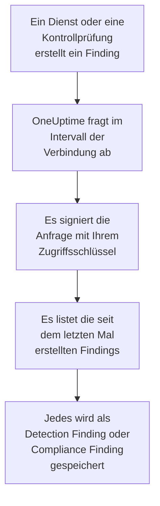

# AWS Security Hub

Importieren Sie Findings aus [AWS Security Hub](https://aws.amazon.com/security-hub/) in die Sicherheitsereignisse von OneUptime: Findings von GuardDuty, Inspector, Macie und IAM Access Analyzer, die eigenen Kontrollprüfungen von Security Hub und die Findings von Partnerprodukten. Dort durchsuchen Sie sie neben Ihren Logs, Traces und Metriken, verknüpfen sie mit jeder anderen Quelle und alarmieren die Bereitschaft für die wichtigen. OneUptime liest sie mit einem Zugriffsschlüssel, den Sie erstellen und dem Sie eine einzige lesende Aktion erlauben, und ändert nichts in AWS. Es gibt keinen Agenten, keine EventBridge-Regel und keinen S3-Export einzurichten.

:::cards
- [Die Verbindung einrichten](#die-verbindung-einrichten): Eine IAM-Richtlinie, ein Zugriffsschlüssel und das Formular der Verbindung.
- [Was importiert wird](#was-importiert-wird): Wie aus jedem Finding ein Sicherheitsereignis wird.
- [So funktioniert das Abfragen](#so-funktioniert-das-abfragen): Das Zeitfenster jeder Abfrage, und warum es sich um 30 Minuten überlappt.
- [Fehlerbehebung](#fehlerbehebung): Was jeder Fehler bedeutet und was zu ändern ist.
:::

## So funktioniert es



Jede Minute fragt OneUptime jede aktivierte Verbindung ab, deren Abfrageintervall abgelaufen ist. Eine Abfrage ruft `GetFindings` von Security Hub in Ihrer Region auf, signiert mit [Signature Version 4](https://docs.aws.amazon.com/IAM/latest/UserGuide/reference_sigv-create-signed-request.html), für die seit der letzten Abfrage erstellten Findings. Sie speichert jedes als [OCSF](https://schema.ocsf.io/)-Ereignis: eine Kontrollprüfung als Compliance Finding (Klasse `2003`) und jedes andere Finding als Detection Finding (Klasse `2004`). Erkennungsregeln, Monitore und Dashboards behandeln es dann wie ein Sicherheitsereignis aus jeder anderen Quelle.

## Bevor Sie beginnen

- In OneUptime die Rolle Project Owner, Project Admin oder Security Admin. Security Member und Security Viewer sehen Verbindungen und ihren Laufverlauf, können sie aber nicht ändern.
- Ein AWS-Konto, in dem Security Hub in der Region aktiviert ist, die Sie verbinden. Security Hub ist regional: Eine Verbindung liest die Findings, die ein Konto in einer Region hält.
- Um die Findings jedes Kontos und jeder Region über eine Verbindung zu lesen, das delegierte Administratorkonto von Security Hub, in seiner Heimatregion, mit eingeschalteter [regionsübergreifender Aggregation](https://docs.aws.amazon.com/securityhub/latest/userguide/finding-aggregation.html). **Security Hub → Settings → Regions** zeigt die Heimatregion.
- Ausgehendes HTTPS von der OneUptime-App und den Workern zu `securityhub.<region>.amazonaws.com`, oder `securityhub.<region>.amazonaws.com.cn` in China, und eine richtige Uhr auf ihren Hosts: AWS lehnt eine Anfrage ab, die mehr als 5 Minuten daneben signiert wurde.

## Die Verbindung einrichten

Die Verbindung signiert ihre Anfragen mit einem IAM-Zugriffsschlüssel. Die Identität des Schlüssels braucht eine einzige Aktion, `securityhub:GetFindings`, und sonst nichts: Die Verbindung ändert nie ein Finding.

:::steps
### Das Lesen von Findings erlauben

Öffnen Sie in der [IAM-Konsole](https://console.aws.amazon.com/iam/) **Policies → Create policy**, wählen Sie **JSON** und fügen Sie diese Richtlinie ein. Benennen Sie sie, zum Beispiel `OneUptimeSecurityHubRead`:

```json
{
  "Version": "2012-10-17",
  "Statement": [
    {
      "Effect": "Allow",
      "Action": "securityhub:GetFindings",
      "Resource": "*"
    }
  ]
}
```

`GetFindings` lässt sich nicht auf eine Ressource beschränken, deshalb bleibt `Resource` bei `*`. Die verwaltete Richtlinie `AWSSecurityHubReadOnlyAccess` funktioniert auch, erlaubt aber mehr.

### Einen Zugriffsschlüssel erstellen

1. Öffnen Sie **Users → Create user**, benennen Sie den Benutzer, zum Beispiel `oneuptime-security-hub`, lassen Sie den Konsolenzugriff aus und hängen Sie die Richtlinie an. Für die Findings anderer Konten tun Sie das im delegierten Administratorkonto.
2. Öffnen Sie den Benutzer, dann **Security credentials → Access keys → Create access key**, und wählen Sie **Third-party service**.
3. Kopieren Sie die **Zugriffsschlüssel-ID** und den **Geheimer Zugriffsschlüssel**. AWS zeigt das Geheimnis nur einmal.

### Die Verbindung in OneUptime hinzufügen

Öffnen Sie **Produkte → Sicherheitsereignisse → Verbindungen** (`/dashboard/{projectId}/security-events/connections`), klicken Sie auf **Verbindung hinzufügen**, wählen Sie **AWS Security Hub** und klicken Sie auf **Weiter**. Füllen Sie die Einstellungen aus der Tabelle unten aus, klicken Sie auf **Weiter** und fügen Sie das Geheimnis in **Geheimer Zugriffsschlüssel** ein.

### Vor dem Speichern testen

Klicken Sie unter **Vor dem Speichern testen** auf **Diese Einstellungen testen**. Der Test signiert eine Anfrage mit den Werten im Formular und speichert nichts, ein falscher Schlüssel oder eine fehlende Berechtigung zeigt sich also, bevor die Verbindung existiert. Klicken Sie dann auf **Weiter**, geben Sie der Verbindung einen **Name** und legen Sie sie an.
:::

| Einstellung | Was Sie eintragen |
| --- | --- |
| **Region** | Der Code der Region, etwa `us-east-1`, `eu-central-1` oder `us-gov-west-1`: für die Findings anderer Konten die Heimatregion des Administratorkontos. |
| **Zugriffsschlüssel-ID** | Die ID des Schlüssels: 16 bis 128 Buchstaben oder Ziffern, meist 20, beginnend mit `AKIA`, oder mit `ASIA` bei temporären Anmeldedaten. |
| **Geheimer Zugriffsschlüssel** | Das Geheimnis des Schlüssels. Es wird verschlüsselt, nie von der API zurückgegeben und nie wieder angezeigt. Ersetzen Sie es mit **Anmeldedaten aktualisieren** an der Verbindung. |
| **Session token** | Nur für temporäre Anmeldedaten, die es brauchen: Ein Schlüssel `ASIA` wird ohne eines abgelehnt, und ein Schlüssel `AKIA` wird mit einem abgelehnt. |

Temporäre Anmeldedaten aus `aws sts assume-role` oder `aws sts get-session-token` laufen ab, bei einer übernommenen Rolle nach höchstens 12 Stunden, und das Abfragen stoppt, bis Sie neue mit **Anmeldedaten aktualisieren** einfügen. Ein langlebiger Schlüssel mit dieser engen Richtlinie, nach Ihrem eigenen Plan rotiert, hält das Abfragen ohne Aufsicht am Laufen. Um von temporären Anmeldedaten zu einem langlebigen Schlüssel zu wechseln, tragen Sie den neuen Schlüssel in **Anmeldedaten aktualisieren** ein und schalten Sie **Remove the stored Session token** ein.

Der Schritt **Abfrage** hat außerdem eine optionale **Beschreibung**, das **Abfrageintervall (Minuten)**, eine ganze Zahl von `1` bis `1440`, die mit `5` beginnt, und **Aktiviert**, das eingeschaltet beginnt.

## Was importiert wird

Jedes Finding wird zu einem Ereignis, mit dem Anbieter `Amazon Web Services` und dem Produkt `AWS Security Hub`. Ein Finding mit einem Objekt `Compliance`, eine Kontrollprüfung gegen einen Standard wie AWS Foundational Security Best Practices oder CIS, wird zu einem Compliance Finding (OCSF-Klasse `2003`). Jedes andere Finding wird zu einem Detection Finding (OCSF-Klasse `2004`).

| Feld des Findings | OneUptime-Spalte |
| --- | --- |
| `Id`, ein ARN bei Findings, die AWS erstellt | Ereignis-UID, nach der auch Duplikate verworfen werden |
| `CreatedAt`, sonst `UpdatedAt`, sonst `FirstObservedAt` | Ereigniszeit |
| `Title` | Regelname |
| `GeneratorId`, etwa der Finding-Typ von GuardDuty oder die ID der Kontrolle | Regel-ID |
| `Title`, sonst `Description` | Meldung |
| `Severity.Label`, sonst eine Stufe von `Severity.Normalized` | Schweregrad |
| `Workflow.Status`: `NEW`, `NOTIFIED`, `RESOLVED` oder `SUPPRESSED`, sonst das ältere `WorkflowState` | Status |
| `Types` unter `TTPs/`: Aus `TTPs/Initial Access/...` wird `TA0001` | MITRE-ATT&CK-Taktiken und -Techniken |
| Der IAM-Benutzer einer Ressource vom Typ Zugriffsschlüssel oder Benutzer, `Network.SourceIpV4` oder `SourceIpV6`, `Process.Name` oder `Process.Path` | Benutzer, IP und Prozess des Akteurs |
| `Process.Name` und `Process.Path` | Prozessname und -pfad. Ein Finding nennt weder eine Befehlszeile noch einen übergeordneten Prozess. |
| Die Instanz-ID einer Ressource `AwsEc2Instance`, `Network.DestinationIpV4` oder `DestinationIpV6`, `Network.DestinationPort`, die erste `Resources[].Id` | Host, IP, Port und Ressource des Ziels |
| Diese, jede `Resources[].Id`, `AwsAccountId`, die Domänen des Netzwerks, Malware-Namen und Werte der Bedrohungsdaten | Observables |
| Das ganze Finding, flach gemacht zu Schlüsseln mit Punkten wie `Compliance.Status` und `Remediation.Recommendation.Url` | `attributes` |

Hat ein Finding kein `Severity.Label`, entscheidet `Severity.Normalized`: `0` ist Informational, `1` bis `39` Low, `40` bis `69` Medium, `70` bis `89` High und `90` bis `100` Critical. Ein Finding, das Security Hub später aktualisiert, ein neuer `Workflow.Status` oder eine Kontrolle, die jetzt besteht, behält seine `Id` und wird deshalb nicht noch einmal importiert: Das Ereignis behält das Finding so, wie es beim Import war.

## So funktioniert das Abfragen

Jede Abfrage listet die in ihrem Zeitfenster erstellten Findings, die ältesten zuerst, 100 pro Seite, und folgt `NextToken`, bis sie das ganze Zeitfenster gelesen hat:

```text
POST https://securityhub.{region}.amazonaws.com/findings
    {"Filters": {"CreatedAt": [{"Start": "{window start}", "End": "{window end}"}]},
     "SortCriteria": [{"Field": "CreatedAt", "SortOrder": "asc"}],
     "MaxResults": 100}
```

- **Die Erstellungszeit ist der Cursor.** Findings werden nach `CreatedAt` gelistet, nie nach `FirstObservedAt`. GuardDuty erstellt ein Finding, sobald es genug Aktivität gesehen hat, und eine Kontrollprüfung, wenn Security Hub die Ressource zum ersten Mal prüft, Stunden oder Tage nach Beginn der Aktivität. Ein Cursor über die Beobachtungszeit würde sie überspringen.
- **Die erste Abfrage blickt 24 Stunden zurück**, sodass eine neue Verbindung ihre jüngsten Findings sofort zeigt.
- **Jede spätere Abfrage beginnt 30 Minuten vor dem gespeicherten Cursor.** `CreatedAt` setzt der Dienst, der das Problem gefunden hat, und das Finding erreicht Security Hub später: GuardDuty sendet neue Findings innerhalb von fünf Minuten, und eine fehlgeschlagene Zustellung über EventBridge wird bis zu 24 Stunden lang wiederholt. Die Überlappung liest solche Findings bei der nächsten Abfrage. Eines, das mehr als 30 Minuten nach seinem `CreatedAt` ankommt, kann hinter den Cursor fallen: Importieren Sie seinen Zeitraum, um es zurückzuholen.
- **Eine Abfrage liest höchstens 24 Stunden über den Cursor hinaus.** Eine Verbindung, deren Cursor zurückliegt, holt in einer Reihe von 24-Stunden-Fenstern auf, und ihre **Integrität** zeigt **Catching up**.
- **Duplikate werden nach `Id` des Findings verworfen**, innerhalb des Projekts, sodass die Überlappung, ein wiederholtes Zeitfenster und ein Import nie ein Finding doppelt speichern.

### Wenn ein Zeitfenster mehr enthält, als eine Abfrage lesen kann

Eine Abfrage sendet höchstens 20 Anfragen mit 100 Findings: 2.000 Findings. Enthält ein Zeitfenster mehr, ist der Lauf **Teilweise**, mit einer Warnung wie dieser:

```text
Stopped after 20 findings requests (the per-run request limit) before the window was fully read. The last finding read was created at 2026-09-14T08:12:44.000Z.
```

Findings werden die ältesten zuerst gelesen, deshalb setzt OneUptime den Cursor auf die Erstellungszeit des letzten gelesenen Findings, und die nächste Abfrage beginnt genau dort, ohne die 30 Minuten Überlappung, mit derselben Fensterlänge. Ein ausgelastetes Konto holt etwa 2.000 Findings pro Abfrage auf, statt dieselben noch einmal zu lesen. Die Überlappung kehrt zurück, sobald der Cursor 30 Minuten über diesen Punkt hinaus gerückt ist.

Kommt ein Lauf gar nicht über den gespeicherten Cursor hinaus, etwa weil schon die 30 Minuten der Überlappung mehr als 2.000 Findings enthalten, verkürzt OneUptime stattdessen das Zeitfenster:

1. **Verkleinern.** Die nächste Abfrage liest ein halb so langes Zeitfenster ab demselben Startpunkt und halbiert weiter, bis ein Zeitfenster vollständig gelesen wird, bis hinunter zu einer Minute. Die Warnung des Laufs sagt das: `This window holds more records than one poll can read; the next poll reads a {n} minute window from the same starting point.`
2. **Wieder wachsen.** Nachdem ein Zeitfenster vollständig gelesen wurde, ist das nächste wieder doppelt so lang, bis zu 24 Stunden.
3. **Über eine einzelne Minute hinweggehen.** Enthält selbst eine Minute mehr, als eine Abfrage lesen kann, geht das Abfragen über sie hinweg, damit neuere Findings weiter ankommen, und die Überlappung späterer Abfragen reicht nicht mehr in sie zurück. Der Lauf bleibt **Teilweise**, und **Letzter Fehler** lautet `More records were created in the one minute from {cursor} to {end} than one poll can read. Polling moved past this minute so newer records keep arriving; use Import this time range in Diagnostics on this minute to recover what one run can read.` Importieren Sie diese Minute mit **Diesen Zeitraum importieren**, um zurückzuholen, was ein Lauf lesen kann.

Ein Lauf, der ganz fehlschlägt, mit einem Fehler von AWS, behält den Cursor und die Fensterlänge, und die nächste Abfrage liest dasselbe Zeitfenster erneut. Die einzige Ausnahme ist eine Anfrage, deren Zeit abgelaufen ist: Der Cursor bleibt, aber das nächste Zeitfenster ist halb so lang, denn ein Zeitfenster, das zu schwer ist, um rechtzeitig beantwortet zu werden, würde bei jedem Versuch ablaufen. Ein anderes **Abfrageintervall (Minuten)** ändert nichts davon: Es entscheidet, wie oft eine Abfrage beginnt, nicht, wo ihr Zeitfenster beginnt.

### Bei Bedarf ausführen, ansehen und importieren

Klicken Sie an einer Verbindung auf **Diagnose**, um ihre letzten Läufe zu sehen und von Hand mit ihr zu arbeiten. Wer die Verbindung ändern darf, kann diese starten; wer sie sehen darf, kann den Verlauf lesen.

- **Jetzt ausführen** startet sofort eine Abfrage, mit dem üblichen Cursor, auch wenn die Verbindung nicht **Aktiviert** ist.
- **Preview findings** liest einen Zeitraum von bis zu 7 Tagen und importiert nichts.
- **Diesen Zeitraum importieren** importiert nach Ihrer Bestätigung einen Zeitraum von bis zu 7 Tagen, ohne den Cursor zu verschieben. Bereits importierte Findings werden übersprungen.
- **Diagnosen kopieren** an einem Lauf kopiert seinen Bericht für den Support. Er enthält nie Anmeldedaten.

## Verbindung testen

**Verbindung testen** in der Zeile einer Verbindung und **Diese Einstellungen testen** im Formular laufen im API-Prozess, nicht in einem Hintergrund-Worker, sodass ein Test auch dann antwortet, wenn die Worker das Problem sind. Er führt diese Prüfungen der Reihe nach aus:

| Prüfung | Was sie prüft |
| --- | --- |
| **Konfiguration** | Jede Einstellung ist vorhanden und gültig. Schlägt das fehl, wird nichts kontaktiert. |
| **Authenticate with AWS** | AWS nimmt eine signierte Anfrage `GetFindings` nach einem in den letzten 24 Stunden erstellten Finding an. AWS prüft die Signatur vor der IAM-Richtlinie, deshalb besteht eine Ablehnung durch die Richtlinie diese Prüfung trotzdem: Der Schlüssel stimmt. |
| **Read findings** | Security Hub beantwortet diese Anfrage: Die Identität darf `securityhub:GetFindings` aufrufen, und Security Hub ist in der Region aktiviert. |
| **Findings available to import** | Wie viele Findings in den letzten 24 Stunden und den letzten 7 Tagen erstellt wurden, je eine Seite mit 100, `100+` heißt also mehr. Keine in 7 Tagen ist eine Warnung, kein Fehler. |
| **Background workers**, **Poll scheduler**, **Security event storage** | Die Seite von OneUptime selbst: Ein Prozess nimmt die Aufträge der Worker-Warteschlange an, der Abfrageauftrag läuft jede Minute, und der Speicher der Sicherheitsereignisse antwortet. |
| **Geplante Abfrage** | Für eine gespeicherte Verbindung: Das Abfragen ist eingeschaltet, kein Lauf wartet festgefahren auf einen Worker, und die Abfragen laufen pünktlich. |

Jede Anfrage in einem Test hat eine Frist von 20 Sekunden. Ein Test importiert nie etwas und verschiebt nie den Cursor, und jede fehlgeschlagene Prüfung sagt, was zu ändern ist.

## Fehlerbehebung

Der **Letzter Fehler** der Verbindung bewahrt die vollständige Fehlermeldung, mit geschwärzten Anmeldedaten, hinter einem Präfix, das den fehlgeschlagenen Schritt nennt. Hat eine Verbindung einen Fehler, wählen Sie in ihrer Spalte **Aktionen** die Aktion **Fehler anzeigen**, um ihn zu lesen, und im Dialog **Fehler kopieren**, um ihn zu kopieren. Jede Meldung beginnt mit `AWS Security Hub findings request`; lesen Sie, was danach folgt.

:::details Letzter Fehler sagt `failed (HTTP 401)` oder `failed (HTTP 403)`
AWS hat die Anfrage abgelehnt. Die Meldung zitiert den Fehlercode von AWS, oder die eigenen Worte von AWS, wenn es keinen Code gesendet hat:

- `AccessDeniedException` oder `is not authorized to perform`: Der Schlüssel stimmt, aber seine Identität darf `securityhub:GetFindings` nicht aufrufen. Hängen Sie die Richtlinie aus [Die Verbindung einrichten](#die-verbindung-einrichten) an. Auch eine Berechtigungsgrenze oder eine Service Control Policy kann es verweigern.
- `InvalidAccessException` oder `is not subscribed to AWS Security Hub`: Security Hub ist für dieses Konto in dieser **Region** nicht aktiviert, oder das Konto ist dort nicht sein Administrator.
- `InvalidSignatureException` oder `SignatureDoesNotMatch`, oder `The request signature we calculated does not match`: Der **Geheimer Zugriffsschlüssel** gehört nicht zur **Zugriffsschlüssel-ID**. Erstellen Sie einen neuen Zugriffsschlüssel und speichern Sie ihn mit **Anmeldedaten aktualisieren**.
- `UnrecognizedClientException` oder `InvalidClientTokenId`, oder `The security token included in the request is invalid`: AWS kennt die **Zugriffsschlüssel-ID** nicht. Sie ist vertippt, gelöscht, deaktiviert oder aus einer anderen Partition, oder es ist ein temporärer Schlüssel ohne sein **Session token**.
- `ExpiredTokenException` oder `The security token included in the request is expired`: Die temporären Anmeldedaten sind abgelaufen. Stellen Sie neue aus oder wechseln Sie zu einem langlebigen Schlüssel.
- `RequestTimeTooSkewed` oder `RequestExpired`, oder `Signature expired`: Die Uhr der OneUptime-Hosts geht mehr als 5 Minuten falsch. Richten Sie NTP auf den App- und Worker-Hosts ein.
- Gar kein Code: AWS hat nicht gesagt, ob der Schlüssel oder die Richtlinie die Anfrage abgelehnt hat. Prüfen Sie zuerst den Schlüssel, dann die Richtlinie.
:::

:::details Letzter Fehler sagt `failed (HTTP ...)` mit einem anderen Status
- `HTTP 404`: Unter dieser **Region** hat kein Security-Hub-Endpunkt geantwortet. Vergleichen Sie sie mit dem Regionsmenü der AWS-Konsole: `us-east-1`, nicht `us-east1` oder `N. Virginia`.
- `HTTP 429`: Das Konto hat die Grenze von Security Hub erreicht, 3 Anfragen `GetFindings` pro Sekunde in einer Region. Die nächste Abfrage versucht es erneut. Wiederholt sich das, suchen Sie nach einem anderen Werkzeug oder einer anderen Verbindung, die dasselbe Konto und dieselbe Region liest.
- `HTTP 5xx`: Security Hub hatte auf seiner Seite ein Problem. Die nächste Abfrage versucht es erneut.
- `HTTP 400`: Security Hub hat die Abfrage abgelehnt, die OneUptime baut, nicht Ihre Einstellungen. Senden Sie die Meldung an den OneUptime-Support.
:::

:::details Letzter Fehler sagt `returned`, `timed out` oder `Could not reach data source`
- `returned a non-JSON body` oder `returned an unrecognized response shape`: Etwas anderes als Security Hub hat geantwortet, etwa die Anmeldeseite eines Proxys oder ein Gateway, das Antworten umschreibt. Das wird gemeldet statt als leeres Zeitfenster genommen, damit der Cursor nie über Findings hinwegrückt, die niemand gelesen hat.
- `timed out after 60 seconds with no response` oder `failed: Could not reach data source`: Die Anfrage bekam keine Antwort. Die Endpunkte von Security Hub sind öffentlich, prüfen Sie also DNS, Firewalls und Proxys zwischen der OneUptime-App und den Workern und `securityhub.<region>.amazonaws.com`.
:::

:::details Zuletzt abgefragt ist Never und Letzter Fehler ist leer
Für diese Verbindung ist noch keine Abfrage fertig geworden. Führen Sie **Verbindung testen** aus: Ihre Prüfungen **Background workers** und **Poll scheduler** nennen die Ursache. Bei einer selbst gehosteten Installation ist die übliche Ursache `DISABLE_QUEUE_WORKERS=true` an der App, ohne eigene Worker-Bereitstellung, die die Aufträge annimmt: Setzen Sie es auf `false` oder betreiben Sie die Worker-Bereitstellung (Helm: `worker.enabled: true`).
:::

:::details Ein Lauf ist Teilweise
- `Stopped after 20 findings requests`: Das Zeitfenster enthielt mehr als die 2.000 Findings, die ein Lauf liest. Nichts geht verloren: Die nächste Abfrage beginnt nach dem letzten gelesenen Finding. Eine Verbindung, die Abfrage um Abfrage **Teilweise** bleibt, holt einen Rückstand auf, und ihre Werte **Zuletzt abgefragt** und **Letztes importiertes Ereignis** bewegen sich weiter. Holt sie nie auf, erstellt das Konto mehr als 2.000 Findings pro Abfrageintervall: Verkürzen Sie das **Abfrageintervall (Minuten)**.
- `More records were created in the one minute from ... than one poll can read`: Das Abfragen ist über diese Minute hinweggegangen. Importieren Sie sie mit **Diesen Zeitraum importieren** in der **Diagnose**. Ein Import liest so viel wie eine Abfrage.
:::

:::details Der Test besteht, aber nichts wird importiert
Lesen Sie **Findings available to import** im Bericht des Tests. `0` in den letzten 7 Tagen heißt, dass Security Hub in diesem Konto und dieser Region kein Finding erstellt hat: Prüfen Sie, dass dort GuardDuty, Inspector oder ein Sicherheitsstandard eingeschaltet ist. Um die Findings anderer Konten und Regionen zu sehen, verbinden Sie das Administratorkonto in seiner Heimatregion.
:::

:::details Ein Finding aus der Security-Hub-Konsole ist nie angekommen
Vergleichen Sie sein `CreatedAt` mit seinem `ProcessedAt`, wann Security Hub es erhalten hat. Ein Finding, das mehr als 30 Minuten nach seinem `CreatedAt` ankam, kann hinter den Cursor fallen: Importieren Sie sein `CreatedAt` mit **Diesen Zeitraum importieren**.
:::

## Was Sie davon haben

- **Suche.** Filtern Sie Findings im Explorer der Sicherheitsereignisse nach Schweregrad, Status, Regel, Konto, Ressource oder jedem Observable, neben jeder anderen Quelle.
- **Verknüpfung.** Die Benutzer, Instanzen, IPs, Ressourcen-ARNs und Konto-IDs jedes Findings werden als Observables indiziert, sodass eine Suche alles findet, was sie nennt.
- **Erkennungsregeln.** Sigma-Regeln, die nach einem Zeitplan über Ihre Sicherheitsereignisse laufen und Warnungen eröffnen, die die Bereitschaft alarmieren.
- **Monitore.** Monitore für Sicherheitsereignisse zählen passende Ereignisse, etwa neue kritische GuardDuty-Findings oder fehlgeschlagene Kontrollen, und eröffnen ab einem Schwellwert Vorfälle oder Warnungen.

Sicherheitsereignisse werden wie Ihre übrige Telemetrie abgerechnet, pro aufgenommenem GB. Siehe [Preise](https://oneuptime.com/pricing).

## Nächste Schritte

:::cards
- [Sicherheitsereignisse](/docs/telemetry/security-events): Durchsuchen, verknüpfen und warnen, was Sie importieren.
- [Okta-Systemprotokoll](/docs/integrations/okta): Auch die Anmeldungen Ihres Identitätsanbieters importieren.
- [Rollen](/docs/permissions/reference#rollen): Was die Security-Rollen sehen und ändern können.
- [Integrationsübersicht](/docs/integrations/index): Die anderen Werkzeuge, die Sie verbinden können.
:::
