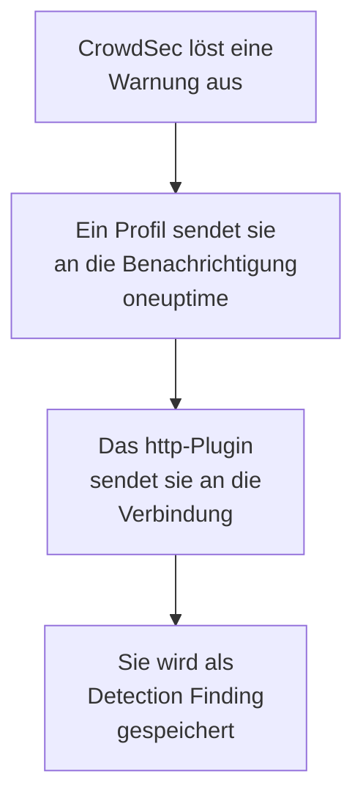

# CrowdSec

Empfangen Sie die Warnungen von [CrowdSec](https://www.crowdsec.net/) in den Sicherheitsereignissen von OneUptime, sobald CrowdSec sie auslöst, und sperren Sie die Adressen auf der Sperrliste Ihres Projekts mit CrowdSec. Das eigene Benachrichtigungs-Plugin von CrowdSec sendet jede Warnung an eine CrowdSec-Verbindung, die aus den Erkennungen von CrowdSec Fälle eröffnet. Sobald Sie das Sperren einschalten, bannt OneUptime jede Adresse, die Sie sperren, über die Local API von CrowdSec, und jeder Bouncer, der sie liest, sperrt die Adresse.

:::cards
- [Die Verbindung einrichten](#die-verbindung-einrichten): Eine Verbindung und die Benachrichtigung, die die Warnungen von CrowdSec an sie sendet.
- [Was empfangen wird](#was-empfangen-wird): Wie aus jeder CrowdSec-Warnung ein Sicherheitsereignis wird.
- [Adressen mit CrowdSec sperren](#adressen-mit-crowdsec-sperren): Die Adressen auf Ihrer Sperrliste in CrowdSec bannen.
- [Die Sperrlisten von CrowdSec lesen](#die-sperrlisten-von-crowdsec-lesen): Die Listen, die die CrowdSec Console bereitstellt, als Threat-Intel-Feed.
- [Fehlerbehebung](#fehlerbehebung): Was jeder Fehler bedeutet und was zu ändern ist.
:::

## So funktioniert es



Die Local API von CrowdSec übergibt jede Warnung, die ein Profil an eine Benachrichtigung sendet, an das Plugin dieser Benachrichtigung. Die Benachrichtigung der Verbindung nutzt das `http`-Plugin von CrowdSec: Es sendet die Warnung, im eigenen JSON von CrowdSec, mit Ihrem Ingestion-Schlüssel an die Aufnahme der Sicherheitsereignisse und nennt dabei die Verbindung. OneUptime speichert sie als [OCSF](https://schema.ocsf.io/)-Ereignis Detection Finding (Klasse `2004`), prüft sie gegen Ihre Erkennungsregeln und eröffnet einen Fall aus jeder eigenen Erkennung von CrowdSec, die den Wert **Fälle eröffnen ab** der Verbindung erreicht. Nichts wird abgefragt: Eine Warnung kommt Sekunden, nachdem CrowdSec sie ausgelöst hat, an.

## Bevor Sie beginnen

- In OneUptime die Rolle Projektinhaber, Projektadministrator oder Sicherheits-Administrator. Sicherheits-Mitglied und Sicherheits-Betrachter sehen Verbindungen, können sie aber nicht ändern.
- CrowdSec 1.5 oder neuer, mit seiner Local API und dem `http`-Benachrichtigungs-Plugin, das es mitbringt. Diese Seite ist anhand von CrowdSec v1.8.2 geschrieben.
- Ausgehendes HTTPS vom Host, auf dem die Local API von CrowdSec läuft, zu Ihrem OneUptime.
- Um auch Adressen zu sperren: eine Local API, die OneUptime erreichen kann, und eine Maschine für OneUptime (siehe [Adressen mit CrowdSec sperren](#adressen-mit-crowdsec-sperren)).

## Die Verbindung einrichten

:::steps
### Die Verbindung in OneUptime hinzufügen

Öffnen Sie **Produkte → Sicherheitsereignisse → Verbindungen** (`/dashboard/{projectId}/security-events/connections`), klicken Sie auf **Verbindung hinzufügen**, wählen Sie **CrowdSec** und klicken Sie auf **Weiter**. Um nur Warnungen zu empfangen, lassen Sie jede Einstellung aus der Tabelle unten leer; um auch Adressen zu sperren, füllen Sie sie aus.

### Vor dem Speichern testen

Klicken Sie unter **Vor dem Speichern testen** auf **Diese Einstellungen testen**. Ist keine Local API eingetragen, sagt der Test das und kontaktiert nichts; ist eine eingetragen, erreicht er die Local API, meldet sich als die Maschine an und speichert nichts. Klicken Sie dann auf **Weiter**, geben Sie der Verbindung im Schritt **Warnungen** einen **Name**, wählen Sie den Wert für **Fälle eröffnen ab** und legen Sie sie an.

### Die Benachrichtigung auf dem CrowdSec-Host speichern

Das Anlegen der Verbindung öffnet ihr **Warnungen senden**, das Sie später aus der Zeile der Verbindung wieder öffnen. Wählen Sie unter **Ingestion-Schlüssel auswählen** einen Schlüssel und speichern Sie dann die Benachrichtigung, die es zeigt, mit Ihrem Schlüssel und Ihrer Verbindung schon eingetragen, auf dem Host, auf dem die Local API von CrowdSec läuft:

```yaml title="/etc/crowdsec/notifications/oneuptime.yaml"
type: http
name: oneuptime

# info or quieter: at debug, CrowdSec logs each request's headers.
log_level: info

format: |
  {{.|toJson}}

url: https://oneuptime.com/security-events/v1/ingest?connection=YOUR_CONNECTION_ID&format=crowdsec
method: POST
headers:
  Content-Type: application/json
  x-oneuptime-token: YOUR_INGESTION_TOKEN
```

### Die Warnungen Ihrer Profile an sie senden

Fügen Sie in `/etc/crowdsec/profiles.yaml` `oneuptime` zu den `notifications` jedes Profils hinzu, dessen Warnungen OneUptime erhalten soll, und laden Sie CrowdSec dann neu:

```yaml title="/etc/crowdsec/profiles.yaml"
notifications:
  - oneuptime
```

```bash
sudo systemctl reload crowdsec
```

### Eine Testwarnung senden

```bash
sudo cscli notifications test oneuptime
```

**Warnungen senden** zeigt an, wann sie eintrifft, und **Warnungen anzeigen** öffnet sie in den Sicherheitsereignissen. Die Testwarnung ist ein Ereignis mit dem Schweregrad Informational und eröffnet keinen Fall.
:::

| Einstellung | Was Sie eintragen |
| --- | --- |
| **URL der Local API** | Nur zum Sperren von Adressen: wo OneUptime die Local API von CrowdSec erreicht, etwa `https://crowdsec.example.com:8080`. Nutzen Sie `https`, wo immer die Verbindung ein Netzwerk durchquert. |
| **Maschinen-ID** | Nur zum Sperren von Adressen: die Maschine, als die sich OneUptime anmeldet, angelegt auf dem CrowdSec-Host mit `sudo cscli machines add oneuptime --auto -f -`. |
| **Adressen mit CrowdSec sperren** | Bei einer neuen Verbindung aus. Eingeschaltet bannt es die Adressen und Bereiche auf Ihrer Sperrliste in CrowdSec und braucht die anderen drei Einstellungen (siehe [Adressen mit CrowdSec sperren](#adressen-mit-crowdsec-sperren)). |
| **Maschinenpasswort** | Nur zum Sperren von Adressen: das Passwort, das `cscli` für die Maschine ausgegeben hat. Es wird verschlüsselt, nie von der API zurückgegeben und nie wieder angezeigt. Ersetzen Sie es mit **Anmeldedaten aktualisieren** an der Verbindung. |

Der Schritt **Warnungen** hat außerdem eine optionale **Beschreibung** und **Aktiviert**, das eingeschaltet beginnt. Eine nicht aktivierte Verbindung behält die Warnungen, die sie empfängt, als Ereignisse und eröffnet aus ihnen keinen Fall.

In einem Container kommt die Benachrichtigung in den Ordner, der unter `/etc/crowdsec/notifications/` eingehängt ist, und ein Neustart des Containers liest sie ein. Eine Kubernetes-Installation nennt sie in ihren Helm-Werten unter `config.notifications`, mit `profiles.yaml` daneben unter `config`.

## Was empfangen wird

Jede Warnung, die CrowdSec sendet, wird zu einem Ereignis Detection Finding (OCSF-Klasse `2004`), mit Anbieter und Produkt `CrowdSec`:

| CrowdSec-Feld | OneUptime-Spalte |
| --- | --- |
| `uuid`, oder ein Hash bei einer Warnung ohne | Ereignis-UID, nach der auch Duplikate verworfen werden |
| `stop_at`, oder `start_at` | Ereigniszeit |
| `scenario` | Regel-ID und Regelname: der Titel des Szenarios im CrowdSec Hub, oder sein Name |
| `source.ip`, oder `source.value` einer `Ip`-Warnung | IP des Hauptakteurs |
| `target_fqdn` oder `target_host` der Warnung oder ihrer Ereignisse, sonst die `machine`, die ihre Ereignisse nennen | Ziel-Host |
| `target_user`, `target_uri` | Zielbenutzer und Zielressource |
| Der `type` der ersten Entscheidung | Status: `Blocked` bei einem Bann, `Challenge` bei einem Captcha, `Logged` ohne Entscheidung oder im Simulationsmodus |
| Das Verhalten des Szenarios | Schweregrad, und seine MITRE-ATT&CK-Taktiken und -Techniken |
| Alles andere, etwa `source.cn`, `source.as_name` und `events_count` | `attributes`: die Felder der Warnung, flach gemacht zu Schlüsseln mit Punkten, ihre ersten 10 Ereignisse vollständig, und die Auswertung von OneUptime unter `crowdsec.` |

Eine CrowdSec-Warnung hat keinen eigenen Schweregrad, daher leitet OneUptime ihn davon ab, was das Szenario erkennt, so wie der CrowdSec Hub es kennzeichnet (`ssh:bruteforce`, `http:exploit`):

| Verhalten | Schweregrad |
| --- | --- |
| Ein Exploit, etwa eine CVE oder was die AppSec-Komponente blockiert hat, oder was ein Angreifer tut, sobald er drin ist | High |
| Brute Force, Denial of Service, Betrug, eine unmögliche Anmeldung oder ein Verhalten, das OneUptime nicht zuordnen kann | Medium |
| Scans, Sondierungen, Crawls, Bots, Spam und Änderungen aus Cloud-Audits | Low |
| Die eigenen Testszenarien von CrowdSec | Informational |

Mit **Fälle eröffnen ab** auf **Hoch und höher** eröffnen die Exploits von CrowdSec Fälle, und seine alltäglichen Banns von Scannern und Passwortratern bleiben Ereignisse für Ihre Erkennungsregeln. Nur die eigenen Erkennungen von CrowdSec eröffnen Fälle. Eine Entscheidung, die jemand mit `cscli` oder in der Console von CrowdSec hinzugefügt hat, eine Adresse auf einer Sperrliste von CrowdSec, die Testwarnung und die zurückkommenden eigenen Banns von OneUptime sind Informational und eröffnen keinen. Eine zweimal gesendete Warnung, wie `cscli notifications reinject` sie sendet, wird einmal gespeichert.

## Adressen mit CrowdSec sperren

Schalten Sie an einer Verbindung **Adressen mit CrowdSec sperren** ein, und die Adressen und Bereiche auf der [Sperrliste](/docs/telemetry/security-cases#sperrliste) Ihres Projekts werden in CrowdSec gebannt. Jeder Bouncer, der seine Local API liest, etwa seine Firewall-, nginx- und Traefik-Bouncer, sperrt sie dort, wo er läuft, so wie er die eigenen Banns von CrowdSec durchsetzt. Sperren durchlaufen dieselben Genehmigungen, dieselben Grenzen der automatischen Reaktion und dasselbe **Aufheben** wie an jedem anderen Ort, an dem Ihre Sperrliste durchgesetzt wird.

Der Schalter ist bei einer neuen Verbindung aus. So schalten Sie ihn ein:

1. Legen Sie auf dem CrowdSec-Host eine Maschine für OneUptime an; der Befehl gibt ihr Passwort aus:

   ```bash
   sudo cscli machines add oneuptime --auto -f -
   ```

2. Lassen Sie OneUptime die Local API erreichen, die ohne andere Vorgabe auf `127.0.0.1:8080` lauscht: Setzen Sie `api.server.listen_uri` in der `config.yaml` von CrowdSec, stellen Sie sie über TLS oder hinter einem `https`-Proxy bereit, und lassen Sie die Adressen von OneUptime durch Ihre Firewall.
3. Bearbeiten Sie die Verbindung, tragen Sie **URL der Local API** und **Maschinen-ID** ein, setzen Sie das Passwort in **Maschinenpasswort**, schalten Sie **Adressen mit CrowdSec sperren** ein und speichern Sie. **Verbindung testen** prüft dann, dass sich die Maschine anmeldet und die Banns von OneUptime liest, ohne etwas zu ändern.

Wie ein Bann entsteht und wie er endet:

- Jede Sperre ist eine Bann-Entscheidung, erstellt so, wie `cscli decisions add` eine erstellt, unter dem Szenario `oneuptime/blocklist`. CrowdSec führt sie als manuelle Entscheidung, daher wird sie nie mit der Central API von CrowdSec geteilt, es sei denn, Sie teilen manuelle Entscheidungen. OneUptime liest und entfernt nur seine eigenen Banns, nie einen, den eine Person oder CrowdSec erstellt hat.
- Eine Sperre mit Ende ist ein Bann bis genau zu diesem Ende, und CrowdSec hebt ihn dann von selbst auf, ob OneUptime es erreichen kann oder nicht. Eine Sperre, die gilt, bis sie aufgehoben wird, ist ein Bann von 7 Tagen, der erneuert wird, sobald 3 Tage oder weniger übrig sind, sodass ein Bann, den OneUptime nicht mehr aufrechterhält, innerhalb einer Woche endet.
- **Aufheben** entfernt den Bann beim nächsten Durchlauf, innerhalb einer Minute. Ein in CrowdSec entfernter Bann, durch `cscli decisions delete` oder einen Flush, wird beim nächsten Durchlauf neu erstellt, solange die Sperre besteht.
- Eine Adresse oder ein Bereich auf einer der Allowlists von CrowdSec wird nie gebannt: Die Sperre zeigt sie dort als nicht durchgesetzt, mit dem Namen der Allowlist, und ein schon erstellter Bann wird entfernt, sobald eine Allowlist die Adresse enthält.
- Die eigenen Adressen Ihres Projekts, etwa Ihre Proxys unter **Vertrauenswürdige Proxys**, Load Balancer und Edge-Netzwerke, werden nirgends gesperrt, auch nicht in CrowdSec.
- CrowdSec bannt nur: Eine Challenge wird dort nicht angewendet, und eine Domäne, eine URL oder eine Datei wird nicht an CrowdSec gesendet.

Ist die Local API nicht erreichbar, ändert sich in CrowdSec nichts: Die Banns, die es hält, bleiben und enden, wenn sie enden. **Durchgesetzt bei** in der **Sperrliste** sagt, wann CrowdSec jede Sperre zuletzt gehalten hat, und OneUptime versucht es nach 1 Minute erneut und wartet dann jedes Mal doppelt so lange, bis zu 30 Minuten. Eine neue Sperre wartet, bis sie erstellt werden kann.

## Die Sperrlisten von CrowdSec lesen

Die CrowdSec Console stellt die Sperrlisten, die Ihre Organisation abonniert, als Integration vom Typ Raw IP List bereit: eine Adresse pro Zeile, hinter Benutzername und Passwort. Ein [Threat-Intel-Feed](/docs/telemetry/threat-intelligence) liest sie und gleicht Ihre Ereignisse mit ihnen ab:

1. Legen Sie in der CrowdSec Console eine Integration vom Typ Raw IP List an, mit ausgeschalteter IP-Aggregation: OneUptime gleicht Adressen ab, keine Bereiche. Kopieren Sie ihren Endpunkt, Benutzernamen und ihr Passwort.
2. Öffnen Sie in OneUptime **Produkte → Sicherheitsereignisse → Erkennungen → Threat Intel**, klicken Sie auf **Threat-Intel-Feed erstellen** und wählen Sie **Liste von Indikatoren**.
3. Fügen Sie den Endpunkt als **Listen-URL** ein, wählen Sie **Benutzername und Passwort** unter **Anmeldung** und fügen Sie beides ein. Im Community-Tarif von CrowdSec, der einen Download pro Tag erlaubt, setzen Sie **Abfrageintervall (Minuten)** auf `1440`.

Die Listen gehören CrowdSec: Sie dürfen sie in Ihren eigenen Tools nutzen, aber nicht weitergeben. OneUptime bietet keine eigene Liste an.

## Verbindung testen

**Verbindung testen** in der Zeile einer Verbindung und **Diese Einstellungen testen** im Formular laufen im API-Prozess, nicht in einem Hintergrund-Worker. Sie führen diese Prüfungen der Reihe nach aus:

| Prüfung | Was sie prüft |
| --- | --- |
| **Konfiguration** | Die Einstellungen sind entweder alle leer oder alle angegeben, und wohlgeformt. Schlägt das fehl, wird nichts kontaktiert. |
| **Reach CrowdSec's Local API** | `GET /health` antwortet. Ist keine Local API eingetragen, sagt die Prüfung, dass die Verbindung nur Warnungen empfängt, und die nächsten drei laufen nicht. |
| **Sign in to the Local API** | `POST /v1/watchers/login` nimmt die Maschine und ihr Passwort an. |
| **Read CrowdSec's allowlists** | `GET /v1/allowlists` antwortet, und wie viele Adressen und Bereiche sie enthalten. Eine Local API älter als 1.6.8, die keine hat, besteht. |
| **Block with CrowdSec** | Nur mit eingeschaltetem **Adressen mit CrowdSec sperren**: Die Maschine kann die Banns von OneUptime zurücklesen, und wie viele in Kraft sind. Die Prüfung ändert nichts. |
| **Background workers**, **Security event storage** | Die Seite von OneUptime selbst: Ein Prozess nimmt die Aufträge der Worker-Warteschlange an, die speichern, was CrowdSec sendet, und der Speicher der Sicherheitsereignisse antwortet. |
| **Alerts received** | Für eine gespeicherte Verbindung: wann die letzte Warnung eingetroffen ist. Ist noch keine eingetroffen, ergibt das eine Warnung, mit dem Hinweis, wie Sie eine Testwarnung senden. |

Ein Test bannt oder entfernt nie etwas. **Bericht kopieren** kopiert die Prüfliste als JSON, ohne das Passwort oder Tokens.

## Fehlerbehebung

Die **Integrität** der Verbindung zeigt **Wartet auf Warnungen**, bis die erste Warnung eintrifft, danach **Empfängt Warnungen**, egal wie lange die nächste dauert; **Fälle pausiert** heißt, dass die Verbindung nicht aktiviert ist. CrowdSec schreibt, was das Plugin geantwortet hat, in sein eigenes Log, `/var/log/crowdsec.log`, als `HTTP server returned non 200 status code`.

:::details Keine Warnung kommt an
- Führen Sie `sudo cscli notifications list` aus: `oneuptime` muss aufgeführt und in einem Profil aktiv sein. Eine Benachrichtigung, die kein Profil nennt, sendet nichts.
- `401`: Der Ingestion-Schlüssel in `x-oneuptime-token` fehlt, ist falsch oder abgelaufen, und `422`: Er ist ausgeschaltet. Wählen Sie in **Warnungen senden** einen Schlüssel und kopieren Sie die Benachrichtigung erneut.
- `400`: Die Adresse nennt keine CrowdSec-Verbindung dieses Projekts. Kopieren Sie die Adresse aus **Warnungen senden** der Verbindung: Sie endet auf die ID der Verbindung.
- Gar nichts im Log: Der CrowdSec-Host kann Ihr OneUptime nicht erreichen. Prüfen Sie ausgehendes HTTPS von ihm und seinen Proxy.
:::

:::details Verbindung testen scheitert bei Reach CrowdSec's Local API
`CrowdSec Local API health check could not be completed` heißt, dass nichts geantwortet hat: Die Local API lauscht standardmäßig auf `127.0.0.1`, daher kann OneUptime sie erst erreichen, wenn `api.server.listen_uri` und Ihre Firewall es zulassen. Eine Warnung, dass sie über `http` antwortet, heißt, dass das Passwort der Maschine unverschlüsselt durch das Netzwerk geht: Stellen Sie die Local API über TLS bereit, oder setzen Sie einen `https`-Proxy davor.
:::

:::details Verbindung testen scheitert bei Sign in to the Local API
`CrowdSec Local API login failed (HTTP 401)` endet mit dem, was zu tun ist: Prüfen Sie Maschinen-ID und Passwort mit `sudo cscli machines list`, validieren Sie eine noch nicht validierte Maschine mit `sudo cscli machines validate oneuptime`, oder legen Sie eine Maschine an, die sich mit einem Passwort anmeldet. Speichern Sie ein neues Passwort mit **Anmeldedaten aktualisieren**.
:::

:::details Eine Sperre ist in CrowdSec nicht durchgesetzt
Fahren Sie mit der Maus über ihr **Durchgesetzt bei**: Es nennt eine Allowlist, die die Adresse enthält, eine Challenge, die CrowdSec nicht anwendet, oder den Fehler der Local API. Solange die Local API nicht erreichbar ist, versucht OneUptime es weiter, und die Banns, die CrowdSec schon hält, bleiben in Kraft.
:::

:::details CrowdSec sendet seine Warnungen, aber keine wird gespeichert
Was CrowdSec sendet, speichern die Hintergrund-Worker: Bei einer selbst gehosteten Installation mit `DISABLE_QUEUE_WORKERS=true` an der App und ohne eigene Worker-Bereitstellung werden Warnungen angenommen und nie gespeichert. **Verbindung testen** zeigt das als fehlgeschlagene Prüfung **Background workers**. Setzen Sie es auf `false` oder betreiben Sie die Worker-Bereitstellung (Helm: `worker.enabled: true`).
:::

## Nächste Schritte

:::cards
- [Sicherheitsereignisse](/docs/telemetry/security-events): Durchsuchen, verknüpfen und alarmieren Sie zu dem, was CrowdSec sendet.
- [Sicherheitsfälle](/docs/telemetry/security-cases): Bearbeiten Sie die Fälle, die die Erkennungen von CrowdSec eröffnen, und sperren Sie aus ihnen heraus.
- [Threat Intelligence](/docs/telemetry/threat-intelligence): Gleichen Sie Ihre Ereignisse mit den Sperrlisten von CrowdSec ab.
- [Integrationsübersicht](/docs/integrations/index): Die anderen Tools, die Sie verbinden können.
:::
