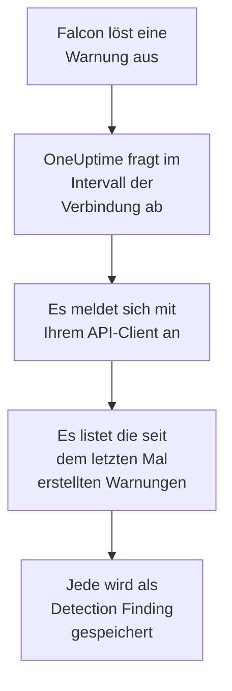

# CrowdStrike Falcon

Importieren Sie Warnungen von [CrowdStrike Falcon](https://www.crowdstrike.com/platform/), aus Erkennungen auf Endpunkten, bei Identitäten und in der Cloud, in die Sicherheitsereignisse von OneUptime. Dort durchsuchen Sie sie neben Ihren Logs, Traces und Metriken, verknüpfen sie mit jeder anderen Quelle und alarmieren die Bereitschaft für die wichtigen. OneUptime liest sie über die Falcon Alerts API mit einem API-Client, den Sie anlegen, und schreibt nie in Falcon.

:::cards
- [Die Verbindung einrichten](#die-verbindung-einrichten): Ein API-Client mit einem Bereich und das Formular der Verbindung.
- [Was importiert wird](#was-importiert-wird): Wie aus jeder Falcon-Warnung ein Sicherheitsereignis wird.
- [So funktioniert das Abfragen](#so-funktioniert-das-abfragen): Das Zeitfenster jeder Abfrage, und was eine ausgelastete CID damit macht.
- [Fehlerbehebung](#fehlerbehebung): Was jeder Fehler bedeutet und was zu ändern ist.
:::

## So funktioniert es



Jede Minute fragt OneUptime jede aktivierte Verbindung ab, deren Abfrageintervall abgelaufen ist. Eine Abfrage meldet sich mit ID und Geheimnis des API-Clients bei Ihrer Falcon-Cloud an, bittet die Alerts API um die seit der letzten Abfrage erstellten Warnungen und speichert jede als [OCSF](https://schema.ocsf.io/)-Ereignis Detection Finding (Klasse `2004`). Erkennungsregeln, Monitore und Dashboards behandeln es dann wie ein Sicherheitsereignis aus jeder anderen Quelle.

## Bevor Sie beginnen

- In OneUptime die Rolle Project Owner, Project Admin oder Security Admin. Security Member und Security Viewer sehen Verbindungen und ihren Laufverlauf, können sie aber nicht ändern.
- Eine Falcon-Kunden-ID (CID) und einen Benutzer der Falcon-Konsole, der API-Clients verwalten darf: mit der Rolle Falcon Administrator oder einer eigenen Rolle mit der Berechtigung für API-Clients und -Schlüssel.
- Ausgehendes HTTPS von der OneUptime-App und den Workern zum API-Host Ihrer Falcon-Cloud, aufgeführt unter **Falcon cloud** unten.

## Die Verbindung einrichten

:::steps
### Einen API-Client anlegen

1. Öffnen Sie in der Falcon-Konsole **Support and resources → API clients and keys** und wählen Sie **Create API client**.
2. Benennen Sie ihn, etwa `OneUptime security events`. Schalten Sie unter **API scopes** den Bereich **Alerts → Read** ein und lassen Sie jeden anderen Bereich aus: Die Verbindung schreibt nie in Falcon.
3. Legen Sie den Client an. Falcon zeigt seine Client-ID, sein Geheimnis und seine Basis-URL einmal an. Kopieren Sie jetzt alle drei: Das Geheimnis lässt sich später zurücksetzen, aber nie wieder anzeigen.

### Ihre Falcon-Cloud finden

Die Basis-URL, die Falcon angezeigt hat, nennt die Cloud, in der Ihre CID liegt. Die Seite **API clients and keys** zeigt sie auch, neben jedem Client. Ein Client aus einer Cloud wird von den anderen abgelehnt.

| Basis-URL, die Falcon zeigt | Falcon-Cloud |
| --- | --- |
| `https://api.crowdstrike.com` | US-1 |
| `https://api.us-2.crowdstrike.com` | US-2 |
| `https://api.eu-1.crowdstrike.com` | EU-1 |
| `https://api.laggar.gcw.crowdstrike.com` | US-GOV-1 |

### Die Verbindung in OneUptime hinzufügen

Öffnen Sie **Produkte → Sicherheitsereignisse → Verbindungen** (`/dashboard/{projectId}/security-events/connections`), klicken Sie auf **Verbindung hinzufügen**, wählen Sie **CrowdStrike Falcon** und klicken Sie auf **Weiter**. Füllen Sie die Einstellungen aus der Tabelle unten aus, klicken Sie auf **Weiter** und fügen Sie das Geheimnis in **Client-Secret** ein.

### Vor dem Speichern testen

Klicken Sie unter **Vor dem Speichern testen** auf **Diese Einstellungen testen**. Der Test meldet sich mit den Werten im Formular an, liest Warnungen und speichert nichts, die falsche Cloud oder ein fehlender Bereich zeigt sich also, bevor die Verbindung existiert. Klicken Sie dann auf **Weiter**, geben Sie der Verbindung einen **Name** und legen Sie sie an.
:::

| Einstellung | Was Sie eintragen |
| --- | --- |
| **Client-ID** | Die ID des API-Clients, wie Falcon sie beim Anlegen des Clients gezeigt hat. |
| **Falcon cloud** | Die Cloud, in der Ihre CID liegt: **US-1 (api.crowdstrike.com)**, **US-2 (api.us-2.crowdstrike.com)**, **EU-1 (api.eu-1.crowdstrike.com)** oder **US-GOV-1 (api.laggar.gcw.crowdstrike.com)**. Jede Anfrage geht an den API-Host dieser Cloud. |
| **Client-Secret** | Das Geheimnis des API-Clients. Es wird verschlüsselt, nie von der API zurückgegeben und nie wieder angezeigt. Ersetzen Sie es mit **Anmeldedaten aktualisieren** an der Verbindung. |

Der Schritt **Abfrage** hat außerdem eine optionale **Beschreibung**, das **Abfrageintervall (Minuten)**, eine ganze Zahl von `1` bis `1440`, die mit `5` beginnt, und **Aktiviert**, das eingeschaltet beginnt. Eine nicht aktivierte Verbindung lässt sich trotzdem testen und von Hand abfragen.

## Was importiert wird

Die Verbindung liest die Warnungen von Falcon: was die Falcon-Konsole unter **Endpoint security → Endpoint detections** und **Next-Gen SIEM → Alerts** listet, aus jedem Produkt, das sie auslöst. Jede Warnung wird zu einem Ereignis Detection Finding (OCSF-Klasse `2004`), mit dem Anbieter `CrowdStrike` und dem Produkt `Falcon`:

| Falcon-Feld | OneUptime-Spalte |
| --- | --- |
| `composite_id` | Ereignis-UID, nach der auch Duplikate verworfen werden |
| `created_timestamp` | Ereigniszeit |
| `display_name`, oder `name` | Regelname |
| `pattern_id` | Regel-ID |
| `description`, oder der Regelname | Nachricht |
| `severity_name`, oder `severity` von 0 bis 100 | Schweregrad |
| `status`, etwa `new`, `in_progress` oder `closed` | Status |
| `tactic_id`, `technique_id` | MITRE-ATT&CK-Taktiken und -Techniken |
| `device.hostname`, `device.local_ip`, `user_name`, `filename` oder `cmdline` | Hauptakteur: Host, IP, Benutzer und Prozess |
| `filename`, `filepath` und `cmdline`; `parent_details.filename`, `parent_details.filepath` und `parent_details.cmdline` | Prozessname, -pfad und -befehlszeile; Name, Pfad und Befehlszeile des übergeordneten Prozesses |
| `device.hostname`, `device.local_ip`, `device.external_ip`, `user_name`, `sha256` | Observables |
| Alles andere, etwa `device.platform_name`, `falcon_host_link`, `product` und `timestamp` | `attributes`, flach gemacht zu Schlüsseln mit Punkten |

Die Zeit des Ereignisses ist mit Absicht die, zu der Falcon die Warnung erstellt hat: Die Zeit des Verhaltens dahinter, `timestamp`, bleibt in `attributes.timestamp`.

## So funktioniert das Abfragen

- **Die Erstellungszeit ist der Cursor.** Warnungen werden nach `created_timestamp` gelistet, nie nach der Zeit des Verhaltens dahinter. Falcon kann eine Warnung lange nach der Aktivität auslösen, die sie beschreibt, und ein Cursor über die Aktivitätszeit würde jede solche Warnung überspringen.
- **Die erste Abfrage blickt 24 Stunden zurück**, sodass eine neue Verbindung ihre jüngsten Warnungen sofort zeigt.
- **Jede spätere Abfrage beginnt 1 Minute vor dem gespeicherten Cursor**, sodass eine Warnung, die an der Grenze zwischen zwei Zeitfenstern erstellt wurde, nie fehlt.
- **Eine Abfrage liest höchstens 24 Stunden über den Cursor hinaus.** Eine Verbindung, deren Cursor zurückliegt, holt in einer Reihe von 24-Stunden-Fenstern auf.
- **Duplikate werden nach `composite_id` verworfen**, innerhalb des Projekts, sodass die Überlappung und ein wiederholtes Zeitfenster nie eine Warnung doppelt speichern.
- **Jedes Zeitfenster kostet** eine Token-Anfrage, die für die Lebensdauer des Tokens gilt, dann eine Abfrage der Warnungen und einen Abruf der Warnungen je 1.000 Warnungen, jede mit ihrer eigenen Zeitgrenze.

### Wenn ein Zeitfenster mehr enthält, als eine Abfrage lesen kann

Eine Abfrage sendet höchstens 20 Anfragen. Mit einer Token-Anfrage und zwei Anfragen je 1.000 Warnungen liest sie höchstens 9.000 Warnungen. Enthält ein Zeitfenster mehr, ist der Lauf **Teilweise**, mit einer Warnung wie dieser:

```text
Stopped after 19 requests before reading the whole window. Alerts are read oldest first; every alert created before 2026-09-14T08:12:44.995Z was read.
```

Die Abfrage der Warnungen ist nach `created_timestamp` sortiert, die ältesten zuerst, deshalb setzt OneUptime den Cursor auf die Erstellungszeit der letzten gelesenen Warnung, und die nächste Abfrage beginnt dort, mit derselben Fensterlänge, ab Offset `0`. Eine ausgelastete CID holt etwa 9.000 Warnungen pro Abfrage auf, statt dieselben noch einmal zu lesen. Die Warnungen, die im selben Augenblick erstellt wurden, werden zweimal gelesen, und die Duplikatprüfung verwirft die zweite Kopie.

Die Abfrage der Warnungen von Falcon kann nicht über 10.000 Ergebnisse hinaus blättern (`limit` plus `offset`). Die Anfragegrenze hält einen Lauf bei 9.000 Warnungen an, vor dieser Obergrenze. Hält die Obergrenze doch einmal ein Lesen an, wird es genauso behandelt: Der Lauf ist **Teilweise**, der Cursor rückt zur zuletzt gelesenen Warnung, und die nächste Abfrage beginnt wieder ab Offset `0`.

Kommt ein Lauf gar nicht über den gespeicherten Cursor hinaus, etwa weil mehr als 9.000 Warnungen die Minute der Überlappung teilen, verkürzt OneUptime stattdessen das Zeitfenster:

1. **Verkleinern.** Die nächste Abfrage liest ein halb so langes Zeitfenster ab demselben Startpunkt und halbiert weiter, bis ein Zeitfenster vollständig gelesen wird, bis hinunter zu einer Minute. Die Warnung des Laufs sagt das: `This window holds more records than one poll can read; the next poll reads a {n} minute window from the same starting point.`
2. **Wieder wachsen.** Nachdem ein Zeitfenster vollständig gelesen wurde, ist das nächste wieder doppelt so lang, bis zu 24 Stunden.
3. **Über eine einzelne Minute hinweggehen.** Enthält selbst eine Minute mehr, als eine Abfrage lesen kann, geht das Abfragen über sie hinweg, damit neuere Warnungen weiter ankommen. Der Lauf bleibt **Teilweise**, und **Letzter Fehler** lautet `More records were created in the one minute from {cursor} to {end} than one poll can read. Polling moved past this minute so newer records keep arriving; use Import this time range in Diagnostics on this minute to recover what one run can read.` Importieren Sie diese Minute mit **Diesen Zeitraum importieren**, um zurückzuholen, was ein Lauf lesen kann.

Ein Lauf, der ganz fehlschlägt, mit einem Fehler von Falcon, behält den Cursor und die Fensterlänge, und die nächste Abfrage liest dasselbe Zeitfenster erneut. Die einzige Ausnahme ist eine Anfrage, deren Zeit abgelaufen ist: Der Cursor bleibt, aber das nächste Zeitfenster ist halb so lang, denn ein Zeitfenster, das zu schwer ist, um rechtzeitig beantwortet zu werden, würde bei jedem Versuch ablaufen. Ein anderes **Abfrageintervall (Minuten)** ändert nichts davon: Es entscheidet, wie oft eine Abfrage beginnt, nicht, wo ihr Zeitfenster beginnt.

### Bei Bedarf ausführen, ansehen und importieren

Klicken Sie an einer Verbindung auf **Diagnose**, um ihre letzten Läufe zu sehen und von Hand mit ihr zu arbeiten. Wer die Verbindung ändern darf, kann diese starten; wer sie sehen darf, kann den Verlauf lesen.

- **Jetzt ausführen** startet sofort eine Abfrage, mit dem üblichen Cursor, auch wenn die Verbindung nicht **Aktiviert** ist.
- **Preview alerts** liest einen Zeitraum von bis zu 7 Tagen und importiert nichts.
- **Diesen Zeitraum importieren** importiert nach Ihrer Bestätigung einen Zeitraum von bis zu 7 Tagen, ohne den Cursor zu verschieben. Bereits importierte Warnungen werden übersprungen.
- **Diagnosen kopieren** an einem Lauf kopiert seinen Bericht für den Support. Er enthält nie Anmeldedaten.

## Verbindung testen

**Verbindung testen** in der Zeile einer Verbindung und **Diese Einstellungen testen** im Formular laufen im API-Prozess, nicht in einem Hintergrund-Worker, sodass ein Test auch dann antwortet, wenn die Worker das Problem sind. Er führt diese Prüfungen der Reihe nach aus:

| Prüfung | Was sie prüft |
| --- | --- |
| **Konfiguration** | **Client-ID**, **Falcon cloud** und **Client-Secret** sind vorhanden und gültig. Schlägt das fehl, wird nichts kontaktiert. |
| **Authenticate with CrowdStrike Falcon** | `POST /oauth2/token` mit ID und Geheimnis des API-Clients, auf dem Host Ihrer Cloud, gibt ein Token zurück. |
| **Read alerts from the Falcon Alerts API** | Eine Abfrage nach einer Warnung (`limit=1`) über die letzten 24 Stunden wird angenommen, was den Bereich **Alerts → Read** beweist. |
| **Alerts available to import** | Wie viele Warnungen in den letzten 24 Stunden und den letzten 7 Tagen erstellt wurden. Keine in 7 Tagen ist eine Warnung, kein Fehler: Das Abfragen importiert neue Warnungen, sobald Falcon sie erstellt. |
| **Background workers**, **Poll scheduler**, **Security event storage** | Die Seite von OneUptime selbst: Ein Prozess nimmt die Aufträge der Worker-Warteschlange an, der Abfrageauftrag läuft jede Minute, und der Speicher der Sicherheitsereignisse antwortet. |
| **Geplante Abfrage** | Für eine gespeicherte Verbindung: Das Abfragen ist eingeschaltet, kein Lauf wartet festgefahren auf einen Worker, und die Abfragen laufen pünktlich. |

Jede Anfrage in einem Test hat eine Frist von 20 Sekunden. Ein Test importiert nie etwas und verschiebt nie den Cursor, und jede fehlgeschlagene Prüfung sagt, was zu ändern ist. **Bericht kopieren** kopiert die Prüfliste als JSON, ohne Anmeldedaten oder Tokens.

## Fehlerbehebung

Der **Letzter Fehler** der Verbindung und jede fehlgeschlagene Prüfung bewahren die vollständige Fehlermeldung, mit geschwärzten Anmeldedaten, hinter einem Präfix, das den fehlgeschlagenen Schritt nennt. Hat eine Verbindung einen Fehler, wählen Sie in ihrer Spalte **Aktionen** die Aktion **Fehler anzeigen**, um ihn zu lesen, und im Dialog **Fehler kopieren**, um ihn zu kopieren. Lesen Sie zuerst das Präfix.

:::details Letzter Fehler beginnt mit `CrowdStrike Falcon token request`
- `CrowdStrike Falcon token request failed (HTTP 401)` oder `(HTTP 403)`: Falcon hat ID und Geheimnis des API-Clients abgelehnt, bevor die Alerts API kontaktiert wurde. Prüfen Sie, dass **Falcon cloud** die Cloud Ihrer CID ist, denn ein Client aus einer anderen Cloud wird hier abgelehnt, dass **Client-ID** die des Clients ist und dass **Client-Secret** das mit ihm ausgestellte Geheimnis ist. Ging das Geheimnis verloren, setzen Sie es in der Falcon-Konsole zurück und speichern Sie es mit **Anmeldedaten aktualisieren**.
- `CrowdStrike Falcon token request returned ...`: Falcon hat mit etwas Unbrauchbarem geantwortet, einem Text, der kein JSON ist oder kein `access_token` hat. Das ist meist ein Proxy oder Gateway dazwischen, nicht die Anmeldedaten.
:::

:::details Letzter Fehler beginnt mit `CrowdStrike Falcon alerts`
- `CrowdStrike Falcon alerts query failed (HTTP 403)`: Das Token wurde angenommen, aber der API-Client hat den Bereich **Alerts → Read** nicht. Schalten Sie ihn für den Client unter **API clients and keys** ein und speichern Sie. Er gilt ab dem nächsten Token, testen Sie also nach einer Minute erneut.
- `CrowdStrike Falcon alerts query failed (HTTP 401)`: Die Alerts API hat das Token abgelehnt, was fast immer heißt, dass **Falcon cloud** nicht die Cloud ist, die den Client ausgestellt hat.
- `CrowdStrike Falcon alerts query failed (HTTP 429)` oder `CrowdStrike Falcon alerts fetch failed (HTTP 429)`: Falcon begrenzt die Rate dieses API-Clients. Der HTTP-Client von OneUptime behält bei einem Fehler keine Antwort-Header, deshalb endet die Meldung meist mit `the X-RateLimit-RetryAfter header was not available`, statt ihn zu zitieren. Geplante Abfragen versuchen es von selbst erneut. Wiederholt sich das, geben Sie OneUptime einen eigenen API-Client, statt einen mit anderen Werkzeugen zu teilen.
- `CrowdStrike Falcon alerts query failed (HTTP 400)`: Falcon hat die Abfrage abgelehnt. Die Verbindung sendet einen festen FQL-Filter auf `created_timestamp`, kopieren Sie also den Bericht und senden Sie ihn an den OneUptime-Support.
- `CrowdStrike Falcon alerts query returned ...` oder `CrowdStrike Falcon alerts fetch returned ...`: Falcon hat mit `200` geantwortet, mit einem Text, der kein JSON ist oder keine Form hat, die die Verbindung kennt. Das wird gemeldet statt als leeres Zeitfenster genommen, damit der Cursor nie über Warnungen hinwegrückt, die niemand gelesen hat.
- `CrowdStrike Falcon alerts fetch failed (HTTP ...)`: Die Warnungen wurden gelistet, aber ihr Abruf ist fehlgeschlagen, aus denselben Gründen wie die Abfrage. Ein `403` hier heißt, dass der Bereich zwischen den beiden Aufrufen entfernt wurde.
:::

:::details Letzter Fehler sagt, die Anfrage konnte nicht abgeschlossen werden
`CrowdStrike Falcon token request could not be completed`, `CrowdStrike Falcon alerts query could not be completed` und `CrowdStrike Falcon alerts fetch could not be completed` heißen, dass nichts zurückkam: eine abgelaufene Zeit, ein DNS-Fehler oder blockierter ausgehender Verkehr. Prüfen Sie ausgehendes HTTPS von der OneUptime-App und den Workern zum API-Host Ihrer Cloud, etwa `api.crowdstrike.com`.
:::

:::details Letzter Fehler nennt eine unbekannte Cloud
`CrowdStrike Falcon cloud "..." is not one of us-1, us-2, eu-1, us-gov-1` heißt, dass die gespeicherte Cloud keine ist, die die Verbindung kennt. Bearbeiten Sie die Verbindung und wählen Sie eine Cloud aus der Liste.
:::

:::details Ein Lauf ist Teilweise
- `Stopped after 19 requests before reading the whole window`: Das Zeitfenster enthielt mehr als die 9.000 Warnungen, die ein Lauf liest. Nichts geht verloren: Die nächste Abfrage beginnt nach der letzten gelesenen Warnung. Eine Verbindung, die Abfrage um Abfrage **Teilweise** bleibt, holt einen Rückstand auf, und ihre Werte **Zuletzt abgefragt** und **Letztes importiertes Ereignis** bewegen sich weiter. Die Zahl kann etwas über 19 liegen, wenn das Token während des Laufs erneuert wurde.
- `Falcon returned alerts out of created_timestamp order, so this run cannot name a point to resume from.`: Die Abfrage hat die Reihenfolge „älteste zuerst“ ignoriert, der Lauf kann den Cursor also nicht auf seine letzte Warnung setzen, und die nächste Abfrage liest stattdessen ein kürzeres Zeitfenster. Wiederholt sich das, senden Sie den Bericht des Laufs an den OneUptime-Support.
- `More records were created in the one minute from ... than one poll can read`: Das Abfragen ist über diese Minute hinweggegangen. Importieren Sie sie mit **Diesen Zeitraum importieren** in der **Diagnose**. Ein Import liest so viel wie eine Abfrage.
:::

:::details Zuletzt abgefragt ist Never und Letzter Fehler ist leer
Es ist noch keine Abfrage gelaufen, also hat nichts Falcon erreicht. **Verbindung testen** zeigt das als fehlgeschlagene Prüfung **Background workers** oder **Poll scheduler**. Bei einer selbst gehosteten Installation ist die übliche Ursache `DISABLE_QUEUE_WORKERS=true` an der App, ohne eigene Worker-Bereitstellung, die die Aufträge annimmt: Setzen Sie es auf `false` oder betreiben Sie die Worker-Bereitstellung (Helm: `worker.enabled: true`).
:::

:::details Der Test besteht, aber keine Ereignisse erscheinen
Lesen Sie **Alerts available to import**: Eine Warnung dort heißt, dass Falcon in den letzten 7 Tagen keine Warnungen erstellt hat, es gibt also noch nichts zu importieren. Öffnen Sie andernfalls die **Diagnose**, prüfen Sie Zeitfenster und Zahlen der letzten Abfrage und nutzen Sie an einem Lauf **Ereignisse in diesem Zeitraum anzeigen**, um den Zeitraum der Warnungen zu öffnen, die er importiert hat.
:::

## Was Sie davon haben

- **Suche.** Filtern Sie Falcon-Warnungen im Explorer der Sicherheitsereignisse nach Schweregrad, Status, MITRE-Taktik, Host, Benutzer oder jedem Observable, neben den Logs und Metriken dieses Hosts.
- **Verknüpfung.** Hostnamen, IPs, Benutzer und Datei-Hashes jeder Warnung werden als Observables indiziert, sodass eine Suche quer durch alle Quellen alles findet, was einen Host nennt.
- **Erkennungsregeln.** Sigma-Regeln, die nach einem Zeitplan über Ihre Sicherheitsereignisse laufen und Warnungen eröffnen, die die Bereitschaft alarmieren.
- **Monitore.** Monitore für Sicherheitsereignisse zählen passende Ereignisse und eröffnen ab einem Schwellwert Vorfälle oder Warnungen.

Sicherheitsereignisse werden wie Ihre übrige Telemetrie abgerechnet, pro aufgenommenem GB. Siehe [Preise](https://oneuptime.com/pricing).

## Nächste Schritte

:::cards
- [Sicherheitsereignisse](/docs/telemetry/security-events): Durchsuchen, verknüpfen und warnen, was Sie importieren.
- [Microsoft Defender XDR](/docs/integrations/microsoft-defender-xdr): Auch die Warnungen der Defender-Arbeitslasten von Microsoft importieren.
- [Rollen](/docs/permissions/reference#rollen): Was die Security-Rollen sehen und ändern können.
- [Integrationsübersicht](/docs/integrations/index): Die anderen Werkzeuge, die Sie verbinden können.
:::
