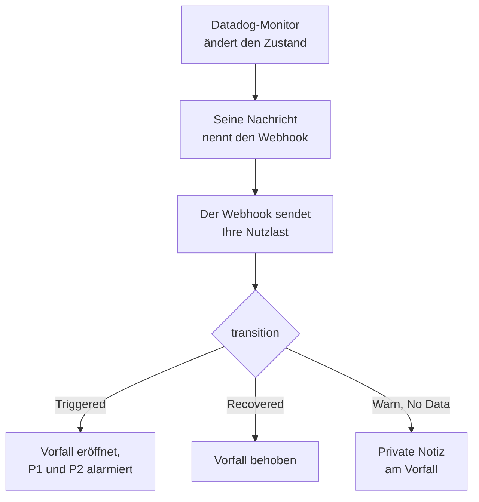

# Datadog

Senden Sie Monitorwarnungen von [Datadog](https://www.datadoghq.com) an OneUptime, sodass jede zu einem Vorfall oder einer Warnung wird, bei Dringlichkeit Ihr Bereitschaftsteam alarmiert und behoben wird, wenn sich der Datadog-Monitor erholt. Datadog sendet seine Warnungen über seine [Webhooks-Integration](https://docs.datadoghq.com/integrations/webhooks/), es gibt also auf keiner Seite etwas zu installieren.

:::cards
- [Wählen Sie, wie OneUptime Warnungen empfängt](#wählen-sie-wie-oneuptime-warnungen-empfängt): Eine Workflow-Vorlage oder ein Monitor für eingehende Anfragen.
- [Mit der Vorlage beginnen](#mit-der-vorlage-beginnen): Wählen Sie, wen Sie alarmieren, kopieren Sie die URL und sehen Sie, was jede Warnung bewirkt.
- [Warnungen mit einem Monitor empfangen](#warnungen-mit-einem-monitor-empfangen): Ein Vorfall pro Warnung, bei der Erholung behoben.
- [Datadog konfigurieren](#datadog-konfigurieren): Ein Webhook und die Monitore, die ihn benachrichtigen.
- [Fehlerbehebung](#fehlerbehebung): Wenn Warnungen nicht ankommen oder Vorfälle offen bleiben.
:::

## So funktioniert es



Ein Datadog-Monitor benachrichtigt die Webhooks, die seine Nachricht nennt, wenn er seinen Zustand ändert: wenn er auslöst, warnt, sich erholt oder keine Daten hat. Den JSON-Text des Webhooks schreiben Sie selbst, aus den [Vorlagenvariablen](https://docs.datadoghq.com/integrations/webhooks/#usage) von Datadog, deshalb gibt Ihnen diese Anleitung einen, der jede Warnung benennt und sagt, was mit ihr geschah.

## Bevor Sie beginnen

- Ein Datadog-Konto, in dem Sie Integrationen konfigurieren und Monitore bearbeiten können.
- In OneUptime das Recht, Workflows anzulegen, oder Monitore, wenn Sie diesen Weg gehen. Auf OneUptime Cloud brauchen Workflows den Tarif **Growth** oder höher.

## Wählen Sie, wie OneUptime Warnungen empfängt

Richten Sie zuerst OneUptime ein: Es gibt Ihnen die URL, an die Datadog sendet.

| Weg | Nutzen Sie ihn, wenn |
| --- | --- |
| Die Workflow-Vorlage (empfohlen) | Sie möchten jede Warnung als Vorfall oder Warnung mit einem Schweregrad aus der Priorität des Monitors, bei P1 und P2 an die Bereitschaft gemeldet, mit Warnstufen als Notiz, und bei der Erholung behoben. Es gibt nichts zu bauen. |
| Ein Monitor für eingehende Anfragen | Sie möchten Vorfälle ohne Workflow, in jedem Tarif, und einen Monitor, dessen Status Datadog folgt. |

Beide bekommen dasselbe JSON vom selben Webhook, Sie können also mit einem beginnen und später wechseln, indem Sie in Datadog eine URL ändern.

## Mit der Vorlage beginnen

Der Dialog **Arbeitsablauf erstellen** hat zwei Datadog-Vorlagen, unter **Datadog** in seiner Kategorieliste: **Declare an incident when a Datadog monitor triggers** und, für Warnungen, **Create an alert when a Datadog monitor triggers**. Beide tun dasselbe, jede mit ihrer eigenen Art von Datensatz.

:::steps
1. Gehen Sie zu **Arbeitsabläufe** und klicken Sie auf **Arbeitsablauf erstellen**. Wählen Sie unter **Oder mit einer Vorlage beginnen** in der Kategorieliste **Datadog**, klicken Sie auf **Declare an incident when a Datadog monitor triggers** oder auf **Create an alert when a Datadog monitor triggers** und dann auf **Diese Vorlage verwenden**.
2. Wählen Sie unter **Who to page for P1 and P2 monitors** die zu alarmierenden Bereitschaftsrichtlinien, oder keine, um niemanden zu alarmieren, und klicken Sie auf **Arbeitsablauf erstellen**. Der Workflow öffnet sich ausgeschaltet im **Editor**.
3. Klicken Sie auf den Trigger **Webhook**, dann auf **URL kopieren**, und bewahren Sie die URL für Datadog auf.
4. Schalten Sie oben im **Editor** **Aktiviert** ein. Ein ausgeschalteter Workflow antwortet Datadog mit `400`.
:::

Dann [konfigurieren Sie Datadog](#datadog-konfigurieren), damit es seine Warnungen an diese URL sendet. Der Schritt `read-event-1` des Workflows öffnet sich mit derselben Einrichtung, falls Sie im **Editor** darauf zurückkommen.

### Was der Workflow tut

Nach dem Trigger **Webhook** liest der Schritt **Check With JavaScript** `read-event-1` das `transition`, das Datadog sendet, und **Incident From Another Tool**, in der Vorlage für Warnungen **Alert From Another Tool**, tut, was es bedeutet, über den Zyklusschlüssel der Warnung. Datadog behält diesen Schlüssel von dem Moment an, in dem eine Warnung auslöst, bis sie sich erholt, und beim nächsten Auslösen ist der Schlüssel neu, sodass jedes Mal ein eigener Vorfall entsteht. Der Vorfall behält den Schlüssel in seinem benutzerdefinierten Feld `datadogAlertCycleKey`.

| Übergang | Was der Workflow tut |
| --- | --- |
| `Triggered`, `Re-Triggered` | Meldet einen Vorfall mit dem Titel `Datadog: <monitor>`, mit dem Schweregrad, auf den die Priorität des Monitors abgebildet wird, und hält ihn von Ihren Statusseiten fern. Seine Beschreibung verlinkt die Warnung in Datadog und nennt die Priorität, den Host, den Geltungsbereich und die Nachricht des Monitors. Eine Benachrichtigung für eine Warnung, die ihren Vorfall hat, eröffnet keinen zweiten und alarmiert niemanden erneut. |
| `Recovered` | Behebt den Vorfall der Warnung, sofern er nicht schon behoben ist. Der Grund steht auf seiner Zeitleiste. |
| `Warn`, `Re-Warn`, `No Data`, `Re-No Data` | Fügt dem Vorfall der Warnung eine private Notiz hinzu, die sagt, in welchem Zustand der Monitor jetzt ist. |
| `Renotify` | Nichts: Die Warnung ist noch offen. |

Ein Warnzustand oder eine Erholung für eine Warnung ohne Vorfall ändert nichts. Alles andere, etwa eine Anfrage eines anderen Werkzeugs, bleibt unberührt: `read-event-1` nimmt **No**, und die **Schritte** der Ausführung sagen, warum. Nichts geht an Datadog zurück: Es behebt seine eigenen Warnungen, wenn sich das Signal erholt, und das behebt den Vorfall.

### Prioritäten und Alarmierung

Ein neuer Vorfall alarmiert die gewählten Bereitschaftsrichtlinien, wenn sein Monitor P1 oder P2 ist oder keine Priorität hat. P3, P4 und P5 eröffnen einen Vorfall und alarmieren niemanden. In einem neuen Projekt werden die Prioritäten auf diese Vorfall- und Warnungsschweregrade abgebildet:

| Datadog-Priorität | Vorfall | Warnung | Bereitschaft |
| --- | --- | --- | --- |
| P1 | Critical Incident | High | Alarmiert |
| P2 | Critical Incident | High | Alarmiert |
| Keine Priorität | Critical Incident | High | Alarmiert |
| P3 | Major Incident | Low | Nicht alarmiert |
| P4 | Minor Incident | Low | Nicht alarmiert |
| P5 | Minor Incident | Low | Nicht alarmiert |

Mit eigenen Schweregraden gehen P1, P2 und keine Priorität an Ihren schwersten, P3 an den mittleren und P4 und P5 an Ihren leichtesten.

- Um eine Priorität per Namen einem Ihrer Schweregrade zuzuordnen, bearbeiten Sie `SEVERITY_BY_NAME` im Schritt `read-event-1`, etwa `{ P3: 'Minor Incident' }`.
- Um auch bei P3 zu alarmieren, setzen Sie **Compare with** des Schritts `if-page-1` **If / Else** auf `3`.

## Warnungen mit einem Monitor empfangen

Ein [Monitor für eingehende Anfragen](/docs/monitor/incoming-request-monitor) gibt Ihnen eine URL, und seine Kriterien entscheiden, was jede Warnung bewirkt.

:::steps
### Den Monitor anlegen

Gehen Sie zu **Monitore** und klicken Sie auf **Monitor erstellen**. Wählen Sie unter **Monitortyp** die Option **Eingehende Anfrage**, nennen Sie ihn `Datadog` und klicken Sie auf **Weiter**.

### Für jede Warnung einen Vorfall melden

Öffnen Sie im Schritt **Kriterien** das erste Kriterium, das den Monitor als offline markiert. Setzen Sie seinen Filter auf **Anfragetext**, **Enthält**, `"transition":"Triggered"`. Dieses Kriterium meldet bereits einen Vorfall, wenn sein Filter zutrifft. Füllen Sie den Vorfall aus:

- **Vorfalltitel**: `{{requestBody.title}}`.
- **Vorfallbeschreibung**, unter **Beschreibung**: `{{requestBody.body}}`, dann `Datadog: {{requestBody.link}}` in einer eigenen Zeile.
- **Schweregrad**: der Vorfallschweregrad, den diese Warnungen haben sollen.
- **Bereitschaftsrichtlinien**, unter **Bereitschaft**: die Richtlinien, die alarmiert werden.
- **Vorfall automatisch beheben**, unter **Weitere Felder**: Lassen Sie es eingeschaltet, wie es beginnt. Ohne diese Option werden Erholungen ignoriert, und Vorfälle bleiben offen.

### Einen Vorfall pro Warnung eröffnen

Öffnen Sie im selben Kriterium **Einstellungen** und schalten Sie **Vorfälle und Warnungen nach einem Payload-Feld gruppieren** ein. Füllen Sie es wie unten aus, damit jede Warnung ihren eigenen Vorfall bekommt und ihre Erholung ihn behebt:

| Feld | Wert |
| --- | --- |
| **Einen eigenen Vorfall eröffnen pro…** | `requestBody.alert_key` |
| **Feld, das die Erholung signalisiert** | `requestBody.transition` |
| **Wert, der „wiederhergestellt“ bedeutet** | `Recovered` |

### Den Monitor wieder online bringen

Öffnen Sie das zweite Kriterium, das den Monitor als online markiert, und setzen Sie seinen Filter auf **Anfragetext**, **Enthält**, `"transition":"Recovered"`.

### Die URL kopieren

Klicken Sie auf **Monitor erstellen**. Die Seite **Übersicht** des Monitors zeigt seine **Heartbeat-URL**. Kopieren Sie sie für Datadog:

```text
https://oneuptime.com/heartbeat/<secret key>
```

Eine selbst gehostete Installation hat ihren eigenen Host anstelle von `oneuptime.com`.
:::

Die Nutzlast unten setzt `alert_key` auf die ID des Datadog-Monitors und die Tags der Gruppe, die gewarnt hat, sodass jede Gruppe eines Multi-Alert-Monitors ihren eigenen Vorfall bekommt und die Erholung dieser Gruppe ihn behebt. Ein Monitor, der erneut auslöst oder erneut benachrichtigt, während sein Vorfall offen ist, eröffnet keinen zweiten. Unter [Warnungen aus einem anderen System empfangen](/docs/monitor/incoming-request-monitor#warnungen-aus-einem-anderen-system-empfangen) steht, was jede Einstellung tut.

> [!NOTE]
> Eine Benachrichtigung **Warn** oder **No Data** eröffnet mit diesen Filtern keinen Vorfall. Um auch bei Warnungen alarmiert zu werden, klicken Sie auf **Kriterien hinzufügen** und geben dem neuen Kriterium den Filter **Anfragetext**, **Enthält**, `"transition":"Warn"`, einen Vorfall mit eigenem **Schweregrad** und dieselben Gruppierungseinstellungen, und ziehen es dann über das erste Kriterium. Kriterien werden von oben geprüft, und das erste, das zutrifft, entscheidet.

## Datadog konfigurieren

:::steps
### Den Webhook hinzufügen

Öffnen Sie in Datadog die [Kachel der Webhooks-Integration](https://app.datadoghq.com/integrations/webhooks) und installieren Sie sie, falls sie noch nicht installiert ist. Fügen Sie einen Webhook mit diesen Einstellungen hinzu und speichern Sie ihn:

- **Name**: `oneuptime`. Monitore nennen den Webhook unter diesem Namen, als `@webhook-oneuptime`.
- **URL**: die URL, die Sie aus OneUptime kopiert haben.
- **Payload**:

  ```json
  {
    "alert_key": "$ALERT_ID $ALERT_SCOPE",
    "alert_cycle_key": "$ALERT_CYCLE_KEY",
    "transition": "$ALERT_TRANSITION",
    "alert_priority": "$ALERT_PRIORITY",
    "title": "$EVENT_TITLE",
    "body": "$TEXT_ONLY_MSG",
    "host": "$HOSTNAME",
    "scope": "$ALERT_SCOPE",
    "priority": "$PRIORITY",
    "link": "$LINK"
  }
  ```

### Den Webhook in Ihren Monitoren nennen

Fügen Sie in jedem Datadog-Monitor, der über OneUptime alarmieren soll, `@webhook-oneuptime` in die Benachrichtigungsnachricht des Monitors ein und speichern Sie den Monitor. Datadog sendet dann die Warnungen und Erholungen dieses Monitors an OneUptime.
:::

| Variable | Was Datadog einsetzt |
| --- | --- |
| `$ALERT_ID` | Die ID des Datadog-Monitors, der gewarnt hat. |
| `$ALERT_SCOPE` | Die Tags der Gruppe, die gewarnt hat, etwa `host:web-1`. |
| `$ALERT_CYCLE_KEY` | Eine ID, die vom Moment an, in dem eine Warnung auslöst, bis zu ihrer Erholung gleich bleibt. |
| `$ALERT_TRANSITION` | Was geschah: `Triggered`, `Re-Triggered`, `Warn`, `Recovered`, `No Data` oder `Renotify`, unter anderem. |
| `$ALERT_PRIORITY` | Die Priorität des Datadog-Monitors, `P1` bis `P5`, oder nichts bei einem Monitor ohne Priorität. |
| `$EVENT_TITLE` | Der Titel des Ereignisses, etwa `[Triggered] High CPU`. |
| `$TEXT_ONLY_MSG` | Die Nachricht des Monitors, ohne Markdown. |
| `$LINK` | Ein Link zum Ereignis in Datadog. |

Eine Nutzlast dient beiden Wegen: Die Vorlage richtet sich nach `alert_cycle_key` und `alert_priority`, der Monitor nach `alert_key`. Behalten Sie alle, dann können Sie später wechseln, indem Sie nur die URL ändern.

## Testen

Senden Sie eine Warnung an die kopierte URL, so wie Datadog es täte:

```bash
curl -X POST "<url>" \
  -H "Content-Type: application/json" \
  -d '{
    "alert_key": "1234 host:web-1",
    "alert_cycle_key": "7151157925468446720",
    "transition": "Triggered",
    "alert_priority": "P1",
    "title": "[Triggered] High CPU",
    "body": "CPU is above 90% on web-1.",
    "host": "web-1",
    "scope": "host:web-1",
    "priority": "normal",
    "link": "https://app.datadoghq.com/event/event?id=1"
  }'
```

Mit der Vorlage wird ein Vorfall eröffnet, mit dem Titel `Datadog: High CPU`, und die gewählten Bereitschaftsrichtlinien werden alarmiert. Mit dem Monitor wird ein Vorfall eröffnet, mit dem Titel `[Triggered] High CPU`. Senden Sie dieselbe Anfrage mit `transition` auf `Recovered`, und der Vorfall wird behoben.

Testen Sie dann aus Datadog: Öffnen Sie einen Monitor, der den Webhook nennt, klicken Sie auf **Test Notifications** und senden Sie seine Benachrichtigung **Alert**. Um zu sehen, ob sie angekommen ist, öffnen Sie **Protokolle → Ausführungen** des Workflows oder die Zeitleiste des OneUptime-Monitors.

## Fehlerbehebung

:::details In OneUptime kommt nichts an
- Prüfen Sie, dass die Nachricht des Datadog-Monitors `@webhook-oneuptime` nennt, genau so geschrieben, wie der Webhook heißt.
- Der Monitor antwortet sofort mit `200`, bevor er etwas prüft, selbst bei einem falschen geheimen Schlüssel. Prüfen Sie in der Zeitleiste des Monitors, ob Warnungen ankommen.
- Ein ausgeschalteter Workflow antwortet mit `400`. Schalten Sie oben in seinem **Editor** **Aktiviert** ein.
:::

:::details Der Workflow läuft, eröffnet aber nichts
Öffnen Sie die Ausführung unter **Protokolle → Ausführungen**. Der Eintrag `read-event-1` unter **Schritte** sagt, warum er **No** genommen hat.

- `Datadog named no alert cycle key`: Fügen Sie `"alert_cycle_key": "$ALERT_CYCLE_KEY"` zur Nutzlast des Webhooks in Datadog hinzu.
- `Datadog named no transition`: Fügen Sie `"transition": "$ALERT_TRANSITION"` zur Nutzlast des Webhooks in Datadog hinzu.
:::

:::details Die Bereitschaft wird nicht alarmiert
- Nur P1- und P2-Monitore und Monitore ohne Priorität alarmieren. Siehe [Prioritäten und Alarmierung](#prioritäten-und-alarmierung).
- Eine Benachrichtigung für eine Warnung, die ihren Vorfall hat, alarmiert niemanden erneut.
- Ist im Dialog **Arbeitsablauf erstellen** niemand gewählt, hat der Workflow keinen Schritt, der alarmiert.
:::

:::details Vorfälle werden eröffnet, aber nie behoben
- Der Datadog-Monitor muss den Webhook auch über seine Erholungen benachrichtigen. Eine Nachricht, die den Webhook nur für Warnungen nennt, innerhalb einer Bedingung, sendet keine Erholung.
- Mit der Vorlage öffnen Sie die Ausführung der Erholung unter **Protokolle → Ausführungen**: Ihr letzter Schritt sagt, warum. Der `alert_cycle_key` der Erholung muss der der Warnung sein, lassen Sie also `$ALERT_CYCLE_KEY` in der Nutzlast so, wie es ist.
- Mit dem Monitor braucht der Vorfall des Kriteriums **Vorfall automatisch beheben** unter **Weitere Felder**.
- **Wert, der „wiederhergestellt“ bedeutet** muss genau `Recovered` sein. Der Vergleich unterscheidet Groß- und Kleinschreibung.
- Der `alert_key` der Erholung muss der der Warnung sein: Lassen Sie `$ALERT_ID $ALERT_SCOPE` so, wie es in der Nutzlast steht.
:::

:::details Ein Feld zeigt den Namen einer Variablen oder nichts
Datadog füllt nur die Variablen aus, die zum Ereignis passen. Senden Sie eine Testbenachrichtigung und sehen Sie dann nach, was angekommen ist: in der Zeitleiste des Monitors oder bei einem Workflow unter **Protokolle → Ausführungen**.
:::

:::details Alle Warnungen eines Monitors landen in einem Vorfall
Mit dem Monitor braucht jede Gruppe ihren eigenen `alert_key`. Prüfen Sie, dass die Nutzlast ihn aus `$ALERT_ID` und `$ALERT_SCOPE` zusammensetzt und dass der Gruppierungspfad `requestBody.alert_key` ist.
:::

## Sicherheit

- **Behandeln Sie die URL wie ein Passwort.** Wer sie hat, kann Vorfälle eröffnen. Wird sie bekannt, setzen Sie sie zurück: mit **URL zurücksetzen** im **Webhook**-Trigger des Workflows oder mit **Geheimen Schlüssel für eingehende Anfragen zurücksetzen** auf der Seite **Einstellungen** des Monitors. Aktualisieren Sie dann die **URL** des Webhooks in Datadog.
- **Links führen zu Datadog.** Die Vorlage verlinkt eine Warnung nur auf einer Datadog-Site, egal was eine Anfrage sagt, und schreibt, was Datadog gesendet hat, als Text.
- **Selbst gehostet?** Datadog sendet Webhooks aus dem Internet, Ihr OneUptime muss also von dort über HTTPS erreichbar sein.

## Nächste Schritte

:::cards
- [Workflow-Vorlagen](/docs/workflows/authoring): Einen Workflow aus einer Vorlage erstellen und im Editor ändern.
- [Eingehende-Anfrage-Überwachung](/docs/monitor/incoming-request-monitor): Jede Einstellung des Monitors, der Ihre Warnungen empfängt.
- [New Relic](/docs/integrations/new-relic): Dieselbe Vorlage, für New-Relic-Issues.
- [Eskalationsregeln](/docs/on-call/escalation-rules): Festlegen, wen eine Bereitschaftsrichtlinie alarmiert, und wann.
- [Integrationsübersicht](/docs/integrations/index): Die anderen Werkzeuge, die Sie verbinden können.
:::
