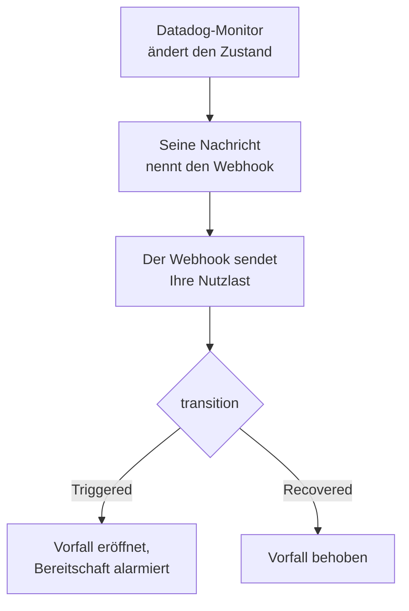

# Datadog

Senden Sie Monitorwarnungen von [Datadog](https://www.datadoghq.com) an OneUptime, sodass jede Warnung zu einem Vorfall wird, der Ihr Bereitschaftsteam alarmiert und behoben wird, wenn sich der Datadog-Monitor erholt. Datadog sendet seine Warnungen über seine [Webhooks-Integration](https://docs.datadoghq.com/integrations/webhooks/), es gibt also auf keiner Seite etwas zu installieren.

:::cards
- [Wählen Sie, wie OneUptime Warnungen empfängt](#wählen-sie-wie-oneuptime-warnungen-empfängt): Ein Monitor für eingehende Anfragen oder ein eigener Workflow.
- [Warnungen mit einem Monitor empfangen](#warnungen-mit-einem-monitor-empfangen): Ein Vorfall pro Warnung, bei der Erholung behoben.
- [Datadog konfigurieren](#datadog-konfigurieren): Ein Webhook und die Monitore, die ihn benachrichtigen.
- [Fehlerbehebung](#fehlerbehebung): Wenn Warnungen nicht ankommen oder Vorfälle offen bleiben.
:::

## So funktioniert es



Ein Datadog-Monitor benachrichtigt die Webhooks, die seine Nachricht nennt, wenn er seinen Zustand ändert: wenn er auslöst, warnt, sich erholt oder keine Daten hat. Den JSON-Text des Webhooks schreiben Sie selbst, aus den [Vorlagenvariablen](https://docs.datadoghq.com/integrations/webhooks/#usage) von Datadog, deshalb gibt Ihnen diese Anleitung einen, der jede Warnung benennt und sagt, was mit ihr geschah.

## Bevor Sie beginnen

- Ein Datadog-Konto, in dem Sie Integrationen konfigurieren und Monitore bearbeiten können.
- In OneUptime das Recht, Monitore anzulegen, oder Workflows, wenn Sie diesen Weg gehen.

## Wählen Sie, wie OneUptime Warnungen empfängt

Richten Sie zuerst OneUptime ein: Es gibt Ihnen die URL, an die Datadog sendet.

| Weg | Nutzen Sie ihn, wenn |
| --- | --- |
| Ein Monitor für eingehende Anfragen (empfohlen) | Sie möchten, dass jede Warnung ein Vorfall wird, der die Bereitschaft alarmiert und behoben wird, wenn sich der Datadog-Monitor erholt. Es gibt nichts zu bauen. |
| Ein Workflow mit einem Webhook-Trigger | Sie brauchen eigene Logik: Warnungen filtern, umformen oder zuerst andere Systeme aufrufen. Ein Workflow meldet für jede Warnung, die er bekommt, einen Vorfall und behebt ihn bei der Erholung nicht. |

Beide bekommen dasselbe JSON vom selben Webhook, Sie können also mit einem beginnen und später wechseln, indem Sie in Datadog eine URL ändern.

## Warnungen mit einem Monitor empfangen

Ein [Monitor für eingehende Anfragen](/docs/monitor/incoming-request-monitor) gibt Ihnen eine URL, und seine Kriterien entscheiden, was jede Warnung bewirkt.

:::steps
### Den Monitor anlegen

Gehen Sie zu **Monitore** und klicken Sie auf **Monitor erstellen**. Wählen Sie unter **Monitortyp** die Option **Eingehende Anfrage**, nennen Sie ihn `Datadog` und klicken Sie auf **Weiter**.

### Für jede Warnung einen Vorfall melden

Öffnen Sie im Schritt **Kriterien** das erste Kriterium, das den Monitor als offline markiert. Setzen Sie seinen Filter auf **Anfragetext**, **Enthält**, `"transition":"Triggered"`. Dieses Kriterium meldet bereits einen Vorfall, wenn sein Filter zutrifft. Füllen Sie den Vorfall aus:

- **Vorfalltitel**: `{{requestBody.title}}`.
- **Vorfallbeschreibung**, unter **Beschreibung**: `{{requestBody.body}}`, dann `Datadog: {{requestBody.link}}` in einer eigenen Zeile.
- **Schweregrad**: der Vorfallschweregrad, den diese Warnungen haben sollen.
- **Bereitschaftsrichtlinien**, unter **Bereitschaft**: die Richtlinien, die alarmiert werden.
- **Vorfall automatisch beheben**, unter **Weitere Felder**: Lassen Sie es eingeschaltet, wie es beginnt. Ohne diese Option werden Erholungen ignoriert, und Vorfälle bleiben offen.

### Einen Vorfall pro Warnung eröffnen

Öffnen Sie im selben Kriterium **Einstellungen** und schalten Sie **Vorfälle und Warnungen nach einem Payload-Feld gruppieren** ein. Füllen Sie es wie unten aus, damit jede Warnung ihren eigenen Vorfall bekommt und ihre Erholung ihn behebt:

| Feld | Wert |
| --- | --- |
| **Einen eigenen Vorfall eröffnen pro…** | `requestBody.alert_key` |
| **Feld, das die Erholung signalisiert** | `requestBody.transition` |
| **Wert, der „wiederhergestellt“ bedeutet** | `Recovered` |

### Den Monitor wieder online bringen

Öffnen Sie das zweite Kriterium, das den Monitor als online markiert, und setzen Sie seinen Filter auf **Anfragetext**, **Enthält**, `"transition":"Recovered"`.

### Die URL kopieren

Klicken Sie auf **Monitor erstellen**. Die Seite **Übersicht** des Monitors zeigt seine **Heartbeat-URL**. Kopieren Sie sie für Datadog:

```text
https://oneuptime.com/heartbeat/<secret key>
```

Eine selbst gehostete Installation hat ihren eigenen Host anstelle von `oneuptime.com`.
:::

Die Nutzlast unten setzt `alert_key` auf die ID des Datadog-Monitors und die Tags der Gruppe, die gewarnt hat, sodass jede Gruppe eines Multi-Alert-Monitors ihren eigenen Vorfall bekommt und die Erholung dieser Gruppe ihn behebt. Ein Monitor, der erneut auslöst oder erneut benachrichtigt, während sein Vorfall offen ist, eröffnet keinen zweiten. Unter [Warnungen aus einem anderen System empfangen](/docs/monitor/incoming-request-monitor#warnungen-aus-einem-anderen-system-empfangen) steht, was jede Einstellung tut.

> [!NOTE]
> Eine Benachrichtigung **Warn** oder **No Data** eröffnet mit diesen Filtern keinen Vorfall. Um auch bei Warnungen alarmiert zu werden, klicken Sie auf **Kriterien hinzufügen** und geben dem neuen Kriterium den Filter **Anfragetext**, **Enthält**, `"transition":"Warn"`, einen Vorfall mit eigenem **Schweregrad** und dieselben Gruppierungseinstellungen, und ziehen es dann über das erste Kriterium. Kriterien werden von oben geprüft, und das erste, das zutrifft, entscheidet.

## Datadog konfigurieren

:::steps
### Den Webhook hinzufügen

Öffnen Sie in Datadog die [Kachel der Webhooks-Integration](https://app.datadoghq.com/integrations/webhooks) und installieren Sie sie, falls sie noch nicht installiert ist. Fügen Sie einen Webhook mit diesen Einstellungen hinzu und speichern Sie ihn:

- **Name**: `oneuptime`. Monitore nennen den Webhook unter diesem Namen, als `@webhook-oneuptime`.
- **URL**: die URL, die Sie aus OneUptime kopiert haben.
- **Payload**:

  ```json
  {
    "alert_key": "$ALERT_ID $ALERT_SCOPE",
    "transition": "$ALERT_TRANSITION",
    "title": "$EVENT_TITLE",
    "body": "$TEXT_ONLY_MSG",
    "host": "$HOSTNAME",
    "priority": "$PRIORITY",
    "link": "$LINK"
  }
  ```

### Den Webhook in Ihren Monitoren nennen

Fügen Sie in jedem Datadog-Monitor, der über OneUptime alarmieren soll, `@webhook-oneuptime` in die Benachrichtigungsnachricht des Monitors ein und speichern Sie den Monitor. Datadog sendet dann die Warnungen und Erholungen dieses Monitors an OneUptime.
:::

| Variable | Was Datadog einsetzt |
| --- | --- |
| `$ALERT_ID` | Die ID des Datadog-Monitors, der gewarnt hat. |
| `$ALERT_SCOPE` | Die Tags der Gruppe, die gewarnt hat, etwa `host:web-1`. |
| `$ALERT_TRANSITION` | Was geschah: `Triggered`, `Re-Triggered`, `Warn`, `Recovered`, `No Data` oder `Renotify`, unter anderem. |
| `$EVENT_TITLE` | Der Titel des Ereignisses, etwa `[Triggered] High CPU`. |
| `$TEXT_ONLY_MSG` | Die Nachricht des Monitors, ohne Markdown. |
| `$LINK` | Ein Link zum Ereignis in Datadog. |

## Testen

Senden Sie OneUptime eine Warnung, so wie Datadog es täte:

```bash
curl -X POST "https://oneuptime.com/heartbeat/<secret key>" \
  -H "Content-Type: application/json" \
  -d '{
    "alert_key": "1234 host:web-1",
    "transition": "Triggered",
    "title": "[Triggered] High CPU",
    "body": "CPU is above 90% on web-1.",
    "host": "web-1",
    "priority": "normal",
    "link": "https://app.datadoghq.com/event/event?id=1"
  }'
```

Ein Vorfall wird eröffnet, mit dem Titel `[Triggered] High CPU`. Senden Sie dieselbe Anfrage mit `transition` auf `Recovered`, und der Vorfall wird behoben.

Testen Sie dann aus Datadog: Öffnen Sie einen Monitor, der den Webhook nennt, klicken Sie auf **Test Notifications** und senden Sie seine Benachrichtigung **Alert**. Prüfen Sie in der Zeitleiste des OneUptime-Monitors, ob sie angekommen ist.

## Warnungen mit einem Workflow empfangen

Nutzen Sie einen [Workflow](/docs/workflows/index), wenn Sie zwischen Datadog und dem Vorfall eigene Schritte brauchen.

:::steps
### Den Workflow anlegen

Gehen Sie zu **Arbeitsabläufe**, klicken Sie auf **Arbeitsablauf erstellen** und dann auf **Ohne Vorlage beginnen**. Nennen Sie ihn `Datadog alerts` und klicken Sie auf **Arbeitsablauf erstellen**.

### Den Webhook-Trigger hinzufügen

Klicken Sie auf den gestrichelten Baustein **Wählen Sie, was diesen Arbeitsablauf startet** und wählen Sie **Webhook**. Klicken Sie auf den Trigger, dann auf **URL kopieren**, und verwenden Sie diese URL im Webhook in Datadog.

### Prüfen, ob der Monitor ausgelöst hat

Klicken Sie auf **Komponente hinzufügen**, fügen Sie einen **If / Else**-Baustein hinzu und verbinden Sie den Punkt **Out** des Triggers damit. Setzen Sie **Value to check** auf `{{local.components.webhook-1.returnValues.request-body.transition}}`, **Comparison** auf **is equal to** und **Compare with** auf `Triggered`.

### Den Vorfall melden

Fügen Sie einen **Create One Incident**-Baustein hinzu und verbinden Sie die Seite **Yes** des **If / Else**-Bausteins damit. Wählen Sie unter **Incident Template** eine Vorlage, die den Schweregrad und die zu alarmierenden Bereitschaftsrichtlinien festlegt (siehe [Vorfallvorlagen](/docs/incidents/settings#vorfall-vorlagen)). Setzen Sie in **JSON Object**, was von Datadog kommt:

```json
{
  "title": "{{local.components.webhook-1.returnValues.request-body.title}}",
  "description": "{{local.components.webhook-1.returnValues.request-body.body}}\nDatadog: {{local.components.webhook-1.returnValues.request-body.link}}"
}
```

Ohne Vorlage braucht **JSON Object** zusätzlich `incidentSeverityId`, die ID eines Vorfallschweregrads des Projekts.

### Den Workflow einschalten

Schalten Sie oben im **Editor** **Aktiviert** ein. Ein ausgeschalteter Workflow antwortet Datadog mit `400`.
:::

Jede Benachrichtigung `Triggered` meldet einen neuen Vorfall. Eine Erholung nimmt die Seite **No** des **If / Else**-Bausteins, an der nichts angeschlossen ist, die Ausführung endet also dort. Für einen Vorfall pro Warnung, bei der Erholung behoben, nutzen Sie den Monitor.

## Fehlerbehebung

:::details In OneUptime kommt nichts an
- Prüfen Sie, dass die Nachricht des Datadog-Monitors `@webhook-oneuptime` nennt, genau so geschrieben, wie der Webhook heißt.
- Der Monitor antwortet sofort mit `200`, bevor er etwas prüft, selbst bei einem falschen geheimen Schlüssel. Prüfen Sie in der Zeitleiste des Monitors, ob Warnungen ankommen.
- Ein ausgeschalteter Workflow antwortet mit `400`. Schalten Sie oben in seinem **Editor** **Aktiviert** ein.
:::

:::details Vorfälle werden eröffnet, aber nie behoben
- Der Datadog-Monitor muss den Webhook auch über seine Erholungen benachrichtigen. Eine Nachricht, die den Webhook nur für Warnungen nennt, innerhalb einer Bedingung, sendet keine Erholung.
- Der Vorfall des Kriteriums braucht **Vorfall automatisch beheben** unter **Weitere Felder**.
- **Wert, der „wiederhergestellt“ bedeutet** muss genau `Recovered` sein. Der Vergleich unterscheidet Groß- und Kleinschreibung.
- Der `alert_key` der Erholung muss der der Warnung sein: Lassen Sie `$ALERT_ID $ALERT_SCOPE` so, wie es in der Nutzlast steht.
:::

:::details Ein Feld zeigt den Namen einer Variablen oder nichts
Datadog füllt nur die Variablen aus, die zum Ereignis passen. Senden Sie eine Testbenachrichtigung und sehen Sie dann nach, was angekommen ist: in der Zeitleiste des Monitors oder bei einem Workflow unter **Protokolle → Ausführungen**.
:::

:::details Alle Warnungen eines Monitors landen in einem Vorfall
Jede Gruppe braucht ihren eigenen `alert_key`. Prüfen Sie, dass die Nutzlast ihn aus `$ALERT_ID` und `$ALERT_SCOPE` zusammensetzt und dass der Gruppierungspfad `requestBody.alert_key` ist.
:::

## Sicherheit

- **Behandeln Sie die URL wie ein Passwort.** Wer sie hat, kann Vorfälle eröffnen. Wird sie bekannt, setzen Sie sie zurück: mit **Geheimen Schlüssel für eingehende Anfragen zurücksetzen** auf der Seite **Einstellungen** des Monitors oder mit **URL zurücksetzen** im **Webhook**-Trigger des Workflows. Aktualisieren Sie dann die **URL** des Webhooks in Datadog.
- **Selbst gehostet?** Datadog sendet Webhooks aus dem Internet, Ihr OneUptime muss also von dort über HTTPS erreichbar sein.

## Nächste Schritte

:::cards
- [Eingehende-Anfrage-Überwachung](/docs/monitor/incoming-request-monitor): Jede Einstellung des Monitors, der Ihre Warnungen empfängt.
- [Prometheus Alertmanager](/docs/integrations/prometheus-alertmanager): Dieselbe Einrichtung für Alertmanager.
- [Eskalationsregeln](/docs/on-call/escalation-rules): Festlegen, wen eine Bereitschaftsrichtlinie alarmiert, und wann.
- [Integrationsübersicht](/docs/integrations/index): Die anderen Werkzeuge, die Sie verbinden können.
:::
