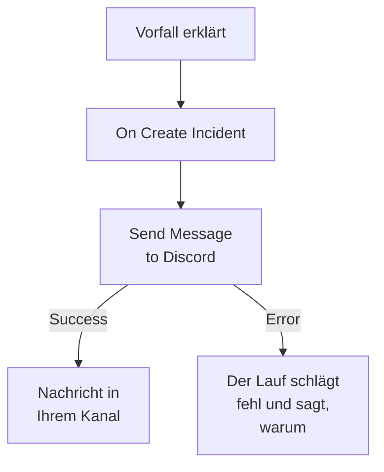

# Discord

Posten Sie eine Nachricht in einen [Discord](https://discord.com)-Kanal, wenn ein Vorfall eröffnet wird, damit die Leute, die diesen Kanal verfolgen, es sofort wissen. Der Arbeitsablaufschritt **Send Message to Discord** von OneUptime postet über den Webhook des Kanals, und eine fertige Vorlage baut den ganzen Arbeitsablauf für Sie. Diese Integration ist **ausgehend**: OneUptime postet in den Kanal und liest nicht, was dort geschrieben wird.

:::cards
- [So funktioniert es](#so-funktioniert-es): Was der Arbeitsablauf tut, wenn ein Vorfall eröffnet wird.
- [Einrichten](#die-integration-einrichten): Ein Webhook in Discord, dann der Arbeitsablauf: aus der Vorlage oder von Grund auf.
- [Tipps](#tipps): Formatierung, lange Nachrichten und weitere Ereignisse.
- [Fehlerbehebung](#fehlerbehebung): Was die Fehler des Schritts bedeuten und was zu ändern ist.
:::

## So funktioniert es



Der Schritt postet den **Message Text** an den Webhook des Kanals. Er nimmt seinen Ausgang **Success**, wenn Discord die Nachricht annimmt, und seinen Ausgang **Error**, mit dem Grund von Discord, wenn Discord sie ablehnt. Ist mit **Error** nichts verbunden, wie in der Vorlage, schlägt ein Lauf, der nicht posten konnte, fehl, und seine **Schritte** sagen, warum.

## Bevor Sie beginnen

- In Discord die Berechtigung **Manage Webhooks** für den Kanal.
- In OneUptime das Recht, Arbeitsabläufe und Variablen anzulegen. In OneUptime Cloud brauchen Arbeitsabläufe den Plan **Growth** oder höher.

## Die Integration einrichten

:::steps
### Einen Webhook in Discord erstellen

1. Öffnen Sie in Discord die Einstellungen des Kanals mit **Edit Channel**, dann **Integrations → Webhooks**, und wählen Sie **New Webhook**.
2. Benennen Sie ihn, zum Beispiel `OneUptime`, und prüfen Sie, dass er in den richtigen Kanal postet.
3. Wählen Sie **Copy Webhook URL**.

Wer die URL hat, kann in den Kanal posten, bewahren Sie sie also so sicher wie ein Passwort auf.

### Den Arbeitsablauf bauen

Beginnen Sie mit der Vorlage, die den ganzen Arbeitsablauf für Sie baut, oder von Grund auf.

:::tabs
@tab Aus der Vorlage
1. Öffnen Sie **Arbeitsabläufe** und klicken Sie auf **Arbeitsablauf erstellen**.
2. Geben Sie `Discord` in **Vorlagen durchsuchen…** ein, klicken Sie auf **Tell Discord when an incident opens** und dann auf **Diese Vorlage verwenden**.
3. Behalten Sie den Namen **Notify Discord on new incident** oder ändern Sie ihn, und klicken Sie auf **Weiter**.
4. Fügen Sie die URL in **Discord Webhook URL** ein und klicken Sie auf **Arbeitsablauf erstellen**.

Der Arbeitsablauf öffnet sich im **Editor** mit zwei Schritten: **On Create Incident** und **Send Message to Discord**, der Nummer, Titel, Schweregrad und Status des Vorfalls postet. Die URL wird als geheime Variable `discordWebhookUrl` des Arbeitsablaufs gespeichert.
@tab Von Grund auf
1. Speichern Sie die URL als geheime globale Variable: Gehen Sie zu **Arbeitsabläufe → Globale Variablen**, klicken Sie auf **Arbeitsablaufvariable erstellen**, nennen Sie sie `DISCORD_WEBHOOK_URL` und klicken Sie auf **Weiter**. Fügen Sie die URL in **Inhalt** ein, schalten Sie **Geheimnis** ein und klicken Sie auf **Arbeitsablaufvariable erstellen**.
2. Gehen Sie zu **Arbeitsabläufe**, klicken Sie auf **Arbeitsablauf erstellen**, wählen Sie **Ohne Vorlage beginnen**, geben Sie dem Arbeitsablauf einen Namen und klicken Sie auf **Arbeitsablauf erstellen**.
3. Klicken Sie im **Editor** auf **Wählen Sie, was diesen Arbeitsablauf startet** und wählen Sie **On Create Incident** unter **Beliebt**. Klicken Sie auf den Auslöser: Seine **Fields to pass on** beginnen mit **Titel**, also klicken Sie auf **Feld hinzufügen** und wählen Sie die weiteren Felder, die Ihre Nachricht zeigt, etwa **Vorfallsnummer mit Präfix**.
4. Klicken Sie auf **Komponente hinzufügen**, suchen Sie nach `discord` und klicken Sie auf **Send Message to Discord**. Verbinden Sie den Ausgang **Success** des Auslösers mit diesem Schritt.
5. Klicken Sie auf den neuen Schritt. Klicken Sie in **Discord Incoming Webhook URL** auf **{ }** und wählen Sie `DISCORD_WEBHOOK_URL` unter **Globale Variablen**. Schreiben Sie die Nachricht in **Message Text** und fügen Sie die Felder des Vorfalls mit **{ }** ein.
:::

Eine Nachricht von Grund auf liest die Felder des Vorfalls mit Verweisen wie diesen:

```text
🚨 **Incident {{local.components.incident-on-create-1.returnValues.model.incidentNumberWithPrefix}} declared**
**Title:** {{local.components.incident-on-create-1.returnValues.model.title}}
```

### Einschalten und testen

Schalten Sie **Aktiviert** oben im **Editor** ein. Von nun an wird jeder neue Vorfall im Kanal gepostet.

Um zu testen, ohne einen Vorfall zu eröffnen, klicken Sie auf **Arbeitsablauf ausführen** und wählen unter **Vorfall** einen vorhandenen Vorfall aus: Die neuesten sind aufgelistet, und wenn Sie seine Nummer oder einen Teil seines Titels eintippen, finden Sie einen anderen. Klicken Sie auf **Arbeitsablauf manuell ausführen** und bestätigen Sie mit **Ausführen**. Das Panel **Arbeitsablauf-Ausführung** verfolgt den Lauf, und die Nachricht erscheint im Kanal. Nimmt der Schritt stattdessen **Error**, schlägt der Lauf fehl, und der Eintrag des Schritts unter **Schritte** sagt, warum: siehe [Fehlerbehebung](#fehlerbehebung).
:::

## Tipps

- **Mit dem Markdown von Discord formatieren.** Der Text wird so gesendet, wie er getippt ist, deshalb funktioniert das Markdown von Discord darin: Sternchen um ein Wort machen es fett, und eine URL erscheint als Link.
- **Auf die Grenze von 2.000 Zeichen achten.** Discord nimmt Nachrichten mit bis zu 2.000 Zeichen an. Eine längere wird gekürzt und endet mit "… (truncated — see OneUptime for the full text)", statt abgelehnt zu werden.
- **Mehr als neue Vorfälle posten.** Bauen Sie einen weiteren Arbeitsablauf auf **On Update Incident** für Statusänderungen, oder auf **On Create Alert** für Warnungen, mit demselben Schritt. Um nur manche Vorfälle zu posten, setzen Sie einen Block **If / Else** vor den Schritt.
- **Nur die eigenen Adressen von Discord.** Der Schritt postet an eine `https`-URL auf `discord.com` oder `discordapp.com` und folgt keinen Umleitungen, eine URL, die woandershin zeigt, beendet den Lauf also.

## Fehlerbehebung

Nimmt der Schritt **Error**, schlägt der Lauf fehl, und der Eintrag des Schritts im Reiter **Schritte** des Laufs nennt den Grund von Discord.

:::details "Unknown Webhook" oder "Invalid Webhook Token"
Der Webhook wurde gelöscht, oder die URL wurde falsch kopiert. Erstellen Sie einen neuen Webhook und ersetzen Sie die URL: im Arbeitsablauf der Vorlage die Variable `discordWebhookUrl`, in einem eigenen Arbeitsablauf den Inhalt von `DISCORD_WEBHOOK_URL`.
:::

:::details Discord antwortet "You are being rate limited"
Discord begrenzt, wie oft ein Webhook posten kann. Eine Häufung von Vorfällen kann diese Grenze erreichen: Posten Sie weniger Nachrichten, zum Beispiel nur für manche Schweregrade.
:::

:::details Der Lauf stoppt mit "Discord Webhook URL must be an https URL on discord.com or discordapp.com"
**Discord Incoming Webhook URL** enthält etwas anderes als einen Discord-Webhook, oder die Variable, die es liest, ist leer. Fügen Sie die URL aus **Copy Webhook URL** erneut ein.
:::

## Nächste Schritte

:::cards
- [Workflow-Komponenten](/docs/workflows/components#discord): Jede Einstellung des Schritts und was seine Ausgänge bedeuten.
- [Telegram](/docs/integrations/telegram): Dieselbe Idee, in einem Telegram-Chat.
- [Workflow-Ausführungen](/docs/workflows/runs-and-logs): Lesen Sie, was jeder Lauf des Arbeitsablaufs getan hat.
- [Integrationsübersicht](/docs/integrations/index): Das ausgehende Muster und die anderen Werkzeuge, die Sie verbinden können.
:::
