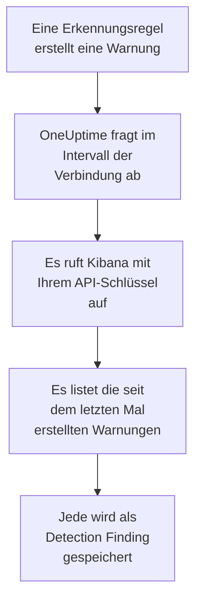

# Elastic Security

Importieren Sie die Erkennungswarnungen, die Ihre Regeln in [Elastic Security](https://www.elastic.co/security) auslösen, in die Sicherheitsereignisse von OneUptime. Dort durchsuchen Sie sie neben Ihren Logs, Traces und Metriken, verknüpfen sie mit jeder anderen Quelle und alarmieren die Bereitschaft für die wichtigen. OneUptime liest sie über die Detection-Engine-API von Kibana mit einem API-Schlüssel, den Sie erstellen, und ändert nichts in Elastic.

:::cards
- [Die Verbindung einrichten](#die-verbindung-einrichten): Ein API-Schlüssel, seine Berechtigungen und das Formular der Verbindung.
- [Was importiert wird](#was-importiert-wird): Wie aus jeder Erkennungswarnung ein Sicherheitsereignis wird.
- [So funktioniert das Abfragen](#so-funktioniert-das-abfragen): Das Zeitfenster jeder Abfrage, und was ein ausgelasteter Space damit macht.
- [Fehlerbehebung](#fehlerbehebung): Was jeder Fehler bedeutet und was zu ändern ist.
:::

## So funktioniert es



Jede Minute fragt OneUptime jede aktivierte Verbindung ab, deren Abfrageintervall abgelaufen ist. Eine Abfrage bittet Kibana um die seit der letzten Abfrage in Ihrem Space erstellten Erkennungswarnungen, 1.000 auf einmal, und speichert jede als [OCSF](https://schema.ocsf.io/)-Ereignis Detection Finding (Klasse `2004`). Jede Art von Regel zählt: benutzerdefinierte Abfrage, Schwellenwert, EQL, Indikatorabgleich, maschinelles Lernen und neue Begriffe. Erkennungsregeln, Monitore und Dashboards behandeln die Warnungen dann wie Sicherheitsereignisse aus jeder anderen Quelle.

## Bevor Sie beginnen

- In OneUptime die Rolle Project Owner, Project Admin oder Security Admin. Security Member und Security Viewer sehen Verbindungen und ihren Laufverlauf, können sie aber nicht ändern.
- Elastic Security 8.x oder neuer, in Elastic Cloud oder auf Ihrem eigenen Elastic-Stack, mit Erkennungsregeln, die in einem Kibana-Space laufen.
- Kibana-Zugriff, der Erkennungswarnungen in diesem Space sehen darf: die Indexberechtigungen `read` und `view_index_metadata` für `.alerts-security.alerts-<space-id>` und eine Kibana-Funktionsberechtigung für Security, mit der er dort Warnungen lesen kann.
- Ein Kibana, das OneUptime über HTTPS erreicht. OneUptime Cloud verbindet sich aus dem Internet, Kibana braucht also eine öffentliche Adresse, wie sie Elastic-Cloud-Bereitstellungen haben: Private Adressen werden abgelehnt. Ein selbst gehostetes OneUptime verbindet sich aus seinen App- und Worker-Containern und erreicht ein Kibana in Ihrem privaten Netz, außer wenn `DATA_SOURCE_BLOCK_PRIVATE_ADDRESSES` auf `true` steht.

## Die Verbindung einrichten

:::steps
### Einen API-Schlüssel erstellen

1. Öffnen Sie in Kibana **Stack Management → API keys** und wählen Sie **Create API key**.
2. Benennen Sie ihn, zum Beispiel `oneuptime-security-events`. Ein Schlüssel hat die Berechtigungen des Benutzers, der ihn erstellt, außer Sie geben ihm weniger: Er braucht nur die oben genannten.
3. Wählen Sie, wann er abläuft, oder nie. Ein Schlüssel, der abläuft, hält die Verbindung an, bis Sie ihn ersetzen.
4. Erstellen Sie den Schlüssel und kopieren Sie seinen **Base64**-Wert, den Kibana nur einmal zeigt. Nicht die ID des Schlüssels und nicht das Paar `id:api_key`.

### Die ID Ihres Space finden

Warnungen werden pro Space gespeichert. Öffnen Sie den Space, in dem Ihre Regeln laufen: Seine ID ist der Teil der Kibana-Adresse nach `/s/`, etwa `security` in `https://kibana.example.com/s/security/app/security`. Der Standard-Space hat keinen `/s/`-Teil und braucht keine ID.

### Die Verbindung in OneUptime hinzufügen

Öffnen Sie **Produkte → Sicherheitsereignisse → Verbindungen** (`/dashboard/{projectId}/security-events/connections`), klicken Sie auf **Verbindung hinzufügen**, wählen Sie **Elastic Security** und klicken Sie auf **Weiter**. Füllen Sie die Einstellungen aus der Tabelle unten aus, klicken Sie auf **Weiter** und fügen Sie den Schlüssel in **API-Schlüssel** ein.

### Vor dem Speichern testen

Klicken Sie unter **Vor dem Speichern testen** auf **Diese Einstellungen testen**. Der Test meldet sich mit den Werten im Formular an, liest Warnungen und speichert nichts, ein falscher Space oder eine fehlende Berechtigung zeigt sich also, bevor die Verbindung existiert. Klicken Sie dann auf **Weiter**, geben Sie der Verbindung einen **Name** und legen Sie sie an.
:::

| Einstellung | Was Sie eintragen |
| --- | --- |
| **Kibana URL** | Die Adresse, unter der Kibana bereitgestellt wird, etwa `https://kibana.example.com` oder `https://<deployment>.kb.<region>.cloud.es.io`. Ohne Pfad: nicht `/app/security`, nicht `/api` und nicht der Teil `/s/<space>`. |
| **Kibana space** | Die ID des Space, nicht sein Name: Buchstaben, Ziffern, Bindestriche und Unterstriche. Lassen Sie sie für den Standard-Space leer. |
| **API-Schlüssel** | Der **Base64**-Wert des Schlüssels, für sich allein: OneUptime fügt das Schema `ApiKey` selbst hinzu. Er wird verschlüsselt, nie von der API zurückgegeben und nie wieder angezeigt. Ersetzen Sie ihn mit **Anmeldedaten aktualisieren** an der Verbindung. |

Der Schritt **Abfrage** hat außerdem eine optionale **Beschreibung**, das **Abfrageintervall (Minuten)**, eine ganze Zahl von `1` bis `1440`, die mit `5` beginnt, und **Aktiviert**, das eingeschaltet beginnt.

## Was importiert wird

Jede Erkennungswarnung wird zu einem Ereignis Detection Finding (OCSF-Klasse `2004`), mit dem Anbieter `Elastic` und dem Produkt `Elastic Security`:

| Feld der Warnung | OneUptime-Spalte |
| --- | --- |
| `_id`, die ID der Warnung | Ereignis-UID, nach der auch Duplikate verworfen werden |
| `kibana.alert.original_time`, sonst `kibana.alert.start`, sonst `@timestamp` | Ereigniszeit |
| `kibana.alert.rule.name` | Regelname |
| `kibana.alert.rule.uuid`, sonst `kibana.alert.rule.rule_id` | Regel-ID |
| `kibana.alert.reason`, sonst der Regelname, sonst `kibana.alert.rule.description` | Meldung |
| `kibana.alert.severity`, sonst eine Stufe von `kibana.alert.risk_score` | Schweregrad |
| `kibana.alert.workflow_status`: `open`, `acknowledged` oder `closed` | Status |
| `kibana.alert.rule.threat`, einschließlich Untertechniken | MITRE-ATT&CK-Taktiken und -Techniken |
| `user.name`, `host.name`, `source.ip` oder `host.ip`, `process.name` oder `process.executable` | Benutzer, Host, IP und Prozess des Akteurs |
| `process.name`, `process.executable` und `process.command_line`; `process.parent.name`, `process.parent.executable` und `process.parent.command_line` | Prozessname, -pfad und -befehlszeile; Name, Pfad und Befehlszeile des übergeordneten Prozesses |
| `user.target.name`, `destination.domain`, `destination.ip`, `destination.port`, `file.path` | Benutzer, Host, IP, Port und Ressource des Ziels |
| Diese, sowie `related.*`, `dns.question.name`, `url.domain` und Datei-Hashes | Observables |
| Die ganze Warnung, flach gemacht zu Schlüsseln mit Punkten, mit `_index` und `_id` | `attributes` |

Die Zeit einer Warnung ist absichtlich die Zeit der Aktivität, um die es geht. Ihr `@timestamp`, wann die Regel sie erstellt hat, ist das, was das Abfragen liest, sodass eine heute erstellte Warnung über die Aktivität von gestern im Explorer der Sicherheitsereignisse unter gestern erscheint. Hat eine Warnung keinen Schweregrad, entscheidet ihr Risikowert: ab `74` Critical, ab `48` High, ab `22` Medium, und alles darunter Low.

## So funktioniert das Abfragen

Jede Abfrage listet die in ihrem Zeitfenster erstellten Warnungen, die ältesten zuerst, 1.000 pro Seite. In einem anderen als dem Standard-Space beginnt der Pfad mit `/s/{Kibana space}`:

```text
POST {Kibana URL}/api/detection_engine/signals/search
    {"query": {"range": {"@timestamp": {"gte": "{window start}", "lt": "{window end}"}}},
     "size": 1000, "sort": [{"@timestamp": "asc"}]}
```

- **Die Erstellungszeit ist der Cursor.** Warnungen werden nach ihrem eigenen `@timestamp` gelistet, wann der Regellauf sie erstellt hat, nie nach der Zeit der Aktivität, um die es geht. Eine stündlich laufende Regel erstellt Warnungen über Aktivität, die bis zu einer Stunde alt ist, und ein Cursor über die Aktivitätszeit würde jede davon überspringen.
- **Die erste Abfrage blickt 24 Stunden zurück**, sodass eine neue Verbindung ihre jüngsten Warnungen sofort zeigt.
- **Jede spätere Abfrage beginnt 1 Minute vor dem gespeicherten Cursor**, sodass eine Warnung, die an der Grenze zwischen zwei Zeitfenstern erstellt wurde, nie übersprungen wird.
- **Eine Abfrage liest höchstens 24 Stunden über den Cursor hinaus.** Eine Verbindung, deren Cursor zurückliegt, holt in einer Reihe von 24-Stunden-Fenstern auf, und ihre **Integrität** zeigt **Catching up**.
- **Duplikate werden nach `_id` der Warnung verworfen**, innerhalb des Projekts, sodass die Überlappung, ein wiederholtes Zeitfenster und ein Import nie eine Warnung doppelt speichern.

Die Warnungssuche von Kibana nimmt eine Größe und eine Sortierung, aber kein Seitentoken. Deshalb blättert OneUptime, indem es den Anfang des Bereichs auf die letzte Warnung jeder Seite setzt, und lässt nach `_id` die Warnungen aus, die es zu diesem Zeitpunkt schon gelesen hat. Ein Regellauf versieht oft viele Warnungen mit derselben Zeit, und eine solche Gruppe wird Seite für Seite gelesen, keine doppelt und keine übersprungen.

### Wenn ein Zeitfenster mehr enthält, als eine Abfrage lesen kann

Eine Abfrage liest höchstens 10.000 Warnungen, in höchstens 20 Anfragen. Enthält ein Zeitfenster mehr, ist der Lauf **Teilweise**, mit einer Warnung wie dieser:

```text
Stopped after collecting 10000 alerts; the window holds more.
```

Warnungen werden die ältesten zuerst gelesen, deshalb setzt OneUptime den Cursor auf die Erstellungszeit der letzten gelesenen Warnung, und die nächste Abfrage beginnt dort, mit derselben Fensterlänge. Ein ausgelasteter Space holt 10.000 Warnungen pro Abfrage auf, statt dieselben noch einmal zu lesen. Die Warnungen, die im selben Augenblick erstellt wurden, werden zweimal gelesen, und die Duplikatprüfung verwirft die zweite Kopie.

Die ausgelassenen IDs reisen in jeder Anfrage mit, und Kibana begrenzt die Größe einer Anfrage. Teilen sich mehr Warnungen einen Zeitpunkt, als eine Anfrage auslassen kann, etwa 7.800, endet der Lauf dort als **Teilweise**, mit einer Warnung, die den Zeitpunkt nennt.

Kommt ein Lauf gar nicht über den gespeicherten Cursor hinaus, verkürzt OneUptime stattdessen das Zeitfenster:

1. **Verkleinern.** Die nächste Abfrage liest ein halb so langes Zeitfenster ab demselben Startpunkt und halbiert weiter, bis ein Zeitfenster vollständig gelesen wird, bis hinunter zu einer Minute. Die Warnung des Laufs sagt das: `This window holds more records than one poll can read; the next poll reads a {n} minute window from the same starting point.`
2. **Wieder wachsen.** Nachdem ein Zeitfenster vollständig gelesen wurde, ist das nächste wieder doppelt so lang, bis zu 24 Stunden.
3. **Über eine einzelne Minute hinweggehen.** Enthält selbst eine Minute mehr, als eine Abfrage lesen kann, geht das Abfragen über sie hinweg, damit neuere Warnungen weiter ankommen. Der Lauf bleibt **Teilweise**, und **Letzter Fehler** lautet `More records were created in the one minute from {cursor} to {end} than one poll can read. Polling moved past this minute so newer records keep arriving; use Import this time range in Diagnostics on this minute to recover what one run can read.` Importieren Sie diese Minute mit **Diesen Zeitraum importieren**, um zurückzuholen, was ein Lauf lesen kann.

Ein Lauf, der ganz fehlschlägt, mit einem Fehler von Kibana, behält den Cursor und die Fensterlänge, und die nächste Abfrage liest dasselbe Zeitfenster erneut. Die einzige Ausnahme ist eine Anfrage, deren Zeit abgelaufen ist: Der Cursor bleibt, aber das nächste Zeitfenster ist halb so lang, denn ein Zeitfenster, das zu schwer ist, um rechtzeitig beantwortet zu werden, würde bei jedem Versuch ablaufen. Ein anderes **Abfrageintervall (Minuten)** ändert nichts davon: Es entscheidet, wie oft eine Abfrage beginnt, nicht, wo ihr Zeitfenster beginnt.

### Bei Bedarf ausführen, ansehen und importieren

Klicken Sie an einer Verbindung auf **Diagnose**, um ihre letzten Läufe zu sehen und von Hand mit ihr zu arbeiten. Wer die Verbindung ändern darf, kann diese starten; wer sie sehen darf, kann den Verlauf lesen.

- **Jetzt ausführen** startet sofort eine Abfrage, mit dem üblichen Cursor, auch wenn die Verbindung nicht **Aktiviert** ist.
- **Preview alerts** liest einen Zeitraum von bis zu 7 Tagen und importiert nichts.
- **Diesen Zeitraum importieren** importiert nach Ihrer Bestätigung einen Zeitraum von bis zu 7 Tagen, ohne den Cursor zu verschieben. Bereits importierte Warnungen werden übersprungen.
- **Diagnosen kopieren** an einem Lauf kopiert seinen Bericht für den Support. Er enthält nie Anmeldedaten.

## Verbindung testen

**Verbindung testen** in der Zeile einer Verbindung und **Diese Einstellungen testen** im Formular laufen im API-Prozess, nicht in einem Hintergrund-Worker, sodass ein Test auch dann antwortet, wenn die Worker das Problem sind. Er führt diese Prüfungen der Reihe nach aus:

| Prüfung | Was sie prüft |
| --- | --- |
| **Konfiguration** | Jede Einstellung ist vorhanden und gültig. Schlägt das fehl, wird nichts kontaktiert. |
| **Authenticate with Kibana** | `/api/status` von Kibana antwortet vollständig. Kibana antwortet auch Aufrufern, die es nicht authentifiziert hat, mit weniger, deshalb lässt eine knappe Antwort diese Prüfung fehlschlagen. |
| **Read detection alerts** | Eine in den letzten 24 Stunden erstellte Warnung lässt sich lesen. Das beweist die Berechtigungen und den Space. |
| **Alerts available to import** | Wie viele Warnungen in den letzten 24 Stunden und den letzten 7 Tagen erstellt wurden, mit `+`, wo Elasticsearch nur einen Teil gezählt hat. Keine in 7 Tagen ist eine Warnung, kein Fehler. |
| **Background workers**, **Poll scheduler**, **Security event storage** | Die Seite von OneUptime selbst: Ein Prozess nimmt die Aufträge der Worker-Warteschlange an, der Abfrageauftrag läuft jede Minute, und der Speicher der Sicherheitsereignisse antwortet. |
| **Geplante Abfrage** | Für eine gespeicherte Verbindung: Das Abfragen ist eingeschaltet, kein Lauf wartet festgefahren auf einen Worker, und die Abfragen laufen pünktlich. |

Jede Anfrage in einem Test hat eine Frist von 20 Sekunden. Ein Test importiert nie etwas und verschiebt nie den Cursor, und jede fehlgeschlagene Prüfung sagt, was zu ändern ist.

## Sicherheitsereignisse an Elastic Security senden

OneUptime kann das, was es findet, auch an Elasticsearch senden, als Dokumente im Elastic Common Schema (ECS) in einem Datenstrom, sodass die Warnungen, Zeitachsen und Erkennungsregeln von Elastic Security die Erkennungen von OneUptime neben Ihren eigenen sehen. Eine Erkennung ist ein Dokument mit `event.kind` `alert`, und jedes andere Ereignis hat `event.kind` `event`.

:::steps
### Einen API-Schlüssel erstellen, der schreiben darf

Öffnen Sie in Kibana **Stack Management → API keys**, klicken Sie auf **Create API key**, geben Sie ihm die Berechtigungen unten und kopieren Sie seinen Wert **Encoded**.

### Das Ziel hinzufügen

Öffnen Sie **Produkte → Sicherheitsereignisse → Verbindungen**. Klicken Sie unter **An Ihr SIEM senden** auf **Ziel hinzufügen**, wählen Sie Elastic Security unter **SIEM** und klicken Sie auf **Weiter**. Tragen Sie die **Elasticsearch-URL** ein, den Elasticsearch-Endpunkt des Deployments und nicht den von Kibana, und fügen Sie den Schlüssel in **API-Schlüssel** ein. **Datenstrom** ist optional: Bleibt er leer, gehen die Dokumente nach `logs-oneuptime.security-default`, den Elasticsearch beim ersten Schreiben anlegt.

### Ein Testereignis senden und das Senden starten

Klicken Sie auf **Testereignis senden**: Ein Dokument kommt im Datenstrom an. Behalten Sie dann unter **Was gesendet wird** die Option **Nur Erkennungen** oder wählen Sie **Alle Sicherheitsereignisse**, und klicken Sie auf **Senden starten**.
:::

Die Berechtigungen des Schlüssels, für den Standard-Datenstrom:

```json title="oneuptime-writer-role.json"
{
  "oneuptime-writer": {
    "indices": [
      {
        "names": [
          "logs-oneuptime.security-*"
        ],
        "privileges": [
          "create_doc",
          "auto_configure"
        ]
      }
    ]
  }
}
```

- Dokumente gehen in Stapeln von bis zu 500, jedes mit der eigenen ID seines Ereignisses, sodass ein zweimal gesendetes Ereignis einmal gespeichert wird.
- Ein Dokument, das Elasticsearch nicht zuordnen kann, wird ausgelassen und in **Fehler anzeigen** genannt, und eines, das es gerade nicht annehmen kann (`429`), wird erneut gesendet.
- Warnungen, die OneUptime aus Elastic Security importiert hat, werden nie an Elastic Security zurückgesendet.

## Fehlerbehebung

Der **Letzter Fehler** der Verbindung bewahrt die vollständige Fehlermeldung, mit geschwärzten Anmeldedaten, hinter einem Präfix, das den fehlgeschlagenen Schritt nennt. Hat eine Verbindung einen Fehler, wählen Sie in ihrer Spalte **Aktionen** die Aktion **Fehler anzeigen**, um ihn zu lesen, und im Dialog **Fehler kopieren**, um ihn zu kopieren. Lesen Sie zuerst das Präfix.

:::details Letzter Fehler beginnt mit `Elastic Security status request`
- `Elastic Security status request failed (HTTP ...)`: Kibana hat die Statusanfrage abgelehnt.
  - `HTTP 401`: Kibana hat den API-Schlüssel nicht angenommen. Es ist nicht der **Base64**-Wert, oder er ist abgelaufen oder wurde ungültig gemacht. Erstellen Sie einen neuen Schlüssel und speichern Sie ihn mit **Anmeldedaten aktualisieren**.
  - `HTTP 404`: Die **Kibana URL** hat einen Pfad oder ist nicht Kibana.
  - `HTTP 503`: Kibana meldet sich als nicht verfügbar, meist weil es Elasticsearch nicht erreicht.
  - `HTTP 3xx`: Kibana hat die Anfrage umgeleitet, und Umleitungen werden abgelehnt. Verwenden Sie die Adresse, unter der Kibana bereitgestellt wird.
- `Elastic Security status request returned ...`: Etwas anderes als Kibana hat geantwortet, etwa eine Anmeldeseite oder ein Proxy.
- Schlägt nur der Test fehl, mit der Meldung, Kibana habe `answered without authenticating the request`, hat der Schlüssel Kibana nicht erreicht. Prüfen Sie, dass es der **Base64**-Wert ist und dass kein Proxy vor Kibana den Header `Authorization` entfernt.
:::

:::details Letzter Fehler beginnt mit `Elastic Security alerts search`
- `Elastic Security alerts search failed (HTTP ...)`: Kibana hat die Warnungssuche abgelehnt.
  - `HTTP 403`: Der Schlüssel meldet sich an, kann die Warnungen des Space aber nicht lesen. Geben Sie ihm die Berechtigungen unter [Bevor Sie beginnen](#bevor-sie-beginnen).
  - `HTTP 404`: Kein Space hat diese ID in **Kibana space**, oder Elastic Security ist darin nicht aktiviert.
  - `HTTP 429` oder `HTTP 5xx`: Kibana oder Elasticsearch begrenzt Anfragen oder schlägt fehl. Die nächste Abfrage versucht es erneut.
- `Elastic Security alerts search returned ...`: Kibana hat mit `200` geantwortet, aber ohne lesbare Seite mit Warnungen, etwa mit seinem eigenen Fehler. Die Meldung zitiert ihn. Das wird gemeldet statt als leeres Zeitfenster genommen, damit der Cursor nie über Warnungen hinwegrückt, die niemand gelesen hat.
:::

:::details Letzter Fehler endet mit `did not complete`
`Elastic Security alerts search did not complete`, und dasselbe für die Statusanfrage, heißt, dass die Anfrage keine Antwort bekam: eine Zeitüberschreitung, ein Name, der sich nicht auflösen lässt, eine abgelehnte Verbindung oder eine abgelehnte private Adresse. Prüfen Sie, ob die OneUptime-App und die Worker Kibana erreichen, mit dem richtigen Schema und Port. Nach einer Zeitüberschreitung liest die nächste Abfrage ein halb so langes Zeitfenster.
:::

:::details Zuletzt abgefragt ist Never und Letzter Fehler ist leer
Für diese Verbindung ist noch keine Abfrage fertig geworden. Führen Sie **Verbindung testen** aus: Ihre Prüfungen **Background workers** und **Poll scheduler** nennen die Ursache. Bei einer selbst gehosteten Installation ist die übliche Ursache `DISABLE_QUEUE_WORKERS=true` an der App, ohne eigene Worker-Bereitstellung, die die Aufträge annimmt: Setzen Sie es auf `false` oder betreiben Sie die Worker-Bereitstellung (Helm: `worker.enabled: true`).
:::

:::details Ein Lauf ist Teilweise
- `Stopped after collecting 10000 alerts; the window holds more`: Das Zeitfenster enthielt mehr als die 10.000 Warnungen, die ein Lauf liest. Nichts geht verloren: Die nächste Abfrage beginnt nach der letzten gelesenen Warnung. Eine Verbindung, die Abfrage um Abfrage **Teilweise** bleibt, holt einen Rückstand auf, und ihre Werte **Zuletzt abgefragt** und **Letztes importiertes Ereignis** bewegen sich weiter. Holt sie nie auf, erstellt der Space mehr als 10.000 Warnungen pro Abfrageintervall: Verkürzen Sie das **Abfrageintervall (Minuten)**.
- `More records were created in the one minute from ... than one poll can read`: Das Abfragen ist über diese Minute hinweggegangen. Importieren Sie sie mit **Diesen Zeitraum importieren** in der **Diagnose**. Ein Import liest so viel wie eine Abfrage.
:::

:::details Der Test besteht, aber nichts wird importiert
Lesen Sie **Alerts available to import** im Bericht des Tests. `0` in den letzten 7 Tagen heißt, dass keine Regel in diesem Space eine Warnung erstellt hat: Prüfen Sie, dass dort Regeln aktiviert sind und dass **Kibana space** der Space ist, in dem sie laufen. Gibt es Warnungen, erweitern Sie den Zeitraum im Explorer der Sicherheitsereignisse: Warnungen erscheinen unter der Zeit ihrer Aktivität, die weit vor ihrer Erstellung liegen kann.
:::

## Was Sie davon haben

- **Suche.** Filtern Sie Warnungen im Explorer der Sicherheitsereignisse nach Schweregrad, Status, Regel, MITRE-ATT&CK-Technik, Benutzer, Host oder jedem Observable, neben jeder anderen Quelle.
- **Verknüpfung.** Die Benutzer, Hosts, IPs, Domänen und Hashes jeder Warnung werden als Observables indiziert, sodass eine Suche alles findet, was sie nennt.
- **Erkennungsregeln.** Sigma-Regeln, die nach einem Zeitplan über Ihre Sicherheitsereignisse laufen und Warnungen eröffnen, die die Bereitschaft alarmieren.
- **Monitore.** Monitore für Sicherheitsereignisse zählen passende Ereignisse, etwa neue kritische Warnungen, und eröffnen ab einem Schwellwert Vorfälle oder Warnungen.

Sicherheitsereignisse werden wie Ihre übrige Telemetrie abgerechnet, pro aufgenommenem GB. Siehe [Preise](https://oneuptime.com/pricing).

## Nächste Schritte

:::cards
- [Sicherheitsereignisse](/docs/telemetry/security-events): Durchsuchen, verknüpfen und warnen, was Sie importieren.
- [Splunk Enterprise Security](/docs/integrations/splunk): Auch die Notable Events eines Splunk-Search-Heads importieren.
- [Rollen](/docs/permissions/reference#rollen): Was die Security-Rollen sehen und ändern können.
- [Integrationsübersicht](/docs/integrations/index): Die anderen Werkzeuge, die Sie verbinden können.
:::
